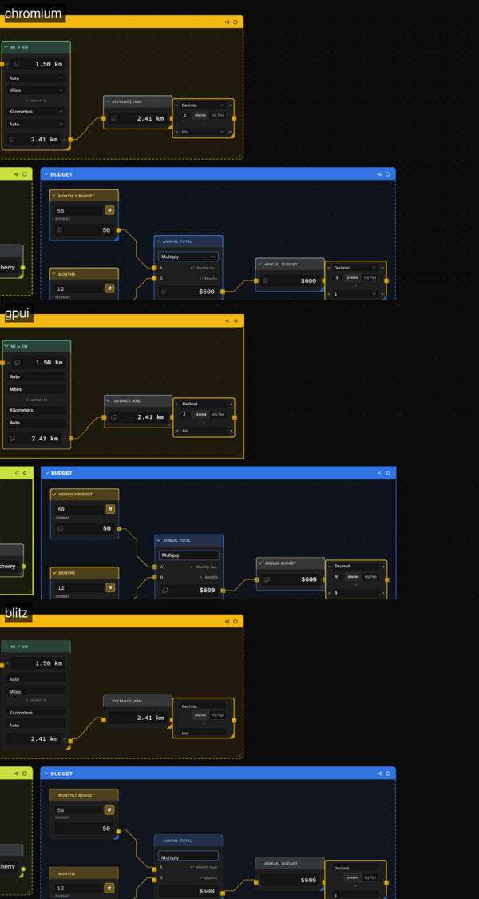
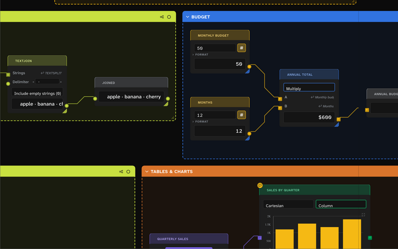

# Fast render: the canvas on the GPU (branch `blitz-gpui`)

**Status:** working prototypes, renderer-only, 2026-11-07. Nothing here changes the app: the web build, React Flow and
every card are untouched. The app's test suites skip this branch (`branches-ignore` in `test.yml`, `engine-test.yml`,
`rust-supply-chain.yml`); the new crates are checked locally. The decision this feeds is the author's: a GPU canvas
gives up the browser's accessibility and parity for big graphs at full frame rate, and [[C130]] rustCore still says
the UI stays TypeScript, so a merge needs a leaf first. Background: `archive/rust-gpu-ui-findings.md`.

## What is on the branch

| Piece | Where | What it does |
|---|---|---|
| The scene | `crates/solenoid-scene` | The canvas as data: each card a flat display list (boxes, text runs, SVG paths, icons, images) placed as Chromium laid it out, cables as paths between sockets, groups, the camera. Ports the app's cable router (`cablePaths.ts`), so a moved card reroutes as the app would. Builds for wasm and native; `--tile` stamping; culling. |
| The exporter | `scripts/scene-export.mjs` | Loads a seed or graph file in the live app and writes `.dev/scenes/<name>/`: `scene.json` (for GPUI), `canvas.html` (the canvas's own DOM and CSS, for Blitz), `chromium.png` (the app at the same camera, to compare against) and `fonts/*.ttf` (static cuts of the app's variable fonts). |
| GPUI | `native/solenoid-gpui` | Draws `scene.json` with Zed's GPUI: every card whole at every zoom, pan, wheel zoom, drag a card (a group drags its members; cables reroute). |
| Blitz + Vello | `native/solenoid-blitz` | Draws the app's real DOM and CSS with Blitz (Stylo, Taffy, Parley) into a **retained Vello scene**, then pans and zooms it on the GPU. Also a headless PNG shot and a CPU bench. |
| Helpers | `native/shot.sh`, `native/interact.sh` | Screenshot a viewer with no display (Xvfb + openbox), or drive it with real wheel and drag events. |

## Testing without building

The **Fast render** workflow (`.github/workflows/fast-render.yml`) runs on every push to this branch: it exports fresh
scenes from the app and builds both viewers for Linux, Windows and macOS. Each run's page on GitHub has one download per
platform (`solenoid-fast-render-<OS>`) holding the viewers, the scenes, `run-blitz` / `run-gpui` scripts and a README.

## Running it

```
npm ci                                           # once; the exporter drives the dev server
node scripts/scene-export.mjs personal-finance   # any seed id, or a graph .json
cargo build --release --manifest-path native/solenoid-blitz/Cargo.toml
cargo build --release --manifest-path native/solenoid-gpui/Cargo.toml
native/solenoid-blitz/target/release/solenoid-blitz view .dev/scenes/personal-finance [--tile 6] [--animate]
native/solenoid-gpui/target/release/solenoid-gpui .dev/scenes/personal-finance [--tile 6] [--lod]
```

The Blitz viewer's title bar shows frames per second, the chunks drawn, and the CPU time of the frame's scene build;
`--animate` pans continuously so the frame rate is steady to read. `--tile N` stamps the graph N × N (zz-scratch-new-nodes
at `--tile 4` is 3,856 real cards). Linux needs `libxkbcommon-x11-dev`, `libwayland-dev`, `libvulkan-dev` and the
xcb dev packages to build GPUI; the native crates pin a vendored `xattr` (`native/vendor`, one-line libc fix).



## The two routes, as they stand

**Blitz + Vello, retained (the one to judge for scale).** Blitz lays the page out and paints it once, in 2048 px
chunks, each a `vello::Scene` clipped to its square; a frame appends only the chunks in view under the camera's
transform and Vello rasterizes on the GPU. Nothing is laid out, styled or re-encoded while panning or zooming, so the
CPU cost of a frame follows what is on screen, not the size of the graph: 0.75 ms at 25% zoom over 3,856 cards here.
Far out, each chunk draws as a cached picture of itself instead (below). Fidelity is the app's own CSS: what stock Blitz
misses is flattened in the exported copy only. Colors are written as `rgba()` (stock Blitz drops `color(srgb …)`,
`light-dark()`, `color-mix()` and `var()` in SVG paint); CSS-mask and SVG-background icons become inline svgs; selects,
checkboxes and canvases become spans, drawn boxes and images; SVG geometry set by CSS becomes attributes. The page is
see-through and the viewer paints the canvas color and dot grid under it. Still off: range sliders, small styling.

**GPUI (immediate mode).** Draws the exported display list every frame. Close to Chromium card for card (paint order,
clipping, icons, fonts, images), and the right shape for hand-built native cards later. But GPUI rebuilds every
primitive each frame at a few microseconds apiece: about 0.23 ms of CPU per full-detail card, so around 2,000 cards on
screen is a 500 ms frame. It needs a retained or cached layer (GPUI has no public one) or a per-card raster cache to
reach the scale the author wants.



## What the numbers here do and don't say

This container has no GPU: Vulkan is Mesa's lavapipe on the CPU, so every frame-rate figure from it is meaningless,
and only CPU-side costs (layout, scene building) carry over. The repo's older perf probes measure the DOM canvas and
may be stale; they are not the yardstick for this branch. The author judges speed on real hardware with
`--tile` and `--animate`.

## Open, in order

1. **Raster thresholds on real hardware.** Far out, chunks draw as pictures of themselves (1/4 resolution under 25%
   zoom, 1/16 under 6.25%, made once per chunk on first need), which is what lets all 3,856 cards show at once; at
   25% and above everything is vector. Whether 25% is the right line, and how sharp the pictures look on a real
   display, is for the author's eye; `SOLENOID_NO_RASTER=1` turns the pictures off to judge pure vector.
2. **Live, not a snapshot.** Both viewers draw a captured scene. The next step is feeding the renderer from the running
   app: re-record only the chunks a changed card touches (Blitz), or patch the display list (GPUI).
3. **Input.** Card drag in the Blitz viewer (re-record the chunks under the card on drop, move its recording while
   dragging); text entry and selection belong to whichever route survives.
4. **Fidelity gaps** above, and charts drawn to `<canvas>` in Blitz.
5. **The web.** Vello runs on WebGPU and WebGL2 (`vello_hybrid`), so the retained scene could serve the browser too; not
   started.
