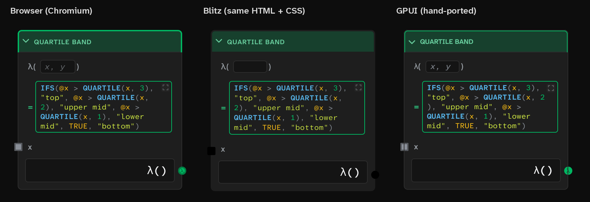
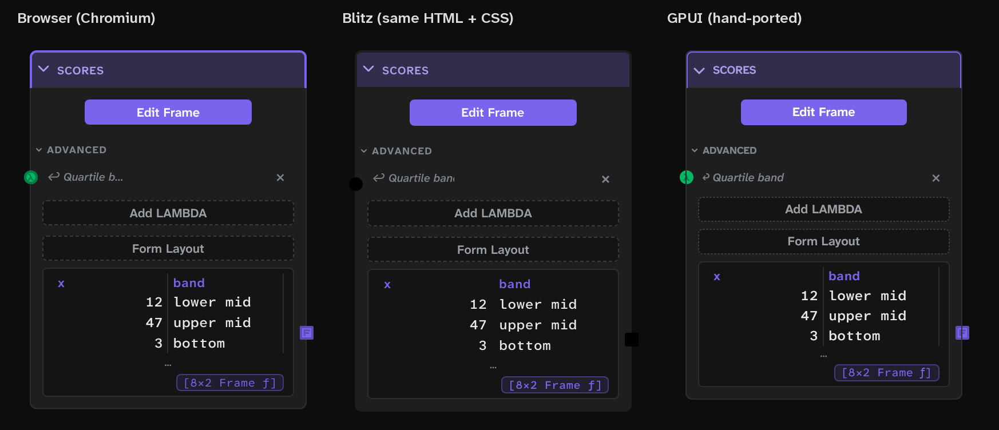
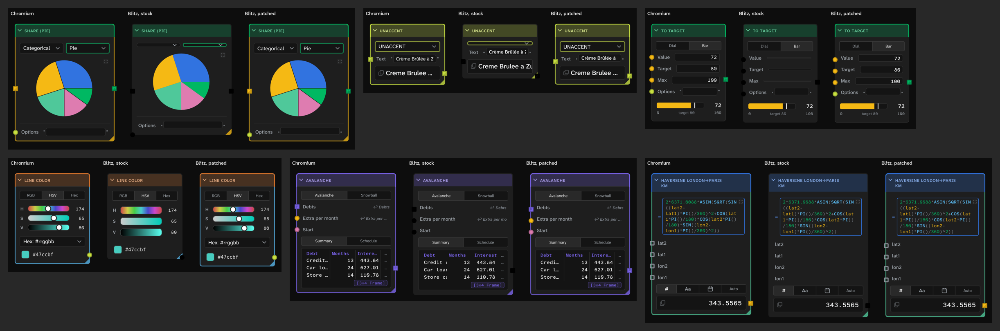

# Rust GPU UI in place of React Flow: findings (October 2026)

Should the canvas move from React Flow to a GPU-rendered Rust UI as part of a complete Rust port, and if
so, how? This is a point-in-time report for the author's call, not a plan. Library versions are from
crates.io and the projects' own READMEs and changelogs, read 2026-10-24. Nothing below is decided:
[[D102]] graphOnCore still says the UI stays TypeScript, and any route here needs a leaf from the author
first.

## The short answer

- **React Flow is the small part.** It is used by 20 files. The app has already replaced RF's `<Handle>`
  (finding 3 in `canvas-frame-cost-findings.md`), its `<Background>` (`CanvasBacking`), its wheel zoom
  (`installWheelZoom`), its box select (the lasso) and its arrow keys. What RF still owns is the node
  wrappers, the edge layer, sub-flow parenting, drag, selection and the camera
  (`../tree/specs/canvas/react-flow-surface-contract.md` § What RF owns).
- **The cards are the big part.** About 104k lines of TypeScript outside tests, of which roughly 60k are
  UI (`components/` 37k, `nodes/` 19.5k, `flow/` 3.7k, plus the chrome in `src/graph/`). On top of that
  there are 17k lines of CSS and 383 `.tsx` components. Every card is DOM: text fields, the formula
  editor and its suggestions, grids, Recharts charts, KaTeX, Mermaid (`pele`), markdown (`marked` +
  `dompurify`). A GPU canvas that replaces RF also has to redraw all of that, so "drop React Flow for a
  GPU library" in practice means "rewrite the whole UI".
- **No Rust GPU framework covers the card content on the web today.** The blocker is shared: AccessKit,
  the accessibility layer every Rust UI uses, has no web adapter yet (its README lists it under
  "planned"). On the web a canvas-drawn UI has no screen reader, no cross-card text selection, no
  Ctrl+F, and soft keyboards and IME go through a hidden `<input>`.
- **Recommendation:** do it in two separable steps.
  1. Move the *scene* to Rust and the GPU: the camera, cables, dot grid, minimap, lasso, hit-testing and
     a far-zoom card view drawn on one WebGL2/WebGPU canvas, with DOM cards positioned over it. This
     retires React Flow and the HTML-in-Canvas layer, and it targets every frame-cost problem the repo
     has measured.
  2. Decide the cards separately. If the whole UI is to be Rust, **Dioxus** is the route that keeps the
     decision tree intact (real DOM on the web, the CSS survives, the Obsidian plugin can still mount
     it). **GPUI** is the route if a native desktop outweighs the website, the plugin and the web build.
     Spike before choosing (§ The spike).

## What a GPU canvas would fix (the repo's own measurements)

- **Pan and zoom cost scales with DOM elements on screen.** personal-finance at zoom 0.2 is about 3,000
  elements and 20 ms paint per zoom step (`backlog.md`, "A zoom step re-records every card on screen").
  On a GPU scene a camera change is one uniform; cards are instanced quads and atlas glyphs.
- **Phones have a size knee.** Pan is the next limit and a card drag breaks down by about 616 nodes
  (`../tree/specs/documents/graph-load-teardown-performance.md`), because a coarse-pointer viewport gets
  no compositor layer (`../tree/specs/canvas/html-in-canvas.md` § The GPU texture budget).
- **WebKitGTK on Linux rasterizes a layer at 1× and stretches it**, which is why nothing inside a card
  may become a GPU layer and why transitions are off inside the viewport on Linux
  (`../tree/specs/canvas/layout-chrome.md` § The desktop window frame). A screen-space canvas outside the
  transformed viewport draws at device resolution itself and does not hit this. Confirm with
  `WEBKIT_SHOW_COMPOSITING_DEBUG_VISUALS=1` in the spike.
- **The HTML-in-Canvas layer (about 1,800 lines, [[C42]] htmlInCanvasRenderer) exists to fake this:**
  it captures pictures of cards into an atlas so a gesture can pan pictures instead of DOM. A real
  far-zoom card view replaces it.
- **React Flow's per-frame subscriptions:** every cable subscribes three times and recomputes its ends
  each frame, and the minimap subscribes once per card (findings 4 and 5, both still candidates). An
  owned scene has neither.
- **One language for the scene.** Positions, sizes, membership and cable geometry already live on the
  Rust model; the scene would read them there instead of across `flowView.ts` and RF state.

## The libraries

### Rendering

| Crate | Version (date) | What it gives Solenoid |
|---|---|---|
| wgpu | 30.0.1 (2026-08-21) | One wasm binary with WebGPU and a WebGL2 fallback chosen at run time. The base everything below sits on. |
| vello_gpu | 0.3.0 (2026-10-02) | Linebender's 2D renderer (the former `vello_hybrid`): CPU path prep, GPU raster, **native WebGL2 backend, no compute shaders**. The README names it the intended production renderer; their April post called it roughly beta. Best fit for cables, the grid and card silhouettes. |
| vello (compute) | 0.11.0 | Moved under `research/`. Not for production. |
| lyon | 1.0.19 (2026-03-08) | Stable path tessellation, for a hand-written wgpu pipeline if vello_gpu disappoints. |
| femtovg | 0.27.0 (2026-08-31) | NanoVG-style on WebGL; mature but plain. |
| skia-safe | 0.153 | Fastest and most complete, but wasm only through emscripten and a large C++ build. Not worth it here. |

Browser support for WebGPU (gpuweb implementation-status wiki, 2026-10-02): on by default in Chrome on
Windows, macOS, ChromeOS and Android 12+, on some Linux GPUs; in Safari 26 on macOS and iOS; in Firefox on
Windows and Apple Silicon only. **WebKitGTK (the Linux desktop shell) has no WebGPU by default that
could be confirmed.** So WebGL2 is a requirement, not a fallback, which wgpu and vello_gpu both meet.

### Text

parley 0.12 (layout, a plain editor, fills AccessKit text properties) with fontique for fallback;
cosmic-text 0.19 (used by iced and by GPUI on Linux and web); glyphon 0.12 (cosmic-text on wgpu);
swash 0.2. For the far-zoom card view, parley + vello_gpu is enough: a card title and its value in
Atkinson Hyperlegible, which DESIGN.md's Hyperlegible Rule fixes as the faces. The fonts ship with the
app already (`@fontsource-variable`), so loading them into the wasm side is a copy, not a new download.

### Whole-UI frameworks, against Solenoid's needs

| Framework | Latest | Web | Accessibility | Fit |
|---|---|---|---|---|
| **Dioxus** (+ Blitz native) | 0.7.10 stable, 0.8.0-alpha.3 (2026-10-16); Blitz 0.3.0-beta.4 | `dioxus-web` renders **real DOM** | Browser's own on the web; AccessKit is a Blitz goal | Best fit for a complete port. Components move React → RSX, the CSS stays CSS (Blitz renders it natively through Stylo, Taffy, Parley and Vello). Recharts, KaTeX and pele can stay on the web through JS interop until replaced. Blitz is beta, so the desktop keeps Tauri until it isn't. |
| **GPUI** (Zed) | crates.io 0.2.2 is a year behind Zed's main; `gpui_web` on main only | One WebGPU/WebGL2 canvas | AccessKit on desktop; web has the canvas penalties | Strongest pure-GPU desktop (Zed, Longbridge ship it; Windows and Linux real). `gpui-component` 0.8 gives 60+ widgets; `gpui-flow` (a React Flow-like editor) is announced with no crate. Every card rebuilt by hand; API churns; web needs nightly and COOP/COEP headers for threads. |
| egui + egui-snarl | egui 0.37.0 (2026-10-15); snarl 0.12.0 (2026-08-26) | WebGPU/WebGL | Text-to-speech only on web | Quickest working Rust node editor, good for a measurement prototype. Immediate mode, limited typography, and snarl's README admits zoom has artefacts. Below DESIGN.md's bar. |
| iced | 0.14.0 (2025-12-07) | Experimental | No AccessKit | No release in ten months. |
| Xilem / Masonry | 0.4.0 (2025-10-29) | `xilem_web` is DOM; canvas path unclear | AccessKit | Alpha, releases stalled. |
| Makepad | crates frozen at 1.0.0 (2025-05) | Nightly-only wasm | None found | Development off crates.io. |
| Slint | 1.18.1 (2026-09-21) | Wasm demos | Not on web | DSL suits forms, not hundreds of free cards; GPL or a separate licence. |
| Freya, Floem | 0.4.3 / 0.2.0 | **None** | Freya: AccessKit | No web build rules them out (website, tablets, phones). |
| Bevy UI | 0.20 (2026-10-08) | Yes | Partial | A game engine; clipboard off by default. |

## What a complete GPU port collides with in the decision tree

- **[[B1]] obsidianBet / [[C107]] obsidianPlugin.** The plugin reuses the app's chips and popup editors
  inside Obsidian's DOM (`../tree/specs/integrations/obsidian-plugin.md`). A canvas UI leaves two
  choices: keep a React copy for the plugin (a second implementation, which [[D99]] rustIsSpec's own
  logic rejects) or mount small wasm canvases into Obsidian's property rows, themed from Obsidian's CSS
  variables. Dioxus keeps one implementation, since its web build is DOM and mounts into any element.
- **[[B3]] sameNodeEverywhere / the website.** The landing scenes are real app instances. A canvas UI
  still satisfies that, but every landing visit loads the UI's wasm and pays GPU start-up before the
  first frame; the crawler snapshots (`prerender/`) are unaffected.
- **DESIGN.md's pixel bar.** Every card has been tuned by eye in the browser's text and CSS renderer. A
  GPU framework draws text and borders its own way, so each of the 383 components is re-crafted and
  re-approved by the author. This is the part with no oracle: the compute port froze TypeScript answers
  into fixtures ([[D99]]); a card's spec is how it looks, so verification is screenshot comparison plus
  the author's eye, one card at a time.
- **[[B2]] webTryDesktopFull points the other way.** Desktop is the full product and "it won't work on
  the web" is never an objection, which softens the web accessibility and soft-keyboard costs of a
  canvas UI. It does not soften the plugin or the pixel bar.
- **The JavaScript libraries with no drop-in Rust twin:** elkjs (Tidy; no Rust ELK exists), KaTeX
  (Typst's math layout is the nearest), pele/Mermaid, Recharts (plotters, or charts drawn directly with
  vello), `knap` (23 files; the Obsidian note templating), chrono-node (natural-language dates) and the
  `@anthropic-ai/sdk` client. Markdown is easy (pulldown-cmark or comrak).

## The two steps in more detail

### Step 1: the scene on the GPU (independent of any card decision)

- A new crate (say `crates/solenoid-canvas`) built to wasm beside the core: camera, hit-testing (sockets,
  cables, card boxes, group bands), drag and group towing on absolute positions (which removes the
  RF parent-relative conversion in § Groups are sub-flows), selection, lasso, and the cable geometry
  that `cablePaths.ts` and `hicCableGeom.ts` compute today.
- One screen-space `<canvas>` under the cards draws the grid, cables, standoffs, ghost cables and socket
  highlights through vello_gpu on WebGL2 (WebGPU where present). The minimap is a second small canvas
  from the same scene.
- Cards stay React DOM in one transformed layer that follows the scene's camera. Below a zoom threshold
  the DOM cards unmount (or hide) and the canvas draws each card as a silhouette: header colour, title,
  socket dots, the headline value. That is the surface contract's semantic zoom (`../tree/specs/canvas/react-flow-surface-contract.md` § Semantic zoom) made real, and it replaces the
  HTML-in-Canvas capture.
- What it deletes: `@xyflow/react` and `@xyflow/system`, the HTML-in-Canvas files, the SVG edge layer,
  the minimap's per-card subscriptions, and the desktop pan-layer workarounds.
- What it keeps: every card, the plugin, the website, IME, copy and paste, screen readers.
- What it re-specs (all in `../tree/specs/canvas/`): the React Flow surface contract becomes a canvas
  surface contract; the HTML-in-Canvas, cable-rendering, drawn-cable and gesture specs change owner.

### Step 2: the cards, if the whole UI goes Rust

- **Dioxus route.** Port component by component from React to RSX on the web, CSS untouched, with the
  JavaScript libraries behind interop at first. The scene from step 1 is already Rust. Once Blitz renders
  the app's CSS well enough, the desktop drops the Tauri webview and WebKitGTK with it. Risks: Dioxus
  is pre-1.0 with breaking releases, the RSX ecosystem is thin next to React's, and DOM-bound card
  rendering costs about what it does now (step 1 is what fixes the frame cost, not Dioxus).
- **GPUI route.** Rebuild the chrome and every card in GPUI with `gpui-component`; native window on
  Windows and Linux with no webview; the web build through `gpui_web`. Risks: the web build is unpublished
  and single-canvas; the plugin and the pixel re-approval above; GPUI's API moves with Zed's needs.
- **A renderer swap instead of a rewrite** (seen 2026-10-24: gpuix-svelte,
  https://gpuix-svelte.stanislav.garden, one author, days old). Svelte components stay JavaScript and
  GPUI draws them through Svelte's unreleased custom-renderer API, natively and on the web. It shows
  GPUI's web build working (WebGPU, WebGL2 fallback, a 19.9 MB wasm, COOP/COEP headers) and that the
  components need not move to Rust to leave the DOM; React's `react-reconciler` would allow the same
  for Solenoid, though nothing does it yet. It doesn't fit as is: it is Svelte, the desktop binary
  carries Bun (about 80 MB), and there is no CSS engine, only a per-property subset with no
  descendant selectors, `transform`, `transition`, `z-index`, `box-shadow`, `@media`, pseudo-elements
  or `em`. Solenoid's CSS has about 1,380 rules with descendant or child selectors, 160 transforms,
  151 box shadows and 119 z-indexes, so the cards would be restyled from scratch, the GPUI route's
  pixel cost without its Rust.

## Two cards, rendered three ways (2026-10-25)

Does the card design survive a Rust renderer? Two cards were tried: the `quartile-band` shot graph's
LAMBDA card (wrapping syntax-highlighted code, sockets) and its Frame Input card (buttons, dashed
borders, a preview grid, a chip). Static rendering only; no typing, hover or drag was tested.

- **The cards are almost entirely CSS.** Each card's live DOM and every stylesheet, copied into a
  standalone page served from the app's origin (so its web fonts load), renders identically in
  Chromium with no app running. The LAMBDA card is 79 elements
  styled by 49 rules, the Frame Input card 56 elements and 45 rules; the only non-CSS parts are five
  small inline SVGs per card (the header frame, the sockets, icons). No canvas.
- **Blitz** (git main 2026-10-24, 0.3.0-beta.4, `vello_cpu`) rendered that same page, unmodified:
  the app's own woff2 web fonts (fetched over HTTP), `color-mix()` tints, the token colors, the wrap,
  dashed borders, buttons, the chip and even the
  chevron (a CSS mask over a data-URI SVG) all came through. It missed five things, all small: the
  header's accent outline (an SVG `rect` sized by CSS geometry properties), the socket colors (SVG
  `fill="var(--…)"`), the input placeholder, the grid's column rules (`border-right` on `td`) and the
  ellipsis on a clipped label. Each is either a Blitz gap or a one-line markup change on our side.
- **GPUI** (crates.io 0.2.2) needed the cards written again, 320 lines of Rust for the two (the
  header and frame chrome shared), from the computed styles Chromium reports. After four rounds it
  is close but not the same, and every gap was hand work:
  - no CSS variables or `color-mix()`: every theme color is computed and kept as a Rust constant,
    which a palette switch would need as a theme struct;
  - no letter-spacing (the uppercase titles' 0.05em), and CSS's `line-height: normal` has to be set
    by hand, since GPUI's default is taller;
  - an SVG is one color, so a two-tone socket is a shape plus a glyph, and the chevron's mask and
    rotation become a separate pre-rotated SVG;
  - fonts had to be loaded as bytes, and the variable Atkinson files split into fixed weights, or
    semibold and bold never show;
  - no table (flex rows with fixed widths) and no text input in core GPUI (its own example builds one
    in about 750 lines; `gpui-component` ships one);
  - text wraps at different places (it breaks `2)` before the bracket where the browser doesn't).

**What it means.** Whether the CSS has to be redone depends on the renderer, not on whether the
components stay JavaScript. A renderer with a CSS engine (the browser, Blitz) keeps the 17k lines of
CSS and the pixel work in them; one without (GPUI, egui, and gpuix-svelte, which keeps JavaScript
components but translates CSS property by property) rebuilds every card by hand and re-tunes it by eye.
That makes the Dioxus route the one that keeps the cards, with Blitz's gaps to close; the GPUI route
pays the rewrite this test priced at about 160 lines of Rust per card before interaction. The test is
two cards of 383 components, so read it as direction, not a measurement of the whole port.

## Ninety cards through Blitz, and what closing the gaps took (2026-10-25)

One card of each type from three seeds (`chart-showcase`, `whats-new`, `zz-scratch-new-nodes`: 90 card
types, every one plain DOM and CSS but two that draw a `<canvas>`), rendered by Chromium and by Blitz from
the same standalone page, and scored by the share of pixels that differ after a slight blur (so a
one-pixel shift doesn't count, but a few pixels of vertical drift does).

| Round | Mean drift | Cards over 5% |
|---|---|---|
| Stock Blitz | 8.1% | 81 of 90 |
| Blitz patched: SVG `var()`, number inputs, placeholders, `<select>` | 6.4% | 76 |
| plus Solenoid's frame drawn with divs | 3.1% | 10 |
| plus ellipsis, alignment, SVG text font, inline `<select>`, separated grid borders | 2.9% | 12 |
| plus Chromium's form-control defaults in Blitz's UA sheet | 2.8% | 10 |

What stock Blitz got wrong, and what fixed each:

- **Patched in Blitz** (about 300 added lines over 10 files, `assets/rust-gpu-ui/blitz-scratch.patch`,
  against Blitz main of 2026-10-24; a scratch test, not upstream-ready):
  - `var()` in SVG attributes (every socket's colors, the pie's slice outlines) is resolved from the
    element's custom properties when the SVG is serialized for the SVG renderer, as `currentColor` already was;
  - `<input type="number">` was built as a text editor but left out of layout, so it collapsed to a line;
  - `<select>` drew nothing, as a flex item or inline: it now shows its selected option's text (static only:
    no popup list);
  - placeholders show (drawn at half opacity, not from `::placeholder`);
  - `text-overflow: ellipsis` was ignored (its stylo pref was off) and is now painted;
  - single-line inputs honor `text-align` (the editor was never given its width);
  - SVG `<text>` inherits the page's font, and the SVG renderer is given the app's fonts;
  - a range input gets a thumb (a fixed white one: `::-webkit-slider-thumb` styles aren't read);
  - the UA sheet pads inputs as Chromium does (`1px 2px`, none on a range), which had made every unpadded
    input 2 to 4px taller.
- **Changed on Solenoid's side** (each renders the same in Chromium, at most 0.17% of pixels on any card):
  - the card frame: the SVG `rect`s sized by CSS geometry properties (`x`, `rx`, `width: calc(…)`) become
    two absolutely positioned divs with the same borders, keeping the one-outline structure that
    `72737aa59` introduced to stop the header/body seam. Blitz parses an inline SVG before layout, so
    CSS-sized SVG geometry can't resolve there without real engine work;
  - preview grids: `border-collapse: separate; border-spacing: 0` in place of `collapse`, since Blitz
    paints collapsed borders as one uniform grid and drops per-cell right borders;
  - the color picker's slider gets an explicit height.
- **Still open:** styled range thumbs (Slider Input's orange one), checkbox `accent-color` (a
  Gecko-only property in Blitz's stylo), 1 to 2px of line-height drift that adds up down a tall card,
  and the two `<canvas>` cards, which a Rust UI would draw itself anyway.

Not tested: typing, hover, focus, popups, scrolling, animation, a whole canvas of cards at once, and
Blitz's GPU renderer (this ran `vello_cpu`). The gaps found were all in form controls, SVG and tables,
none in layout or text: flexbox, the box model, `color-mix()`, variables, masks and web fonts held from the
start.

## Pan and zoom: Blitz against `develop` (2026-10-25)

**Blitz on the web.** It builds for `wasm32` and draws through WebGL2 (`vello_hybrid`), bundling its
fonts since the browser gives it none. Its TodoMVC example is 12.5 MB of wasm after `wasm-opt -Oz`,
4.4 MB gzipped (Stylo, Parley, the renderer and a font); Solenoid's whole core is 1.9 MB gzipped. The
numbers below are native, not wasm, which runs slower and, without threads, on one core.

**The test.** personal-finance (154 cards, 172 cables, 89 cards hidden in collapsed groups), 1600×1000 at
1×, the camera paths of `scripts/zoom-perf-probe.mjs`: 60 pan frames, and 40 wheel steps that each cross
a 0.1 zoom step. `develop` (`c7da52b`) runs in headless Chromium through that probe; Blitz (patched as
above) runs the same canvas, extracted from `develop` with the three Solenoid-side tweaks, through a
bench that sets the viewport transform each frame and times restyle and layout, scene encoding and
raster. The dot grid is off on both: it is one 400,000 px SVG pattern that Chromium tiles cheaply and
Blitz can't draw, and a Rust canvas would paint the grid itself. With the dots on, `develop` pans about
1 ms a frame slower and pays two to four times the raster on a zoom step.

Milliseconds per frame. `develop` is main-thread time plus raster (headless Chromium rasters on the
CPU); its main thread includes about 5.5 ms of the app's own JavaScript per pan frame. Blitz CPU is the
whole frame on `vello_cpu`. Blitz GPU is the CPU side only (restyle, layout and encoding with the Vello
painter): its raster ran on a software Vulkan driver here, 65 to 110 ms that say nothing about a real GPU.

| Zoom | `develop` pan | Blitz CPU pan | Blitz GPU pan, CPU side | `develop` zoom step | Blitz CPU step | Blitz GPU step, CPU side |
|---|---|---|---|---|---|---|
| 1 | 12.1 + 1.4 | 4.1 | 4.1 | 21.4 + 6.4 | 3.4 | 3.9 |
| 0.5 | 13.1 + 1.5 | 8.1 | | 13.6 + 4.1 | 6.1 | |
| 0.25 | 14.1 + 1.8 | 17.1 | 7.8 | 17.0 + 4.5 | 11.3 | 6.2 |
| 0.1 | 17.3 + 1.8 | 38.6 | 13.6 | 9.8 + 3.9 | 21.6 | 9.8 |

- **Close in, Blitz is about three times cheaper.** Chromium pays its JavaScript, paint and layerize on
  every frame; Blitz pays 2 to 4 ms of restyle and layout and little else (its encoding at zoom 1 is under 1 ms, so it
  appears to skip what is off screen).
- **Far out, the cost moves to encoding.** Blitz keeps no layers between frames, so it rebuilds the scene
  for every element on screen each frame (about 9,300 at zoom 0.1), where Chromium pans one cached
  layer (finding 1 of `canvas-frame-cost-findings.md`). With the Vello painter that is about 10 ms at 0.1,
  level with `develop`; with the CPU painter it is 32 ms, over a 60 Hz frame.
- **That far-zoom cost is what step 1 removes.** Drawn as silhouettes below a zoom threshold, a card is
  a handful of shapes instead of 60 elements, whichever renderer draws the cards.
- **Not measured:** real GPU raster (no GPU here), wasm in a browser, a phone, input latency, and the
  app's own event handling on the Blitz side (it has none; a Rust canvas's would be far below Chromium's 5.5 ms).

## The spike (what would turn this into a decision)

Build the same three things in each candidate: the step-1 scene on personal-finance (154 nodes,
172 cables), plus one Expression card with the formula editor and its suggestions, and one Frame card
with a preview grid and a chart. Run each on the Vercel web build, WebView2, WebKitGTK and the author's
phone, and record:

- pan and zoom-step frame cost against `scripts/zoom-perf-probe.mjs`'s current numbers;
- wasm size (the core is 5.2 MB today, `src/graph/engineWasm/`) and time to first frame;
- IME and soft-keyboard behaviour in the formula field, copy and paste out of a grid;
- a screenshot beside today's card, for the author's eye.

Step 1 alone is worth spiking first: it needs no card decision and every number it moves is one the repo
already measures.

**Reopen if:** AccessKit ships its web adapter, Blitz leaves beta, or GPUI publishes its web backend;
each changes the cost of step 2.
