# Bundle 27 — Live multiplayer: rooms, sync and data entry

**Source:** author ask 2026-11-07: "research and write up the best way to achieve multiplayer
editing… no particular host… no account system… JSON savefiles and just making things sync
somewhat decently, esp for data entry." **Verdict:** IN (bundle 21 Stage 3, by the 2026-09-01
order), re-planned here so it no longer waits on accounts. **Written:** 2026-11-07, plan-only;
nothing in this doc is built.
**Replaces:** `21-collaboration.md` § Stage 3, which now points here. Stages 0–2 there (the
file watcher, accounts, BYOS Drive, async review) stand as they were and are no longer
prerequisites.

## The answer, short

1. **A share link is the whole account system.** "Start a live session" mints a room id and a
   secret key and puts both in the link's `#fragment` (`…/live#<room>.<key>`), the way Excalidraw
   does. Browsers never send a fragment to a server, so the relay never learns the key. Whoever
   has the link can edit. Display names and colors are local, picked once; the name is the one
   `commentAuthorStore` (`commentStore.ts`) already keeps for comments.
2. **The shared document is a CRDT: Loro** (`loro-crdt` on the web, the `loro` crate if the
   bridge later moves into Rust). It is the same Rust core on every platform, it has the data
   types a table needs (movable lists, maps, last-writer-wins registers), a per-user undo
   manager, an ephemeral store for presence, and shallow snapshots for compaction. Yjs is the
   fallback, behind the same seam (§ The library).
3. **The CRDT sits at the save boundary, not inside every store.** Solenoid's document is spread
   over the Rust editor, the node instances and fifteen-odd TypeScript stores, but all of it
   already funnels through one lossless capture (`serializeGraph`, which undo and autosave call
   on every commit). The bridge diffs that capture into CRDT ops on the way out and applies
   remote ops as an **incremental delta** on the way in. That delta applier is the one large
   new piece, and it pays for itself before any networking exists: undo, the AI apply and the
   Stage 0 file watcher all reload the whole graph today (`loadGraph`) and would stop doing so.
4. **Tables sync cell by cell.** `frameText` and `tableText` are one string per node in the save,
   so syncing them as a value means two people typing in different cells clobber each other. In
   the CRDT a table is rows and columns with stable ids and a cell map keyed `row:col`; the
   string is rebuilt from it. That is the data-entry requirement, met structurally.
5. **Transport is a dumb, encrypted relay on Cloudflare Workers + Durable Objects**, free at this
   scale, about 200 lines, CRDT-agnostic, self-hostable as a plain Node or Rust process. It
   stores and forwards ciphertext. Peer-to-peer WebRTC is out for now: Linux desktop's webview
   has no `RTCPeerConnection` (§ Transport).
6. **Every client computes**, as bundle 21 always said. Every client runs the same wasm core,
   so the same document gives the same answers. Nothing is evaluated on a server.
7. **netcore-rs does not change.** It holds topology under per-load random ids and is a faithful
   rete port (netcore-rs's own tree: A3 portEverything, B1 upstreamIsSpec); rete has no sync. Remote edits arrive as ordinary
   `add_node` / `add_connection` / `remove_*` calls through the applier, so its pipes and the
   dataflow engine's invalidation fire exactly as for a local edit.

## The bar ("somewhat decently")

What a session must do, in the order the author asked for it:

- Two people type into **different cells of the same table**: both edits survive, in seconds.
- Two people edit **different fields or cards**: both survive. The **same field**: the later
  commit wins everywhere, and the loser can see it happened (presence shows who is in that cell).
- Edits sync on **commit** (Enter, blur, a discrete pick), the granularity `useDraftCommit`
  already has ([[B19]] spreadsheetHabits). Keystroke-level merging is not the bar, except
  later for long text (§ Later).
- Moving cards, adding cards and wiring cables sync too. Drags stream live as presence and land
  on drop.
- **Offline works**: edits made while disconnected merge on reconnect.
- **The file stays the product**: any participant can save or export at any moment and gets an
  ordinary, name-addressed `.sol` file. Leaving a room leaves an ordinary local document.
- Web and desktop (all three OSes) join the same room.

## Why the cheap options fail

- **Ship the whole file on every change** (whole-document last-writer-wins). Two people editing
  at once lose one side's work on every overlap. Fine for turn-taking (that is bundle 21 Stage
  2), not for live data entry.
- **Broadcast edit commands between clients without a CRDT.** Works until two edits cross on the
  wire or someone reconnects after being offline. Then clients diverge silently, and building
  the ordering and rebasing to prevent that is writing a worse CRDT (tldraw and Figma do it with
  an authoritative server, which this plan does not want to run).
- **Sync the `SavedGraph` JSON through a CRDT as-is.** Gets nodes and literals right, but a
  table is one `frameText` string, so cell-level merging is lost exactly where the author wants
  it, and a node keyed by name loses concurrent edits across a rename (§ Identity).

## The shared document

One Loro document per room. Containers, by what lives in them:

| Path | Type | Holds | Merge |
|---|---|---|---|
| `meta` | Map | save version, room's app version, palette, report palette, `meta` fields | LWW per key |
| `nodes` | Map, key = sync id | per node a Map: `type`, `name`, `init` (per field), `literals` (per key), `stringLiterals` (per key), `visual` (x, y, size, collapsed, flipped, sections) | LWW per field |
| `nodes.<sid>.table` | Map | only for Frame Input / Table Input, replacing `frameText` / `tableText` (below) | per cell |
| `cables` | Map, key = `<targetSid>/<targetInput>` | `{ source: sid, sourceOutput }` | LWW per input: one cable per input is the key itself |
| `order` | MovableList of sids | stacking order (`reorder_nodes`) | list merge |
| `standoffs`, `pins`, `comments`, `frameFormats`, `drawnCables` | Map, key = entry id | one entry each, node references as sids | LWW per entry |

**Tables.** A Frame Input's table container:

- `cols`: MovableList of column ids; `colMeta`: Map colId → `{ name, type, unit?, expr? }`.
- `rows`: MovableList of row ids.
- `cells`: Map `"<rowId>:<colId>"` → the cell's **raw typed text** ([[C58]] tableInputRawText:
  the text as typed is the truth, so a cell is a string, never a parsed value).

`frameText` is a projection (`frameSourceToText` over the ordered rows and columns); Table
Input's `tableText` the same through `rawCellsToText`, with no column names. Two people
inserting rows at the same spot both keep their rows; deleting a row someone is typing into
deletes it (the CRDT keeps no orphan cells), which presence makes visible before it happens.

**What is not in the document.** Derived types (worked out again on every client, as on load),
computed values, caches, the camera, selection, open popups. Presence carries the shareable
parts of those.

**Identity.** The CRDT keys nodes by a **sync id** (`sid`), not by name. A rename then is a
field write, and a concurrent edit to the renamed node lands on it. Keyed by name, a rename is
delete-plus-insert, and anything another person wrote into the old key in the meantime is
silently lost. Sids live only inside the room: minted when a node first enters it (or for every
node when a room starts from a file), never written to a `.sol` file. Files stay addressed by
name ([[B16]] oneFormulaSurface) and the per-load random ids stay per load. The bridge keeps
`liveId ↔ sid` for its session.
This reads against `../out-of-scope.md` §3's tell-tale "a sync key that is not the addressable
name"; author call 1 asks to rewrite that line to "a sync key that is the per-load id, or that
leaks into the file."

**Names under concurrency.** Two people creating `Filter_2`, or renaming two cards to `Sales`:
both entries exist in the CRDT. Every client resolves the clash the same way on apply (the
later-created sid gets the next free suffix, written back as an ordinary rename) and shows a
notice. Rename rewrites references in formulas as it does today, as one CRDT transaction.

## The bridge

```mermaid
flowchart LR
    edit["a local commit<br>(useDraftCommit, a move, a wire)"] --> cap["serializeGraph<br>(already runs for undo)"]
    cap --> diff["diff against the last<br>applied projection"]
    diff --> ops["CRDT ops, origin = local"]
    ops --> relay["relay"]
    relay --> remote["remote CRDT ops"]
    remote --> proj["project the changed<br>entries to SavedGraph parts"]
    proj --> apply["applyGraphDelta:<br>minimal editor + store calls"]
    apply --> pass["one settle + a pass<br>over what changed"]
```

**Outbound.** The commit points already call `flowHistory.schedule()` (400 ms coalescing) and
`scheduleAutosave()`. In a room the bridge hooks the same points with a shorter debounce
(about 100 ms), captures, diffs per node and per field against what it last applied, and writes
the difference as one transaction. The capture is canonical and byte-stable, so "nothing
changed" costs a string compare per node, the trick `flowHistory`'s snapshot reuse already uses.
Table popups are the exception (below): they emit cell ops directly, because a row-level diff of
two `frameText` strings can't tell an inserted row from an edited one.

**Inbound: `applyGraphDelta(prev, next)`.** A pure diff of two `SavedGraph`s keyed by identity
(the pure half, testable in node vitest with no view), and an applier that turns it into the
smallest set of live calls:

| Change | Applied as |
|---|---|
| node added / removed | the paste path (`savedNodeBody`, `ctorRegistry`) / the delete path (cables pruned first, `tree/specs/canvas/input-cable-pruning.md`) |
| literal or string literal | set the key, `node.edited()`, pass targeted at that node |
| hot `init` field (`frameText`, `tableText`, `expr`, `label`, `value`) | set in place where the class has a setter, then the same as a literal; `reconcileTypesAfterEdit` where a retype is possible |
| any other `init` change | rebuild that one node from its new `init` under the same live id, cables kept |
| cable added / removed | editor calls; the topology pipe coalesces them |
| position, size, collapse, flip, sections | the stores, no pass |
| side-table entry | that store's entry |

Then one Type Settle and FC reconcile, then one pass over the union of targets. The applier
runs inside a "remote" scope so its own changes don't echo back out.

**Shipped for undo (2026-11-12): `graphDelta.ts`.** `diffGraphs` (pure) and `applyGraphDelta` now carry undo and
redo ([[react-flow-surface-contract#Undo history]]), keyed by card name, with a read-back that falls back to a whole
load on any miss. `graphDelta.test.ts` is the property test above over every shipped example and two kinds of step,
answers included. What the room still needs from it: keying by `sid` instead of name, and the hot-field row of the
table (a literal or `frameText` set in place): today any `init` or literal change rebuilds that one card.

**The table popup in a room.** Today it edits a local grid and Save writes the whole string back.
In a room: each cell commits on blur straight into the table container (the popup already
commits on blur into its grid), insert and delete row and column become list ops (the popup
already knows them as such: `tableEdit.ts`), and a remote cell change patches the open grid in
place, except the cell being edited, whose draft wins until it commits. The sort is view-only
and source-indexed already, so it is unaffected. Outside a room nothing changes. Other writers
of a whole table (CSV paste, the AI apply) fall back to a row diff aligned by content.

## Undo, presence, trust

**Undo.** In a room, undo is per person: Loro's `UndoManager` undoes only local-origin changes,
merged on the same 400 ms window, applied through the same delta. Undo never reverts another
person's edit. The snapshot `flowHistory` keeps serving solo documents.

**Presence** (Loro `EphemeralStore`, timed out after 30 s silent, never saved): name, color, the
canvas pointer in flow coordinates, the selection as names, the drag in progress (about 20 Hz,
so a card glides on everyone's screen before it lands), and the open popup and focused cell
(`node, rowId, colId`), drawn as a colored cell outline and a "being edited by" badge on the card.
A top-bar avatar row shows who is here. Follow-a-person and cursors on every surface are later.

**Trust.** Joining a room is opening a document someone else wrote ([[C103]]
untrustedContentSeams, [[B18]] safeToShare): it opens as foreign, scripts and fetches held
until allowed. The live case adds one rule: **a card a peer adds arrives foreign**
(`foreignCardStore`), so a Script or Web Source pushed into a session mid-edit waits for each
person's allow and runs nowhere silently. Each client fetches its own sources; volatile cards
(RAND, NOW) roll per client, which bundle 21 already accepted.

**Versions.** The room records the app version that created it. A client on a different
release joins read-only with an update prompt: two catalogs disagreeing about a card's init is
data loss, and a Placeholder writing back is worse. Pre-alpha this is crude on purpose; P1's
migration seam (`../2.0-plan.md`) refines it.

## The library

| | Loro | Yjs (+ yrs) | Automerge |
|---|---|---|---|
| Version (2026-11-07) | `loro-crdt` / `loro` 1.17.1 (2026-10-22), monthly releases | `yjs` 13.6.33; `yrs` 0.28.1; v14 in beta since 2025 with a wire change | 3.5.0; `automerge-repo` 3.0 in alpha |
| Implementations | one Rust core, wasm on the web | two (JS and Rust) sharing a format | one Rust core |
| Size on the web | wasm about 1.2 MB gzip | about 60 KB gzip | wasm about 1.1 MB gzip |
| Table types | Map, List, **MovableList**, Tree, Text, Counter | Map, Array, Text (a move is delete + insert) | Map, List, Text |
| Undo | `UndoManager` | `UndoManager` | none built in |
| Presence | `EphemeralStore` | `Awareness` | via repo, ephemeral messages |
| Compaction | shallow snapshot | GC | yes |
| E2E encryption | `loro-protocol` %ELO mode | none (secsync, beta) | Keyhive, alpha |
| Main risk | Rust API breaks within minors (1.17.0 to 1.17.1) | v14 format change pending | repo layer in flux |

**Pick: Loro.** It is Rust like the rest of the core ([[D99]] rustIsSpec), so if the diff and
apply ever move next to `text_form.rs` in `solenoid-graph` (the canonical, name-addressed form
lives there already), the CRDT moves with them, and a native client (the CLI, an agent: the
#35 MCP gap bundle 21 named) can join a room on the same library. MovableList gives column and
row reorders that don't duplicate under concurrency. Its cost is size, and the rule for that
already exists: heavy libraries load lazily (`tree/specs/floors/engineering.md` § Heavy
libraries load lazily). `loro-crdt` is fetched only when a live session starts, so a solo
document pays nothing. Pin the exact version; the API churn is the price.

**The seam.** The bridge talks to a small `SyncDoc` interface (transactions, maps, lists,
subscribe, undo, presence, export), never to Loro directly, so swapping to Yjs is one adapter
file. The relay never sees the library (it moves ciphertext), so it doesn't change either way.

## Transport

**The relay.** A Cloudflare Worker routes each room to one Durable Object (named by a hash of the
room id), which:

- accepts WebSockets (hibernation on, so an idle room costs nothing);
- appends each incoming encrypted update to its SQLite log and fans it out to the others;
- on join, sends the newest encrypted snapshot and every update after it;
- accepts a client-made encrypted snapshot (any client, every few hundred updates or on leave)
  and drops the log before it;
- deletes the room after 30 days idle (an alarm), and caps a room's storage (about 20 MB) and a
  message's size.

The envelope is ours and tiny: `{ kind: update | snapshot | presence, iv, ciphertext }`,
AES-GCM through WebCrypto (in every webview and in Node) with the link's key. Presence goes
through the same socket but is never stored. Because the server stores ciphertext it can't merge
or compact, which is why clients upload snapshots: the secsync / %ELO model. `loro-protocol`'s
%ELO framing is worth a look when building, but it has no Durable Objects server, so the relay is
ours either way, and owning the envelope keeps it CRDT-agnostic.

**Cost.** Durable Objects on the Workers free plan: 100k requests a day (hibernated WebSocket
messages bill 20:1), 13,000 GB-s of duration a day, 5 GB stored. A handful of people editing for
hours a day stays inside it: **$0**. The paid plan is $5 a month if it ever isn't.

**Exit.** The relay is "store ciphertext, forward ciphertext," so the same logic runs as a small
Node, Deno or Rust (axum) process on any box; the room link takes an optional relay host
(`…/live#<room>.<key>@relay.example.com`). That is bundle 21's "every hosted piece has an exit,"
met.

**Why not the alternatives.**

- *Peer-to-peer (y-webrtc, Trystero).* No server, but Linux's WebKitGTK ships without
  `RTCPeerConnection` (WebKit 2.54 has WebRTC disabled; 2.56, expected around March 2027,
  turns LibWebRTC on, and distros lag), y-webrtc's public signaling servers are unreliable and
  unmaintained, and some networks need a TURN server anyway, which is hosting again. Worth
  revisiting as an option later, never as the only path.
- *Hosted PartyKit*: shut down 2026-10-23 (PartyServer in your own Cloudflare account is the
  successor, and it is what this plan uses, minus the Yjs server merge). *y-sweet / Jamsocket*:
  Jamsocket joined Modal in July 2025, y-sweet's last release was September 2025. *Liveblocks*:
  the free tier is non-commercial and nothing is end-to-end encrypted. *Hocuspocus*: good, but a
  Node server someone has to run. *Supabase Realtime*: a broadcast pipe with no persistence, and
  it brings an account. *Jazz, Instant, Zero*: they want to own the data model and the accounts;
  Solenoid's model is the file.
- *Automerge's public sync server*: "for experimenting, not production."

**Desktop.** WebSockets work in every Tauri webview, so the desktop joins by pasting the link
into a "Join live session" field. Nothing desktop-specific is needed for v1; a `solenoid://`
deep link that opens a pasted link from the browser (`tauri-plugin-deep-link`) is a later
nicety.

## Where the files go

| Piece | Home |
|---|---|
| `graphDelta.ts` (pure diff), `graphDeltaApply.ts` (the applier) | `src/graph/`, beside `persistence.ts` |
| `liveSession.ts` (room lifecycle, the bridge), `syncDoc.ts` (the seam), `syncDocLoro.ts` (the adapter, lazy), `liveCrypto.ts` (the envelope) | `src/graph/live/` |
| `presenceStore.ts` | `src/graph/` with the other stores (`tree/specs/floors/stores.md`) |
| the relay (Worker + Durable Object, and the self-host twin) | `packages/live-relay/`, deployed with `wrangler` from the author's machine |
| the spec once built | a live-sessions spec under `tree/specs/documents/`, plus a leaf for the sync-id rule |

## Build order

1. **The delta.** `graphDelta` + the applier + the property test; `flowHistory.restore` and the
   AI apply switch to it. Exit: undo of any seed edit leaves the camera, selection and other
   cards' state untouched, and serializes identical to a full load.
2. **The CRDT document, headless.** `SyncDoc` + the Loro adapter + the projection both ways +
   the table container. Two docs in one test exchange updates in every interleaving and
   converge to identical `SavedGraph`s; the canonical concurrent cases (same cell, different
   cells, row inserts at one spot, rename against an edit, a cable to one input from two
   sources, name clashes) have frozen expected answers.
3. **Rooms.** The relay, the envelope, "Start a live session" and joining by link, the bridge
   wired to the app, the popup's live cell commits, presence-lite (who is here, who is in which
   cell), version gating, peer cards arriving foreign. **Exit = the bar above**, between a
   browser and a desktop build.
4. **Polish.** Per-user undo, cursors and drag streaming, the offline cache (the room's CRDT in
   IndexedDB, since localStorage is too small for a big table's history), snapshot
   compaction, reconnect states in the status bar.

## Later

- **Character-level merging for long text** (Note bodies, Script source, long formulas) as Loro
  Text instead of a register. Until then the later commit wins the whole field.
- **Composites.** v1 syncs a composite's `init.internal` as one register (the last person to
  commit inside a drill-in wins the subgraph); nested sub-documents later.
- **Assets.** Images and uploaded files ride beside the document (`imageAssets.ts`); in a room
  they need content-hashed, encrypted blobs through the relay. Until then a peer sees a
  placeholder.
- **Large tables.** A table past about 50,000 cells syncs as one register with a notice, so a
  pasted dataset doesn't become a million-entry map.
- **View-only links**: a second secret the relay checks before accepting writes.
- **Pages** (bundle 20): a page id on each node entry, and "which page is each person on" in
  presence.
- **Peer-to-peer and LAN** once WebKitGTK ships WebRTC, as a relay-free option.

## Open author calls

1. **Sync ids that live only in the room**, and rewording `../out-of-scope.md` §3's tell-tale to
   match (recommended: yes; keying by name loses edits across renames).
2. **Cloudflare as the default relay host** (free, needs a Cloudflare account for the author
   only, users need nothing), with the self-host twin as the exit.
3. **Anyone with the link edits** for v1 (recommended), view-only links later.
4. **Loro over Yjs** (recommended for the Rust fit and the table types; Yjs if the 1.2 MB lazy
   download or Loro's API churn is a dealbreaker).
5. **Whether this goes ahead of bundle 21 Stages 1–2.** Nothing here needs accounts; the build
   order's step 1 is worth doing in any case.

## Sources (checked 2026-11-07)

Loro releases and docs (github.com/loro-dev/loro/releases, loro.dev/docs/tutorial/ephemeral,
github.com/loro-dev/protocol); yrs docs (docs.rs/yrs); Automerge 3 and its sync-server note
(automerge.org/blog/automerge-3, automerge.org/docs/tutorial/network-sync); y-webrtc signaling
(github.com/yjs/y-webrtc/issues/43); Trystero (github.com/dmotz/trystero); PartyKit's shutdown
and PartyServer (docs.partykit.io/guides/migrate-to-partyserver); Jamsocket joining Modal
(modal.com/blog/jamsocket-is-joining-modal); Durable Objects pricing
(developers.cloudflare.com/durable-objects/platform/pricing); Liveblocks pricing
(liveblocks.io/pricing); Excalidraw's encryption and P2P collaboration posts
(plus.excalidraw.com/blog/end-to-end-encryption, …/building-excalidraw-p2p-collaboration-feature);
Figma's multiplayer post (figma.com/blog/how-figmas-multiplayer-technology-works); WebKitGTK's
WebRTC status (Igalia's 2026 WebKit status deck; tauri-apps/tauri discussion 8426). Package sizes
measured from the npm tarballs.
