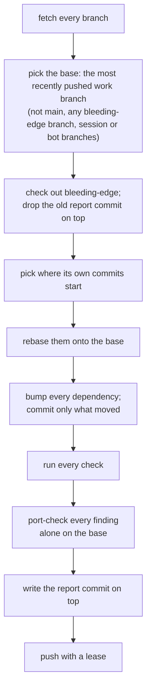

<!-- [[A7]] bleedingEdgeSolenoid, [[B25]] edgeReadyToPort -->

# Spec: The bleeding-edge branch

Serves [[A7]] bleedingEdgeSolenoid, [[B21]] edgeRebasesNotRebuilds, [[B22]] edgeNewestDependencies, [[B23]] edgePlatformFeatures, [[B24]] edgeAgentsAct and [[B25]] edgeReadyToPort. It covers how the branch is kept (the generator), how its dependencies move, and how an agent works there. These leaves and specs live only on the bleeding-edge branch. The platform features in use are [[platform-features]], and the fixes the dependency bumps needed are [[dependency-fixes]]; each finding says whether it's ready to port to a work branch ([[B25]] edgeReadyToPort).

## The generator

`.github/bleeding-edge/bleeding-edge.mjs` keeps the branch, run daily by `.github/workflows/bleeding-edge.yml`. GitHub runs a scheduled workflow only from the default branch's copy of the file, so the copy on `main` is the one that runs on the schedule; the workflow then runs the script from a temporary copy, since the script checks out the base branch, which may carry an older copy or none.

- **Where the branch's own commits start.** The rebase starts from the merge-base of the branch and the base. When the base branch has changed since the last run (the base commit recorded in the last report's `REPORT.json` isn't under that merge-base), it starts from the recorded commit instead, so only the branch's own commits travel to the new base.
- **Leaves that collide.** Before the rebase, a leaf the branch added whose id the new base gives to a different leaf (told apart by their `uuid` frontmatter, or the base's has none) moves to the next id free on both sides and in both ledgers. Its citations move with it (`[[ID]]`, `dte:` lists, and the id followed by its name), rewritten through the branch's own history on its old base, where every mention of that id is the branch's leaf; the rebase then meets no collision, and the report lists each renumbering.
- **Conflicts.** A carried commit that conflicts with new work only in dependency or generated files resolves itself: `package.json` merges (the base's file, with each dependency both sides list at the newer of the two versions), and `package-lock.json`, `Cargo.toml`, `Cargo.lock`, the engine module and the prerender snapshots take the base's copy, which the bump step and the checks bring forward again. A commit that conflicts anywhere else is dropped from the branch and named in the report, and the pre-rebase tip is pushed to `bleeding-edge-prev`, so it can be redone from there. A commit the resolution leaves empty is dropped silently.
- **The port check.** Every finding is ported alone onto the base in a throwaway worktree (`port.mjs --check`), and the report lists which still port and why any doesn't.
- **The report commit.** `REPORT.md` and `REPORT.json` sit in one commit at the top, replaced on every run, never piled up, with the engine module and prerender snapshots the checks rebuilt. The report lists the checks, the findings' port check, the commits carried and dropped, the direct dependencies that moved that day and how far the npm direct dependencies sit ahead of the base, the security audits, and the failure logs.
- **The push** forces, since a rebase rewrites the branch, with a lease on the tip it started from, so a push made to the branch during the run is never overwritten.
- **`--rebase-only`** stops after the rebase and prints what was carried and dropped, with no installs, checks or push. `--base <branch>` names the base instead of picking the most recently pushed one. `--push` pushes; without it the run stays local.

## Dependencies

- **npm.** `npm-check-updates` raises every range in `package.json` to the newest release, majors included. The lockfile and `node_modules` are deleted and installed fresh, so transitive packages move to their newest too; when the install fails on a peer range the newest versions don't satisfy, it runs again with `--legacy-peer-deps`, and the report says so.
- **Cargo.** `cargo upgrade --incompatible allow --pinned allow` raises every manifest in the crates and the desktop shell, then `cargo update` refreshes each lockfile.
- **The engine module.** The checks rebuild it with plain `npm run build:wasm`, never the optimized build. Its `wasm-bindgen-cli` must match the `wasm-bindgen` crate in the lockfile exactly, so the run installs that version first when the installed one differs.
- **What a bump breaks.** A failing check is reported, never silenced, skipped or pinned back. An agent then fixes it in its own `Fix:` commit on the branch.

## The checks

The engine module build, the site's prerender snapshots, the typecheck (`tsrs`), the unit tests, the site build, the headless CLI build, the Obsidian plugin build, `clippy` (with warnings as errors) and the tests of each crate, `clippy` for the core on the wasm target, the desktop shell's `cargo check` where WebKitGTK's development libraries are installed, and `npm audit` and `cargo audit`. A failing check never fails the run: the report is the result.

## Working on the branch

An agent on the branch works without asking ([[B24]] edgeAgentsAct):

1. **Start** by rebasing onto the newest work (`node .github/bleeding-edge/bleeding-edge.mjs --rebase-only`, then push), reading the branch's platform-features spec, then working down the newest release notes (Chrome's release notes and its "What's new in web UI" round-ups, web.dev's monthly "New to the web platform", the Interop dashboard) for anything that spec doesn't list yet.
2. **Pick what's within reason** ([[B23]] edgePlatformFeatures): the look and behavior stay the same or get clearly better (more accessible, crisper, faster, fewer lines, a bug class gone), and the feature replaces something the app already does by hand. A feature that would change the look goes in the platform-features spec's candidates, with what it would change, for the author.
3. **Use it for real.** Delete what it replaces. No `@supports` fallback, JS fallback or polyfill, except the one [[B23]] edgePlatformFeatures allows: the smallest fallback that makes an otherwise ready feature port as it stands.
4. **One finding, one commit**, named `Edge: <feature>: <what it replaces>`, or `Fix: <what broke>` for a bump's breakage. A `Fix:` that needs an upgrade names it in its message, one line: `Upgrades: wasm-bindgen@0.2.130 js-sys@0.3.107`. On the branch those packages have already moved, so the commit's diff can't carry them, and the port applies the line instead. Generated files (lockfiles, the engine module, the site's prerender snapshots) need no care: a port rebuilds them for the branch it lands on. The branch is never merged into a work branch.
5. **Check it.** The typecheck and the unit tests pass, and the push is chained after the test run, so a red run never leaves the machine. A visible change is screenshotted in Chromium in both themes on a phone and a desktop, beside the same view of the base.
6. **Check it without the feature.** For each engine that lacks it ([[platform-features#Engines]], the Linux desktop's WebKitGTK floor included), run the change in Chromium with the feature taken away: strip its declarations or attribute with an injected style or script, or force the `@supports not` branch, and screenshot what's left. If that engine would break where the work branches don't (a menu off-screen, colors gone, text overflowing), either add the smallest fallback that keeps today's behavior inside the same commit, or mark the finding not ready with what it waits for.
7. **Port-check it.** In a worktree of the base, `node .github/bleeding-edge/port.mjs --check <commit>` ports the commit, runs the checks there and resets. The daily report repeats this for every finding against the newest base, so a finding that stops porting shows up there.
8. **Record it** in [[platform-features]] (or [[dependency-fixes]] for a `Fix:`): the feature, what it replaced, whether the look changed, which engines lack it and what happens without it, and whether it's ready to port, or what it waits for ([[B25]] edgeReadyToPort).

## Porting a finding

On the work branch, with a clean tree: `node .github/bleeding-edge/port.mjs <commit>...`. Each finding is cherry-picked; a `Fix:` commit's `Upgrades:` line moves those packages in every manifest that lists them, keeping each range's style; a conflict in a generated file takes the work branch's copy; then the lockfiles, the engine module and the prerender snapshots are rebuilt where the change reaches them. The typecheck and the unit tests run, and the finding lands as one commit ending `Ported from bleeding-edge <sha>`, or comes back off with the reason. A finding already on the branch is reported as such and adds nothing. The next rebase of bleeding-edge drops the ported commit, since its change is in the base.
