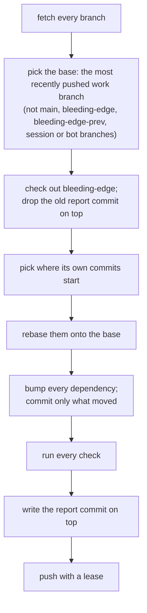

<!-- [[A7]] bleedingEdgeSolenoid, [[B25]] edgeReadyToPort -->

# Spec: The bleeding-edge branch

Serves [[A7]] bleedingEdgeSolenoid, [[B21]] edgeRebasesNotRebuilds, [[B22]] edgeNewestDependencies, [[B23]] edgePlatformFeatures, [[B24]] edgeAgentsAct and [[B25]] edgeReadyToPort. It covers how the branch is kept (the generator), how its dependencies move, and how an agent works there. These leaves and specs live only on the bleeding-edge branch. The platform features in use are [[platform-features]], and the fixes the dependency bumps needed are [[dependency-fixes]]; each finding says whether it's ready to port to a work branch ([[B25]] edgeReadyToPort).

## The generator

`.github/bleeding-edge/bleeding-edge.mjs` keeps the branch, run daily by `.github/workflows/bleeding-edge.yml`. GitHub runs a scheduled workflow only from the default branch's copy of the file, so the copy on `main` is the one that runs on the schedule; the workflow then runs the script from a temporary copy, since the script checks out the base branch, which may carry an older copy or none.

- **Where the branch's own commits start.** The rebase starts from the merge-base of the branch and the base. When the base branch has changed since the last run (the base commit recorded in the last report's `REPORT.json` isn't under that merge-base), it starts from the recorded commit instead, so only the branch's own commits travel to the new base.
- **Conflicts.** A carried commit that conflicts with new work only in dependency files resolves itself: `package.json` merges (the base's file, with each dependency both sides list at the newer of the two versions), and `package-lock.json`, `Cargo.toml` and `Cargo.lock` take the base's copy, which the bump step brings forward again. A commit that conflicts anywhere else is dropped from the branch and named in the report, and the pre-rebase tip is pushed to `bleeding-edge-prev`, so it can be redone from there. A commit the resolution leaves empty is dropped silently.
- **The report commit.** `REPORT.md` and `REPORT.json` sit in one commit at the top, replaced on every run, never piled up. The report lists the checks, the commits carried and dropped, the direct dependencies that moved that day and how far the npm direct dependencies sit ahead of the base, the security audits, and the failure logs.
- **The push** forces, since a rebase rewrites the branch, with a lease on the tip it started from, so a push made to the branch during the run is never overwritten.
- **`--rebase-only`** stops after the rebase and prints what was carried and dropped, with no installs, checks or push. `--base <branch>` names the base instead of picking the most recently pushed one. `--push` pushes; without it the run stays local.

## Dependencies

- **npm.** `npm-check-updates` raises every range in `package.json` to the newest release, majors included. The lockfile and `node_modules` are deleted and installed fresh, so transitive packages move to their newest too; when the install fails on a peer range the newest versions don't satisfy, it runs again with `--legacy-peer-deps`, and the report says so.
- **Cargo.** `cargo upgrade --incompatible allow --pinned allow` raises every manifest in the crates and the desktop shell, then `cargo update` refreshes each lockfile.
- **The engine module.** The checks rebuild it with plain `npm run build:wasm`, never the optimized build. Its `wasm-bindgen-cli` must match the `wasm-bindgen` crate in the lockfile exactly, so the run installs that version first when the installed one differs.
- **What a bump breaks.** A failing check is reported, never silenced, skipped or pinned back. An agent then fixes it in its own `Fix:` commit on the branch.

## The checks

The engine module build, the typecheck (`tsrs`), the unit tests, the site build, the headless CLI build, the Obsidian plugin build, `clippy` (with warnings as errors) and the tests of each crate, `clippy` for the core on the wasm target, the desktop shell's `cargo check` where WebKitGTK's development libraries are installed, and `npm audit` and `cargo audit`. A failing check never fails the run: the report is the result.

## Working on the branch

An agent on the branch works without asking ([[B24]] edgeAgentsAct):

1. **Start** by rebasing onto the newest work (`node .github/bleeding-edge/bleeding-edge.mjs --rebase-only`, then push), reading the branch's platform-features spec, then working down the newest release notes (Chrome's release notes and its "What's new in web UI" round-ups, web.dev's monthly "New to the web platform", the Interop dashboard) for anything that spec doesn't list yet.
2. **Pick what's within reason** ([[B23]] edgePlatformFeatures): the look and behavior stay the same or get clearly better (more accessible, crisper, faster, fewer lines, a bug class gone), and the feature replaces something the app already does by hand. A feature that would change the look goes in the platform-features spec's candidates, with what it would change, for the author.
3. **Use it for real.** Delete what it replaces. No `@supports` fallback, JS fallback or polyfill.
4. **One feature, one commit**, named `Edge: <feature>: <what it replaces>`, small enough to port on its own; a fix for a bump's breakage is `Fix: <what broke>`. The author ports a commit by cherry-picking it; the branch is never merged into a work branch.
5. **Check it.** The typecheck and the unit tests pass, and the push is chained after the test run, so a red run never leaves the machine. A visible change is screenshotted in Chromium in both themes on a phone and a desktop, beside the same view of the base.
6. **Record it** in [[platform-features]] (or [[dependency-fixes]] for a `Fix:`): the feature, what it replaced, whether the look changed, which engines lack it, and whether it's ready to port, with what it waits for when it isn't ([[B25]] edgeReadyToPort).
