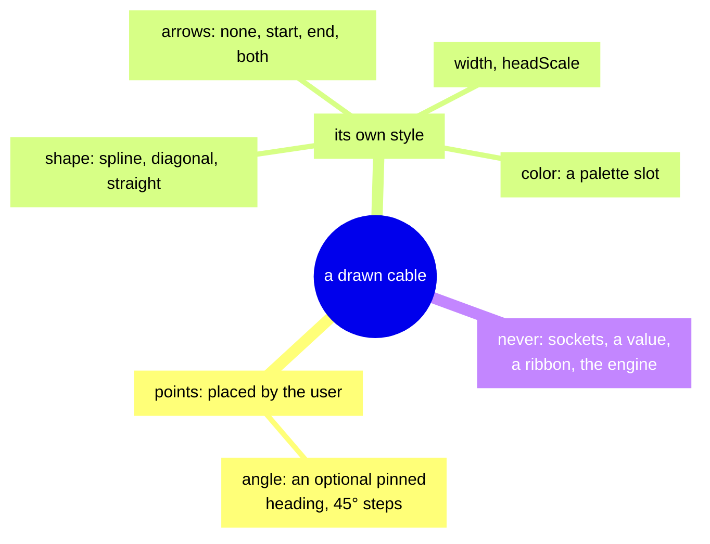

<!-- [[A1]] visualGraphCalculator; covers: src/graph/drawnCables.ts, src/graph/drawnCablePath.ts, src/graph/components/drawnCableLayer.css, tests/graph/drawnCablePath.test.ts -->

# Spec: Drawn cables

Serves [[A1]] visualGraphCalculator. It covers what the system does and blocks, and the decision each behavior serves.

A drawn cable is a free-drawn annotation curve: a list of points the user places, rendered with the same three drawers (spline, diagonal, straight) as wired cables. Drawn cables live in a world-coordinate layer inside React Flow's viewport portal (through `ViewportLayer`, [[react-flow-surface-contract#World-coordinate overlays]]), the same pattern the standoffs use. The layer is gated on the main-graph hook `hooks.drawnCables` and has its own store, its own exclusive selection and a docked panel.

Code: `drawnCables.ts` (the stores), `drawnCablePath.ts` (the pure geometry), `DrawnCableLayer.tsx`, `DrawnCableCapture.tsx`, `DrawnCableInspector.tsx` (the panel).

## Annotation, not wiring

A drawn cable has no sockets, no value, no Conduit run, no ribbon and no part in the engine. It borrows the wired cables' drawers so it reads as part of the same visual language, which is why nothing else about it may look like it carries a value. It never touches `cableShapeStore`: the toolbar's shape setting governs wired cables only. Each drawn cable carries its own style:

| Field | Values | Default |
|---|---|---|
| `shape` | spline, diagonal, straight | spline |
| `arrows` | none, start, end, both | end |
| `width` | canvas units; the panel offers Hairline 1.2, Thin 1.8, Medium 2.4, Thick 3.6, Heavy 5.2 | 2.4 |
| `headScale` | a multiple of the arrowhead size, independent of `width`; Small 0.7, Medium 1, Large 1.5, Huge 2.2 | 1 |
| `color` | a palette slot id, resolved to a color at render | gray |

## Stacking

Code: `drawnCableLayer.css`.

The layer's svg sits above every card (`z-index: 6`). Standoffs sit under the graph at `z-index: -3`.

## Geometry

- The path is one `getCablePath` call per span between consecutive points, chained into one subpath: each later span's leading `M` is rewritten to `L`, because a second `M` would break the joins.
- Every point hands both of its spans the same heading, so the drawers' end stubs are collinear and a joint never kinks. The heading is the point's pinned `angle` if it has one. Otherwise it is the chord from the previous point to the next (at an end, the chord to its only neighbor), snapped to the 45° grid (`drawnHeadings`). A degenerate chord falls back to the previous point's heading, or 0 at the head of the run.
- Arrowheads are drawn paths, not SVG markers, with the tip on the endpoint; the start head points back out of the run. `ARROW_LEN` (10) stays under the drawers' `DIR_LEAD` (14), so the directional stub still shows behind the head.
- An arrowhead is a closed triangle sized by its own scale about its tip, so resizing a head never moves the point it marks.
- The stroke stops at a head's base, not its tip. The path is built with that endpoint pulled back by the head length, capped at half the end span. Otherwise a thick stroke shows through the triangle and its round cap pokes past the point.
- Coincident points draw without NaN: a degenerate chord takes the fallback heading above.

Tests: `drawnCablePath.test.ts`: nothing below two points, one subpath, exact first and last points, every interior point passed through, the stroke stopping at a head's base (a span shorter than two heads keeping half of itself), the shared heading at each joint (the chord inside, the end's own span at an end), a coincident point, a derived heading snapping to the 45° grid, and the arrowheads (none and both, the start head pointing back, a closed triangle tipped on the endpoint, scaled about its tip).

## Per-point heading

`DrawnPoint.angle` is an optional heading override in degrees clockwise from +X, the same convention as `AngleDial`; unset means the derived chord. A pinned angle is stored normalized to [0, 360) however it arrived, because a loaded or hand-typed −90 must read the same as 270, or the history digest records a spurious edit.

- The panel's dial edits the **active point**, which is set by clicking a handle or by the panel's point stepper.
- The dial shows the live heading, pinned or derived. Auto releases the pin.
- The step is 45° only (`DRAWN_ANGLE_STEP`, defined in `drawnCablePath.ts`, re-exported from `drawnCables.ts`). The derived chord heading snaps to the same grid, so a freshly drawn auto heading already sits where the dial would pin it. A pinned angle is the user's and is never snapped, even off the grid.
- A pinned angle replaces the derived chord for both spans at its point, so it rotates the cable through the point instead of opening a kink.
- A pinned point grows a needle.
- `movePoint` and `translate` spread the point object, so dragging keeps its `angle`.
- The active point follows insertions and removals and never dangles: removing the active point leaves none active, an out-of-range index never sticks, and selecting another cable drops it.

Tests: `drawnCablePath.test.ts`: a point's own angle replacing the chord and passing through off the grid, pinning and releasing a heading (wrapped into [0, 360)), a drag keeping a pinned heading, the active point following insertions and removals, and another cable's selection dropping it.

## Sizes on screen

Affordances are sized for the screen and content for the canvas. Handles, the hit path and the needle divide by the live zoom so they keep a constant on-screen size; the line and heads are in world units and scale with the canvas. Handle color arrives as the `--handle-ink` custom property, because a CSS `fill` rule beats a `fill` attribute.

## Pointer and touch

- Everything that can be grabbed carries the `nopan` class: the hit path while the cable is grabbable, and the handles always. React Flow's d3 pan listens to native touch and mouse events that React's `stopPropagation` never reaches, so `nopan` is what makes it stand down.
- On touch, an unselected cable body is pan surface: a tap selects it through its click, and a drag pans (a finger never selects on pointerdown; see [[touch-gestures]]). A selected body drags the cable. A pinch in the middle of a drag aborts the drag.
- With a mouse, pressing on the body selects and drags in one motion. Alt-click on a handle removes that point; double-click on the body inserts one.
- The panel's `+` and `✕` buttons beside the point stepper are the finger's versions of insert and remove. `+` splits the span after the active point at its midpoint (on the last point, the span before it). A mouse insert goes before a given index, from 1 to length − 1, splitting the span that ends there. A cable never drops below two points.
- The panel's style pickers select the listed option nearest the cable's value, so a hand-edited value still selects something.

Tests: `drawnCablePath.test.ts`: a cable is never made or left with fewer than two points, a point inserts only inside the run, `translate` moves every point, `+` splits the span after the active point (before it on the last point), and `nearestOption` snaps a hand-edited size to a listed one.

## Drawing mode

The armed tool is modal. `DrawnCableCapture` is a screen-space sheet over the pane, mounted only while the tool is armed.

- The sheet spans the whole window, so its `z-index` (4) must stay below the header's 6, or it swallows the menu bar and toolbar.
- It is a sibling of the pane, so it owns panning itself: a drag pans, and a tap that moves less than `TAP_SLOP` (12 px on a coarse pointer, 4 px otherwise) places a point. A repeat tap on the last point is dropped.
- Points place on **click**, not pointerdown, because a `PointerEvent`'s `detail` is always 0 and the double-click that ends a run is only readable in `onClick`.
- Pinch zoom works through the sheet, because `flowPinch` listens in the capture phase.
- **Finish** with Enter, a mouse double-click, a right-click, or the hint strip's Finish button. Finishing leaves the tool and selects the new cable, so its panel opens. Finishing with fewer than two points does nothing and the tool stays armed. Double-tap is not a finish gesture on touch.
- **Cancel** with Esc or the Cancel button, which discards the run. Backspace or Undo drops the last placed point.
- `canvasKeyboard` gives the armed tool its keys before the Command Palette and isolate get them.
- The store has two notifiers. The cursor moves at pointer rate, and only the rubber-band preview subscribes to `subscribeCursor`, so nothing else (the toolbar toggle, the menu bar) re-renders on every move. A structural change wakes both, since it moves the preview too.

Tests: `drawnCablePath.test.ts`: placing, undoing and finishing; a repeat tap dropped; a one-point finish committing nothing and staying armed; disarming discarding a half-drawn run; a cursor move waking only the cursor subscribers; no placement while disarmed.

## How to reach it

Insert ▸ Draw an arrow in the menu bar (Draw Arrow in the heading of the phone menu's Insert section) is the only entry point; the menu says arrow because a person reads "cable" as wiring, which this never is, and it also appears in the Command Palette from the same `menuModel.ts` entry. There is no toolbar button and no hotkey: the tool is too minor to spend chrome or a key on.

## Selection and editing

- Drawn-cable selection is exclusive with node, cable and standoff selection, in both directions. Arming the tool clears it.
- On the main canvas, `deleteSelection` deletes a selected drawn cable before anything else; a drill-in's delete scope leaves drawn cables alone.
- Every settled edit goes through `commitDrawn()`, which `FlowCanvas` registers as autosave plus `flowHistory.schedule()`, so `drawnCables.ts` never imports persistence or the history. A drawn cable therefore gets undo entries like any graph edit, and the history digest labels them "Drew a cable", "Edited a drawn cable" and "Removed a drawn cable".

Tests:

- `drawnCablePath.test.ts`: finishing a run selects the new cable exclusively, dropping the cable and standoff selections, and a selected cable's removal clears the selection.
- `flow/flowHistoryDigest.test.ts`: the digest names drawn-cable changes.

## Saving and loading

Drawn cables persist as `SavedGraph.drawnCables`, a plain pass-through in the text form (`text_form.rs`), since nothing in one refers to a node. The JSON save is generated by a round trip through the text form, so a field the text form drops does not save; a graph with no drawn cables carries no `drawnCables` field at all. Ids are not saved; they are regenerated on load. `registerNodeForgetAll` clears the store when the graph rebuilds, and the restore tail loads the saved list. On load, a malformed entry is skipped, invalid points are dropped, and an entry left with fewer than two points is skipped. A missing or invalid field takes its default, and `width` and `headScale` are clamped (0.2 to 40, and 0.1 to 10). A pinned angle loads normalized to [0, 360) (see Per-point heading).

Tests:

- `drawnCablePath.test.ts`: a round trip through serialize and load, a pinned heading round-tripping (an unset one staying absent), clamping, a malformed entry skipped, and a loaded −90 reading 270.
- `textForm.test.ts`: every drawn-cable field, per-point angles included, round-trips the text form, and a graph with none omits the field.

## Known limits

- Nothing tows a drawn cable when the cards it annotates move.
- The composite drill-in has no drawn-cable layer: `drawnCables` is a main-graph hook only, matching the rule that saves bind to the main graph.
