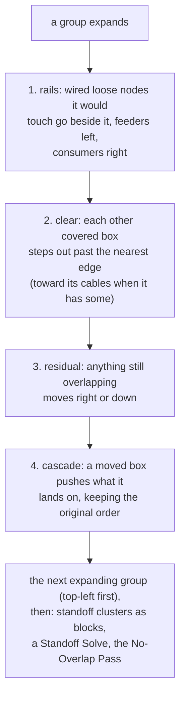
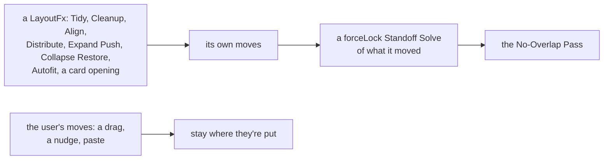

<!-- [[A1]] -->
<!-- [[A1]] visualGraphCalculator, [[C52]] visibleSelection -->

# Spec: Group Expand Push

Serves [[A1]] visualGraphCalculator. It covers what the system does and blocks, and the decision each behavior serves.

A collapsed group draws as a small card. Expanding it back to full size would cover whatever sits nearby, so the expansion pushes those neighbors just far enough aside, remembers each push, and slides them back exactly when the group collapses again. A neighbor the user has moved since the push stays where the user put it. This spec covers that push, how groups map onto React Flow, and the rules for who is a member of a group.

## The world the push works on

The push runs over plain boxes, with no editor or DOM, so the core (`computeExpandPush` and `separateAll` in `groupPushCore.ts`) is pure. `groupPush.ts` builds the boxes and applies the result.

- **Movable boxes** are every group plus every loose node: a node that is in no group and is not a docked Format Controller (FC).
- **A loose node's box** reaches over its docked FCs (FC width plus 8), rightward for an FC docked to an output and leftward for one docked to an input, because a docked FC has no box of its own.
- **An expanded group** is read at its stored size, which is exactly the size it renders at; React Flow's measure lags a resize by a frame.
  - Its box then reaches over any FC docked to a member that hangs past its edge (an input FC on a member at the left pad does), since that FC rides the member.
  - When such a group expands, its collapsed card is widened to the same top-left corner, so the right and bottom seams stay where the card's were.
- **A collapsed group** is read at its card size; its members' FCs are hidden with them.
- **What moves together.** A group moves with its members and with every FC docked to one of them; a loose node moves with any FC docked to it.
- **One set of boxes.** All passes read and write the same in-memory boxes, and the totals are applied once at the end, because `view.moveNode` is async and the DOM would show stale positions between passes.

The push runs only while the `groupPush` setting ("Auto-arrange groups on expand") is on. Turning it off also skips the No-Overlap Pass on expand, which the no-overlap rule ([[#LayoutFx]]) doesn't allow; the pass should run with the setting off too (`docs/backlog.md` § Canvas chrome).

Tests: `pushWorldDockedFc.test.ts`: a neighbor under a host's docked FC, on either side, is separated from it, and so is a neighbor under a member's FC that hangs past an open group's edge.

## The push, per expanding group

When several groups expand at once, they are processed in order of `x + y` of their boxes (top-left first), each against the boxes as earlier groups left them.

For one group, the expanded box starts at the group's position with its full size; the collapsed card is the same corner with the card's size. The right and bottom edges of the card are the "seams" the expansion grows from.

**Satellites.** A loose node wired to the group's members is a satellite:

- **Its side.** Count its cables into members (upstream) and out of members (downstream). The larger count decides its side: upstream nodes are feeders, downstream nodes are consumers.
- **A tie.** A node with equal counts has no side and is not a satellite.
- **Its target height** is the mean vertical center of the members it is wired to, in world coordinates, corrected by however far this group has already moved within the batch, since members move physically only when the batch applies.

**Anchors.** For every other box, its anchors are the centers of the entities its cables lead to:

- each cable end resolves to a push entity: a member becomes its group, a docked FC becomes its host;
- satellites and groups get no anchors, so a group always clears by geometry, never toward its cables: a group chasing its connections would pile interconnected groups onto one spot when several expand at once.

**Exempt boxes.** These are never moved by the steps below:

- a position-locked group ([[auto-arrange-tidy#Position-locked groups]]);
- a box that already overlaps the collapsed card (the user parked it there).

Pairs of boxes that already overlap each other before the push are recorded as baseline pairs, and the cascade never tries to separate them: both may still be cleared, and their offset may close up, but neither moves further than one clearing distance. The backstop below separates all of these anyway.

The steps, in order:

1. **Rails.** Each satellite that the expanded box would touch is placed on its dataflow side.
   - Feeders go just left of the box and consumers just right of it, each `PUSH_GAP` (28) clear of the edge and vertically centered on its target height, clamped within the box's vertical span.
   - A consumer that is already right of the group and would clear rightward is left for step 2 (cleared, not re-placed).
   - Satellites on the same side are then stacked downward in y order, `RAIL_STACK_GAP` (12) apart.
   - A satellite the expansion doesn't touch stays put.
2. **Clear.** Every other box that the expanded box covers moves just past an edge plus `PUSH_GAP`. Only covered boxes move; free space is expanded into without moving anything.
   - A box with anchors tries all four directions (right, down, left, up) and takes the one with the smallest score: mean distance from its new center to its anchors plus 0.5 times the length of the move. A node wired to something on the left therefore hops left out of the way.
   - A box without anchors moves right if its center is past the right seam and it overlaps the box vertically, down if its center is below the bottom seam and it overlaps horizontally. If both apply, it takes the axis along which its center is farther from the card's center. If neither applies, it waits for step 3.
3. **Residual clear.** Any box, satellites included, still overlapping the expanded box after steps 1 and 2 adds the cheaper of a move right or a move down to clear it plus `PUSH_GAP`.
4. **Cascade.** Each moved box, in order of its original `x + y`, pushes any box it now lands on just clear of itself (plus `PUSH_GAP`) along its main direction of travel.
   - It pushes only boxes that started ahead of it on that axis, and never exempt boxes or baseline pairs.
   - Each pushed box then cascades in turn.
   - A band of cleared boxes therefore restacks in its original order instead of flattening or reversing.

Tests:

- `groupPushCore.test.ts`, on plain boxes: the clear (just past the edge, the short way out of a deep overlap, a corner neighbor by its dominant axis, never left or up without anchors, free space taken without moving anything, parked boxes exempt), the rails (feeders left, consumers right, a consumer already right kept on its row, an untouched satellite left alone, two on one side stacked), the cascade (in the direction of travel, the original order kept, no cascade onto an out-of-band neighbor, baseline pairs not pried apart), the anchors (left, up and right hops, untouched boxes, a satellite keeping its rail), and no growth moving nothing.
- `layoutInvariants.test.ts`: `computeExpandPush` stays finite over random fixtures.

## After all groups: the Standoff Solve and the No-Overlap Pass

Three more passes run over the same boxes, after every expanding group has had its push:

1. **Standoff clusters move as one block** ([[standoffs]]). For each cluster of boxes joined by standoffs, every member except a locked group takes the largest displacement any member received, and the cluster's contributing groups become the union of its members'. A lone push is therefore not pulled partway back.
2. **Standoff Solve.** `solveStandoffs` runs with `forceLock` over the clusters this expansion touched (`standoffsTouching`: those holding an expanding group or a moved box), with the expanding groups and any position-locked group pinned. An unrelated cluster keeps its slant. Its corrections are added to the same totals, credited to every expanding group.
3. **No-Overlap Pass** ([[#LayoutFx]]). `separateAll` removes every overlap left among the boxes, with no exemptions: an overlap the user made before the expand is separated too.
   - Each standoff cluster moves as one unit, so it can't tear, but only its members' own boxes collide: a card sitting between a group and its standoff partner, touching neither, stays put.
   - Locked groups are fixed; the expanding groups are preferred, so they hold still while a partner can yield.
   - Its moves are credited to every expanding group.

How `separateAll` places the boxes:

- **Two passes.** It runs its placement pass (`separateUnits`) twice. The first pass pins the fixed and the preferred units; the second pins only the fixed ones, clearing any overlap the first had to leave between two pinned units.
- **The order.** The pass places the boxes one at a time, pinned ones first, then the rest from the top-left (by `x + y`).
- **A pinned box** stays where it is.
- **Every other box**, while it overlaps one already placed, moves right or down, whichever is cheaper, to clear the placed box it overlaps most by `PUSH_GAP`.
- **What follows.** The top-left box keeps its anchor corner, a pinned box's partner yields (even when the free box is the top-left one), and two pinned boxes are left alone. Afterwards only two fixed units can still overlap.
- **Cost.** Moves only ever go right or down, so it always finishes, and a few hundred boxes take milliseconds.

Tests:

- `groupPushCore.test.ts`: `separateAll` on coincident boxes and a packed grid, only right or down, no move without an overlap, a pinned box holding while its partner yields, two pinned boxes left overlapping, and a standoff cluster moving whole while a box between its members stays put.
- `layoutInvariants.test.ts`: randomized boxes and every op's final pass leave no overlap.

## LayoutFx

A **LayoutFx** is a process that moves cards the user didn't move: Tidy, Cleanup, Align, Distribute, the group Expand Push, the Collapse Restore, Autofit and a card opening ("Fx" names a process, keeping it apart from the graph's items). No LayoutFx leaves two nodes or groups overlapping anywhere on the canvas. Every LayoutFx ends the same way:

1. a `forceLock` Standoff Solve of what it moved ([[standoffs]]);
2. the No-Overlap Pass, which pulls apart anything that overlaps.

None moves a position-locked group ([[auto-arrange-tidy#Position-locked groups]]).

What is not a LayoutFx, and what is:

- **A drag** is the user's own move: it puts cards where the user put them, and no No-Overlap Pass follows it.
- **A paste** is an explicit exception: it lands at the pointer plus a small offset and may cover a card, since where the user pastes is where they want it.
- **Align, Distribute, and a card whose body chevron expands,** are LayoutFx and end with the No-Overlap Pass, the cards just placed or opened holding still where they can (`selectionOps.ts`: `settle`, `cardsExpanded`). Inside an open group that holds one of those cards the same pass runs over its members first (`settleMemberOverlaps`, `groupLogic.ts`), and the group's box grows over a member pushed past an edge, keeping the edges nothing passed; the top-level pass then separates the grown group from its neighbors (`groupMemberOverlaps.test.ts`).
- **A card that grows with its live content** (a Display showing a longer value, a list that gains rows) pushes nothing, since that can happen on any recalculation. It can cover a neighbor until the next LayoutFx's No-Overlap Pass separates them, which measures the grown card.
- **Content that overflows a constant-size body** ([[resizable-content-nodes]]) is never counted at all, since the pass reads the card's box.

Tests: `groupPushRecords.test.ts`, no layout op leaves an overlap: an expand separates an overlap the user made far from the group, an expand never moves a locked group, and a collapse separates a restore that lands on a card placed while the group was open.

## Records and restore

Each moved box gets a push record in memory (never saved; a reload keeps everything where it is). A record holds:

- the position before the first push;
- the position the latest push left it at;
- `dueTo`, the set of groups whose expansion moved it.

What happens to a record:

- **Merging.** When a later expansion moves the same box again, the push merges into the existing record only if the box is still within `EPS` (2px) of where the last push left it. A merge keeps the original position, plus whatever nudged the box since the last push, and adds to `dueTo`. Otherwise the old record is void, because something moved the box in between (Tidy, Cleanup, align or distribute move boxes without a drag), and a fresh record starts from the current position.
- **Restore.** After a collapse, and when a group is deleted, `restoreSettledPushes` checks every record whose contributing groups are all collapsed or deleted.
  - If the box is still within `EPS` of where the push left it, it slides back by what the pushes moved it: to its original position when nothing else moved it, and keeping a nudge within `EPS` (a Tidy's pixel) when something did, so a collapse and expand cycle never walks a box away from the cards around it.
  - If not, it stays put. Manual moves win.
  - Either way the record is dropped.
- **Invalidation.** Dragging a node or group ends in RF's `onNodeDragStop`, which drops every record for the dragged item and every record that item's expansion caused (`groupPushStore.invalidateGroup`). A click never starts an RF drag, so only a real move invalidates.

Tests: `groupPushRecords.test.ts`: a pixel a Tidy moved the box after the push survives the collapse; a nudge between two merged pushes carries into where the box returns; a second push after a move without a drag (a Tidy's `view.translate`) starts a fresh record, so the box returns to where it stood before that push and not to where it stood before the move; and a single group's expand and collapse restores exactly.

## Entry points

`setGroupsCollapsed` is the one entry point for toggling. The group's chevron, the Outline panel and the collapse hotkey (`E`) all call it. It runs these steps:

1. **Measure** the collapsed card size of each group about to expand, before the flip re-renders it at full size. These are the seam origins. A collapsed card's size is read from its painted element first: React Flow's measured size still holds the old size in the frame of a toggle.
2. **Flip** `collapsed`, recompute collapse state (`syncGroupCollapse`), wait for each group to re-render so the footprints measured next are current, and settle the cable endpoints (`settleCollapse`).
3. **On collapse:**
   - restore settled pushes;
   - re-solve standoffs with `forceLock` over the clusters holding a collapsed group or a restored box, because the shrink moved their anchors (a no-op when the restores already landed everything in band);
   - a collapse never rearranges the canvas: a cluster whose re-solve would land a box on another stays where it is, its bar stretched past the band until the group opens;
   - each move the re-solve makes is recorded like a push. On expand, before the push, every record whose groups are all open again slides its box back, by what the re-solve moved it, if it is still within `EPS` of where the collapse left it;
   - two frames later, once React Flow has measured the cards, `settleOverlapsAfterPaint` runs the No-Overlap Pass, preferring the collapsed groups: a restore can land a card on one placed while the group was open.

   **On expand** (with `groupPush` on): run the push.
4. **Schedule** an autosave.

ELK (the automatic layout engine behind Tidy) is never used in this path.

`pushForGrownGroups` reuses the same engine outside a toggle, when a Tidy inside a group grows its box ([[auto-arrange-tidy]]). The size before the grow is the box as it stood, not a collapsed card, so a neighbor the grown edge newly covers is pushed and one already clear of the grown box stays. It records nothing, so that displacement is permanent and never restores on collapse.

Tests:

- `groupPushRecords.test.ts`: across a collapse round trip, the collapse pulls a standoff partner in and the expand puts it back exactly, a collapse leaves the partner in place when the re-solve would land it on another box, and a toggle leaves an unrelated slanted standoff alone; a member the collapse hides leaves the selection while a visible card stays ([[C52]] visibleSelection).
- `groupPushCore.test.ts`: the grow push.
- `tidyArrangeGroups.test.ts`: a within-group Tidy grows, pushes a right-hand neighbor clear and autofits.

## Groups are React Flow sub-flows

A member is the group's RF child: it sets `parentId`, its RF position is relative to the group box, and parents come before children in the node array (`flowModel.toFlowNodes`). RF then tows members with the group and stacks them above it.

The model stays absolute. Saves, Tidy, standoffs, the lasso and docking all read `view.position` / `node.position` unchanged. Conversion lives only at the boundary:

- `toFlowPosition` / `fromFlowPosition`;
- `handlers.moveNode`, where moving a group re-bases every member, so a Tidy that moves members before their group still ends consistent;
- `onNodesChange`, which applies RF-driven moves to the model, groups first.

A membership change re-projects the nodes through the `groupMembershipStore` subscription. During a group drag, the model's member positions follow the group by its per-frame delta (`moveGroupMembers`), collapsed groups included. Drag callers pass `skipSelected`, because RF already moves selected members as part of the selection, and a selected member moved again would outrun its group; a programmatic push leaves it off.

Tests:

- `flow/flowModel.test.ts`: a member projects relative to its group, the group first.
- `groupLogic.test.ts`: `moveGroupMembers` moves every member with `skipSelected` off, skips a selected member with it on, and does nothing on a zero delta.

## Creating and fitting a group

- **Group** (the `G` key, or the menu) wraps the current selection (`createGroupFromSelection`, `groupLogic.ts`).
  - A selected member of another group leaves that group, since membership is exclusive.
  - The new box may cover cards outside the selection; the No-Overlap Pass pushes them off it.
  - Nodes hidden inside a collapsed group are left out, since they already belong to one and a selection path such as Ctrl+A then G would otherwise absorb them ([[C52]] visibleSelection).
  - The cable selection is cleared first, because a selected cable carried into the group-forming reflow garbles its rendering.
- **The box** is the members' bounding box (through `measuredBox`) plus `GROUP_PAD` (24) on each side and `GROUP_HEADER` (34, matching GroupNode.css) on top.
  - Each edge is rounded to a whole pixel on its own. A fractional edge puts the selection ring on a half-pixel, and rounding the size instead of the edges left the interior up to half a pixel lopsided, which a within-group Tidy (it centers members in the interior) turned into a quarter-pixel creep on every Cleanup.
  - Creation, the within-group Tidy and Autofit share these two constants; if they disagreed, Cleanup's tidy-then-autofit cycle would drift the box a few pixels on every run.
- **The group's color** is the most common card color in the selection, read as the palette slot the card wears (`nodeAccentSlot`, the slot behind `nodeAccent`, so an unfiled card counts its output's color per [[palette-and-theme#Card colors]]). A tie, or all kinds distinct, falls back to gray (`GROUP_DEFAULT_COLOR`). The members tint at once.
- **Autofit** (the `F` key, or a double-press on the resize grip) wraps the box tightly around its current members with the same padding, clamped to the grip's own minimums (`GROUP_MIN_W` 140, `GROUP_MIN_H` 90) and to integers.
  - `autofitGroupWithHistory` records one undo entry for position, size and members together, so both entry points undo as a single step.
  - It then re-settles the standoffs as a rigid block, pinning the fitted group, and runs the No-Overlap Pass preferring it, since a box that grows can land on a neighbor.
  - A locked group keeps its corner: the members move to it instead ([[auto-arrange-tidy#Position-locked groups]]).
- **The group element** stacks behind its members and behind member Conduits (−1), so a Conduit inside a group stays selectable ([[react-flow-surface-contract#Stacking]]).
- **The position lock** is set only through `setGroupLocked`; its re-projection repaints the RF `draggable` flag and the header lock icon ([[auto-arrange-tidy#Position-locked groups]]). Every Standoff Solve pins every locked group and its members (`withLockedGroupsPinned`), since the solver works on raw endpoint ids and a member's standoff would otherwise slide the member out of the locked box.

Tests:

- `groupPushRecords.test.ts`: Autofit keeps a locked group's corner and brings the members to it, an Autofit that grows the box pushes a neighbor off it, and grouping takes a node out of its old group and pushes a bystander off the new box.
- `tidyArrangeGroups.test.ts`: a group Tidy then Autofit is a fixed point.
- `groupLogic.test.ts`: `withLockedGroupsPinned` pins every locked group and keeps the caller's set.

## Who is a member

Membership changes only on an explicit gesture that puts a node in a group or takes it out:

- **Dragging a node in or out** (`reconcileGroupMembership`, run on RF drag stop for each dragged non-group node).
  - Membership is exclusive and stable: a node belongs to at most one group, and keeps it while its center stays inside that group's rendered box.
  - Once its center leaves, it leaves; it then joins the first other expanded group whose rendered box contains its center.
  - Any FC docked to the node follows its host's membership.
- **A select-then-group action.**
- **A manual resize of the box** (`reconcileGroupBox`, from the grip drag). Every non-group node whose center is inside the new box joins, unless it already belongs to another group, and every member whose center is outside leaves.
- **Creating a node inside a group** (`absorbIntoContainingGroup`, for live creation such as the Add menu or paste). The node joins the first expanded group whose rendered box contains it entirely, unless it is already a member of some group. During a load or seed rebuild, membership comes from the saved list instead.

The terms and edges:

- **Groups don't nest:** a group is never a member.
- **"Rendered box"** means the group element's live size, falling back to the stored one, because a collapsed group draws as a small card and its stored size would absorb nodes dropped where the expanded box would be.
- **Deleting a node** drops its id from every member list.

**Autofit does not change membership.** It wraps the box around the existing members, so `autofitGroupWithHistory` never runs `reconcileGroupBox`, which would absorb any bystander whose center the shrunk box happens to cover. It does run `rebuildGroupMembership`, which only refreshes the color markers from the unchanged list.

**A collapsed group never gains members.** A node that joined one would be hidden by the next collapse sync and vanish from the canvas. All three editors guard it:

- `reconcileGroupMembership` skips collapsed groups as join targets;
- `absorbIntoContainingGroup` skips collapsed groups;
- `reconcileGroupBox` does nothing while the group is collapsed (reconciling against the small card would also drop every member).

To change membership, expand the group first.

Tests: `groupLogic.test.ts`: a drop onto a collapsed group's card doesn't join it while a drop into an expanded group does, and a new node fully over a collapsed card isn't absorbed while one over an expanded box is.

