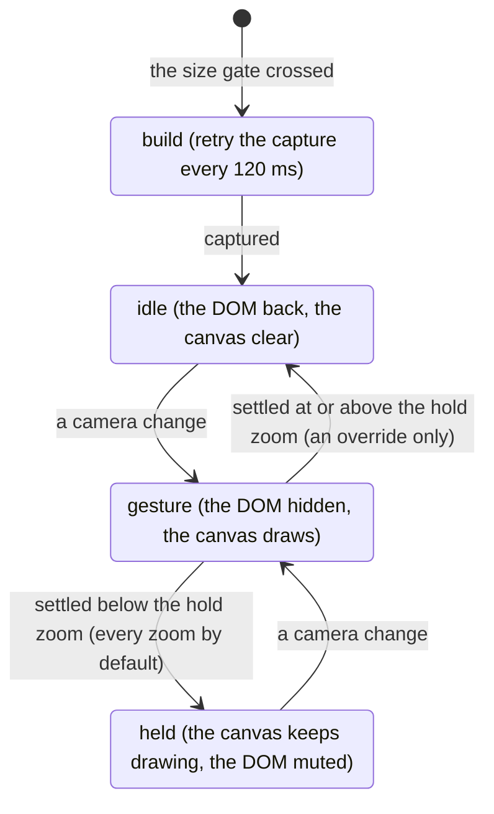

<!-- [[A1]] visualGraphCalculator -->

# Spec: HTML-in-Canvas gesture layer

Serves [[A1]] visualGraphCalculator; its GPU limits are [[#The GPU texture budget]]. It covers what the layer does, when it runs, and the number behind each knob. The knobs are tuning, not decisions: change one freely, and record the measurement that justified the change here.

The layer is an optional setting that makes pan and zoom cheap on a big graph; live nodes are the default. During a gesture it hides React Flow's viewport and draws the whole graph on a canvas instead: captured bitmaps of the cards, and every cable and overlay copied as vectors. At rest it holds that drawing over the real DOM, which stays underneath for input ([[#The lifecycle]]). It is never a DOM replacement: every click, edit and hover lands on the real cards. The live DOM and this layer are the canvas's only two ways of being drawn; a third would be another renderer to keep in step with every card. The layer rests on the WICG HTML-in-Canvas API, on by default in Chrome 157 and absent from Firefox and Safari, so it stays an opt-in: if the API changes again, the DOM default is untouched and nothing breaks. **Reopen if:** the DOM path becomes the one that costs more to keep.

The engine is `HtmlCanvasRenderer`, an imperative class rather than a React component; `HtmlCanvasLayer` mounts it and feeds it.

Code: `htmlCanvasRenderer.ts`, `HtmlCanvasLayer.tsx`, `htmlCanvasLayer.css`, `renderMode.ts`, `htmlCanvasSupport.ts`, `zoomSettle.ts`, `rasterAtlas.ts`, `hicVectors.ts`.

## When it runs

- **The setting.** Render mode `html` (the default is `dom`, and only `html` persists) is offered only where `supportsHtmlInCanvas()` (`htmlCanvasSupport.ts`) finds the WICG API, in its shipped shape: the canvas's `content` attribute (Chrome 155 renamed `layoutsubtree` to `content="drawable"`) and the 2D context's `drawElementImage`. That is Chrome 157 on, or 155 and 156 behind `chrome://flags/#canvas-draw-element`; an older build has the pre-155 API and isn't offered the mode. The check is synchronous and cheap, so it runs at startup.
- **The size gate.** Even with the setting on, the layer stays inert until the graph weighs at least `RENDERER_MIN_NODES = 100` DOM units. The unit is kind-weighted (`nodeDomWeight`, `nodes/kind.ts`), in tiers each strictly heavier than the one below; the numbers are coarse by design, and the order is what matters:
  - a full figure (Chart, Histogram, Sankey, Mermaid, Record, Heatmap…) weighs 10;
  - a Tornado's inline bars 6;
  - a small inline figure (Sparkline, Gauge, Chart Builder) 3;
  - a card that previews a Frame, table or Cube grid 2, and so does an SVG Picker, which shows one `` at rest and mounts its inline SVG only on hover, never during a pan or zoom, the only time the gate reads the weight;
  - a plain scalar or logic card 1.

  So about ten charts engage it, while a scalar-only graph needs about a hundred cards. Below the gate the native DOM pans fine and the capture cost isn't worth paying. The weight is recounted on bind and on every node add or remove, even while inert, so crossing the line is noticed. `window.__hcMinNodes` overrides it live.
- **Both canvases.** `FlowSurface` mounts `HtmlCanvasLayer` for the main canvas and for a composite drill-in alike.

Tests:

- `renderMode.test.ts`: the mode defaults to `dom`, a set switches it, and setting the same value does not notify.
- `nodes/kind.test.ts`: the weight tiers in order, and ten full charts reaching the default gate of 100.

## The lifecycle

1. **Build.** On engaging, the layer starts in the gesture state (holder hidden, canvas active), so the DOM and the canvas never show as a double image, and it retries the capture every 120 ms until it succeeds, which waits for React Flow's container: until it exists `view.viewport` is a detached placeholder, so the layer looks the viewport up each time rather than keeping the first one. It then drops to idle.
2. **Gesture.** Any camera change, or a held pointer while gesturing, enters the gesture: the React Flow viewport ("the holder") takes `solenoid-html-hidden`, which hides every layer root in it (each card's wrapper by `visibility`, each edge's svg and each portal overlay by opacity) and nothing else, so layout stays measurable, an in-flight drag survives, and the vector snapshot still reads the content below the roots as the DOM shows it ([[#Cables and overlays on the canvas]]). Nothing stays live DOM through a gesture. An exception kept live (Conduits and their cables, the ribbons, the standoff bars all were) is drawn by a second pipeline that skews from the canvas by a frame on every camera change, which reads as flicker on a zoom (author, 2026-11-11).
3. **Settle.** A gesture ends on a timer that each camera change re-arms: 140 ms after a pan, and `DEFAULT_ZOOM_SETTLE_MS = 420` after any gesture that zoomed.
   - A scale change repaints the whole visible DOM at the new raster scale, while a pan only recomposites, and wheel zoom is notchy with no held-pointer signal. A short zoom settle would leave and re-enter the gesture on every notch and pay that repaint each time.
   - A longer settle doesn't cure choppy zoom: a deployed 3000 ms A/B ruled it out.
   - `window.__zoomSettle` overrides the zoom settle live, so a deployed preview can be A/B'd with no redeploy. Only a finite, non-negative number is taken; anything else falls back to the default rather than set a nonsense timer.
4. **Held.** When a gesture ends below `HOLD_ZOOM`, the canvas keeps drawing at rest. The DOM comes back muted (by opacity, so it still hit-tests) and the selected or focused cards show as live DOM over the canvas. The renderer skips those live cards (`setDomLive`), so nothing paints twice. `HOLD_ZOOM` is `Infinity`, so the layer holds at every zoom: going back to the DOM repaints every card on screen at the device's pixel density, and zoomed in, where pans are short and many, that repaint on each settle made a phone pan worse than zoomed out (author, 2026-11-11). It was 0.4, where DOM text is unreadable anyway. The trade: a card at rest is the capture ([[#Capture]]: 2.5×, soft past 100% zoom on a screen denser than 2.5×), and an unselected card shows no hover state. A redraw from the live element on settle was weighed and refused, since it is the same full-resolution repaint. `window.__hcHoldZoom` overrides it live (0.4 restores the old line). **Reopen if** the softness or the missing hover states cost more than the pan saves.
5. **Idle.** Above the hold zoom (only under an `__hcHoldZoom` override) the holder is fully restored and the canvas clears to transparent. The canvas element itself stays visible even when idle, because capture needs it rendered.

**The canvas sits under React Flow.** Its host is mounted before `<ReactFlow>` at the same z-index (0), so React Flow stacks above it, and while the canvas draws (`sol-hic-on` on the surface) React Flow's own background goes transparent and the DOM backing hides: the canvas paints the canvas color and the dot grid itself, one fill and one pattern fill a frame (`drawBacking`; the dot is centered on a tile pixel and the pattern fills unsmoothed, or a sub-pixel dot spreads over four pixels and vanishes). The colors are read off the DOM backing at each build, and a theme change rebuilds. With the canvas underneath, a live card (selected or focused) shows over everything the canvas draws, as React Flow lifts a selected card anyway; with the canvas on top (z 2, until 2026-11-11), the groups and cards the canvas drew covered it (author). The muted DOM above the canvas still takes every press.

A lasso never enters the gesture: it moves no camera, so the swap would only show a stale snapshot.

Tests: `zoomSettle.test.ts`: the default with nothing set, a finite non-negative override honored, and junk values falling back to the default.

### The GPU texture budget

A live canvas under a full-viewport opaque overlay stops painting: the composite drill-in sets `visibility: hidden` on the app canvas it covers, and any future surface that covers the canvas owes the same. It must be `visibility`, not `display: none`, because while the drill-in is open the covered canvas is still asked to re-render and re-measure cards, and measuring needs a real layout box.

The layer never promotes the viewport: nothing in it is visible during a gesture. Why it mustn't on a phone: the browser does not reliably drop a hidden subtree from raster, so a covered canvas keeps its layers and textures in memory, two surfaces' worth on a mobile GPU, where the canvas bounding box times the device pixel ratio can already overrun the maximum texture size on its own. A tablet runs the desktop UI on a mobile-class GPU, and a viewport-sized layer fails tile allocation there. The desktop shell's WebKitGTK budget is the same idea per engine ([[layout-chrome#The desktop window frame (the Tauri shell)]]).

## Capture

Each card's live element is cloned into the canvas and captured with the WICG API. Capture keeps running while the layer is idle, so a fresh snapshot is ready for the next gesture.

- **The opt-ins.** The canvas wears `content="drawable"`, which lays out its descendants, and each clone wrapper wears `drawable`, without which `drawElementImage` and `captureElementImage` throw. The canvas is `aria-hidden`: drawable content joins the accessibility tree, and the clones would read every card twice.
- **No geometry sync.** Since Chrome 155 a draw moves the drawn element's hit-test box and focus ring to where it was drawn. Every draw passes `preserveElementGeometry: true`: the clones are pictures, and an atlas raster would otherwise park live hit boxes at atlas positions on screen.

- **Padding.** The capture box and the draw box are both inflated by `PAD` (10 px), because sockets straddle the card edge. A card's `x`, `y`, `w` and `h` stay the card's own: its world top-left and its natural CSS size.
- **The clone wrapper.** Every wrapper is absolutely positioned at the origin and insets the card with padding rather than by sizing or positioning it, so the card keeps its own CSS and its cloned inline styles. Inside it, a stand-in for React Flow's node wrapper has zero padding, border and margin, so its padding box equals the card's border box, where the card's absolutely positioned chrome anchors.
- **The clone never sets `position`.** Each root's own CSS class governs it, exactly like the original: `.solenoid-node` is static with its chrome anchored to the relative stand-in div, and `.solenoid-note` is relative so its resize handle anchors to the card. Forcing one value breaks the other root: a forced `static` shifted the note's handle by a measured 1.75 px, and a forced `relative` shifted node chrome.
- **What `cloneNode` misses.** Three repairs run on every clone, each walking the original and the clone in lockstep and bailing if their structure differs:
  - `syncFormState` copies live form properties (`value`, `selectedIndex`, `checked`), since `cloneNode(true)` copies only attributes. For a `<select>` it mirrors the `selected` attributes too, because the clone may be captured before it is in the document.
  - `syncCanvasState` replaces each `<canvas>` in the clone with an `` of its pixels (`toDataURL`): a cloned canvas has an empty drawing buffer, and a canvas nested in a drawable subtree draws as a misplaced slice of itself in Chrome 157 (the heatmap showed only its bottom row), while an image draws as it is. The card's raster waits for the images to decode (`decoding`), or it would cache the figure blank. A tainted canvas can't be read and captures blank.
  - `uniquifyIds` rewrites every inline-SVG `id` and its references, since a duplicated id makes `url(#id)` resolve to nothing.
- **Lay out at 1×, raster at 2.5×.** `REF = 1`: the clone lays out at true size, since a clone laid out larger (CSS `zoom`) rounds text line boxes differently from the live DOM, a measured 0.9 px drift. The raster is separate: it draws the 1× clone at `RASTER = 2.5` times its size, and `drawElementImage` re-rasters the clone's paint at that size rather than stretching a 1× picture, so text stays sharp to 250% at 1× pixel density and to 125% on a 2× screen, with no drift (author: 2× on 2026-11-11, with the layer held at every zoom, then 2.5×). It costs 6.25 times the texture memory of a 1× capture and as much atlas area, so a first build takes more paints, and a card too big for the atlas at that scale is scaled down to fit. `live` mode (`window.__hcLive`) re-rasterizes at the exact transform every frame for anyone who needs it crisp past that.
- **The mip pyramid.** Each card gets a pyramid of bitmaps halving from its top bitmap's scale (`RASTER`, less for a card scaled down to fit the atlas) down to about `MIP_MIN_PX` (6 px). A frame draws the level `mipLevel(top, quality × scale × dpr)` picks, `floor(log2(top / (quality × scale × dpr)))`, per card. Quality 1 is roughly one texture pixel per screen pixel; below 1 is cheaper and softer (`setQuality`).
- **How a pyramid gets built.** `buildMips` first tries the captured image as a bitmap source, then a scratch-canvas raster of the captured image or the live clone. The shipped API's `ElementImage` is only `{close()}` (its size comes from `getElementImageDefaultSize`) and is not an `ImageBitmapSource`, by spec and permanently, so on most builds both fail and the card falls to the in-paint raster. That raster must run inside the `paint` event and before `drawFrame`, which clears the atlas pixels in the same paint task so they never present. It takes at most `RASTER_BATCH` cards per paint (24 on a coarse pointer, 48 on a fine one) to stay inside a frame budget, and a card is retried up to `RASTER_MAX_ATTEMPTS` (5) times, since a fresh clone may miss its first rendering update. `buildMips` loops until no unbuilt card remains, because an `updateNodes` that arrives mid-build returns early on the `building` guard.
- **One read-back per paint.** Every card rastered in a paint packs into one atlas (`rasterAtlas.ts`). The packer sorts the cards tallest first, so shelves stay dense, and places them left to right with a gutter, wrapping to a new shelf; a card larger than the atlas is scaled down to fit alone, and a card that does not fit this round is reported unplaced for the next. The paint takes one canvas read-back, and each card's bitmap is cropped from the atlas bitmap (`createImageBitmap(atlas, x, y, w, h)`), which needs no further read-back. A read-back per card (about 16 per paint) is the expensive pattern on mobile GPUs. `createImageBitmap(canvas)` copies at invocation, so the paint's later clear cannot race it.
- **The ink check.** The first atlas is checked once for ink (every card paints an opaque body). A build that defers the raster past the read-back would otherwise cache a blank texture for every card. If the check cannot run, the layer proceeds.
- **The slow path.** A card whose pyramid can't be built is drawn with `drawElementImage` on every frame instead, and a card with no capture at all draws its live clone, so it never blinks out. Both stay correct, just slower, and `getStats()` counts slow draws and permanent failures. When every capture throws, the layer still marks itself captured, so the tick loop does not spin `requestPaint` every frame.

Tests: `rasterAtlas.test.ts`: an empty layout, one card at the origin unscaled, a row wrapping to a new shelf with the gutter, tallest first, an oversize card scaled to fit alone, cards that don't fit reported unplaced, and no placement overlapping another or leaving the atlas.

## Drawing and the camera

- **Only inside `paint`.** A snapshot of the canvas children is recorded just before the `paint` event, so `drawElementImage` called outside the handler draws the previous snapshot. That is the "canvas a frame behind the DOM" bug at its source. Every frame that must call `drawElementImage` (live mode, or a visible card with no pyramid yet) routes through `requestPaint`; a frame drawn purely from cached bitmaps draws synchronously. The paint handler re-reads the freshest camera from its transform source, because the paint can land a frame after the animation frame that asked for it. The listener is added with `addEventListener` only: also assigning `canvas.onpaint` registers a second listener on builds that have the IDL attribute.
- **The exact backing-store ratio.** The render transform scales by the backing store's own ratio to CSS pixels on each axis (`bsx`, `bsy`), not by `devicePixelRatio`. The backing store is rounded to whole pixels, and a transform built from the pixel ratio drifts from the DOM in proportion to world coordinate times zoom.
- **Selection.** The per-card selection ring is a pseudo-element, so it rides along in the captured clone; a selection change re-captures only the cards whose ring toggled. The box-select rectangle is drawn in screen space, so its stroke stays a constant 1 px.

Tests:

- `hicCamera.test.ts`: the camera round-trips world and screen coordinates.

## Cables and overlays on the canvas

Everything the viewport draws outside the cards is SVG in world coordinates: one svg per cable under React Flow's edges container (a ribbon into a collapsed group, a Conduit's lanes and a cable's flow beads included), and the overlays the viewport portal holds (the standoff bars, drawn cables, the pending-cable ghost). The canvas copies them as vectors (`snapshotVectors`, `hicVectors.ts`) rather than routing cables itself, so a cable on the canvas is the DOM's own path, never a second router to keep in step.

- **Layers.** Each direct child of the edges container or of the portal is a layer, keyed by its element, at its computed z-index; the canvas backing is the one portal child left out. A card is captured, never copied: a portal card (the isolate endpoints) is captured like React Flow's.
- **What a layer holds.** Every `path`, `line`, `circle`, `ellipse`, `rect`, `polyline` and `polygon` below the root that paints: a stroke or fill that is neither `none` nor fully transparent, so a hit path (a transparent stroke) is nothing to draw, with no list of classes. Each keeps its computed stroke, fill, width, dash, cap, join and the opacity of every element between it and the root, and skips one whose computed visibility isn't `visible` or that lays out no box. A draw-on reveal's `pathLength` dash has no canvas equivalent, so the cable draws whole.
- **Coordinates.** A shape's path is mapped to world coordinates by its screen CTM and the inverse of the holder's own placement and transform, read together, so the copy is exact whatever transforms sit between; its stroke width and dash scale by the same matrix.
- **Hiding at the root only.** The layer hides and mutes a layer at its root alone (`htmlCanvasLayer.css`), never the holder, so everything below the root reads as the DOM shows it: a cable a collapsed group hides is hidden on the canvas too.
- **Following changes.** A `MutationObserver` on the edges container and the portal marks the layer a change lands in, and the frame loop re-snapshots only those layers, once a frame. That one channel covers a reroute from a move, a selection or hover, a new cable and a new standoff. A theme change moves computed colors with no mutation, so it rebuilds, which re-snapshots every layer. A change to a portal card schedules a rebuild, since a card is captured, not copied.
- **Drawing order.** Cards and layers draw by z-index, and at a tie as the DOM stacks them: edges, then cards, then portal overlays. The standoff bars (z −3) sit under groups (−2), groups under Conduits (−1), and a cable under the cards at its z.
- **Drawing.** Shapes that share a z, an order and a style merge into one `Path2D`, so a frame strokes a handful of paths. They draw under the camera transform, so a stroke's world width scales with the zoom exactly as the DOM's does.

Tests: `hicVectors.test.ts`: each shape's geometry as path data and nothing for a shape that draws nothing; a paint that shows against `none`, `transparent` and zero alpha; and the style key equal for shapes that can share a path and different on any style.

## Keeping the capture fresh

Every change to how a card looks must reach a re-capture, by one of four channels: `view.rerenderNode(id)` through the flow view's `render` pipe; a `MutationObserver` on React Flow's nodes container, which re-captures the card any DOM change lands in (a figure finishes drawing after its first render, from measured containers and async layout, with no render-pipe call), except RF's own writes on the wrapper (its transform, the selected and dragging classes, the live mark), which move or mark a card without changing how it looks; the `sol-canvas-drawn` event a figure's `<canvas>` fires after drawing (`canvasDrawn.ts`, from the canvas figures' draw hooks and `SurfaceView`), since new pixels change no DOM; or a store the layer subscribes to. On chart-showcase, before the first two, 9 of 42 cards (the treemap, the heatmap, the gauges, the Sankey) stayed on a capture from before their figure drew; with them, all 42 match the live DOM at load and after a slider moves, and no seed tried (chart-showcase, personal-finance, power-features, tiny-transformer) mutates a card at idle. The subscribed stores are connection topology, chevron collapse, group collapse, manual size, group membership, theme and palette, format annotations and semantic zoom. Group collapse is on the list because it re-renders only the group's own id, so its members would keep their cached bitmaps; semantic zoom flips a root CSS class the bitmaps know nothing about. `cableValueStore` is deliberately left out: a value change already arrives per card through the render pipe, and the store's bump carries no ids, so subscribing would force a full rebuild on every pass. A new store that changes how a card paints joins this list. Socket hover highlights, format mismatches and pack toggles are deliberately left out: one churns on every hover, and the others are rare and too small to see. A re-capture touches only the changed cards (`updateNodes`), leaving every other card's pyramid intact, and selection changes re-capture only the cards whose ring toggled, so a lasso sweep stays cheap. Re-captures are throttled to one batch per 150 ms (not debounced, which a card whose DOM keeps changing would push back forever) and scoped to the cards that changed; a new or vanished card, or a store change, makes the scope unknown and falls back to a rebuild, which re-reads which cards show, where and in what order, and keeps every card whose element and size are unchanged with its pyramid (`setNodes(specs, keep)`). Only theme, format annotations and semantic zoom re-clone every card, since they restyle cards through CSS variables or a root class without touching a card's DOM. Re-cloning on every store change cost a pan right after a drop that changed a card's group: on chart-showcase at a 4× CPU throttle, 34 pan frames took 6.9 s (frames to 833 ms) against 1.3 s at rest; keeping unchanged cards, 1.85 s (author, 2026-11-11). A cable a grown value box moves rerenders in the DOM, and the vector channel follows it ([[#Cables and overlays on the canvas]]). While a lasso is active every rebuild waits for its release, because only selection is changing.

## Debugging

- `window.__hcProbe()` logs which WICG paths the build supports and whether `drawElementImage` rasters eagerly or defers.
- `window.__hcDiag = true` logs, per capture, the real against the expected dimensions and a clone-against-original position check for each element inside the card.
- The debug overlay (`window.__hcOverlay`) shows the live DOM at half opacity over the canvas, to compare capture and position by eye.
- `window.__hcTriggers` counts rebuild causes by name, so a store that fires on every pass shows in the console.
- `window.__hcStats()` returns the renderer's stats plus `vectorLayers`: `slow` is the visible cards re-rasterized per frame, `failed` the permanently unbuildable pyramids, `vectorLayers` the layers the vector snapshot read at the last build.
- `window.__hcQuality` sets the level-of-detail bias, in texture pixels per on-screen pixel.
- Because the engine is imperative, HMR invalidates the module rather than keep a stale instance alive.

