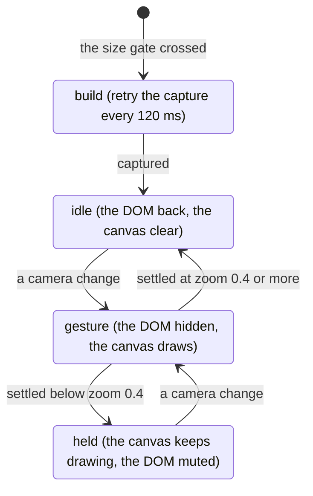

<!-- [[C42]] htmlInCanvasRenderer, [[A1]] visualGraphCalculator -->

# Spec: HTML-in-Canvas gesture layer

Serves [[C42]] htmlInCanvasRenderer; its GPU limits are [[#The GPU texture budget]]. It covers what the layer does, when it runs, and the number behind each knob. The knobs are tuning, not decisions: change one freely, and record the measurement that justified the change here.

The layer makes pan and zoom cheap on a big graph. During a gesture it hides React Flow's viewport and draws captured bitmaps of the cards on a canvas instead; at rest the real DOM is back. It is never a DOM replacement: every click, edit and hover lands on the real cards. The live DOM and this layer are the canvas's only two ways of being drawn; a third would be another renderer to keep in step with every card. The layer rests on the WICG HTML-in-Canvas API, on by default in Chrome 157 and absent from Firefox and Safari, so it stays an opt-in: if the API changes again, the DOM default is untouched and nothing breaks. **Reopen if:** the DOM path becomes the one that costs more to keep.

The engine is `HtmlCanvasRenderer`, an imperative class rather than a React component; `HtmlCanvasLayer` mounts it and feeds it.

Code: `htmlCanvasRenderer.ts`, `HtmlCanvasLayer.tsx`, `htmlCanvasLayer.css`, `renderMode.ts`, `htmlCanvasSupport.ts`, `zoomSettle.ts`, `domSync.ts`, `rasterAtlas.ts`, `hicGraphSnapshot.ts`, `hicCableGeom.ts`.

## When it runs

- **The setting.** Render mode `html` (the default is `dom`, and only `html` persists) is offered only where `supportsHtmlInCanvas()` (`htmlCanvasSupport.ts`) finds the WICG API, in its shipped shape: the canvas's `content` attribute (Chrome 155 renamed `layoutsubtree` to `content="drawable"`) and the 2D context's `drawElementImage`. That is Chrome 157 on, or 155 and 156 behind `chrome://flags/#canvas-draw-element`; an older build has the pre-155 API and isn't offered the mode. The check is synchronous and cheap, so it runs at startup.
- **The size gate.** Even with the setting on, the layer stays inert until the graph weighs at least `RENDERER_MIN_NODES = 100` DOM units. The unit is kind-weighted (`nodeDomWeight`, `nodes/kind.ts`), in tiers each strictly heavier than the one below; the numbers are coarse by design, and the order is what matters:
  - a full figure (Chart, Histogram, Sankey, Mermaid, Record, Heatmap…) weighs 10;
  - a Tornado's inline bars 6;
  - a small inline figure (Sparkline, Gauge, Chart Builder) 3;
  - a card that previews a Frame, table or Cube grid 2, and so does an SVG Picker, which shows one `` at rest and mounts its inline SVG only on hover, never during a pan or zoom, the only time the gate reads the weight;
  - a plain scalar or logic card 1.

  So about ten charts engage it, while a scalar-only graph needs about a hundred cards. Below the gate the native DOM pans fine and the capture cost isn't worth paying. The weight is recounted on bind and on every node add or remove, even while inert, so crossing the line is noticed. `window.__hcMinNodes` overrides it live.
- **Both canvases.** `FlowSurface` mounts `HtmlCanvasLayer` for the main canvas and for a composite drill-in alike.

Tests:

- `renderMode.test.ts`: the mode defaults to `dom`, a set switches it, and setting the same value does not notify.
- `nodes/kind.test.ts`: the weight tiers in order, and ten full charts reaching the default gate of 100.

## The lifecycle

1. **Build.** On engaging, the layer starts in the gesture state (holder hidden, canvas active), so the DOM and the canvas never show as a double image, and it retries the capture every 120 ms until it succeeds. It then drops to idle.
2. **Gesture.** Any camera change, or a held pointer while gesturing, enters the gesture: the React Flow viewport ("the holder") gets `visibility: hidden`, never `display: none`, so its layout stays measurable and an in-flight drag survives. DOM-only elements stay visible through it (below), and so does the canvas backing (the canvas color and dots, [[react-flow-surface-contract#The dot grid]]), which the canvas draws its cards over; it follows the holder's presented camera like any DOM-only element. Cable flow animation freezes to match the static canvas. On fine pointers the holder gets a gesture-scoped `will-change: transform` layer; on coarse pointers it never does ([[#The GPU texture budget]]).
3. **Settle.** A gesture ends on a timer that each camera change re-arms: 140 ms after a pan, and `DEFAULT_ZOOM_SETTLE_MS = 420` after any gesture that zoomed.
   - A scale change repaints the whole visible DOM at the new raster scale, while a pan only recomposites, and wheel zoom is notchy with no held-pointer signal. A short zoom settle would leave and re-enter the gesture on every notch and pay that repaint each time.
   - A longer settle doesn't cure choppy zoom: a deployed 3000 ms A/B ruled it out.
   - `window.__zoomSettle` overrides the zoom settle live, so a deployed preview can be A/B'd with no redeploy. Only a finite, non-negative number is taken; anything else falls back to the default rather than set a nonsense timer.
4. **Held.** If the gesture ends below `HOLD_ZOOM = 0.4`, the canvas keeps drawing at rest. The DOM comes back muted (by opacity, so it still hit-tests) and the selected or focused cards show as live DOM on top. The renderer skips those live cards (`setDomLive`), so nothing paints twice. At that zoom DOM text is unreadable anyway, every card is in view so the settle repaint would be at its most expensive, and holding removes the pop at gesture end. `window.__hcHoldZoom` overrides it.
5. **Idle.** Above the hold zoom the holder is fully restored and the canvas clears to transparent. The canvas element itself stays visible even when idle, because capture needs it rendered.

A lasso never enters the gesture: it moves no camera, so the swap would only show a stale snapshot.

Tests: `zoomSettle.test.ts`: the default with nothing set, a finite non-negative override honored, and junk values falling back to the default.

### The GPU texture budget

A live canvas under a full-viewport opaque overlay stops painting: the composite drill-in sets `visibility: hidden` on the app canvas it covers, and any future surface that covers the canvas owes the same. It must be `visibility`, not `display: none`, because while the drill-in is open the covered canvas is still asked to re-render and re-measure cards, and measuring needs a real layout box.

The layer gives the viewport a `will-change: transform` layer for the length of a gesture on fine pointers only, never on coarse ones (the gate is `IS_COARSE`, not `isMobile()`). On a coarse pointer only the small DOM-only elements are promoted, each on its own and capped at 1024px (`PROMOTE_MAX`).

Why: the browser does not reliably drop a hidden subtree from raster, so a covered canvas keeps its layers and textures in memory, two surfaces' worth on a mobile GPU, where the canvas bounding box times the device pixel ratio can already overrun the maximum texture size on its own. A tablet runs the desktop UI on a mobile-class GPU, and a viewport-sized layer fails tile allocation there, so the gate is the pointer type rather than the device class. The desktop shell's WebKitGTK budget is the same idea per engine ([[layout-chrome#The desktop window frame (the Tauri shell)]]).

## Capture

Each card's live element is cloned into the canvas and captured with the WICG API. Capture keeps running while the layer is idle, so a fresh snapshot is ready for the next gesture.

- **The opt-ins.** The canvas wears `content="drawable"`, which lays out its descendants, and each clone wrapper wears `drawable`, without which `drawElementImage` and `captureElementImage` throw. The canvas is `aria-hidden`: drawable content joins the accessibility tree, and the clones would read every card twice.
- **No geometry sync.** Since Chrome 155 a draw moves the drawn element's hit-test box and focus ring to where it was drawn. Every draw passes `preserveElementGeometry: true`: the clones are pictures, and an atlas raster would otherwise park live hit boxes at atlas positions on screen.

- **Padding.** The capture box and the draw box are both inflated by `PAD` (10 px), because sockets straddle the card edge. A card's `x`, `y`, `w` and `h` stay the card's own: its world top-left and its natural CSS size.
- **The clone wrapper.** Every wrapper is absolutely positioned at the origin and insets the card with padding rather than by sizing or positioning it, so the card keeps its own CSS and its cloned inline styles. Inside it, a stand-in for React Flow's node wrapper has zero padding, border and margin, so its padding box equals the card's border box, where the card's absolutely positioned chrome anchors.
- **The clone never sets `position`.** Each root's own CSS class governs it, exactly like the original: `.solenoid-node` is static with its chrome anchored to the relative stand-in div, and `.solenoid-note` is relative so its resize handle anchors to the card. Forcing one value breaks the other root: a forced `static` shifted the note's handle by a measured 1.75 px, and a forced `relative` shifted node chrome.
- **What `cloneNode` misses.** Three repairs run on every clone, each walking the original and the clone in lockstep and bailing if their structure differs:
  - `syncFormState` copies live form properties (`value`, `selectedIndex`, `checked`), since `cloneNode(true)` copies only attributes. For a `<select>` it mirrors the `selected` attributes too, because the clone may be captured before it is in the document.
  - `syncCanvasState` blits each `<canvas>` element's pixels onto its clone, since a cloned canvas has an empty drawing buffer and every canvas-drawn figure would capture blank.
  - `uniquifyIds` rewrites every inline-SVG `id` and its references, since a duplicated id makes `url(#id)` resolve to nothing.
- **Capture at 1×.** `REF = 1`: the clone lays out at true size (CSS `zoom`). A higher REF would supersample for crisp zoom-in, but it rounds text line boxes differently from the live DOM, a measured 0.9 px drift. The accepted trade is a softer image past 100% zoom. `live` mode (`window.__hcLive`) re-rasterizes at the exact transform every frame for anyone who needs it crisp.
- **The mip pyramid.** Each card gets a pyramid of bitmaps halving from REF down to about `MIP_MIN_PX` (6 px). A frame draws the level `computeIdealMipLevel(scale, quality, dpr)` picks, `floor(log2(REF / (quality × scale × dpr)))`. Quality 1 is roughly one texture pixel per screen pixel; below 1 is cheaper and softer (`setQuality`).
- **How a pyramid gets built.** `buildMips` first tries the captured image as a bitmap source, then a scratch-canvas raster of the captured image or the live clone. The shipped API's `ElementImage` is only `{close()}` (its size comes from `getElementImageDefaultSize`) and is not an `ImageBitmapSource`, by spec and permanently, so on most builds both fail and the card falls to the in-paint raster. That raster must run inside the `paint` event and before `drawFrame`, which clears the atlas pixels in the same paint task so they never present. It takes at most `RASTER_BATCH` cards per paint (24 on a coarse pointer, 48 on a fine one) to stay inside a frame budget, and a card is retried up to `RASTER_MAX_ATTEMPTS` (5) times, since a fresh clone may miss its first rendering update. `buildMips` loops until no unbuilt card remains, because an `updateNodes` that arrives mid-build returns early on the `building` guard.
- **One read-back per paint.** Every card rastered in a paint packs into one atlas (`rasterAtlas.ts`). The packer sorts the cards tallest first, so shelves stay dense, and places them left to right with a gutter, wrapping to a new shelf; a card larger than the atlas is scaled down to fit alone, and a card that does not fit this round is reported unplaced for the next. The paint takes one canvas read-back, and each card's bitmap is cropped from the atlas bitmap (`createImageBitmap(atlas, x, y, w, h)`), which needs no further read-back. A read-back per card (about 16 per paint) is the expensive pattern on mobile GPUs. `createImageBitmap(canvas)` copies at invocation, so the paint's later clear cannot race it.
- **The ink check.** The first atlas is checked once for ink (every card paints an opaque body). A build that defers the raster past the read-back would otherwise cache a blank texture for every card. If the check cannot run, the layer proceeds.
- **The slow path.** A card whose pyramid can't be built is drawn with `drawElementImage` on every frame instead, and a card with no capture at all draws its live clone, so it never blinks out. Both stay correct, just slower, and `getStats()` counts slow draws and permanent failures. When every capture throws, the layer still marks itself captured, so the tick loop does not spin `requestPaint` every frame.

Tests: `rasterAtlas.test.ts`: an empty layout, one card at the origin unscaled, a row wrapping to a new shelf with the gutter, tallest first, an oversize card scaled to fit alone, cards that don't fit reported unplaced, and no placement overlapping another or leaving the atlas.

## Drawing and the camera

- **Only inside `paint`.** A snapshot of the canvas children is recorded just before the `paint` event, so `drawElementImage` called outside the handler draws the previous snapshot. That is the "canvas a frame behind the DOM" bug at its source. Every frame that must call `drawElementImage` (live mode, or a visible card with no pyramid yet) routes through `requestPaint`; a frame drawn purely from cached bitmaps draws synchronously. The paint handler re-reads the freshest camera from its transform source, because the paint can land a frame after the animation frame that asked for it. The listener is added with `addEventListener` only: also assigning `canvas.onpaint` registers a second listener on builds that have the IDL attribute.
- **The exact backing-store ratio.** The render transform scales by the backing store's own ratio to CSS pixels on each axis (`bsx`, `bsy`), not by `devicePixelRatio`. The backing store is rounded to whole pixels, and a transform built from the pixel ratio drifts from the DOM in proportion to world coordinate times zoom.
- **The DOM follows the presented camera.** Mid-gesture the canvas draws the cards while DOM-only content (conduits, their cables, the standoff layer) stays live DOM, and the two pipelines can skew by a frame or more ("the conduit trails the pan"). So the holder's transform is steered to the camera the canvas actually presented (`holderSyncTransform`, `domSync.ts`): the one the last frame drew with, which the paint re-read from the transform source. Before Chrome 155 `drawElementImage` returned its draw matrix and the camera was derived from it within a tolerance of this bookkeeping; it returns nothing now, and the matrix only ever echoed the transform the renderer set. When the gesture ends the layer hands the transform back by re-serializing the live camera (`holderTransform`), so React Flow's next write is a no-op.
- **Selection.** The per-card selection ring is a pseudo-element, so it rides along in the captured clone; a selection change re-captures only the cards whose ring toggled. The box-select rectangle is drawn in screen space, so its stroke stays a constant 1 px.

Tests:

- `domSync.test.ts`: `holderTransform`'s serialization; `holderSyncTransform` null with nothing presented or when live and presented agree, and the presented transform on a pan or zoom skew.
- `hicCamera.test.ts`: the camera round-trips world and screen coordinates.

## Cables on the canvas

`snapshotCables` (`hicGraphSnapshot.ts`) measures every visible card's sockets and returns the cables between them. Every read is guarded, so a half-built graph yields a partial list, never a throw. The layer draws those cables, minus the ones touching DOM-only elements; the cards themselves come from the captures above, never from the snapshot.

- **Cable ends.** React Flow anchors an edge at the handle box's outer edge (right for a source, left for a target), not its center, so the snapshot measures the handle and the routed ends match the DOM cable. A flipped node's handles sit on the mirrored edge, so the anchor follows the visual side.
- **Collapsed members.** Members of a collapsed group are skipped, and so are their cables, since the DOM shows nothing for them.
- **Conduits.** A Conduit's model position is its wrapper's origin, but its body floats at an offset and rotates, so the snapshot uses the Conduit element's true rect.
- **Color.** Each cable carries its source socket's data-type color, resolved from the `SOCKET_COLORS` CSS variables off the document root (neutral gray as the fallback) and cached for one snapshot, so a theme change is picked up.
- **Routing.** `hicCableGeom.ts` routes each cable with the app's real router (`getCablePath` in `cablePaths.ts`), so canvas cables match DOM cables exactly, and flattens the SVG path to a polyline (`parsePathPoints`, which reads the M, L, Q and C commands the routers emit). Each end reaches `SOCKET_OVERLAP` into its socket, as the DOM cable does, so no seam shows at the handle edge. An exit angle is honored, and a flipped endpoint leaves or enters from its mirrored side, as in `FlowCableEdge`.
- **Following moves.** The layer's frame loop compares every card's model position and selection class with the renderer's only on frames near a change: for a few frames after React Flow is handed a new `nodes` array (every move and selection change is one), after a build or re-capture, and while a card is still moving. A camera frame walks no cards ([[C120]] linearWork). The renderer stores each cable as offsets from its endpoint cards, so it follows them live; the snapshot's absolute positions are the fallback when an endpoint card is absent. Cables are routed once on a topology or shape change, and `relayoutCables(moved)` re-routes from current positions with no DOM read, limited to the cables touching `moved` when given.
- **Drawing.** Visible cables are bucketed by color into one `Path2D` each, so a frame strokes a handful of paths rather than one per cable. The stroke is `1.8 × zoom` screen pixels, matching the DOM cable's 1.8-unit stroke inside the scaled viewport; a constant screen width would read far heavier once zoomed out. The idle opacity matches the DOM cable's non-hover default (0.72 in `FlowCableEdge`), or the gesture swap visibly pops.

Tests:

- `hicCableGeom.test.ts`: the ends reach `SOCKET_OVERLAP` into the sockets, every cable shape gives a finite polyline, an explicit exit angle is honored, and a flipped source's path equals `getCablePath`'s left-side route.
- `pathPoints.test.ts`: `parsePathPoints` reads comma- and space-separated lines, flattens cubic and quadratic curves with exact endpoints, reads the walk router's rounded corners, and returns nothing for garbage.

## Keeping the capture fresh

Every change to how a card looks must reach a re-capture, by one of two channels: `view.rerenderNode(id)` through the flow view's `render` pipe, or a store the layer subscribes to. The subscribed stores are connection topology, chevron collapse, group collapse, manual size, group membership, theme and palette, format annotations, cable shape and semantic zoom. Group collapse is on the list because it re-renders only the group's own id, so its members would keep their cached bitmaps; semantic zoom flips a root CSS class the bitmaps know nothing about. `cableValueStore` is deliberately left out: a value change already arrives per card through the render pipe, and the store's bump carries no ids, so subscribing would force a full rebuild on every pass. A new store that changes how a card paints joins this list. Socket hover highlights, format mismatches and pack toggles are deliberately left out: one churns on every hover, and the others are rare and too small to see. A re-capture touches only the changed cards (`updateNodes`), leaving every other card's pyramid intact, and selection changes re-capture only the cards whose ring toggled, so a lasso sweep stays cheap. Re-captures are debounced 150 ms and scoped to the cards that re-rendered; a new or vanished card makes the scope unknown and falls back to a full rebuild, which re-clones every card and rebuilds every pyramid. A re-captured card's cables relayout, since a grown value box moves its edges. While a lasso is active every rebuild waits for its release, because only selection is changing.

## DOM-only elements

The DOM-only set is the Conduit node views, every cable the canvas does not draw (one touching a Conduit, or one the graph snapshot can't resolve), and the standoff svg. None of them is captured. They stay live DOM through a gesture, shown through the hidden holder with inline `visibility: visible`, and the canvas skips them. On coarse pointers, where the holder gets no compositor layer, each DOM-only element is promoted on its own instead, capped at 1024 px (`PROMOTE_MAX`, [[#The GPU texture budget]]). Group collapse stamps inline visibility on the same elements, so the layer never overrides an element something else hid, clears only a `visible` it stamped itself, and clears the old set's overrides before a rebuild installs the new one.

## Debugging

- `window.__hcProbe()` logs which WICG paths the build supports and whether `drawElementImage` rasters eagerly or defers.
- `window.__hcDiag = true` logs, per capture, the real against the expected dimensions and a clone-against-original position check for each element inside the card.
- The debug overlay (`window.__hcOverlay`) draws the canvas at half opacity over the live DOM, to compare capture and position by eye.
- `window.__hcTriggers` counts rebuild causes by name, so a store that fires on every pass shows in the console.
- `window.__hcStats()` returns the renderer's stats plus `domOnly`: `slow` is the visible cards re-rasterized per frame, `failed` the permanently unbuildable pyramids, `domOnly` the elements kept as live DOM through a gesture.
- `window.__hcQuality` sets the level-of-detail bias, in texture pixels per on-screen pixel.
- Because the engine is imperative, HMR invalidates the module rather than keep a stale instance alive.
