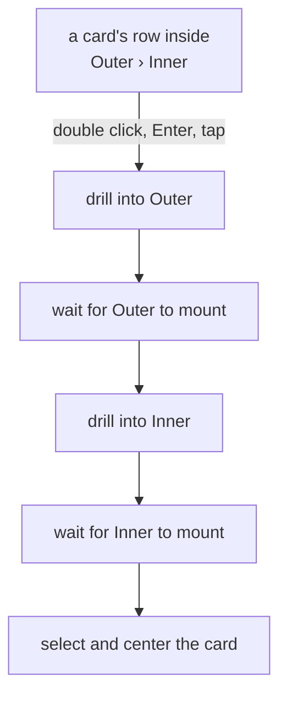

<!-- [[A1]] visualGraphCalculator, [[C52]] visibleSelection, [[C77]] compositeIsSubgraph -->

# Spec: Outline panel

Serves [[A1]] visualGraphCalculator (focusing a node) and follows [[C52]] visibleSelection. It covers what the system does and blocks, and the decision each behavior serves.

The Outline is the Navigator's lower section: the list of every node on the open level (the main canvas, or the composite drilled into), mirroring group membership and collapse state. The Files section above it, and how the two share the pane, are [[workspace-tree]]. Format Controllers are left out entirely. The code is `OutlinePanel.tsx`.

## The list

- **Unfiltered, it is a tree:** top-level nodes, and under each expanded group its members, indented 18 px per level, one icon slot, so a member's dot sits under its group's label.
- **A search query or a filter chip switches to a flat list.** A query matches the display name and the catalog name (`nodeName`, the same string the card's hover hint shows).
- **Filter and sort sit in one menu** behind the funnel inside the search field, beside the every-document globe, so they cost the panel no rows: Inputs and Displays as toggles, then Sort by Position or A–Z. The funnel wears the accent while a filter is on, and the field's placeholder names it (Search inputs…).
- **The filters are Inputs and Displays.** A node is an input when it is a source by either measure: it has no input sockets but has an output, so it counts before it is wired; or nothing is wired into it while its output is wired onward, which stops being true the moment an input is wired.
- **Sorting** is Position (the default) or Alphabetical, remembered under `solenoid.navSort`. Position reads top to bottom in row bands of 120 world units, then left to right; the band is deliberately generous so the order doesn't react to small vertical jitter. Alphabetical compares display names numerically and ignoring case.
- **A group row reads as a container:** its own color as a 24% tint fill inside a full 1 px edge at 55%, never an accent stripe. The edge is an inset shadow, so a group row is exactly as tall as a node row.
- **Two columns.** Every control's box sits one gutter in from the panel edge and every text or icon one pad inside its box; a node's dot is centered in the chevron's slot, so group and node labels share one column.

## Composites

- **The Outline follows the drill-in.** It reads the active graph (`getActiveEditor`), so while drilled in it lists the open composite's cards, and a level row above the search field names where it is, Canvas › Outer › Inner; a click on Canvas or an outer name backs out as the strip's crumbs do (`compositeEditorStore.drillTo`, which the mounted drill-in registers, so the levels it leaves settle). On desktop the strip and its run controls step right of the open panel; a phone's sheet covers the strip and its level row stands in.
- **A composite's row folds open** to the cards inside it, at any depth, with the chevron in its dot's slot in its own color. The fold is per session and per panel, since a composite has no fold of its own on the canvas; folding open one that hasn't loaded its insides loads them. A group inside a closed composite lists its cards under it and doesn't fold from here.
- **Opening a card inside a composite** (a double click, Enter, or a tap on a phone) drills level by level down to it, waiting for each level to mount, then selects and centers it as on the open level. Space and the selection clicks skip such rows: their cards aren't on the open level.
- **A search reaches inside composites**: the flat list holds every card at every depth, each inside one followed by where it lives (Outer › Inner). The section's count stays the open level's.
- **Refresh state** ([[C23]] calcModes): a held composite waiting on Refresh wears the card's hollow warning ring at its row's end; a composite with one waiting anywhere inside wears a smaller dot, so a folded row still says something inside is out of date. Only the Navigator shows the inside state; the outer card doesn't.

## Keeping current

While open, the panel polls the active graph every 300 ms and re-renders only when an order-sensitive signature of its rows changes (a composite's Refresh state included), so a Position re-sort caused by a moved node shows within one poll. The per-row connection lists subscribe to `connectionVersionStore`, because the signature ignores connections.

## Acting on rows

- A plain click on a row does nothing, to avoid jumpy recentering.
- A double click selects the node and pans it to the center (`focusNode`). It sizes through `measuredBox` ([[auto-arrange-tidy#Size reads]]), so a collapsed group centers on its visible box.
- Ctrl or Cmd click and Shift click add to the selection or select a range without recentering; on a touch device in select mode a tap accumulates too.
- On mobile a plain tap selects and jumps, since there is no double click.
- Ctrl or Cmd+F, without Shift, opens the panel and focuses its search, except under a modal (`keyUnderModal`), where the search would open behind it and take its focus.
- **Keyboard**: the list is an ARIA tree with one row in the tab order, on the Files tree's keys ([[workspace-tree#The pane]]): Up, Down, Home and End move; Right opens a folded group or steps into it, Left folds it or steps out to its group (folding only in the unfiltered tree); Enter selects and centers, as a double click does; Space adds the row to the selection or takes it out; typed letters jump. Keys the list takes stop there, so an arrow never also nudges the selected cards.
- The header's collapse-all button toggles every group through `setGroupsCollapsed`, so the neighbor push and expand sweep apply. Its glyph shows the action: converging to collapse, diverging to expand.

## Layout

While open, the panel sets `body.solenoid-nav-open`, so bottom-left popups shift right past it. Its place among the bars is in [[layout-chrome]].
