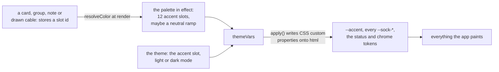
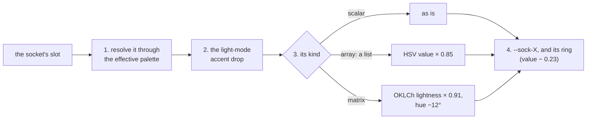
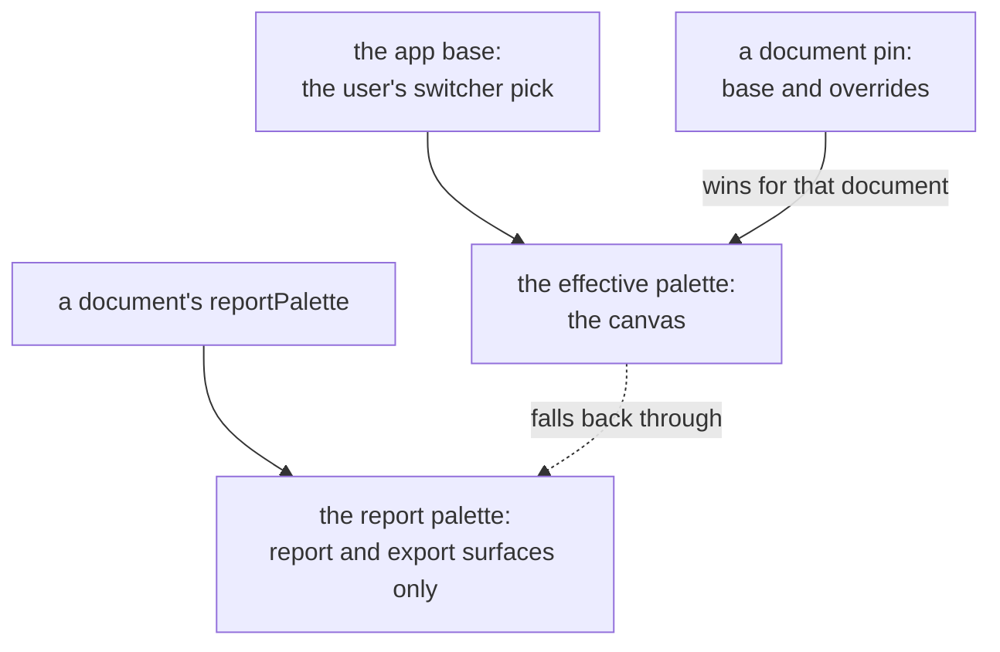

<!-- [[B14]] oneDesignSystem, [[C3]] brandGoldChrome -->

# Spec: Palette and theme

Serves [[B14]] oneDesignSystem: every color rule below exists so the app wears one look at a time. It covers what the system does and blocks, and the decision each behavior serves.

Every color the app paints comes from one of two places. A **palette** is a named set of twelve accent colors plus, optionally, a neutral ramp for the workbench around the graph. The **theme** is the user's accent choice and light or dark mode, which `appTheme.ts` writes onto `<html>` as CSS custom properties. What each built-in palette is meant to look like, and the structure every neutral ramp keeps, is in `DESIGN.md` §2 Colors.

Code: `palette.ts` (the palette half), `appTheme.ts` and `themeVars.ts` (the theme half), `cssColor.ts`, `categoryColor.ts`.

## Slots: how a color is stored

A card, group, note or drawn cable never stores a hex. It stores a **slot id**, one of the twelve keys of `PALETTE`, and the color is looked up at render time. The id is never an index either, because the swatch order can change while the id stays put. Ids are opaque names: in a given palette the `green` slot need not be green.

The twelve slots and their Default hexes:

| Slot | Default | Socket color it drives |
|---|---|---|
| `gray` | `#8a8f98` | `--sock-any` |
| `amber` | `#d9742b` | none (the input node kind) |
| `blue` | `#3173e0` | the logical sockets (and the math node kind) |
| `teal` | `#4fc89a` | none (the convert node kind) |
| `purple` | `#c05dd1` | none (the logic node kind) |
| `green` | `#00b862` | `--sock-lambda`, `--sock-chart` |
| `gold` | `#f5b914` | `--sock-number`, `--sock-list`, `--sock-table` |
| `lime` | `#c8e040` | the string sockets |
| `pink` | `#de7cb0` | the date sockets |
| `sky` | `#56b4e9` | the complex sockets |
| `vermilion` | `#e0473a` | the semantic error red, `--sol-error` |
| `violet` | `#7b64ed` | `--sock-frame`, `--sock-cube` |

`COLOR_PALETTE` is the swatch picker's order, and also the order of the categorical chart series: gold, green, amber, blue, lime, purple, gray, vermilion, violet, pink, sky, teal. Gray sits seventh so the first six series stay vivid.

### Resolving a slot

`resolveColor(slot)` is the one place a slot becomes a hex. It checks the two neutral shades first, then the effective palette, and anything else (an unknown or stray string) falls back to the palette's gray. It is total so that a bad stored value can never crash a render; it is not a compatibility path for old values.

### The gray swatch's neutral cycle

The gray swatch cycles through three values: `neutral-white` (default `#f3f4f6`, a hair off pure white so it reads as a swatch), `gray` (the real slot) and `neutral-dark` (default `#3a3d42`). The two extremes are fixed sentinel ids, so a card stores and saves them like any slot.

`neutralHex(slot)` draws all three from the active palette's chrome, so on a tinted palette they are that palette's neutrals and not foreign grays ([[B14]] oneDesignSystem): a palette sets the look of the whole workbench, so its neutrals belong to it too, and a plain gray on a navy workbench looks out of place. Each shade borrows one color from the palette's dark-mode chrome ramp: white takes its `text`, gray its `textMuted`, and dark its `borderStrong`. The borrowed color is used only if it still looks like that shade, which means its OKLCh lightness is between 0.85 and 1 for white, 0.45 and 0.8 for gray, or 0.2 and 0.55 for dark. Solarized's dim text, for example, is too dark to count as white. When the borrowed color is out of its band, the shade keeps its default (`#f3f4f6` for white, the palette's `gray` slot for gray, `#3a3d42` for dark), tinted with the hue of the ramp's background (`appBg`) at a chroma of at most 0.05, keeping the default's lightness. A palette with no chrome ramp keeps the plain defaults. `resolveColor` routes the white and dark shades through it, and `resolveAccent` the app accent's gray, so groups, notes and cables colored with a neutral shade follow the palette the same way. A gray node or socket keeps the palette's own `gray` slot. **Reopen if:** a palette's chrome text or border reads badly as an accent; that palette then names its neutrals itself.

`nextNeutral` steps gray to dark to white to gray, and any real color (or none) steps to gray. `NEUTRAL_CYCLE` lists them in the order the split disc draws them: upper left white, middle gray, lower right dark. The two extremes are reachable only through the gray swatch and never appear as swatches of their own. `NEUTRAL_HEX` has a null prototype, so a stored slot such as `"constructor"` reads as undefined rather than a function.

Tests: `palette.test.ts`: the cycle and its homing to gray, the neutrals plain under Default and taken from the chrome under a tinted palette (Solarized's dim text falling back to a white tinted with its background's hue), only the extremes counting as neutral shades, and neither extreme in the swatch grid.

## Socket colors

`SOCKET_VARS` maps each `--sock-*` variable to a slot and a kind (`scalar`, `array` or `matrix`). App.css defines no `--sock-*` values: `themeVars` writes every one on each apply, so a palette or mode change retints socket dots, cables and the legend. Shared slots are told apart by glyph: `--sock-table` (a numeric matrix) shares gold with the number sockets and is known by its grid glyph, the cube shares the frame's violet and is known by its hexagon, and the chart shares lambda's green.

Each socket color is derived in this order:

1. Resolve the slot through the effective palette.
2. Apply the light-mode accent drop (`themeAccent`). This comes first so the drop compounds exactly once, not again on top of the shade.
3. Apply the kind's shade. `socketArrayShade` multiplies HSV value by 0.85, HSV being the default space (`DESIGN.md` §Tertiary). `socketMatrixShade` runs in OKLCh (`oklchShade`), the override for a large perceptual move: lightness × 0.91 and the hue turned −12°, chroma kept, a color pushed past sRGB giving up chroma until it fits (`oklchToHex`). The hue turn is what tells a 2-D socket from its scalar. HSV's −11° (with saturation × 1.18 and value × 0.92) turned gold's matrix 25° into orange and barely moved sky's; the OKLCh step is that rule's median effect (author 2026-11-03).
4. Write the result as `--sock-X` and a ring as `--sock-X-ring`: `socketRingShade`, a fixed HSV value drop of 0.23 off that same fill, so every glyph's border reads at the same contrast whatever the fill's lightness.

The accent drop, the list shade and the ring run in HSV, the matrix shade in OKLCh (`DESIGN.md` §Tertiary). A canvas renderer (the minimap, the HTML-in-Canvas snapshot) cannot read a CSS variable, so `socketVarHex(expr, mode)` runs the same derivation without the DOM. It accepts a bare `--sock-*` name or a `var(--sock-*)` expression, passes a bare hex through unchanged, and returns gray for anything it does not recognize.

## Card colors

A card's accent is its node kind's slot (`NODE_KIND_SLOTS` in `nodes/shared.ts`); `nodeKindOf` in `nodes/kind.ts` files each card under a kind (its family), and a card it doesn't list falls back to math. Filing a card under a family is how its color is chosen, and the families stay as chosen. `nodeAccent` is the one place a card's color is read, and every consumer (the card header, the Navigator, the minimap, the canvas snapshot) goes through it, so a minimap can never stay one color while its card recolors. It returns a concrete, theme-resolved hex, never a CSS variable, which a `<canvas>` can't paint. It departs from the kind's slot in two cases:

- **Socket-driven cards** (List Input, Table Input, Sets, the Format Controller) wear their first output socket's color, so a retype recolors them.
- **Unfiled cards** ([[B14]] oneDesignSystem): a card `explicitKindOf` returns no kind for, with exactly one output whose type is not a number, list, numeric matrix or wildcard, wears that output socket's color. A numeric fallback keeps math blue. A card's color tells what it makes; math blue exists only so every card has a color, and a text or date result on a blue card would read as a number. **Reopen if:** the unfiled cards get a family of their own.

`nodeAccentSlot` is the slot behind the accent the card paints, so a group of unfiled text cards takes their lime, not math blue.

Tests: `nodes/kind.test.ts`: a plain card's theme-resolved kind color, always a concrete hex, List Input and Table Input tracking their element socket across a retype, the chart cards in chart green, an unfiled card wearing its one non-numeric output's color while a numeric one keeps math blue, and `nodeAccentSlot`.

## Accent helpers

- `themeAccent(hex, mode)`: in light mode, drops HSV value by 0.045; in dark mode, returns the hex unchanged. The caller passes the mode because `palette.ts` cannot import the theme store (the import would be circular).
- `darkenAccent(hex)`: HSV value −0.07, for light-mode outside borders on cards, groups and popups.
- `hexToRgba(hex, alpha)`: falls back to `rgba(139,124,246,alpha)` for a bad hex.
- `contrastInk(hex)`: the text or icon color for a solid fill: `#fff` when white clears 3:1 WCAG contrast against the fill (`1.05 / (L + 0.05) ≥ 3`, L the fill's WCAG relative luminance, so L ≤ 0.3), else `#1a1a1a`, and `#fff` for a bad hex. This is Android Chrome's own rule for the toolbar it tints with `theme-color` (`ColorUtils.shouldUseLightForegroundOnBackground`), and `theme-color` is the accent, so the app's accent ink and the browser's icons always agree. The earlier rule, gamma-encoded luma (0.299 R + 0.587 G + 0.114 B) above 0.62, overweighted greens and blues and put white on fills Chrome gave dark icons (Default green and sky, Neon green). Results are cached per hex, because a card asks for its ink on every render. Each palette change bakes the ink for every slot of the effective palette in its raw form and in both theme modes (`bakeInks`), since the light-mode drop can move a color across the threshold.

Tests: `palette.test.ts`: every slot in both modes gets one of the two inks, the ink agrees with Android Chrome's rule, and the cache agrees with a fresh computation.

## The built-in palettes

`BUILTIN_PALETTES` holds nine palettes, each setting all twelve slots as hexes. Slots may share a color only where color blindness forces it (Colorblind-safe maps twelve slots onto a smaller proven set) or where a palette is monochrome by design (Equinox); every other built-in gives all twelve slots distinct colors. `PALETTE_NAMES` lists them in this order:

- **Default**: `PALETTE` itself.
- **Muted**: the Default hues at about 0.62 of their saturation, with lightness nudged toward the middle.
- **Colorblind-safe**: the Okabe-Ito set. The eight slots that drive sockets (gray, gold, lime, pink, sky, vermilion, violet, green) each take a different Okabe-Ito color, so the type system stays separable; gray is `#999999`, since Okabe-Ito has no gray. The four slots that only color node kinds reuse the matching one: amber takes number's orange, blue takes frame's blue, teal takes complex's sky, purple takes date's reddish purple.
- **Solarized**: Solarized's eight accents, plus base1 gray (`#93a1a1`) and three hues blended into its gaps (a leafy green, a light azure, a muted purple), with gold brightened off Solarized yellow. Every slot stays a distinct color.
- **Equinox**: Default with its hue and saturation removed. Each slot is a gray at its Default color's OKLab lightness, with the slots' lightness range stretched linearly onto 0.42 to 0.9 (`EQUINOX_BAND`) for contrast (`equinoxPalette`), so blue and violet are dark grays and gold and lime nearly white, and type is told apart by socket shape and that lightness alone. This neutralizes the error red too, by design.
- **Orchard**: lifted from the Pear design system, a warm cream ground under orchard hues. Pear ships no cool hue, so teal, sky, blue, violet and purple are blended into its gaps at Pear's own saturation and value band (saturation about 0.40 to 0.56, value about 0.62 to 0.71), the same technique Solarized uses. Then every slot leans 10% of the way in OKLab a/b toward Orchard's own lime, its lightness kept (`pulledToward`, `ANCHOR_PULL`), and gray 3% (`ANCHOR_GRAY_PULL`) so it stays a neutral the accent-adaptive chrome ignores; the authored hexes are `ORCHARD_BASE` and the lean is part of the palette, not an edit to it (the author 2026-11-06).
- **Blueprint**: a cyanotype drafting table. The slots are chalky mid-value pencil colors that hold up on deep blue and on the light whiteprint; `blue` and `sky` stay clearly separated from the ground by value. Every slot then leans toward Blueprint's own blue as Orchard leans toward its lime, the same 10% (gray 3%), from `BLUEPRINT_BASE`.
- **Neon**: derived from Default, never authored (`neonPalette`). Gray stays Default's gray. Every other slot:
  1. **Push.** HSV saturation and value go 65% of the way to full (`1 − (1 − x) × 0.35`, `NEON_STEP`).
  2. **Floor.** A color under 4.5:1 on black (relative luminance 0.175, `NEON_MIN_LUM`) bisects its saturation back down, value held, until it clears (`neonAt`).
  3. **Nudge toward brightness.** The slot may slide its HSV hue toward whatever is brightest nearby. Its reach is `45° × (1 − L(hue) / L(yellow))`, where L is the luminance of the pure hue at full saturation and value, so a dark hue (violet, blue) may move far and one already near a luminance peak (lime) barely moves. The reach is capped at a third of the hue gap to each neighbor on the hue ring, so no slot crosses or meets another.
  4. **Spacing guard.** Within that window the slot takes the brightest candidate (81 samples, each through steps 1 and 2) whose OKLab distance to every other slot is at least the floor: Default's closest pair among the socket slots (gold and lime). If none qualifies, it takes the candidate with the most room. Slots choose in order of reach, darkest hue first, and the whole round runs three times so later choices are seen by earlier ones.

  The point of the guard is that brightening crowds colors toward the luminance peaks (yellow, cyan, magenta), where the neighbors are: without it gold and lime meet at yellow, and pink and purple at magenta.
- **Dawn and Dusk**: Default's slots, softened and tinted toward the dusk ground, never authored (`dawnDuskPalette`). Each slot keeps its Default OKLab lightness; its chroma is scaled to 65% (`DD_SATURATION`), then it moves 10% of the way in OKLab a/b toward the dusk color (`tintedToward`, shared with Orchard and Blueprint's lean) (`DD_TINT`; the heatmap's `plasma` colormap at 0.4, the same purplish burgundy the dark ground uses), which warms every hue a little toward that ground so the set reads as one scene. Gray takes 3% of the tint. Plasma is the palette's inspiration, not a target: it supplies the tint and the chrome's two hues, and nothing else. As a sanity check, socket slots stay at least 60% of Default's closest socket-pair distance apart and no pair falls under 60% of the smaller of that distance and its own Default distance (`palette.test.ts`); gold and lime, Number and String, are the closest, at about 68%, harmony with the grounds having been put first.

Tests: `palette.test.ts`: every palette sets twelve hex slots, distinct outside Colorblind-safe and Equinox; Neon keeps Default's gray, makes every other slot readable on black, keeps the hue order with each pair a third of its Default gap, and puts no two slots closer than Default's closest socket pair; Dawn and Dusk keeps its socket spacing floor and Default's lightness steps on every chrome key.

## The neutral chrome ramp

Besides its slots, a palette may author the **chrome ramp**: the neutral workbench around the graph, per theme mode. It is a separate map from the slots (`BUILTIN_CHROME`, keyed by palette name) and never a slot a card can point at. The thirteen keys (`ChromeKey`) and the App.css tokens they write (`CHROME_VARS`):

| Key | Token | Key | Token |
|---|---|---|---|
| `appBg` | `--app-bg` | `borderStrong` | `--border-strong` |
| `canvasBg` | `--canvas-bg` | `borderSubtle` | `--border-subtle` |
| `canvasDot` | `--canvas-dot` | `text` | `--text` |
| `surface` | `--surface` | `textBright` | `--text-bright` |
| `surfaceSunken` | `--surface-sunken` | `textDim` | `--text-dim` |
| `surfaceRaised` | `--surface-raised` | `textMuted` | `--text-muted` |
| `border` | `--border` | | |

A ramp is all or nothing ([[B14]] oneDesignSystem): a palette sets every key in both modes or none and keeps the app's own, because a palette that set only some of the neutrals would leave the app wearing two looks at once. The other neutrals are mixed from that one set, never set one by one, so moving the set moves the whole chrome, including on a palette nobody has checked by eye. A tinted palette's workbench follows the accent the user picked ([[#Accent-adaptive ramps]]), and a document pinned to a palette takes its workbench too ([[#Which palette is in effect]]). A palette may recolor the workbench but never break its structure (`DESIGN.md` §2: canvas darker than a card, a legible dot, the field brightest in light mode and a recess in dark mode, hover stepping toward the ink, three border tiers stepping outward, four ink tiers stepping down in contrast); `palette.test.ts` checks it over every ramp, Default's included, since a rule Default fails is a wrong rule. The WCAG AA requirement binds only Default, which nobody chose, and Colorblind-safe, which exists to be legible (`AA_PALETTES` in `palette.test.ts`); the others are looks a user opts into, whose value is fidelity to that look (Solarized sits near 3:1 by design, and forcing AA would no longer be Solarized). A palette that becomes anyone's default joins `AA_PALETTES` that day. The requirement is 4.5:1 for every ink tier on a card and a field, and for the body text on the canvas; the secondary tiers are not held on the canvas, since nothing sets them there and App.css's own light ramp sits at 4.35 there. **Reopen the all-or-none rule if:** the workbench needs more than flat colors, such as a texture, a vignette or a workbench per document. Default authors none (`NO_CHROME`), because it is App.css's own ramp; every other built-in authors all thirteen keys in both modes. The rest of the neutral chrome follows the ramp two ways: through App.css's own `var()` chains (`--btn-bg` from `--surface-sunken`, `--panel-border` from `--border`, `--panel-bg` and `--overlay-bg` from `--surface`), and through the derived tokens below.

`DEFAULT_CHROME` is a hand-kept copy of App.css's two `:root` ramps. It is never written to the DOM. It seeds the Custom palette's ramp and the custom palette editor's chrome wells, so an author edits away from what they see. No test can read the stylesheet, so keep it in step with App.css by hand.

Tests: `palette.test.ts`: every declared chrome key is known and a hex, a palette authors no ramp or a complete one in both modes, switching the app base swaps the ramp, a document pin picks the chrome and wins over the app's choice; every ramp and App.css's own keep the `DESIGN.md` §2 structure (a tinted canvas a clear step below its cards); every ink tier of the AA palettes clears 4.5:1, and those palettes are all among the ramps checked.

### App.css: the fallback tokens and the ramp's roles

App.css holds the fallback values of the theme tokens. `appThemeStore` overwrites the accent at runtime, and `appTheme.ts` writes every `--sock-*` from the active palette, so beside the ramp App.css keeps only the selection-ring and selected-cable tokens and the chrome literals.

- **Ramp roles.** `--surface` is raised chrome (the node body, menus, popovers), `--surface-sunken` is a recessed field (inputs, value and result boxes), and `--surface-raised` is a hover or selected fill inside chrome.
- **Chrome fills are opaque.** Bars, panels and floating overlays are the surface, never a window onto the graph behind them.
- **Floating overlay chrome** (socket legend, minimap, pins, alerts) uses the opaque surface with a stronger always-on border (`--overlay-border`, 2 px through `--overlay-border-width`) and a layered shadow, so it reads above a busy graph. The border defines it more than the shadow does, which stays lighter and tighter, because a wide soft shadow spreads heavier on a larger panel such as the socket legend. The border width is theme-agnostic, and the light ramp only softens the shadow tint.
- **The dock edge** (`--dock-shadow`) is a minimal leftward lift on the right docks (Inspector, Report), because cards scroll off under that edge and a border alone reads flat. It stays under the bars.
- **`--text-muted`** is set to clear WCAG AA 4.5:1 on the card and sunken surfaces (`#80868e` dark, `#6a717b` light) while staying a step below `--text-dim`.
- **The light theme.** The card body is a touch off-white, fields are the brightest layer (white) so number boxes and dropdowns read as familiar input fields, and the canvas is a shade grayer so cards lift off it. Its header tint is stronger (`--header-tint` 52% against 22% in dark mode), since pale on white needs more.
- **The selection ring** is the accent mixed toward a contrast pole (`color-mix(accent var(--mix-ring), var(--ring-into))`): 70% accent toward white in dark mode. Light mode flips the pole to black and raises the accent share to 80%, because a mix near 70% toward black reads as a harsh near-black frame over a pale card.
- **`--cable-selected`** is white on the dark canvas and a dark neutral in light mode. The wordmark is accent-tinted in dark mode and a dark neutral in light mode, so neither washes out on near-white.

### Mapping a lifted system onto the ramp

- **Orchard** maps Pear's neutrals by role, not position. Pear sinks its fields; Solenoid's light theme makes the field the brightest layer (`DESIGN.md` §2). So in light mode Pear white becomes `surfaceSunken`, Pear surface becomes `surface`, and Pear surface-sunken becomes `surfaceRaised`. Where Pear has no token (dark `surfaceRaised`, `borderSubtle` and `textBright`; light `borderStrong`), the value is one step off the nearest Pear token, inside its band.
- **Solarized** uses its base03 to base3 ladder in the canonical roles: background, background highlight, then the content tones in Solarized's own order. Its border tiers are blends in the gap between base02 and base01. Its body text sits near 3:1 contrast on purpose; do not raise it (the 4.5:1 requirement binds only Default and Colorblind-safe, above).
- **Muted** lifts off near-black onto a soft, barely warm charcoal and pulls the light ramp's contrast in a step.
- **Colorblind-safe** is fully achromatic and a step crisper than Default.
- **Equinox** is an authored achromatic ramp (Default's with the blue cast removed), polarized at strength 0.3 (`EQUINOX_POLARIZE`) the way Neon's is below, for a crisper workbench.
- **Blueprint** is prussian blue in dark mode and cool whiteprint paper in light mode, cool end to end.
- **Dawn and Dusk** takes plasma's two ends, ground from one and ink from the other (`tintRamp`): every key keeps its Default OKLab lightness, so the structure carries over, and takes a hue and chroma. Dark mode: grounds and borders take the dusk hue (plasma at 0.4, a purplish burgundy) at chroma 0.03, lifted 0.06 in lightness together (`DD_DUSK_LIFT`) so the ground reads as burgundy rather than black, and the inks the dawn hue (plasma at 0.92, yellow) at 0.025, a cream. Light mode swaps them: plum ink, and a dawn ground at chroma 0.016 (`DD_GROUND_CHROMA`) whose hue comes from plasma's sunrise orange (0.8, `PLASMA_SUNRISE`) rather than its yellow end, since near white that yellow reads lime: a pale apricot glow. It does not follow the accent.
- **Neon** is derived from Default's two ramps, not authored (`polarizeRamp`): at strength 0.5: the five ground keys mix that far to the mode's ground pole (black in dark mode, white in light), the four inks that far to the opposite pole, and the three borders half as far, all with `mixHex`. The dot keeps Default's value. Mixing every key of a tier by the same step keeps each tier's order, so the structure Default passes carries over.

### The canvas step on tinted ramps

On a tinted ramp the canvas and the cards share one hue, so only lightness sets them apart, and the same step that reads on Default's neutral grays reads as one surface. Solarized, Orchard, Blueprint and Dawn and Dusk therefore pass through `deepenCanvas`: when the canvas sits less than 0.1 (dark) or 0.05 (light) of OKLab lightness below `surface` (`CANVAS_STEP`; Default steps 0.085 and 0.034), it drops to exactly that step, keeping its hue. In dark mode its chroma scales by the same factor as its lightness, as a darker paint holds less color, which keeps an adaptive ramp's rotation in gamut; in light mode it keeps its chroma, since a pale tint that loses chroma as it darkens turns muddy (Dawn's yellow went khaki). `canvasDot` keeps its hue and the same chroma treatment and moves, on its own side of the canvas, to the lightness that gives it the WCAG contrast against the new canvas that it had against the old, so the grid reads the same. No other key changes. Groups are a translucent tint over the canvas, so they deepen with it and the cards lift off both. The step was set by eye against cards both inside and outside groups; a group's tint already lifts its members, so judging only grouped cards overshoots. `palette.test.ts` pins the step.

### Derived chrome tokens

`chromeCssVars(ramp, mode)` returns the map from token to value that a ramp produces: each of the thirteen keys that holds a valid `#rrggbb` hex, plus the tokens App.css writes as literals, rebuilt from the ramp. When `surface` or `text` is missing it returns only the authored keys and derives nothing. `mixHex(a, b, t)` blends per sRGB channel, with `t = 0` giving `a`.

| Token (`DERIVED_CHROME_VARS`) | Value | Needs |
|---|---|---|
| `--overlay-border` | `mixHex(borderStrong, text, 0.08)`: one step past the strong border toward the ink, since overlays are defined by their edge rather than a big shadow | `borderStrong` |
| `--btn-hover` | `mixHex(surfaceSunken, text, 0.08)`, the same in both modes because "toward the ink" already flips with the theme | `surfaceSunken` |
| `--gauge-track` | `mixHex(borderStrong, textMuted, 0.35)`: stronger than a border so the gauge's unfilled arc clears the card, short of a muted label | both |
| `--cable-selected` | dark: `textBright`, else `text`; light: `text` | |
| `--wordmark-color` | light only: `text`. Dark mode leaves App.css's accent-tinted wordmark alone | |
| `--shadow-card` | light only: `0 1px 2px` in `text` at alpha 0.1 | |
| `--shadow-pop` | light only: `0 4px 14px` in `text` at alpha 0.07 | |
| `--overlay-shadow` | light only: `0 4px 14px` at 0.1 plus `0 1px 4px` at 0.06, both in `text` | |

Light shadows take the ink's hue, so a warm ramp casts a warm shadow; dark mode keeps App.css's black. The mix steps were calibrated by running the Default ramp through them and matching App.css's hand-tuned literals. Retune a step by redoing that comparison, never by nudging it until one palette looks right.

Tests: `palette.test.ts`: an unauthored ramp produces nothing, a partial ramp writes what it has and derives nothing, a full ramp writes all thirteen tokens plus the derived ones (all of them in light mode, five fewer in dark), and the Default ramp derives every token too.

### Accent-adaptive ramps

`CHROME_HOME` names the slot a tinted ramp was authored against: Orchard `green`, Blueprint `blue`. Every other palette, Custom included, holds still. `adaptChrome(ramp, homeHex, accentHex)` retints such a ramp for the live accent:

1. If either hex is invalid, return the ramp unchanged.
2. If the accent's OKLCh chroma is below 0.05 (`ADAPT_MIN_CHROMA`), return the ramp unchanged: the accent has no hue worth following. The floor sits in the measured gap between the grayest guard case (Orchard's gray at chroma about 0.038) and the least chromatic real accent (Orchard's teal at about 0.072).
3. Take the hue difference from home to accent, 0 to 360°. Within 0.5° of zero, return the ramp unchanged.
4. Otherwise rotate every valid key's OKLCh hue by that difference (`rotateHueKeepLum`), holding its chroma, then bisect OK lightness (22 steps) until its WCAG relative luminance matches the authored value. Luminance rises steadily with OK lightness at fixed chroma and hue, so the bisection lands. Out-of-gamut results come back into gamut by bisecting chroma toward gray (16 steps) at fixed lightness and hue, so chroma can only drop, never grow.

**The tint band.** A palette may give a mode an earth band (`CHROME_TINT_BAND`, `TintBand`: a center hue, a flat width, a falloff and a floor), and `adaptChrome` then scales every key's chroma by `bandChroma` at the hue the ramp lands on, relative to its home's: full inside `flat` degrees of `center`, easing by a raised cosine over `fall` more degrees down to `floor`. Near white, a tint reads as paper only in the cream, tan and ochre hues; the same chroma at blue, pink or violet reads as pastel. So a ramp keeps its authored warmth wherever the accent leaves it in that band and goes as quiet as Blueprint's where it does not, still in the accent's own hue. Orchard's light ramp has one (center 85, flat 10, fall 50, floor 0.45), so lime and green pass as authored. A deep ground has the mirror problem: Blueprint's strong dark tint reads as ink in blue, violet, magenta and red but as mud at yellow, so Blueprint's dark ramp has one too (center 250, flat 100, fall 60, floor 0.4): gold and amber turn it a quiet umber, pink keeps its burgundy red-line print. Orchard dark (quiet already) and Blueprint light (likewise) have none. A band is a rule, not a per-accent table, so a changed slot or a new palette gets its ground from the same four numbers (author 2026-11-10: derivable rules over per-value tweaks, looks first).

Returning the ramp object itself, rather than a copy, means the authored hexes pass through byte-identical at home. Each palette's own gray sits below the chroma floor, so picking a neutral accent never retints the workbench.

The rotation may retint but never relight: every key keeps its WCAG luminance (within 8-bit rounding), its chroma never grows and drops only where the sRGB gamut is tighter at the new hue (near-white creams carried to pink, dark teals), and every structure rule holds for every adaptive palette under every pickable accent.

Solarized, Colorblind-safe, Equinox, Muted and Custom do not rotate. The rotation does not reopen the socket-sibling HSV rule (`DESIGN.md` §Tertiary), whose steps stay near their own hue. The rotation is in OKLCh, never HSL: HSL's saturation varies with hue, so an HSL rotation washed the workbench in the accent color, at up to twice the authored perceived chroma on Orchard's dark ground.

Tests: `palette.test.ts`: a home only on a palette that authors chrome, naming one of its own slots; the ramp passed through as the same object at home and for a gray accent; every key rotated by the hue difference with its luminance and chroma held, under every accent; the structure kept under every accent; and `chromeHomeHex` following the effective base, a document pin included, with Custom never adapting.

## Which palette is in effect

Three layers decide the palette:

- **The app base**, the user's switcher choice: a built-in name or `"Custom"`. It persists in `localStorage` under `solenoid.palette`.
- **The document pin**: a document may declare `palette: { base?, overrides? }` ([[save-format]]). The base must be a built-in name; `overrides` maps slot ids to hexes. An unknown base, an unknown slot and any value that isn't a `#rrggbb` hex are dropped, so a shared file can't write markup into an exported page's stylesheet ([[C103]] untrustedContentSeams). The pin wins over the app base for that document and never changes it.
- **The report palette**: a document may also declare `reportPalette` in the same shape. It colors only report and export surfaces, never the canvas, so a brand override for an export does not retint the live graph ([[reports-and-notes]]).

From these, `recompute` builds:

- the effective slot map: the document base's slots if pinned, else the app base's, with the document overrides laid on top;
- the effective chrome: the document base's ramp if pinned, else the app base's. A pin picks the chrome as well, so a pinned document looks the same wherever it opens; document overrides touch slots only.

`recomputeReport` builds the report map from the report base, falling back to the document base and then the app base, with the report overrides on top. `reportPaletteStore.resolve` resolves a slot through that map, with the same neutral-shade and gray fallbacks as `resolveColor`.

`paletteStore` and `reportPaletteStore` have separate notifiers, so a report-only change never wakes canvas subscribers and the reverse. A change to the app base or the document pin updates and notifies both, since the report map falls back through them. `setDocPalette` and `setReportPalette` take `null` to clear; `docPalette()` and `reportPalette()` return `undefined` when the document declares nothing, which keeps the field out of the save.

`paletteStore.chromeHomeHex()` returns the home slot's hex from the built-in palette itself, never through document overrides, because the ramp was tuned against the palette's authored colors. It is null for Custom and for palettes with no home.

Tests: `palette.test.ts`: with nothing declared the report mirrors the canvas; a report override or base pin changes the report and leaves the canvas alone; a non-hex override is dropped from the report and the document pin alike; the report declaration serializes only what was declared, round-trips, clears with `null`, and ignores an unknown base or slot.

### The Custom palette

Custom is the user's own palette, and only the app base may be Custom. Its slot map (`solenoid.palette.custom`) starts as `PALETTE`. Its ramp (`solenoid.palette.custom.chrome`) is always complete, seeded from `DEFAULT_CHROME`, so choosing Custom always pins a ramp, one that starts identical to App.css.

- `setCustomSlot` edits one slot.
- `setCustomMap(map, chrome?)` commits a whole draft at once, laying valid hexes over the current map and ramp. The editor saves through it so the app retints once, not on every drag tick.
- `loadCustomTemplate(name)` copies a built-in's slots, and its ramp laid over `DEFAULT_CHROME`. A template that authors no ramp therefore resets the custom ramp to neutral rather than leaving the old one.

Each edit persists, and recomputes and notifies both stores only when Custom is actually on screen: the app base is Custom and no document pin overrides it. `paletteEditorPanel` is the editor's open flag. The Settings dialog's palette picker lists the built-ins plus Custom. The group member-dot store keeps each member's palette slot and resolves it when read, and it notifies on every palette change, so no switch path has to rebuild group membership.

`initPalette()` runs once at startup. It reads the custom map and ramp (ignoring anything malformed, and keeping only valid hexes over the defaults), then the app base, recomputes, and notifies so subscribers pick up a persisted palette. Every `localStorage` read and write is wrapped in try/catch, so a private window still works.

Tests:

- `palette.test.ts`: a custom map active as the app base and edited live, a template seeding every slot, an edit while a built-in is active leaving the canvas alone, invalid hexes ignored by a slot edit and by `setCustomMap`, `customMap()` returning a copy, a whole map committed at once; the custom ramp starting neutral, always complete and edited on Save, and a template reseeding it (a chromeless one back to neutral).
- `groupMembership.test.ts`: group member dots follow a palette switch with no rebuild, and announce it.

## The theme

`appThemeStore` holds the accent, a slot id defaulting to `gold` (the brand coil's `#f5b914`), and the mode, `dark` by default. Both persist as one JSON object under `solenoid.theme`. Setters do nothing when the value would not change. `initAppTheme()` runs `initPalette()` first, so the accent resolves through the persisted palette, then reads the saved theme and applies it.

`themeVars(accentSlot, mode)` computes every custom property the theme writes, with `null` meaning "remove this property". It is pure and has its own module so a host with no `<html>` of its own (the Obsidian plugin, [[obsidian-plugin]]) can scope the same values without the store.

- `--accent` is the resolved accent hex; `--accent-soft` and `--accent-mid` are it at alpha 0.14 and 0.4; `--accent-ink` is its `contrastInk`.
- Every `--sock-*` and `--sock-*-ring`, as in Socket colors above.
- The status tokens come from slots through `themeAccent`, so any palette retints them: `--sol-error` from `vermilion`, `--sol-ok` from `green`, `--sol-warn` from `gold`. `errorChip.css` carries their static fallbacks for the first paint.
- Every chrome token, core and derived. For an adaptive palette the ramp first goes through `adaptChrome`, using the accent resolved through the live palette, so the tint tracks what the accent dot shows. Ramp hexes are not passed through `themeAccent`: that drop tunes an accent against the chrome, and the chrome is what it is tuned against. Any chrome token the ramp does not produce is `null`, so it is removed. An inline property beats App.css, and one left over from the previous palette would strand, for example, a cream workbench under Default.

`apply()` writes those properties onto `document.documentElement`, sets `data-theme` and `color-scheme` to the mode, sets the `theme-color` meta tag (created if missing) to the accent hex so mobile browsers tint their chrome, and calls `syncNativeAccent`. It does nothing when there is no `document`. It runs on every accent or mode change and on every palette notification; the palette notification also fires the theme store's own notifier, so a visual component subscribes to the theme store alone rather than to both.

`syncNativeAccent(hex)` sets the Windows 11 window border to the accent through the Tauri command `set_window_border` (`{ r, g, b }`). It does nothing on web, and the Rust command does nothing off Windows 11; a failed call is ignored.

The marketing pages' `.sol-landing` wrapper overrides the four accent variables (`--accent`, `--accent-soft`, `--accent-mid`, `--accent-ink`) with the brand coil gold, whatever accent the visitor picked ([[C3]] brandGoldChrome). Only chrome that reads them changes color; the node and socket colors on the scene canvases use their own variables and are untouched.

## Palette-derived color for charts and chips

- **The height ramp** (`heightRampColor(t)`, for Surface, Contour and Vector Field, and the default of the Heatmap, Calendar Heatmap's colormap and an XY figure's `c`): the slots blue, green, teal and gold exactly as the palette has them, sorted darkest to lightest by relative luminance, so the ramp reads as height and every stop is a palette color. Those four climb in luminance in every built-in palette (only green and teal trade places), which is why they were chosen. The diverging ramp (`divergingRampColor`, a Heatmap with a `center`) is blue, gray and vermilion, likewise unaltered. `t` is clamped to 0 to 1 and interpolated linearly between stops. The stops are cached per palette version, since a draw calls this thousands of times.
- **Category chips** (`categoryColorIndex(values)` in `categoryColor.ts`): each distinct string gets an index by first appearance, skipping null and undefined. It is pure and order-deterministic, so a value keeps its index wherever it sits and a chip keeps its color when rows are reordered for display (the renderer feeds the source order). The index maps to the chart series colors (`useSeriesColors`, modulo their count) at render time.

Tests: `categoryColor.test.ts`: an index by first appearance, deduplicated, with null and undefined skipped.

## Color math for canvas renderers

A `<canvas>` cannot evaluate `color-mix()` or `var(--…)`, so `cssColor.ts` does that math for the canvas renderers. It stays free of the DOM; resolving a `var()` needs `getComputedStyle` and is the caller's job.

- `parseColor` reads `#rgb`, `#rgba`, `#rrggbb`, `#rrggbbaa`, `rgb()` and `rgba()` (alpha as a fraction or a percentage), and `color(srgb r g b / a)`. Chromium serializes any `color-mix()` result in that last form, so without it header tints and group-tinted borders fall back to a flat body fill. Its channels are rounded after scaling to 0 to 255, because the serialized floats are truncated and a bare multiply lands one step low. Whitespace is tolerated. Anything else (a named color, `hsl()`, a `var()`, an unresolved `color-mix()`) returns null.

Tests: `cssColor.test.ts`: each hex form, `rgb()` and `rgba()`, whitespace, the `color(srgb …)` form with and without alpha, and null for the unsupported forms.
