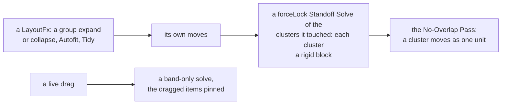

<!-- [[A1]] -->
<!-- [[A1]] visualGraphCalculator -->

# Spec: Standoffs

Serves [[A1]] visualGraphCalculator; the layer's stacking is [[react-flow-surface-contract#Stacking]]. It covers what the system does and blocks, and the decision each behavior serves.

A standoff is an arrangement constraint the user declares between two items on the canvas: "keep these two between this distance and that distance, in this direction." It draws as a pale, thick bar between the two items. No layout action leaves a standoff broken: items tied by standoffs move as one block. Standoffs are a main-canvas feature; the composite drill-in has none. Wrap as Composite removes a standoff it would split across the boundary, and one with both ends wrapped rides in the composite's snapshot, unshown, until Unpack brings it back ([[composite-nodes]]).

## What a standoff links

Code: `standoffs.ts` (`Standoff`, `standoffStore`); the saved form is `SavedGraph.standoffs`, including `locked`.

- **What can be linked.** A standoff links two top-level items: loose nodes or groups. Conduits, Format Controllers (docked or not) and group members can't be linked.
- **Anchors.** Each end names an anchor on its item's box, one of eight: a side midpoint (`n`, `e`, `s`, `w`) or a corner (`ne`, `nw`, `se`, `sw`). The two ends always use opposite anchors, so the bar spans the pair.
- **One per pair.** A pair can have at most one standoff.

## The constraint

The direction runs from end a's anchor toward end b (`ANCHOR_DIR[a.anchor]`, a unit vector along one of the eight directions). Measure the distance between the two anchor points along that direction. The constraint holds when

`min ≤ dot(P_b − P_a, axis) ≤ max`

where `P_a` and `P_b` are the anchor points. This is an axis band: only distance along the axis is constrained.

- **Unlocked.** The offset across the axis is free. The bar slants to show that slack.
- **Locked.** The solver also pulls the cross-axis offset to 0, so the two anchors line up exactly along one of the eight directions. New standoffs are locked by default; the toolbar's Lock toggle turns it off.
- **Floor.** `min` is never below `STANDOFF_MIN` (30), and `max` is never below `min`. Both `add` and `setBand` enforce this.
- **Direction.** The toolbar's angle dial sets the direction. `setAxis` changes a's anchor and gives b the opposite one.

Tests:

- `standoffSolver.test.ts`: a satisfied band moves nothing, an overstretched or too-close pair is pulled back to the band, the cross-axis offset is left alone when unlocked and pulled to 0 when locked or under `forceLock`, and a diagonal is corrected along its 45° axis only.
- `layoutInvariants.test.ts`: over random anchors, bands and positions, a solve with one end pinned lands the axis distance in the band (and a locked one on the axis), and a chain of standoffs holds every band.

## Creating one

Code: `linkStandoffBetween` in `canvasActions.ts`.

Select exactly two linkable items, right-click one of them, and choose "Link with Standoff". The item must not already be linked to the other.

1. The anchor faces along whichever of the eight directions is closest to the line from a's center to b's center (`anchorFromVector`, by angle, with 0° east and y pointing down); b takes the opposite anchor.
2. The band starts at `min` = `STANDOFF_MIN` (30) and `max` = the current distance along the axis (or 30, if that is smaller). The code asks for `min(PUSH_GAP, distance)`, which is always below the floor, so the floor sets it.
3. The new standoff is locked, becomes the selection (clearing node and cable selection), and is settled right away, so the pair snaps into alignment.

Tests: `standoffSolver.test.ts`: `anchorFromVector` maps each of the eight directions to its anchor.

## The solver runs last

Code: `solveStandoffs` in `standoffSolver.ts`; the canvas registers the live settle routine that drives it (`setStandoffSettle`).

`solveStandoffs` is pure. It takes plain boxes, the standoffs, a set of pinned ids and an optional `forceLock`, and returns a displacement per box.

- **Whole pixels.** Each displacement lands its box on a whole pixel, so repeated settles can't accumulate a fraction. The solve stops once every error is within 0.25, and an unrounded leftover would ride into a Tidy's cluster offsets and back out as a slightly different block size.
- It is iterative projection: up to 48 rounds, each correcting every active standoff in turn, stopping once no correction exceeds 0.25px. Corrections propagate along a chain (a pinned end tows its partner, which tows the next), and an unsatisfiable cycle stays bounded instead of diverging.
- Each correction splits evenly between the two ends. If one end is pinned, the other takes all of it. A standoff with both ends pinned, or with an end that has no box, is skipped.
- `forceLock` treats every standoff as locked for that one solve, without touching the saved `locked` flag. Every LayoutFx uses it, so a cluster of items joined by standoffs (`standoffClusters()`, the connected groups) behaves as one rigid block.
- Position-locked groups are always pinned (`withLockedGroupsPinned`).
- A settle can be scoped with `touching`: only the clusters holding one of those ids solve (`standoffsTouching`). Every LayoutFx scopes its `forceLock` solve to what it moved, so an unrelated unlocked slant survives it.

The solver runs as the last step after every pass that affects layout, so that no layout action leaves a standoff broken:

| Pass | When and how |
|---|---|
| Live drag | Only when a dragged item (or a member of a dragged group) is linked; ties are sparse, so a plain drag costs nothing (`standoffStore.participants()` gates the work). Once per animation frame during the drag, and once more exactly on drop, with the dragged items pinned. Band only, never `forceLock`, so an unlocked slant survives a drag. Programmatic moves never trigger it. |
| Group expand | Inside `runExpandPushes`. After the push heuristics, each cluster moves as one block: every member takes the cluster's largest displacement, so a lone push isn't pulled partway back. Then a `forceLock` solve, with its corrections folded into the push records so a later Collapse Restores them too ([[group-expand-push]]). |
| Group collapse | After the pushes are restored, a `forceLock` re-solve of the touched clusters, because the shrink moved the anchors. A cluster that would land on another box is skipped; the moves are recorded, and the expand slides them back ([[group-expand-push]]). |
| Autofit | `autofitGroupWithHistory` re-solves the fitted group's cluster with `forceLock`, pinning the group. |
| Tidy | A final `forceLock` settle of the clusters holding a laid-out box. |
| Toolbar edits | A band, lock or angle change settles at once. |

Every pass in the table except the live drag and toolbar edits is a LayoutFx, so it then ends with the No-Overlap Pass ([[group-expand-push#LayoutFx]]). It moves each standoff cluster as one unit, so it never breaks a band; only the members' own boxes collide, never the cluster's bounding box.

Tests:

- `standoffSolver.test.ts`: an even split with both ends free, a chain towed from a pinned root, a contradictory cycle staying bounded, a standoff skipped with both ends pinned or an end missing, every moved box landing on a whole pixel, and `standoffsTouching` keeping exactly the clusters that hold a touched id.
- `groupPushRecords.test.ts`: a collapse pulls the partner in and the expand puts it back exactly, a collapse leaves the partner in place when the re-solve would land it on another box, and a toggle leaves an unrelated slanted standoff alone.
- `groupPushCore.test.ts`: the No-Overlap Pass moves a standoff cluster whole while a box between its members stays put.

## Tidy and clusters

Code: `makeArrangeFn` in `tidyArrange.ts`; `FlowCanvas` only wires it in.

Tidy lays out each cluster of loose items as a single ELK super-node. ELK is the automatic layout engine behind Tidy.

1. A cluster qualifies only if every member is a loose target of this Tidy.
2. The leader is the member nearest the top-left (by `x + y`), preferring a non-group.
3. ELK sees the leader as one rectangle the size of the cluster's bounding box, so it reserves room for the whole block. The size is presented through a proxy object, so the real node is never resized.
4. Edges to other members are remapped onto the leader, as node-level edges (the same way edges to a group are treated).
5. After layout, every member is placed at its stored offset from the leader's new position.

Without qualifying clusters none of this runs, so a graph with no standoffs tidies exactly as it would otherwise. A cluster that doesn't qualify (for example, one that reaches into a group's interior) is handled by the final `forceLock` settle instead.

## Drawing and selection

Code: `StandoffLayer.tsx`, `StandoffLayer.css`.

`StandoffLayer` draws the bars in an SVG inside React Flow's viewport portal (through `ViewportLayer`, [[react-flow-surface-contract#World-coordinate overlays]]), so they move with the camera. The main canvas mounts it (the host's `standoffs` hook); the layer redraws on standoff changes and on collapse changes, and each bar redraws when React Flow reports a move or a new measure of one of its two cards (`endsKey`, a selector on RF's node lookup). On this controlled flow a card moves or is measured only through a new `nodes` array, so the selector reuses its key while the array is unchanged and a camera frame builds none ([[engineering#Performance]]).

- Each bar is a 9px line between the two anchor points of the items' live boxes, with a small cap circle at each end. A wider invisible line (18px) is the hit target.
- **Stacking.** [[react-flow-surface-contract#Stacking]] places the bars at −3 in the stacking ladder, below groups (−2), Conduits (−1) and ordinary nodes (0). `nodeZIndex` in `flowModel.ts` stamps the nodes (groups −2, Conduits −1, the rest 0); the standoff SVG sets its own `z-index: -3` in `StandoffLayer.css`. Both sit in the viewport's stacking context, so a card dragged over a bar covers it even though the viewport portal comes after the node layer in the DOM.
- Clicking a bar selects it and clears node and cable selection; clicking a selected bar deselects it. A standoff selection is always exclusive with node and cable selection. The bar stops `pointerdown` and `mousedown`, so a press on it never pans or starts a lasso.
- A selected standoff shows a docked toolbar: the min and max of the band (each committing on Enter or blur via `useDraftCommit`), the 45° Lock toggle, the angle dial, and a delete button. The Delete key also removes it.
- Deleting either end's node removes the standoff (`registerNodeForget`); a full rebuild clears them all (`registerNodeForgetAll`).

Tests: `drawnCablePath.test.ts`: finishing a drawn cable selects it exclusively, dropping the standoff selection.

## Known gaps

- A linked item dragged into a group stays linked, so a member can be an end after all. An end hidden inside a collapsed group makes the standoff dormant: the bar is hidden, and every solve and cluster reads `liveStandoffs`, which leaves it out.
- A cluster whose members aren't all in the loose layout falls back to the `forceLock` settle instead of the super-node path.
- Standoff edits don't record undo steps of their own.
- Tidy and Cleanup edge cases under heavy overlap have not been fully tested.

Tests:

- `standoffSolver.test.ts`: a standoff with an end hidden in a collapsed group drops out of `liveStandoffs`, so the solve doesn't pull the visible end toward the hidden one.
- `selectionOps.test.ts`: moving a linked item doesn't carry a partner hidden in a collapsed group.

## In seeds

Seed graphs use groups liberally and standoffs sparingly.

- A seed standoff only pins an unwired explanatory Note to what it explains.
- A Note wired through its frontmatter exports gets no standoff.
- A data node never has a standoff to its consumer. An exhibit and its Note go in one group instead (a Note can be a member).

Re-bake seeds with `scripts/tune-seeds.mjs` after editing. It expands every group for the whole pass and collapses the collapsed ones again at the end, because a whole-canvas Tidy of collapsed groups packs their small boxes and leaves their hidden members under the neighbors' boxes, which `seeds.test.ts` rejects. `decision-matrix.json` and `table-verbs.json` are the exemplars.

Tests: `seeds.test.ts`: every seed standoff's ends name nodes the seed has, every group's box holds exactly its members' centers, and no other card's center sits inside an expanded group's box.

