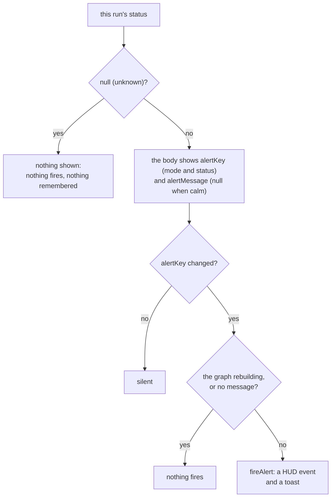

<!-- [[C23]] -->
<!-- [[C23]] calcModes -->

# Spec: Alert node + Alerts HUD

Serves [[C23]] calcModes. It covers what the system does and blocks, and the decision each behavior serves.

The **Alert** card watches a value and raises a notification when a condition is met. Each firing lands in two places: a toast, and the Alerts section of the HUD, the column of floating panels on the right edge of the screen. The Alert node lives in `nodes/display.ts` (`AlertNode`, which raises what its body says fires) and `components/AlertNode.tsx`, and its status, what fires and the message in its body (`alert` in `crates/solenoid-core/src/nodes/docs.rs`, [[node-bodies]]); the log is `alertStore.ts`; the column is `components/HudStack.tsx`.

## Modes

The trigger dropdown picks both the condition and which input sockets are live. It is an argument, not an op, and persists as **`condition`** ([[C26]] opArgDistinct). `ALERT_MODE_KEYS` maps each mode to its live sockets:

| Mode (`condition`) | Dropdown label | Live sockets | Triggered when |
|---|---|---|---|
| `range` (default) | Out of range | `value`, `low`, `high` | `value` is below `low` or above `high` |
| `equals` | Equals | `value`, `target` | `value` exactly equals `target`; the `target` socket is labeled "Match" |
| `boolean` | Is true | `value` | `value` is a real `true` or exactly `1`; any other nonzero number is not true, because logicals are first-class and bridge to numbers only as 1 and 0 |
| `text` | Text contains | `text`, `match` | `text` contains `match`; an empty `match` never triggers |

The card carries the full set of sockets at all times, and the component shows only the active mode's keys. On a mode change the component first drops the cables on sockets the new mode hides, through `dropInputCables` ([[input-cable-pruning#The ordering rule]]), and then sets the mode.

An unwired socket falls back to the card's typed literal (defaults: `value` 50, `low` 0, `high` 100, `target` 0, `text` and `match` empty). A wired socket always wins, even when its cable carries a blank ([[D86]] blankRoles).

Tests:

- `alertNode.test.ts`: `condition` survives a save; `boolean` mode means a real true or 1, not any nonzero number; `equals` fires on a match; `text` fires when the text contains the match.
- `wiredNull.test.ts`: in `range` mode a wired blank High makes the status null rather than reading the card's 100, while an unwired High uses the card's bound.

## The status output

The `result` socket (labeled "Status") emits a number:

- `0` when calm;
- in `range` mode, `1` below Low and `2` above High;
- in every other mode, `1` when triggered;
- null when a needed input is missing, which means the status is unknown.

A list input yields a list of statuses, one per element. A per-cell error or blank rides through as a non-alerting cell.

Tests: `alertNode.test.ts`: a blank or error cell in a list is not alerting, and the list's message counts only the cells that are.

The card's value box shows a neutral dot and word, never a pass or fail mark, because an Alert watches and notifies rather than judging. Calm reads "in range", "no match", "false" or "no match" by mode; met reads "below" or "above", "equal", "true" or "match". A list reads "all clear" or "some out". The met color is the theme's amber accent; calm is `--text-dim`.

## When it fires

An Alert fires on a change of status, not on a boolean flip ([[#An alert fires when its status changes, and never on load]]). The body decides what fires; the TypeScript only raises it:

1. A null status is unknown. The body shows nothing new, so nothing fires and the remembered status stands.
2. Otherwise the body shows the status key (`alertKey`: the mode and the status, the number or the list joined with commas) and, when the status is alerting (any nonzero cell), the message it fires (`alertMessage`, else null).
3. The class names `alertKey` in `static coreWatch`, so the engine calls `coreWatched()` when a run changed it ([[graph-core]] § Direct calls). The mode is part of the key, so a mode change compares fresh: the old mode's status means nothing in the new one.
4. `coreWatched()` raises `alertMessage` unless it is null or the graph is rebuilding (`isGraphRebuilding()`), so loading a document or a seed does not replay old alerts. The recompute that follows a rebuild still runs inside the rebuild scope, and still remembers its key.

So in `range` mode, calm to LOW, calm to HIGH and LOW to HIGH (either way) all fire; LOW to LOW and HIGH to HIGH do not; returning to calm is silent. A new card holds no key, so a card born alerting, or switched into a condition that is already met, fires once. Expect fires the same way, its key the set of failed checks (`nodes/quality.ts`, `expect` in `docs.rs`). That key is the kinds of check that failed, not which cells failed or how many: a different cell failing the same check does not fire again, a new kind of check joining the failures fires, and a recovery to no failures fires nothing and lets the next failure fire.

Tests:

- `alertNode.test.ts`: the engine's direct call fires on a change of status and not while the graph rebuilds; a card born out of range fires on its first run; calm to alert fires once, a held status stays silent and a return to calm re-arms; every change between Low and High fires; a mode switch into a condition already met fires once.
- `quality.test.ts`: Expect fires only when the set of failing checks changes, from the engine's direct call too.
- `connectionStore.test.ts`: a live connection's refresh changes the value reaching an Alert and its change of status fires.
- `sourceInvariants.test.ts`: every node file that fires an alert names the `isGraphRebuilding` gate.

## Firing

`fireAlert(...)` in `alertStore.ts` is the single entry point. It does two things:

- it logs an event (`id`, `nodeId`, `label`, `kind`, `message`, `time`) to `alertStore`, newest first, capped at 50 events. The log is transient and never saved.
- it raises a toast through `pushNotice` (`noticeStore`), with the tone mapped from the kind: `info` to info, `warning` to warn, `critical` to error. The Alert card always fires `warning`.

The message, which the body writes, is a neutral observation prefixed with the card's label (or "Alert" when the label is blank):

- range, one value: "Tank: 150 above 100" or "Tank: 3 below 10"; a list: "Tank: 2 below 10, 1 above 100";
- equals: "Tank: equals 7";
- boolean: "Tank: is true";
- text: `Log: contains "error"`.

Tests: `alertNode.test.ts`: the range message ("Temp: 150 above 100"), a list's message, and the text mode's message carrying the label.

Numbers print as every unformatted number does ([[C118]] formatTravelsWithValue).

`alertStore` registers `forget` and `forgetAll` with the node-store registry ([[stores#The rules]]): deleting an Alert card removes its events, and a whole-graph rebuild clears the log. Each event in the HUD has its own dismiss button (`alertStore.dismiss`).

## The HUD column

`HudStack` is one portal into `document.body` that owns the fixed position of the right-side column. It stacks four sections, top to bottom:

1. `PinLayer`, the pinned values;
2. `AlertLayer`, the fired alerts;
3. `ProblemsPanel`;
4. `CommentsPanel`.

Each section renders nothing when empty, so the column is invisible until used, and each section's button lands below whatever sits above it however many entries there are. Positioning lives in `hudStack.css`:

- `top: calc(var(--chrome-top, 66px) + 58px)`, below the nav pill (124px with the default chrome), and `right: 12px`;
- a column with a 10px gap, right-aligned, at most 260px wide, with `pointer-events: none` so clicks in the gaps reach the canvas (chips and buttons turn pointer events back on);
- on mobile, `top: calc(136px + env(safe-area-inset-top))` so it stays below the Fit/Lock pill, and a width of at most `min(260px, 100vw - 24px)`;
- a docked Report shifts `right` by the dock width (`ReportOverlay.css`); a docked Inspector does the same on desktop (`InspectorPanel.css`) and hides the column on mobile;
- presenter mode hides the column (`PresentationOverlay.css`).

The column is not a generic panel API. Each section is its own component with its own state, its own trigger button and its own `registerChrome` call. A new panel is a new component added as a sibling inside `HudStack`, not a plug-in to a shared base.

## An alert fires when its status changes, and never on load

An effect that reaches outside the graph, such as an alert, fires only when its status changes, never again while it stays the same, and stays silent while a document loads.

- How it's built: [[alert-node-alerts-hud#When it fires]] and [[compute-pass#Rebuild scopes]].
