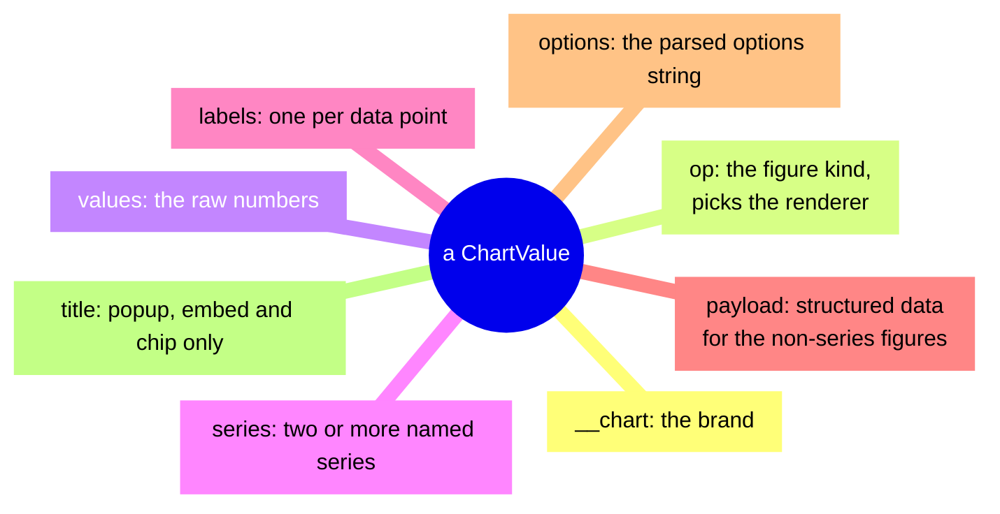
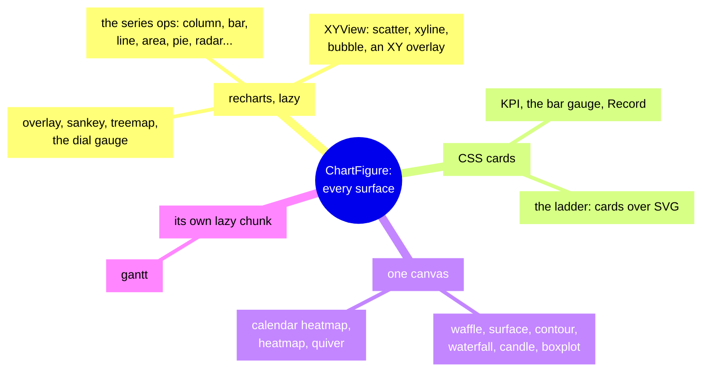

<!-- [[C100]] chartIsAValue, [[C96]] chartOptionsAreMatplotlib, [[B2]] webTryDesktopFull, [[C71]] noBarEditing, [[C118]] formatTravelsWithValue, [[C26]] opArgDistinct, [[C103]] untrustedContentSeams, [[C114]] cardsView -->

# Spec: Chart figures

Serves [[C100]] chartIsAValue, [[C96]] chartOptionsAreMatplotlib, [[B2]] webTryDesktopFull, [[C71]] noBarEditing and [[C118]] formatTravelsWithValue (the Format Controller's `chart` family), and [[B11]] maximalMerge (the XY family). It covers what the system does and blocks, and the decision each behavior serves.

A chart in Solenoid is a value, not a drawing. Each figure node computes a small, self-describing figure value and sends it down a `chart` cable; whatever receives it (the node's own card, a Display, the chart popup, a Report embed) draws it at the size it has. This spec covers that value, the nodes that make it, the options string that styles it, and the renderers that draw it.

Code: `src/graph/chartValue.ts` and `src/graph/mermaidValue.ts` (the values), `src/graph/colormaps.ts` (the named colormaps and the heat scale), `src/graph/numberSpec.ts` (the `fmt` spec), `src/graph/nodes/visual.ts` (every figure node class but Gantt) with their bodies in `crates/solenoid-core/src/nodes/visual.rs` (the XY column mapping and the XY merge among them), `src/graph/nodes/gantt.ts` (the Gantt node; its body is `gantt_card` in `crates/solenoid-core/src/nodes/sched.rs`), `src/graph/nodes/chartOptions.ts` (the options grammar and the Chart Builder's target table), `src/graph/components/chartView.tsx` (the one dispatcher, `ChartFigure`), `chartRender.tsx` (every recharts renderer), `chartCards.tsx` (the CSS figures), `chartCanvasViews.tsx`, `heatmapLayout.ts` and `SurfaceView.tsx` (the canvas figures), `MermaidView.tsx`, `ChartChip.tsx`, `ChartPopup.tsx` with `chartPopupStore.ts`, `DisplayNode.tsx` and `inlineRefDisplay.tsx` (the Display and Report surfaces). The Gantt layout and its React figure are packages with their own contracts: `packages/gantt-layout/README.md` and `packages/gantt-react/README.md`. `docs/node-coverage.md` § Output is the node inventory; this file is the mechanics.

## The values on the `chart` socket

The `chart` socket carries a self-describing figure value. Every figure node is terminal: it emits a new value and never passes its input through. Acceptance follows [[socket-lattice]]: `chart` is an object-family type, so a chart output reaches a `chart` input or a `trueany` input (Display, Report, Cable Switch, Composite boundaries) and nothing else. The socket also carries two sibling brands that this spec does not cover: `ImageValue` (`imageValue.ts`, the QR node and image inputs) and `SvgValue` (`svgValue.ts`, the SVG picker).

Every consumer recognizes a value by its brand field, never by structure: `isChartValue(v)` tests `__chart === true`, `isMermaidValue(v)` tests `__mermaid === true`. Both values are flat and JSON-safe (plain objects, arrays, numbers, strings, booleans, null), so they cross cables and React roots unchanged.

### `ChartValue`

| Field | Type | Meaning |
|---|---|---|
| `__chart` | `true` | The brand. |
| `op` | `ChartValueOp` | The figure kind. Picks the renderer (see Render dispatch). |
| `values` | `number \| number[] \| null` | The raw 1-D numbers the figure plots. The series figures draw from it; for the payload figures it is a summary (see the per-node table) that no renderer reads. |
| `series` | `{ name, values: (number \| null)[] }[]`, optional | Named series. For the cartesian ops it is set only when two or more numeric columns survive the label column, and `values` then mirrors the first series. Sparkline always sets one series. The XY ops (Scatter, XY Line, Bubble) never set it; their series ride the `xy` payload. |
| `labels` | `(string \| number)[]`, optional | One category label per data point (a Frame's column 0), shown on the axis instead of the 1-based index. For Radar it is the spoke names. |
| `payload` | `ChartPayload`, optional | Structured data for the figures that are not a numeric series. Its `kind` equals `op`. |
| `options` | `ChartOptions` | The parsed options string (see The options string). Figures that take no options carry `{}`. |
| `title` | string, optional | The display title: the options `title`, else the node label, else the node's default name. It labels the popup header, the Report embed bar and the chip; it is never drawn inside the figure (the in-figure title is `options.title`, see Titles). |

`ChartValueOp` is the union of the Chart node's eleven ops (`column`, `bar`, `line`, `area`, `scatter`, `xyline`, `pie`, `radar`, `radialbar`, `funnel`, `bubble`, the keys of `CHART_OP_META`) and the sixteen special ops in `CHART_SPECIAL_OPS` (`kpi`, `scale`, `proportion`, `sankey`, `surface`, `contour`, `waterfall`, `candle`, `boxplot`, `calheat`, `heatmap`, `quiver`, `record`, `overlay`, `gantt`, `ladder`). `chartValueOps()` enumerates all 27 at runtime, and `chartPopupCoverage.test.ts` checks that every one reaches the shared popup path.

### Payloads

Every payload is data, never geometry: the renderer lays it out at the size it is given.

The figure picks its renderer, not the surface ([[C100]] chartIsAValue): recharts for interactive plots (one lazy chunk, [[engineering#Heavy libraries load lazily]]), plain CSS or SVG cards for structured payloads (KPI, Gauge, the Record views), and a supersampled 2-D canvas for data-heavy figures, which stays one DOM element however many points it draws and takes its theme colors from the live CSS variables when it draws. The Gantt value, for example, carries rows, links and non-working spans as serials plus the resolved view settings, and the layout produces pixels at the measured width, because the same figure draws at four sizes (chip, Display, popup, Report).

| `kind` | Fields |
|---|---|
| `kpi` | `value: number \| null`, `prev: number \| null`, `unit: string` (a suffix after the number), `goodUp: boolean` (whether an increase is good). |
| `scale` | `style: "dial" \| "bar"`, `value`, `target: number \| null`, `min`, `max`. Dial pins `min 0`, `max 1`, `target null`. |
| `proportion` | `layout: "treemap" \| "waffle"`, `names: string[]`, `values: number[]`. |
| `sankey` | `sources: string[]`, `targets: string[]`, `values: number[]`, parallel: flow `i` runs from `sources[i]` to `targets[i]` carrying `values[i]`. Nodes are the unique names across both ends, in first-seen order. |
| `surface` | `xs: number[]`, `ys: number[]`, `z: (number \| null)[][]` with `z[iy][ix]` the height at `(xs[ix], ys[iy])` and null a hole; `yaw`, `pitch` in degrees. |
| `contour` | `xs`, `ys`, `z` as Surface; `levels`: the iso-line count. |
| `waterfall` | `names: string[]`, `values: (number \| null)[]` (signed deltas; null is an unknown step), `total: boolean` (append a computed Total bar). |
| `candle` | `labels: string[]`, `open`, `high`, `low`, `close`: parallel `(number \| null)[]`. |
| `boxplot` | `boxes: { name, lo, q1, med, q3, hi, outliers: number[] }[]`. |
| `calheat` | `days: number[]` (whole date serials), `values: number[]`, parallel. |
| `heatmap` | `z: (number \| null)[][]` row-major, null a gap; `rows`, `cols: string[]` (the labels); `totalRows?`, `totalCols?`, set only when the table was cut to `HEATMAP_MAX` (400) rows or columns. |
| `quiver` | `u`, `v`: same-shaped `(number \| null)[][]` of the x and y components, one arrow per cell. |
| `record` | See The Record figure. |
| `overlay` | `series: OverlaySeries[]`, `labels?: (string \| number)[]`. An `OverlaySeries` is `{ name, kind: "line" \| "area" \| "column" \| "bar", values: (number \| null)[], color?, markersize?, linewidth?, alpha?, marker?: boolean }`. |
| `xy` | `series: XYSeries[]`, `xcats?: string[]` (set when x is a text column; each x is then an index into it), `xDate?: true` (set when x is a date column; each x is a date serial), `names: { x?, y?, s?, c?, text? }` (the column names, for the tooltip and the colorbar). An `XYSeries` is `{ name, points: (XYPoint \| null)[], line: "solid" \| "dashed" \| "dotted" \| "dashdot" \| "none", marker: boolean, color?, markersize?, linewidth?, alpha?, sRange?, cRange?, cCats? }`, the points in row order with null a gap; an `XYPoint` is `{ x, y, s?, c?: number \| string, text? }`. `sRange`, `cRange` and `cCats` span every series from one source. Emitted with op `scatter`, `xyline` or `bubble` by Chart, and with op `overlay` by an XY Merge Plots. |
| `ladder` | `LadderPayload`: `options` in rank order (`name`, `score`, `costs` per resource, `value` per criterion), `criteria`, `resources` (`name`, `limit` and `floor`, both null for a rough cost, the cost column's `format`), `states` (`id`, `depth`, `share` of the flow, `taken`, `end`), `edges` (`from`, `to`, `pick`, `share`, `kind`: `clear`, `close`, `chosen`, `passed`, `must`, `required` or `quota`, `struck` (passed over there) and `conflicts` (clashing with the pick)), `main` (the main line's edges), `choices` and `ruledOut` (names left out before the ladder); as [[frame-verbs#Choice Ladder]] computes them. |
| `gantt` | `GanttPayload` from `@solenoid/gantt-layout`: tasks in depth-first WBS order, links, non-working spans, weekend days, holidays, `today`, `statusDate`, `projectStart`, `projectFinish`, per-task predecessor text and the resolved `view` options. The field list is the package README's; this spec does not restate it. |

### `MermaidValue`

`{ __mermaid: true, source: string, title?: string }`. `source` is Mermaid diagram text; `title` is the Mermaid node's label, else `"Diagram"`. It rides the same `chart` socket.

## The figure nodes

Each figure node computes its value in `data()`, caches it on the node (`cachedChart`, `cachedPayload` or `cachedResult` with `cachedSeries` / `cachedLabels`) for its card, and returns it on the `chart` output (Mermaid's output is `diagram`). A card never calls `data()`; it reads the cache.

"Wired blank" below means a connected cable whose value is null. It is always distinct from unwired (`readInput`): unwired falls back to the card's literal, wired blank does not.

| Node | Inputs | Emits `op` | `values` | Options |
|---|---|---|---|---|
| Sparkline | `values` (number list) | `line` or `column` | the known numbers | none, `{}` |
| Chart | `values` (Data: frame, cube, list or number, received raw), `options` | its op | first series (an XY op: the first series' y, gaps null) | yes |
| Merge Plots | `p0`, `p1`, … (charts), `options` | `overlay` | null | yes |
| Histogram 1-D | `values`, `bins`, `options` | `column` | bin counts | yes |
| Histogram 2-D | `values` (X), `bins`, `y`, `ybins`, `options` | `heatmap` | null | yes |
| Gauge, Dial | `value` | `scale` | the value | none, `{}` |
| Gauge, Bar | `value`, `target`, `max`, `options` | `scale` | the value | yes |
| KPI | `value`, `prev` (Prior), `options`; `unit` and `goodUp` on the card | `kpi` | the value | yes |
| Proportion | `frame` (Label + Value), `options` | `proportion` | the values | yes |
| Sankey | `frame` (From + To + Value), `options` | `sankey` | the flow values | yes |
| Surface (3-D view) | `z` (table), `xs`, `ys`, `options` | `surface` | null | yes |
| Surface (Flat view) | `z`, `xs`, `ys`, `levels`, `options` | `contour` | null | yes |
| Waterfall | `frame` (Label + Delta), `options` | `waterfall` | the known deltas | yes |
| Candlestick | `frame` (Date + OHLC), `options` | `candle` | the known closes | yes |
| Boxplot | `values` (frame or list, received raw), `options` | `boxplot` | null | yes |
| Calendar Heatmap | `frame` (Date + Value), `options` | `calheat` | the values | yes |
| Heatmap | `values` (frame, table or list, received raw), `options` | `heatmap` | null | yes |
| Record | `frame`, `rows`, `by` (Board only), `layout` (all but Cards), `options` | `record` | null | yes |
| Vector Field (Quiver) | `u`, `v` (tables), `options` | `quiver` | null | yes |
| Gantt | `schedule` (cube), `baseline` (cube), `holidays` (date list), `weekend_code`, `status` (date), `options` | `gantt` | null | yes |
| Choice Ladder | `frame` (Options), `weights`, `limits`, `close`; outputs `frame` (Plan) and `chart` | `ladder` | null | none, `{}` |
| Mermaid | `source` (string) | MermaidValue | n/a | n/a |

Title defaults (used when neither the options `title` nor the label is set): Sparkline `"Sparkline"`, Chart `"Chart"`, Merge Plots `"Merged Plot"`, Histogram `"Histogram"`, Gauge `"Gauge"`, KPI `"KPI"`, Proportion `"Proportion"`, Sankey `"Sankey"`, Surface `"Surface"` or `"Contour"`, Waterfall `"Waterfall"`, Candlestick `"Candlestick"`, Boxplot `"Boxplot"`, Calendar Heatmap `"Calendar"`, Heatmap `"Heatmap"`, Record `"Record"`, Vector Field `"Vector Field"`, Gantt `"Gantt"`, Choice Ladder `"Choice Ladder"`. Nodes without options take the title from the label alone.

### Sparkline

Ops `line`, `column`, `winloss` (`SPARKLINE_OP_META`); an old save's `bar` loads as `column` and `area` as `line`. Each cell that is not a finite number becomes a gap (null), never zero. Win/Loss maps each known cell to its sign (`-1`, `0`, `1`) and emits op `column`. The value carries `series: [{ name, values }]` with the gaps in place and `values` with only the known numbers. The card draws its own axis-less figure (see Cards); the value on the cable carries no sign colors, so a Sparkline drawn downstream is an ordinary single-series chart with axes.

### Chart

The card picks the op in two steps: a family select (Cartesian, XY, Categorical, from `CHART_OP_META`'s `group`) narrows a type select, and picking a family jumps to its first type. The type is the node's `op`, the accented op select; the family is only a filter ([[C26]] opArgDistinct), and both derive from `CHART_OP_META` so they can't drift from the Add-menu rows ([[engineering#One declaration per fact]]). Every op reads the same `values` input, so switching op is a plain recompute.

Scatter, XY Line and Bubble stay three types on the Chart node, grouped as one XY family apart from the charts that plot against labels ([[B11]] maximalMerge): they share the numeric plane and differ only in their starting settings (line style, markers, which columns are x, y and size). The option not taken was folding them into one Scatter type with settings. Connected scatter and bubble are the names people look for, and as settings on one type they would be found only by someone who already knew them; a family of their own says they are one figure without hiding the names. Reopen if the XY types' defaults converge so their names no longer mean different starting points.

The Chart node has no combined bars-and-lines (Composed) type: that figure is Merge Plots over a Column chart and a Line chart, so a Frame whose bars and line sit in one figure is split into two charts first. A fixed bars-and-lines type would be a second, narrower way to draw what Merge Plots already draws ([[B11]] maximalMerge). Reopen if charts with bars and lines from one Frame turn out common. The Chart Builder lists Merge Plots under Cartesian.

`data()` reads the raw `values` input. The input is kept raw (`rawInputs`) because coercion would widen a wired list into a single frame row; Boxplot is raw for the same reason. A cube is flattened to a frame of its scalar columns first (`flatCubeToFrame(cube, "scalar")`: a list or table column has nothing to plot and is skipped); a top-level `SolError` there is treated as no data (Chart is in the error guard's see-errors set, so it runs). Every non-finite cell becomes null in place, so labels stay aligned with rows.

- **Op `scatter`, `xyline` or `bubble`:** `build_xy` reads the input into an `xy` payload (see XY plots below); the other bullets do not apply.
- **Frame, op `radar`, two or more columns:** the frame is read transposed. `labels` are the names of the number columns after column 0 (the spokes). Each row becomes a series named by its column-0 cell (formatted, else `Row N`) with one value per spoke. `series` is set only for two or more rows; `values` is the first row. The flip makes a Decision Matrix row read as one option scored across its criteria; the cartesian charts keep column 0 as labels.
- **Frame, any other op, two or more columns:** column 0 is always the label column, formatted by `formatFrameCell` (dates as date text, errors as their code). The series are the number-typed columns after it; other types are skipped. `series` is set only for two or more; `values` is the first series.
- **Frame with one column:** plots positionally; `values` is that column.
- **Plain list:** `values` is the list, non-finite cells null. **A number:** `values` is the number.

Options: a wired string is parsed; a wired blank means no options; a wired non-string falls back to the inline literal. Options are parsed before the data, since the XY ops read column names from them. For Bubble, and for Scatter or XY Line whose options name `x`, an unset `xlabel` defaults to the x column's name and an unset `ylabel` to the y column's when there is one; naming `y` alone does the same for `ylabel`.

### References

A Chart with axes (the Cartesian and XY families) shows a **References** input: a Frame of reference lines and bands, one per row, its columns found by name in any case (`read_chart_refs`). `x` alone draws a dashed vertical line and `y` alone a dashed horizontal one; `x` and `y` together a point. A row with `x2` or `y2` draws a light area (`refShape`): `x` to `x2` bounds it across and `y` to `y2` up and down, so all four make a box, `x` and `x2` alone a full-height band, and an end left blank runs to the plot's edge (`x`, `x2`, `y` shades everything above `y` between the two x's). These are recharts' own ReferenceLine, ReferenceDot and ReferenceArea. `label` and `color` are optional; a line's or point's label shows, an area's doesn't. A row with no position is skipped, and an area's ends may come in either order. The rows ride the chart value as `refs`, so Merge Plots, a Display, the popup and a Report all draw them, and Merge Plots gathers every source's.

- **Where an x lands.** On a numeric or date axis `x` is the number or date serial. On a category axis (Line, Area, Column, Bar, Merge Plots of those) it names a category: the label equal to it, a date serial matching its formatted label, or with no labels its 1-based position (`categoryAt`); an x that names no category draws nothing. A horizontal Bar runs its categories down the y axis, so x references cross it.
- **Look.** Lines are dashed at 1 px, points are 3 px dots labeled above; areas fill at 16% opacity behind the data and clip to the plot. A color is a palette slot name, which follows the theme, or any CSS color; the default is the axis ink. A vertical line's label sits at its top, right of the line or left of it where the right would run past the plot or across another line and the left would not, stepping down a row where labels would overlap; a horizontal line's label sits at its left end.
- **Why a Frame.** References are data the user may edit, sort, filter or compute, so they arrive on a cable as any Frame does, rather than as text inside the options string.

### XY plots

Scatter, XY Line and Bubble plot points on a numeric plane. Their options can name which columns are x, y, marker size, marker color, point text and series, rather than the card having an input for each ([[C96]] chartOptionsAreMatplotlib): not every Frame reads as "first column is x, the rest are series" (a parametric t, x, y Frame should plot y against x, not both against t, and a size or label column would otherwise become one more series), and naming each column's role is how pandas plots a table, so it fits the option names people already know. A named column the data lacks is an error on the chart, never silently ignored, because a misspelt column ignored would draw a plausible wrong chart. Reopen if the options move to separate fields per chart type, where a column picker could replace typed names. `build_xy(op, input, options)`:

- **A list** plots at x = 1, 2, 3, …, a non-finite cell a gap; **a number** is one point at x = 1. One series named `""`.
- **A frame** assigns each column a role by name. The options `x`, `y` (a comma list), `s` (size), `c` (color), `annotate` (point text) and `by` (split into series) name columns, matched trimmed and case-insensitively; a name the frame lacks is `#REF!` naming the role and the column. Unnamed roles default: for Scatter and XY Line, x is the first column no role claimed (any type), and y is every remaining number column; for Bubble, x, y and size are the first, second and third unclaimed number columns (a single number column plots at `(x, x)`). A `y` or `s` column that is not number-typed is `#TYPE!`. No y column means nothing to plot (null).
- **x** from a number column is the cell, and from a date column its serial with `xDate` set, so the axis reads as dates: it spans the data exactly, ticks fall on the first of January every 1, 2, 5, 10, 20 or 50 years across three years or more and on month starts below that (`dateTicks`), labeled `YYYY` or `MMM YYYY`, and the tooltip shows `DD-MMM-YYYY`. From any other type x is the cell's formatted text, its index in `xcats` (distinct texts in first-seen order), so the axis reads as categories.
- **Rows.** A row whose x or y is not finite is a null point, a gap. `s` keeps a finite number; `c` keeps a finite number from a number column, else the formatted text; `annotate` keeps non-empty formatted text.
- **Series.** The `by` option names a column to split the series on, as in `by=Region` in the options string. Without `by`, there's one series per y column, named after that column. With `by`, each y column splits into one series per distinct value in the `by` column, read as formatted text, and a null cell groups as `—`. Each of those series holds only its group's rows, in row order, and the series come in first-seen order. With one y column, a split series is named after its `by` value, like `East`. With several y columns, it's named `y · group`, like `Sales · East`.
- **Lines and markers.** `line` is the `linestyle` option, else `solid` for XY Line and `none` for Scatter and Bubble. Scatter and Bubble always draw markers; XY Line draws them per the `marker` option, else only when there is one series (as the Line chart does).

### Merge Plots

Plot inputs are keyed `p0`, `p1`, …; `nextInputId` keeps keys unique across removals, and a load rebuilds exactly the saved keys so cables realign (`valueKeys`). A new card starts with two plot rows. Its own options keep only the keys the Chart Builder offers Merge Plots (axes, limits, title, font size, line width); a typed `alpha`, `markersize`, `color` or `marker` is dropped, since each plot keeps its own. For each plot row in order: an empty row or a non-chart value is skipped. A chart whose op is not in `PLANAR_OPS` (`nodes/visual.rs`: `line`, `area`, `column`, `bar`, `scatter`, `xyline`, `bubble`) makes the whole output `#TYPE!` "Plot N is a OP chart, which has no x/y plane to overlay", naming the first such row. Otherwise, when no source carries an `xy` payload, each source series becomes an `OverlaySeries` with the source's op as its `kind` and the source's `color`, `markersize`, `linewidth`, `alpha` and `marker` options; a source with no `series` contributes one series from `values` named by its title. `labels` are the union of every source's labels in first-seen order, a label repeated within one source keeping one slot per repeat; each labeled source's series move onto that list, blank where they have no value, and a source without labels keeps its values by position.

When any source carries an `xy` payload (a Scatter, XY Line or Bubble), the merge is an `xy` payload instead, every series on one numeric plane (`source_as_xy`, in plot order, `xcats` from the first source that has them, and a date axis when every source has one). Every source's references are the merged value's `refs`, in plot order. An XY source contributes its series as they are, a one-series source named by its title. A Line or Area source joins as solid-line series, its x the numeric labels or else the row position 1, 2, 3, …, with markers per its `marker` option; an Area loses its fill. A Column or Bar source is `#TYPE!` "Plot N is a column chart; bars can't share an x/y plane with a scatter or XY line", and a Line or Area plotted against text labels is `#TYPE!` too. Each series inherits its source's `markersize`, `linewidth` and `alpha`, and its `color` when the source has one series.

### Conditional Regions

The Conditional Regions node takes a Scatter, XY Line or Bubble chart and a frame of points (column 0 is x, column 1 is y) and answers the points as a frame: the x and y columns as they came, then a third column named apart from them through `makeHeaders`. A Boolean card (`op: "bool"`, the default; the op is the card's hoisted toggle, a checkbox, `Aa` and `#`) answers a logical `in`: TRUE for a point in a region marked TRUE, FALSE in one marked FALSE. A Labels card (`op: "text"`) gains a Labels text-list input and answers a text `label`, the region's label from that list; a Values card (`op: "num"`) gains a Values number-list input and answers a number `value` the same way. Each is blank in an unmarked region or where x or y is blank. With **Margin** checked (`margin`), a number `margin` column follows: the distance from the point to the nearest line where the answer changes, straight across in the chart's own units, blank when no line anywhere changes it (`flip_pieces`: every line, the references carried out far past the plot, is cut where another crosses it, and a piece counts when a hair to one side reads differently from a hair to the other). Any other chart is `#TYPE!`; a points frame of fewer than two columns is `#VALUE!`; no chart or no points is blank. The body is `conditional_regions` (`nodes/visual.rs`).

- **What cuts the plane** (`chart_cuts`). Each series is a line: an XY Line's in row order, a gap breaking it as the chart draws it; a scatter's or bubble's points joined in order of x. A line that doesn't close on itself carries on straight past both ends, each along its end segment, so it divides the whole plane (`tails`; a loop has none). Each References row with only `x` is a vertical line and with only `y` a horizontal one; points, bands and boxes cut nothing. The card shows the cuts as `cachedCuts`.
- **A region's key** (`region_key`): the count of vertical lines at or left of the point, the count of horizontal lines at or below it, then one digit per series, `1` when a ray straight up from the point crosses that series an odd number of times (below a curve, inside a loop). A Bool card saves its marks in `regionMarks` as `key → true | false`, and a click cycles a region unmarked, TRUE, FALSE; a Labels card saves them in `regionLabels` and a Values card in `regionValues`, each as `key → the item's place in the list`, and a click cycles unmarked, then each item in turn. The three are kept apart, so switching ops keeps them all; a place past the list's end reads as unmarked. Adding or removing a line renumbers the keys, so marks then land on different regions.
- **A point on a line** (within 1e-9 of the largest coordinate) reads the regions a hair away on all eight sides. In the default `≤` mode (`mode: "inclusive"`) it takes their marking: TRUE, or where the regions disagree, the item listed first, and blank where none is marked. In `<` mode (`"strict"`) a point on a line is blank.
- **Large inputs** ([[C120]] linearWork). The curves' segments are bucketed by the stretch of x each spans (`SegIndex`, built once per call), so a point's key and its on-a-line test look only at the segments over it, a segment too wide to bucket (a carried-on end) at all of them; a curve segment meets only the segments its stretch reaches when the lines are cut for Margin, and a horizontal reference line meets them all. Margin's pieces sit in a grid over the points and the curves (`PieceGrid`), each point searching outward until no farther cell could hold a nearer piece, the reference-line and carried-on pieces measured from every point. The card draws one dot per 2 px spot and color, takes the axes from the points' corners, and reads the hovered region from its shading grid, asking the core only on a click. The hovered region lives in a store only the shading listens to, so a pointer move redraws the tint alone.
- **The card** draws the chart without its markers, through `XYView`'s `under` and `over` layers (`RegionsFigure`, `chartRender.tsx`): the marked regions shaded (Bool: green and vermilion; Labels and Values: each item its categorical palette color, in list order, with a legend of the items under the plot, and every line, the chart's and its References', in the neutral ink) on a 3 px grid of keys from `coreRegionKeys` (the core's `region_keys`, the body's own function), the hovered region tinted, a scatter's joined line and every line's carried-on ends dashed, the axes stretched to take in every point (`extent`), and each point in its answer's color, a ring when it sits on a line.

### Histogram

The Histogram node bins its input with `histogram_bins` (`nodes/visual.rs`). A non-finite `k` or `floor(k) < 1` is `#DOMAIN!` "Bins must be 1 or more". Bins are `floor(k)` clamped to 100. Only finite numbers count, and with none the result is `[]`. Equal min and max puts every count in bin 0. Otherwise bins are equal width over `[min, max]` (`equal_width_bins`): the lower edges are `min + i · w`, a value lands in the bin whose edges hold it by those same floats (so a value equal to an edge is in that edge's bin, however `(x - min) / w` rounds), and the last bin is closed. A wired blank `bins` gives an empty figure. The 2-D mode pairs X and Y by index, keeps pairs where both are finite, bins each axis the same way (`histogram2d`, `nodes/visual.rs`, each bin count clamped 1 to 100) and emits a heatmap payload, matplotlib's `hist2d`: `z[iy][ix]` the counts, `rows` and `cols` the y and x lower bin edges to three significant figures, with `origin=lower` and `aspect=auto` as defaults the options string can override, so y grows upward and the bins fill the plot. Switching between the 1-D and 2-D modes adds or removes the `y` and `ybins` inputs, and Options stays last. Before removing an input, the component prunes its cables ([[input-cable-pruning#The ordering rule]]).

### Gauge

The Gauge node's `mode` is `dial` or `bar`, an argument picked with a segmented toggle ([[C26]] opArgDistinct). Dial has only `value`; Bar adds `target`, `max` and `options`, which a switch to Dial prunes and removes. Dial emits `{ style: "dial", value, target: null, min: 0, max: 1 }` with `options: {}`. Bar emits `{ style: "bar", value, target, min: 0, max }`; `max` falls back to the card literal (default 100) even when wired blank, because it is the track's scale, while `value` and `target` are data (a wired blank is null). Literal defaults: value 0, target 80, max 100.

### Gauge dial

The dial's 0% and 100% sit on a row under the arc, clear of its ends. Given a height (a resized Display, a Dashboard box), the dial grows to fill it, its percentage scaling with it; without one it keeps its card size.

### KPI

`value` and `prev` read with `readInput`, card literals default to 0. `unit` is the card text, `goodUp` the card flag (default on). A wired blank `prev` gives null (no comparison). The card draws the value and the size of the change in the format on the KPI's Value input (a Format Controller docked there or one upstream through passthroughs, `resolveRefAnnotation(kpi, "value")`), on the KPI's own card and wherever the figure is embedded (a Report, a Dashboard box: `ChartFigure`'s `valueFormat`); with none, the General style. The change's percentage shows one decimal place.

### Frame-fed payload figures

Proportion, Sankey, Waterfall, Candlestick and Calendar Heatmap read their frame through `readFrame`; anything that is not a frame reads as no columns. Two column readers (`nodes/visual.rs`): `col_strings` formats each cell (`formatFrameCell`) to text, blank as `""`; `col_numbers` formats each cell and keeps a finite number, or text that parses as a finite number, else null.

- **Proportion:** names from column 0, values from column 1 (column 0 when there is only one), null as 0. The layout (`treemap` or `waffle`) only re-derives the figure; the sockets do not change.
- **Sankey:** sources from column 0, targets column 1, values column 2 (null as 0). `merge_flows` first folds every repeated From and To pair into one flow carrying the sum of their values, in first-seen order, so the payload holds one flow per pair. `acyclic_flows` then walks the flows in order: a blank end, a self-loop or a value that is not positive is kept in place untouched; a flow whose target already reaches its source closes a cycle and is dropped (counted in `droppedLoops`, which the card shows under the figure as "N looped flows dropped"); the rest are added to the graph. When at least one flow was dropped and no drawable flow remains, the output is `#SHAPE!` "The flows form a loop; a Sankey needs a direction".
- **Waterfall:** names column 0, deltas column 1 with null kept as a gap; `total` is always true.
- **Candlestick:** no columns gives a null output. Fewer than four columns is `#SHAPE!` "Candlestick needs Open, High, Low and Close columns (a date column first is optional)". Five or more: column 0 is the label axis (as text) and columns 1 to 4 are OHLC. Exactly four: all four are OHLC and labels are `"1"`, `"2"`, ….
- **Calendar Heatmap:** column 0 and column 1 are read raw (a date stays a serial). A row is kept only when both are finite numbers; the day is `floor(serial)`. A day without a value is dropped, never painted as zero.

### Heatmap

The Heatmap node reads its input raw, for the same reason Chart does ([[C100]] chartIsAValue). A list is one row. A table plots as it stands: each cell a finite number or null, a short row padded with null, rows and columns labeled `1`, `2`, `3`, …. A cube is flattened as Chart flattens it. A frame (`heatmap_from_columns`): when it has two or more columns and column 0 is not number-typed, column 0 names the rows (`col_strings`), else rows are numbered; the heat columns are the number-typed columns after it, named by the column, and other types are skipped. A frame with no number column, or a wired blank, draws nothing. A table past 400 rows or columns is cut to the first 400 of each (`clip_heatmap`), and the payload keeps the full counts.

### Boxplot

The Boxplot node reads its input raw. A frame gives one box per number-typed column, named by the column, and a plain list gives one unnamed box. `boxplot_stats` sorts the finite numbers; `q1`, `med`, `q3` are linear-interpolated quantiles at 0.25, 0.5, 0.75 (`quantile_sorted`, Excel `PERCENTILE.INC`); the fences are `q1 - 1.5·IQR` and `q3 + 1.5·IQR`; `lo` and `hi` are the smallest and largest values inside the fences (the sample's extremes if none are inside); `outliers` are the values outside. A column with no finite numbers gives no box.

### Surface and Contour

One node with op `surface` (3-D) or `contour` (Flat). `grid_axes(z, xs, ys)`: `z` must be a non-empty 2-D array; its width is the widest row, and a cell that is not a finite number is null. An unwired `xs` or `ys` is `1, 2, 3, …`; a wired blank, a length that does not match the grid, or a non-finite coordinate makes the figure empty (the node swallows the `#SHAPE!` or `#VALUE!` that `grid_axes` returns). The 3-D view carries the card's `yaw` and `pitch` literals (default 45 each, stepped by the card's rotate pad in 45 degree steps). Both angles wrap fully from 0 to 360, so the pitch flips all the way over rather than clamping, and the pad's home button resets both to 45. The Flat view adds `levels`: rounded and clamped 2 to 24, default 8, a wired blank gives 0. Switching to 3-D prunes the Levels cable first. Options stays the last input in both views.

### Vector Field

The Vector Field node normalizes `u` and `v` to matrices of finite-or-null cells. A non-array row becomes a one-cell row.

### The Record figure

Record is one node whose views are ops `detail`, `cards`, `gallery`, `board`, `list` (`RECORD_OP_META`, each its own Add-menu row, [[B11]] maximalMerge). The op owns sockets: `by` exists only on Board and `layout` on every view but Cards, whose layout is derived ([[C114]] cardsView); a switch prunes the departing cable before removing the socket.

- **Rows:** a number or a list (`numlist`, typed as `1, 3, 5` in the card's field; the Inspector's socket doc says how it reads), with the `picks` role: the 1-based records to show, in that order, a negative counting from the end as CHOOSEROWS does (`record_rows`, `nodes/docs.rs`). A blank pick is dropped, an out-of-range or non-numeric one too, and none given, or a wired blank, is every record. Every view draws only the picked records; Detail pages through them. Detail's pager position is its own literal `page` (1-based among the picks), clamped to `1..total` and written back so the pager and the card agree; `total` and `index` count the picks, so a single pick draws one record with no pager, and a pick list that names nothing draws the boxes empty (index 0).
- **Layout:** `parseRecordLayout(text)`. One line per grid row, cells split on `|`; an empty cell or `.` is a gap; lines with no named cell are dropped. `Name*N` widens a cell to N columns (N clamped 1 to 12, expanded before the walk, so later cells shift right). A first `:` splits placeholder text (`Qty: e.g. 40`) kept as the box's `hint`, first authored hint wins. A leading `#` marks the title field. Repeating a name (case-insensitive, first spelling kept) claims the bounding rectangle of all its cells; when that rectangle overlaps one placed earlier, it shrinks to the first of its cells (reading order) clear of every earlier box, or, when none is clear, to a one-cell box on a new row below the layout, so no box ever covers another. Placements are 1-based CSS grid lines. The card's `cols` is the widest placed column. An empty layout stacks every column one per row (Board skips its grouping column there). A layout name that matches no column (case-insensitive) keeps its box with the name as the label and no value.
- **Fields:** the label is the column name, plus ` (unit)` when the column carries a unit. The value is `formatFrameCell` of the cell: numbers stay numeric, dates, logicals and errors arrive as text, a null cell is null. A text value that is a `data:image/` URL, or an http(s) URL ending in an image extension (`png`, `jpg`, `jpeg`, `gif`, `webp`, `svg`, `avif`, `bmp`, optional query), is also set as `image`. An empty value carries the layout's `hint`.
- **Views:** Detail draws one card (the record at `page` among the picks). Cards, Gallery and List draw the picked records up to `RECORD_CARD_CAP` (60) and set `more` to the rest. Board requires a `by` column (matched case-insensitively and trimmed); a blank or unmatched name draws nothing. Over the first 60 picked records, each goes to the lane of its grouping cell (a number column's lane is its number, any other cell's its formatted text, `"—"` for a null cell), lanes in first-seen order, and `more` counts the rest.
- **Cards:** the Table popup's Cards ([[table-popup]] § The Cards view) as a figure. `record_deck` names each column (with its unit, as a field label is), plans every row up to `PROFILE_ROWS` with `planCards` over the raw text and the text as the column's format shows it (so a percent or currency column is recognized), and ships the first 60 rows: numbers raw, every other cell as `formatFrameCell` shows it. The layout socket is absent; a layout left in the node's literals is ignored.
- **Options:** `cardsize=s|m|l` (Gallery and Cards tile size, absent means medium) and `clamp=on|true|yes|1` (clamp long tile values; on Cards it also folds a card past six fields behind its Show All N Fields button) are read by their own patterns from the raw options string, not by `parse_chart_options`. A wired blank Layout or Options means none given.

`RecordPayload`: `{ kind: "record", view, cols, cards: RecordField[][], deck?, lanes?: { label, value?, format?, cards: number[] }[], more?, size?, clamp?, index, total }`, where `index` is the Detail view's page (0 for none) and `total` the number of picked records. A `RecordField` is `{ label, value: number | string | null, format?, image?, hint?, isTitle?, row, col, rowSpan, colSpan }`. Every view reads a cell one way (`record_cell`): a number column's number stays raw and carries its column format, and any other cell is its formatted text (a date through its column's pattern); `recordNumberText` draws the number through that format, else Auto, and a Board lane's heading is the same text: a number lane keeps `value` and `format` and `recordLaneText` draws it, so a Decimal places change shows without a recompute. `titleIndexFor(fields)` is the one place that picks the title field: the first `isTitle` field, else field 0. Cards carries `cards: []` and a `RecordDeck`: `{ names, types, formats, chipCols, plan, rows, rowNumbers }` (`rowNumbers` the drawn records' 1-based rows, for a title-less card's `Row N`), the column formats and Chip-styled columns riding along so the figure formats and colors as the popup does.

### Gantt

The Gantt node computes no dates ([[C71]] noBarEditing: the figure is display-only; edits happen in the plan). A top-level `SolError` on `schedule` passes through as the output. A value that is neither a cube nor a frame gives a null output. Otherwise `ganttPayloadFromSchedule` reads the columns a Schedule node appended:

- The plan is flattened depth-first. The task column is the first of `task`, `name`, `title` (case-insensitive), else the first column holding any text; with none, `#VALUE!` "Gantt needs a Task column naming each task". A child column (`tasks`, `children`, `subtasks`, `steps`, or a column of nested Frames that have a task column) recurses one level deeper. A row with a blank task name is skipped, and so is a row the Schedule left out (its Active cell set and false, `is_inactive`), with its subtree.
- Every row needs numeric `start` and `finish`, else `#VALUE!` naming the task. A row is a summary when its `summary` cell is true or the next row is one level deeper. A milestone is a non-summary with duration 0, or with no duration and `start === finish`. The remaining columns (`duration` or `days`, `complete` or `% complete`, `critical`, `late`, `float`, `deadline` or `due`, `segments`, `manual`, `project`/`section`/`group`, `color`, `resource`/`who`/`owner`/`assignee`, `units`) map onto the task fields listed in the gantt-layout README.
- Links come from the predecessor column (`predecessors`, `predecessor`, `after`, `depends on`, `blockedby`, `blocked by`): text, a list of names, or a nested Frame with a task column plus optional `type` (FS, SS, FF, SF, default FS) and `lag`.
- A baseline is a second scheduled plan joined by task name (case-insensitive); one that is not a plan draws no ghost bars.
- The shading calendar is built from `weekend_code` (Excel `WORKDAY.INTL` codes, default 1) and `holidays`, over the project span padded by 14 days. `today` is the local day; `status` is wire-only (unwired means no status line).
- The options string is parsed twice: `parse_chart_options` (`nodes/visual.rs`) for `title` and `fontsize`, and `gantt_view_options` (`nodes/sched.rs`) for the view keys. `view.minutes` is also set automatically when any start or finish carries a clock fraction.

### Mermaid

The source is the wired `source` string, else the card literal (a starter flowchart on a new card). A wired blank renders empty. The card offers starter templates only when the source is unwired.

## The options string

Figures with an `options` input take one string of `key=value` pairs separated by `;` ([[C96]] chartOptionsAreMatplotlib). It is typed on the card or produced by a Chart Builder.

The key names are matplotlib's (`marker`, `markersize`, `fontsize`, `linestyle` and the rest), and pandas' scatter names where a key names a Frame column (`x`, `y`, `s`, `c`). A new option takes its matplotlib name where one exists; only a concept matplotlib lacks gets a name of our own, and the tables below mark it (`annotate`, `by`, `radarscale`, `pielabels`, the Record and Gantt keys). An unknown key is ignored rather than refused, so a string written for a newer build still draws on an older one.

### Grammar (`parse_chart_options`, `nodes/visual.rs`)

- Split on `;`. A part with no `=` is skipped. The key is the text before the first `=`, trimmed and lower-cased; the value is the rest, trimmed (so `title=a=b` is `a=b`). There is no escape: a value cannot contain `;`.
- Pairs apply left to right, so a later key overrides an earlier one (`ylim=0,10;ymax=5` gives ymax 5).
- An unrecognized key is ignored. A recognized key with an unreadable value is ignored, so the default stands.
- Booleans: `on`, `true`, `1`, `yes`, `y` are true; `off`, `false`, `0`, `no`, `n` are false (case-insensitive); anything else is ignored.
- Numbers: `Number(text)` must be finite; blank is ignored.
- A null or empty string gives `{}`.

### Keys read by `parse_chart_options`

| Key | Parsed as | Default when absent | Meaning |
|---|---|---|---|
| `title` | non-empty text | none | The in-figure title and the value's `title`. |
| `xlabel`, `ylabel` | non-empty text | none | Axis titles, drawn only on axed figures. |
| `color` | non-empty text (any CSS color or palette slot name) | the Display kind accent | The single-series mark color. A palette slot name (`green`, `amber`) follows the theme. |
| `grid` | boolean | on | Grid lines on axed figures. |
| `marker` | boolean | on for single-series axed line, area, radar and XY Line; off elsewhere | Dots on line, area, radar and XY Line points. |
| `ylim` | `lo,hi`, either side may be blank | none | Sets `ymin` and `ymax`. |
| `ymin`, `ymax` | number | open (`auto`) | The value-axis bounds. On a horizontal Bar chart they bound the horizontal value axis. |
| `linewidth`, `lw` | number | 1.5 | Line, area and radar stroke width. |
| `markersize`, `ms` | number greater than 0 | 2 on lines, 3 on scatter | Marker radius in pixels. |
| `alpha` | number | 0.25 area and radar fill (0.18 when two or more area series overlap); lines, bars and dots opaque | Mark opacity: the fill of areas, radar polygons and bars, the stroke of lines, the dots of scatter. |
| `fontsize` | number greater than 0 | 10 | Text size in points; every text size scales by `fontsize / 10`. |
| `pielabels` | `off`, `outside` (`leader`, `on`, a true boolean), `inside` (`center`, `on-chart`); a false boolean is `off` | outside | Pie category labels. |
| `xlim` | `lo,hi`, either side may be blank | none | Sets `xmin` and `xmax`. |
| `xmin`, `xmax` | number | open (`auto`) | The x-axis bounds of an XY figure. |
| `aspect` | `equal` or `auto` | auto; equal on Heatmap | `equal` pads the axis ranges so a unit spans the same pixels on x and y (a circle draws round), with round-number ticks. On a Heatmap it draws square cells, and `auto` stretches them to fill the plot. |
| `linestyle`, `ls` | `-` or `solid`, `--` or `dashed`, `:` or `dotted`, `-.` or `dashdot`, `none` | `solid` on XY Line, `none` on Scatter and Bubble | The line joining an XY series' points in row order, broken at each gap. |
| `x`, `s`, `c`, `annotate`, `by` | non-empty text (a column name) | see XY plots | The x, size, color, point-text and split-by columns of an XY figure. `s` and `c` are pandas' scatter names; `annotate` and `by` are our own. |
| `y` | a comma list of column names | see XY plots | The y columns of an XY figure. |
| `cmap` | a colormap name, any case, `_r` reversing (see The Heatmap figure); stored in matplotlib's spelling | the palette's height ramp, or its diverging ramp when `center` is set | The Heatmap's colors, and the ramp an XY figure's numeric `c` paints with. |
| `vmin`, `vmax` | number | the data's range | The values at the colormap's ends; values past them take the end color. |
| `center` | number | none | The value at the colormap's midpoint (seaborn's `center`). |
| `annot` | boolean | when they fit | Each value written in its cell. |
| `fmt` | a Python format spec, `[+][,][.N][f\|e\|g\|d\|%]` (`numberSpec.ts`) | compact, three significant figures | The cell values' format. |
| `cbar` | boolean | on | The colorbar. |
| `origin` | `upper` or `lower` | upper | Where row 1 sits. |
| `yscale` | `linear` or `log` | linear | The y axis of an XY figure (matplotlib's `yscale`). `log` snaps the bounds out to whole decades unless `ymin`/`ymax` set them, ticks 1, 2 and 5 of each decade (only the 1s past four decades), and drops a point at zero or below as a gap. |
| `maxgap` | number greater than 0 | none | Our own key, since matplotlib breaks a line only at a NaN: an XY line breaks between consecutive points farther apart in x than this, in x's own units (days on a date axis), so a stretch with no data shows as a gap rather than a straight bridge. A lone point left between breaks, or between blanks, draws as a dot even with markers off. |
| `radarscale` | `axis` (`normalize`, `normalized`, `independent`) or `shared` (`raw`, `absolute`) | axis | Multi-series radar radius. `axis` scales each spoke to 0 to 1 by its own maximum, so one large-valued column (dollars beside scores out of 10) cannot swamp the rest, and a negative value plots at the center; `shared` keeps one raw radius. |

### Keys read elsewhere

| Key | Read by | Values |
|---|---|---|
| `cardsize` | Record (`nodes/docs.rs`) | `s`, `m`, `l` (the single letter only) |
| `clamp` | Record (`nodes/docs.rs`) | `on`, `true`, `yes`, `1` |
| `layout`, `zoom`, `fit`, `tiers`, `collapse`, `fiscal_start`, `week`, `window`, `columns`, `critical`, `baseline`, `arrows`, `today`, `status`, `weekends`, `group_by`, `labels`, `minutes`, `histogram` | Gantt (`parseGanttViewOptions`) | As the gantt-react README's Option keys. Defaults the figure applies when absent: `layout=gantt`, `zoom=fit`, two header rows, every level open, ISO weeks, a January fiscal year, `critical`, `baseline`, `arrows`, `today`, `status`, `weekends`, `group_by` and `labels` on, `histogram` and `minutes` off. A `window` bound is parsed as a date; an unreadable or ambiguous bound means no window. |

Each parser reads only its own keys from the shared string and ignores the rest, so one string can carry chart keys and figure keys together.

### Which renderer reads which key

**MUST** ([[C96]] chartOptionsAreMatplotlib): for each chart type, the Chart Builder offers exactly the options that chart type draws, no more and no fewer. An option the chart reads is offered for it, and an option offered for it visibly changes the figure everywhere it is drawn: on the node, in a Display, in the popup and in a Report. Most people set options in the Chart Builder rather than typing them, so an option missing there is invisible and an option that does nothing looks broken, and nothing else ties what the builder offers to what each chart draws. A chart that learns an option offers it in the Chart Builder in the same change; one that drops an option stops offering it. *Unenforced:* whether an option visibly changes a figure needs the figure drawn on screen, and the test suite doesn't draw; `chartTitles.test.ts` pins the title option and that every offered key is one a parser reads, and the rest is checked by eye whenever the Chart Builder's options or a chart change. Reopen if the options move to separate fields per chart type, so the builder's list could be derived.

A key a renderer does not read is inert on that figure. For each Chart Builder target the key list (`CHART_BUILDER_TARGETS`) is exactly this set ([[C96]] chartOptionsAreMatplotlib); the target's `op` names the figure it draws.

| Target (`op`) | Keys read |
|---|---|
| Column, Bar, Histogram (`column`, `bar`) | `title`, `xlabel`, `ylabel`, `color`, `grid`, `ymin`/`ymax`, `alpha`, `fontsize`. On Bar the value axis is horizontal. |
| Line, Area | as Column, plus `marker`, `linewidth`, `markersize` |
| Scatter, Bubble | as Column, plus `x`, `y`, `s`, `c`, `cmap`, `annotate`, `by`, `linestyle`, `aspect`, `yscale`, `xmin`/`xmax`, `linewidth`, `markersize` |
| XY Line | as Scatter, plus `marker` and `maxgap` |
| Pie | `title`, `fontsize`, `pielabels` |
| Radar | `title`, `grid`, `marker`, `radarscale`, `ymin`/`ymax`, `linewidth`, `markersize`, `alpha`, `fontsize` |
| Radial, Funnel | `title`, `fontsize` |
| Merge Plots (`overlay`) | `title`, `xlabel`, `ylabel`, `grid`, `aspect`, `xmin`/`xmax`, `ymin`/`ymax`, and on an XY merge `yscale`, `maxgap`, `linewidth` (a fallback for series without one), `fontsize`; each series keeps its inherited `color`, `markersize`, `linewidth`, `alpha`, `marker` |
| KPI, Gauge (`scale`), Proportion, Sankey, Waterfall, Candlestick, Boxplot | `title`, `fontsize` |
| Calendar Heatmap | `title`, `cmap`, `center`, `vmin`/`vmax`, `cbar`, `fontsize` |
| Contour (Surface, Flat view) | `title`, `xlabel`, `ylabel`, `cmap`, `center`, `vmin`/`vmax`, `cbar`, `fontsize` |
| Surface (3-D view), Vector Field | `title`, `cmap`, `fontsize` |
| Heatmap, Histogram 2-D | `title`, `xlabel`, `ylabel`, `cmap`, `center`, `vmin`/`vmax`, `annot`, `fmt`, `cbar`, `aspect`, `origin`, `fontsize` |
| Record | `title`, `fontsize`, `cardsize`, `clamp` |
| Gantt, timeline | `title`, `fontsize`, `zoom`, `tiers`, `layout`, `fit`, `critical`, `baseline`, `arrows`, `today`, `status`, `weekends`, `labels`, `histogram`, `minutes`, `window`, `columns`, `collapse`, `group_by`, `week`, `fiscal_start` |
| Gantt, `layout=calendar` | `title`, `fontsize`, `layout`, `critical`, `minutes`, `window`, `week` |

Exceptions a key list cannot see, because the builder does not know the data:

- **Series count.** Two or more series paint from the palette, so `color` is inert on a multi-series Column, Bar, Line, Area, Scatter, XY Line or Bubble. `radarscale` is read only by a multi-series Radar, and with `radarscale=axis` (the default) the radius is `[0, 1]`, so `ymin`/`ymax` apply to a single-series or `shared` Radar only.
- **The data.** `markersize` is inert on points sized by an `s` column, so on a Bubble whose data has a third number column. `linewidth` is inert on a Scatter or Bubble with no `linestyle`. `aspect` and `xmin`/`xmax` are inert on a Merge Plots holding no XY source, and `aspect` on an XY figure whose x is a text column.
- **Mode.** Gauge's Dial mode has no Options input and emits `{}`; the Gauge target covers the Bar mode. Surface's Flat view is the Contour target, its 3-D view the Surface target.
### Serialization and the Chart Builder

`serializeChartOptions(fields)` emits only set fields, in this order: `title`, `xlabel`, `ylabel`, `color`, `grid`, `marker`, `pielabels`, `radarscale`, `zoom`, `layout`, `tiers`, `fit`, `critical`, `baseline`, `arrows`, `today`, `weekends`, `labels`, `histogram`, `minutes`, `window`, `columns`, `collapse`, `week`, `fiscal_start`, `status`, `group_by`, `cardsize`, `clamp`, `x`, `y`, `s`, `c`, `annotate`, `by`, `linestyle`, `aspect`, `cmap`, `annot`, `fmt`, `cbar`, `origin`, then `xlim=lo,hi` and `ylim=lo,hi` (each with either side blank when unset, emitted when either bound is finite), `linewidth`, `markersize`, `alpha`, `fontsize`, `vmin`, `vmax`, `center`. Text values are trimmed and a blank one is skipped; a number must be finite. Parts join with `;`, so an untouched builder yields `""`.

The Chart Builder node has one input per field (42 text, 11 number) and one output, `result` (a string). Each field is the wired value, else the card literal; a wired blank means the field is unset, never the literal. Its `target` (one of the 28 `CHART_BUILDER_TARGETS`, default `column`; a stale saved target loads as `column`) only chooses which rows the card offers (`chartBuilderKeys`; the Gantt target offers fewer keys when `layout=calendar`). The Chart node's own ops are targets of their own, and Histogram, Histogram 2-D and Merge Plots are targets beside them, so each offers only the keys its figure reads (see Which renderer reads which key), in a two-level dropdown (`group`). The categorical ops (Pie, Radar, Radial, Funnel) are not offered `color`, because they paint from the palette. The Gantt calendar layout draws its own grid and ignores the scale, bars, links and grid pane, so it is offered only `title`, `fontsize`, `layout`, `critical`, `minutes`, `window` and `week`; it always outlines today, shades weekends and labels its chips. Switching the target destroys every field the new figure does not read (`setTarget`): the card removes those fields' cables, then the node clears their values, so a builder only ever carries options for the figure it names. Within the Gantt target, a switch to `layout=calendar` narrows the rows without clearing them, so switching back restores the timeline's settings; meanwhile a row the calendar does not read stays visible and dimmed under Not used by the Gantt calendar while it is wired or holds a value. When the target offers more than ten rows, the secondary ones fold into sections by kind (`SECTIONS` in `ChartBuilderNode.tsx`: Columns, Style, Axes, Color scale, Timeline, Shown, Calendar), each open while any of its rows is wired or set (DESIGN.md § Card sections), and a row inside one drops the words its caption says (X column reads X under Columns, Color min reads Min under Color scale; `SECTION_LABELS`) while its socket keeps the full name for the collapsed card and cables; a shorter target stays uncaptioned. Every set field serializes. Toggles store `on`/`off`; a select's default option stores `""`, and the default shown is the target figure's own, so Aspect reads square cells on the Heatmap target and fill the plot elsewhere. The Colormap select lists every map in its family and every map reversed.

## Render dispatch

`ChartFigure({ value, width, height, axes = true, fontScale, recordNav, virtualize })` in `chartView.tsx` is the one function that maps a `ChartValue` to a drawing. Every surface (the figure cards, Display, the popup, a Report embed, the socket peek, a Composite boundary) goes through it. It tests `op` together with a matching `payload.kind`:

| Op | Renderer | Path |
|---|---|---|
| `kpi` | `KpiCard` | CSS |
| `scale`, dial | `ScaleDial` (a recharts arc under DOM text) | recharts |
| `scale`, bar | `BulletBar` | CSS |
| `proportion`, treemap | `TreemapView` | recharts |
| `proportion`, waffle | `WaffleView` | canvas |
| `sankey` | `SankeyView` | recharts |
| `surface` | `SurfaceView` | canvas |
| `contour`, `waterfall`, `candle`, `boxplot`, `calheat`, `heatmap`, `quiver` | `ContourView`, `WaterfallView`, `CandleView`, `BoxplotView`, `CalHeatView`, `HeatmapView`, `QuiverView` | canvas |
| `record` | `RecordCardView` | CSS |
| any op with an `xy` payload (`scatter`, `xyline`, `bubble`, an XY `overlay`) | `XYView` | recharts |
| `overlay` | `OverlayView` | recharts |
| `gantt` | `GanttView` (`GanttFigure` from `@solenoid/gantt-react`) | its own lazy chunk, DOM grid plus SVG |
| `ladder` | `LadderView` (`ladderView.tsx`) | CSS cards over SVG ribbons |
| `scatter`, `xyline`, `bubble` with no payload | the empty dash | |
| the other Chart ops | the series path | recharts |

The series path: when `series` has two or more entries and the op is `column`, `bar`, `line`, `area` or `radar`, `MultiSeriesView` draws one mark per series with a legend. Otherwise `toSeries(values)` keeps each finite cell as `{ i, v }` with `i` its original index (so labels stay aligned across gaps); none left draws the empty dash; else `ChartView` draws one series.

A `MermaidValue` is not a `ChartValue`; the surfaces test for it separately and draw `MermaidView`.

### The three paths

- **recharts.** Every recharts component lives in `chartRender.tsx`, the one module under `src/` that imports `recharts`, and nothing imports it statically ([[engineering#Heavy libraries load lazily]]). `chartView.tsx` and `chartCore.ts` stay recharts-free and wrap each renderer in `lazy` plus `Suspense`, with a blank box of the figure's size as the fallback, so the card doesn't reflow and its sockets don't re-measure before the chunk arrives. There is no spinner; it would flash too fast to read. A chart is a figure, never prose or a form control, so the whole recharts subtree is unselectable and draws no focus outline (`chartView.css`): recharts' SVG text would otherwise select in fragments, and recharts 3's accessibility layer makes marks focusable. Colors are resolved values, not CSS variables, because recharts writes SVG attributes: `useChartColors` reads `--border-strong` (grid), `--text-dim` (axis), `--gauge-track` and the gold slot (the default mark color), and re-reads when the theme store changes. `pele` and `@solenoid/gantt-react` follow the same rule: reached only by dynamic import.
- **CSS cards.** KPI, the Bar gauge and Record are DOM elements styled by `chartCards.css`; every text size there is `calc(Npx * var(--chart-fscale, 1))`.
- **Canvas.** One `<canvas>` element however many points it draws. `setupCanvas` sets the backing store to `min(4, devicePixelRatio · 2)` times the CSS size and lets the browser downscale. Colors are read from the canvas's computed CSS variables at each draw (`--text`, `--text-dim`, `--border-strong`, `--surface-sunken`, `--accent`, plus the palette's green, vermilion and blue); the component subscribes to the theme store so a theme change redraws. Text draws in the app's own face alone, the first family of `--font-sans` or `--font-mono` (`canvasFont`), since a canvas cannot read a CSS variable. A canvas paints text once, in whatever face is loaded then, so no canvas figure paints until both bundled faces have loaded (`useAppFaces`); naming no other family means no other face can stand in. Each view redraws on every layout.

### The categorical palette

Multi-series marks, categorical slices, treemap cells, Sankey nodes and waffle categories take colors from `useSeriesColors()`: the palette slots `blue`, `gold`, `teal`, `pink`, `green`, `purple`, `sky`, `vermilion`, `lime`, `violet`, `amber`, `gray`, resolved through the active palette, indexed `i % 12`. `MermaidView` hands Pele the first eight slots in the same order as `--pele-series-1` to `-8`.

### Titles

The in-figure title is `options.title`, drawn as a centered bold strip `ceil(16 · fs)` pixels tall at `11 · fs` pixels, taken out of the plot's height, by `ChartView`, `MultiSeriesView`, `OverlayView`, `XYView` and `RecordCardView`. For the figures that draw none themselves (KPI, Gauge, Proportion, Sankey, Waterfall, Candlestick, Boxplot, Calendar Heatmap, Heatmap, Contour, Surface, Vector Field, Gantt and the ladder, `UNTITLED_FIGURES` in `chartTitle.tsx`), `ChartFigure` draws the same strip (`chartTitle.tsx`) above the figure and hands it the remaining height. The Sankey, KPI and Gauge cards draw through `ChartFigure`, so their options apply on the card as they do in a Display. The popup and a Report embed remove both `title` and `options.title` before drawing, because their header or bar already shows it.

## The recharts figures

All recharts figures run with animation off. Tick text is `9 · fs`, axis titles `10 · fs`, where `fs = fontScale · (fontsize / 10)`.

- **Axis ticks.** With `labels`, a tick shows the label at the rounded index (a number label is snapped to 10 significant figures by `axisTick`), blank past the ends; without, the 1-based index. Every tick is shown while there are 12 points or fewer; beyond that recharts thins them. A value axis (the y-axis, and the Bar's horizontal axis) writes its ticks in the canvas figures' compact form below, and the y-axis gutter is sized to its widest tick so a long number never clips: `valueAxisWidth` takes the data's extremes rounded to two figures as the end ticks, 5.8 · `fs` pixels a character (never under three), plus 8 for recharts' tick spacing and 14 for an axis title. Short ticks keep the 26 pixel gutter.
- **Tooltips.** Values format with `formatScalar`. The single-series tooltip shows `#n` (1-based) and the value; the XY tooltip lists each mapped column by name (x, y, size, color, label) and the series name when there are several; categorical tooltips show the value only; multi-series tooltips list each series with a swatch; a tooltip value that is an object shows its `code`.
- **Line, Area, Column.** Cartesian plot with 14 pixels of top headroom for the expand button. Column bars and line strokes use `color` at full opacity unless `alpha` is given. A dense Line or Area series is thinned (below); columns and bars always draw every point.
- **Thinning.** A series denser than its pixels draws only the points that change the picture, so a large table draws as fast as a small one and looks the same ([[C120]] linearWork). Each kept point keeps its own index or x for ticks, the tooltip and references; a reference on a thinned category axis lands on the nearest kept row (`snapAt`).
  - *A one-series Line or Area* with more than four points per pixel of width draws from its envelope (`minMaxDecimate`): each of `width` equal index spans gives its lowest and highest point in index order, two per span so the category axis keeps even spacing. Every spike survives.
  - *Several series on a category axis* (a multi-series Line or Area, and a Merge Plots of only lines and areas), past four rows per series per pixel, keep each series' lowest and highest row in each of the plot's pixel spans, topped up from the span's start to two distinct rows per series, so each span gives the same count and no category repeats (`envelopeRows`). A span where a series is blank keeps a blank row, so a gap wider than a pixel stays a gap.
  - *An XY run* longer than twice the plot's width is thinned on a pixel grid laid over the axis domain (the pinned or computed bounds, logged on a log axis; recharts' rounder domain only makes real pixels smaller than the grid's, never larger), by `thinXY`: a line whose x only climbs or only falls keeps each pixel column's first, lowest, highest and last point, which draws the same strokes, and one whose x turns back keeps the first and last point of each streak in one pixel; dots keep the last in each pixel, the one drawn on top. A lineless series thins as dots; a line with markers draws as two marks, the line thinned as a line and its markers as dots. A series under an `alpha` keeps all its markers and dots, since overlap is how it shows density, and a sized (`s`) or labeled point is never dropped.
- **Bar.** Horizontal bars; the category axis, one series or several, is sized to the widest label by `categoryAxisWidth` (`5.2 · fs` pixels per character plus 8, at least 18, at most a third of the width, at least 32 under an axis title), and the multi-series legend starts at that gutter.
- **XY.** One recharts `ScatterChart` on numeric axes (domain `auto` unless `xmin`/`xmax`/`ymin`/`ymax` pin a side, which then clips), each series split at its gaps into runs, each run one `Scatter` whose joint `line` draws the `linestyle` (dashes `6 4`, dots `1.5 3`, dash-dot `6 3 1.5 3`) in row order. With `xcats` the x axis is the category indices `[0, n-1]`, 8 pixels padding, every tick shown up to 12. A marker's radius is the series' `markersize`, else the option, else 3 on a lineless series and 2 on a lined one; with an `s` range it is the radius of an area from 40 to 420 square pixels, linear in `s` over the range (a missing size draws the smallest). Its fill is the `cmap` (else the height ramp) at `c`'s place in the range for a numeric `c`, the palette color of its category for a text `c`, else the series color: the palette by index with two or more series, else `color`, else the default mark color. With a numeric `c` the line takes the same colors: each segment fades from its first point's marker color to its second's (a `linearGradient` per segment, dashes continuing across segments), and past 400 segments each takes its first point's color instead, since the gradients would cost more than they show. Opacity is `alpha`, else 0.55 on sized markers and 1 elsewhere. `annotate` text draws right of each point (`sanitizeChartLabel`, 12 code points). Under the plot, a `SeriesLegend` row with two or more series (click spotlights, line swatches when any series has a line), a category legend for a one-series text `c`, and a colorbar row for a numeric `c` (the column name, the range's ends and a swatch of the same ramp). An axis with both bounds pinned by the options draws round-number ticks (`niceTicks`), about one per 60 pixels on x and 40 on y, never fewer than three. `aspect=equal` computes the plot box from the figure size, pads the shorter range and draws the same round-number ticks.
- **Pie.** A slice that is zero or negative is dropped (`partSlices`), since a pie has no place for it; the slices keep their row's color and label. Radius `max(18, min(width, height) / 2 - pad)`, where pad is 6 with no labels, `min(16, 7% of width)` inside, `min(30, 12% of width)` outside. Labels draw only when `labels` exist and `pielabels` is not `off`. Label text goes through `sanitizeChartLabel` (control characters to spaces, whitespace collapsed, capped at 10 code points when the width is under 260, else 16, with an ellipsis). A slice under 3% gets no label. Outside labels ride a two-segment leader (a 7 pixel radial stub, then a horizontal run to a shared column per side). Inside labels sit at 62% of the radius on a translucent plate, for slices of 6% or more; smaller slices keep the outside leader.
- **Radar.** Polar grid (none with `grid=off`), spoke names from `labels`, no radial tick text (it would print rotated on the polygon); the single-series radar takes the palette's first color. Multi-series with `radarscale=axis` normalizes each spoke to `[0, 1]` by dividing by the largest value on that spoke, and the tooltip shows the raw value. Dividing by the maximum (never min-max scaling) keeps the result proportional, so spokes in different units (a price beside a score out of 10) share one figure and the weakest value keeps its true fraction of the axis. A negative value plots at the center, since a radar has no sensible place for one, and an all-zero spoke plots at 0.
- **Radial.** A negative ring is dropped (`partSlices`) and a zero ring keeps its empty track; the rest keep their row's color. Rings from 18% to 92% radius, starting at 12 o'clock; a bottom legend names the rings only when `labels` exist, each name through `sanitizeChartLabel`.
- **Funnel.** Palette-colored stages with the value labeled on the right. A negative stage is dropped (`partSlices`) and a zero stage kept; the stages keep their row's color.
- **Slice hover and spotlight** (Pie, Radial, Funnel). A slice brightens under the pointer (`.sol-slice`, a CSS filter, as a Sankey flow lifts), and a click spotlights it, the others dropping to 0.18 opacity, as a multi-series legend entry does (`useSeriesSpotlight`, keyed by the slice's row); clicking it again clears.
- **Multi-series.** The legend is DOM rows of 18 pixels under the plot, inset by the y-axis width to center on the plot area. Entries wrap onto as many rows as the width needs; the rows are counted from the names before drawing (`legendRows`: an 8 px swatch, a 4 px gap and about 5.4 · fs px a character, entries 10 px apart) and their height is taken off the plot, so the plot never jumps. The rows are capped at a quarter of the figure's height (at least one row, `legendCap`), so a card-sized chart keeps its plot; entries past the cap are clipped below the last row, and the popup, with room for them, shows them all. It is never recharts' `<Legend>`, which reserves a strip inside the plot, lays it out against the x-axis (landing on the x label) and re-reserves whenever its measured height changes, so the plot jumps on a click. Clicking an entry spotlights that series (the others drop to 0.18 opacity); clicking it again clears. When the series change, the spotlight stays on its slot while that slot keeps the picked name, else moves to the one series still wearing it, else clears (`spotlightIndex`), so a vanished series never leaves every entry dimmed. A pointer press on the legend is stopped so the card does not start a drag.
- **Overlay.** A series' inherited `alpha` is its line stroke, area fill or bar fill. One shared cartesian plane (a recharts `ComposedChart`) with each series in its own mark: line, area, and both `column` and `bar` as vertical bars, so every mark shares the x axis. A series without an inherited color takes the palette. Legend clicks spotlight by series index (the data key); the name only re-finds a spotlight whose series moved, and an ambiguous name clears it, since merged series names can collide.
- **Treemap.** Cells sized by value (non-positive values dropped, blank names shown as `#n`); a name is drawn in white only in a cell wider than `46 · fs` and taller than `20 · fs`.
- **Sankey.** Flows that are blank, self-loops or not positive are skipped; node width 10, padding 16; labels sit inward (left of nodes in the right half, right of the others). A flow is drawn at stroke opacity 0.5 and lifts to 0.85 under the pointer (`.sol-sankey .recharts-sankey-link:hover` in `chartView.css`), beside its value tooltip.
- **Dial.** A half-ring arc for `value` clamped to `[0, 1]` over a track, with the percent (one decimal) centered and `0%`, `100%` at the ends. Its size is the given `size`, else the width clamped to 120 to 200 pixels, drawn 0.55 times as tall. The Gauge card's square-collapsed miniature draws the same arc (`GaugeArc`).
- **Tornado bars.** The Tornado node's card draws `TornadoBars`, a horizontal stacked bar chart 218 pixels wide (`TORNADO_W`, the same width as the Chart card, kept as a literal in `chartView.tsx` so reading it doesn't load the chunk) and `max(70, 22 per row + 16)` tall. Each row is a transparent offset bar plus a range bar: `#e0524d` when the output rises, `#4c8bf5` when it falls, and a muted full-width bar at 0.4 opacity for a diverged row, which has no finite swing and reads as off the chart. The tooltip shows the output range (or "diverged (non-finite)") and the input range with its basis (the slider range, or ±10% for a number), so a wide bar is never mistaken for a like-for-like comparison with a narrow nudge. The Tornado bars are not a chart value; they are drawn only on that card.

## The CSS and canvas figures

- **KPI.** The formatted value (`formatScalar`) with the unit suffix. When `prev` is a finite number, a delta line shows an arrow (up, down, or a bar for no change), the absolute change and, when `prev` is not zero, the percent change against `|prev|`. It is green (`#2fae7a`) when the direction is good (`goodUp` decides), the error color when bad, dim when unchanged. The green is a semantic state color, never a palette slot, because a trend reads as good or bad, not as a series color.
- **Bar gauge.** A 0 to `max` track (a non-finite bound falls back to 0 and `min + 1`) with the value's fill and a target tick; the fill is green when the value meets the target, else the accent. Below it: min, `target N`, max.
- **Record.** Detail: one CSS grid of boxes at the payload's placements. The boxes are neutral sunken fields (the type signal stays on the sockets), square, and touching, overlapping their shared 1 pixel borders so adjacent edges read as one hairline. A title box drops its label and draws its value larger (14 pixels at scale 1); an image box draws the picture; an empty box shows its hint muted or a dash. When a surface passes `recordNav` and there are two or more records, a pager (previous, `index / total`, next) sits under the card. In a host of definite height (a resized Display, the popup) the card is a column in which the grid takes the height the pager leaves, so a short host clips the grid, never the pager; in an auto-height host it stays content-sized. Gallery: a masonry of cards (`masonryLayout.ts`), tracks aimed at 130, 170 or 230 pixels for `s`, `m`, `l` (bands 110 to 190, 140 to 260, 190 to 340: a track compresses to the band's minimum before a column drops and never stretches past its maximum), 6 pixel gap. The placement is the CSSWG masonry explainer's definite-first pack, the Pinterest algorithm: in order, each card goes into the column whose running height is smallest, the leftmost on ties (`packMasonry`). It runs in script because native CSS masonry is still flag-gated in Chromium. The column plan (`planColumns`) justifies the track width to fill the container within that band (the maximum keeps a lone card from stretching into a full-width stack), and tracks never outnumber the cards, so a short gallery's tracks widen to fill instead of leaving phantom columns. The container's height is the tallest packed column. Card heights are measured from the DOM, a ResizeObserver re-packs on a container resize, a wrap change or a text-scale change, and tiles stay hidden until the first measurement at the final track width, so no mispacked frame paints. With `clamp` on, a Gallery tile's long values stop at three lines with an ellipsis. Cards: the same masonry (`MasonryGallery`, shared with Gallery) of `AutoCard`s, the Table popup's card, with wider tracks for its header and field grid: 240, 300 or 380 pixels for `s`, `m`, `l` (bands 210 to 310, 250 to 400, 320 to 500), so a narrow host stacks one column and a wide one packs several. In every view, numbers show through their column's format, else Auto, and dates through their column's pattern. Board: one lane per `lanes` entry. List: per record, the title field's text, then one ellipsized `label: value` line per field, indented 12 pixels, text only (a long value or an image URL clamps to its line). `+N more` follows when `more` is set. The figure's height follows its content; the given height is ignored.
- **Waterfall.** Bars span the running total `[cum, cum + v]`, green up, vermilion down; a null step keeps its slot, draws nothing and does not move the total; the Total bar spans `[0, sum]` in blue. Dashed connectors join bar tops, a zero line draws over the bars, labels show under bars at least 20 pixels wide.
- **Candlestick.** A candle with any null of the four, or high below low, is a gap; open and close are clamped into `[low, high]`. Green when close is at or above open. Only the first and last labels are drawn.
- **Boxplot.** Whiskers, caps, a translucent IQR box, a heavier median line and vermilion outlier dots; names under boxes at least 20 pixels wide.
- **Calendar Heatmap.** Values on the same day sum. Weeks run Monday first and the grid starts on a Monday, so columns stay week-aligned; it ends at the last day's week and starts at the later of the first data day and a year before the end, limited to the weeks that fit at 3.2 pixels a cell (at least 4), below which the grid stops reading as days. A multi-year feed therefore shows its most recent weeks. When data starts before the drawn grid, `last N wk` shows in the corner, since the reader must know the data reaches further back. Month initials label the top, at each week whose Monday enters a new month, and `M`, `W`, `F` label the rows. A day without a value draws a sunken cell. A day with one is colored by its place `t` on the Heatmap's scale (`heatScale`) over the drawn days' range, `vmin`, `vmax` and `center` applying as there: with no `cmap` and no `center`, the accent at opacity `0.16 + 0.84 · t` over the sunken color, so the default follows the theme; otherwise the Heatmap's colormap. A colorbar in the same colors sits right of the grid unless `cbar` is off, and the grid gives up the weeks its width needs (`calendarLayout`). The weeks wrap into up to four stacked bands, each with its month row and `M`, `W`, `F`, in the count that makes the days largest at the given size; a band's first week names a month carried over from the band above when two weeks of it follow. Hovering a day outlines it and shows its date (`DD-MMM-YYYY`) and summed value.
- **Heatmap.** One cell per value, touching: each overdraws its right and lower neighbor by half a pixel so no seam shows, and a null cell draws sunken, a gap. With `aspect` equal (the default) the cells are square at the largest size that fits and the block is centered; `auto` fills the plot. The color is the value's place on the scale (`heatScale`): from `vmin` to `vmax`, else the data's range; with `center`, that value is the midpoint and both sides take one color step per unit, the unpinned ends reaching as far as the farther side. The colormap is `cmap`; without one it is the palette's height ramp, or with `center` the palette's diverging ramp (its blue, gray and vermilion; `divergingRampColor`), so the default follows the theme. The named maps are matplotlib's, sampled at even stops (`colormaps.ts`): viridis, plasma, inferno, magma, cividis and turbo; Blues, Greens, Reds, Oranges, Purples, Greys, YlOrRd and YlGnBu; coolwarm, RdBu, RdYlBu, RdYlGn, PiYG, BrBG and Spectral. Cell values draw in the mono value face, near-black or white by the cell's luminance, at `0.3` of the cell's short side, between `8.5 · fs` and `12 · fs` pixels; with `annot` unset they draw only when every value fits its cell, with `annot` on each one shrinks to fit and is skipped below 6 pixels. Row labels sit left, column labels below, and a column label wider than its cell turns upright; crowded labels thin to every Nth. The colorbar sits right of the grid with its ends and the center labeled. A cut table notes `N of M rows` under the colorbar. Hovering a cell outlines it and shows its row, column and value (`formatScalar`); hovering never repaints the canvas (`useHoverCanvas`, shared with Calendar Heatmap).
- **Waffle.** A 10 by 10 grid filled bottom-up. A single value between 0 and 1 fills that share in the accent. Otherwise shares of the positive values are split into 100 cells by largest remainder, one palette color per category, with a legend of up to four names when any name is set; the unfilled cells draw sunken.
- **Contour.** Each grid cell is shaded by bilinear interpolation in 6 by 6 subquads, colored as the Heatmap colors (`heatScale` over the data's range, `cmap`, else the palette's height ramp, or its diverging ramp with `center`), each overdrawn by half a pixel so the subquads meet without seams; a cell with any missing corner stays blank, a hole as in Surface. Iso-lines by marching squares at `levels` evenly spaced heights strictly inside the data range (at least 2), with linear interpolation along each cell edge and saddles split by the cell mean. The plot sits in a hairline frame with outward ticks at round numbers (`niceTicks`, about one per 45 pixels on x and 30 on y, never asked for fewer than three), their labels in gutters, since they would be illegible over the filled bands; `xlabel` and `ylabel` title the axes, and a colorbar sits right unless `cbar` is off. Hovering shows the pointer's x and y and the interpolated height there (`contourAt`), a dash over a hole.
- **Surface.** An orthographic projection of the grid normalized to a unit box (height exaggerated 0.55), yaw about the vertical then pitch. The floor and the two farthest walls draw as faint grids behind; cells with all four corners known paint back to front (the painter's algorithm, no depth buffer), colored by mean height on the height ramp, or the `cmap`, and lit from the upper front left, at 0.86 opacity. X, Y and Z label the box edges.
- **Vector Field.** One arrow per cell, centered on the cell, colored on the height ramp, or the `cmap`, by magnitude relative to the largest, length `0.15 + 0.85` of that fraction times 46% of the cell; positive v points up. The stroke thins on small arrows (`max(0.7, 7% of the cell × (0.55 + 0.45 · t))`), because a full-width stroke on a short arrow reads as a blob. The head is `min(4.5, 55% of the length)` long and 0.9 of that wide, drawn only when at least 2.2 pixels long (else the arrow is a plain line), and the shaft stops at the head's base so it can't poke past the tip. A cell with a null component draws a faint dot.

- **The ladder figure** ([[C122]] choiceLadder). A Sankey of value on a flowchart of rungs. The geometry is `ladderLayout.ts` (pure, checked by `ladderLayout.test.ts`); `ladderView.tsx` measures the cards and draws it.
  - *Cards.* A source card with the criteria's color key, the limits (`≥` a floor, `≤` a cap, a rough one by name alone) and, under `Left out`, the ruled-out options struck through. A card per rung: the option's name and score, its costs as `<resource> <amount>` in the source's order (a logical one by name when yes, none that every option shares), a bar of its value per criterion against the most any option serves, then under `Skips` the options passed over there (`struck`) and under `Rules out` those that clash with the pick (`conflicts`). A `required` card is dashed, with a dashed bracket to the card that needs it, and a `quota` card is dashed alone; a settled fork's card is outlined in the accent and a Must's carries an accent bar on its left, and the side passed over sits dimmed and dashed in the first free lane to its right, carrying no flow.
  - *Flow.* One band, 96 by `fscale` pixels for the value the ladder serves: each rung's option value times its share of the flow, summed bottom up, so a state's band is what its paths go on to serve. At each card the band's slice turns into the card's left side and the rest runs on beside it; a path's last card takes all that reaches it, so there is no end card. Between rows a state's arriving flow splits among its rungs by what each goes on to serve; when several flows arrive and several leave, they first meet in one band centered between their lanes. So the band conserves at every card and every meeting point. Links between rows are strokes along a centerline, so a sideways run keeps its thickness, and a row's gap grows to fit the widest sideways band through it. Every piece spills 0.8 pixels over its neighbors under one group opacity, so no seam shows.
  - *Lanes.* Depth first: a fork's main side and everything below it are placed before the other side, which takes the next lane past all of them, so no band crosses another. A path that reaches a state already placed merges into its lane.
  - *Choosing.* When the surface knows the node (its chip, the popup from it, a Display fed by it, through `ladderTarget`), a fork's card is a button: clicking it settles the fork on that option, clicking the side passed over swaps the choice to it, and clicking a settled card undoes it (`applyLadderAction`, which recomputes and autosaves; the popup swaps in the fresh value). Elsewhere, such as a Report embed, the cards don't respond. The node's card lists the choices with an undo on each and a Clear.
  - *Size.* A ladder figure grows downward like a Gantt chart, so the chart popup opens it at the Gantt's taller height (`MAX_H_GANTT`, 680 px, in `ChartPopup.tsx`). On any surface too small to show the whole ladder figure, the figure scrolls inside it.

Tick labels on the canvas figures are compact (`compactTick` in `chartCore.ts`): three significant figures, rounded before the unit is picked (999,999 is 1M), with K, M, B, T above a thousand. A recharts value axis sizes its gutter to its widest tick, the round ticks between the ends included (`valueAxisWidth`). Their text is `8.5 · fscale` pixels, and the gutters that hold it (the y-axis and label strips, the Calendar Heatmap's month and weekday rows, the Contour hints, the Waffle legend) grow with it.

## Mermaid

`MermaidView` renders Mermaid text with Pele (the `pele` package, which reads Mermaid 12 syntax), loaded on first use through `pele/lazy`, the one module reached only by dynamic import; it fetches each diagram type's parser the first time that type draws. It mounts Pele on its host element with `pele.mountAsync`, which reads the font from CSS and adapts the layout to the host's width, and destroys the mount when the source changes or the view unmounts. Colors are CSS variables: `.solenoid-mermaid` maps `--pele-bg` (the card surface, since Pele paints with it: label backings, slice labels, markers), `--pele-fg`, `--pele-muted`, `--pele-line`, `--pele-surface`, `--pele-surface-alt`, `--pele-border`, `--pele-accent` and `--pele-error` onto the app's theme variables, and the host's inline style sets `--pele-series-1` through `--pele-series-8` to the first eight categorical slots, resolved through the active palette and mode, so a theme change recolors without a re-render. Links and images are off (`links: false`, `images: false`) because the source is a wired socket or a literal that rides in any shared document ([[C103]] untrustedContentSeams): a label never navigates and a diagram never fetches anything; Pele itself escapes label text and never runs a click callback. Pele's zoom is off, since the canvas owns zoom. A blank source renders nothing. A parse or render failure draws a `Diagram error` box with Pele's message as its tooltip, and the host (where Pele writes its own error text) is hidden.

## Surfaces and sizing

The same value draws at several sizes; the renderer is always given pixel width and height. A figure of more than 5,000 points (`figurePoints`, `HEAVY_FIGURE_POINTS`; a Gantt virtualizes instead) draws at the last size it held for 160 ms, stretched by a CSS transform to the live size until the resize settles, so dragging a popup or card edge costs a transform per frame and one redraw at the end. Its surface hands it the same value object across a resize (`ChartPopup` and Merge Plots memoize it), since a new one would redraw.

| Surface | Size |
|---|---|
| Figure card | Fixed per node: Chart, Histogram, Merge Plots 218 by 150; Sparkline 218 by 56 (46 by 22 square-collapsed); Sankey 218 by 170; Surface 218 by 190; Waterfall, Candlestick, Boxplot, Proportion card width minus 22 by 170; Calendar Heatmap by the height its bands take at the card's width, the fewest bands whose days reach 8 pixels, days at most 16 (`calendarHeight`); Heatmap by the height its rows take at square cells up to 40 pixels, 90 to 320; Vector Field by 190; the Dial at size 160. |
| Display, unsized | 210 by 130. |
| Display, resized | The body's measured size, at least 120 by 90; the card's resize floor is 230 by 150 for a chart, 200 by 120 for a diagram. |
| Popup | The window minus chrome, capped at 1000 wide and 380 tall (680 for Gantt and the ladder), at least 200 by 140; after opening it follows the measured region minus 16 pixels padding a side (at least 160 by 120). Resizable, minimum 260 by 200 (520 by 300 for Gantt). |
| Report embed | The container's measured width capped at 640 (320 before the first measurement), 200 tall. KPI and Gauge draw before measuring; other figures wait for a width. |
| Socket peek | 200 by 120. |
| Composite boundary | 200 by 110. |

### What each card draws

- **Draws its own figure:** Chart, Histogram, Merge Plots, Sankey, Surface (with the rotate pad on the 3-D view), Waterfall, Candlestick, Boxplot, Calendar Heatmap, Heatmap, Proportion, Vector Field (through `ChartFigure`); Sparkline (a bare `ChartView` without axes, win/loss bars colored green, vermilion, or grid color for zero); KPI (the card itself, not collapsible); Gauge (the Dial, or the Bar); Mermaid (the diagram under its source box).
- **Draws only the `Chart` chip:** Record, Gantt and Choice Ladder (beside its Plan frame). The figure would be squashed at card width, so it draws wherever the output goes ([[C100]] chartIsAValue). The Record node keeps its own pager in the Detail view. The Gantt card registers an SVG serializer for exports (see Exports).
- **Collapsed:** a figure card shows the `Chart` chip in its hero box instead of the figure; Sparkline and the Dial square-collapse to a miniature; Mermaid shows a `Diagram` chip that re-expands the card.

The `Chart` chip (`ChartChip`) opens the popup with the value, titled by the chip's label, else the value's title, else `Chart`. An expand button in the figure's top right corner does the same on the Chart, Merge Plots, Sparkline and Display surfaces.

The popup (`ChartPopup`, one instance mounted in App, state in `chartPopupStore`, a module store, so a card deep in the canvas opens it with no context threaded down from App) holds a snapshot of the value, not a subscription. Its state carries either the whole chart `value`, which every surface uses, or, for the Sparkline and Chart expand buttons, the series path (`op`, `axes`, `series`, `labels`, `opts`, `signColors`); with a `value` the series fields are ignored. It opens at the window size less its chrome (32 pixels of overlay margin, a 38 pixel header and 32 of chart padding), and the figure region has 16 pixels of padding a side. It draws through `ChartFigure`, with `virtualize` on for Gantt (windowed rows), and its overflow menu offers Copy SVG for a Gantt (`ganttSvg` at the current width). For a Record Detail view it pages with the on-figure pager and the left and right arrow keys (ignored while focus is in a text field), stepping the node's `page` and swapping in the fresh value. `recordNav.ts` finds the Record node by walking up to 8 single-inlet hops from the surface's node; the card is steppable only in the Detail view with two or more picked records, wired or typed. A step clamps to `1..total` and recomputes the node; the pager never writes Rows, so a cable into Rows chooses the set and the pager moves within it. A Sparkline's popup is drawn from the series it was opened with.

### Display

A Display node holding a chart object draws the chart itself (`ChartFigure`), with a button to expand it. When the Display is collapsed, it shows a `Chart` chip instead. A Display carries along every control that belongs to the rendered chart object, as opposed to controls on the node's card that work when no object is rendered ([[C100]] chartIsAValue). A Record chart keeps its paging controls (`recordNav`), so its records can be stepped through from the Display, and a Choice Ladder chart keeps its choice actions (`ladderAction`). The 3-D Surface's rotate buttons are the one exception today. The chart object carries the angle (`yaw`, `pitch`), so a Display draws the surface the way the Surface node shows it, but the buttons live only on the Surface node's card (`SurfaceNode.tsx`). The exception goes once the Display gets rotate buttons that write back to the Surface node (`docs/backlog.md`). A `MermaidValue` draws `MermaidView`, or the `Diagram` chip when collapsed.

### Report embeds

A Report's bare `{{ name }}` tag on a wired input becomes an inline reference (the `=name` code span, `embedBareVariables`), and a chart or diagram value there renders as a figure: in a Report, a collapsible block (open by default) titled by the value's title, else the input name; in a Note's inline span, the title as a caption above the figure. Any other use of the name in the template (a filter, a loop, a path) reads the data form, where a chart is null and a Mermaid value is its fenced source (`toTemplateValue`).

### Exports

The webpage export and Write to Obsidian take a chart as SVG from the source node: a registered serializer first (`registerChartSvgProvider`, keyed by node id), else the largest `<svg>` in the node's element that is not card chrome, serialized with computed styles inlined (`canvasCapture.ts`). The Gantt card and a Gantt drawn in a canvas Display register `ganttSvg(payload, { width: 1000 })`, a width independent of the on-screen size, so the export gets the whole chart. The card registers under its own node id, so a Report referencing it exports the figure with nothing mounted; the popup never registers, being transient. `ganttSvg` is imported eagerly, not with the lazy figure, because the export asks each provider for a string synchronously. Write to Obsidian rasterizes that SVG to a PNG asset. A figure that draws on a canvas, or a node not on the live canvas, exports nothing.

## A Format Controller on a chart socket

The `chart` family has one control, the text scale `chartFontScale` (×0.8, ×1 default, ×1.25, ×1.5, ×2), and nothing else ([[C118]] formatTravelsWithValue; the table is [[format-model]]). It is display-only: it never changes the value on the cable. The scale multiplies with the value's own `fontsize`: the payload figures get `fscale = chartFontScale · fontsize / 10`, and the recharts series figures compute the same product themselves.

- **Where it is read:** the Chart and Merge Plots cards (the FC on their own output), Display (`resolveDisplayAnnotation`: an FC on the Display, else one on its source output or downstream), the popup (the FC on the node it was opened from) and a Report embed (the FC resolved for that reference). The other figure cards do not read it.
- **Figures it affects:** every recharts series figure, Overlay, XY, Treemap and Sankey labels, KPI, the Bar gauge and Record (through `--chart-fscale`), Gantt, and the canvas text of Waterfall, Candlestick, Boxplot, Calendar Heatmap, Heatmap, Waffle and Contour. It has no effect on the Dial, Surface or Vector Field.

## Errors and empty inputs

Every figure node except Chart is subject to the error guard's short-circuit ([[compute-pass]]): a top-level `SolError` on any input becomes the `chart` output without running `data()`, and the guard also writes it to the card's `cachedChart` (and blanks `cachedPayload`), so a card never keeps drawing the last good figure. Chart runs on errors: a `SolError` on Data draws nothing, and one on Options falls back to the card text. Errors a node produces itself:

| Node | Error |
|---|---|
| Chart | `#REF!` when an XY op's options name a column the data lacks; `#TYPE!` when a named y or size column is not numbers. The card shows the error chip. |
| Merge Plots | `#TYPE!` when a plot has no x/y plane, or cannot share the numeric plane of an XY merge. |
| Histogram | `#DOMAIN!` when bins is not 1 or more. |
| Sankey | `#SHAPE!` when every flow closes a loop. |
| Candlestick | `#SHAPE!` with fewer than four columns. |
| Gantt | `#VALUE!` with no task column, or a task without Start or Finish. |

A chart output that is a `SolError` renders as an error everywhere else: Display's error value box, a Report's inline error code, the Merge Plots card's error chip, the shared figure card's code with the message as its tooltip.

Empty is never an error. A figure with nothing to draw shows the muted em-dash box (`solenoid-node__display-value--empty`): the series path with no finite values (in any series, for a multi-series figure), a Pie with no positive slice, a Funnel or Radial with no value of 0 or more, a Treemap with no positive value, a Sankey with no drawable flow, an XY figure with no point, a Waterfall, Candlestick, Boxplot, Calendar Heatmap, Waffle or Vector Field with no rows, a Heatmap with no number, a Contour or Surface with fewer than two coordinates on an axis or no finite height. A canvas figure whose rows all turn out unusable (every candle a gap, a waffle whose values are all zero) draws an empty canvas. The KPI and gauges draw their frame with a dash for a null value (the Dial at 0%). A Record with no data draws its boxes empty. Candlestick with no columns and Gantt with no plan emit null, which surfaces show as an empty value. Blank or error cells inside the data are gaps, never zeros, in every figure (Sparkline, Chart, Waterfall, Candlestick, Calendar Heatmap, Heatmap, Contour, Surface, Vector Field); Proportion and Sankey read a blank value as 0, which draws nothing.

## Enforced by

`tests/graph/chartValue.test.ts`, `tests/graph/chartPopupCoverage.test.ts` (every op reaches the popup), `tests/graph/components/chartCore.test.ts`, `tests/graph/chartThinning.test.ts` (a thinned series draws the same strokes, cells and envelopes), `tests/graph/chartLabel.test.ts` (`sanitizeChartLabel`), `tests/graph/nodes/chartOptions.test.ts`, `tests/graph/nodes/visual.test.ts`, `tests/graph/nodes/mergePlots.test.ts`, `tests/graph/nodes/conditionalRegions.test.ts`, `tests/graph/nodes/xyPlot.test.ts`, `tests/graph/heatmap.test.ts` (colormaps, the scale, `fmt`, the layout), `tests/graph/recordViews.test.ts`, `tests/graph/components/masonryLayout.test.ts`, `tests/graph/ganttBuilder.test.ts`, `tests/graph/ganttPayload.test.ts`, `tests/graph/nodes/gantt.test.ts`, `tests/graph/fcLambdaChart.test.ts`, `tests/graph/chartTitles.test.ts` (every target that offers a title draws one, draws a real op, and offers only keys a parser reads), and the source sweep in `tests/graph/sourceInvariants.test.ts` (only `chartRender.tsx` imports recharts).
