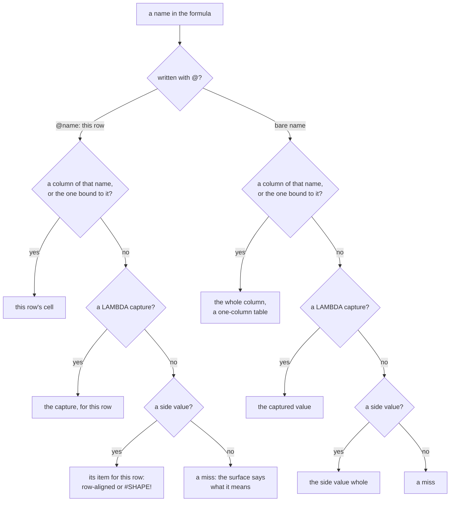
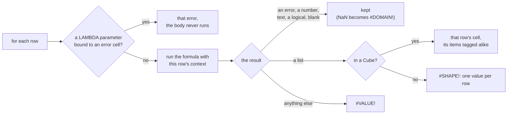

<!-- [[C22]] rowFormulaRefs, [[C54]] noPerCellFormulas, [[C50]] lambdaBindsByName, [[C25]] firstClassUnits -->

# Spec: Computed columns

Serves [[C22]] rowFormulaRefs and [[C54]] noPerCellFormulas; a wired LAMBDA binds under [[C50]] lambdaBindsByName. It covers what the system does and blocks, and the decision each behavior serves.

A computed column is a Frame column defined by one formula, or one LAMBDA, evaluated once per row. It is the only way to put per-row math on a Frame, since a Frame never enters a formula whole ([[C15]] matricesInFormulas). There are three surfaces, and all run the same engine, the core's column runner (`eval::column_with`, driven by `crates/solenoid-core/src/nodes/columns.rs`), so they can't disagree:

- **An Fx column in Frame Input**, typed into the table popup's column header. The popup's (i) legend lists the names below ([[table-popup#The grid]]).
- **The Computed Column node**, which adds one column to a Frame or Cube that arrives on a cable.
- **An Fx column in Cube Input**, typed into the Cube popup's root header ([[#Fx columns in Cube Input]]).

The formula language itself is [[formula-language]]. This spec covers what is different inside a computed column: how names resolve, how rows are evaluated, and how the result becomes a column.

## Names inside a row

| Written | Reads |
|---|---|
| `price`, `[Unit Price]` | the whole `price` column, a one-column table as an Excel table column is |
| `@price`, `@[Unit Price]`, `[@Unit Price]` | this row's `price` cell |
| `ROW()` | this row's 1-based number (`set_row_number`, `excel_functions.rs`); outside a computed column it is `#NAME?` saying where it works |
| `ROWS(price)` | the row count, since a whole column is a column |

Brackets spell a name that isn't a valid identifier. A column is found by its exact name; a numeric name is still a name, never a position.

So `revenue / SUM(revenue)` gives each row's share of the total, and `SUMIFS(amt, cat, @cat)` sums the rows in this row's category. A whole column where one value is needed is a `#SHAPE!` on that row that points at `@` ("A computed column needs one value per row. Use @name to read this row's cell."), never a silent read of this row's cell.

**A whole-column total is worked out once per column, not once per row.** A range function (`kind: range` in the call table) called with the very same argument values as its last call (the same whole-column array, the same scalars, by identity) answers its last result (`Memo`, `eval.rs`, keyed per call site), so `revenue / SUM(revenue)` stays linear in the row count. Only a scalar or error result is kept; a list result is computed fresh each row so no row shares a mutable array. Every range function is pure, so a new range function that reads a clock, a random source or the row stack must not be `range`.

**A part of the formula that reads no row is computed once per column.** Before the rows run, the runner finds the largest subtrees that read no `@` cell, call no `ROW()` or random draw (`fns_random::NAMES`), name no parameter of a LAMBDA around them and call no LAMBDA it can't see into (a wired or bound one, or a LAMBDA's own parameter, which may hold one), and keeps each one's value from the row that first computes it (`row_free`, `Eval::hoisted`), so `GEOMEAN(score + 1) + @score` and `SUM(MAP(score, LAMBDA(v, v * 2))) - @score` stay linear. A value whose calc raised isn't kept. A new function that reads the row or a random source joins that list. The differential test `keeping_row_free_subtrees_changes_no_answer` runs random formulas with and without it.

A name resolves in a fixed order: a column (or the column an explicit binding picks, below), then a LAMBDA's captured values, then the surface's side value. A name that is none of these is a miss. What a miss means depends on the surface (below).

`@name` and `[Name]` only work inside a computed column. Anywhere else they are a `#REF!` saying so.

**How a row read finds its row.** While a column computes, a row context is pushed around every evaluation, the inline formula and a wired LAMBDA's body alike, and popped after; contexts nest as a stack. The row context's `at` (`@name`) and `whole` (`[Name]`, `eval.rs`) read the top of that stack, so even a zero-parameter LAMBDA can read `@price` with no binding. An `@name` read tries the explicit binding or the column of that name (this row's cell), then the definition's own environment (a LAMBDA's captures, read for this row), then the side value. A `[Name]` read returns the bound or named column whole, else the side value as it is, not indexed by row. On both paths a reserved name that reaches the side-value step is the reserved-name `#REF!`. A LAMBDA's bare captured name reads the same way: while a row context is up, a capture that names a column (or the column an explicit binding picks) is that whole column, and the captured value is used only when no column matches. A parameter is this row's value whether written `x` or `@x`, so a LAMBDA card whose body writes one parameter both ways shows a hint pointing at `[x]` for the whole column (`perRowParamClashes`). A bare `x` in such a body is almost always meant as the column, and the answer it gives is believable, so it must not pass silently.

## Evaluating a column

1. **Bind the variables.** For an inline formula, each bare variable binds to the whole column of that name, or else becomes a side variable. For a LAMBDA, each parameter binds to this row's cell of the column with the same name ([[C50]] lambdaBindsByName), in any order. A name that collides with one of the surface's own input names is a whole-column `#REF!` telling the user to rename the variable or the column.
2. **Find the side names.** Every `@name` that matches no column is a side name too, so the surface can grow an input for it. The surface passes these as `row_refs`: the row reads its definition does not already own, a LAMBDA's captures excluded. A bound `@name` reads its column instead, and a binding to a missing column is the same whole-column `#REF!` the variable spelling gets. Side names are listed in first-appearance order (`sideVars`), and the surface grows and prunes its side inputs from that list.
3. **Run each row.** The row count is the longest column. For each row, a LAMBDA parameter bound to an error cell makes that row's result the error, the first such parameter in binding order, without running the body ([[C24]] arraySemantics). A whole-column binding passes its errors into the formula, where the function's own rule applies, and a blank reaches the formula as blank, so ISBLANK and IF can see it. Otherwise the formula or LAMBDA body runs with this row's context available to `@` reads. A formula or LAMBDA that throws gives that row the thrown error value, or a `#VALUE!` carrying the message.
4. **Tag each result** (`tag_computed_cell`):
   - an error passes through;
   - a number passes, except NaN, which becomes `#DOMAIN!` ([[C24]] arraySemantics); a surviving infinity is a real value, since the formula's operators have already classified overflow;
   - text, TRUE/FALSE and blank pass, and an undefined result is blank;
   - a list is `#SHAPE!` (one value per row), except in a Cube, where a list or a grid is that row's cell and its items are tagged by these same rules (`tag_cube_cell` in `nodes/columns.rs`, [[C22]] rowFormulaRefs). A Frame row can't hold a list, so a Frame's computed column still answers one value per row. A one-item answer is one value, as a formula's answer is everywhere;
   - anything else is `#VALUE!` ("each row must be a number, text, TRUE/FALSE or blank").

Errors are per row: one bad row never blanks the column.

**Side values.** A side value is fetched once per column (`sideValue(name, kind)`, where `kind` says whether it was bound as a variable or reached from inside a row) and must be the same on every row. A column is found by its exact name, never by position. Read with `@name`, a side list must be row-aligned: a list whose length equals the row count reads its element for this row, a matrix is `#SHAPE!` ("a matrix has no single this-row value"), and a list of the wrong length is `#SHAPE!` naming both counts. A scalar reads the same on every row. Read bare, the side value arrives whole, so `SUM(list)` works; a list with one value per row arrives as a column, like the Frame's own columns, so `SUM(price * weights)` pairs them element by element ([[D85]] columnsStayColumns).

## The column's type

The type is inferred from the computed cells (`inferColumn`). Cells alone can't tell a date from a number, since both are serials, so a Number column is promoted to Date when the definition keeps a date a date (`yields_date` in `nodes/columns.rs`):

- a name or `@` read of a Date column is a date;
- `date + number` (either order) is a date, and `date − number` is a date; `date − date` is a number of days;
- unary `+` keeps a date;
- a function whose registration declares `returns: "date"` gives a date;
- IF gives a date when every branch it has is one.

Anything else stays a number. The Computed Column node can also pin the type instead of inferring it (Number, Text, Date or Boolean). Its output type picker (`addAs`) defaults to Auto, which infers from the computed cells; Date is offered because inference cannot always reach it, since a date serial is indistinguishable from a number.

## Units

A computed column, over a Frame or a Cube, takes the unit its formula works out from its columns' units and its wired values' units, and an authored unit (a `Name (unit)` name, or the Fx column's unit picker) wins; a clash is `#UNIT!` in every cell ([[C25]] firstClassUnits). The rule, its magnitudes and its readings are [[unit-flow#Computed columns]]. A LAMBDA is read through its body, whether it is the column's whole definition (a wired λ, or a Frame Input column that is only `λ1`), called by name (`λ1(@lo, @hi)`), or written inline: each parameter takes the unit of the column or argument it binds to.

A Cube carries its unit on its cells, so a Cube column's unit is the one its cells share and the result's unit is tagged onto each new cell ([[unit-flow#Computed columns]], Cubes). A LAMBDA's captured values count with their units.

## Fx columns in Frame Input

- **Storage.** A computed column is a column of the Frame Input's source text with an `expr` field (the JSON form of `frameText`). It stores the formula alone; there are no cells to store ([[C54]] noPerCellFormulas, [[C28]] literalsIffEditable). A Number Fx column can carry a unit, picked in the popup, which becomes the column's `ColumnUnit`.
- **Dependency order.** Fx columns fill in dependency order, so a column can use another computed column. A column's dependencies are its variables and its `@` and `[Name]` reads, plus the `@` reads and captured names inside any LAMBDA it calls, so even a zero-parameter LAMBDA orders after the column it reads. Computed columns start empty, so stale values can't leak into the row count or an earlier dependency.
- **Cycles.** Columns still unfilled when no more progress is possible form a cycle. Every one of them becomes a column of `#REF!` "Circular computed columns: A → B".
- **LAMBDA inputs.** Frame Input can grow LAMBDA inputs, named `λ1`, `λ2` and so on. A formula that is only `λ1` binds that LAMBDA's parameters to columns by name. Anywhere else `λ1` is an ordinary LAMBDA value, so `λ1(@price, @qty)` calls it with positional arguments and `MAP(price, λ1)` passes it. A named LAMBDA input with nothing wired leaves the column blank, not an error. Removing a LAMBDA input turns a column whose whole formula was that name back into a Data column.
- **No side inputs.** Beyond its LAMBDA inputs, Frame Input has nothing to wire, so a name that is no column is `#REF!` "No column "x"". A LAMBDA's own side values ride its captures on the LAMBDA card.
- **A formula that doesn't parse** gives its column `#VALUE!` "The formula does not parse".
- **Stable output.** While the source text and every wired LAMBDA are unchanged, the node returns the same Frame object, so the relational backend's identity-keyed upload cache holds across recomputes.

How the Fx column is edited (the type button's Fx step, the formula row, the λ list under the field) is [[literal-input-editors]].

## The Computed Column node

- **Inputs.** `frame` (a Frame or a Cube; a list or matrix widens to a Frame), `name` (the new column's name, default `computed`), `after` (blank appends at the end; a column name inserts right after it), `fn` (an optional LAMBDA), and one side input per side variable.
- **The definition.** A wired LAMBDA wins over the inline formula. An empty formula with nothing wired passes the Frame through unchanged. A formula that doesn't parse is a whole-output `#VALUE!`.
- **Side inputs.** A variable or `@name` that names no column grows an input named after it, `anydata` so it can take a whole list (the socket lattice, [[socket-lattice#anydata, the formula-variable wildcard]]). The inputs follow the Frame's columns: when a column appears that the name now matches, the input goes away, and its cables are pruned first ([[input-cable-pruning#The ordering rule]]). The grown inputs are saved (`sideVars`) and rebuilt on load, so a saved cable finds its socket. An unwired side input reads its inline literal, 0 by default; a wired blank stays blank ([[D86]] blankRoles). The names `frame`, `name`, `fn` and `after` are reserved. A wired LAMBDA's captured names never grow side inputs here, since they ride the LAMBDA card's own sockets.
- **Explicit bindings.** The card can bind a variable to a chosen column (`bindings`). A bound variable skips the resolution order and always reads that column; if the column is gone, the whole output is `#REF!` "No column "x" to bind "v" to", never a silent fallback.
- **Name and placement.** The name goes through `addColumn`. A trailing unit in the name, as in `Price (USD)`, is split off and tags a Number column with that unit. A name that then matches an existing column replaces it in place, keeping its position whatever `after` says; a new name that clashes after cleaning is made unique the way headers are. An `after` naming no column is `#REF!`.
- **Cubes.** A Cube is read through `cube_row_table` (`crates/solenoid-core/src/nodes/columns.rs`). **A Cube row's list is reachable** ([[C22]] rowFormulaRefs): in a Cube a cell can hold a list, and formulas take lists, so `@name` on a column of lists reads this row's list and the formula may answer a list, which becomes that row's cell; refusing would leave a Cube's list columns unreachable from the one place per-row math lives. A nested Frame stays out of formulas. A column of scalars reads as a typed column, by its declared type when it has one (a Text column keeps `"5"` as text) and by `inferColumn` otherwise. A column holding lists reads each row's list with `@name`, its items as bare magnitudes; its whole read is its rows stacked, one list per row, padded with blanks to the longest (`stacked_rows`; a scalar cell is a one-item row and a blank cell an empty one), so `SUM(prices)` totals every row's items. The padding is blank, not the `#N/A` that VSTACK pads with: a short list's missing positions don't exist, and a blank is no value, which totals and averages skip. `INDEX(prices, ROW(), 2)` is this row's second item. A column with a grid in some row has no single table, so its whole read is `#SHAPE!` pointing at `@`. A row holding a nested Frame reads as `#SHAPE!` on that row alone, so the column's other rows (values or lists) still compute, and leaving the column out is harmless; read whole, a column with a nested Frame in any row is `#SHAPE!`, since it has no single table to stack. The cells are computed as a Cube's (`tag_cube_cell`), so a row may answer a list, and the new column's type is its items' type when any row is a list (`cube_cells_type`). The new column is added back onto the original Cube with every nested column carried through untouched ([[C10]] socketLattice).
- **Declared shape.** When the type is pinned and neither `name` nor `after` is wired, the node declares the output's columns ahead of time (`frameShape`), so downstream column pickers see the new column before anything computes. With Auto type the shape is known only after a compute.
- **Stable output.** An unchanged input, definition, name, placement, bindings and side values return the same output object.

## Fx columns in Cube Input

- **Storage.** A formula column is a `{ name, expr }` entry in Cube Input's column list ([[frame-verbs#The Cube value]], Cube Input's source); it has no cells of its own, and records that still hold its key are ignored.
- **Reading.** The formula reads the cube as the Computed Column node reads one (`cube_row_table`), after the typed columns are read by their types ([[D90]] cubeTypesAtDepth), so `SPARKLINE(@history)` draws each row's own list, typed items included, and a row may answer a list (*The Computed Column node*, Cubes).
- **Dependency order and cycles** work as in Frame Input: a column's variables and `@` reads order it after the columns they name, and columns still unfilled when no more progress is possible are each a column of `#REF!` "Circular computed columns: A → B". A column that reads itself is such a cycle.
- **No side inputs.** Cube Input has nothing to wire, so a name that is no column is `#REF!` "No column "x"", and there are no LAMBDA inputs.
- **Blank and bad formulas.** An Fx column with no formula yet is blank; one that doesn't parse is `#VALUE!` "The formula does not parse".
- **Type.** A column whose rows include a list takes its items' type; otherwise the type is inferred as for any computed column.

