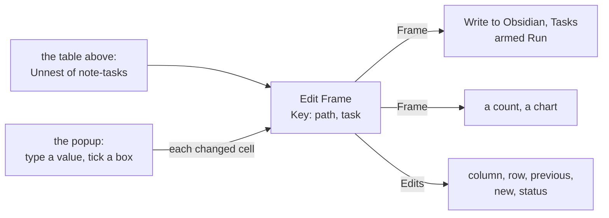

<!-- [[C58]] tableInputRawText, [[B18]] safeToShare -->

# Spec: Edit Frame

Serves [[A1]] visualGraphCalculator. The Edit Frame card changes cells of a table another card computed, by hand: a person opens the table, types a value or ticks a box, and each change is kept on the card as an edit of one cell. The card that computed the table is never touched, and every hand edit stays in plain sight on the Edit Frame card. The code is `EditFrameNode` (`nodes/frame.ts`), its body `nodes/edit_frame.rs`, its card `EditFrameComponent` (`FrameNodes.tsx`) and its popup `editFramePopup.ts`.

The usual chain is a vault's tasks ticked by hand and written back: Vault Folder with Tasks ticked, Unnest of `note-tasks`, Edit Frame keyed by `path, task`, then Write to Obsidian set to Tasks, which writes only on Run from an armed card ([[B18]] safeToShare; [[reports-and-notes#Write to Obsidian]]). Edit Frame itself only changes the table; a count or a chart off its Frame sees the ticks before anything is written.

## The card

- **Inputs:** `frame` (the table) and `key`, text naming the columns that find a row, split at commas and trimmed. A name matches a column exactly, else ignoring case and spaces at its ends. Empty, its Behavior is `[row number]`: a row's key is its 1-based number. A key column the table lacks answers `#REF!` ("No column "x" for the key"); a key that isn't text is `#TYPE!`.
- **Outputs:** `frame`, the table with its edits applied, and `edits`, a table of the edits.
- **Saved:** `cellEdits`, a list of `{ row, column, value }`: the key of the edit's row, its column's name and the text typed, kept as typed ([[C58]] tableInputRawText). The key text rides in `stringLiterals.key`.
- **The card shows**, top to bottom, an Edit Cells button above its inputs, as Frame Input's Edit Frame and Table Input's Edit Table sit (`CardOpenButton`, theirs too; with no table wired it opens nothing), the edit list with the Edits socket beside it, centered on the list, and the Frame output row. It is a 340 px card (`nodeXWide`), so each edit's key and value fit on its line.

## A row's key

A row's key is its key cells as the table shows them, joined by ` · `: text as it is, a logical as TRUE or FALSE, a number in its shortest exact digits, a date as its date in its column's pattern, a blank as empty text (`cell_text`). So `path, task` keys a task as `Projects/Alpha.md · Call Bob`. An edit finds its row again by that text whatever order the rows come in, so it survives a sort upstream, a row added above it or a note edited above the item. A key built from `line` alone would not, which is why the tasks chain keys on the item's text.

## Applying an edit

Each edit, in the order saved:

1. **Its column** is found by name as a key column is. None: the edit is `stale`.
2. **Its row** is the one row whose key is the edit's `row`. None: `stale`. Two or more: `ambiguous`, and it changes none of them.
3. **Its value** is read into a cell of its column's type as Frame Input reads typed text (`frame_cell_of`): a Number column's text as a number, `#VALUE!`'s NaN when it reads as none; a Date column's text as a date; a Logical column's `TRUE` or `FALSE`; text as it is, empty text a blank. A column that carries typed text (`raw`) takes the typed value there too.
4. **Equal to the cell already there:** the edit is `settled`, and it drops (below). Otherwise it is `applied`, and the cell takes the new value.

A stale or ambiguous edit is kept on the card, listed struck through with its status in the error ink, and stays in the `edits` table. It is never dropped silently: the table above may come back (a vault folder not yet read, a filter loosened), and a person decides when to take it back.

## Settled edits drop

An edit whose cell already holds its value has nothing left to do: a task ticked by hand, written to the vault and read back ticked; or a cell typed back to what the table gives. The body names those edits in the `settled` field (each `column` and `row` joined by U+001F), and the card removes them from `cellEdits` (`coreWatched`, [[node-bodies]]), then marks itself edited so the next save leaves them out. They are matched by column and row, never by position, so an edit added meanwhile is never the one dropped. A settled edit is left out of the `edits` table.

## The Edits table

A row per edit that is not settled, in saved order, every column text:

| Column | What |
|---|---|
| `column` | the edit's column |
| `row` | its row's key |
| `previous` | the cell as the table above gave it, as shown (blank for a stale or ambiguous edit) |
| `new` | the cell as the edit makes it, as shown (the typed text for a stale or ambiguous edit) |
| `status` | `applied`, `stale` or `ambiguous` |

## The edit list

The edits list as a Pipeline lists its steps ([[composite-nodes#Manual refresh and Pipeline]]): numbered rows in a Recess that scrolls past about seven (216 px, `nowheel`). Each row is its number, its row's key, then `column = value` (`blank` for an empty value) or, for a stale or ambiguous edit, its status, whose tooltip says why it changes nothing; a remove button takes that edit back. The list shows the first 20 edits (`EDIT_LIST_CAP`) and counts the rest under them, `+57 more…`; the card keeps every edit and the Edits table lists every one. With none it reads `no edits`.

## The popup

Edit Cells opens the card's output, its edits applied, in the Table popup as an editor (`openEditFramePopup`): every cell takes typing, a Logical cell is a checkbox and a Date cell has its calendar ([[table-popup]]). The columns and the rows are fixed (`fixedCols`, `fixedRows`): nothing adds, removes or renames one, and the CSV view only reads. The grid opens with each cell's text as the edit list shows it (a date as `DD-MMM-YYYY`); Save compares each cell with what it opened with and sets an edit on every one that differs, keyed by the row's key as the body last read it (`rowKeys`) and the column's name (`changedCells`, `setCellEdits`). A second change to the same cell replaces its edit, and a cell typed back to the table's own value settles and drops.

## Tests

`tests/graph/nodes/editFrame.test.ts`: the table unchanged with no edits; a row found by its key and its cell typed by its column; an edit following its row through a reorder; stale and ambiguous edits listed, kept and changing nothing; a settled edit dropping while the rest stay; a missing key column's `#REF!`; nothing wired; a typed date read as its day; `cellEdits` through `extractInit`; a second change to a cell replacing the first; the popup saving only the cells that changed.
