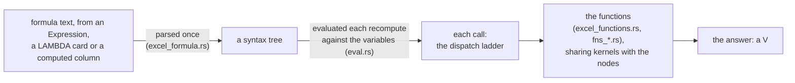
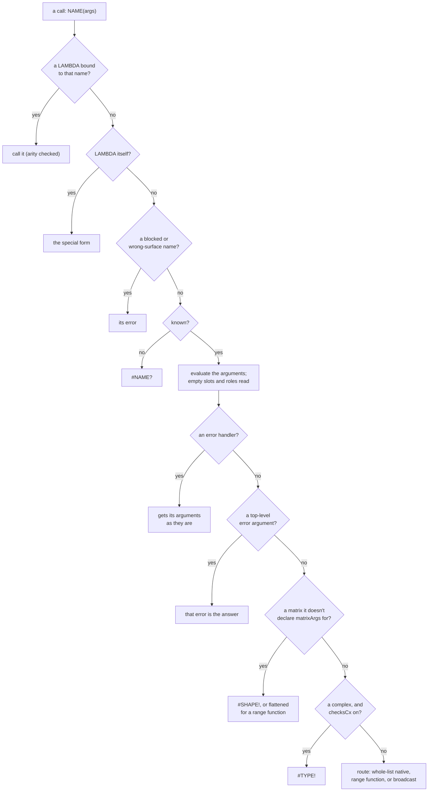
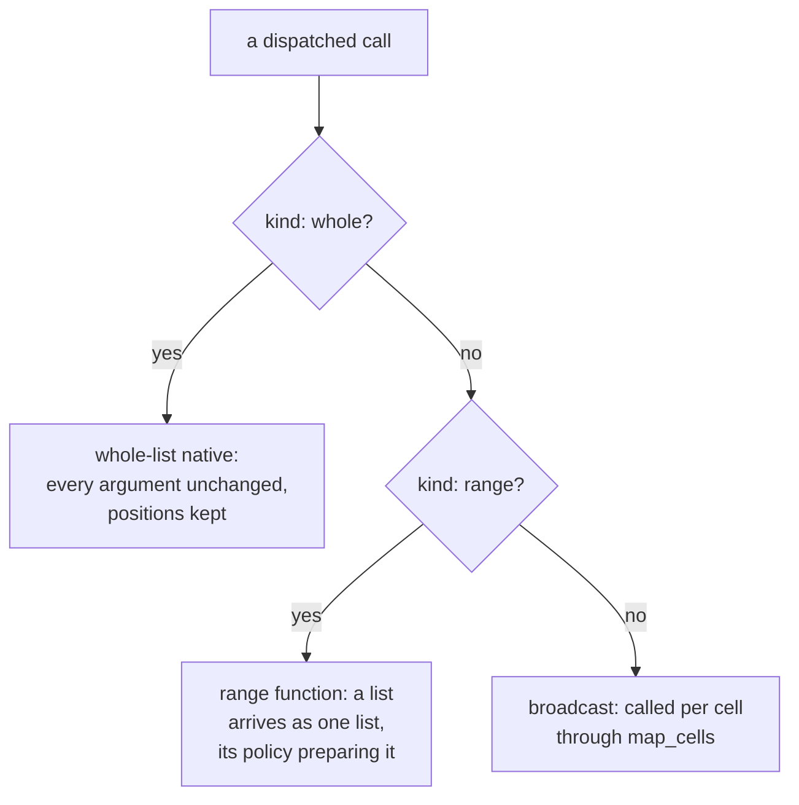
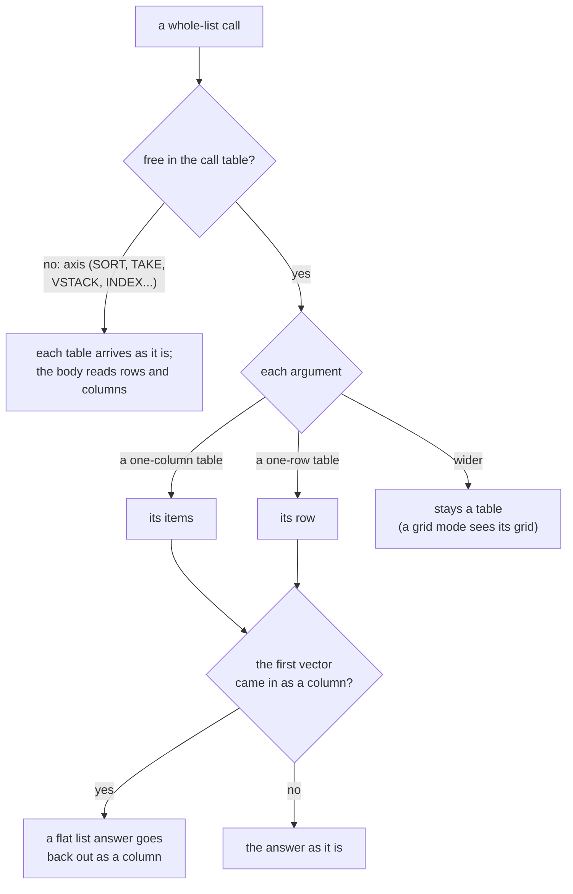
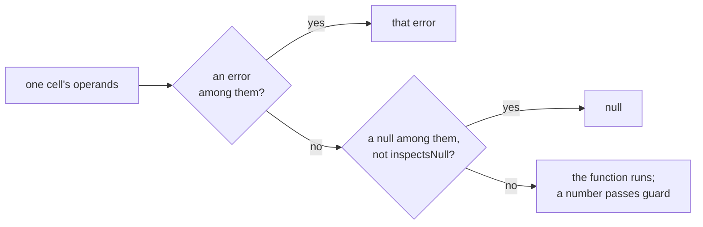
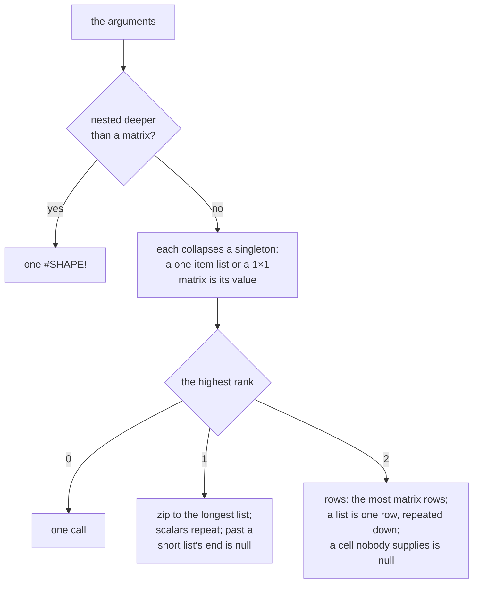

<!-- [[B16]] oneFormulaSurface, [[C15]] matricesInFormulas, [[C17]] shareImpl, [[C24]] arraySemantics, [[C45]] excelComparisons, [[C50]] lambdaBindsByName, [[C51]] formulaNaming, [[C80]] blankArgIsExcelBlank, [[C44]] dateSerials, [[C48]] appendLadder, [[B11]] maximalMerge, [[C26]] opArgDistinct -->

# Spec: Formula language and evaluator

Serves [[B16]] oneFormulaSurface, with its subtree: [[C15]] matricesInFormulas, [[C17]] shareImpl, [[C24]] arraySemantics, [[C45]] excelComparisons, [[C50]] lambdaBindsByName, [[C51]] formulaNaming and [[C80]] blankArgIsExcelBlank. The shared kernels and the parity measurement also serve [[C44]] dateSerials, [[C48]] appendLadder, [[B11]] maximalMerge and [[C26]] opArgDistinct. It covers what the system does and blocks, and the decision each behavior serves.

The formulas and the nodes share one set of functions ([[B16]] oneFormulaSurface). A new function lands on both surfaces in one change, or on neither. Nodes that no formula can express (Frame verbs, figures, inputs) aren't functions and sit outside that set. A surface that offers fewer functions, such as a simple mode, would be a filter over the one set, never a second set.

The formula language is the Excel-style expression language typed into an Expression card, a LAMBDA card and a computed column. A formula is parsed once into a syntax tree and evaluated per recompute against the card's variables. Every function it calls is implemented in Rust ([[rust-core]]) and usually shares its kernel with the matching node. This spec covers the grammar, how names and calls resolve, how arguments are prepared and broadcast, the function-by-function notes, the shared graph-free kernels both surfaces call, and the measurement that keeps nodes and formulas in step.

Where Solenoid answers otherwise than Excel, and where it answers as Excel where Formula.js did not, is [[excel-divergences]]; this spec does not repeat it. The mechanics below name the core's own functions (`eval.rs` unless another file is named) and the fields of its call table; the TypeScript copies are gone ([[D99]] rustIsSpec). Computed-column name resolution is [[computed-columns]]. The Equation node's symbolic rearrangement of the same AST is [[equation-solver]]. The dimension pass that runs beside the numeric evaluator is [[unit-flow]].

## Files

| File | Owns |
|---|---|
| `crates/solenoid-core/src/excel_formula.rs` | Tokenizer, parser and the tree (`engine_formula_parse` hands it to the TS). |
| `crates/solenoid-core/src/eval.rs` | The evaluator: argument routing and preparation, broadcasting (`map_cells`), the operator table, the error-handler family, LAMBDA as a special form and the LAMBDA hosts, computed columns' row context. |
| `crates/solenoid-core/src/excel_functions.rs`, `fns_*.rs`, `fns_packs.rs` | Every function body; `route` resolves a name to its arm or module. |
| `crates/solenoid-core/data/call_traits.json` | Each name's contract (see *The registry*). |
| `src/graph/excelFormula.ts` | The tree's type, `parseFormula` (the core's tree), `compileEvaluator` and `compilePositional` over the core (`evaluateOnCore`), static analyses (`extractVariables` and siblings), LaTeX rendering and the step trace. |
| `src/graph/excelFunctions.ts` | The names the editor reads: each function's arity (`FUNCTION_ARITY`), the blocklist (`LEGACY_ALIASES`, with `POSITION_NAMES`), the wrong-surface names (`FRAME_SURFACE_NAMES`, `NODE_SURFACE_NAMES`), and the names the core resolves (`formulaFunctionNames`, `isFunctionName`). |
| `src/graph/closeParens.ts` | `closeParens` ([[C115]] closeParensOnCommit), alone so a caller outside the engine (the Obsidian plugin's column head) does not pull the engine in. |
| `src/graph/formulaSignatures.ts` | Display-only argument hints per function name. |
| `src/graph/formulaExtensions.ts` | Pack formula declarations and the advertised (autocomplete) name set. |
| `src/graph/formulaSyntax.ts` | Editor highlighting, caret word, suggestions, enclosing-call detection. |
| `src/graph/lambdaValue.ts` | The `LambdaValue` shape and `isLambdaValue`. |
| `src/graph/nodeExcel.ts` | `NODE_EXCEL` (catalog node type to its Excel equivalents, with `parity` and a note) and `EXCEL_GAP` (Excel functions with no node, flagged out of scope or superseded). The Function Reference and catalog read them; the evaluator does not. |
| `src/graph/nodes/expression.ts` | The Expression node. |
| `src/graph/nodes/lambda.ts` | The LAMBDA node, which emits a `LambdaValue`. |
| `src/graph/nodes/tableLambda.ts` | The MAP, BYROW, BYCOL, REDUCE, SCAN and MAKEARRAY nodes; their bodies, wired-LAMBDA binding included, are the core's. |
| `src/graph/cxValue.ts` | The tagged complex value, its text forms and its arithmetic kernels. |
| `src/graph/excelToCatalog.ts` | `EXCEL_TO_CATALOG` and `CATALOG_TO_EXCEL`, derived from `NODE_EXCEL`, never hand-edited. |
| `src/graph/formulaNodeParity.ts` | The node-and-formula parity measurement (see *Parity measurement*). |
| `src/graph/nodes/*Ops.ts` | What the components and the cards' shells still read of the kernels; the kernels themselves are the core's (see *Shared kernels*). |
| `src/graph/packs/*Formulas.ts` | A pack's `formulas`: each one's name, arity and argument hint. |

Every module the formula path imports is graph-free, each pack's `*Formulas.ts` included ([[engineering#The formula path is graph-free]]). The headless evaluator (`run-graph`, the Expression host) loads `excelFormula.ts`, then `excelFunctions.ts`, then the shared op modules, so none of them may import the graph model (`graphModel`, `graphEditor`, `dataflowEngine`) or the socket lattice (`sockets.ts`). An `import type` is allowed, since only a value import loads a module at run time.

Tests: `formulaPathIsGraphFree.test.ts`: the relative import graph from `excelFormula.ts`, `excelFunctions.ts` and every pack's `*Formulas.ts` reaches no value import of the graph model or `sockets.ts`.

## Lexical grammar

The formula tokenizer, `tokenize(src)` in `excel_formula.rs`, splits a formula's text into tokens, scanning left to right. If it reaches a character that can't start or continue a token, it returns `None`, and the whole formula fails to parse: a syntax error, which an Expression or LAMBDA node shows as `#SYNTAX!`. Whitespace separates tokens and is otherwise ignored: spaces, tabs, newlines and carriage returns.

| Token | Form | Notes |
|---|---|---|
| number | a digit, or `.` followed by a digit; then any run of digits and dots; then optionally `e` or `E`, an optional sign, and digits | The run must be one well-formed number (digits with at most one decimal point, and digits after any exponent), or the formula is a syntax error: `1.2.3` and `2e` do not parse. No thousands separators, hex or leading sign (a sign is the unary operator). |
| string | `"` up to the next `"` | No escapes. A doubled quote is not an embedded quote: `"a""b"` is two adjacent strings, which is a syntax error. An unterminated string is a syntax error. Single quotes are not string delimiters. |
| name | starts with `A`-`Z`, `a`-`z`, `_` or `λ`; continues with those or digits; a `.` is consumed only when an identifier character follows it | So `NORM.S.DIST` and `STDEV.S` are one name, and a trailing dot is not part of the name. Only ASCII letters and `λ` are letters; `é` is an unknown character. `λ` exists so a wired LAMBDA socket's name (`λ1`) can be typed. |
| operator | `<>`, `<=`, `>=` (two characters, matched first), then any of `+ - * / ^ % & = < > @` | |
| paren | `(` or `)` | |
| comma | `,` | The only argument separator. |
| column reference | `[` text `]` | Whole-column reference. The text is everything up to the first `]`, trimmed; it cannot contain `]`. Empty text is a syntax error. |
| row reference | `[@` text `]`, or `[@[` text `]]` | This-row reference. The inner bracket form lets the text hold characters a name cannot. |

Anything else (`{`, `}`, `;`, `#`, `'`, `!`, `:`, `$`) is an unknown character, so the formula is a syntax error. There are no error literals, no array literals and no cell references. `A1` is an ordinary name.

`TRUE` and `FALSE` are names at the token level. The parser turns a bare `TRUE` or `FALSE` (any case, not followed by `(`) into a logical literal.

Tests: `excelFormula.test.ts`: a malformed number (`1.2.3`, `2e`) doesn't parse, while `2e3 + .5` is 2000.5; `excelFunctions.test.ts`: dotted names (`NORM.S.DIST`, `STDEV.S`) read as one name and resolve.

## Syntax

The parser is recursive descent over the token list. A formula is one expression that consumes every token; anything left over is a syntax error. An empty or all-whitespace formula does not parse.

Precedence, loosest first. Every binary level is left-associative, including `^` (so `2^3^2` is 64, as in Excel).

| Level | Operators | Form |
|---|---|---|
| 1 comparison | `=` `<>` `<` `>` `<=` `>=` | binary; chains left to right, so `1<2<3` is `(1<2)<3` |
| 2 concatenation | `&` | binary |
| 3 additive | `+` `-` | binary |
| 4 multiplicative | `*` `/` | binary |
| 5 exponent | `^` | binary |
| 6 percent | `%` | postfix, repeatable (`50%%` is 0.005) |
| 7 unary | `-` `+` | prefix, repeatable |
| 8 primary | literals, names, calls, references, `( expr )`, postfix application | |

Unary binds tighter than `^`, so `-2^2` is `(-2)^2` = 4, and `-x^2` is `(-x)^2`, both Excel's reading. Percent binds looser than unary: `-50%` is `(-50)%`.

Primaries:

| Source | AST node |
|---|---|
| number token | `{ t: "num", v }` (the raw text; evaluated with `Number`) |
| string token | `{ t: "str", v }` |
| bare `TRUE` / `FALSE` | `{ t: "bool", v }` |
| bare name | `{ t: "name", name }` |
| name `(` args `)` | `{ t: "call", name, args }` |
| `@` name, or `@` `[Name]` | `{ t: "atcol", name }` (this-row reference) |
| `[@Name]`, `[@[Name]]` | `{ t: "atcol", name }` |
| `[Name]` | `{ t: "wholecol", name }` (whole-column reference) |
| `(` expr `)` | the inner expression |
| primary `(` args `)` | `{ t: "apply", fn, args }`, repeatable: `LAMBDA(x, x+1)(5)`, `f(2)(3)` |

A name immediately followed by `(` is a call, never an application; application applies to any other complete primary, including a call's result. `@` must be followed by a name or a `[Name]`; anything else is a syntax error.

Argument lists: `(` then zero or more slots separated by commas, then `)`. `F()` has no arguments. A slot that is empty, because a comma or the closing paren sits where an expression should start, is `{ t: "blank" }`: `IF(x,,y)` has three arguments, the middle one blank; `F(a,)` has two; `F(,)` has two blanks.

`parseFormula` hands back the core's tree (null on a syntax error); the editor's analyses walk it.

Tests: `excelFormula.test.ts`: precedence (`a + b * c`, `2 ^ 3 ^ 2` is 64, `50%`), an empty or unparseable formula compiles to null, and empty slots parse (`IF(x,,y)`, a trailing `F(a,)`); `formulaLambda.test.ts`: application to a LAMBDA and to a call's result.

### Syntax hints

The core's `syntax_hint` (`nodes/matrix.rs`) explains a failed parse, or answers null when nothing recognizable is wrong. String literals are blanked first so their contents cannot trigger a hint. Checks run in this order and the first hit wins:

1. braces anywhere: array literals aren't supported, wire a List or Table instead;
2. a leading `=`: drop it;
3. a `;`: use commas;
4. unbalanced `[` and `]`;
5. more `(` than `)`, naming the count; or more `)` than `(`; or, balanced, a `)` before the `(` it would close (`)a(`). Parentheses inside a `[column]` or `[@[column]]` reference don't count;
6. a trailing operator or comma: the formula ends mid-expression.

Check 5's first half rarely shows after an edit, because every formula surface commits through `closeParens` ([[C115]] closeParensOnCommit):

- It appends the missing `)` when the text has more `(` than `)` outside quoted text and `[column]` references, read as the tokenizer reads them (`referenceEnd`).
- An unterminated string or reference is left as typed, so the parser names it rather than a `)` landing inside it.
- A formula with too many `)` is left for the hint.
- The formula popup calls it in `commit`, and the Fx column row (`ColumnExprField`, shared by the Frame Input and Cube popups) calls it on blur. Nothing happens while typing, so the text never changes under the cursor; a formula surface that committed on every keystroke would add parentheses mid-typing and reopen [[C115]] closeParensOnCommit.

Tests:

- `formulaSignatures.test.ts`: each check names its trap (braces, a leading `=`, `;`, an unclosed `[`, the count of missing `)`), and a parseable formula, or braces inside a string, gets no hint.
- `excelFormula.test.ts`: `closeParens` adds the missing closers outside quoted text and `[column]` references, leaves an unterminated string or reference and an over-closed formula alone, and the hint names a `)` before its `(`.

## Names

A bare name (`{ t: "name" }`) resolves, in order:

1. **Constant.** `pi`, `tau` (2π), `e` and `phi` (the golden ratio), matched case-insensitively (`FORMULA_CONSTANTS`). A constant always wins, inside a LAMBDA body too ([[C50]] lambdaBindsByName). A constant is never a variable, so a formula cannot have a variable named `e`, `E`, `pi` or `PI`, and a LAMBDA cannot have a parameter by one of those names (see *Syntax and evaluation* under LAMBDA).
2. **Environment.** `env[name]`, case-sensitive. In the Expression node every non-constant bare name is a variable with a socket, so it is always bound (see *The Expression node*). A name the environment lacks evaluates to `undefined`.

Function names in call position are case-insensitive and resolve through the registry (see *Calls*). A variable never shadows a function, and a function never shadows a variable: `SUM` bare is a variable named `SUM`, `SUM(…)` is the function. The one crossover is a call whose raw name is bound in the environment to a `LambdaValue`, which applies that lambda.

`@name`, `@[Name]`, `[@Name]` and `[Name]` read a computed column's row context. Outside one they answer `#REF!` ("@ reads the current row, so it only works inside a computed column", or the whole-column wording for `[Name]`). They are never variables: `extractVariables` skips them, so they never grow a socket.

Tests:

- `excelFormula.test.ts`: the constants evaluate with no input, case-insensitively and beside real variables.
- `formulaLambda.test.ts`: a constant keeps its meaning inside a LAMBDA body, a parameter named after one is refused on the formula and the card, and a positional binding never shadows one.

## Calls

### The registry

A name resolves once: `route` (`excel_functions.rs`) gives it its arm of `call_function`'s match or the module that holds its body. A name nothing routes is `#NAME?` "Unknown function". The editor reads the names from the core (`engine_function_names`): `formulaFunctionNames()` is every callable name, `isFunctionName` every name that resolves (a blocked one included), `packFunctionNames()` the packs'.

`data/call_traits.json` holds each name's contract, keyed by the uppercased name ([[engineering#One declaration per fact]]):

| Field | Meaning |
|---|---|
| `kind` | how a call routes: `range` (reads its lists whole), `broadcast` (maps over them), `whole` (a whole-list native: arguments arrive exactly as they are), `handler` (the error handlers) |
| `prep` | how a range call readies its lists ([[#Range functions]]): `default` (blanks drop), `zero` (blanks read 0), `paired` (a position blank in any list drops from every list), `raw` (the lists as they come), `positional` (as they come, a matrix refused) |
| `inspectsNull` | the function sees a blank argument instead of answering blank |
| `nullableOk` | a whole-list native that decides blank by blank itself |
| `scalar` | the range arguments a list lifts in (`LARGE`'s k, `PERCENTILE`'s p) |
| `matrixArgs` | the only way a matrix reaches the body whole |
| `checksCx` | a complex argument is refused with `#TYPE!` before the body; off for the IM* family, the value-passers and the whole-list natives |
| `free` | the vector direction (free, else axis): a one-column or one-row table reads as its items, and a list answer comes back the way the vector came in |
| `roles`, `blanks` | each argument's role and empty-slot reading ([[C80]] blankArgIsExcelBlank) |
| `known`, `resolves`, `refusal` | registered with Solenoid; resolves to a body; the message a blocked name answers |

A function's arity lives in the TS (`FUNCTION_ARITY`, `excelFunctions.ts`) for the signature hints and the tests; a body handles missing or extra arguments itself.

The node and the formula call the same kernel ([[C17]] shareImpl). A generator that a formula can reach (SEQUENCE, RANDARRAY, MAKEARRAY and the list generators) checks `MAX_GENERATED` (1,000,000 elements, the core's limit, which the cards reach through the same bodies) and answers `#OVERFLOW!` past it. The 2-D builders (EXPAND, MUNIT, DIAGONAL, OUTER) apply the same limit to their cell count inside their kernels (`fns_matrix.rs`), so the card and the formula refuse together. **One function, one limit** ([[C17]] shareImpl): a formula never generates more values than the matching node allows, rather than quietly allowing more. On a node the count is a spinner the user watches; in a formula one typo can ask for ten million values with nothing on screen to stop it.

Nesting has limits too, so no formula can overflow the stack (a stack overflow in wasm traps the whole module):

- A formula nested more than 400 deep, in parentheses, argument lists, unary operators or the depth of its tree (a flat sum of 400 terms is 400 deep), doesn't parse (`MAX_DEPTH`, `excel_formula.rs`).
- Calls nested more than 500 deep in one evaluation, a LAMBDA that keeps calling itself included, answer `#OVERFLOW!` (`MAX_CALL_DEPTH`, `eval.rs`).

Tests:

- `coreLimits.test.ts`: a formula nested past the parser's depth is `#SYNTAX!` while a long flat one answers, a LAMBDA that keeps calling itself is `#OVERFLOW!` while one with a base case recurses, and MAKEARRAY with a side that isn't a number builds nothing ([[rust-core#Where it runs]]).
- `generatorCaps.test.ts`: MAKEARRAY takes the shared million-element cap and truncates its size, and a fractional count is capped after rounding, on the card and in a formula alike.
- `formulaLambda.test.ts`: MAKEARRAY caps its rows and columns each, so a count of no columns can't hide a billion rows.
- `excelFunctions.test.ts`: a loop that takes a step per period or outcome stops at a million instead of stalling the calculation.
- `fuzz_formulas.rs` (solenoid-core): random formulas over every callable function, with hostile arguments (huge, tiny and infinite numbers, blanks, empty slots, text, lists, tables, nested calls and dates), answer without a panic and without stalling, since a panic in the shipped engine takes the whole graph down (`FUZZ_CASES=200000 cargo test --release --test fuzz_formulas` runs more, `FUZZ_SEED=n` starts elsewhere).

### Blocked and wrong-surface names

Four tables name functions a formula refuses. Each refusal happens before any argument is evaluated, so a blocked name over a list answers one error, never a list of them ([[#Blocked and wrong-surface names]]).

**MUST:** a retired Excel name ([[B16]] oneFormulaSurface) answers a `#NAME?` that names its replacement before anything is done with its arguments. It gets no range routing, no autocomplete entry and no highlighting, and the blocklist is derived from `LEGACY_ALIASES`, never pruned by hand. If a blocked name were routed or its arguments prepared first, it could compute, or fail with an unrelated argument error, instead of pointing the user at the function that replaced it. Answering first is what makes the block total.

| Table | Answer | Examples |
|---|---|---|
| `LEGACY_ALIASES` (the blocklist, [[B16]] oneFormulaSurface) | `#NAME?` "Use {replacement}" | `VLOOKUP`, `HLOOKUP`, `LOOKUP` to `XLOOKUP`; `MATCH` to `XMATCH`; the D* database family to its aggregate; the pre-2010 statistics spellings (`NORMDIST`, `STDEVP`, `TDIST`); the undotted spellings of dotted names (`STDEVS`, `PERCENTILEINC`); `CEILING.PRECISE`, `FLOOR.PRECISE`, `ISO.CEILING`; `SUBTOTAL`, `AGGREGATE` to `SUM`; `SUMIF` to `SUMIFS`; the A forms (`AVERAGEA`, `MINA`, `MAXA`, `STDEVA`, `STDEVPA`, `VARA`, `VARPA`) to their plain forms |
| `FRAME_SURFACE_NAMES` ([[C15]] matricesInFormulas; Excel has no formula behavior for a whole table to copy, the Frame nodes already do the job, and handing a table to a formula would force loading data a large table otherwise leaves on disk) | `#TYPE!` "Frames don't flow through formulas, use the {node} node, or a Computed Column for row math" | `BUILDFRAME`, `JOIN`, `FRAMEFILTER`, `PIVOTBY`, `UNPIVOT`, `KMEANS`, `SETCELL` |
| `NODE_SURFACE_NAMES` | `#NAME?` "Use the {node} node" | `TEXTFILTER` to List Filter |
| `POSITION_NAMES` (cell-position functions, [[B16]] oneFormulaSurface) | `#NAME?` with its own message | `COLUMN` says columns are read by name. `ROW()` is not here: it is a computed column's row number ([[computed-columns]]) |

The legacy stems that had dotted children are blocked in their dotted spellings too (`TDIST.RT`, `CHIDIST.RT`, `BINOMDIST.RANGE`, `ISO.CEILING.MATH` and the rest). `TDIST` maps to `T.DIST.RT` because Excel split its tails argument into `.RT` and `.2T`; `TINV` was always two-tailed, so it maps to `T.INV.2T`. `ELIMINATED_FUNCTIONS` is the set of `LEGACY_ALIASES` and `POSITION_NAMES` keys, derived, never kept by hand. A blocked name's message is its `refusal`, so a node calling the function by name gets the redirect too. Blocked names are filtered out of every advertised list.

**Why each family is blocked** ([[B16]] oneFormulaSurface). A name is blocked only once its replacement already works, so a redirect never points at a name that fails: pointing at a name that also fails would be worse than leaving the old one callable. INDEX stays: it was never superseded.

- **The D* database family** (DSUM, DAVERAGE, DGET and the rest) is superseded by composition, a Frame Filter feeding an aggregate, the way XLOOKUP supersedes VLOOKUP. It is blocked rather than ported from Formula.js, whose versions were broken, and each name redirects to the aggregate it wraps; DGET, a unique-match lookup, redirects to XLOOKUP.
- **CEILING.PRECISE, FLOOR.PRECISE, ISO.CEILING** differ from the MATH forms only in ignoring the significance's sign, so they redirect to CEILING.MATH and FLOOR.MATH.
- **SUBTOTAL and AGGREGATE** pick their operation by a number code, and their hidden-row and ignore-errors options mean something only in a cell grid, so they redirect to SUM.
- **COLUMN** answers a cell reference's position and was never superseded, so it is blocked with its own message rather than a replacement name: columns are read by name. ROW has one meaning here, a computed column's current row, so `ROW()` works there ([[C22]] rowFormulaRefs) and says where it works anywhere else.
- **The A forms** (AVERAGEA, MINA, MAXA, STDEVA, STDEVPA, VARA, VARPA) differ from their plain forms only in reading the text and logicals a range's cells hold. The graph's lists are typed, so text never sits among numbers, and every aggregate reads a logical the same way, as 1 or 0 typed in or inside a list ([[D108]] aggregatesCountLogicals), rather than a second name per function. Each redirects to its plain form: AVERAGE, MIN, MAX, STDEV.S, STDEV.P, VAR.S, VAR.P.
- **SUMIF** is covered by SUMIFS with one criteria pair, the node implements only the plural forms, and Formula.js's SUMIF concatenated a numeric-text sum range as text ("01030" for 4), a wrong answer rather than an error. So SUMIF redirects to SUMIFS. COUNTIF and AVERAGEIF stay: they answer correctly.
- **FORECAST** redirects to FORECAST.LINEAR, its current spelling.

**Frame verbs are recognized, not typos.** The Add menu teaches the Frame verbs' names (JOIN, PIVOTBY, GETCOLUMN), so a typed one reads as a real name on the wrong surface: `#TYPE!` naming the node, the frame violet in the editor (*Editor support*) and the redirect in the parameter bar. A node-only verb (TEXTFILTER, whose job Text Filter did before it merged into List Filter) reads the same way with `#NAME?`. `FRAME_SURFACE_NAMES` is written by hand next to `LEGACY_ALIASES` and checked against the catalog both ways: every Frames or Tables leaf whose typeable name doesn't dispatch is in it, and no entry shadows a dispatchable name, a blocked one, or a leaf that doesn't exist. A name with punctuation left over after despacing ("BYROW/BYCOL") can't be typed and so is outside the map.

Tests:

- `formulaTier1.test.ts`: every blocked spelling answers `#NAME?` naming its replacement, and the replacement is live; the core refuses no `#NAME?` spelling the TS tables don't name; COLUMN says columns go by name; no blocked spelling is advertised or gets range routing; FORECAST redirects to FORECAST.LINEAR.
- `excelFormula.test.ts`: VLOOKUP, HLOOKUP and LOOKUP say "Use XLOOKUP", MATCH "Use XMATCH" and SUMIF "Use SUMIFS", while SUMIFS, COUNTIF, AVERAGEIF and INDEX still answer.
- `blankArgIsExcelBlank.test.ts`: MATCH, VLOOKUP and HLOOKUP are blocked, so they need no empty-slot row.
- `formulaMatrix.test.ts`: the D* database family is blocked like VLOOKUP and MATCH.
- `frameSurfaceNames.test.ts`: the map against the catalog both ways (redirect targets anywhere in the catalog, since K-Means, PCA and Logistic sit under Packs › Data Science and are still Frame verbs), a typed Frame verb's `#TYPE!` naming the node in Expression and Equation alike, a node-only verb's `#NAME?`, the violet in the editor and the redirect in the parameter bar.

### Excel names on nodes

**A name in capitals is a function you can type** ([[B16]] oneFormulaSurface). A node or op name written in all capitals claims to be a function you can type into a formula: it either runs in a formula, or is a real Excel function whose typed form sends you to this very node (GROUPBY, PIVOTBY). Every other name is Title Case. A function's name is shown as you would type it and is also the node's title, so letter case is the one signal a reader has: an all-caps name you can't type is a false promise, and a Title Case name hides one you can. Reopen if formula names stop being written in capitals.

*Exception:* well-known acronyms (BMI, KPI and the like) and the Solenoid-only ISNULL stay in capitals though no formula runs them, and the flagship Convert stays Title Case though CONVERT runs. **Removed by:** nothing; an acronym is its name, and Convert is the node people know.

Where a node does what an Excel function does, it wears the Excel spelling in capitals, even when the formula surface won't run that function. This is a naming divergence from Excel, recorded here rather than as a decision of its own:

- **The check.** A catalog leaf label or a `NODE_OPS` op label written in all capitals (dotted ones such as `STDEV.S` included, each token of an "X / Y" enumeration counted on its own) must be in `formulaFunctionNames()` or be a `FRAME_SURFACE_NAMES` key; every other label is Title Case. The allowlist: the acronyms BMI, TDEE, SVG and KPI and the Solenoid-only op ISNULL stay all-caps though they don't dispatch, and the flagship `Convert` stays Title Case though `CONVERT` dispatches. PCA needs no entry: it is a `FRAME_SURFACE_NAMES` key.

- **GROUPBY and PIVOTBY** are frame nodes. Excel runs them as formulas; Solenoid's formula surface refuses them through `FRAME_SURFACE_NAMES` (Frames don't flow through formulas, [[C15]] matricesInFormulas) and the refusal names the node, so the capitals still point at something the user can use. The capitals check admits the map's keys. Frame verbs with no Excel function (Unpivot, Nest, Rename and the like) stay Title Case. If the stack merge lands, Append and Bind Columns become VSTACK and HSTACK. Reopen if the formula surface starts accepting Frames.
- **ISBOOLEAN** is the Type Check op's label, because Solenoid's first-class type is called Boolean on every surface. Excel has no ISBOOLEAN, so the core answers `ISBOOLEAN(v)` with ISLOGICAL's test, which keeps the capitals a true callable claim with no `nameCase.test.ts` allowlist entry. `ISLOGICAL` stays callable for Excel parity and is the Inspector's Excel equivalent; the op's saved key stays `islogical`. Reopen if the type is renamed.
- **DATE (Build)** is the DATE(year, month, day) node. A bare DATE beside Value Input's Date row in the Add menu would differ only by letter case, so the Title Case parenthetical tells them apart ([[D22]] oneNamePerCard allows a parenthetical that distinguishes rather than hints at use); DATE is still the callable token. Reopen if that row is renamed.
- **No node is named for a bare count or structural function** it doesn't run. A bare "Columns" reads as COLUMNS(), the count, so the relational leaves are named for their op: Keep Columns and Drop Columns. A general "dispatches?" check can't stand in for this, since some labels are the node form of the function they name (Sort and SORT), so ROWS, COLUMNS, ROW and COLUMN are refused by name.

`formulaFunctionNames()` is every callable name the core holds, uppercase and sorted, `ELIMINATED_FUNCTIONS` left out.

Tests:

- `nameCase.test.ts`: every all-capitals leaf or op label token is callable or allowlisted, and no Title Case leaf label despaces to a real Excel function except Convert. The case test reads the label as written, since `despace` uppercases.
- `frameSurfaceNames.test.ts`: no Frames or Tables leaf is named for a bare count or structural function.

### Packs

Every pack's formula functions are the core's (`fns_packs.rs`, over the cards' kernels in `nodes/packs.rs`), so a saved formula keeps computing with its pack off. A pack declares each one's name, arity and hint (`PackFormula`); `initPackFormulas()` records which pack owns which, and a name two packs claim throws at startup. `advertisedFunctionNames()` hides an inactive pack's names from the editor ([[C51]] formulaNaming).

Resolution is global and advertising is for active packs only. A formula pack's card saves as a plain Expression and reopens with its pack switched off ([[C76]] formulaPackDefault), so the functions its formula calls must keep answering: a switched-off pack that turned saved documents into `#NAME?` would lose data. Autocomplete, on the other hand, doesn't teach a name whose pack is off.

Tests: `formulaExtensions.test.ts`: a pack function computes while its pack is off and is advertised only while it is on; a pack toggling never hides a core function; the pack's argument hint reaches the signature lookup; the declarations match the core's pack functions one to one; two packs claiming one name are refused, a pack's own earlier registrations are not, and a pack that is gone stops being declared.

### Derived names are unique

**MUST:** a rule that derives a name, such as [[C51]] formulaNaming's despaced node label, gives an answer for every input and never gives two different things the same name. Both properties are machine-checked, and `initPackFormulas` throwing on a name two packs claim is the registry's half.

A naming rule without a collision check collides silently, and whoever registers second finds out. Fill's `Interpolate` op and the `INTERPOLATE` node in `stats.ts` both despace to `INTERPOLATE`, so Fill's op declares `fx: "FILLINTERPOLATE"` ([[engineering#An override lives on the declaration it overrides]]). The first full sweep also caught the math-function `round` op claiming `ROUND`, whose two-argument Excel form can't express the op's one-argument meaning; RoundN at 0 digits covers the same ground, so the duplicate op was deleted.

The names must be unique across op families and against the catalog leaves because the parity measurement counts a leaf covered when its ops' names dispatch, which assumes the function that dispatches is the op. The sweep has these cases:

- An operation-kind op in `NODE_OPS` claims `fx ?? despace(label)`. An argument-kind op claims no name; its host does ([[C26]] opArgDistinct).
- A family whose ops are its leaves surfaces each op as a leaf, so the leaf check covers it.
- A leaf may share an op's name when it is that op: the leaf creates the family's node set to that op.
- The chart and sparkline styles (LINE, COLUMN) and the gauge's BAR share their words across families: they are figure styles on cards that register no formula name, and a sparkline's Line is a small line chart.

Tests:

- `formulaTier3.test.ts`: no two visible catalog leaves despace to one formula name, every declared `fx` (the Set, Set relation and Fill ops) is distinct from the others and from the despaced labels, and every operation-kind op's name is unique across families and leaves.
- `formulaExtensions.test.ts`: two packs can't claim one name.

### The dispatch ladder

Evaluating `{ t: "call", name, args }` uppercases the name and takes the first matching step:

1. **Lambda binding.** If `env[rawName]` (case-sensitive) is a `LambdaValue`, evaluate the arguments (an error among them is a value the body reads, a Formula.js-style one as its `SolError`), answer `#VALUE!` "{name} takes N arguments, not M" when the lambda declares parameters and the count differs, and otherwise call it.
2. **LAMBDA.** The special form (see *LAMBDA*).
3. **Blocked.** A name whose call-table entry holds a `refusal` (the four tables above) answers it.
4. **Unknown.** No implementation resolves: `#NAME?` "Unknown function {NAME}".
5. **Evaluate arguments.** Each argument is evaluated. For a lambda host (`MAP`, `BYROW`, `BYCOL`, `REDUCE`, `SCAN`, `GROUPBY`) a bare dispatchable name eta-expands instead (see *LAMBDA*).
6. **Empty slots and input roles.** An empty slot reads as its parameter's Excel blank, and `apply_arg_roles` reads each other declared argument by its role in the call table ([[input-roles]]), so a blank setting is its default, a blank pick is dropped and a missing required one is `#SYNTAX!` (see *Blank and omitted arguments*).
7. **Error handlers.** `IFERROR`, `IFNA`, `ISERROR`, `ISERR`, `ISNA`, `ERROR.TYPE` and `TYPE` receive their arguments as they are (see *Error-handling functions*).
8. **Error propagation.** The first top-level argument that is an error is the answer, a Formula.js-style one (`NA()`, a body's own `#VALUE!`) read as its `SolError` (`V::as_error`), so `CONCAT(NA(), "a")` is `#N/A`, never the text "#N/Aa". Errors inside a list are not hoisted here; each route decides. IF, IFS, CHOOSE and SWITCH propagate only an error in what picks the branch (IF's condition, IFS's conditions up to its first TRUE one, CHOOSE's index, SWITCH's value), here and cell by cell when they broadcast, so an error in a branch not taken isn't the answer, as in Excel: `IF(@qty = 0, 0, @total / @qty)` is 0 where qty is 0, and `SWITCH(1, 2, NA(), 9)` is 9 (`branch_selector`). SWITCH's body answers an error case it reaches before the match. COUNT and COUNTA take every error to their body, which COUNT skips and COUNTA counts (`COUNT(1, NA())` is 1, `COUNTA(1, NA())` 2; the author's Excel, 2026-11-01).
9. **Matrix containment.** If any argument is a matrix and the function does not declare `matrixArgs`: a `positional` one answers `#SHAPE!`; a range function flattens each matrix row-major and continues; a whole-list native, or a body taken from Formula.js (`known` false in the call table), answers one `#SHAPE!` "{NAME} works on values and 1-D lists, not a 2-D matrix"; an internally registered element-wise function continues to the broadcast ([[#The dispatch ladder]]).
10. **Complex containment.** If any argument is or contains a complex value and the function is `checksCx`: `#TYPE!` "{NAME} doesn't compute on complex numbers, use the IM* family".
11. **Route.** Whole-list native, else range function, else broadcast (see *Argument routing*).

A body that throws answers a value at its call (`call_caught`, `excel_formula.rs`), so an enclosing IFERROR reads it like any other error: an error a body returns is itself, and a body that raises (`throw`, the core's stand-in for a JavaScript exception, such as a scalar where a body iterates a list) is `#VALUE!` "{NAME} can't compute with these arguments".

**MUST (containment):** a matrix reaches a function whole only when its registration declares `matrixArgs`, and a complex value only when it is not `checksCx`; every other case takes step 9 or 10 above. So a body taken from Formula.js only ever receives lists and scalars, permanently. The three complex exemptions are those that must see their operand as it is: the `inspectsNull` value-passers (IF hands a complex branch through, and the type checks must see it), the error handlers (a catcher sees its raw operand), and the whole-list natives, whose position-preserving ops treat elements as opaque (`REVERSE` of a complex list is legitimate).

Formula.js's array functions were written against 2-D spreadsheet ranges and had untested quirks, and one was caught changing its arguments in place (CHISQ.TEST rebuilt its ranges element by element, so one evaluation turned the cached list on a cable into a column for every other reader); their ported bodies keep that shape, and none may change the graph's own lists. When [[C15]] matricesInFormulas lifted the old formula rank cap, which had partly been containing that, the containment had to stay. Without the gate, UNIQUE, SORT, MODE.MULT and FREQUENCY dispatched through Formula.js and broadcast element-wise, so `UNIQUE([3,1,3,2])` answered a column of singletons, MMULT answered a 2×2 of empty objects, and TREND, GROWTH, LINEST and LOGEST returned plausible-looking garbage the same way. Complex numbers had the same problem: `cx + 1` produced the text `"[object Object]1"`, and Formula.js's IM* functions accepted complex numbers written as text while refusing the graph's own complex values.

Tests:

- `excelFormula.test.ts`: IFERROR, IFNA and the IS* tests catch an error the formula makes and one wired in, cell by cell over a list; an error in a branch not taken is not IF's, IFS's or CHOOSE's answer; a top-level Formula.js-style error (`NA()`, `ASIN(2)`) answers as a `SolError`, while IFERROR still catches one inside the formula.
- `dispatchThrow.test.ts`: a body that fails answers `#VALUE!` as a value with its reason, which IFERROR and ISERROR read.
- `formulaMatrix.test.ts`: MMULT is the matrix product and the matrix answers compose, which needs `matrixArgs`.
- `formulaComplex.test.ts`: arithmetic, scalar functions and range aggregates refuse a complex value with `#TYPE!`, while the value-passers (IF's branches, IFERROR, the type checks) and the whole-list natives take it as it is.
- `formulaReviewFixes.test.ts`: CHISQ.TEST leaves its argument lists untouched.

## Blank and omitted arguments

Three things can sit in an argument's place, and they read differently ([[C80]] blankArgIsExcelBlank):

- **An empty slot**, a comma with nothing typed before the next comma or the closing parenthesis, reads as Excel's blank for that parameter: 0, FALSE, "", or the argument left out where Excel reads it so. Every parameter has this reading, declared once ([[input-roles#Empty slots]]), and it is shown in the slot wherever it isn't "" ([[D96]] emptySlotShowsItsValue).
- **A blank value**, a variable or cell holding blank, follows the parameter's role ([[D86]] blankRoles, [[input-roles]]): a blank in data stays missing ([[C24]] arraySemantics), a blank setting is its default, a blank pick is dropped.
- **An omitted trailing argument** is absent, so the implementation receives `undefined` and takes its default. Implementations read `undefined` as "use the default" and never treat `null` as omitted.

So:

- `TEXTJOIN(",",,"a","","b")` is `a,b`: an empty `ignore_empty` slot is TRUE, as Excel reads it, while a blank value there is FALSE and keeps the empties (`a,,b`).
- `XMATCH(7, x, )` is an exact match, and `XLOOKUP(9, a, b, )` with no match is `#N/A`: an empty `if_not_found` is left out.
- `POWER(2, )` is 1, and `IF(x,,y)` is 0 for a true `x`.
- `AVERAGE(2,)` is 1, while `AVERAGE(2, b)` with `b` blank is 2.
- A blank `search_mode` becomes 0, which the implementation rejects as Excel does.

A declared or empty slot doesn't blank the answer under the null rule; a blank value in an undeclared parameter still propagates as missing, never a made-up 0.

Tests:

- `blankArgIsExcelBlank.test.ts`: TEXTJOIN's empty slot and blank value, XMATCH and XLOOKUP's blank modes, a blank value into a scalar call against an empty slot, INDEX's blank position as the whole axis, EXPAND, TAKE and DROP's blank sizes keeping their axis, and a blank value in an undeclared parameter.
- `emptySlots.test.ts`: in every function and position an empty slot answers what typing its reading out does, and the reading is shown ([[D96]] emptySlotShowsItsValue).
- `excelFormula.test.ts`: an empty middle IF branch is 0 and a trailing empty slot works, a blank value rather than an empty slot is what blanks a cell, an empty slot in an aggregate is a 0, and `extractVariables` ignores empty slots.

## Lists, columns and tables

The shape model ([[D85]] columnsStayColumns):

- **A List is one row**, everywhere: for its shape, for broadcasting, and for every row and column position. `INDEX(x, 2, 1)` is `#REF!`, as `CHOOSEROWS(x, 2)` is `#VALUE!`. `INDEX(SEQUENCE(5), 3)` is item 3; `INDEX(SEQUENCE(5), 3, 1)` is `#REF!`.
- **A Frame column read whole is a one-column table**, as an Excel table column is ([[computed-columns]]). So `ROWS(price)` is the row count, and SORT, UNIQUE and TAKE work down it, not across it.
- **A column-shaped answer stays a column.** A function whose Excel answer is a column because of what it does answers a one-column table: TOCOL, MAKEARRAY with one column, and BYROW. So `m / BYROW(m, SUM)` divides each row by its own total and `HSTACK(m, BYROW(m, SUM))` puts the totals in a column beside `m`. The Table Reshape card's TOCOL op and the By Axis card's BYROW op answer one-column tables too, and switching op retypes the output. SEQUENCE(n) stays a list: its orientation carries no meaning, and the Sequence card answers a list.
- **Direction is declared per function** (`free` in the call table, see *Whole-list natives*). A direction-free function reads a one-column or one-row table as its items and answers in the shape its first vector came in, so `price * REVERSE(price)` pairs values instead of spreading into a grid. An axis-aware function (SORT, TAKE, VSTACK and the other Excel shapers) gets the table as it is.
- **The named converters.** Frame from Lists turns each list, a row, into a column of the Frame; Get Column turns a column back into a list; TOROW flattens a table or a column into a list, reading row by row. Nothing else turns one shape into the other silently.
- **Lists under the Excel shapers.** TAKE and DROP count a list's items as columns (*Matrices and dynamic arrays*). INDEX takes a list of positions, on the card and in the formula, so a list has its own way to pick several items and stay a list (*Index access*). CHOOSEROWS and CHOOSECOLS name rows and columns, so they answer tables even on a list (`CHOOSECOLS(x, 1, 3)` is a one-row table), where TAKE and DROP, whose names say nothing about tables, keep a list a list. SORT and UNIQUE work on rows, so on a list they change nothing unless `by_col` is TRUE; the Sort and UNIQUE cards carry the same choice as a Rows / Columns toggle, defaulting to Rows. Reading a list's items as rows instead would take its own toggle on the card and an argument in the formula, never an exception in the rule.

SORT and UNIQUE over a list follow Excel strictly. Anything friendlier goes on the card as a toggle, or into a separate function with its own behavior (a LISTSORT or ROWSORT, say), never into SORT or UNIQUE themselves.

Tests:

- `vectorOrient.test.ts`: `ROWS(price)` is the row count of a column, and a wired list with one value per row reads as a column, so `SUM(price * weights)` pairs element by element.
- `excelFormula.test.ts`: INDEX reads a list as one row (`INDEX(x, 2, 1)` is `#REF!`) and TOCOL's answer by row.
- `indexPosition.test.ts`: INDEX walks a list, a one-row and a one-column table by one position.
- `formulaMatrix.test.ts`: TAKE and DROP count a list's items as columns and keep a list a list, UNIQUE on a list dedupes by column, and TOCOL answers a column.
- `listSortOrder.test.ts`: a list's items sort as columns (Excel's `by_col`).
- `formulaLambda.test.ts`: BYROW and a one-column MAKEARRAY answer columns.

## Argument routing

A dispatched call takes exactly one of three routes, chosen by the function's declaration ([[#Argument routing]]).

**MUST:** a function that takes a whole list is routed past the element-wise broadcaster, and so is a function whose arguments are all scalars but whose result is a list. Otherwise the evaluator calls the function once per element and returns N answers to a question that has one, and a list-returning function broadcast that way builds a 2-D value that slips past the formula rank rules ([[C15]] matricesInFormulas). The failure is silent, because each of the N answers looks plausible: T.TEST and F.TEST once answered a list of empty objects and MODE.SNGL its own input back.

Tests: `rangeRouting.test.ts`: each whole-sample function (GCD, the tests, the pairwise sums, MODE.SNGL, PROB, SERIESSUM, FVSCHEDULE, SUM, CORREL, SUMPRODUCT, NPV and the rest) answers one value for list arguments, not one per element, and an element-wise function (SQRT) still maps. It checks shape, not value: the numbers are each body's business, the routing is the evaluator's.

### Whole-list natives

A function whose `kind` is `whole` (and is not blocked) receives every argument unchanged: nulls stay in place and cell errors stay where they are, because these functions preserve positions (`REVERSE([1, null, 3])` is `[3, null, 1]`). A list-returning function with scalar arguments (SEQUENCE, QUADRATICROOTS) is declared the same way so it is never broadcast. Before dispatch, a top-level `null` scalar argument makes the answer `null` (a blank scalar is unknown, not 0), unless the argument is a declared setting or pick ([[input-roles]]); an empty argument slot is exempt, as on the broadcast path, so `TRIANGLESOLVER(3, 4, , , , 90)` reaches its registration. The rule has further exceptions for the functions marked `nullableOk`, whose registrations decide blank by blank: `FILLVALUE`, `COALESCE`, the matrix and array-shaping functions (`SEQUENCE`, `WRAPROWS`, `WRAPCOLS`, `MMULT`, `MDETERM`, `MINVERSE`, `TRANSPOSE`, `MUNIT`, `TOCOL`, `TOROW`, `UNIQUE`, `SORT`, `SORTBY`, `FILTER`, `TAKE`, `DROP`, `MODE.MULT`, `FREQUENCY`, `RANDARRAY`, `RANDDIST`, `INTERPOLATE`, `HSTACK`, `VSTACK`, `CHOOSECOLS`, `CHOOSEROWS`, `EXPAND`), the lambda hosts (`MAP`, `BYROW`, `BYCOL`, `REDUCE`, `SCAN`, `MAKEARRAY`, `GROUPBY`), the regression quartet (`TREND`, `GROWTH`, `LINEST`, `LOGEST`) and the criteria family (`SUMIFS`, `COUNTIFS`, `AVERAGEIFS`, `MINIFS`, `MAXIFS`, `COUNTIF`, `AVERAGEIF`).

`INDEX` is `whole`, with `positional` prep for its matrix check. The matrix functions are `whole` beside `matrixArgs`, so a rank-1 argument also arrives whole: TRANSPOSE of a list is a column, not an element-wise map, and COLUMNS and ROWS count a list as one row.

**Vector direction** ([[D85]] columnsStayColumns). A function's direction is its `free` flag in the call table: free, else axis.

- Before the matrix guard, a `free` function's arguments pass through `read_vectors`: a one-column table (more than one row, each row one cell) becomes its items, a one-row table becomes its one row, and anything wider stays a table, so a grid mode (INTERPOLATE, DIAGONAL) still sees its grid.
- When the first vector argument came in as a column, a flat list answer goes back out as a column (`as_column`), so `SUM(price * REVERSE(price))` with `price` = 10, 20, 30 stays element by element (10·30 + 20·20 + 30·10 = 1000) instead of spreading column by row into a grid (3600).
- An `axis` function (the Excel shapers: SORT, UNIQUE, TAKE, DROP, INDEX, ROWS, COLUMNS, VSTACK, HSTACK, TRANSPOSE, the matrix algebra, the LAMBDA hosts) receives the table as it is and reads its rows and columns itself.

Tests:

- `vectorOrient.test.ts`: every `free` function, pack functions included, answers a one-column table as it answers the same values as a list, and a column for a column; an axis function sees the column's direction; a direction-free answer keeps the column's direction, so it combines element by element.
- `formulaReviewFixes.test.ts`: a blank scalar argument to a whole-list native makes the answer blank (CONTAINS with a blank needle), a blank setting with no default is `#SYNTAX!`, and the `nullableOk` functions decide for themselves (FILLVALUE fills with missing).
- `formulaComplex.test.ts`: the whole-list natives' shape ops take complex elements as opaque.
- `formulaMatrix.test.ts`: COLUMNS and ROWS count a list as one row, a scalar as 1×1 and a blank as unknown, as the Table Info card does.

### Range functions

A function of kind `range` has a signature that takes a range: the aggregates (`SUM`, `AVERAGE`, `MIN`, `MAX`, `COUNT`, the STDEV and VAR families, `MEDIAN`, `LARGE`, `PERCENTILE`, `RANK` and the rest), `GCD`, `LCM`, `MULTINOMIAL`, the workday functions (their holiday list), the correlation and regression pairs, `AND`, `OR`, `XOR`, `TEXTJOIN`, `CONCAT`, the criteria aggregates, `NPV`, `XNPV`, `FVSCHEDULE`, the lookups, the statistical tests and the pairwise sums. An argument that is a list arrives as one list; nothing is called per element. Blocked spellings (`VLOOKUP`, `SUBTOTAL` and the rest) get no range routing. A function made `range` needs a row in `rangeRouting.test.ts`.

**One-value arguments lift** ([[A5]] excelParity). Most range functions also take arguments that are one value, not a range: LARGE's k, PERCENTILE's p, RANK's number, a criteria value, NPV's rate. The call table's `scalar` declares those positions, a criteria function's as every second argument from its first criterion. A list or table in one of them lifts before any other routing: the function runs once per item, with the ranges whole each time, and answers in that argument's shape, through the broadcaster's alignment (`map_cells`). So `LARGE(x, SEQUENCE(3))` is the top three and `COUNTIF(x, {list})` one count per item. Each item answers on its own: an error or blank item is that item's answer, and an error the function gives for one item (RANK of a value not in the list is `#N/A`) stays at its spot. Without the declaration the list reached the implementation as if it were one value, and each read it differently: LARGE a blank, PERCENTILE a false overflow, COUNTIF and SUMIFS a silent 0. XLOOKUP, XMATCH and INDEX lift their own lookup values and positions and are not declared. `rangeLift.test.ts` pins the declaration against the range functions.

Before dispatch, `prep_range_args` applies the function's null and error policy ([[#Range functions]]). **MUST:** a routed function declares which policy prepares its arguments, matched to the function's shape, not its category; whole-list natives that preserve positions skip `prep_range_args` entirely, being `whole`. No single policy is right for every function: the aggregator policy breaks a positional function (`REVERSE([1, null, 3])` must be `[3, null, 1]`, never `[3, 1]`), and the paired policy breaks two independent samples of different lengths. The policies are checked in this order:

| Policy | Members | Errors | Nulls |
|---|---|---|---|
| `raw` | `COUNT`, `COUNTA`, `COUNTBLANK`, and the criteria family `SUMIF(S)`, `COUNTIF(S)`, `AVERAGEIF(S)`, `MAXIFS`, `MINIFS` | untouched; the function classifies them (COUNT skips errors, COUNTA counts them) | untouched (COUNTBLANK counts them; a blank criterion matches a blank cell) |
| `positional` | `XLOOKUP`, `XMATCH`, `INDEX` | untouched, so an error at a position the lookup never reads cannot poison it | untouched, so positions do not shift |
| `zero` | `SERIESSUM`, `NPV` | the first cell error in any list argument is the answer | each null becomes 0 in place |
| `paired` (term-by-term definitions that must stay index-aligned) | `SUMPRODUCT`, `CORREL`, `PEARSON`, `SPEARMAN`, `KENDALL`, `WILCOXON`, `COVAR`, `COVARIANCE.P`, `COVARIANCE.S`, `SLOPE`, `INTERCEPT`, `RSQ`, `STEYX`, `FORECAST.LINEAR`, `XNPV`, `SUMX2MY2`, `SUMX2PY2`, `SUMXMY2`, `CHISQ.TEST`, `PROB` | the first cell error is the answer; then lists of different sizes are `#N/A` (SUMPRODUCT `#VALUE!`, XNPV `#DOMAIN!`), as in Excel | an index where any list holds null is dropped from all of them; CHISQ.TEST alone takes a matrix whole, a row each, for Excel's (r − 1)(c − 1) degrees of freedom; a pair holding text adds nothing while the degrees of freedom still count it, as Excel's do |
| pooled (`default`) | every other range function, including `T.TEST` and `F.TEST` | the first cell error is the answer | each list drops its own nulls independently |

A Formula.js-style error found in a list (`V::Fx`) counts as an error. Scalar arguments pass through every policy unchanged. A numeric result passes `guard` with every flattened input, so `SUM` over a list holding a first-class infinity still answers infinity.

Dropping nulls per array would shear a paired function's pairing, which is why `paired` drops whole rows. `T.TEST` and `F.TEST` stay pooled because their samples may differ in length for an independent test, which the paired policy refuses ([[#Range functions]]). **Removed by:** routing per test type, if the evaluator ever dispatches on an argument's value.

So `AND(x)` over `[TRUE, null, TRUE]` is TRUE: a reduction skips nulls, while the operators and element-wise functions propagate them. That is the one sanctioned node-versus-formula split ([[C24]] arraySemantics).

**A degenerate range call answers what its node answers**, never a bare NaN ([[C24]] arraySemantics):

- too little data is blank (SKEW below 3 values, KURT below 4, a T.TEST of two identical constant samples);
- a sample spread of one value is `#DIV/0!`, as in Excel (STDEV and VAR of one value);
- a zero variance under a division is `#DIV/0!` (CORREL, SLOPE and RSQ of constants, Z.TEST of a constant);
- a log-domain miss is `#DOMAIN!` (GEOMEAN of a negative).

A first-class infinity among the inputs still passes (`SUM` of ∞ and 1 is ∞).

Tests:

- `rangeRouting.test.ts`: the degenerate calls above, a range longer than a call can take as arguments (200,000 values through AVERAGE and MEDIAN), and the regression quartet staying `whole` rather than `range`.
- `rangeLift.test.ts`: each lifted item answers on its own (RANK of a value not in the list is `#N/A` there), the answer takes the lifted argument's shape, a scalar argument still reads the whole range, and every declared one-value argument belongs to a range function.
- `excelFormula.test.ts`: a list aggregates through a range function beside element-wise math (`x / SUM(x)`, `x - AVERAGE(x)`), an error inside a list is the answer, nulls are skipped rather than read as 0, the COUNT family stays `raw`, SUMPRODUCT drops a pair holding null, and XMATCH keeps nulls in place.
- `formulaReviewFixes.test.ts`: SERIESSUM keeps a blank coefficient in place as 0 (`a` = 1, blank, 3 at x = 2 is 1 + 0 + 12 = 13, never the shifted 1 + 3·2 = 7), PROB pairs values with probabilities and skips missing pairs, and F.TEST and T.TEST answer the node's p-values.

### Broadcast

Every other function is element-wise. With no list or matrix argument it is called once with the scalars, under the same null rule as a cell: a blank value makes the answer blank unless the function is `inspectsNull`. An empty argument slot is not a value, so the function still reads it (`ROUND(2.5, )` is 3). With at least one list argument, `map_cells` aligns the arguments (see *Broadcasting*) and calls the function per cell with this per-cell contract:

1. a `SolError` among the cell's operands is the cell's answer;
2. otherwise a `null` among them makes the cell `null`, unless the function is `inspectsNull` (`ISBLANK`, `ISNUMBER`, `ISTEXT`, `ISNONTEXT`, `ISLOGICAL`, `ISBOOLEAN`, `ISREF`, `N`, `T`, `TYPE`, `IF`, `CHOOSE`), which sees the null;
3. otherwise the function runs, and a numeric result passes `guard` against that call's arguments.

If every list argument is empty, the answer is `[]`.

The contract is the same for a list cell in range, a scalar and a position past a short list's end, so all three behave alike.

Tests:

- `broadcastContract.test.ts`: a per-cell error propagates through a function call unchanged, a per-cell blank as null, an `inspectsNull` predicate (ISBLANK) still sees the blank, and unary minus and percent carry errors and blanks per cell (never −0 for a blank).
- `excelFunctions.test.ts`: a function the core owns still broadcasts element by element over a list.

## Broadcasting

`map_cells(argv, cell)` is the one broadcaster for every element-wise surface: binary operators, unary minus and plus, percent, `IFERROR` and `IFNA`, and function broadcasting ([[#Broadcasting]]). It owns shape only; its `cell` callback owns the per-cell meaning. The rules, as the B-table in `docs/archive/17-matrix-formulas.md` Part 2 states them and `tests/graph/broadcastRules.test.ts` transcribes row by row:

- A value nested deeper than a matrix (a matrix cell that is itself an array) answers one `#SHAPE!`.
- Each argument first collapses a singleton: a 1×1 matrix and a one-element list are their scalar, so `[5] + [1,2,3]` is `[6,7,8]` (B10, B11).
- The result rank is the highest argument rank.
- Rank 0: one call.
- Rank 1: scalars repeat; lists zip to the longest length; a position past the end of a shorter list yields `null` for that cell without calling `cell` (B2 to B4).
- Rank 2: the row count is the largest matrix row count. A list reads as one row and repeats down every row. A matrix with one row repeats down every row; a matrix whose every row has one cell repeats across every column. The column count is the largest of each matrix's width (1 for a single-column matrix) and each list's length. A cell any operand cannot supply is `null`, again without calling `cell` (B5 to B9).

**MUST:** every element-wise surface goes through `map_cells`, and the broadcast table and `broadcastRules.test.ts` change together, so editing either one alone fails. Two broadcasters are how the same expression ends up answering differently depending on where it's typed, which is the drift the parity program exists to close. Tying the table to the test is the one-implementation rule for gating metrics ([[engineering#A gating metric has one implementation]]) applied to semantics.

Ragged element-wise math pads with `null`, never `#N/A`. Shape-building functions (VSTACK, HSTACK, WRAPROWS, WRAPCOLS) pad with `#N/A` inside their own implementations and never go through `map_cells` ([[C15]] matricesInFormulas, [[C48]] appendLadder).

Tests:

- `broadcastRules.test.ts`: the eleven rows of the table, one test each (B1 to B11).
- `excelFormula.test.ts`: an operator and a function broadcast over a list, ragged lists zip to the longest padding with null, and a one-item list broadcasts as its value.

## Scalar operators

**The last addition snaps**, as Excel's does. The `+` or `-` at a formula's root answers 0 where its two numbers cancel to 15 significant digits (`snapped_sum`), so `0.1+0.2-0.3`, `(0.1+0.2)-0.3` and `1E+15+0.3-1E+15` are 0. SUM does not snap each addition: see **Sums** below.

- Only the root snaps: the same cancellation inside parentheses wrapping the whole formula, inside a function's argument, before a product or under a comparison keeps its 5.55E-17.
- The root is the formula's, set by `formula` (unless `wholly_parenthesized`) and by a computed column for every cell. A column holds its tree, not its text, so a column formula wholly in parentheses snaps too.
- The unit-aware Expression path (`unit_expression.rs`) sets the root as `formula` does.
- A LAMBDA's body is a formula of its own, so its root snaps too, called inline or by a host (`call_lambda`): `LAMBDA(x, x-0.3)(0.1+0.2)` is 0, as in Excel.

**Sums.** Every total of a list (SUM, AVERAGE, SUMIFS, AVERAGEIFS, AVERAGEIF, Group By, Pivot, Rollup and Window sums and means, running and rolling sums) is exact: the numbers' exact sum rounded once (`exact_sum.rs`), so it doesn't depend on their order, and SUM over a column, SUMIFS over the rows that match and a Group By of the same rows agree to the last digit. A total snaps to 0 only where the numbers as written (each read as the shortest decimal that gives it back) cancel exactly: `SUM(0.1, 0.2, -0.3)` is 0, while `SUM(1E+15, 0.3, -1E+15)` is 0.3 and `SUM(1E+297, -1E+297, -0.089061)` is -0.089061, where Excel's snap at each addition gives 0 for both. Being order-free is what lets a criteria sum read a sorted run of its range and a rolling sum slide a row at a time ([[C120]] linearWork). The statistics that sum computed terms (variance, skew, regression) keep their own arithmetic, over an exact mean.

`op2(op, a, b)` runs per cell. Checks in order: an error in `a`, then in `b`, is the answer; a `null` on either side answers `null`; a complex operand goes to the complex table; a LAMBDA operand answers `#TYPE!` ("A LAMBDA isn't a value…"). Otherwise `apply_op` (`excel_formula.rs`) runs: logicals become 1 and 0 for the numeric operators and ordering, and:

| Operator | Result |
|---|---|
| `+` `-` `*` `^` | Arithmetic on the operands, then `guard`. `^` runs the POWER and Arithmetic card kernel: zero to a negative power is `#DIV/0!`, as in Excel. A text operand to any of these (and to `/`) is `#VALUE!` "Arithmetic needs numbers. Join text with &, or read a number from text with NUMBERVALUE" ([[C10]] socketLattice). |
| `/` | `#DIV/0!` when the divisor is 0 and the dividend is a number; otherwise divide, then `guard`. |
| `&` | Both sides as text: numbers through `number_to_text`, logicals as `TRUE` and `FALSE`, strings as they are. `null & "a"` is `null`. |
| `=` `<>` | Two strings compare case-insensitively (`toLowerCase`, [[C45]] excelComparisons). Anything else compares with `===` after the logical bridge, so `5 = "5"` is FALSE and `TRUE = 1` is TRUE; two numbers equal to 15 significant digits are equal (`same_to_15`), so `0.1+0.2=0.3` is TRUE, as in Excel. |
| `<` `>` `<=` `>=` | Two numbers numerically, those equal to 15 significant digits as equal (`0.1+0.2>0.3` is FALSE, `<=` TRUE); two strings by code point (`compare_text`, `jsnum.rs`, [[C59]] byteStringOrder), which is case-sensitive; any other pair `#TYPE!` "Cannot order values of different types; Cast one side first". |

**One comparison** ([[D124]] comparisonFunctions). The six comparison operators, the functions IS, ISNOT, ABOVE, BELOW, ATLEAST, ATMOST and BETWEEN, and the Comparison and Between cards all answer through one kernel, `compare` (`compare.rs`), so none of them can drift from another:

- An error answers first, then a blank on either side answers blank, as the operators always have ([[C24]] arraySemantics). So `ABOVE(x, 2)` with `x` blank is blank, and over a list a blank item is a blank verdict. [[D124]] words this as Excel's reading of a blank as 0 or empty text; the operators answer blank, so the functions do too, and whether the operators should read a blank as Excel does waits on the author (inbox `operators-read-blank-as-zero`).
- A date compares only with a date; a date against anything else is `#TYPE!` "A date compares only with a date…" for every operator, `=` included ([[D115]] datesArePoints).
- A value with a unit follows the Comparison card's rule: different dimensions, or two currencies, are unequal (`=` FALSE, `<>` TRUE) and unordered (`#UNIT!`), and a plain number beside a unit value is read in that value's display unit. A formula meets a unit value only through the unit-aware Expression and a card; the rule is the same there.
- Text against text, numbers and logicals follow the table above. Two values of different kinds are unequal and unordered (`#TYPE!`).
- IS(values, x) is `values = x`, ISNOT `<>`, ABOVE `>`, BELOW `<`, ATLEAST `>=` and ATMOST `<=`, each a TRUE/FALSE per value, broadcast as the operators are. BETWEEN(values, low, high) is ATLEAST(values, low) and ATMOST(values, high) per value, so it takes dates between dates and text between text too; an error or a blank on either test is its answer.
- **The cards' blanks.** The Comparison card answers blank when both A and B are blank, and the Between card when Low or High is; otherwise each card calls its function item by item (`core_call`), so a blank item answers blank as the function does. A card's empty field has its default (0 for A, B and Low, 1 for High), so only a wired blank reaches the kernel.

**Case** ([[C45]] excelComparisons). Every equality test and match ignores case, as Excel's `=` does: `=` and `<>`, the Comparison node's equality ops, lookup matches, the criteria family and the Filter's text ops. EXACT and the "Match case" option compare case-sensitively. Every identity operation respects case instead: Join keys, GROUPBY keys and Distinct ([[frame-verbs]]), since merging "Apple" and "apple" into one group or one match would destroy a distinction the data held, with nothing on screen to show it. Ordering goes by character code and so respects case too ([[C59]] byteStringOrder). A per-verb option to ignore case in keys would be an addition inside this rule.

`0^0` is 1, as in Google Sheets, IEEE 754's `pow` and nearly every language, not Excel's `#NUM!`: the empty product is 1, and the formulas that rely on it (polynomials, series, `x^0` columns) shouldn't break at zero ([[B27]] computeAnswersToExcel, the better app where Excel's answer only gets in the way).

`number_to_text(x)` writes a number as text:

- Non-finite values use `String`.
- Otherwise it rounds to 15 significant digits and strips trailing zeros, so `(0.1+0.2) & "kg"` is `0.3kg`.
- Magnitudes of 1e20 or more are written Excel's way, `1E+20` (uppercase E, signed, at least two exponent digits), and `1E+19` whole.
- A number below 1 is written whole while that takes at most 18 digits after the point (`0.00000000015`, `0.000123456789012345`, `0.000000000000000001`), and in the same E form past that (`1.23456789012345E-05`, `1E-20`), as Excel writes them (checked at 18 and 19 digits); a negative number is read by the same count, unchecked against Excel.
- A typed number keeps every digit it was given: Excel cuts typed digits past the 15th to zeros (`1234567890123456` reads as `1234567890123450`), which mangles IDs and card numbers, so Solenoid deliberately doesn't.

Complex operands (`apply_cx_op`): `&` formats the complex value with `format_cx` (`eval.rs`); `=` and `<>` are true only for two complex values with equal real and imaginary parts; ordering answers `#TYPE!` "Complex numbers have no order…"; arithmetic answers `#TYPE!` naming `IMSUM`, `IMSUB`, `IMPRODUCT` and `IMDIV`.

Unary `-` and `+` and postfix `%` run per cell through `map_cells` on a list or matrix, and directly on a scalar: an error passes, `null` stays `null`, a complex value answers `#TYPE!` (naming `IMSUB(0, z)` or `IMDIV(z, COMPLEX(100, 0))`), text answers the binary operators' `#VALUE!` ([[C10]] socketLattice), and otherwise the result is `-x`, `+x` or `x/100`, a logical reading as 1 or 0. These do not call `guard`.

Tests:

- `comparisonFunctions.test.ts`: each Comparison op against its function and its operator (numbers, near-equal numbers, dates, a date against a number, text in any case, text against a number, a logical), the card's unit and blank rules, and BETWEEN over a list and over dates as the Between card answers. `compare.rs` inline tests: the functions keep the unit and currency rules, a blank answers blank and kinds never mix.
- `excelFormula.test.ts`: the operator table (case-blind `=` that never crosses types, `#TYPE!` ordering across types and text by character code, `&` writing TRUE and FALSE, blanks and per-cell errors through every operator, TRUE as 1 in arithmetic), text in arithmetic as `#VALUE!` while `&` joins, `#DIV/0!` from a scalar division carried up a chain, and `&`, CONCAT, CONCATENATE and TEXTJOIN writing `0.1 + 0.2` as `0.3`.
- `excelFunctions.test.ts`: a number as text strips its binary noise at 15 significant digits and leaves clean values alone.
- `broadcastContract.test.ts`: `2^5000` and `EXP(1000)` are `#OVERFLOW!`, and `0^0` is 1.
- `formulaComplex.test.ts`: the complex operands' table.
- `excel_examples.rs` (solenoid-core): the last addition snaps where Excel's does and nowhere else, on the unit-aware path too, and near-equal numbers compare and write as Excel's do.
- `exact_sum.rs` inline tests (solenoid-core): a total rounds once, any order and any split of the numbers agree, and a sliding sum snaps as a fresh one does.
- `properties.rs` (solenoid-core): SUM keeps its laws over random lists.

## Text is text

**A formula never reads a number, date or logical out of text** ([[C10]] socketLattice). Only the explicit converters read text: VALUE, NUMBERVALUE, DATEVALUE and TIMEVALUE, and the functions whose whole job is reading a text form (BIN2DEC, HEX2DEC, OCT2DEC, DECIMAL, ARABIC). The complex-number functions (IMSUM, IMABS and the rest) also read text such as `"3+4i"`, since text is how Excel writes a complex number; that's a recorded exception under the rule. Criterion strings are the one exception, unenforced until their redesign (*Criteria*). The rule is carried by the core's readers and by one table:

- The readers a body takes its numbers through answer as they would for any other non-number: `to_num` (`excel_functions.rs`, Solenoid's own bodies) reads text as NaN, so a body that needs a number answers `#VALUE!` "NAME needs a number"; `parse_number`, the reading of the bodies ported from Formula.js, answers its `#VALUE!` (shown as "The formula produced an error") and passes an error through; `num_blank_zero`, which reads a blank as 0, and the readers built on it read text, and any list longer than one, as NaN. Formula.js's `parseDate` and `new Date` never read date text. JavaScript's `acc + v`, which joins text into a sum, never reads the joined text back as a number.
- The aggregates built from arithmetic or ordering refuse text instead of skipping it, numeric text included: typed in, from a name, or inside a list at any depth ([[D109]] aggregatesRefuseText). So do AND, OR and XOR, arithmetic over 0 and 1, with `#VALUE!`, `"TRUE"` included ([[D110]] logicRefusesText). `refuses_text` in `excel_functions.rs` names each with its error (`#VALUE!` for arithmetic, `#TYPE!` for ordering, only the list argument for LARGE, SMALL, PERCENTILE and QUARTILE), and `call_resolved` reads the values in order before the body runs: non-empty text answers that error. An error among the values, before or after the text, is still the answer (`SUM(x, NA())` and `AND(x, NA())` are `#N/A`). Empty text is left as before. A function outside that list that skips non-numbers (COUNT, MODE.SNGL, the criteria family, the statistics kernels beyond it) skips numeric text with them (`nums_of`). A card that is one of these functions runs the same check (`text_refusal`) after its own error check ([[C17]] shareImpl): the Aggregate card, Rank & Percentile's Large, Small, Percentile and Quartile, Group Lists per group, and a Frame's `aggregate_group`; the Boolean Op card answers an item holding text with its formula's call, NAND, NOR and XNOR included.
- Where a body would read text through a JavaScript coercion that answers silently (a NaN count, a truthy flag), `REFUSED` in `excel_functions.rs` names the argument positions it reads as a number or as TRUE or FALSE, and `call_function` answers `#VALUE!` "NAME needs a number" or "NAME needs TRUE or FALSE" before the body runs. A unit test requires every name there to have a body.
- A condition (`if_test`) and a logical argument (`logical_or_type_error`) never read the text TRUE or FALSE: a condition answers `#VALUE!` "A condition needs a logical. Compare text with = to get one", a logical argument `#TYPE!` "PLACE: "text" is text. Use TRUE, FALSE or a number".

A card that reads text from a typed input does so through `value_kinds.rs` ([[C58]] tableInputRawText); none reaches these readers through a typed socket, since text on a number or logical port is `#TYPE!` before the body runs, except on the inputs `nodes::reads_text` names, whose text the card answers as its formula does ([[compute-pass]] § Full coercion, per rung). Get Column's read-as Logical reads its cells through `value_kinds::logical_or_type_error`.

**Unenforced:** the IM* functions still read Excel's `a+bi` text, plain numeric text included (`IMABS("5")` is 5), because no explicit converter reads a complex number from text yet; and the pack functions' bodies answer blank for text, as for any value they can't read, rather than `#VALUE!`. **Removed by:** a complex-from-text converter, and the pack bodies refusing what they can't read.

Evaluation is eager. Both operands of every operator and every argument of every call are evaluated before the operator or function runs, including `IF`'s branches.

Tests:

- `noTextGuessing.test.ts`: an operator on text, a function that needs a number given numeric text, a date function given date text, and a condition or logical argument given the text TRUE all refuse; the aggregates refuse numeric text while COUNT leaves it out; the explicit converters read text; a paired-list function drops a text pair as it drops a blank one; and the pack, coupon, dated cash flow and signal functions refuse numeric text, while IRR and MIRR skip it as Excel does.
- `cardsRefuseText.test.ts`: the Aggregate, Rank & Percentile, Boolean Op and Group Lists cards answer text as their formulas do, through the port it arrives on, with the same error and message.
- `aggregates_refuse_text.rs` (solenoid-core): text given to an aggregate, typed in, from a name or inside a list, is the error its algebra gives ([[D109]] aggregatesRefuseText).
- `logic_refuses_text.rs` (solenoid-core): text given to AND, OR or XOR is `#VALUE!` the same three ways ([[D110]] logicRefusesText).
- `frame_aggregates_refuse_text.rs` (solenoid-core): a Frame's GroupBy, Pivot and Rollup answer text in a group as the op's formula does over the same cells, with the same error and message, while a text column's MIN and MAX order its text, which no formula does.

## Numeric and vendor boundaries

`guard(result, inputs)` (`excel_formula.rs`, over `guard_finite`, [[C24]] arraySemantics): a finite result passes; NaN is `#DOMAIN!`; an infinite result is `#OVERFLOW!` unless some input was itself infinite, in which case the infinity passes (a first-class infinity from the Constant node). The operators, range dispatch, broadcast calls and eta calls apply it.

A body taken from Formula.js reports its failures as Formula.js did (`V::Fx`, its error code). Inside a formula they stay so (the error handlers recognize them); at the boundary (the evaluator's `run`) `fx_error_to_sol` (`excel_functions.rs`) maps one to a `SolError` by its code: `#DIV/0!`, `#N/A`, `#NAME?`, `#REF!`, `#VALUE!` keep their code, `#NULL!` becomes `#VALUE!`, `#NUM!` becomes `#DOMAIN!`, and anything unrecognized is `#VALUE!`.

`compileEvaluator(expr)` parses once and returns `(env) => value`, or null on a syntax error. The returned evaluator answers `#VALUE!` "LAMBDA needs arguments…" when the result is an unapplied `LambdaValue`, and otherwise returns the result, a Formula.js-style error mapped as above. Array results are returned as they are; each host cleans cells itself.

`compilePositional(expr, paramNames)` wraps `compileEvaluator` with positional binding: argument `i` binds to `paramNames[i]` in a fresh environment. A name that is a constant still reads the constant; the LAMBDA node refuses such a parameter before it compiles. The card wire uses it to rebuild a LAMBDA card's λ (*The LAMBDA node and wired lambdas*).

Tests:

- `broadcastContract.test.ts`: `guard` makes NaN `#DOMAIN!` and an infinity from finite inputs `#OVERFLOW!`, passes one when an input was already infinite, and leaves a finite result unchanged.
- `excelFormula.test.ts`: a top-level Formula.js-style error maps to a `SolError` (`ASIN(2)`'s `#NUM!` is `#DOMAIN!`), and `compilePositional` binds by position, not by the order the names appear.
- `formulaLambda.test.ts`: an unapplied LAMBDA at the top level is `#VALUE!`.

## Complex numbers

A complex value is a tagged object, `{ __cx: true, re, im }` (`cxValue.ts`, [[value-semantics#The value grammar]]), so `Array.isArray` means exactly one thing everywhere, and every complex test goes through `isCx`, never a structural array check. It reaches only a function that is not `checksCx` (step 10 of the dispatch ladder): the IM* family. COMPLEX takes real arguments, so it is `checksCx` and refuses a complex one.

- **Arguments** (`to_cx` in `fns_complex.rs`; the IM cards read text through the same parser): a complex value as is, a real number as `re + 0i`, or text in Excel's `a+bi` grammar. Text that does not parse is `#VALUE!` (Excel says `#NUM!`); anything else, logicals included, is `#TYPE!`.
- **Results** are tagged complex values, not Excel's text complexes. IMREAL, IMAGINARY, IMABS and IMARGUMENT answer numbers. Each IM* function's body runs the IM cards' kernels, so the same inputs give the same answers on both surfaces ([[C17]] shareImpl).
- The IM* functions are element-wise, like their nodes: they are not `whole`, so they broadcast over lists, and IMSUM and IMPRODUCT over two lists zip them pairwise rather than summing a whole range as Excel does.
- IMARGUMENT(0) is 0, atan2's convention and the IM Unpack node's answer; Excel answers `#DIV/0!`.
- IMPOWER's exponent is real on both surfaces; a complex exponent is `#TYPE!`.
- COMPLEX(re, im, [suffix]) takes real parts and answers a tagged value. The suffix is checked (`"i"` or `"j"`, else `#VALUE!`) and then dropped, since a tagged value stores no spelling.
- QUADRATICROOTS(a, b, c) answers both roots as a two-element list `[x₁, x₂]`, the Quadratic Roots node's two outputs side by side: `(−b − √D)/2a` then `(−b + √D)/2a`, as real values when the discriminant D is at least 0 and as a conjugate pair otherwise. `a = 0` is `#DOMAIN!` (a line, not a quadratic). A −0 part becomes 0 so it never displays as "-0". POLYROOTS(coefficients) answers every root as complex values through `poly_roots`.
- **Text forms.** `assembleCx` is the one place that knows how a complex is spelled: `a + bi`, `a - bi`, `bi`, `-bi`, `i`, `a`, `0`, and `NaN` when either part is NaN. The core's `format_cx` is the Excel and coercion form, which drops a zero part (`23`, `4i`); the `&` operator and cast to text use it, and it round-trips with `parseCx`. `formatCxDisplay` always shows both parts (`0 + 4i`, `23 + 0i`). `hasBothParts` reports the two-term form, which a unit wrapper must parenthesize. In `format_cx` the parts print as integers or to 4 decimals with trailing zeros removed, since it makes data; `formatCxDisplay` prints each part as any unformatted number shows ([[C118]] formatTravelsWithValue). `parseCx` accepts Excel's forms and the spaced output (`3 + 4i`, `-2.5-1e3j`, `i`, `-j`, a bare real), and answers null otherwise so the caller picks the error.
- The arithmetic kernels (`cx_add` through `cx_cosh`, `fns_complex.rs`) do no error classification; they carry their own non-finite forms (dividing by zero is `cx(NaN, NaN)`) rather than minting tagged errors. `cx_pow(0, n)` is 0.

Tests: `formulaComplex.test.ts`: `parseCx` reads every Excel form and round-trips the `&` text, refusing other text; `formatCxDisplay` keeps a zero part visible and still round-trips; each IM* function, QUADRATICROOTS included, answers what its card answers, over lists too with the per-cell contract; text and real numbers coerce in, invalid text is `#VALUE!` and a logical `#TYPE!`; the operators answer typed errors, equality by parts and formatted text; the containment above; and the answers compose back into the language (IMABS bridges to a number).

## Error-handling functions

`IFERROR`, `IFNA`, `ISERROR`, `ISERR`, `ISNA` and `ERROR.TYPE` (`kind: handler` in the call table) are handled by `error_handler` (`excel_functions.rs`) before error propagation. An operand counts as an error when it is a `SolError` or a Formula.js-style error. `IFNA` and `ISNA` catch only `#N/A`; `ISERR` catches everything except `#N/A`; the rest catch every error.

- `IFERROR(value, fallback)` and `IFNA`: a scalar value is replaced by the fallback when caught. When either argument is a list or matrix, the two broadcast through `map_cells` like an operator's operands ([[#Broadcasting]]): a list fallback reads as one row across a matrix, and a cell past a shorter operand's edge is `null`. A missing fallback is `null`.
- `ISERROR`, `ISERR`, `ISNA`: TRUE or FALSE, walked cell by cell over lists and matrices.
- `ERROR.TYPE`: per cell of a list or matrix, Excel's number for the code (`#DIV/0!` 2, `#VALUE!` 3, `#REF!` 4, `#NAME?` 5, `#N/A` 7, and 6 for `#NUM!` and the Solenoid codes that split it: `#DOMAIN!`, `#OVERFLOW!`, `#CONV!`); any other code is 3; a non-error answers `#N/A`.

Tests: `excelFormula.test.ts`: IFERROR catches a `#DIV/0!` the formula makes and IFNA only `#N/A`; ISERROR, ISNA and ISERR classify a wired-in error; the family works cell by cell over a list; `IFERROR(XLOOKUP(…), default)` composes; a list fallback broadcasts as an operator's operand; ERROR.TYPE answers Excel's code number, `#N/A` for a non-error, cell by cell over a matrix.

## LAMBDA

### Syntax and evaluation

`LAMBDA(p1, …, pn, body)` is a special form: its arguments are not evaluated. With no arguments it answers `#VALUE!` "LAMBDA needs a body…". Every argument but the last must be a bare name, or it answers `#VALUE!` "LAMBDA parameters must be plain names", a name may appear once (`#NAME?` "LAMBDA parameter x appears twice"), and a constant's name is refused (`#NAME?` "e is a constant, so it can't name a LAMBDA parameter", [[C50]] lambdaBindsByName). The value is a closure (`LambdaV`: its parameters, its body and the defining environment): calling it (`call_lambda`) copies the defining environment, binds parameter `i` to argument `i` (a missing argument binds `undefined`) and evaluates the body. The closure captures the whole defining environment, so a body can read the formula's variables. A lambda can return a lambda.

A lambda is applied three ways:

- **Application** `(lambda)(args)`: the callee expression must evaluate to a `LambdaValue`, or the answer is `#VALUE!` "Only a LAMBDA can be called like a function". Arguments are evaluated with eta expansion; an error argument is a value the body reads, so `LAMBDA(x, IFERROR(x, 0))(NA())` is 0 (the author's Excel, 2026-11-01); a lambda that declares parameters and receives a different count answers `#VALUE!` "This LAMBDA takes N arguments, not M".
- **By name**: a call whose name is bound to a lambda (a LAMBDA parameter, or a λ socket in a computed column) applies it, step 1 of the dispatch ladder.
- **A host function** calls it directly (`call_lambda`).

A lambda is not a value the graph carries out of a formula: the top-level evaluator refuses one, and an operator given one answers `#TYPE!`.

Tests: `formulaLambda.test.ts`: an unapplied lambda at the top level is `#VALUE!`; parameters must be plain names and appear once; a closure captures the formula's variables; application inline, curried and higher-order, with the declared arity checked and only a lambda applying; a lambda in an operator is `#TYPE!`.

### Eta expansion

In an argument of `MAP`, `BYROW`, `BYCOL`, `REDUCE`, `SCAN` or `GROUPBY`, and in every argument of an application, a bare name that is not in the environment, is not a constant, and resolves to a function becomes an eta lambda (a `LambdaV` with no parameters whose `eta` names the function), which `call_lambda` dispatches and passes through `guard`. A host calls an eta lambda with only its meaningful arity (MAP with one array passes one value, not the row and column indices), so a plain SQRT never sees MAP's row and column. `MAKEARRAY` is not an eta host, since its generator slot takes `(row, col)`. A variable of the same name wins over the function.

Tests: `formulaLambda.test.ts`: a bare function name in a host's lambda slot is eta and no variable, two arrays reach the eta function cell by cell, a failure in it is that cell's error, a variable or parameter named like a function wins, and eta rides an application's arguments too (`LAMBDA(f, f(9))(SQRT)` is 3).

### Formula hosts

The hosts accept a list, a matrix or a scalar (read as a 1×1), and read a list as one row. Each requires a `LambdaValue` in its lambda slot, else `#VALUE!` "{HOST} needs a LAMBDA as its last argument". A `null` array argument answers `null`. The lambda receives these arguments positionally, Excel's binding:

| Host | Calls the lambda with | Result |
|---|---|---|
| `MAP(a1, [a2], [a3], λ)` | `(v1, v2, v3, row, col)`: each array's cell at that position (`null` past its edge, or when the array is absent), then 1-based indices | the largest row count by the largest row width; a list result when the first array was a list |
| `BYROW(a, λ)` | `(row as a list)` | a one-column table, one value per row beside the rows it came from ([[D85]] columnsStayColumns) |
| `BYCOL(a, λ)` | `(column as a list)`, `null` for a short row | a list, one value per column |
| `REDUCE(init, a, λ)` | `(acc, value, step)`, row-major, `acc` starting at `init` (or `null`) | the final accumulator; a cell error, or an accumulator that becomes an error, stops the fold and is the answer |
| `SCAN(init, a, λ)` | as REDUCE | every intermediate accumulator in the input's shape; from the first error onward every cell is that error |
| `MAKEARRAY(rows, cols, λ)` | `(row, col)`, 1-based | a rows by cols matrix, one column included ([[D85]] columnsStayColumns); a `null` dimension answers `null`; past `MAX_GENERATED` `#OVERFLOW!` |
| `GROUPBY(keys, values, λ)` | `(the group's values as a list)` | a two-column matrix `[key, result]`, groups in first-seen order, keyed by value (`set_key`) over the shorter list's length |

Arity is not checked by the hosts: missing parameters bind `null` from the host's tuple and extra host arguments are ignored.

The lambda answers one value each time in MAP, BYROW, BYCOL, SCAN and MAKEARRAY, as Excel's does (its `#CALC!`): a list answer is that cell's `#SHAPE!` "{HOST}'s LAMBDA answers one value for each {cell, row, column, step}, not a list", since keeping it would nest the answer past a table, which nothing downstream reads. A list or table of one cell is that cell, as Excel reads a 1×1 array, so `MAP(ys, LAMBDA(x, FILTER(vals, keys = "b")))` answers the one match. REDUCE's accumulator may be a list, and so may GROUPBY's answer for a group.

A host card with an inline formula and the formula host with an inline `LAMBDA(…)` run the same evaluation over the same tagged `LambdaValue`, so the same inputs give the same answers ([[C17]] shareImpl).

Tests: `formulaLambda.test.ts`: each host answers what its card answers (MAP's binding and two arrays zipping, BYROW and BYCOL handing the row or column as a list, REDUCE and SCAN folding row-major, SCAN over a list as the Running card's cumulative SUM, MAKEARRAY's 1-based indices and its one column staying a column, GROUPBY's first-seen groups keyed by value, a blank keys list answering blank); a cell error stops REDUCE; a blank cell reaches the lambda; a list answer is `#SHAPE!` and a one-cell answer its cell; a non-lambda in the lambda slot is `#VALUE!` naming the host.

### The LAMBDA node and wired lambdas

The LAMBDA node has a comma-separated `params` field and a body `expr`. Every name in the body that is not a parameter, together with every identifier-shaped `@name` (from `atColNames`), becomes a capture input socket. The LAMBDA node (`nodes/lambda.rs`) answers the λ as its text and captures; the card wire rebuilds it as `{ __lambda: true, params, fn, expr, captured, descriptions }`, where `fn(...args)` compiles the body with `compilePositional(expr, [...params, ...captures])` and passes the first `params.length` arguments followed by the capture values ([[node-bodies]] § The call). An unchanged recompute returns the same object, since consumers memoize on identity: the card's shell keeps it. A parameter that is not an identifier, one named twice, or one named after a constant answers `#NAME?`, and the card shows the reason ("e is a constant" for the last, [[C50]] lambdaBindsByName); a body that does not parse answers `#SYNTAX!` with the syntax hint; an empty body answers `null`.

A wired lambda reaching the MAP, BYROW, BYCOL, REDUCE, SCAN or MAKEARRAY node binds by parameter name, not position ([[C50]] lambdaBindsByName). The option not taken, filling those names in automatically whatever is wired, would leave inputs that do nothing.

- Each node has fixed variable names: MAP `value`, `value2`, `value3`, `row`, `col`; BYROW and BYCOL `values`; REDUCE and SCAN `acc`, `value`, `step`; MAKEARRAY `row`, `col`. The order the lambda declares them in is free, and captured values pass through.
- A parameter outside that set answers `#VALUE!` naming the node's variables.
- A captured name that matches one of the node's variables is flagged on the card as a likely missing parameter (`undeclaredConsumerVars`).
- Without a wired lambda, the node compiles its inline formula text over its fixed variables, and any other name answers `#NAME?`, pointing at the LAMBDA node.
- REDUCE's and SCAN's Initial input takes a scalar, not a list, so a wired number seeds the fold as itself rather than as a one-item list that would broadcast every step into a list.

The formula hosts above bind positionally; only the node hosts bind by name. How units ride through the host cards' folds is [[unit-flow]].

Tests:

- `nodes/tableLambda.test.ts`: the LAMBDA node emits a callable value binding its parameters by position; SCAN and REDUCE seed from a scalar Initial socket; the card names the variables a lambda used without declaring; the hosts carry units over a list.
- `nodes.rs` (solenoid-core): the host cards' frozen cases, wired lambdas with captures among them ([[node-bodies#Checks]]).
- `nodes/tableLambda.test.ts`: a LAMBDA wired into REDUCE reads `acc` and `value` by name whichever is declared first, and a parameter the card doesn't offer is `#VALUE!` naming the card's variables.
- `formulaLambda.test.ts`: a parameter named after a constant or named twice is refused on the card.

## Errors a formula answers

| Code | When |
|---|---|
| `#SYNTAX!` | The formula does not parse (Expression and LAMBDA nodes). |
| `#NAME?` | Unknown function; a blocked spelling (naming its replacement); a node-only verb (naming its node). |
| `#TYPE!` | A Frame verb; ordering across types; any operator or undeclared function on a complex value; a lambda used as an operand. |
| `#SHAPE!` | A value deeper than a matrix; a matrix given to a whole-list native, a positional lookup without `matrixArgs`, or a function taken from Formula.js. |
| `#VALUE!` | Applying a non-lambda; lambda arity mismatch; bad LAMBDA parameters or no body; an unapplied lambda as the result; a host without a lambda; a Formula.js-style `#VALUE!`, `#NULL!` or unrecognized error; many implementations' argument checks. |
| `#DIV/0!` | `/` by zero; zero to a negative power; implementations. |
| `#DOMAIN!` | A NaN result from an operator, a broadcast call, a range call, or Expression's final check; a Formula.js-style `#NUM!`. |
| `#OVERFLOW!` | An infinite result from finite inputs; a generator past `MAX_GENERATED`. |
| `#REF!` | A row or column reference outside a computed column. |
| `#N/A` | `ERROR.TYPE` of a non-error; lookups with no match; shape-builder padding. |
| `#CONV!` | The iterative finance functions failing to converge (IRR, XIRR, RATE). |

Errors produced by an implementation for its own reasons (a negative `SQRT`, a bad argument) are that implementation's business and are not listed. The table restates the sections above; their tests hold it.

## The Expression node

`ExpressionNode` (catalog type `expression`) is the formula surface on the canvas. Its persisted fields are `label`, `expr`, `locked`, `castTo`, `literals` (variable name to number), `varDescriptions` (variable name to prose, shown as a hover tooltip and a legend, never part of the formula) and `varUnits` (a preset's input units, variable name to unit id). The Expression node's Rust side is in `nodes/formula.rs`. Its sockets derive from `expr`. A variable takes a scalar, a list or a matrix, never a Frame or Cube ([[C15]] matricesInFormulas); a request to widen Expression past that is answered with a Composite instead.

**Variables.** `extractVariables(expr)` walks the AST and collects every bare `name` that is not a constant, in first-appearance order without duplicates, from operator operands, call arguments, application callees and arguments, and LAMBDA bodies. Function names in call position, `@` and bracket references, and literals are not variables. A LAMBDA's parameters are bound inside its body and are not variables, and neither is a bare function name in a lambda slot (an argument of `MAP`, `BYROW`, `BYCOL`, `REDUCE`, `SCAN`, `GROUPBY`, or of an application), which evaluates as an eta function. So `MAP(x, LAMBDA(v, v*2))` and `MAP(x, SQRT)` both grow the one socket `x`. A formula that does not parse has no variables.

**Rebuild.** `_rebuild()` recomputes the variables, adds an `anydata` input (scalar, list or matrix, never a Frame) for each new one, and returns the added and removed names. The single edit path, `applyExprChange` in `components/expressionEdit.ts`, is a no-op on a locked node; otherwise it sets `expr`, rebuilds, drops the removed sockets' cables before removing the sockets ([[input-cable-pruning#The ordering rule]]), resizes the card and recomputes the graph. A locked node is a pack preset: the formula is read-only and the title stays editable.

**Inputs.** Each variable reads as `read_num` reads it: unwired is the literal (0 by default); wired is the cable's value, even when `null`, so a wired blank stays blank through the formula. A variable with a `varUnits` entry reads its number in that unit (`read_in_declared_unit`): a bare number is taken as already in it, a cell of the same dimension converts, and another dimension answers `#UNIT!` ([[C25]] firstClassUnits). The error guard around every `data()` short-circuits a wired top-level `SolError` before the formula runs, so `IFERROR(x, 0)` catches errors raised inside the formula and cell errors inside a wired list, not a wired scalar error. Unit-tagged cells are stripped to their base-SI magnitudes before evaluation.

**Evaluation.**

1. The formula does not parse: an empty formula answers `null` with no error; otherwise `#SYNTAX!` carrying the syntax hint ("The formula has a syntax error" without one), and the card shows the hint (or "Syntax error").
2. When any input carries a unit, `expression_units` (`unit_expression.rs`) runs the formula: `dim_eval_with_code` (`unit_dims.rs`) computes the result's dimension from the AST, the input dimensions and their currency codes. An error there is the result; a known dimension tags each numeric cell; an indeterminate one drops the unit ([[unit-flow]]).
3. Otherwise the evaluator runs. Each result cell (scalar, list cell or matrix cell) is tagged (`tag_result`): a `SolError` passes; a Formula.js-style error maps through `fx_error_to_sol`; NaN is `#DOMAIN!`; a string, a logical, a number (an infinity included) or a complex value passes; anything else becomes `null`.
4. A body that raises answers `#VALUE!` "The formula failed to evaluate".

**Result socket.** The result's type is what the formula computed, read off its values ([[D113]] inlineCast, [[D114]] dateIsAKind, [[C136]] typesKnownAfterCalc): a number, a date, text or a logical; an answer that mixes kinds is untyped (the combo wildcard), and one with no values keeps the last run's family. Before the first run it is the untyped combo. A variable reads a date as a date ([[date-values]]); a plain number is never read as one. With no cast the socket is typed by the value it carries (`ValueTypedSocket`, [[socket-lattice]] req. 9): a table at its family's matrix, anything else at its family's combo, the cables following through the Type Settle after the pass. An error result leaves the socket where it was ([[D117]] emptyKeepsLastType). The card's **InlineCast** (`castTo`: ∅ `none`, the default, or `number`, `text`, `date`, `logical`) is a Cast on the result, labelled as one: the core runs Cast's own conversion over every cell (`inline_cast`, Cast's defaults: no format pattern, the default separators), a cell that won't convert is `#VALUE!`, and the socket takes the cast's family. A date cast to Number gives its serials, as Cast does ([[C137]] datesNeverSerials). The core's `typed_answer` does both, for this card and the LAMBDA helper cards (MAP, BYROW / BYCOL, REDUCE, SCAN, MAKEARRAY), whose inputs read dates the same way. A fold over dates starts from a date: a plain 0 beside dates is a mix.

Tests:

- `expressionMatrix.test.ts`: a fresh Expression declares `anydata` variables; every family's matrix connects and Frames, Cubes and objects never do; a wired matrix computes by the broadcast table, mixes ranks and aggregates whole, with per-cell blanks and errors riding through; the result socket takes the rank and family of the value it carried, and an error keeps the last type ([[D117]] emptyKeepsLastType).
- `excelFormula.test.ts`: `extractVariables` collects bare names in first-appearance order and skips functions, constants, references and literals.
- `formulaLambda.test.ts`: a LAMBDA's parameters and an eta name grow no socket.

## Static analyses

Other surfaces read a formula without evaluating it. All return empty on a syntax error.

| Function | Answers |
|---|---|
| `extractVariables(expr)` | the variables, as above |
| the core's `engine_formula_names` (its `rows`) | every `@` and bracket reference name, excluding a name that is a parameter of an enclosing LAMBDA literal (a computed column's dependency feed) |
| `atColNames(expr)` | identifier-shaped `@name` references only (the LAMBDA node's capture sockets) |
| `formulaFunctionNames()` | every dispatchable name |

Tests: `excelFormula.test.ts` (`extractVariables`); `formulaLambda.test.ts` (parameters and eta names).

## Rendering

`formulaToLatex(expr)` renders the AST for KaTeX, or null on a syntax error. It uses KaTeX's own operator names (the arc functions are `\arcsin`, never `\asin`), and since KaTeX has no `\textquotedbl`, quotes stay literal inside `\text{}`. Division is `\frac`, `*` is `\cdot`, `^` is a superscript, comparisons use their symbols, `&` is `\mathbin{\&}`, a blank is `\varnothing`, strings are `\text{"…"}` with LaTeX specials escaped, logicals are upright words, and references are `\text{@name}` or `\text{[Name]}`. `SQRT`, `ABS`, `POWER`, `EXP`, `PI()`, `LN`, one-argument `LOG` and `LOG10`, and the trigonometric and hyperbolic functions get their math forms; any other call is `\operatorname{NAME}`. A name splits into a base and a subscript at its first underscore, or at a trailing digit run (`x2` is `x_2`); a Greek base becomes its letter (`phi` is `\varphi`); a longer base is upright. Parentheses are added only where precedence needs them.

`evaluateSteps(expr, vars)` produces one LaTeX step per operation and call, deduplicated by rendered form, for a numeric scalar formula. It uses plain JavaScript arithmetic, not `apply_op`, reads unbound variables and blanks as 0 and logicals as 1 and 0, and answers null for strings, references, applications, `&`, a call that fails to dispatch, a non-finite result or no steps. Each step's LaTeX reads `operands = result`, with the operands shown as their computed numbers, as every unformatted number shows ([[C118]] formatTravelsWithValue).

Tests: `excelFormula.test.ts`: `formulaToLatex`'s math forms, Greek names, subscripts, parentheses only where precedence needs them, KaTeX's own arc names and string literals KaTeX accepts with their specials escaped; `evaluateSteps`'s step per operation in order, one step for a repeated operation, none for a bare percent or literal, and numbers shown as unformatted numbers show.

## Editor support

**Highlighting.** `highlightFormula(src)` is a position-preserving tokenizer for the highlighted overlay: every character of the source reaches the output, so the colored layer mirrors the text area and a half-typed formula never bails out. Each token becomes a classed span:

| Class | Token |
|---|---|
| `fx-num` | a number, scanned as the lexer does |
| `fx-str` | a string literal; an unterminated one colors through to the end |
| `fx-var` | a bare name that is not a constant; an `@name` reference; a bracket reference `[…]` or `@[…]`, one token through its matching `]` (nesting counted), running to the end while left open |
| `fx-const` | a bare constant name (case-insensitive) |
| `fx-fn` | a name in call position (the next non-space character is `(`) that `advertisedFunctionNames()` offers |
| `fx-frame` | a name in call position that is a Frame verb or a node-only verb: a recognized name on the wrong surface, shown in violet, never the typo red |
| `fx-unknown` | any other name in call position |
| `fx-op`, `fx-paren`, `fx-comma` | operators (`<>`, `<=`, `>=` first), parentheses, commas |
| `fx-err` | any character the tokenizer cannot place |

The advertised set is re-read by identity on each call, never kept as a module constant, because packs register after load and switching a pack off shrinks it. An empty argument slot whose reading isn't "" shows that reading as a ghost span after the slot (`emptySlotReading`, [[D96]] emptySlotShowsItsValue): CSS content in the editor, so it never joins the editable text, and inline text in a read-only formula.

**Autocomplete.** `tokenAtCaret(src, caret)` answers the identifier word ending at the caret, or null when that word does not start with a letter, `_` or `λ`. `suggestFor(word, extraNames, limit = 8)` ranks the card's variables, the constants and the advertised function names by `fuzzyScore`. The score is 1,000 for an exact prefix, plus the fuzzy score, plus 3 for a variable or 2 for a constant, so a card's own variable outranks the long function list on a tie; equal scores put the shorter name first. A suggestion that is already fully typed is dropped, unless it is a function, where accepting it still adds the `(`. A function suggestion carries its hint from `signatureFor`.

**Signatures** (`formulaSignatures.ts`). `signatureFor(name)` answers, in order: `frame verb — use the {node} node` for a Frame verb, `use the {node} node` for a node-only verb, the curated `FORMULA_SIGNATURES` entry, a pack's declared signature, a placeholder built from `FUNCTION_ARITY`, or null. It never answers a bare argument count. A curated entry is keyed by the uppercase name, joins its parameters with ", ", puts an optional parameter in brackets and ends a variadic tail with `…`; a blocked name has no entry, since a hint would advertise a name the parser refuses. `genericSignature([min, max])` writes `arg1, arg2, [arg3]`, showing max parameters, or for a variadic function (max 255 or more) `max(min, 1)` parameters followed by `…`; a function of no arguments is "". `signatureParams(sig)` splits a signature into parameters for the parameter bar, answers `[]` for "", and null for a prose redirect (one containing " — " or starting "use the "), which the bar shows as prose.

A hint is the function's contract, so it agrees with the function's arity, whether curated, a pack's or built from the arity: its unbracketed parameters are the minimum, and all its named parameters the maximum, unless a `…` tail makes it variadic, in which case the maximum exceeds the named ones. LAMBDA's hint, `parameter1, …, calculation`, shows the special form's common shape and is exempt; a body taken from Formula.js declares no arity and can't be checked.

**The parameter bar.** `enclosingCall(src, caret)` finds the innermost named call around the caret and the index of the argument the caret is in. It skips string literals and lets anonymous parentheses nest; commas count only on the innermost open group, so a named call's count already excludes an inner anonymous group's commas.

Tests:

- `formulaSyntax.test.ts`: the highlighter loses no character, classes a function, an unknown call, a variable and a constant (a name is a function only in call position, and a dotted name is one token), and escapes HTML; `tokenAtCaret` finds the word at the caret; `suggestFor` ranks an exact prefix first, offers the card's variables and the constants, drops a fully typed non-function and keeps a function; a function suggestion carries its hint; `enclosingCall` finds the innermost call and the caret's argument, past strings and anonymous parentheses.
- `formulaSignatures.test.ts`: every curated signature names a real function, no hint is a bare argument count, every hint agrees with its function's arity, and `genericSignature` and `signatureParams` write and split signatures.
- `frameSurfaceNames.test.ts`: a Frame verb and a node-only verb show in the violet and carry their redirect in the hint.
- `emptySlots.test.ts`: the highlighter shows an empty slot's reading ([[D96]] emptySlotShowsItsValue).
- `formulaExtensions.test.ts`: a pack's argument hint reaches `signatureFor`.

## Computed columns

A computed column's formula runs on this evaluator inside a row context pushed by `eval::column`. There, a bare name is the whole column as a list, and `@name`, `@[Name]` or `[@Name]` is this row's cell; the row context's `at` resolves a this-row reference through columns, then the builtins, then the LAMBDA's own environment, then the surface's side value ([[C22]] rowFormulaRefs). [[computed-columns]] owns those rules.

## Function notes

Per-function behavior that the routing above does not decide. The node and the formula call the same kernel ([[C17]] shareImpl), so the kernel's own rules are in *Shared kernels*; where Solenoid answers otherwise than Formula.js did, and the evidence, are in [[excel-divergences]]. An omitted optional argument takes its default; a blank one follows the rules in *Blank and omitted arguments*.

### Logic and choice

- **IF(test, [then], [else])** reads its test with `if_test`, which the IF card shares: a blank test answers blank; a number test is true when nonzero; text, even `"TRUE"`, is `#VALUE!` ([[C10]] socketLattice). With a false test and no `else` the answer is FALSE, and with a true test and no `then` it is TRUE. An empty branch (`IF(x,,y)`) is 0, as in Excel ([[C80]] blankArgIsExcelBlank); a blank *value* in a branch stays blank.
- **IFS(test1, value1, …)** reads each test with `if_test`, as the IFS card does, and answers the value of the first true one. A blank test before any true one answers blank, an unreadable test is `#VALUE!`, an odd argument count is `#VALUE!`, and no true test is `#N/A`.
- **CHOOSE(index, v1, …)** runs the Choose node's rule: a blank index is `#SYNTAX!` (a required setting, [[input-roles]]), a fractional index truncates (`CHOOSE(2.7, …)` is the second), an index outside 1 to n is `#VALUE!`, and the chosen value passes through as it is, a blank included. CHOOSE is `inspectsNull`, so a blank among the unchosen values cannot blank the answer.
- **NAND, NOR, XNOR** are variadic and three-valued like the Boolean Op node: each operand reads as a logical (a number is TRUE when nonzero, text is `#TYPE!`), an unknown (null) flows by Kleene logic, and the answer is a logical. XNOR is TRUE when an even number of inputs are true, and any unknown makes it unknown.
- **ISCLOSE(a, b, [tolerance])**: `|a − b| ≤ tolerance`, default 10⁻⁹; a blank operand answers blank. **ISBOOLEAN** is TRUE only for a logical.
- **CLAMP(x, lo, hi)** answers `#VALUE!` for a non-number. **BETWEEN(values, low, high)** (inclusive) and **IS, ISNOT, ABOVE, BELOW, ATLEAST, ATMOST(values, x)** are the Sets pack's comparisons, one kernel with the operators (§ Scalar operators).

Tests:

- `excelFormula.test.ts`: an error in a branch not taken is not IF's, IFS's or CHOOSE's answer, and an empty IF branch is 0.
- `noTextGuessing.test.ts`: a condition never reads the text TRUE.
- `excelFunctions.test.ts`: CLAMP bounds a number and BETWEEN answers a logical, both advertised.
- `comparisonFunctions.test.ts`: the comparison functions and BETWEEN against their cards and operators.
- `cardsRefuseText.test.ts`: NAND, NOR and XNOR answer text item by item as the Boolean Op card does.

### Math

- **ROUND**, **ROUNDUP** and **ROUNDDOWN** run `round_digits` (`excel_functions.rs`), which the ROUND card calls too. ROUND rounds half away from zero, as Excel does (`ROUND(-2.5, 0)` is −3). The digits count truncates toward zero, and the scaled value is read at 15 significant digits before it rounds, as Excel reads it, so binary noise never tips a result: `ROUND(1.005, 2)` is 1.01 and `ROUNDUP(0.1+0.2, 1)` is 0.3. A blank digits argument is 0.
- **POWER** is the `^` operator and the Arithmetic card's power op, so `POWER(0, 0)` is 1 ([[B16]] oneFormulaSurface) and `POWER(0, -1)` is `#DIV/0!`.
- **LOG2** of x at or below 0 is `#DOMAIN!`, as LN's is ([[C24]] arraySemantics). **HYPOTENUSE(x, y)** answers blank when either is blank.
- **ERF.PRECISE** and **ERFC.PRECISE** are Excel's single-argument forms, identical to ERF and ERFC, and delegate to them.
- **CONVERT** runs the unit system on the Convert node's units, by Excel code or unit id ([[excel-divergences]]).

Tests:

- `excelFunctions.test.ts`: ROUND rounds half away from zero, in a formula too; SQRT of a negative and the other domain misses (LN, LOG10, SQRTPI, ASIN, ACOS, ATANH) are `#DOMAIN!`; MOD takes the divisor's sign and ATAN2 Excel's argument order; MOD and QUOTIENT by zero are `#DIV/0!`; CONVERT runs the unit system and reads only its own table's units.
- `broadcastContract.test.ts`: `0^0` is 1.

### Text

- The text functions write a number through `number_to_text` (15 significant digits), so `(0.1+0.2) & "kg"` is `0.3kg`.
- **TEXTJOIN(delimiter, ignore_empty, …)**: only FALSE or 0 keeps empty strings; an empty `ignore_empty` slot is TRUE, as Excel reads it, and a blank value there is FALSE (*Blank and omitted arguments*). **CONCAT** and **TEXTJOIN** take whole ranges; **CONCATENATE** is element-wise.
- **VALUETOTEXT** implements only Excel's concise form (format 0), what Cast to Text does with no format.
- **REGEXTEST, REGEXEXTRACT, REGEXREPLACE** take Excel's documented optional arguments. `case_sensitivity` is 0 (case-sensitive, the default) or 1 (case-insensitive); anything else is `#VALUE!`. REGEXREPLACE's `occurrence` is 0 (the default, every match), n (only the nth) or -n (the nth from the end); a fraction truncates, and a non-finite one is `#VALUE!`. The node's Occurrence reads it the same way (`regex_occurrence`). REGEXEXTRACT's `return_mode` is 0 (the first match, the default), 1 (every match as a list) or 2 (the first match's capture groups as a list). The Regex card's Match case button is `case_sensitivity`, on by default.
- **SIMILARITY(a, b, [method])** takes `ratio` (the default), `damerau`, `jaro_winkler` or `levenshtein`, case-insensitive with `-` and spaces read as `_`; `jaro` means `jaro_winkler`; anything else is `#DOMAIN!`. **LEVENSHTEIN(a, b)** is the raw distance. **FUZZYMATCH(text, candidates, [threshold], [method])** answers the best candidate among the text candidates, with a default threshold of 0.6, or `#N/A` when none is similar enough.
- **PADTEXT(text, width, [side], [fill])**: side is `right` by default, `left`, or `center` (also spelled `both`); fill is a space by default. **TRUNCATETEXT** defaults its ellipsis to "…", **SLUGIFY** its separator to `-`, and **WRAPTEXT** refuses a width below 1 with `#DOMAIN!`.
- **HASH(text, [algorithm])**: SHA-256 by default; the name is lowercased with `-`, `_` and spaces removed, and must be one of `HASH_ALGORITHM_META` (`#DOMAIN!` otherwise). The digests are written out in full in `hash_ops.rs`: UTF-8 in, lowercase hex out. **UUID()** is a random v4 UUID from the platform's secure generator. Base64 is the standard alphabet with padding over UTF-8 text; invalid base64 passes through unchanged.
- **TEMPLATE(text, v0, v1, …)** takes positional placeholders only, `{0}`, `{1}` or `{0:0.00}`; a named placeholder is the Template node's business (it grows sockets), so here it is `#NAME?` and the mistake is loud. A number formats through TEXT with its spec (General, `@`, by default).
- The Solenoid text functions (REVERSETEXT, UNACCENT, SLUGIFY, PADTEXT, TRUNCATETEXT, WRAPTEXT, SPELLNUMBER, DECODEURL, the Base64 pair, HASH, TEMPLATE) answer blank for a blank text.

Tests:

- `formulaTier1.test.ts`: TEXTSPLIT, TEXTAFTER and TEXTBEFORE (the not-found blank included), ENCODEURL and the REGEX functions answer what their cards answer, REGEXEXTRACT's groups mode and REGEXREPLACE's occurrence included (the nth match keeps its context, `$n`, `${name}`, `$0` and `$$` expand from it, a fraction truncates and a negative counts from the end); FIND and SEARCH take an empty find text one past the end; SEARCH reads Excel's wildcards; VALUE takes a comma before the decimal point.
- `formulaReviewFixes.test.ts`: REGEXTEST's third argument is `case_sensitivity`, and anything but 0 or 1 is `#VALUE!`.
- `blankArgIsExcelBlank.test.ts`: TEXTJOIN's empty `ignore_empty` slot and blank value.
- `excelFormula.test.ts`: TEXTJOIN, CONCAT and CONCATENATE write numbers at 15 significant digits.

### Dates and times

- The date functions run the date nodes' kernels on one serial model read in UTC ([[C44]] dateSerials); see *Date kernels*. A day before 1900 is a date for every one of them ([[D119]] datesBefore1900, [[date-values#Days before 1900]]).
- **DATE(year, month, day)**: the year is literal and a blank day is 0, the last day of the month before.
- **DAYS(end, start)** is signed. **DAYS360(start, end, [method])** is European when `method` is TRUE. **YEARFRAC** defaults its basis to 0. **WEEKDAY** and **WEEKNUM** default their return type to 1.
- **DATEDIF(start, end, unit)** refuses a start after the end for every unit with `#DOMAIN!`, as Excel does, while the Date Diff card's Days op keeps its sign. An unknown unit is `#DOMAIN!`.
- **TODAY()** is today's date on the local calendar as an integer serial; **NOW()** is the local wall clock with its time fraction. Both read the calc's clock (`engineClock`, from `wallClockSerial`), the Today / Now card's kernel and the day a relative date text such as `tomorrow` counts from, so the day turns at local midnight, when the rollover recalculates.
- **FROMEPOCH(value, [unit])** and **TOEPOCH(date, [unit])** take `s` (the default) or `ms`, case-insensitive; any other unit is `#DOMAIN!`. **DATETRUNC(date, [unit], [ceiling])** defaults to `day`; an unknown unit is `#DOMAIN!`.
- **TIMEZONECONVERT(datetime, from, to)** reads a datetime serial on one IANA zone's wall clock and rebuilds it on another's, the Time Zone Convert node's `convert_zone`; any blank argument answers blank.

Tests:

- `excelFormula.test.ts`: TODAY() is a whole day and NOW() carries a time of day, each a date; TEXT formats a date with a date-shaped code and passes numeric codes through.
- `excelFunctions.test.ts`: YEAR, EOMONTH and the datetime extractors read Solenoid's serial, as the Date Part card does, and a date-returning function answers a date, not a bare serial ([[D114]] dateIsAKind).
- `formulaTier1.test.ts`: YEARFRAC basis 1 uses 366 when a February 29 falls in the span.
- The date-values tests ([[date-values#Functions]]) and `dates_before_1900.rs` (solenoid-core).

### Statistics

- The statistics family runs the nodes' kernels (Aggregate, Rank & Percentile, Correlation, Mode, Fisher). Range arguments arrive prepared by `prep_range_args`, so a registration only gathers the numbers: text is skipped, numeric text included ([[C10]] socketLattice), where the function doesn't refuse it first ([[D109]] aggregatesRefuseText), and a first-class infinity counts, as it does on the cards.
- The flat Excel names carry Excel's flat-name defaults: STDEV and VAR are the sample forms, PERCENTILE and QUARTILE inclusive, MODE single, COVAR the population form.
- **SLOPE, INTERCEPT, STEYX, RSQ** take Excel's order, known Ys first, and **FORECAST.LINEAR(x, known_ys, known_xs)** runs the node's `linear_fit` (zero-variance Xs are `#DIV/0!`). **PERCENTRANK(array, x, [significance])** is the inclusive form with 3 digits by default.
- **The tests beyond Excel's four** run the Hypothesis Test node's kernels: ANOVA and KRUSKAL take each group as a separate list argument (the node reads a matrix's columns); MANNWHITNEY, WILCOXON and KSTEST take two lists; FISHEREXACT(a, b, c, d), PROPTEST(x1, n1, x2, n2) and BINOMTEST(k, n, p) take numbers. **T.TEST(a, b, tails, type)** defaults tails to 2; a type other than 1, 2 or 3, or tails other than 1 or 2, is `#DOMAIN!`.
- **PROB(range, probabilities, lower, [upper])**: an omitted upper limit means exactly the lower limit.
- **COUNTDISTINCT** counts distinct values by value (`set_key`), skipping blanks; an error in the list is the answer.
- **The distributions.** The t, χ², F and gamma functions Formula.js lacked (T.DIST, T.DIST.RT, T.DIST.2T, T.INV, T.INV.2T, CHISQ.DIST.RT, CHISQ.INV.RT, F.DIST.RT, F.INV.RT, GAMMA.DIST, GAMMA.INV) run the core's own kernels; the rest (NORM.*, CHISQ.DIST and CHISQ.INV, F.DIST and F.INV, BETA.*, LOGNORM.*, WEIBULL.DIST, EXPON.DIST, BINOM.DIST, BINOM.INV, POISSON.DIST, HYPGEOM.DIST, NEGBINOM.DIST) run the Distribution card's specs (`dists.rs`), with Excel's argument order mapped onto the spec's value-then-parameters shape. A parameter or x outside the distribution's domain is `#DOMAIN!` (Excel's `#NUM!`) on the formula and the Distribution card alike ([[C24]] arraySemantics), never a fabricated number. A `cumulative` flag is true for TRUE, 1, or the text "true" or "1". BETA.DIST and BETA.INV take Excel's optional support bounds [A, B]: x maps to `(x − A)/(B − A)`, the density scales by `1/(B − A)`, and the quantile maps back; B at or below A is `#DOMAIN!`.
- **RANDDIST(family, n, [params…])** draws n values (rounded, at most 100,000) from a Distribution-node family by inverse CDF, the node's `sample` form as a formula. The family name is case-insensitive with spaces read as hyphens; an unknown one is `#DOMAIN!` naming the families. An omitted parameter takes the node's default. It is volatile like RAND, a fresh stream each evaluation, while the node's form holds its draws for a recalculation. A draw that is not finite is blank.
- **FITDIST(sample)** answers the name of the best-fitting family by AIC; **FITDIST(sample, family)** answers that family's parameters in the Distribution node's order. `lognormal` and `exponential` are accepted spellings; an unknown family is `#DOMAIN!`, and a sample a family cannot fit is `#VALUE!`.
- **The regression quartet.** TREND(known_ys, [known_xs], [new_xs], [const]), GROWTH (the same, exponential), LINEST(known_ys, [known_xs]) answering `[slope, intercept, R²]`, and LOGEST(known_ys, [known_xs]) answering `[m, b]`. Pairs are prepared by `pair_present`: an error is the answer, a pair with a blank side drops, and ragged tails are cut. Omitted Xs are 1 to n and omitted new Xs are the known Xs, the Excel defaults the node's sockets cannot express. TREND and GROWTH take Excel's `const`: FALSE fits through the origin (b = 0), or for GROWTH through b = 1, by least squares on ln y. LINEST and LOGEST take neither `const` nor `stats`, since both wait on their answer's shape matching Excel's. A prediction target that is an error is the answer, and a blank target drops. Text in the Ys, the Xs or the new Xs is `#VALUE!` ("Known Ys need numbers", [[C10]] socketLattice). A blank `known_ys` answers blank; LINEST and LOGEST over two or more Xs with zero variance are `#DIV/0!` "Known Xs have zero variance", as the node's outputs are in both ops; GROWTH and LOGEST with a Y at or below 0 are `#DOMAIN!` "Exponential fit needs every y above 0", as the Fit card's exponential op is ([[C24]] arraySemantics); a TREND or GROWTH that cannot fit answers `[]`.
- **INTERPOLATE** covers both of the Interpolate node's modes under one name ([[#Derived names are unique]]), chosen by the first argument's rank. List mode, `INTERPOLATE(known_ys, known_xs, new_xs)`, requires all three arguments (`#VALUE!` otherwise), prepares the known pairs with the node's `pair_present`, and answers a linear interpolation per query (`interpolate`, `fns_lists.rs`); text in `known_ys`, `known_xs` or `new_xs` is `#VALUE!` naming the argument ("INTERPOLATE: known_ys need numbers", [[C10]] socketLattice); an error in the queries is the answer, a blank query stays blank in place, and a scalar query answers a scalar. Grid mode, `INTERPOLATE(table, [xs], [ys], [forecast])`, takes a matrix first and runs [[bordered-grid-fill]]. There a blank positional argument is an omitted axis counting 1, 2, 3, like an unwired socket, because a formula has no cables and so no wired blank; `forecast` defaults to TRUE.
- **FORECAST.ETS**, **FORECAST.ETS.CONFINT** and **FORECAST.ETS.SEASONALITY** run the Forecast (ETS) node's kernel (*Signal and forecasting kernels*).

Tests:

- `excelFunctions.test.ts`: the flat names (STDEV, VAR, MODE, PERCENTILE, QUARTILE, COVAR) resolve with Excel's flat defaults; RANK of a value not in the list is `#N/A`; TRIMMEAN at 0.2 over five values trims nothing; PERCENTRANK interpolates and truncates as the Rank & Percentile card does; STANDARDIZE is `#DOMAIN!` for a standard deviation at or below 0.
- `formulaReviewFixes.test.ts`: F.TEST answers the two-tailed p-value, T.TEST picks paired, pooled or Welch by its type and halves the p-value for one tail, an out-of-range type or tails is `#DOMAIN!`, PROB's omitted upper limit is the lower limit, and INTERPOLATE drops an incomplete known pair and refuses text.
- `formulaTier1.test.ts`: FORECAST.LINEAR answers the card's line and `#DIV/0!` for Xs with no variance, and TREND and GROWTH with `const` FALSE fit through the origin and through 1.
- `rangeRouting.test.ts`: TREND, GROWTH, LINEST and LOGEST each answer one fit (an omitted `new_xs` defaulting to the known Xs, the Forecast card mirroring a query's shape, an exponential fit's log-scale R² of 1, a Y at or below 0 `#DOMAIN!`, a blank pair dropped).
- `distributionFormula.test.ts`: the distributions answer as the Distributions card's kernels do, with absolute anchors from Excel's examples beside the card comparison, so a kernel mistake can't hide behind being shared; BETA's support bounds; a domain refusal is `#DOMAIN!` on both surfaces; CHISQ, F and GAMMA at and below 0; RANDDIST draws the same family and refuses an unknown one; BINOM.INV and HYPGEOM.DIST refuse an infinite count rather than hang.
- `formulaMatrix.test.ts`: INTERPOLATE picks its mode by the first argument's rank.
- `logicals_in_aggregates.rs` (solenoid-core): every aggregate reads TRUE as 1 and FALSE as 0, typed in or inside a list ([[D108]] aggregatesCountLogicals).

### Finance

- The bond, coupon, discount and T-bill functions (COUP*, ACCRINTM, INTRATE, RECEIVED, YIELDDISC, TBILLEQ, TBILLPRICE, TBILLYIELD, PRICEMAT, YIELDMAT, DURATION, MDURATION, PRICE, YIELD, ODDFPRICE, ODDFYIELD, ODDLPRICE, ODDLYIELD) run the finance nodes' kernels in Excel's argument order. An argument Excel answers `#NUM!` for is `#DOMAIN!` naming what is wrong, and only a missing date answers blank ([[C24]] arraySemantics). ODDF functions read an issue date and a first-coupon date; ODDL functions read only a last-interest date, so their argument lists differ in shape.
- **IRR(values)**, **MIRR(values, finance_rate, reinvest_rate)** and **XIRR(values, dates)** prepare cash flows as the node does (`cash_prep`, `dated_prep`): a blank cash flow is 0 and a blank date makes the answer blank. IRR and MIRR skip text among the cash flows, as Excel does; XNPV and XIRR answer text among the cash flows or dates `#VALUE!` ([[C10]] socketLattice). Fewer than two cash flows answer blank. A failed solve is `#CONV!`, noting the cash flows may have no internal rate of return. XIRR, node and formula alike through `xirr` (`finance_ops.rs`), refuses a date before the first with `#DOMAIN!` (Excel's `#NUM!`), since a negative exponent would otherwise break the solver and be blamed on the sign pattern.
- **VDB** switches to straight-line when that is the larger charge, Excel's default; a `no_switch` of TRUE stays on declining balance to the end, as Excel's. `factor` defaults to 2. A negative cost or salvage, a life or factor of 0 or less, or a period outside 0 ≤ start ≤ end ≤ life is `#DOMAIN!`.
- **The return-series functions** are the Returns card's ops: LOGRETURNS, CUMRETURNS, DRAWDOWN, MAXDRAWDOWN, CAGR(list, [periods per year]), VOLATILITY(list, [periods per year]), SHARPE(list, [risk-free rate per period], [periods per year]) and SORTINO (the same arguments). Periods per year defaults to 1 and the risk-free rate to 0.

Tests:

- `formulaTier1.test.ts`: COUPNUM, COUPDAYBS (30/360 counting a coupon on the last day of February as the 30th), PRICE and YIELD round-tripping, DURATION and MDURATION, and VDB (with `no_switch` too) answer what their cards answer, and an out-of-range argument is `#DOMAIN!`.
- `excelFunctions.test.ts`: the cash-flow functions take the list whole, as the cards do.
- `noTextGuessing.test.ts`: XNPV and XIRR refuse text among their cash flows, while IRR and MIRR skip it.
- `coreLimits.test.ts`: PRICE and YIELD with a far maturity don't walk every coupon in between.

### Lookup and reference

- **XLOOKUP(lookup, keys, values, [if_not_found], [match_mode], [search_mode])** and **XMATCH(lookup, keys, [match_mode], [search_mode])** run `xmatch_index`, the XMATCH node's kernel, on Solenoid's 1-D list model. `match_mode` is 0 (exact, also the default for an omitted argument), 1 (next larger) or −1 (next smaller); wildcard matching (2) is `#VALUE!` "isn't supported", and any other value `#VALUE!`. `An approximate match compares a number lookup with the number keys and a text lookup with the text keys, text without case and in character-code order ([[C59]] byteStringOrder), as Excel's sorted-text lookups do; any other lookup is `#VALUE!`. `search_mode` is 1 (first, the default) or −1 (last); binary search (±2) is `#VALUE!`, since every search scans the whole list. A blank mode argument reads as 0 (*Blank and omitted arguments*), which the search mode rejects as Excel does.
  - Excel's lookup and return arrays are one-dimensional but orientation-free: a single row or a single column both work. Both functions declare `matrixArgs`, so a matrix reaches them whole, and they check each argument themselves: an array that is a true grid is `#VALUE!`, and a 1 × N or N × 1 matrix flattens.
  - An array lookup value spills, as in Excel: one result per element, as a list. A 1 × N or N × 1 matrix lookup value spills over its cells; a true grid is `#SHAPE!`. This spill is scoped to the lookup family; it is not a general per-argument spill ([[#Argument routing]]).
  - XLOOKUP's return array must be as long as the lookup array (`#VALUE!` otherwise). No match answers `if_not_found` when given, else `#N/A`. XMATCH answers a 1-based position.
- **INDEX(array, [row], [col])** runs the INDEX node's accessor (`index_into`), so the formula answers what the card answers (*Index access*).

Tests:

- `excelFunctions.test.ts`: XLOOKUP and XMATCH match exactly, take a 1 × N or N × 1 matrix as the lookup array and refuse a grid with `#VALUE!`, and a list or one-row matrix lookup value spills while a grid one is `#SHAPE!`.
- `excelFormula.test.ts`: XLOOKUP and XMATCH match text without case; INDEX's 0 is the whole axis and past the end is `#REF!`.
- `blankArgIsExcelBlank.test.ts`: the blank match and search modes.
- `coreLimits.test.ts`: a list of lookups indexes the keys once, a search from the end finds the last match, and text matches without case.

### Lists

- The list functions call the list nodes' kernels (*List kernels*). A bare scalar argument widens to a one-element list, as a cable widens a Number into a list input, so `REVERSE(5)` is `[5]`; a blank argument is an empty list.
- The formula names of the Sets and Fill ops (`SETUNION`, `FILLVALUE` and the rest) are declared on `SET_OP_META`, `SET_RELATION_META` and `FILL_OP_META`, because the bare op labels despace to other names ([[engineering#An override lives on the declaration it overrides]]).
- **LINSPACE, REPEAT, GEOMETRIC, RANGE, PADLEFT, PADRIGHT** check their count at the formula boundary, as their cards do at theirs: a non-finite count is `#VALUE!`, and one above `MAX_GENERATED` is `#OVERFLOW!` ([[C17]] shareImpl, one function, one limit). RANGE(start, [stop], [step]) has no count argument, so it caps on the implied length (`range_count`), and an endless walk is `#VALUE!`. FIBONACCI caps itself at 78 terms.
- **RUNNING(op, list, [window])** is the Running node's one name, the aggregator a text argument, as SORT carries its direction ([[C26]] opArgDistinct). The op is SUM, AVERAGE (or AVG), MIN, MAX, MEDIAN, PRODUCT or STDEV, case-insensitive; anything else is `#VALUE!` listing them. A blank op or list answers blank. An omitted or blank window is cumulative; 0 is cumulative, a positive count is the sliding window, and anything else is `#DOMAIN!`. **One Running node** ([[B11]] maximalMerge): a running total from the start and one over the last few items are the same job with one setting, so Running is one node, never separate Cumulative and Rolling nodes, and it has no switch between the two: its Window decides (0, the default, runs from the start; N covers the last N items). A switch would be a second way of saying what the Window already says. Reopen if the two kinds need to treat the start of the list differently in ways one rule can't cover.
- **LENGTH** counts every slot, blanks included, which is why it takes the whole-list route.
- **CONTAINS(list, value)** refuses a matrix with `#SHAPE!`.
- **COALESCE(list, fallback1, …)** is variadic, matching the node's extensible Else rows: per position the first non-blank of the list and then each fallback. A list fallback extends the result to its length, a number broadcasts, and any other fallback is ignored. **FILLVALUE(list, value)** fills every blank with the value.
- **ISOUTLIER(list, [method], [threshold])**: method `z` by default, or `iqr` or `mad` (`#DOMAIN!` otherwise), with the method's default threshold.
- **DECOMPOSE(list, period, component, [model])**, **SAVGOL(list, window, order)**, **LOWESS(list, [frac])** (default 2/3), **GAUSSIANSMOOTH(list, sigma)** and **FINDPEAKS(list, [height], [distance], [prominence])** (the peak positions) run the signal kernels.
- **SHUFFLE(list)** is volatile: a fresh permutation each evaluation, while the node holds its keys until the next recalculation.
- **RANDSAMPLE(list, [count], [weights])** draws `count` items with replacement (blank: the list's length), so an item can repeat; with weights, one non-negative number per item, each draw picks an item in proportion to its weight and one of weight 0 never. A count below 0, weights that don't match the list or are all zero, or nothing to draw from is `#VALUE!` (`#SHAPE!` for a length mismatch). Volatile like SHUFFLE; the Shuffle card's Sample op holds its draws until the next recalculation (`sample_with`, `fns_random.rs`).

- **SPARKLINE(range, [type])** draws a small picture of the range's numbers and answers it as `data:image/svg+xml` text ([[D82]] sparklineCell), which a table cell shows as the picture ([[C103]] untrustedContentSeams). The type is `line` (the default, also for a blank), `column` or `winloss`, case-insensitive, the Sparkline node's three; anything else is `#VALUE!` naming them. The range is a list or a matrix, read row by row; text, TRUE/FALSE and blanks are skipped, the first cell error is the answer, and a range with no number answers blank. Past 40 numbers the range is averaged into 40 equal buckets (`sparkline`, `fns_lists.rs`), so a cell's text stays a few hundred bytes however long the range. The picture is 80 × 20, one path (line, columns, in gold) or two (win/loss's green and vermilion), coordinates to one decimal (`sparkline` in `crates/solenoid-core/src/fns_lists.rs`). The text carries the Default palette's hexes and is marked `class='sol-spark'`; `CellImage` (`components/cubeCell.tsx`), which every grid, card and record picture goes through, repaints those three hexes in the active palette's slots (`repaintSparkline`, `SPARK_SLOTS`) and re-renders on a palette change. The Sparkline node paints the same three slots.

Tests:

- `formulaTier3.test.ts`: each list function answers what its card answers (REVERSE, SLICE in both forms, NTHELEMENT, INTERLEAVE, PADLEFT and PADRIGHT, DIFF, NORMALIZE, LENGTH, ARGMAX, ARGMIN, ARGSORT, WHICH, CONTAINS, the weighted statistics, the generators, the Set and Fill families, COALESCE, RANGE and CONCATLISTS), with each name read from its op table so a rename on one surface fails; RUNNING is one name with the aggregator as its argument, its window sliding, a blank window cumulative and an unknown aggregator `#VALUE!`, and the per-op RUNNING* names don't resolve; nulls keep their place and a cell error rides in its slot, while a whole-list reducer answers the error; a scalar widens to a one-item list; a generator is capped at the formula boundary; SHUFFLE is a fresh permutation each evaluation; RANDSAMPLE draws with replacement, by weight when given.
- `formulaReviewFixes.test.ts`: CONTAINS with a blank needle is blank, a blank SLICE, NTHELEMENT or PADLEFT setting is `#SYNTAX!`, FILLVALUE fills with missing, DIFF's missing neighbour makes a missing difference, and RANGE with a step of 0 is an error.
- `dispatchThrow.test.ts`: NTILE and GAUSSIANSMOOTH refuse a count that would loop or allocate past their limits.
- `sparklineFormula.test.ts`: SPARKLINE answers `data:image/svg+xml` text with one path for a line, columns and a two-color win/loss strip, refuses an unknown type and passes a cell error through, is blank with no numbers and skips text and blanks, reads a matrix row by row, caps a long range, and the display repaints the three colors in the active palette and leaves other pictures alone; the text leaves the app unchanged through CSV and a note's frontmatter.

### Matrices and dynamic arrays

- A matrix argument reads as itself, a list as one row ([[C10]] socketLattice), a scalar as 1 × 1, and a blank stays blank.
- **COLUMNS** and **ROWS** share the Table Info node's reading of a shape: a list is a row, so COLUMNS counts it and ROWS is 1; a scalar is 1 × 1; a blank is unknown.
- **HSTACK**, **VSTACK** and **XSTACK(axis, …)** (axis `"v"` or `"h"`, else `#VALUE!`) share the Stack node's kernels: a blank input drops, no inputs answer blank, and ragged edges pad with `#N/A` ([[C48]] appendLadder). **CHOOSECOLS** and **CHOOSEROWS** take the trailing arguments, flattened, as the index list.
- **EXPAND(array, rows, [cols], [pad_with])** grows the array; a blank row or column count keeps that axis's size ([[input-roles]]), and an omitted `pad_with` pads with blank, where Excel pads with `#N/A`.
- **MMULT** needs complete numeric matrices and matching inner dimensions (`#SHAPE!` otherwise). **MDETERM** and **MINVERSE** need a square matrix (`#SHAPE!`) and answer `#DIV/0!` for a singular one. **MUNIT(n)** is the identity.
- **DIAGONAL(list)** is `numpy.diag`: a list becomes a square matrix with the list on its diagonal and 0 elsewhere (the node alone offers a blank off-diagonal). The registration also reads a matrix's diagonal as a list, `numpy.diag`'s dual, but DIAGONAL declares no `matrixArgs`, so a matrix argument answers `#SHAPE!` before it gets there. **OUTER(a, b)** is the matrix of products.
- **TRACE**, **MATRIXRANK**, **NORM**, **SOLVE(A, b)**, **EIGENVALUES** and **EIGENVECTORS** run the Matrix Determinant, Solve and Eigen nodes' kernels; SOLVE needs a square A with one b per row (`#SHAPE!`) and answers `#DIV/0!` for a singular A; the eigen functions need a square, symmetric matrix.
- **SPECTRUM(list, [rate])** is the FFT node's one-sided spectrum as rows `[frequency, magnitude, phase]`. **HISTOGRAM2D(xs, ys, kx, ky)** answers only the ky × kx count matrix, a row per y bin (`counts[y bin][x bin]`), since coordinates ride beside a matrix rather than inside it; it is the grid the Histogram node's 2-D mode draws, and no finite pair answers blank. The kernel pairs samples by index, skips a pair with a non-finite side, clamps each axis to 1 to 100 equal-width bins, and collapses an axis whose values are all equal to one bin.
- **WRAPROWS** and **WRAPCOLS(list, count, [pad_with])**: a blank list or count answers blank, the count truncates (`wrap_count`, `fns_matrix.rs`, which the Table Reshape card reaches through WRAPROWS and WRAPCOLS), a count below 1 is `#DOMAIN!` (Excel's `#NUM!`), and the default pad is `#N/A` ([[C48]] appendLadder).
- **TOCOL(array, [ignore], [scan_by_column])** stacks the cells into a one-column table and **TOROW** (same arguments) lines them up as a list (a row) ([[D85]] columnsStayColumns). Both read row by row unless `scan_by_column` is TRUE; `ignore` is Excel's code, 0 keeping every value, 1 skipping blanks, 2 errors and 3 both, and anything else is `#VALUE!`, as is a `scan_by_column` that isn't TRUE or FALSE. The Table Reshape card's TOCOL and TOROW ops carry the same two choices as its By row / By column toggle and its skip picker (`flatten_args`, `fns_matrix.rs`). TOROW is the way to turn a table or a column into a list.
- **SEQUENCE(rows, [cols], [start], [step])**: one column answers a list, the Sequence node's own 1-D output; more columns wrap row by row. A blank row count answers blank. The counts truncate; a negative one is `#VALUE!`, and zero rows or columns answer an empty list.
- **SORT(array, [sort_index], [sort_order], [by_col])**, **SORTBY(array, by_array1, [sort_order1], …)**, **FILTER(array, include, [if_empty])** and **UNIQUE(array, [by_col], [exactly_once])** take a list or a table, as Excel's do; a list is one row ([[D85]] columnsStayColumns), and the answer is a list again while one row is left. SORT sorts the rows by the values in column `sort_index`, or with `by_col` the columns by row `sort_index`; an index outside the table is `#VALUE!`, so on a list SORT changes nothing without `by_col`. SORTBY reads each key's shape: keys that are one-column tables sort the rows, keys that are rows (a list is one) sort the columns, earlier keys first, each with its own order; keys that run different ways, or a key of another length, are `#VALUE!`. FILTER does the same with its mask: a column keeps rows, a row keeps columns, another length is `#VALUE!`, and an empty result answers `if_empty` when given. UNIQUE keeps the first of each distinct row (or column with `by_col`), and with `exactly_once` only those that appear once; on a list without `by_col` it changes nothing. A sort order other than 1 or −1 is `#VALUE!`, and the settings are declared roles, so a blank one is its default ([[input-roles]]). All sort through `compare_list_cells`: numbers by value, text by character code ([[C59]] byteStringOrder), then FALSE and TRUE, Excel's order across kinds; blanks, errors and NaN go last in either direction, in their original order. Each include cell is read as IF reads a condition (`if_test`): text other than TRUE or FALSE is `#VALUE!`, a blank keeps nothing, and the first error in the include array is the answer, while an error in the data stays in its cell ([[E10]] pickVsAggregateErrors). The kernels are `sort`, `sort_by`, `filter` and `unique` in `crates/solenoid-core/src/shapers.rs`. A grid is filtered by flattening it first (TOCOL, then List Filter); no filter works cell by cell on a grid ([[C49]] filterOneJob). FILTER's include array has no card twin: the List Filter card is set up by condition rows, each an op and a value, a different mechanism from Excel's computed mask.
- **Set Cell** has no formula, since a matrix writer taking any number of writes has no clean signature. Its card extends each write by the value's shape from its anchor (a scalar is a cell, a list a row segment, a matrix a block), later writes win, and a write past an edge is `#REF!` naming the axis, with no clipping.
- **TAKE** and **DROP(array, rows, [cols])** take Excel's signed counts through the one `take_slice`/`drop_slice` kernel, per axis on a matrix. A list is one row ([[D85]] columnsStayColumns), so its items are columns: `TAKE(x, , 2)` is its first two items, `TAKE(x, 2)` is the whole list, `DROP(x, 1)` leaves nothing, and a list comes back as a list. Taking 0 rows or columns or dropping everything is `#DOMAIN!` (Excel's `#CALC!`), never a silent empty array. DROP of 0 drops nothing. A blank row count keeps every row (`TAKE(m,,2)`, `DROP(m,,1)`), which is what Excel's blank means in that slot ([[C80]] blankArgIsExcelBlank). The TAKE / DROP card has no way to leave a count out, so its 0 means "left out" and keeps the whole axis.
- **UNIQUE**, **MODE.MULT** and **FREQUENCY(data, bins)** answer blank for a blank argument. FREQUENCY drops a bin that is no number, as Excel does, so it answers one count per number bin, plus one (checked in Excel 2026-11-01).
- **RANDARRAY([rows], [cols], [min], [max], [integer])** defaults to one row, one column, 0 and 1. Its counts read as SEQUENCE's do (`array_count` in `fns_random.rs`, shared with the RANDARRAY card): they truncate, a negative one is `#VALUE!`, and zero answers an empty list. A Min above Max is `#VALUE!`, as in Excel. The whole-number option draws each whole number in [Min, Max] equally often, and a range holding none is `#VALUE!`; the formula's checks and draw are `rand_array_range` and `rand_array_draw` (`fns_random.rs`), and the card's `rand_array` (`nodes/list.rs`) repeats both. It is volatile, fresh values each evaluation, while the node holds its rolls for a recalculation.

Tests:

- `formulaMatrix.test.ts`: each matrix function answers what its card answers, error codes included (MMULT, MDETERM, MINVERSE, TRANSPOSE, MUNIT, DIAGONAL both ways, OUTER, COLUMNS and ROWS, the stacks and XSTACK, CHOOSECOLS and CHOOSEROWS, EXPAND, TOCOL and TOROW, WRAPROWS and WRAPCOLS, SEQUENCE, SORT, SORTBY, FILTER and UNIQUE, TAKE and DROP on a list, a matrix and a scalar); EXPAND past the cell cap is `#OVERFLOW!`; FILTER refuses text as a condition, keeps nothing for a blank, answers the include array's error and leaves a data error in its cell; INTERPOLATE's grid mode; the Set Cell card's writes.
- `listSortOrder.test.ts`: SORT orders text by character code and mixed kinds numbers, text, FALSE and TRUE with blanks, errors and NaN last, and SORTBY takes text keys and a sort order, as the Sort card does.
- `indexPosition.test.ts`: INDEX with several positions answers once per position, as Excel's array arguments do.
- `dispatchThrow.test.ts`: WRAPROWS and WRAPCOLS refuse a count past their limits with `#OVERFLOW!`.
- `generatorCaps.test.ts`: MAKEARRAY's cap and truncation, shared with its card.

### Criteria

Code: `excel_criteria.rs`.

The criteria family (SUMIFS, COUNTIFS, AVERAGEIFS, MINIFS, MAXIFS, COUNTIF, AVERAGEIF) runs one criterion kernel, and the SUMIFS card's condition rows run it too ([[D123]] typedCriteria). The plural forms take `(values, range1, criterion1, range2, criterion2, …)`, COUNTIFS without the values range; an empty or odd range-and-criterion list is `#VALUE!` "Criteria come in range, criterion pairs". The singular forms take `(range, criterion, [values])`, with the values range defaulting to the range. A lone scalar range reads as a one-cell range.

**A joined criterion keeps its type.** In a criterion's place (`criterion_slot`), the evaluator reads `"<op>" & value`, where the left side is a text literal that is exactly one of `<>`, `>=`, `<=`, `=`, `>`, `<`, as that operator and the value as it evaluated (`Eval::criterion`, an internal `V::Crit` that only the criteria read): `">="&DATE(2026,1,1)` and `"<="&cutoff` compare with a date, `">"&5` with a number. A list on the right gives a list of criteria, so the call broadcasts as it would over joined texts. Only the joined form in the criterion's own place is read this way; `">="&x` anywhere else is the text Excel joins. A joined value that is text reads as the joined text does, so `"<>"&"ban*"` is a wildcard.

**The ranges keep their dates.** The criteria family doesn't unwrap dates to serials (`date_values::ready`), so a range of dates reaches the kernel as dates, and the values range's dates are read as days for MIN, MAX and AVERAGE and refused by SUMIFS as before ([[date-values]]).

**Parsing a criterion** (`parse_criterion(raw, holds)`, where `holds` says whether the range holds numbers, text and dates):

1. A blank criterion is "equals blank". A logical is "equals" that value. An error is the answer. A number is "equals" that number, and a date "equals" that date.
2. A typed number against a range holding dates is `#TYPE!` "… is a number, and this range holds dates. Write DATE(year, month, day), or a name holding a date" (with the operator joined where there is one). A date against a range holding numbers, or text and no dates, is `#TYPE!` "A date criterion needs a range of dates…". A typed number with an ordering operator against a range holding text is `#TYPE!`, as the text form below.
3. Text may start with a comparison prefix, tried in the order `<>`, `>=`, `<=`, `=`, `>`, `<`. Nothing after the prefix means blank, so `"<>"` is "not blank". The rest reads as `TRUE` or `FALSE` (exact case).
4. **Criterion text is never a date or a serial.** Against a range holding dates and no text, a rest that reads as a number or as a date (`parse_date`, ambiguous day-month text included) is `#TYPE!`, and the message shows the joined form: `">=2026-01-06" is text, which never reads as a date. Write ">="&DATE(2026,1,6), or join ">=" to a name holding a date`; a number-shaped rest names `DATE(year, month, day)`.
5. Against a range holding numbers and no text, the rest reads as a number. A date-shaped rest stays text there, which matches only `<>`. Over any other range it stays text, so `COUNTIF(ids, "10")` matches the text "10" ([[B17]] typedValueModel). An ordering prefix whose rest reads as a number, over a range holding text, is `#TYPE!` rather than an alphabetical comparison ("9" would pass `>15`).
6. Otherwise the criterion is text. With `=` or `<>` (or no prefix), `*` and `?` are wildcards, and `~` escapes the next character.

**Matching a cell** (`criterion_matches`): an error cell never matches. A blank criterion matches a blank cell (null or empty text), and "not blank" matches the rest. A blank cell otherwise matches only a `<>` criterion. A logical criterion matches only logical cells. A number criterion compares only with number cells and a date criterion only with date cells: text never reads as a number ([[B17]] typedValueModel), so other cells match only `<>`, and logical cells never match either. Text compares case-insensitively: a wildcard pattern matches the whole cell, and the ordering prefixes compare lowercased text by UTF-16 code unit (`compare_strings`, [[C45]] excelComparisons). A criterion with `match_case` (the SUMIFS card's Match case) compares text as written, wildcards included.

**The SUMIFS card** (`sum_ifs_over`, `nodes/verbs.rs`) runs each condition row through `card_criterion`, the kernel above: its op (`eq` … `lte`) joined to its value, as `">"&value` in a formula, over the column's cells, a Date column's cells as dates. A wired value comes as it is. A typed value is read in the column's type, as a typed input reads it ([[C10]] socketLattice): a number in a Number column, a date (`parse_date`) in a Date column, TRUE or FALSE in a Logical column; text that doesn't read stays text, so a typed `60` in a Date column is the refused text above. Typed text in a String column is the row's own and never joins to its op, so `<` with `=x` stays `<` "=x". Is blank and Not blank are the criteria `=` and `<>` with a blank value. Contains, Starts with and Ends with are the Filter's text tests (`compile_filter`), which the criteria have no twin of.

**Aggregating** (`criteria_aggregate(kind, values, pairs)`): the ranges and the values range zip to the shortest length, and a row counts when it matches every criterion. An error in a matched value cell is the answer, as in Excel. A value cell contributes only when it is a finite number or a date (its day); text is ignored, numeric text included, as in Excel. COUNT counts matched rows; SUM of nothing is 0; AVERAGE of nothing is `#DIV/0!`; MIN and MAX of nothing are 0, as in Excel. The sorted-run and tally fast paths index a range's numbers and dates together, which is sound because no number criterion runs over a range holding dates and no date criterion over one holding numbers (step 2).

Tests:

- `criteriaFamily.test.ts`: wildcards, the `~` escape, comparisons and `<>` on text; a date-shaped text criterion over numbers staying text; each of the family's functions; a blank criterion matching blank cells, a number only numbers, and errors never; the card and the formula agreeing; numeric text in a range never summing, averaging or meeting a number criterion, a number ordering over text being `#TYPE!`, and a typed criterion over a text range matching the same text; the joined criterion with a date and with a wired name, item by item over a list; the refused date-shaped and serial text, a number against dates and a date against numbers; the SUMIFS card against SUMIFS on dates (typed and wired), case, wildcards, the blank tests and a typed number.
- `excelFormula.test.ts`: COUNTIF and AVERAGEIF never read a numeric-text range as numbers, and COUNTIF takes its range whole.

### Deliberate differences from Excel

Each place Solenoid answers otherwise than Excel, and why, is in [[excel-divergences#Deliberate differences from Excel]]. Its tests, `formulaDivergence.test.ts` and the Excel checks among them, are listed there.

## Shared kernels

A node and a formula call the same kernels, so the two can't answer differently. Each is named by its Rust function where it has one, else by the formula function whose arm holds it, under the core file it lives in ([[C17]] shareImpl, [[engineering#The formula path is graph-free]]). They never import the graph model; a kernel that would need something from a graph-reaching module takes it as an argument instead. Each takes plain values and answers a value, null for "no answer" (shown as a blank), or a `SolError` for a real domain failure. The caller, node or formula, prepares the inputs and tags its own failures.

Each formula that shares a card's kernel is checked against the card, not against its own idea of the answer: a function must first resolve, and then answer what its card answers for the same inputs, error codes included. Sharing the kernel makes that structural, but a small change to one surface is how the two drifted before, so it is checked rather than assumed. A function whose two surfaces deliberately run different clocks (SHUFFLE, RANDARRAY and RANDDIST redraw each evaluation while their cards hold a draw for a recalculation) is checked on its answer's shape instead.

Tests:

- `cardFormulaTwins.test.ts`: every card the catalog marks `parity: true` answers as its formula twin, inputs mapped to arguments in order: the same numbers and error codes (messages may differ), with each uncompared pair naming a card that exists and why.
- `formulaTier1.test.ts`, `formulaTier3.test.ts`, `formulaMatrix.test.ts`, `formulaLambda.test.ts`, `formulaComplex.test.ts`, `distributionFormula.test.ts`, `nodes/dateParity.test.ts` and `nodes/financeIterative.test.ts`: each family's formulas against its cards.

### List kernels

Code: `fns_lists.rs`, `nodes/list.rs`; some in `fns_matrix.rs`, `fns_complex.rs`, `shapers.rs` and `nodes/stats.rs`.

A `Cell` is a number, `null` or a `SolError`; `first_error` returns the first `SolError` in a list. Two policies recur. A **position-preserving** op keeps each null in its slot and carries a cell error along in place. A **reduction** (a statistic, or a scale computed from the whole list) answers the first error in the list and skips nulls.

**Shape: list in, list out** (position-preserving unless noted)

| Kernel | Behavior |
|---|---|
| `SLICE(arr, start, end?)` | 1-based and inclusive, like the node's Start and End fields. An omitted `end` runs to the end of the list. |
| `nth_element(arr, n)` | Every nth element from the first; `n` rounds and is at least 1, so 1 is the identity. |
| `interleave(a, b)` | Alternates a and b. The shorter list pads with null to the longer one's length, so the alternation stays aligned and no tail element drops. |
| `pad_list(arr, n, fill, dir)` | Pads to length `round(n)` on the right or left; a list already that long is returned unchanged. |
| DIFF | Successive differences, one shorter than the input. A missing neighbor makes that difference null; an error propagates into each difference it touches. |
| PCTCHANGE | `(x[i] − x[i−1]) / x[i−1]`, one shorter. A missing neighbor is null, a zero base is `#DIV/0!`, an error propagates as in DIFF. |
| NORMALIZE | Rescales to 0–1 by the list's own minimum and maximum; a flat list is all zeros. The scale is a reduction; a cell that is not a finite number stays null in place. |
| ZSCORE | `(x − mean) / sd` with the population standard deviation; a flat list is all zeros. Same policy as NORMALIZE. |
| `SHIFT(arr, k, wrap)` | Moves each element `round(k)` places later (negative is earlier). Vacated slots are null, or with `wrap` are filled from the elements that fell off the other end, like `numpy.roll`. |
| `bin_index(arr, breaks, rightInclusive)` | For each value, how many sorted breakpoints lie at or below it: 0 is below the first break, so n breaks give bins 0 to n. An edge belongs to the bin above it (`numpy.digitize`); right-inclusive, only edges strictly below count, as in pandas `qcut`. Errors pass through; other non-numbers are null. |
| `combinations_of(arr, k, kind)` | Every k-length combination (order-free) or permutation (ordered), one row each. k below 0 is `#VALUE!`; k above the length is `[]`. The count is computed first, multiplicatively so no factorial overflows, and above 10,000 the answer is `#OVERFLOW!` rather than an enormous table. |
| `GRADIENT(arr, dx)` | Central differences inside, one-sided differences at the ends, same length; a missing neighbor makes that entry null, and fewer than two cells are all null. Any error answers that error. |
| `EWMA(arr, alpha)` | `y[0] = x[0]`, `y[i] = α·x[i] + (1 − α)·y[i−1]`. A blank carries the previous value forward (null before the first number). Alpha outside (0, 1] is `#DOMAIN!`, as pandas refuses it; clamping would silently return the input. Any error answers that error. |
| `TRAPZ(arr, dx)` | Trapezoidal area with uniform spacing. Any gap or non-number is `#VALUE!`; fewer than two points is 0. |
| `CONVOLVE(a, b)` | Full linear convolution, length `a + b − 1`; a blank counts as zero and text is `#VALUE!`; an empty operand gives `[]`. |
| RLE | Each run of equal consecutive values (compared by `set_key`) becomes a row `[value, count]`. |
| `cross_product(a, b)` | The 3-D cross product of each side's present numbers; each side must have exactly three, else `#SHAPE!`. |
| `polyfit_eval(xs, ys, degree)` | Least-squares polynomial fit, evaluated back at each x. It solves the normal equations by Gaussian elimination with partial pivoting (a pivot below 10⁻¹² is singular, `#SOLVE!`). The fit uses the pairs where both x and y are present, so a blank drops its pair and never shifts the pairing. The result follows xs: each present x gets its fitted value, a missing x stays null. No pairs gives all null; fewer than `degree + 1` points is `#VALUE!`. |
| `running(op, arr, window)` | One aggregate per cell over the window ending there. Ops: `sum`, `avg`, `min`, `max`, `median`, `product`, `stdev` (sample). A null window, or one below 1, grows from the start (cumulative); otherwise the last `round(window)` cells slide, running short at the start. An error in the window is that cell's answer, so in cumulative mode it answers every later cell too. Nulls are skipped; an empty window is 0 for `sum` and null otherwise; `stdev` of fewer than two numbers is null. |

**Find: list in, scalar or positions out**

| Kernel | Behavior |
|---|---|
| `ARGSORT(arr, desc)` | 1-based positions that would sort the numbers, stable on ties. Blank, error and non-numeric cells go to the end in either direction, in their original order. |
| WHICH | 1-based positions of the true cells: `TRUE`, a nonzero finite number, or non-empty text. Blanks and errors never count. |
| `arg_min_max` | 1-based position of the first maximum or minimum, under the reduction policy; null when there is no number. `ARG_LIST_OPS` (`argsort`, `argsort_desc`, `which`) answer a list, so the card's output retypes between number and list. |
| `lookup_eq` | Excel's lookup equality: two strings compare case-insensitively (EXACT is the case-sensitive escape), everything else with `===`. |
| `xmatch_index(lookup, keys, matchMode, searchMode)` | The kernel behind the XMATCH node and the XMATCH and XLOOKUP formulas. Answers the 0-based index of the winning key, or −1. Null and error keys never match, so an error at a position the lookup never picks cannot decide the answer. `searchMode: "last"` scans from the end, which decides which duplicate wins. The approximate modes (`next_larger`, `next_smaller`) need a finite numeric lookup value (`#VALUE!` otherwise), skip non-numeric keys, return an exact hit at once, and otherwise take the closest key above or below, keeping the first one in scan order on a tie. This mirrors the frame kernel `lookup_row_index` (`frame_fns.rs`). |
| `contains` (`nodes/list.rs`) | Membership by value (`set_key`, as under Sets below); blank and error cells are never members. Returns a boolean. |

**Weighted statistics.** `weighted` (WAVG, WVAR, WSTDEV) pairs values with weights by position and skips a pair when either side is missing; an error in either list is the answer. No values, fewer weights than values, no pairs, or a zero weight sum answer null. `wavg` is `Σw·x / Σw`. `wvar` is the reliability-weight form `Σw·(x − μ)² / (Σw − Σw²/Σw)`, null when that denominator is not positive, and `wstdev` is its square root. A non-finite result is null.

**Build: scalars in, list out.** These kernels are uncapped; each surface applies `MAX_GENERATED` (1,000,000) at its own boundary and answers `#OVERFLOW!` past it, rather than a kernel silently truncating.

- LINSPACE(start, end, count): `round(count)` evenly spaced points including both ends; 0 or fewer is `[]`, and 1 is `[start]`.
- `REPEAT(value, count)`, GEOMETRIC(start, ratio, count) (`start·ratioⁱ`) and the Series card's sequence `(count, start, step)` (`start + i·step`, count floored).
- FIBONACCI(count): 1, 1, 2, 3, …, capped at 78 terms, because F79 exceeds 2⁵³ and would silently start rounding.
- `range_count(start, stop, step)` and RANGE: inclusive `[start, stop]`, `step` apart, so the series ends on Stop, unlike `numpy.arange` ([[C110]] rangeIncludesStop); the Range op's description says so, so someone porting code knows to adjust. An unset stop means no series yet (count 0), not a blank. A zero step gives one value when start equals stop and an infinite count otherwise; the count is `floor((stop − start)/step + 10⁻⁹) + 1`, at least 0, and is what callers cap on, since Range has no Count field. Each value is `start + i·step`, never accumulated, and the last snaps exactly onto Stop when within `|step|·10⁻⁹`, so 0 to 1 by 0.1 ends on 1.
- `concat_lists`: end to end, staying 1-D; a missing list contributes nothing.

**Sets.** Every set, dedupe, tally or membership test compares values by what they are, never by where they came from: two equal values from different nodes are the same value. `set_key` turns a complex value into a canonical string and leaves every primitive as itself. Blank and error cells equal nothing, so they are never members. Each of them keys through `set_key`; a JS `Set` or `Map` over raw values is a defect wherever a value might be an array or a tagged object, since it keys objects by reference, and a complex number is such an object ([[value-semantics#The value grammar]]): two equal complex numbers from different sources would never match (the Set node once had exactly this bug).

- `set_operation(op, a, b)` (`union`, `intersect`, `difference`, `symdiff`): results in first-seen order, deduplicated as UNIQUE does, blanks dropped. An error cell matches nothing, so union, difference and symmetric difference pass it through where it sits; intersect drops it.
- The set relations (`nodes/list.rs`) (`equal`, `subset`, `superset`, `disjoint`) compares the member sets. The empty set follows set theory: it is a subset of anything, disjoint from anything, and equal to itself.

**Fill and Coalesce**, the explicit opt-in to treat a missing value as something (`fill_list`):

- `constant` fills every gap with the value; `ffill` carries the last value forward (leading gaps stay null); `bfill` carries the next value back (trailing gaps stay null).
- `mean`, `median`, `mode` fill with that statistic of the present finite numbers (`impute_stat`); with none present the gaps stay null. The mode is the first value to reach the highest count.
- `interpolate` fills interior gaps only, linearly between the finite neighbors; a run at either end, or bounded by an error, stays null.
- `drop` removes the missing cells.
- `coalesce` takes, per position, the first non-missing value from the list and then each fallback in order. A list fallback extends the result to its length, a bare number broadcasts without extending, and a null fallback contributes nothing.

**Shuffle.** `shuffle(arr, keys)` sorts by caller-supplied keys, so volatility stays with the caller: the node holds its keys until the next recalc, and the SHUFFLE formula draws fresh ones each evaluation. The weighted key (`weighted_shuffle_key`, `nodes/list.rs`) is `−ln(u)/w` with `u` clamped inside (0, 1); sorting ascending gives the Efraimidis–Spirakis weighted order, where an element's chance to land first is proportional to its weight. A non-positive or non-finite weight is an infinite key and sinks to the end.

**Array-returning core** ([[C15]] matricesInFormulas):

- `unique`: first-seen order, deduplicated by value; every error cell survives, so the count of errors to fix is deterministic.
- `sort_numeric(arr, desc)`: numeric and stable; nulls and errors sort last in both directions, since a bare compare would read null as 0 and scatter it mid-list.
- SORTBY's `(arr, by, desc)`: reorders by parallel numeric keys; ragged lists pad to the longer with null; a null or error key sends its row to the tail, stably, in either direction.
- `take_slice`, `drop_slice`: signed counts, positive from the start and negative from the end, 0 the identity. One kernel serves the 1-D nodes, the 2-D node per axis and the formulas.
- FILTER's `(arr, mask)`: keeps cells whose mask is `TRUE` or a nonzero number, each mask cell read by `if_test` (so text is `#VALUE!`); an error in the mask is the answer. Matching sizes are the caller's check.
- `mode_mult`: every value with the top count, when that count is at least 2, in first-seen order, keyed by value; blanks are ignored and an error is the answer; no repeated value gives `[]`.
- `frequency_bins(data, bins)`: counts per interval `(previous bin, bin]` in sorted order, reported in the bins' given order, plus one overflow count for values above every bin. Errors in either list are the answer.
- `ntile(arr, n)`: quantile buckets 1 to n with right-inclusive edges, like pandas `qcut`. The edges are the PERCENTILE.INC quantiles at k/n, and a value on an edge stays in the lower bucket. Position-preserving; n below 1 is `#VALUE!`.
- `outlier_flags(arr, method, threshold)`: `z` flags `|x − mean| / sd > t` (sample standard deviation, default 3); `iqr` flags values beyond `Q1 − t·IQR` or `Q3 + t·IQR` (default 1.5); `mad` flags a modified z-score `|0.6745·(x − median) / MAD| > t` (default 3.5). A blank stays null and an error passes; fewer than three numbers, or zero spread, flag nothing (all `FALSE`).
- `fft_real` (`fns_lists.rs`): the discrete Fourier transform of a real list at any length, as `{ re, im }`. A power-of-two length uses iterative radix-2 Cooley–Tukey; any other length uses Bluestein's chirp-z through a power-of-two FFT of size at least 2n − 1, so no padding changes the answer.
- `spectrum` (`fns_lists.rs`; SPECTRUM and the Spectrum card): the one-sided amplitude spectrum, bins 0 to ⌊n/2⌋, frequency `k·rate/n`, phase in radians. Magnitudes are scaled by 2/n (1/n at DC, and at Nyquist for an even length) so a pure sine of amplitude A reads A. A blank in the signal counts as 0 and text in it is `#VALUE!` ([[C10]] socketLattice); the first error in the signal, or an error rate, is the answer.

Tests:

- `formulaTier3.test.ts`: each list function answers what its card answers over the same kernel, nulls keeping their place and errors riding in their slot.
- `formulaReviewFixes.test.ts`: DIFF's missing neighbour, SERIESSUM's blank coefficient in place, and INTERPOLATE dropping an incomplete pair.
- `formulaMatrix.test.ts`: UNIQUE, SORT and SORTBY with blanks last, TAKE and DROP at every rank, FILTER's mask, MODE.MULT and FREQUENCY as one answer each, and RANDARRAY's shape.
- `nodes/pythonRGap.test.ts`: NTILE's equal-count buckets with blanks staying blank and errors riding, the Bin card's quantiles mode equal to the formula, and ISOUTLIER's z, IQR and MAD rules on the card and in the formula.

### Statistics kernels

Code: `excel_functions.rs`, `fns_stats.rs`.

The Aggregate, Rank & Percentile, Correlation, Mode, Fisher and Hypothesis Test nodes and the statistics formulas call these. Inputs are already-prepared numbers: errors propagated and blanks skipped by the caller. Null means the input cannot support the statistic (too few points, a flat list) and shows as a blank ([[C24]] arraySemantics); a `SolError` is a real domain failure.

**`aggregate(op, nums)`**, the Aggregate node's reducers:

- An empty list answers the identity for `sum` (0), `count` (0) and `product` (1), and null for every other op.
- `stdev` and `var_s` (sample) of a single value are `#DIV/0!`, as in Excel. `stdev_p` and `var_p` are the population forms.
- `skew` needs 3 values, `skew_p` 2 and `kurt` 4; below that, or with zero spread, they are null. `skew` and `kurt` are Excel's sample-adjusted forms.
- `geomean` and `harmean` over any value at or below 0 are `#DOMAIN!`.
- `countdistinct` counts distinct numbers; `sumsq`, `devsq` and `avedev` are Excel's.
- The Solenoid-only reducers: `ptp` (max − min), `iqr` (Q3 − Q1 with PERCENTILE.INC quartiles), `mad` (the median absolute deviation, unscaled, as scipy does; R's `mad` scales by 1.4826), `sem` (sample sd / √n, null below 2), `cv` (sample sd / mean, null below 2, `#DIV/0!` for a zero mean), `rms`.

**Percentiles and ranks.**

- `percentile_of(sorted, p, exc)` interpolates at index `p·(n − 1)` (inclusive) or `p·(n + 1) − 1` (exclusive) of a sorted list.
- `percentile` applies Excel's domains: INC needs 0 ≤ p ≤ 1, EXC needs p between 1/(n + 1) and n/(n + 1). Outside is `#DOMAIN!` (Excel's `#NUM!`). An empty list is null.
- `quartile` is the percentile at `trunc(q)/4`, as Excel truncates; q outside 0 to 4 after truncation is `#DOMAIN!`. INC's quartile 0 is the minimum and 4 the maximum; EXC refuses 0 and 4, and at small n an interior quartile can still fall outside the EXC domain.
- `nth_extreme` is LARGE and SMALL: the k-th largest or smallest, 1-based, a fractional k read as Excel reads it (its position in ascending order truncated, so SMALL's 2.5 is the 2nd smallest and LARGE's the 3rd largest); a k below 1 is `#DOMAIN!` and a k that is no number `#VALUE!` (a wrong input, [[C24]] arraySemantics), a k past the count is null.

**Correlation and regression** over paired numbers (the caller has already dropped pairs with a blank), using the shorter list's length:

- `pearson` (CORREL, and RSQ with `rsq`): fewer than two pairs is null; zero variance in either list is `#DIV/0!`.
- `average_ranks` gives tied values the mean of their ranks; `spearman` is Pearson over those ranks.
- `kendall_tau` is τ-b with the tie correction, O(n²); a list that is all ties is `#DIV/0!`.
- `covariance` (COVARIANCE.P, and .S with `sample`): fewer than two pairs is null.
- `regression` (SLOPE, INTERCEPT, STEYX) is the least-squares line: fewer than two pairs is null, zero X variance `#DIV/0!`, and STEYX, with its n − 2 denominator, needs three points (null below).

**Mode and Fisher.** `mode_single` is Excel's MODE and MODE.SNGL: the most frequent value, and among ties the one that occurs first in the data; empty is null. The Mode card's form (`mode`, `nodes/stats.rs`, over MODE.MULT) answers one mode as a number, a tie as every tied value ascending. `fisher` is `atanh`, defined only on (−1, 1) (`#DOMAIN!` outside); the inverse is `tanh`.

**Hypothesis tests beyond Excel's four.** Each answers a two-sided p-value (ANOVA and Kruskal–Wallis: the upper tail of F or χ²), and null when the data cannot support the test: too few points, no variance, an empty group. Conventions follow R and scipy where they agree.

| Kernel | Test |
|---|---|
| `anova_p(groups)` | One-way ANOVA over the non-empty groups; needs at least two groups and more values than groups. Zero within-group spread answers 0, or null when the between-group spread is zero too. |
| `mann_whitney_p(a, b)` | Mann–Whitney U (Wilcoxon rank-sum), normal approximation with tie and continuity corrections (R `wilcox.test` for larger samples, scipy `mannwhitneyu` asymptotic with continuity). |
| `wilcoxon_p(a, b)` | Wilcoxon signed-rank on paired differences, zero differences dropped, normal approximation with tie and continuity corrections. |
| `kruskal_p(groups)` | Kruskal–Wallis H, tie-corrected, χ² upper tail with k − 1 degrees of freedom; needs two groups and three values. |
| `fisher_exact_p(a, b, c, d)` | Fisher's exact test on the 2×2 table `[[a, b], [c, d]]`: the sum of every table probability no larger than the observed one (within a relative 10⁻⁷). Cells round; a negative or non-finite cell, or an empty table, is null. |
| `ks_two_sample_p(a, b)` | Two-sample Kolmogorov–Smirnov, exact: the probability that a random interleaving of the two samples keeps every ECDF gap below the observed D. D is kept as the integer `|i·n₂ − j·n₁|` and the probability comes from a lattice-path count on that integer grid, O(n₁·n₂), so no asymptotic approximation is needed. D of 0 answers 1. |
| `two_proportion_p(x1, n1, x2, n2)` | Two-proportion z-test with the pooled standard error and no continuity correction (statsmodels `proportions_ztest`, R `prop.test(correct = FALSE)`). A zero standard error answers 0, or null when the proportions are equal. |
| `binom_test_p(k, n, p0)` | Exact binomial test: the sum of every outcome probability no larger than the observed one. p₀ of 0 or 1 answers 1 when k matches it and 0 otherwise. |

Tests:

- `rangeRouting.test.ts`: the degenerate inputs answer the node's blank, `#DIV/0!` or `#DOMAIN!`, never a bare NaN.
- `excelFunctions.test.ts`: RANK, TRIMMEAN and PERCENTRANK answer as Excel and as the Rank & Percentile card.
- `formulaReviewFixes.test.ts`: `t_test_p`'s three kinds and its tails, F.TEST's p-value, and PROB's pairing.
- `nodes/pythonRGap.test.ts`: the ANOVA p-value matches `scipy.stats.f_oneway`.

### Numeric kernels

Code: `dists.rs`; `iterMin`, `iterMax` and `stdNormCDF` in `nodes/mathUtils.ts` for the canvas.

- `iterMin`, `iterMax`: minimum and maximum over any iterable; empty input gives `Infinity` and `-Infinity`, as `Math.min()` does. Use these on user data, never `Math.min(...arr)`, whose spread throws `RangeError` past about 125,000 elements.
- **Special functions.** `ln_gamma` is the Lanczos approximation (g = 7), with the reflection formula below 0.5 and `Infinity` at or below 0. `regularized_gamma(a, x)` is P(a, x), by the series for x < a + 1 and a Lentz continued fraction otherwise. `regularized_beta(x, a, b)` is Iₓ(a, b) by a Lentz continued fraction, using `Iₓ(a, b) = 1 − I₁₋ₓ(b, a)` to stay where it converges. Both answer NaN for arguments outside their domain.
- **Normal distribution.** `stdNormCDF` (Monte Carlo's uniform draw, and the core's twin) is W. J. Cody's rational Chebyshev algorithm (ACM TOMS 715, the one R's `pnorm` runs): three ranges, double-precision relative error, exactly 0.5 at 0, and a tail that stays accurate where an erf-based form underflows. `norm_s_inv` is Peter Acklam's rational approximation (error below 1.15 × 10⁻⁹) refined by one Halley step against the CDF, for full precision.
- `bisection_inv(cdf, p, lo, hi)` inverts a non-decreasing CDF on [lo, hi] by bisection (up to 200 steps, to 10⁻¹⁰); p at or below 0 answers `lo`, at or above 1 `hi`.
- **Continuous distributions** Formula.js lacked, shared by the Distribution node and the formulas: `t_cdf` (through the incomplete beta), `t_pdf`, `chi_sq_cdf`, `f_cdf`, and `gamma_cdf`, `gamma_pdf` with a scale parameter (Excel's β). The CDFs and the gamma PDF are 0 at or below the origin. The CDFs also back every inverse form through `bisection_inv`.
- **Fits.** `linear_fit(xs, ys, with_r2)` (`fns_matrix.rs`) is the least-squares line over the shorter list's length; fewer than two points, or Xs with zero variance, answer null so each surface tags its own error. `with_r2` adds R², which is 0 when Y has zero variance. `exp_fit` fits `y = b·mˣ` by least squares on ln y and answers null when any y is at or below 0 or the log fit is undefined; `exp_fit_r2` adds R² on the log scale (Excel's LOGEST with stats).
- `interpolate` (`fns_lists.rs`), list mode: piecewise-linear over the pairs sorted by x (the shorter list's length). A query past either end takes the end value; a NaN query stays NaN; no pairs give NaN everywhere. Two points with the same x have no gap between them, so the step between them has zero weight.
- `pair_present(xs, ys)`: the paired policy. The first error cell in either list is the answer; a pair with a null on either side drops; the longer list's tail is cut.
- **Hypothesis tests.** `t_test_p(kind, a, b)` is the two-tailed Student-t p-value: `paired` uses the differences over the shorter length; `equal-var` the pooled variance; `unequal-var` Welch's t and degrees of freedom. It answers null when a sample has fewer than two values, the variance is zero, or t or df is not finite, and clamps p to [0, 1]. F.TEST, the two-tailed p-value that the variances differ, null under the same guards. `prob_between(range, probs, lo, hi)` is Excel's PROB: the total probability of the values in [lo, hi] under the paired policy, clamped to [0, 1], null with no pairs.
- `grid_axes` and `fill_grid` are the Interpolate card's grid mode and INTERPOLATE's matrix form; [[bordered-grid-fill]] owns them.
- `poly_roots(coeffs)`: every complex root of a polynomial with coefficients highest degree first (`numpy.roots` order), as `[re, im]` pairs in no set order. Leading zeros drop; a constant has no roots (`[]`); an empty or non-finite input answers null. It runs Durand–Kerner iteration (up to 500 rounds) from starting points on a circle whose radius comes from the coefficient bound, then up to four Newton steps per root; a Newton step that would move the root far is refused, so polishing never wanders. Finally, parts tiny relative to the root's size snap to 0: 10⁻¹² for the real part and 10⁻⁷ for the imaginary part, because a multiple root converges only linearly and leaves residuals near 10⁻⁹, and a double root should read as two reals, as in numpy.

Tests:

- `nodes/distributions.test.ts`: the normal, t, χ², F, beta, gamma and Poisson functions give Excel's answers, and NORM.INV inverts NORM.DIST.
- `distributionFormula.test.ts`: the distributions Formula.js lacked answer as the card does, CHISQ, F and GAMMA at and below 0 included.
- `formulaTier1.test.ts` and `rangeRouting.test.ts`: `linear_fit` behind FORECAST.LINEAR and the regression quartet.

### Distribution table

Code: `nodes/distributionOps.ts`.

**One Distribution node** ([[B11]] maximalMerge): every probability distribution lives on one Distribution node, never a node per distribution or per function. One picker chooses the distribution and a second chooses what to work out (CDF, PDF, an inverse, a sample), and switching distribution keeps the second choice by its meaning instead of resetting it. Otherwise fourteen distributions times their forms would be dozens of nodes to find and learn. Reopen if a distribution arrives that doesn't fit this shape (a second x input, or a parameter that isn't a number).

*Exception:* Binomial Range stays its own node, because it needs a second x input. **Removed by:** the Distribution node taking a second x input.

Behind the one Distribution card, the op picks the distribution (`DistKey`), and the form picks the curve or the inverse. `DIST_SPECS` holds, per distribution, its label, group (Continuous or Discrete), Excel names, forms (the first is the default), the first input's key, label and default, the inverse form's input label (`probLabel`, default "Probability"), and its parameters with defaults. The curves are the core's (`dists.rs`); the card and the distribution formulas call the same ones, so they answer identically.

- **Forms** (`DIST_FORM_META`): `cdf` (P(X ≤ x)), `pdf`, `pmf` (P(X = k)), `2t` and `rt` (two-tailed and right-tail probability), `inv` (the quantile), `inv2t`, `invrt`, `sample` (N random draws, re-rolled each recalculation), and `half` (Φ − ½, the area from 0 to x). An inverse form (`isInverseForm`: any form starting with `inv`) reads a probability; every other form reads an x.
- A curve refuses rather than fabricate a number: invalid parameters, a probability outside (0, 1) for an inverse. The card and the formula answer the refusal as `#DOMAIN!`, and the broadcaster guards finiteness centrally.
- PHI and GAUSS are standard-normal forms, not distributions: PHI is the density, and GAUSS is Φ − ½, a half-area, so its form is `half` and is never labeled a CDF.
- The discrete CDFs are 1 above their support and 0 below it, not blank: BINOM and POISSON above the top, and HYPGEOM beyond `min(n, M)`. Invalid parameters have no distribution at all and are `#DOMAIN!`. The binomial CDF is `I₁₋ₚ(n − k, k + 1)` through the regularized incomplete beta. BINOM.INV is the smallest k whose cumulative probability reaches alpha, or n when none does.
- When the Distribution node switches to another distribution, it keeps the same form if the new distribution has it (`formAfterSwitch(form, next)` in `distributionOps.ts`). If not, it takes the closest match: PDF and PMF stand in for each other across continuous and discrete distributions, and any inverse form becomes plain `inv`. If there's no match, it takes the new distribution's default form, the first in its list.
- `sample_quantile` (`fns_random.rs`) is one draw for the `sample` form, from a uniform `u` clamped into (10⁻¹², 1 − 10⁻¹²): a distribution with an inverse form uses it; a continuous one without (Weibull, exponential) is inverted by bisection on its CDF over [0, 10⁶]; a discrete one (Poisson, hypergeometric, negative binomial) walks k up from 0 until the CDF reaches `u`. Invalid parameters answer null. `sample_quantiles` answers a whole sample in draw order with the same values; for a discrete family without an inverse form it sorts the draws and walks the CDF once for all of them, so a sample costs one CDF call per k reached rather than per draw.

Tests:

- `nodes/distributions.test.ts`: an inverse form swaps the first input between x and probability; a distribution switch keeps the shared parameters, relabels them and swaps the rest; a form switch drops exactly the input it replaces; the form survives a switch when the target has it, else lands on its sibling; PHI is the density and GAUSS Φ − ½, on the card and in the formula; a discrete sample sweeps the CDF once (Poisson with λ = 10⁴ draws a thousand values).
- `distributionFormula.test.ts`: the `sample` form draws N values whose marginal matches, stable within a pass and re-rolled by a recalculation, and RANDDIST draws the same family.
- `nodes.rs` (solenoid-core): the Distributions card's frozen cases (`fixtures/core/nodes/DistributionsNode.json.gz`).

### Finance kernels

Code: `finance_ops.rs`.

The finance nodes and the finance formulas share these kernels. Entry points take date serials. A missing date answers null, the quiet blank of [[C24]] arraySemantics. An argument Excel answers `#NUM!` for answers a `#DOMAIN!` naming what is wrong, the same on the node and in a formula: a frequency other than 1, 2 or 4, a basis outside 0 to 4, settlement on or after maturity (issue on or after settlement for ACCRINT and ACCRINTM), and a rate, yield, price, discount, par or redemption outside what that function takes. A kernel never throws or fabricates a number. The formulas pass Excel's argument order; an omitted `basis` is 0, `frequency` 2, `par` 1000 and `redemption` 100.

**Day counts.** `days30_360` is DAYS360's US 30/360 rule: a start on the 31st or the last day of February counts as the 30th, and an end on the 31st counts as the 30th when the start is the 30th or 31st. `actual_days` counts real days. Basis 0 and 4 use 30/360; every other basis counts real days. `basis_days` is the year length: 365 for basis 3, 365.25 for basis 1, 360 otherwise.

**Coupon periods.** `coup_dates` finds the coupon period around settlement by counting back from maturity in steps of `12/freq` months, each date counted from maturity itself (`coupon_date`) so a short month never drifts the schedule: the day is clamped to the month's length, and a month-end maturity keeps every coupon on a month end, as Excel's does (31 Aug steps back to 29 Feb, checked in Excel). `coup_period_days` gives that period's day counts under a basis: `e` is the whole period (Excel's COUPDAYS), `dsc` settlement to the next coupon (COUPDAYSNC), `dsbs` the previous coupon to settlement (COUPDAYBS). On a 30/360 basis `e` is `360/freq` and `dsc` is `e − dsbs`; on basis 3 `e` is `365/freq`; otherwise all three are actual days. The COUP* family and DURATION's first-period fraction both read this one definition. `coupon_value` answers the COUP* ops; COUPNCD and COUPPCD answer date serials, COUPNUM counts the coupons from the next one through maturity.

**Bonds.**

- `bond_price` (PRICE) prices on 30/360: the dirty price discounts the redemption and each coupon at `y = yield/freq` over `k − 1 + DSC/E` periods, less the accrued `C·A/E`. With one coupon period or less to maturity, Excel's PRICE switches to simple interest: `(redemption + C) / (1 + (DSC/E)·y) − C·A/E`.
- `solve_yield` finds the yield that gives a target price by Newton's method from the coupon rate (or 0.05), with a numeric derivative, at most 100 steps, and each step clamped to [−0.9999, 100] so a bad price cannot diverge. YIELD, ODDFYIELD and ODDLYIELD use it.
- `duration_value` (DURATION, MDURATION) is the Macaulay duration in years, and the modified duration divides by `1 + y`. The fraction of the first period still to run is `dsc/e` from `coup_period_days`, day-counted per the basis.
- `oddf_price` (ODDFPRICE) uses Excel's quasi-coupon form for an odd first period, long or short (a short one is the case of one quasi period): the first coupon accrues from issue across the quasi periods, on 30/360 only.
- `odd_coupon` holds Excel's date order: maturity after the first coupon, the first coupon after settlement, and settlement on or after issue for ODDF; maturity after settlement and settlement after the last interest date for ODDL. Dates out of that order are `#DOMAIN!`.
- `oddl_price` (ODDLPRICE): with settlement in the odd last period, the whole odd period is discounted with simple interest, `1 + (DSC/E)·y`, never compounded, as PRICEMAT does. Otherwise the regular coupons up to the last interest date are discounted, and the final cash flow lands one odd fraction `Nc` after them. ODDF ops read an issue date and a first-coupon date; ODDL ops read only a last-interest date.

**Accrued interest and discounted securities.**

- `accrint` (ACCRINT) accrues over issue to settlement; the period length is the real period only on basis 1, `365/freq` on basis 3 and `360/freq` otherwise. Excel's `first_interest` and `calc_method` arguments are not modeled. `accrint_m` (ACCRINTM) accrues a security paying at maturity.
- `security_disc` (DISC, INTRATE, RECEIVED): RECEIVED is `#DOMAIN!` when its denominator `1 − discount·DSM/B` is zero or negative (Excel's `#NUM!`), never a fabricated 0.
- `price_disc` (PRICEDISC, YIELDDISC) uses a 365-day year on basis 3 and 360 otherwise.
- `price_mat` (PRICEMAT, YIELDMAT) spans three periods: issue to maturity for the total interest, settlement to maturity for discounting, and issue to settlement for the accrued interest deducted from the price.
- `tbill` (TBILLPRICE, TBILLYIELD, TBILLEQ) counts actual days over 360. TBILLYIELD is a money-market yield on 360 days. TBILLEQ uses `365·rate / (360 − rate·DSM)` up to 182 days; past 182 days Excel switches to the bond-equivalent yield, the semiannual-compounding price equation solved in closed form. Maturity more than one year after settlement (a clamped calendar year) is `#DOMAIN!`, as Excel's `#NUM!`.

**Depreciation.** `vdb` (VDB) is the depreciation between two periods: each period takes the larger of the declining-balance charge (`book·factor/life`) and straight-line over the remaining life, never below salvage, with a fractional period charged pro rata. Out-of-range arguments are null. With `no_switch` every period takes the declining-balance charge (Excel's `no_switch`).

**Cash-flow preparation** ([[#Range functions]]):

- `cash_prep`: an error cell is the answer; then a null cash flow is 0, never dropped, because dropping it would shift every later period.
- `dated_prep`: an error in the values or dates is the answer ([[C24]] arraySemantics); null cash flows are 0; a null date makes the whole schedule unknown (`blank`).

**The discount-rate solver.** `solve_discount_rate(values, exponents)` finds the rate where `Σ vᵢ / (1 + r)^eᵢ = 0`. It is the one kernel behind the IRR node's two modes and the IRR and XIRR formulas ([[C17]] shareImpl). Periodic IRR's exponents are the period indices; XIRR's are year fractions from the first date (days / 365). That is the only difference between the two. Null means no root above the floor, and each surface tags its own `#CONV!`.

1. **Newton** (`newton_discount_rate`) starts at 0.1 and runs up to 100 steps. Each step is clamped at `RATE_FLOOR` (−0.9999): below r = −1 a fractional exponent makes the discount NaN and an integer one flips its sign every period, so an overshoot never walks back. A step that hits the floor never counts as converged, or a solve pinned there would read as a settled root of −0.9999. Convergence is relative (`|Δ| < 10⁻¹² · (1 + |r|)`), because the root is unbounded: 0.05 and a runaway 31,000 are both real answers. A flat derivative (below 10⁻¹⁵) or no convergence answers null, which means Newton stalled, not that no root exists.
2. **Bracket and bisect** (`bracket_discount_rate`) runs only when Newton stalls, so it never overrides which of several roots Newton picked. It is for the roots Newton cannot reach from 0.1, chiefly one crowded against the floor (near −0.95), where the curve is nearly vertical. It scans `1 + r` on a log grid of 2,000 steps from the floor out to r = 10⁷, so the decade near the floor is sampled as densely as the rest and runaway rates stay bracketed. The first sign change scanning up from the floor is bisected (up to 200 steps, to a relative width of 10⁻¹³). No sign change at all answers null.

**MIRR** (`mirr`) works on periodic flows already zeroed by `cash_prep`: negatives are discounted at the finance rate and positives compounded at the reinvestment rate. It needs at least one of each sign, else `#DIV/0!` (Excel's code); a non-finite result is `#OVERFLOW!`.

**Amortization.** `amortization_frame(rate, nper, pv, fv, type)` (`planners.rs`) builds the level-payment Frame (Excel's PMT, IPMT and PPMT per period). A positive `pv` is a loan received, so payment, interest and principal come back negative, as in Excel; `balance` is the principal remaining after each period and ends at `−fv`. Interest is Excel's IPMT: interest on the balance after k − 1 payments. With `type` 1 the payment lands at the start of the period, so period 1 bears no interest and later periods' interest is discounted one period. A zero rate (below 10⁻¹² in magnitude) divides evenly. Fewer than one period, or a non-finite input, gives no table.

**Return series** (`returns_op`, the Returns card's dispatcher; `RETURNS_OP_META` says which ops answer a list and which a scalar, and which take prices or returns):

- `log` and `simple` returns per period (`returns`, `fns_lists.rs`): the first is blank, as is a period with a blank on either side or a zero previous price; an error passes in place.
- `cumulative` (`Π(1 + r) − 1` so far): a blank return compounds as 0 but stays blank in its slot.
- `drawdown` (`pₜ / running max − 1`, at most 0): blanks stay blank and do not move the peak. `maxdrawdown` is the deepest one.
- `cagr`: `(p_last / p_first)^(periodsPerYear / periods elapsed) − 1` over the present prices; fewer than two is null, a non-positive price `#DOMAIN!`.
- `volatility`: the sample standard deviation of the returns times `√periodsPerYear`.
- `sharpe` and `sortino` work on excess returns `r − rf`, where `rf` is the risk-free rate per period and `periods_per_year` annualizes. Sharpe divides by the sample standard deviation, Sortino by the downside deviation (the root mean square of the negative excess returns). Zero spread is `#DIV/0!`; fewer than two returns is null.

Formula.js had almost none of the bond and coupon family, so there is no outside oracle for most of these kernels. Their tests hold invariants that are true whatever the exact value (inverse round-trips, day-count identities, depreciation totals, the solver's root zeroing its own equation) beside answers read off Excel by hand.

Tests:

- `nodes/financeInvariants.test.ts`: Excel's answers for ODDFPRICE and ODDFYIELD (the first coupon accruing from issue across quasi periods), ODDLPRICE and ODDLYIELD (simple interest over the odd last period), ACCRINT per basis, VDB with fractional periods, MDURATION (Microsoft's published 5.7355689 is a typo for Excel's 5.735669814) and the COUP* family on a coupon date; the odd-coupon price and yield functions inverting each other; modified duration as Macaulay over `1 + y/freq`; the first-period fraction day-counted per the basis (one remaining coupon makes Macaulay duration exactly `DSC/E/freq`); ACCRINTM's closed form; VDB over the whole life depreciating exactly cost − salvage; the one-card op switches; odd-coupon dates out of Excel's order as `#DOMAIN!`.
- `nodes/financeIterative.test.ts`: the IRR, XIRR, NPV and MIRR formulas agree with their cards; a same-sign series is `#CONV!` on both and too few points blank; a blank cash flow is a zero period on both, never a dropped one; a blank date makes XIRR blank; MIRR's same-sign `#DIV/0!`.
- `nodes/finance.test.ts`: the Payment Breakdown card's IPMT, PPMT, CUMIPMT and CUMPRINC against Excel, and `#DOMAIN!` outside Excel's domain; TBILLEQ's switch past 182 days; the T-bill and PRICEMAT refusals and a missing date's blank; DISC counting its days by the basis; FVSCHEDULE on the card and in a formula, an overflow `#OVERFLOW!` on both; DB's first-year month; Depreciation's domain errors; dated NPV against Excel's XNPV example.
- `formulaTier1.test.ts`: the coupon, price, yield, duration and VDB formulas answer what their cards answer.
- `nodes/pythonRGap.test.ts`: the amortization Frame's balance reaching 0, interest plus principal making each payment, totals matching CUMIPMT, and a count past a million refused at once.
- `coreLimits.test.ts`: PRICE and YIELD with a far maturity don't walk every coupon in between.

### Date kernels

Code: `date_serial.rs`, `date_ops.rs`.

**The serial model.** A date is an Excel-style serial counted from serial 0 on 1899-12-30, so the Unix epoch is serial 25569 and the fraction is the time of day. Serials match Excel's from 1900-03-01; before it they run one ahead, because Excel counts a 29 February 1900 that never existed. `serialToJsDate` and `jsDateToSerial` convert, and every reader uses the UTC getters, so a serial is the same calendar day on every machine ([[C44]] dateSerials). `DEFAULT_DATE_FORMAT` is `DD-MMM-YYYY` and `DEFAULT_DATETIME_FORMAT` is `DD-MMM-YYYY HH:mm`.

**`parseDate(text, opts)`** is the one text-to-date parser of typed entry, behind Cast to date, Frame and Table date columns, a date Value Input and Get Column's read-as. It answers the serial, `#AMBIGUOUS!`, or NaN when the text is not a date. Time is kept, not floored. In order:

1. Trimmed empty text is NaN.
2. **Relative phrases** (`is_relative` in `relative_date.rs`: today, tonight, tomorrow, yesterday, now, next, last, this, coming, upcoming, ago, later, hence, weekend, "from now", "in" before a count, or a weekday name or abbreviation) are NaN unless `opts.relative` is set. Text with a four-digit year is never relative, so "Monday, 16 March 2026" is a fixed date. With `relative` on, the core reads the phrase at `opts.now` (default the wall clock; a date Value Input reads the pass's clock) with interim (`crates/vendor/interim`, patched as its `PATCHES.md` says): the host's wall clock is the reference, trailing dots and commas are dropped, the whole text must read, and the answer is the calendar day the phrase lands on. "friday" and "this coming friday" are the coming Friday, "next friday" the Friday of next week (interim's UK reading), "last friday" the one before, and "last <today's weekday>" a week ago; "this/next weekend" is that weekend's Saturday; a time ("tomorrow at 5pm") reads and is dropped. `tests/relative_dates.rs` holds the phrases people type. Only a date Value Input and its entry pass `relative`, and only under Settings ▸ Data ▸ Relative dates (off by default); such a Value Input raises a warning alert when the day it lands on changes ([[C44]] dateSerials).
3. Everything else is the core's reader (`engine_parse_date`, `parse_date` in `excel_criteria.rs`), the one the formula surface's explicit converters and the CSV and frame readers use too. Text without a four-digit year is NaN: there is no two-digit-year century pivot in any form. The shapes it reads are a closed list, each ending in only spaces, dots or commas:
   - ISO: `YYYY-MM` or `YYYY-MM-DD` (an optional sign, up to six year digits, no 0–99 pivot), or `YYYY-M-D` with `THH:MM[:SS[.fff]]` and an optional `Z` or `±HH[:MM]`.
   - Year first: `YYYY/MM/DD`, `YYYY.MM.DD` or `YYYY Month D` (a month above 12 swaps with a day that fits).
   - Day first: `D Month YYYY`, `D-Mon-YYYY`, `5th of March 2024`.
   - Month first: `March 5, 2024`, `Mar. 5 2024`, `March 5th 2024`, with an optional weekday before it (`Tuesday, March 5, 2024`, `Tue Mar 05 2024`); the weekday is not checked against the date.
   - Numeric: `M/D/YYYY` with `/`, `-` or `.`. Both leading parts 12 or less and different is `#AMBIGUOUS!`, with or without a time after it, with a message asking for a month name (3-Apr-2026) or ISO; where one part is above 12 the reading is forced. The parser never guesses.
   - Any of these may take a time after spaces, one comma or `at`: `10:30`, `15:00:00`, `3pm`, `3:30 pm`, then an optional zone (`Z`, `GMT`, `UTC`, `±HHMM`).
   A day the month lacks (`February 29, 2023`, `April 31`) is NaN. An explicit zone is an absolute instant and is kept; a zone-less time means the same wall clock on every machine.

`parseDateToSerial` is NaN for every failure, an ambiguous date included; a surface that reports `#AMBIGUOUS!` calls `parseDate` instead.

`formatDateSerial(serial, pattern)` (the core's `format_date_serial`) substitutes the tokens `YYYY`, `YY`, `MMMM` (full month name), `MMM`, `MM`, `M`, `DDDD` (full weekday), `DDD`, `DD`, `D`, `HH`, `hh`, `h` (12-hour), `mm`, `ss`, and `A` or `a` (AM/PM, am/pm), all in UTC; a non-finite serial prints as `String(serial)`.

**Date functions** (`date_ops.rs`, and the arms in `excel_functions.rs`). Entry points take serials. A per-cell domain failure is a `SolError`; an undefined answer, such as a DATEDIF unit over a reversed range, is null.

- `date_from_parts` (DATE): the year is literal, so 26 is the year 26, never 1926, a documented deviation from Excel. The year must be 1 to 9999 (`#DOMAIN!` otherwise); month and day overflow carries, and a day of 0 is the last day of the month before.
- TIME: the fraction of a day, wrapping past 24 hours as Excel does.
- DATEVALUE reads Excel's date text, as checked in Excel: numbers with slashes are day and month in either order, `#AMBIGUOUS!` when both could be the month (`3/5/24`, where Excel reads month first), else the one past 12 is the day (`13/5/24`, `5/13` this year); and `5-Mar-24`, `Mar 5`, `Mar 5, 2024`, `March 2024` (its first day); a two-digit year 00 to 29 is 2000 to 2029 (`excel_datevalue`). Anything else goes to `parse_date`, whose `#AMBIGUOUS!` passes through; unparseable text is `#VALUE!`. The Date/Time Value card calls it.
- TIMEVALUE: `h:mm`, `h:mm:ss` or with fractional seconds, with an optional AM or PM (hours 1 to 12 then, else 0 to 23), gives the 0–1 fraction. Anything else goes through `parse_date`, an ambiguous date failing too, and keeps the fraction of a full datetime; failure is `#VALUE!`. It never uses `new Date("1970-01-01T…")`, which reads zone-less text as local time and would vary by machine.
- WEEKDAY, WEEKNUM, ISOWEEKNUM: WEEKDAY's return type 1 is 1 Sunday to 7 Saturday, 2 is 1 Monday to 7 Sunday, 3 is 0 Monday to 6 Sunday. WEEKNUM's 1 counts Sunday-start weeks and 2 Monday-start weeks from 1 January. ISOWEEKNUM is the ISO 8601 week (weeks start Monday, week 1 contains 4 January) and ignores the return type.
- `date_diff(op, start, end, basis)`:
  - `days` (DAYS) is signed.
  - `days360` is US 30/360 on basis 0 and European 30/360 on any other basis. US: a start on the 31st or the last day of February counts as the 30th, and an end on the 31st counts as the 30th when the start now does; an end in February is left alone. European: every 31st counts as the 30th.
  - `yearfrac` (YEARFRAC): the two dates are truncated to whole days and taken in either order, and a basis outside 0 to 4 is `#DOMAIN!`. Basis 0 is NASD 30/360 over 360, which differs from DAYS360's US rule at month ends: a start on the 31st counts as the 30th and so does an end on the 31st; otherwise an end on the 31st counts as the 30th only after a start on the 30th; otherwise a start on the last day of February counts as the 30th, and so does an end on the last day of February then; 1 is Excel's actual/actual, actual days over 366 when the span looks a year or less and a 29 February can fall in it (or both dates share a leap year), over 365 when it looks a year or less otherwise, and over the mean length of the calendar years it touches when it is longer; 2 is actual over 360, 3 actual over 365, 4 European 30/360 over 360.
  - The DATEDIF units (`date_diff_op_for_unit`: `D`, `Y`, `M`, `YM`, `MD`, `YD`, any case) are null over a reversed range. `MD` counts from the start day advanced by the whole months, clamped to that month's length (31 January plus a month is 28 February), so it is never negative. Excel's MD goes negative when the borrow crosses a short month (31 January to 1 March gives −2).
- `epoch_to_serial` and `serial_to_epoch` (FROMEPOCH, TOEPOCH) convert Unix seconds or milliseconds since 1970-01-01 UTC.
- `date_trunc(serial, unit, ceiling)` (DATETRUNC) floors to the start of its day, week (Monday, or Sunday for `week_sun`), month, quarter or year. `ceiling` answers the start of the next period instead, except that a value already on the boundary stays put either way. `date_trunc_unit_for` accepts `d`, `day`, `days`, `w`, `week`, `weeks`, `week_mon`, `monday`, `week_sun`, `sunday`, `m`, `month`, `months`, `q`, `quarter`, `quarters`, `y`, `year`, `years`, case-insensitive.

Tests:

- `nodes/date.test.ts`: WORKDAY and NETWORKDAYS with holidays, whole weeks and a count past year 9999; DATE's literal year; `parseDate`'s ordinals, month names, day-first separators, `#AMBIGUOUS!`, relative phrases refused and buried dates and garbage rejected; a year token of exactly four digits; serial 25569 as the Unix epoch; the DATEDIF units (MD borrowing from the month before the end month); `parseDateToSerial` and TIMEVALUE the same in every time zone, which the test proves by setting `TZ` across zones; EDATE clamping to the month's end; DATEVALUE and TIMEVALUE on one card; the date cards broadcasting over lists while a setting input stays scalar.
- `nodes/dateParity.test.ts`: the date formulas answer what the date cards answer (DATE's literal year, TIME's wrap, the parsers, WEEKDAY, WEEKNUM and ISOWEEKNUM with every return type, YEARFRAC's bases, truncation and either order, DAYS, DAYS360 and DATEDIF).
- `nodes/relativeDates.test.ts`: relative phrases are refused unless the Relative dates setting is on, and then resolve against now as whole days; a date Value Input under the setting resolves and alerts when the resolved day moves, but not when the phrase was edited.
- `relative_dates.rs` (solenoid-core): the relative phrases a date Value Input reads, natively.
- `coreParseDate.test.ts`: the parser's corpus (`fixtures/core/parse-date.json.gz`) for the text a typed date input reads (a date Value Input, Frame and Table cells, vault properties), frozen from chrono-node's answers with one change on purpose: a date that reads as day/month or month/day stays `#AMBIGUOUS!` with a time after it, where chrono read it month first. `FREEZE_CORE=parse-date` re-records it after a deliberate change.
- `dates_before_1900.rs` (solenoid-core): the serial model before 1900 ([[date-values#Days before 1900]]).

### Text kernels

Code: `text_ops.rs`, `nodes/text.rs`, `excel_functions.rs`.

Each kernel works on one string; the text nodes and the text formulas broadcast it. The kernels below count code points; Excel's own text functions (LEN, LEFT, MID, RIGHT, FIND, SEARCH, REPLACE) count UTF-16 units, as Excel does, so `LEN("😀a")` is 3.

- `split_text` (TEXTSPLIT(text, [col_delimiter], [row_delimiter], [ignore_empty], [match_mode], [pad_with])): an empty delimiter splits into characters. Without a row delimiter the answer is a list (one row); with one it splits into rows first and answers a table, short rows padded with `pad_with` or `#N/A`. A row delimiter alone answers one column, as Excel does (`TEXTSPLIT("a;b", , ";")`); neither is `#SYNTAX!`. `ignore_empty` drops empty parts; match_mode 1 matches case-insensitively.
- `text_after_before` (TEXTAFTER, TEXTBEFORE(text, delimiter, [instance_num], [match_mode], [match_end], [if_not_found])): the text after or before the `instance_num`-th occurrence of the delimiter, counted from the end when negative; 0 is `#VALUE!`. `match_end` 1 counts the end of the text (the start, from the end) as one more occurrence. An empty delimiter, or an occurrence the text does not have, answers `if_not_found` when given and otherwise null rather than Excel's `#N/A`. The formula's settings are declared roles ([[input-roles]]).
- *Diverges:* Excel reads an array of delimiters in these three as "any of them"; here the delimiter is one text, and TEXTAFTER and TEXTBEFORE, being element-wise, pair a list of delimiters with the texts item by item.
- ENCODEURL, DECODEURL, ENCODEBASE64, DECODEBASE64: a malformed escape, or text that is not base64, passes through unchanged.
- **Regular expressions** (`excel_regex.rs`, the REGEX functions, the Regex card, Data Validation's pattern check and TEMPLATE's tokens alike). A pattern reads as Excel's PCRE2 does, on fancy-regex: lookaround, backreferences, atomic groups and possessive quantifiers, inline `(?i)`, `(?m)`, `(?s)` and `(?x)`, `\x{…}` and `\u0061`, POSIX classes and `\p{…}`; `\w`, `\d` and `\s` and caseless matching are Unicode's (`Σ` is a word character, `٣` a digit, `ſ` matches `s` without case). `$` without `(?m)` also matches just before a newline that ends the text. The syntax Rust's regex reads otherwise is rewritten first (`pcre2_lower`): `\h` and `\H` are horizontal space, `\Q…\E` quotes, `\0dd` is octal and so is `\ddd` past the pattern's group count or inside a class, a `]` first in a class is a literal and a POSIX class inside one doesn't end it; `[[]` is invalid and `&&`, `--` and `~~` in a class are literals, as in Excel. Recursion (`(?R)`, `(?1)`, `(?&name)`) and branch-reset groups (`(?|…)`) are `#VALUE!` saying they aren't supported yet. An invalid pattern is `#VALUE!` naming the problem, and so is a match that backtracks past a million steps; an empty pattern answers null. `test` is 1 or 0; `extract` the first match, `extract_all` every match and `extract_groups` the first match's groups (a group that took no part is ""), each `#N/A` where nothing matches; `replace` every match, or with a nonzero occurrence only the nth (1-based, negative from the end), leaving the text as is when there are fewer. The replacement reads `$$` as a dollar, `$n`, `${n}` and `\n` as a group, `$0` and `$&` as the whole match, `${name}` and `$name` as a named group; a group the pattern doesn't have is `#VALUE!`. Checked against the author's Excel, 2026-11-01 (`excel_regex.rs` tests).
- `ordinal_text` (ORDINAL): the truncated whole number with its English suffix: 1st, 22nd, 113th.
- `spell_number` (SPELLNUMBER, `text_ops.rs`): English words for any magnitude below 10¹⁵ (`#DOMAIN!` at or above, and for a non-finite number): "negative" for a negative, hyphenated tens ("twenty-one"), scale words up to trillion, and at most six decimal digits read one by one after "point".
- REVERSETEXT reverses by code point.
- **Similarity** (`fns_complex.rs`). `levenshtein` is the edit distance (insert, delete, substitute). `damerau` is the optimal-string-alignment form, adding adjacent transposition. `jaro_winkler` is the Jaro–Winkler similarity with prefix scale 0.1 over up to 4 characters, the bonus applied at every Jaro score, so a low score never jumps across FUZZYMATCH's threshold by a cutoff. `text_similarity(a, b, method)` answers 0 to 1: `ratio` is `1 − levenshtein / longer length` (rapidfuzz's normalized Levenshtein), `damerau` the same with transpositions, `jaro_winkler` as is, and two empty strings are 1; `levenshtein` answers the raw distance, an integer. Every method is case-sensitive; trim and lowercase upstream when that is the intent.
- `fuzzy_best(needle, candidates, method, threshold)` (FUZZYMATCH): the candidate with the highest similarity, the first on a tie, with its score; null when none reaches the threshold or there are none. The `levenshtein` method scores as `ratio` here, since a distance cannot be compared with a threshold.
- `unaccent` (UNACCENT, `text_ops.rs`) strips combining marks after NFD decomposition, and spells the letters NFD cannot decompose in ASCII (`translit`: ß to ss, æ to ae, ø to o, œ to oe, đ, ł, ð, þ to th, ı, ŋ to ng, and their capitals), the unidecode convention.
- `slugify` (SLUGIFY, `text_ops.rs`), with a separator: unaccent, lowercase, every run of characters outside a to z and 0 to 9 becomes `sep`, and leading or trailing separators are trimmed.
- `pad_text(t, width, side, fill)` (PADTEXT): pads to `width` code points; `side` is where the padding goes (`left`, `right`, `center`, where center puts the odd extra on the right). The fill cycles, an empty fill is a space, and text already that long is unchanged.
- `truncate_text(t, width, ellipsis)` (TRUNCATETEXT): cuts to at most `width` code points, ending in the ellipsis (default …) when anything was cut; when the ellipsis alone is wider than `width`, it is cut to fit.
- `wrap_text(t, width)` (WRAPTEXT): greedy word wrap on whitespace to at most `width` code points per line. Words join with single spaces, runs of whitespace collapse, and a word longer than `width` sits alone on its line unbroken. `width` is at least 1; empty or all-blank text gives `[]`.
- **Templates.** A field is `{name}` or `{name:spec}`. The name is a number or an identifier. An identifier starts with a letter or `_`, and after that it can also have digits, `_`, spaces, `.` and `-`. The `spec` is an Excel TEXT format code, or a date format that gets handed to the caller's formatter. `{{` and `}}` are literal braces. The Template card has one input per distinct name, in first-appearance order (`varsMove`, [[node-bodies]] § What moves and what stays). TEMPLATE (`template`, `nodes/docs.rs`) substitutes each placeholder through `lookup` and `fmt`. `template_format` is the standard `fmt`: a blank prints as "", an error as its code, a logical as `TRUE` or `FALSE`, a number through the injected number formatter (or the date formatter for a date-typed input), and a list as its elements joined with ", ".

Tests:

- `nodes/textOps.test.ts`: `wrap_text` fills lines greedily in whole words, collapses whitespace, leaves a long word alone on its line, refuses a width under 1, gives no lines for blank text and counts code points; WRAPTEXT shares the kernel.
- `formulaTier1.test.ts`: TEXTSPLIT, TEXTAFTER, TEXTBEFORE, ENCODEURL and the REGEX functions on the card and in a formula, and REGEXREPLACE's substitutions.

### Matrix kernels

Code: `fns_matrix.rs`, `shapers.rs`.

The matrix nodes and the matrix formulas share these; the nodes add unit tagging on top, and the kernels are pure shape and arithmetic.

- `transpose` (`shapers.rs`), MUNIT's `(n, offDiag)` (the identity; `n` rounds, below 1 is empty), and DIAGONAL's `(values, offDiag)`: a list becomes the diagonal of a square matrix. The off-diagonal is 0 (as MUNIT) or null, a blank that stays out of sums; a null in the list is a blank diagonal cell.
- `OUTER(a, b)`: the matrix of products `a[i]·b[j]`; a null in either operand blanks its whole row or column.
- `as_numeric` (`fns_matrix.rs`) is the numeric gate for linear algebra: a missing cell (null, undefined or "") is `#VALUE!`, because complete data is needed, and any other non-number is `#TYPE!`, since a table can deliver text into a matrix.
- `mat_mul` answers null when the inner dimensions differ or are 0. `mat_det` and `mat_inverse` use elimination with partial pivoting (LU for the determinant, Gauss–Jordan for the inverse); a pivot below 10⁻¹⁴ is singular (null), as is a non-square matrix.
- `wrap_cells(list, w, dir, pad)` wraps a list into rows of width `w`, or into `w` rows filled column by column. Leftover cells take `pad()`, which the formulas default to `#N/A` ([[C48]] appendLadder) so a `pad_with` argument overrides it cleanly.
- **Append ladder, selection and grow** ([[C48]] appendLadder). Shape construction pads with `#N/A` cells, never null; EXPAND's fill is the exception. `stack_h` (HSTACK) glues matrices left to right, padding shorter ones down; `stack_v` (VSTACK) stacks top to bottom, padding narrower ones right. A bare list arrives as one row, so VSTACK of two lists is a 2 × n grid. `choose_axis` (CHOOSEROWS, CHOOSECOLS) selects by 1-based index, negative from the end, a fraction truncated toward zero; a zero or out-of-range index fails the whole call with `#VALUE!`; a blank index is skipped, and none left is `#SYNTAX!`. Each rung takes any number of rows of any element type and grows a new row as one is connected: Concat Lists (lists), Stack (grids, VSTACK and HSTACK) and Append (Frames, columns matched by name). Deliberately not merged, so no one merges them later: Interleave, Pad, Repeat, Add Column, and Build Frame versus Frame from Lists. A plain list connected to Append is refused, because Append matches columns by name.
- `expand_mat(m, rows, cols, fill)` (EXPAND) grows to rows × cols, filling new cells with `fill`. A target of 0 (Excel's omitted) keeps that axis; shrinking is `#VALUE!`. The default fill is the caller's choice: the node and the formula pass null, where Excel uses `#N/A` ([[value-semantics]]).
- `set_cells(m, writes)` (the Set Cell node) overwrites cells by a 1-based (row, column) anchor. The input is first made a full grid (ragged rows pad with blank). Each write extends by its shape: a scalar (including null or an error) fills one cell, a list a row segment to the right, a matrix a block, like numpy's `A[r:r+h, c:c+w] = B`. An anchor, segment or block that runs past the table edge fails the whole result with `#REF!` in the shared `index_ref_error` wording, naming the axis that overflowed; nothing is clipped. A Row or Column that is not a number fails it with `#VALUE!` (`Row must be a number`). Writes apply in order, so a later write wins.
- TRACE sums the main diagonal. `mat_rank` is Gaussian elimination with partial pivoting, where a pivot within 10⁻¹⁰ of the largest entry counts as zero. NORM is the Frobenius norm (default), the 1-norm (largest column sum), the ∞-norm (largest row sum) or the largest absolute entry.
- `mat_solve` (`nodes/matrix.rs`, SOLVE) solves `A·x = b` by Gaussian elimination with partial pivoting; null when A is singular (pivot below 10⁻¹²), not square, or b's length differs.
- `mat_eigh` (`fns_matrix.rs`, the Eigen card and EIGENVALUES) decomposes a symmetric matrix by cyclic Jacobi rotations (up to 100 sweeps): eigenvalues descending, eigenvectors as the unit-length columns of `vectors` in the same order, each with its largest-magnitude component positive so the sign is deterministic. Null when the matrix is not square or not symmetric (within 10⁻⁹ of its scale).

Tests: `formulaMatrix.test.ts`: each matrix kernel answers alike on the card and in the formula (MMULT's `#SHAPE!` and `#TYPE!`, MDETERM's and MINVERSE's `#SHAPE!` and `#DIV/0!`, DIAGONAL with a blank off-diagonal, the stacks' `#N/A` padding, EXPAND's blank fill and its refusal to shrink), and the Set Cell card's writes (row order, a block, a segment, `#REF!` naming the axis it runs off).

### Signal and forecasting kernels

Code: `fns_lists.rs`.

**Smoothing and peaks.** An error cell passes through in place; a blank stays blank.

- `savgol(values, window, order)` (SAVGOL): at each position, a least-squares polynomial of degree `order` over an odd `window` of neighbors, evaluated there. Near the edges the nearest full window is used and evaluated off-center (scipy's `mode="interp"`). Blank and error cells are left out of the fits. `savgol_problem` names why a call cannot run (a window or order that is not a whole number, an even window, an order not below the window, a window longer than the list), and the formula answers that as `#DOMAIN!`.
- `gaussian_smooth(values, sigma)` (GAUSSIANSMOOTH): a Gaussian kernel truncated at 4σ each side, with scipy's reflect padding (`d c b a | a b c d | d c b a`), as `gaussian_filter1d` does by default. Blank neighbors are skipped and the weights renormalized over the present ones. A sigma that is not positive returns the input unchanged.
- `lowess(values, frac, iterations)` (LOWESS, default frac 2/3 and 3 iterations): over positions 1 to n, a local linear fit with tricube weights over the nearest `frac·n` points (at least 2), then bisquare robustness passes on residuals scaled by 6 × their median absolute value (Cleveland 1979, the statsmodels and R shape without R's delta speed-up). Fewer than three present points pass through unchanged.
- `find_peaks(values, { height, distance, prominence })` (FINDPEAKS), like `scipy.signal.find_peaks`: strict local maxima, where a flat top counts once at its middle. Then a minimum height, then a minimum prominence, then a minimum distance applied greedily, highest peaks first. A peak's prominence is its height above the higher of its two base minima, each taken between the peak and the nearest higher point on that side, or the signal's end. Blank and error cells break the signal. Positions are 1-based; the formula answers the positions.

**Exponential smoothing** (`run_hw`) is additive Holt–Winters: ETS AAN without a season, AAA with one (statsmodels `ExponentialSmoothing` add/add). The seasonal term updates against the previous level plus the previous trend, `s = γ(y − ℓₜ₋₁ − bₜ₋₁) + (1 − γ)sₜ₋ₘ`, as statsmodels does; R `HoltWinters` uses the new level instead. Excel's FORECAST.ETS is the same family with Microsoft's own parameter search, so the values are close but not identical (`parity: false`).

- `fit_ets(y, season)` fits an equally spaced series; season 1 is trend only (Holt). It needs 3 values, and 2 full seasons when seasonal, else null. Initialization: with a season, the level is the first season's mean, the trend the difference of the first two seasons' means divided by the season, and the seasonal terms the first season's deviations; without, the level is the first value and the trend the first step. The parameters α, β, γ come from a coarse grid (α and γ from 0.05, 0.15, 0.3, 0.5, 0.7, 0.9; β from 0, 0.05, 0.15, 0.3, 0.6), then coordinate refinement in steps halving from 0.05 down to 10⁻⁴, minimizing the one-step squared error after the initialization window. The fit carries the one-step fitted values and σ, the residual standard deviation of those one-step errors.
- `ets_forecast(fit, h)` projects level + k × trend (+ the season's term) for k = 1 to h.
- FORECAST.ETS.CONFINT's `(fit, h, confidence)` is the half-width `z · σ · √h`, the usual growing band , with z the two-sided normal quantile for `confidence` (default 0.95).
- `detect_season(y)` (FORECAST.ETS.SEASONALITY, with its own method): the lag from 2 to min(n/2, 24) with the highest autocorrelation of the differenced series, when that autocorrelation is above 0.3 and at least its neighbors'; otherwise 1, no season. Fewer than 6 values or a flat differenced series answer 1.
- The formulas: FORECAST.ETS(target, values, timeline, [seasonality]) requires an equally spaced timeline, and the horizon is the number of steps from the timeline's last point to the target (at least 1). A horizon past 1,000,000 steps is `#DOMAIN!`, since the forecast steps once per period ([[C120]] linearWork). Seasonality 1 (the default) detects, 0 means none, and n sets the period; a seasonal fit that fails falls back to no season. Excel's data completion and aggregation arguments are accepted and ignored: blanks drop and each step is one value. FORECAST.ETS.CONFINT adds a confidence (default 0.95; outside (0, 1) is `#DOMAIN!`). A series that cannot fit is `#VALUE!`. FORECAST.ETS.SEASONALITY answers 0 when no season is found.

**Decomposition.** DECOMPOSE(list, period, component, [model]) answers one component, `trend`, `seasonal` or `residual`, of the Decompose node's three; `model` is `additive` (the default), `multiplicative` or `stl`.

- `seasonal_decompose(y, period, model)` is the classical filter (statsmodels `seasonal_decompose`, R `decompose`). The trend is a centered moving average over the period (a 2 × MA when the period is even), blank for the half-window at each end. The seasonal term is the per-position mean of the detrended series, centered to zero (additive) or to one (multiplicative) and tiled. The residual is what is left. Blanks in the input leave blanks where they touch. It needs a period of at least 2 and two full periods, else null.
- `stl_decompose(y, period)` is STL with a periodic seasonal (R `stl(s.window = "periodic")`): the seasonal term is exactly periodic, each phase the mean of its cycle-subseries centered to zero, and the trend is a LOWESS fit of the deseasonalized series (frac `min(1, 1.5 · period / n)`), refined over 15 inner passes, enough to put a clean signal's residual well below 10⁻⁴. Because LOWESS is local linear, a smooth trend comes back cleanly and a linear one exactly, and the trend has no blank ends. It needs a gap-free series and two full periods, else null.

Tests:

- `nodes/signalFormulas.test.ts`: Savitzky–Golay, Gaussian smoothing and FINDPEAKS match scipy's answers (`savgol_filter` with `mode="interp"`, `gaussian_filter1d`, `find_peaks`); a blank is left out of its neighbours' fits and an even window refused; LOWESS reproduces a straight line and robustifies a single outlier away (a little noise keeps the median absolute deviation above 0, since on an exact line the robustness passes stop, as R's `lowess` does).
- `nodes/stlDecompose.test.ts`: STL on a built trend and season recovers a near-zero residual, an exactly periodic seasonal summing to about 0 over a period and the linear trend with no blank ends, and answers blank for too few periods, a bad period or a gappy series.
- `coreLimits.test.ts`: the ETS Forecast card caps its horizon at the generated-values limit, and FINDPEAKS with a distance walks each peak's neighbours, not every peak.

### Distribution fitting

Code: `fns_lists.rs`.

FITDIST and the Fit Distribution node share these, in the spirit of `scipy.stats.<dist>.fit` and R's fitdistrplus. `fit_distribution(data, family)` fits one family to the finite values on the Distribution node's own parameterization (`DIST_SPECS`), so a fit plugs straight back into that card. It answers the parameter names and values, the log-likelihood, AIC (`2k − 2·logLik`), the one-sample Kolmogorov–Smirnov statistic against the fitted CDF (smaller is closer), and n; null when the data cannot support the family (fewer than 3 values, or values outside its support).

| Family | Parameters | Fit |
|---|---|---|
| `normal` | mean, stdev | maximum likelihood (the variance divides by n) |
| `lognorm` | mean, stdev of ln x | maximum likelihood on ln x; every value above 0 |
| `expon` | lambda | 1 / mean; no negative values |
| `gamma` | alpha, beta (scale) | Newton on `ln a − ψ(a) = ln(mean) − mean(ln x)` from Minka's starting value; every value above 0 |
| `weibull` | alpha (shape k), beta (scale) | Newton on the profile likelihood for k from 1.2, scale from k; every value above 0 |
| `uniform` | min, max | the sample's range |
| `beta` | alpha, beta | method of moments; every value strictly inside (0, 1) |
| `poisson` | lambda | the mean; non-negative whole numbers only |

The Fit Distribution card's all-families mode (`nodes/frames.rs`) fits every family the data supports and sorts them by AIC, best first.

### Unit conversion

Code: `nodes/convertUnits.ts`.

`CONVERT_UNIT_DEFS` is the Convert node's unit table, keyed by the dropdown's unit id (the Format Controller's id wherever the FC lists the same unit, so `kmh`, `degC`, `L`), with each unit's label, Excel code and category (angle, length, mass, temperature, time, area, volume, speed, energy, pressure). Every factor is relative to its category's local base unit (radian, meter, gram, second, square meter, liter, m/s, joule, pascal), and a unit's SI scale is that factor times the base's SI scale (`CATEGORY_DIM`: 0.001 for the gram and the liter, 1 otherwise). Temperature is affine: its `dim` unit works in kelvin with an offset. The core's `convert_value` (`convert_units.rs`) converts through base SI and answers null for an unknown key or units of different dimensions, which CONVERT reports as `#N/A`; `convert_unit_key` reads CONVERT's unit argument, an Excel code first and a unit id second.

Tests: `excelFunctions.test.ts`: CONVERT runs the unit table (°C to °F included) and reads only its own units, never `Object.prototype`'s members.

### Index access

Code: `index_into` (`excel_functions.rs` and `nodes/list.rs`).

The INDEX node and the INDEX formula read a scalar, a list or a matrix alike; the card adds frame and cube slicing and the unit tagging below.

- An axis (`IndexAxis`) is a 1-based position, `undefined` for an axis never given, or null for one given as blank. `resolve_axes` truncates a fractional position (`INDEX(x, 1.9)` reads row 1), reads 0 or `undefined` as the whole axis (Excel's omitted `row_num`), and makes the answer blank when either axis is blank; a card or formula has already read a blank setting as left out ([[D86]]), so only a kernel called directly sees a blank position. A blank container answers blank.
- A scalar is a 1 × 1: position 1, or the whole axis, returns it, and anything else is `#REF!`.
- A matrix given one index and no column walks it when it is one row or one column, as Excel's INDEX does on a range of that shape: `INDEX(m, 2)` on a one-row table `m` and `INDEX(TOCOL(x), 2)` are the second value. Any other matrix reads the one index as a row.
- A matrix: both axes whole passes it through; a whole column comes out as a list (a short ragged row contributes a blank); a whole row as a list; one cell as itself. On the card, a homogeneous matrix unit rides out onto each extracted number; the unit-blind formula surface carries none.
- A flat list is one row ([[D85]] columnsStayColumns), as ROWS and COLUMNS count it. With one index, the index walks along it, as Excel's INDEX does on a one-row range: `INDEX(x, 2)` is the second item and 0 is the whole list. With two, the row must be 1 or 0 and the column picks the item: `INDEX(x, 1, 2)` and `INDEX(x, 0, 2)` are the second item, `INDEX(x, 1, 0)` is the whole list, and `INDEX(x, 2, 1)` is `#REF!`, as `CHOOSEROWS(x, 2)` is `#VALUE!`. A column-shaped answer (TOCOL, BYROW, MAKEARRAY with one column) is a one-column table, so `INDEX(TOCOL(x), 2, 1)` is its second cell.
- The card's position sockets are number lists (`numlist`), so a wired list of positions works as it does in a formula; a typed position is one number. The card swaps its Row and Column sockets for a single Position socket while a list is wired in, and back when a table arrives, through the ordinary socket swap (cables prune first, [[B11]] maximalMerge); a typed number rides across as Position or Row. A blank, an error or an empty array leaves the sockets as they are, and so does Filter's Column socket for an empty array, so a table that runs out of rows keeps its cables. `indexAxes` in the save records which pair is showing.
- A position may be a list or a table of positions, as Excel's array arguments: INDEX answers once per position, shaped like the positions (`INDEX(x, p)` with `p` = 1, 3 is a list of the 1st and 3rd items). With both axes given, the two pair up as Excel's broadcasting does (a list against a column spreads into a table, a size mismatch pads with `#N/A`), and a pair that would pick a whole row is `#VALUE!`. A list of positions against a whole axis of a table picks those rows or columns, as CHOOSEROWS and CHOOSECOLS do. A blank in a flat list of positions is skipped, and a list with none left is the whole axis ([[D86]]); a blank inside a table of positions (a blank row too) is `#SYNTAX!` in its place, since the argument's role reads it first (`input-roles`); the kernel alone would answer it blank. A Frame or Cube takes one position per axis (`#VALUE!` otherwise).
- Out of range is `#REF!` from `index_ref_error`, "Row 5 is outside 1…3", so both surfaces word it identically.

Tests:

- `indexPosition.test.ts`: INDEX on a single row or column, with several positions as Excel's array arguments, and the card swapping Row and Column for Position on a list, its positions as number lists.
- `formulaMatrix.test.ts`: INDEX is the card's accessor, whole axis and rank 2, and a blank row in a table of positions is `#SYNTAX!` in its cells.
- `excelFormula.test.ts` and `blankArgIsExcelBlank.test.ts`: 0 or a blank position is the whole axis, and past the end is `#REF!`.

## Parity measurement

`formulaNodeParity.ts` measures how far the node catalog and the formula registry cover each other. It is the one implementation behind both the report script and the ratchet test in `formulaNodeParity.test.ts` ([[engineering#A gating metric has one implementation]]).

`measureParity()` walks every visible catalog leaf (hidden leaves skipped, pairs flattened, categories joined into a " › " path) against the current `formulaFunctionNames()`, and produces a `ParityRow` per leaf:

- `excel`: the Excel names the leaf stands in for, uppercase, from the leaf's `excel` field or `NODE_EXCEL`; empty for a Solenoid-native node.
- `excelCovered`: every one of those names dispatches (`excelCoverage`). An empty claim is never covered, since vacuous is not complete ([[engineering#Completeness checks use every]]).
- `inFormula`: the leaf is reachable from a formula by name. That holds when any Excel name dispatches; or the despaced label does (`despace`: whitespace removed, uppercased, the same rule the registrations use, [[C51]] formulaNaming); or every name in the leaf's `fx` dispatches; or the leaf is covered by the language itself (`LANGUAGE_LEAVES`: the four arithmetic operators, Comparison, and the Expression and Equation hosts); or it is a preset formula, a locked Expression with a non-empty formula, detected by creating the node rather than listed ([[engineering#Lists of names are generated]]); or it is an op family whose every op dispatches under `fx ?? despace(label)`. Argument families are not in `NODE_OPS` ([[C26]] opArgDistinct), so an aggregator value such as the GROUPBY card's SUM never makes SUM count.

The measurement reports:

| Field | Meaning |
|---|---|
| `rows` | every visible leaf |
| `covered` | leaves with `inFormula` |
| `excelNamedGap` (gap A) | leaves with Excel names that are not all dispatchable: typing the name gives `#NAME?` while the node sits in the Add menu |
| `nativeGap` (gap B) | Solenoid-native leaves with no formula name; not ratcheted, since visual and input/output nodes make parity moot |
| `inScope` | leaves with `inFormula` or Excel names, the complement of `nativeGap` from the same predicate; the denominator a coverage claim must use, since `rows` includes leaves such as Slider and Note that were never candidates |
| `noNode` | dispatchable names that no `NODE_EXCEL` entry claims |
| `untracked` (gap C) | `noNode` names that are neither in `EXCEL_GAP` nor `known` in the call table: the uncurated surface taken from Formula.js. A deliberately registered name counts as tracked, so the ratchet never fights the registry. |

`excelNamedGapNames(m)` flattens gap A to a sorted, deduplicated list of the names that do not dispatch. It is the ratchet's unit, so closing one name of a multi-name node shows.

**The ratchet** pins gaps A and C and makes them one-way ([[C51]] formulaNaming, [[B16]] oneFormulaSurface):

- Both directions are checked: a new gap fails (live ⊆ pinned), and so does a closed gap still pinned (pinned ⊆ live), so the lists can't drift from the truth.
- A failure is never fixed by widening a pin. The gap is closed (register the function, add the node, curate the name), or, when it is deliberate, recorded in `EXCEL_GAP` (`nodeExcel.ts`).
- Gap A is empty and stays so: every Excel name a node carries dispatches. A name appearing there is a new node shipped without its registration, closed the [[C17]] shareImpl way.
- Gap C's goal is empty too; what stays there is what survived curation, since the blocklist refuses the retired names outright.
- Formula.js's internal helper namespace (`utils.symbols.ADD`, `utils.date.serialToDate`) is no Excel surface and is never advertised as a function.
- `inScope` and `nativeGap` partition the catalog exactly, no leaf counted twice or dropped, so a coverage claim's denominator is honest.

**The other direction: every curated function has a node** ([[B11]] maximalMerge). Every function with a declared arity in `FUNCTION_ARITY` is reachable as a node: by a catalog leaf's label or Excel name, or as the same job under another label or as a node's mode, each such alias written down with where it lives. A new function with no node fails until it gets one or an alias with its reason. Pack functions are each pack's own audit (`auditFormulaPack`), and the functions taken from Formula.js with no declared arity are outside the check.

Tests:

- `formulaNodeParity.test.ts`: gap A and gap C hold no new name and keep no closed one; Formula.js internals are never advertised; `inScope` and `nativeGap` partition the catalog; `excelCovered` needs every name, which only a made-up partly covered row can show, since gap A is empty.
- `formulaNodeCoverage.test.ts`: every function with a declared arity is reachable as a node.
