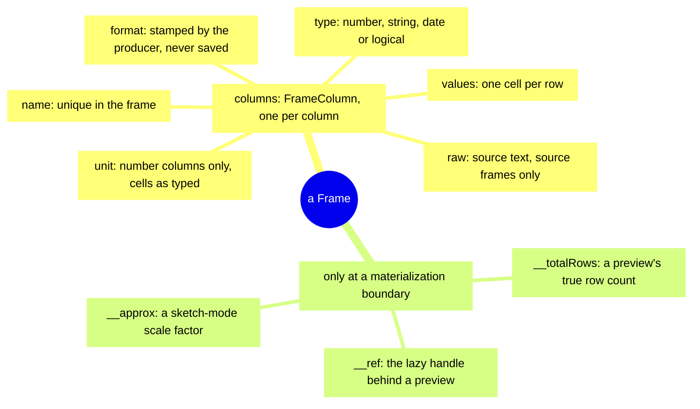
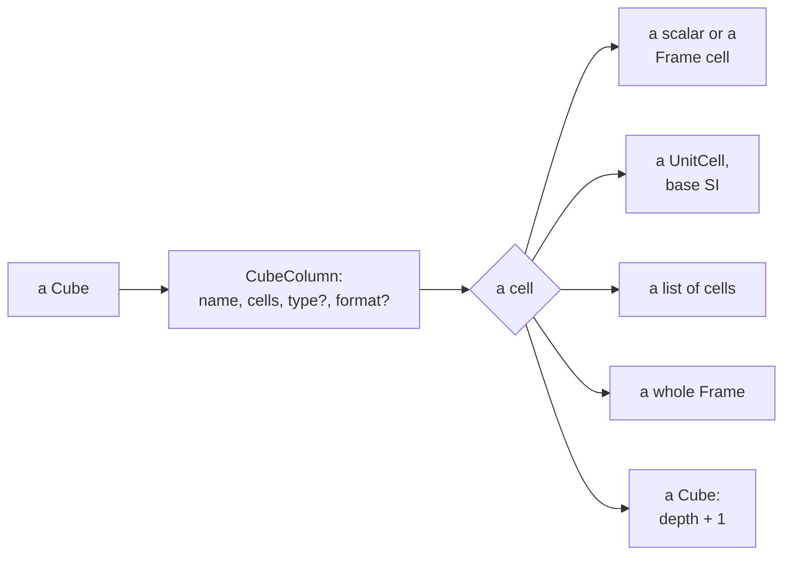
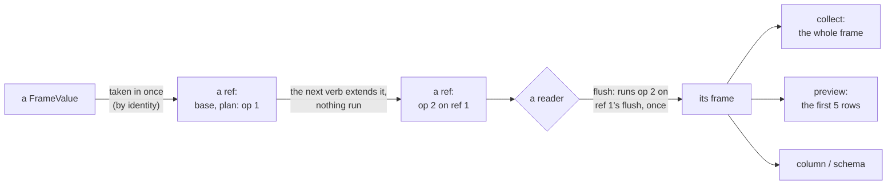
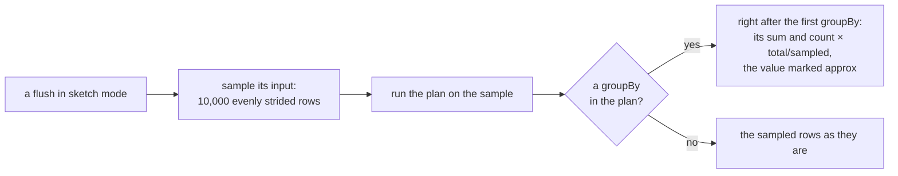

<!-- [[C130]] rustCore, [[C24]] arraySemantics, [[C45]] excelComparisons, [[C59]] byteStringOrder, [[C10]] socketLattice, [[C25]] firstClassUnits, [[B17]] typedValueModel, [[C23]] calcModes -->

# Spec: Frame model and relational verbs

Serves [[C130]] rustCore, [[C24]] arraySemantics, [[C45]] excelComparisons, [[C59]] byteStringOrder and [[C10]] socketLattice. It covers what the system does and blocks, and the decision each behavior serves.

A Frame is Solenoid's version of an Excel table, a table with headers: named, typed columns of cells. The relational verbs (select, sort, filter, group, join and the rest) take Frames and return new ones. They run behind one seam on the Rust core ([[rust-core]]), compiled to WebAssembly on the web and desktop alike, and a corpus of cases pins their answers. A Cube is the Frame's nested sibling, whose cells may hold lists and whole Frames.

| File | Holds |
|---|---|
| `src/graph/frame.ts` | The Frame and Cube values, builders, type inference |
| `crates/solenoid-core/src/frame_verbs.rs`, `frame_fns.rs` | The verbs (cells, units and formats), the eager table tools and the analysis verbs |
| `src/graph/frameOps.ts` | The verbs' vocabulary: `FrameOp` and its settings |
| `src/graph/frameBackend.ts` | The seam, lazy refs, materialization, sketch mode |
| `src/graph/nodes/frame.ts` | The verb cards |
| `crates/solenoid-parquet` | The desktop's Parquet reader |
| `fixtures/frame-verbs/` | The verb corpus |

Computed columns (Frame Input's Fx column and the Computed Column node) have their own spec, [[computed-columns]]. A verb's output columns are predicted before any data flows ([[#Static shape]]).

## The Frame value

### Shape

A Frame is a `FrameValue`: `{ __frame: true, columns: FrameColumn[] }`. A Frame object is marked with a `__frame` field. Code decides whether an object is a Frame by that field alone, never by the object's shape (`isFrameValue`), so a Frame is recognized the same way on any wildcard socket, `trueany` included. Three optional fields, listed below, appear only on a Frame computed out of a lazy frame into real columns, such as a card's preview of its first rows:

| Field | Set when | Meaning |
|---|---|---|
| `__totalRows` | a head-N card preview | The true row count; only the first N rows are in `columns`. |
| `__ref` | the same preview | The lazy handle it came from, so the grid popup and Copy CSV fetch the whole frame instead of exporting the preview. |
| `__approx` | a sketch-mode aggregate | `{ factor }`: sum and count columns were scaled up from a sample; the chip must never present them as exact. |

A `FrameColumn` is:

| Field | Type | Meaning |
|---|---|---|
| `name` | string | Unique within the frame (see Names). |
| `type` | `"number" \| "string" \| "date" \| "logical"` | The column's element family. A date column holds day serials; the tag is the only thing that says those numbers are dates ([[C44]] dateSerials). |
| `values` | `FrameCell[]` | One cell per row: `number \| string \| boolean \| null \| SolError`. |
| `unit` | `ColumnUnit`, optional | Only on a number column. The cells stay the bare magnitudes as typed, in the display unit, not base SI ([[C25]] firstClassUnits). |
| `format` | `FormatAnnotation`, optional | The display format stamped by the producing node; never saved. |
| `raw` | `string[]`, optional | The source text per cell before type inference, present only on a source frame (Frame Input, an import). A blank cell's raw entry is `""`. |

Tests: `frame.test.ts`: `isFrameValue` knows a built frame and refuses everything else.

### Rows

- A frame has no row identifier. A row is a position.
- The row count is the length of the longest column (`frameRowCount`), and a read past the end of a shorter column is `null` (the core's `cell_at`, `frame.rs`), so ragged columns behave as if padded with blanks.
- Every verb returns a new frame and leaves its inputs untouched.
- A verb that moves or rewrites cells (sort, distinct, head, filter, slice, fill, replace, drop blank rows, and every verb built on `reorder_rows`) drops `raw`, because a derived column has no source text that lines up with its values.

Tests:

- `frameVerbCorpus.test.ts`: every corpus case leaves its input frames as they were, so no verb needs a test of its own for it.
- `frameVerbsEdge.test.ts`: a column shorter than the row count reads as blanks through a row verb.

### Names

- **`makeHeaders(names, ncols)`** is the one naming rule, used by every builder and every verb that emits new names. It returns exactly `ncols` names. Each given name is trimmed; a blank becomes `Col{i+1}` (1-based position); a repeat takes the smallest free integer suffix starting at 2 (`Date, Name, Date` becomes `Date, Name, Date2`). Names are processed left to right, so the later of two colliding columns is the one renamed. The Rust engine's `make_headers` is the same algorithm.
- **Strict lookup.** Column lookup is exact and case-sensitive everywhere a verb needs a column (`require_column`); a missing name is `#REF!` with the message `column "<name>" not found`.
- **Loose lookup.** `getColumn` (used by Get Column and the `column` backend call) trims the name, matches exactly and case-sensitively, and otherwise accepts a bare integer string as a 1-based column index; a blank name, a miss or an index out of range is `null`. The engine's `engine_column` follows the same rule. The Get Column card answers a blank name with a blank, and a name the table has no column for with `#REF!` naming the columns it has, as the verbs do for a missing column (`no_such_column`, `nodes/verbs.rs`): a blank there fed a SUM that showed 0.
- **`addColumn(f, name, values, type = "number")`** appends a column, or replaces the column already holding that name in place. A `Name (unit)` suffix is split off first and tags a number column with the unit; an appended name is de-duplicated with `makeHeaders`, and a replaced column drops its `raw`. The Add Column node pads a values list shorter than the frame with blanks to the row count.

Tests: `frame.test.ts`: `makeHeaders`, `getColumn` by name and by index, `addColumn`, and Add Column padding a short list.

### Building a Frame

| Builder | Input | Rule |
|---|---|---|
| `buildFrame(matrix, names?)` | A numeric row-major matrix | Every column is number; a missing cell, a ragged row's included, is `null`; `Name (unit)` headers lock units. The column count comes from the matrix alone. |
| The Build Frame card (its body the core's) | A matrix of any cells | Each column typed as `typedColumn` types it; the adopted matrix socket's element family applies to every column, and an unadopted socket means infer per column. A numeric matrix builds exactly what `buildFrame` builds. |
| `frameFromCells(headers, rows)` | Rows of cells (an HTML table, a test) | Each column through `inferColumn`; the width is the larger of the header and the widest row. |
| `csvToFrame(text)` (`frameBackend.ts`) | A CSV file's text | On the core ([[#Reading CSV text]]): the first row is the header, each column typed as `inferColumn` types text, the width as `frameFromCells`. |
| `frameFromRecords(records)` | JSON array of objects | Columns are the union of keys in first-seen order; a key a record lacks is `null` there. |
| `frameFromRows(rows, headers?)` | JSON array of arrays | Positional columns. |
| `frameFromColumnar(obj)` | `{ col: [values] }` | A scalar value becomes a one-row column. |

`colTypeForSocket(dataType)` turns a socket's element family into a column type: number, string, date or logical, and null for a wildcard rung or `complex`, where the caller falls back to inference.

For display:

- `formatFrameCell(type, v, format?)` shows an error as its code, a logical as `TRUE`/`FALSE`, and a finite date serial through the format annotation's date pattern or the default `DD-MMM-YYYY`; anything else is returned as is.
- `frameToGrid` builds the popup's row-major grid: a blank is `""`, a logical is `TRUE`/`FALSE`, and an error cell passes through.

Tests:

- `frame.test.ts`: `frameFromCells`, ragged `buildFrame` rows, `colTypeForSocket`, the Build Frame card per adopted socket, Frame from Lists, and `formatFrameCell`.
- `frameImport.test.ts`: the record, row and columnar builders.

### Type inference

There are four entry paths, and they do not infer the same way.

**`inferColumn(name, cells)`**, and `inferColumns` for many columns in one core call.

- Used by CSV import (the core's `infer_text_column` in `csv.rs`, the same rule over text cells), HTML tables (`frameFromCells`), JSON records, arrays and columnar objects, cube-to-frame reads, and Unnest.
- A cell is blank when it is `null`, `undefined` or whitespace text.
- The type is the first that fits every non-blank cell:
  1. every cell a JS boolean: logical;
  2. every cell reads as a number: number;
  3. every cell the text `TRUE` or `FALSE` (any case): logical;
  4. every cell an unambiguous ISO date: date (cells become serials);
  5. otherwise string, with each cell trimmed.
- An all-blank column is string.
- CSV text (`infer_text_column`) also tolerates stray cells in a number or date column ([[C58]] tableInputRawText): a missing marker (`N/A`, `NaN`, `null`, `-`, an error code such as `#DIV/0!`) and up to a tenth of the filled cells of any other text read as NaN, the source text kept in the column's `raw`. A column of markers alone is string. `inferColumn` over values doesn't.
- An error cell stays that error in any column type and takes no part in the inference.
- `raw` keeps each cell's trimmed text, and an error's code.
- The reading runs on the core (`nodes::infer_cells`, through `engine_infer_bin`): the cells cross in the columnar hand-off, the types and the read numbers, logicals and dates come back, and the text stays on the TypeScript side, since a text column's cells and every `raw` are the trimmed text it sent. A list or object cell crosses as its text, so it reads as that text would (a list of one number reads as that number).

**`typedColumn(name, cells, length, knownType)`**

- Used by Build Frame from a matrix or lists, and a flat cube to frame.
- A known type from the socket wins; it is the only way to recover date.
- Without one, inference goes by runtime type and preserves it: all numbers (unit cells included) is number, all booleans is logical, anything else is string (the string `"1"` stays text).
- Cells are then coerced to the column type: a string column stringifies, a logical column reads a non-boolean as true only for the text `true`, and a number or date cell that cannot become a number is `NaN`.
- Errors and blanks pass through, and a column shorter than `length` pads with blanks.

**`coerceFrameCell(type, raw)` via `deriveFrame`**

- Used by Frame Input, whose column type is stored, never inferred.
- Blank text is `null`.
- A string column keeps the text verbatim.
- A logical column goes through `coerceLogical`.
- A number column parses the trimmed text or is `NaN`.
- A date column tries a number, then `parseDate`; a parse error (such as `#AMBIGUOUS!`) is kept as that error cell, and a non-finite result is `NaN`.

**The CSV half of `parseFrameSource`** (`source_columns` in `csv.rs`)

- Used by a hand-typed or CSV-shaped `frameText`.
- Type only, cells kept raw: number, then logical, then ISO date, then string, over trimmed non-blank cells. So a column mixing `1` and `TRUE` is string, and both literals stay as typed.

**One text reading** ([[C58]] tableInputRawText). `coerceFrameCell` is the one reading wherever text becomes a value of a declared type:

- a Frame Input cell;
- a List Input item, typed or wired;
- an inline list field on any card;
- an item in a typed Cube list (`coerceListItem`);
- Get Column's Number or Date read;
- a typed or guessed note property from the vault.

So text the type can't read is `NaN` everywhere, never a silent blank, and a date the type can't settle stays its error. Following from the one reader:

- a bare number typed into a Date list is a day serial, as in a Frame's Date column (2024 is 16-Jul-1905);
- `yes` and `no` are not Booleans in a list field, as in a Frame cell;
- a NaN item is a number, so COUNT counts it;
- a date list shows a NaN item as `NaN` in its value box and popup.

List Input keeps its typed text beside each value, so the list popup's Source view shows what was typed ([[literal-input-editors]]).

**Reads as a number** (`cellToNumber`) accepts:

- a finite number;
- a boolean, as 1 or 0;
- a `UnitCell`, as its display magnitude;
- text that `decimalFromText` (`valueKinds.ts`; the core's `decimal_from_text`, `value_kinds.rs`) reads: trimmed plain decimal or scientific text, or thousands grouped by commas (`^[+-]?\d{1,3}(,\d{3})+(\.\d*)?$`), so the European `3,5` stays text instead of reading as 35, and malformed grouping is text too.

A `0x`, `0b` or `0o` radix prefix and `Infinity` are text, as in Excel. A column whose non-blank cells are all JS booleans infers logical before the number test runs; a mix of booleans and numbers reads as number with 1/0 cells. A 0/1 column stays number, because inference reads only the literals `TRUE`/`FALSE` as logical.

**Units.** `inferColumn` also recovers units. When any cell is a `UnitCell` (a Cube column read back), `matrixCellsFromList` unwraps the cells to their display magnitudes before inference and returns the one unit they share, which tags the resulting number column; cells that disagree give no unit. So a Frame to Cube to Frame round trip keeps its units.

**`coerceLogical`** (`valueKinds.ts`; the core's `coerce_logical`, `value_kinds.rs`) is the one reading of a value as a logical.

- It serves the explicit paths: Cast to Boolean, Get Column's read-as Logical, a Frame Input logical column, a list read as logical, a filter or lookup value on a logical column, the NAND/NOR/XNOR arguments, and the logical settings of INTERPOLATE, TOROW and TOCOL.
- A boolean reads as itself.
- A finite number or numeric text (`1`, `0`, `-2.5`) is true when non-zero.
- Other text reads only as `true` or `false`, in any case and trimmed.
- Blank is null.
- Any other text (`yes`, `maybe`, `0x1`) is NaN ([[C58]] tableInputRawText, [[B17]] typedValueModel): a cell holds and shows `NaN`, and a computation turns it into `#TYPE!` naming the value (`logicalOrTypeError`, the core's `logical_or_type_error`). A NaN cell in a logical column matches no filter.

**Dates.** An unambiguous ISO date is `YYYY-MM-DD` with an optional ` ` or `T` time `hh:mm[:ss[.f]]` and an optional `Z` or `±hh[:]mm` zone, and it must parse to a finite serial. Bare years and slash dates such as `1/2/26` never infer as dates. Read as Date (Get Column, Cast, a Frame Input Date column) reads them through `read_date_text`: the shared reader, so a slash date needs a four-digit year (`1/2/26` is NaN, `1/2/2026` `#AMBIGUOUS!`), and under a date order a four-digit-year date of numbers alone takes that order (`1/2/2026` as MDY is 2 January). One cell that isn't an unambiguous ISO date keeps the whole column as text: declining to guess is always safe, and a wrong date never is ([[C44]] dateSerials).

Tests:

- `frame.test.ts`: `inferColumn`'s types, blanks and `raw`, `typedColumn`, logical columns and per-cell errors, and Get Column's readings of a logical column.
- `frameImport.test.ts`: ISO-only date inference and a column that goes text on one cell.
- `coreInferColumn.test.ts`: the core's reading of imported columns, one at a time and many in one call, frozen (`fixtures/core/infer-column`; `FREEZE_CORE=infer-column` re-records it after a deliberate change).
- `valueKinds.test.ts`: `coerceLogical` and the `#TYPE!` a computation makes of its NaN.
- `cube.test.ts`: a Frame to Cube to Frame round trip keeps the unit.

### Reading CSV text

CSV text is read in one place, the core's `csv.rs` ([[C130]] rustCore), on the `csv` crate (BurntSushi's `rust-csv`); Solenoid adds only the newline normalization, the delimiter guess, the blank-line options and the column typing. A Parquet file is the one exception (below). Everything else comes here: Web Source, Local File's CSV and plan files, the data feed presets, a Frame Input's CSV text, a Table Input's and a list literal's text, and the Table popup's CSV view.

- **Rows** (`parseCsvRows(text, opts)`).
  - `\r\n` and `\r` read as `\n` first, inside quotes too, and a leading BOM is dropped.
  - Then the crate reads RFC 4180: a field that starts with `"` is quoted, its `""` read as `"`; a `"` that isn't a field's first character is data. Rows may be ragged.
  - Malformed quoting reads as the crate reads it: after a closing quote, whatever follows up to the next delimiter or newline joins the field (`"a" ,b` is `a ` and `b`; `"a"b"c"` is `ab"c"`), and an unclosed quote takes the rest of the text, its `""` read as `"`.
- **The delimiter.** Without `detectDelimiter` the delimiter is `,`, even when the text holds semicolons. `detectDelimiter` (file ingestion) guesses among `,` tab `|` `;` and the record and unit separators, over each one's first ten rows as the crate reads them:
  - the smallest total change in field count from row to row wins;
  - the larger average breaks a tie;
  - a delimiter averaging under two fields never wins;
  - nothing qualifying means `,`.
  No maintained sniffer crate fits: `csv-sniffer` is unmaintained, and `qsv-sniffer` is built for qsv, wants a seekable reader and pulls in regex and a date parser.
- **Blank lines.** `keepBlankLines` (a literal source, where a typed blank row is data) reads each empty line as a row of one empty field, which the crate would skip; a final newline ends the last row and adds none. Without it, a row whose fields are all whitespace is no row.
- **A typed frame** (`csvToFrame`).
  - Rows with the delimiter guessed and blank lines skipped.
  - The first row, trimmed, names the columns through `makeHeaders`, and each column is typed as `inferColumn` types text.
  - The frame crosses back in the columnar hand-off (`engine_csv_frame`, `binary.rs`), each non-text column followed by its trimmed source text, which becomes its `raw`; a text column's `raw` is its cells.
  - The rows cross the same way (`engine_csv_rows`), so a big file's text crosses in once and its cells come back as buffers.
- **Writing** (`unparseCsv`, the Sink's CSV). The crate's writer:
  - the header row, then each row padded or cut to the header's width (as it stands with no header);
  - every line ended by `\r\n`, the last one too;
  - a field quoted, its `"` doubled, when it holds a comma, `"`, `\r` or `\n`;
  - a row of one empty field written as `""`, so it reads back as a row;
  - no rows still write the header line.
- **The editors' helpers.** The editors' own writer is `joinCsvRows`, and `csvFieldSpans` marks fields in place for the CSV editor; neither is a parser. A blank one-column row survives `joinCsvRows` and a read back, a trailing one and a lone one too, and `csvFieldSpans` marks the fields the parser reads.
- **Well-formed text**, the repo's own CSV files among it, reads as it did on Papa Parse 5.7.

Tests:

- `coreCsv.test.ts`: the core's rows under each option, a file's typed frame, a Frame Input's CSV text and the Sink's writes, over a seeded generator of awkward CSV and the repo's own CSV files, frozen through the callers (`fixtures/core/csv-rows`, `csv-frames`, `csv-sources`, `csv-unparse`; `FREEZE_CORE=csv-rows,csv-frames,csv-sources,csv-unparse` re-records them after a deliberate change). A sample runs in wasm.
- `csv.rs` (solenoid-core): every frozen case replayed natively.
- `csv.test.ts`: `parseCsvRows`, `parseCsvLine`, the delimiter guess, `csvFieldSpans` and `joinCsvRows`.

### Reading Parquet

Local File reads a `.parquet` file on desktop only, from `folder/name` joined as the CSV path joins it. The shell's `read_parquet` command (`src-tauri/src/ipc.rs`) reads it with Apache's `parquet` and `arrow` crates (`crates/solenoid-parquet`) and answers the frame as one buffer of the columnar hand-off (`read_bytes`, `Columnar::to_bytes`), which crosses IPC as bytes and the app reads as a plain frame (`readParquetFrame`, `binaryFromBytes`). The command is async and decodes on a blocking thread, and a file of more than `MAX_CELLS` (25 million) cells is `#VALUE!` from its footer's row count, before anything decodes (`read_capped`).

- **Column types** are the file's own, narrowed to the frame's:
  - Boolean is logical;
  - text is string, a dictionary-encoded text column included, read as its values;
  - `Date` becomes a serial (Unix days plus 25569, since serial 1 is 1900-01-01 and the Unix epoch is serial 25569);
  - a timestamp becomes a fractional serial by its time unit;
  - every other column that casts to a float is a number column.
- **An empty file** keeps its columns and their types, with no rows.
- **Refusals.** A column that doesn't cast (a list, a struct, binary) fails the read with `#VALUE!` naming it. A missing file is `#REF!`, and so is a name that would reach outside the folder (`inside`): a blank name, `..`, an absolute path, a `./` prefix, or a link that points out of the folder.
- **On the web** Local File's Parquet says it is desktop only.

Tests: `read.rs` (solenoid-parquet): the column types and date serials, a dictionary column, an empty file, the `#VALUE!` naming a column that won't cast, a missing file, and a name outside the folder.

### Frame Input's source

Frame Input is the editable literal Frame. Its stored text is never rewritten; the typed Frame flowing downstream is derived from it at compute time. A computed error or logical is never stored, since it is computed again.

- **`FrameSource`** is a list of `{ name, type, cells, unit?, expr? }`: `cells` are the raw typed strings, never coerced; `unit` is a Format Controller unit id; `expr` makes the column computed ([[computed-columns]]), and its raw cells are then ignored.
- **`deriveFrame(source)`** coerces every cell through `coerceFrameCell` and keeps the raw strings as `raw`, so a read-only viewer still shows the literal source. A `unit` applies only to a number column, through `columnUnitFromSpec`.
- **`frameText`** is stored as JSON: `[{ name, type, cells, unit?, expr? }]` (`frameSourceToText`; `unit` and `expr` only when set).
- **`parseFrameSource`** reads it back:
  - the names go through `makeHeaders`;
  - an unrecognized `type` reads as number, and a blank `expr` is dropped;
  - a typed-`values` JSON (the form `frameColumnsToInputText` writes for a caller holding a typed Frame) is read too, its values stringified back to raw cells with booleans as `TRUE`/`FALSE`;
  - anything else, malformed JSON included, goes to the CSV reader (`engine_csv_source`), where each cell is trimmed and the column's type is read off its cells.
- **`frameFromInputText`** is `deriveFrame` of `parseFrameSource`.

Tests: `frame.test.ts`: a blank CSV cell is `null`, the CSV and JSON forms of `frameText` keep logical columns and blanks over a save and reload, a mixed `1`/`TRUE` Boolean column and a date column keep their typed text while the derived value is typed, and the Form and Card layouts hide without deleting.

### Nulls, errors and non-finite numbers

- **`null`** is an empty cell. It is skipped by aggregates, dropped by comparisons, sorted last, and is its own key in grouping and dedupe ([[C24]] arraySemantics).
- **A `SolError`** in a cell is a present value: it is not blank, it propagates through aggregates, sorts last, and keys by its code ([[C24]] arraySemantics).
- **`±Infinity`** is a real value in a number column.
- **`NaN`** is present but dirty: it is counted, it is not blank, it sorts into the tail, it fails every predicate except `neq`, and it poisons an aggregate to `#DOMAIN!`.

Tests: `frameVerbs.test.ts`: error cells through sort, filter, `filterMulti` and groupBy. The corpus (`fixtures/frame-verbs/`) holds each verb's blanks, errors and non-finite cells by code.

### Units and formats

A number column gets a fixed unit in one of two ways: from its header when the frame is built (`buildFrame`, the Build Frame node, `addColumn`), or from a Frame Input column's `unit` field.

- If a number column's header ends in a unit in parentheses, like `Price (USD)`, the column is named `Price` and tagged with that unit.
- Text in parentheses that isn't a known unit, like `Notes (draft)`, stays part of the name.
- Name clashes are checked on the name without the unit.
- Crossing into a Cube, a locked column's cells become per-cell base-SI `UnitCell`s (`cubeCellsFromColumn`, the one bridge), each carrying its display unit, and a plain column's cells stay bare; reading a cube column back through `inferColumn` recovers a uniform unit.

The `format` annotation ([[C118]] formatTravelsWithValue):

- It is stamped on a node's FrameValue outputs by the input-coercion wrapper from `frameFormatStore`, per node and column; a nearer pick overrides a farther one.
- Picks are keyed `<nodeId>::<columnName>`, so a pick survives a column reorder but stays with the name.
- The annotation's own `unit` field is ignored, since a column's unit belongs to its value.
- A verb's output column carries a format only where it also carries a unit, as Add Index's column and an appended computed column carry neither; the reverse need not hold, since a groupBy key keeps its unit and drops its format.
- The store is the one saved home; a stamped `format` is never written to a saved document.
- The store's `load` replaces the whole set, and its caller has already rewritten node ids after an id remap.

The table popup's column-format row and its inherit hint are [[format-model]]. Unit and format behavior per verb is listed under each verb; unit rules themselves belong to [[unit-flow]].

Tests:

- `frameColumnFormat.test.ts`: a column's format rides the frame downstream and a nearer pick wins, a derived column carries the format only where it carries the unit, and a stamped format is never serialized.
- `cube.test.ts`: a locked column crosses into a Cube as per-cell unit cells, and a plain one stays bare.

### Frames and Cubes

A Cube never enters a Frame socket ([[C10]] socketLattice). A verb card that accepts a Cube declares a cube-adoptive input with `noWidenInputs` (Window, GROUPBY and Chart among them) and either runs its own cube branch (the cube row verbs under Eager verbs outside the seam) or calls `flatCubeToFrame(cube, only?)`. A bare list or matrix wired to a cube-adoptive input still widens to a frame as it would into a Frame socket.

`flatCubeToFrame`:

- Each column is typed through `typedColumn` with the cube column's carried type, and keeps its display format.
- A column of `UnitCell`s reads in their shared unit, which the column then carries (`matrixCellsFromList`, as `inferColumn` does); cells that disagree read as bare base-SI values with no unit.
- `only` picks the columns: all of them, the named ones (`#REF!` for a missing name), or `"scalar"` (every column without nested cells).
- A list, Frame or Cube cell in a picked column is `#SHAPE!` (`Column "<name>" holds nested cells; this reads flat rows`).
- GROUPBY picks its keys and value column (its scalar columns while unconfigured); PIVOTBY, SUMIFS and Chart read `"scalar"`, so a list column is simply not a field.

`frameToCube` goes the other way: depth 1, element type and format carried, locked cells tagged.

Tests: `cubeAdoptiveVerbs.test.ts`: `flatCubeToFrame`'s types, `#SHAPE!` and format, the cube-adoptive inputs, GROUPBY reading only its own columns, and a wired list or matrix widening.

### The Cube value

A Cube is a `CubeValue`: `{ __cube: true, columns: CubeColumn[], depth }`, recognized by its `__cube` brand (`isCubeValue`). A cell (`CubeCell`) is any value, recursively: a Frame cell, a whole Frame, a Cube, a `UnitCell`, or a list of cells. A Cube is heterogeneous per cell ([[C25]] firstClassUnits), so a dimensioned cell carries its unit as a value, a base-SI `UnitCell`.

A `CubeColumn` is `{ name, cells, type?, format? }`.

- **`type`** is the column's element type. A declared type (Cube Input's column type, a Solenoid Properties pick, a source Frame column's type) holds the column's values and list items to it, never a Frame nested in it, which carries its own columns' types ([[D90]] cubeTypesAtDepth). One inferred for a column nobody typed is a display hint, not a promise that every cell matches. A hand-built Cube has no column types. A list column's type is its items' type, so its chips tint and print by it.
- **`format`** is the Cube counterpart of `FrameColumn.format`: a producing verb can stamp a date pattern on a column (a Minutes-mode Schedule stamps `DD-MMM-YYYY HH:mm` on Start and Finish).

- **Depth.** `depth` is cached at construction, bottom-up, so it never needs a re-walk: a Cube's depth is 1 plus the deepest Cube found in any of its cells. A Cube cell contributes its own cached depth, a list cell contributes the deepest of its items, and everything else, a nested Frame included, contributes nothing. So a flat Cube is depth 1 and a Cube of Cubes is depth 2. `makeCube` is the only constructor, so every Cube carries its depth.
- **Rows.** The row count is the longest column (`cubeRowCount`).
- **Constructors.**
  - `cubeFromColumns(cols)` names the columns through `makeHeaders` and keeps each `type` and `format`.
  - `cubeFromRows(rows, headers?)` builds from a row-major grid, padding short rows with `null`.
  - `toCube(v)` widens any value, as arrival coercion widens into a Frame ([[compute-pass#Arrival coercion]]): a Cube passes, a Frame goes through `frameToCube`, a 2-D array is a grid, a 1-D list is one row, and a scalar is 1×1.
  - Build Cube reads one wired value as a column (`cube_column_from_value`, `nodes/frames.rs`): a list gives its elements, a single-column Cube gives that column's cells (so a cell-wise Build Cube pipes straight in), a Frame, matrix or scalar is one cell holding it, and `null` is no cells. The Cube Columns card makes one column per input, each read the same way, padded to the longest.
- **Row subsets.** The core's `select_cube_rows` (`nodes/frames.rs`) keeps whole rows by index, with nested cells carried by reference, so the Cube row verbs reorder rows without a verb ever reading a nested cell. An index past the end gives a blank row.

**Records to a Cube.** `recordsToCube(records, picks?, nested?, base?)` is the rows-of-objects reader that frontmatter and the vault readers share. The records are never rewritten.

- **Columns** are the keys in first-appearance order, named through `makeHeaders`.
- **Cells.** A list value becomes a list cell (never joined into text), a list of lists a 2-D cell. A list whose present items are all objects becomes a nested Cube, a `null` beside the objects counting as an empty record; a single object becomes a one-row nested Cube.
- **Picks.** `picks` types the top level's columns ([[D90]] cubeTypesAtDepth) through `typedCubeCell`:
  - a scalar crosses the type's own value boundary, `coerceFrameCell`, as a Frame Input cell would, so what the type cannot read becomes `NaN`, never a silent blank ([[C58]] tableInputRawText);
  - the items of a list or 2-D cell cross `coerceListItem`, which reads text as `coerceFrameCell` does, so what the type cannot read is NaN there too (Date over `[10-Sep-2026, apple]` is a date and a NaN);
  - a nested Cube or Frame passes untouched.
- **Nested tables.** Each nested Frame is read by its own declarations. `nested` (`cubeTypes.ts`) maps a table's records path from the top (`tableKey`: row and key down, a list index where a list holds it; `base` is the path of the records being read) to `{ frame?, types? }`, so two rows of one column declare their Frames independently. A table with `frame: true` becomes a Frame cell (`frameCellFromRecords`: a picked column through `coerceFrameCell` with its text as `raw`, the rest through `inferColumn`, a nested value blank); any other becomes a nested Cube read the same way one level down.
- **Unpicked columns.** An unpicked column of scalars keeps its cells as they came and takes `inferColumn`'s type as its hint; an unpicked column of lists or Frames carries no type.

**Cube Input's source.** `cubeText` is a JSON array of records while nothing, at any level, is typed or computed, and `{ columns, rows, nested? }` once something is (`cubeSourceToText`). The card's body reads it on the core (`nodes/cube_source.rs`), and the Cube popup's editor reads the same text with `parseCubeSource` into a `CubeSource`; the two read alike:

- `columns` lists every column in order, each `{ name, type?, expr? }`: a type outside the four is none, and a repeated or blank name is dropped. Any record key the list lacks is appended in first-seen order (a record's keys in JavaScript's order, an array index first).
- `nested` is the nested tables' declarations: `readNestedTables` drops a key that is not a records path, a `frame` that is not `true` and a pick that is not a type.
- `rows` are the records as typed.
- The body builds the typed columns as `recordsToCube` does, each non-formula column typed by its declared type and each nested table by `nested`, places every column in the list's order, and fills the formula columns ([[computed-columns]], `nodes/columns.rs`).
- Formula columns belong to the top level only: a Frame nested in a cell types its own columns but has no formula columns.
- Blank text is an empty cube; anything else that is not one of the two forms is one `#VALUE!` with its reason.
- An unchanged text gives the same cube object each pass, one calling TODAY or NOW a new one each recalculation ([[graph-core#Direct calls]]).

Tests:

- `cube.test.ts`: the brand, row count, the constructors, cells of any value, cached depth (a nested Frame adding none, the deepest branch winning, a list cell searched), `toCube`, and `frameToCube`'s types.
- `cubeNodes.test.ts`: Build Cube and the Cube Columns card.
- `noteFrontmatterCube.test.ts`: `recordsToCube`'s list cells and nested Cubes, and a `null` beside records read as an empty row.
- `cubeTypes.test.ts`: the nested tables' declarations ([[table-popup#Editing a Cube Input]]).

### Nest Join

The Nest Join node relates two Frames on a shared key column and returns a Cube. Its function is `relate_frames(parent, child, key, nested_name)` in `nodes/frames.rs`.

- **Output.** The Cube has every parent column plus one nested column, and each parent row's cell in that column holds the child rows whose key matches; a parent with no match keeps its row with an empty sub-frame or sub-cube. The nested column is named `items` by default, and its name goes through `makeHeaders`. Each parent cell is tagged with its column's unit (`tag_cell_unit`).
- **Missing key.** It returns `null` when either side lacks the key column. The card is empty until its parent, child and key are all present.
- **Children.** A Frame child's matching rows form a sub-frame that keeps each column's type, unit, format and `raw`, so a Cube of Frames is depth 1. A Cube child's matching rows form a sub-cube (`select_cube_rows`), keeping its own nesting.
- **Keys compare as quantities.**
  - A logical keys as 1 or 0.
  - A `UnitCell` keys by its dimension and base-SI magnitude, so `5 km` matches `5000 m` but not `5 kg` or a bare `5`.
  - A currency keys by its display code as well (no exchange rates, so $5 ≠ 5€).
  - A dimensionless ratio keys as its bare magnitude.
  - A number in a unit-locked column is converted to its base-SI quantity first, so it matches a `UnitCell` of the same quantity.
  - The base-SI magnitude rounds at the 15th significant digit of the larger of its two terms (`round_at_larger_term`, `unit_value.rs`, the rounding Join's converted key uses), so `1 in` matches `2.54 cm` and `−459.67 °F` matches `−273.15 °C`.
- **Keys that never match.** A blank or error key never matches, as in Join, and a nested Frame, Cube or list cell is never a key.
- **A Cube parent.** `relate_cube(parent, child, key, nested_name)` deepens a chain by one level per call. It finds the first parent column holding a Frame or Cube cell (the first, so a hand-built Cube with several is deterministic) and relates inside each cell, recursing through nested Cubes; with no such column it returns the parent unchanged.

Tests:

- `cubeNodes.test.ts`: nesting on a key, a parent with no match, the nested name, a missing key, unit and currency keys, a Cube child, and `relate_cube` deepening a chain or returning a Cube with no nested column unchanged.
- `joinUnits.test.ts`: Nest Join's keys with units.

## Lazy frames

### FrameRef

A Frame on a cable between verb cards is usually a lazy frame: a core value (`Cv::Ref`, `crates/solenoid-core/src/frame_ref.rs`) holding a base frame, a plan of ops not yet run, and the ref it extends by one op.

- The verb cards are direct ([[graph-core#Direct calls]]), so a ref passes between them inside the core and a verb's body only plans: it extends the ref it got, or starts one on a FrameValue it takes in (`refs::planned`, once per value by identity).
- A card with nothing to do passes its input through: a FrameValue as itself, a ref as a new ref planning nothing more.
- JavaScript sees a ref as `{ __frameRef: id }` (`isFrameRef`), the id the core keeps it under (`heldValues.ts`); after a trap that id reads `#REF!` ("The frame isn't held any more").
- Join, Append and Bind Columns run their verb on their inputs' flushed frames and answer a ref with nothing planned.

Tests: `lazyVerbBodies.test.ts`: each lazy verb card plans over a frame value or extends a ref's plan, passes through what came in, answers both of Filter's outputs and runs a Cube's verb on its cells, and a sweep drives each card over its ops and settings.

### Flushing

- A ref's flush runs once per sketch mode and is kept with the ref, so every reader of it shares one run.
- It runs its own op on its parent's flush, so a chain of N previewing cards costs one op per card.
- A ref whose ops include a GROUPBY runs its plan from the base instead, since the aggregate guard reads the plan's own input.
- Op JSON is normalized as JavaScript passed it on (`as_js`).

### Readers

| Reader | Call | Result |
|---|---|---|
| Whole frame | `refs::collect` (JS: `readFrame`, `frameRefRead`) | The frame, kept with the ref, so a ref fanned out to several readers collects once. |
| Card preview | `refs::preview(r, 5)` (JS: `collectPreview`, `frameRefPreview`) | What a card's box draws: a frame of at most 5 rows is the whole one; a longer one is its first 5 rows with `total_rows` the true count and `source` (JS: `__ref`) the ref. |
| Schema | `refs::schema` | Column names and types with no rows, and the row count (Table Size, Pivot). |
| One column | `refs::column` | One column by `getColumn` rules (Get Column, SUMIFS, Pivot, Slicer). |

- Every reader applies the aggregate guard (below) to what it reads (`Flushed::finish`).
- A plan that fails reads as its error value, and a preview of it throws that error.
- A value that isn't a ref (a frame, `null`, an error) reads as itself.
- `frame_ref::take_stats` (`engine_frame_stats`) counts runs, ops, frames taken in and whole collects.

Tests:

- `frameBackend.test.ts`: a whole read runs the plan once however often it is read, a preview carries its row count and its ref, a short frame previews whole, a failing plan, a value read as itself, and format picks riding as one more op.
- `frameNodeBackend.test.ts`: a plan, a join and a stack read back whole answer exactly what the verb answers, and a structural failure reads back as an error value, not a throw.
- `lazyChain.test.ts`: a chain of verb cards takes its source in once, runs one op a card and never reads it whole, and a pass whose inputs stand runs nothing again.
- `frameVerbsPipeline.test.ts`: a join, a groupBy and a sort chained through the store, each intermediate handle still readable on its own.

### Who receives a ref

`LAZY_FRAME_NODES` (`crates/solenoid-graph/src/boundary.rs`) lists the classes that receive a ref as is: the verb cards, Get Column, SUMIFS, Table Size, Write File, PIVOTBY, Slicer and Computed Column, which read through the readers above instead of a whole collect. Every other card, direct or JavaScript, gets the whole frame: the engine collects the ref in the core first (`value::collected`), shared by every reader of it. Every class whose body plans over a ref must be in the set.

- Table Size counts without reading the frame whole.
- SUMIFS reads only the named columns, and resolves a positional column against the upstream frame.
- Write File holds the ref through `data()` and reads it whole only when it runs.
- Slicer reads one column and plans its row filter as a `filterMulti` op; with no selection it forwards the ref (an empty `drop`).
- PIVOTBY reads only its field columns.

A ref lives while something holds it: the cell on a cable, a kept answer (`nodes::KEEPS_ANSWER`, which the verb cards are in, so a pass whose inputs stand runs nothing again), a JavaScript object (`heldValues.ts`). Its flush and readers' values live and die with it.

Tests:

- `lazyChain.test.ts`: the lazy set covers every class whose body plans over a ref, and the readers above on a lazy upstream.
- `lazyFrameReads.test.ts`: readers on a lazy upstream answer as on the same frame held eagerly.

### Sketch mode and the aggregate guard

In the sketch calculation mode (`frame_ref::set_sketch`, kept current by every step of the session):

- **Sample.** A flush first takes a deterministic sample of its input (`SKETCH_SAMPLE_ROWS = 10,000`): evenly strided rows `floor(i × total / n)`, order kept, never random. A flush on a parent already sampled doesn't sample again, and a frame at or under the sample size is never sampled.
- **Scale.** The factor is `total / sampled`. When the plan contains a `groupBy`, the output columns of the first `groupBy`'s `sum` and `count` aggregates are multiplied by the factor as soon as it runs (`scale_sums`), so every op after it reads whole-table totals (a filter on a total keeps what the exact pass keeps), and the read value carries `approx`. An average is never scaled, since scaling one would make it wrong, not approximate. A later `groupBy` groups the groups, which are no sample, so it isn't scaled again.
- **Mode.** A flush and its readers' values are kept per sketch mode, so leaving sketch reads the exact frame, and so does an F9 forced exact pass (`beginForceExact`) while sketch is selected.
- **Preview rows.** `sampleFrame(f, n)` (`engine_sample`) takes n evenly spaced rows, the first row included and in order, and hands back the frame itself when it is no longer than n or n is not positive.
- **Writes.** A write or export (Write File's run) reads every row exact, even while sketch samples the passes.

The aggregate guard classifies non-finite aggregate results at read time ([[C24]] arraySemantics): for a frame produced by a plan with a `groupBy`, any aggregate output column holding a non-finite number goes through `guard_finite`, with an infinite input assumed when the source column of the plan's input holds `±Infinity`. So a sum past the largest double from finite cells is `#OVERFLOW!`, and a sum over an infinite cell stays infinite. A ref extending one past a GROUPBY inherits its guard and its scaled totals, so a card downstream of GROUPBY (SUMIFS, Get Column, PIVOTBY, Slicer) classifies as the GROUPBY card does and reads the same totals, and a truncated preview is scaled like the whole collect.

Tests:

- `frameNodeBackend.test.ts`: the exact sum outside sketch, a sample scaled back toward the true total and marked approx, a truncated preview scaled alike, F9 forcing an exact pass, a small frame never sampled, approx carried through a verb after groupBy, and the aggregate guard on a collected groupBy.
- `lazyFrameReads.test.ts`: one-column readers downstream of GROUPBY read the totals the GROUPBY card reads.
- `sketchExport.test.ts`: Write File writes every row of a lazy input the pass sampled.
- `frameVerbs.test.ts`: `sampleFrame`'s rows.

## The frame store

The core also stores eager frames by handle (`rs:<n>`, numbered past a trapped instance's, `engine_handle_base`).

- **Users.** The eager Frame tools that run a verb over values outside a pass (`onCoreFrames`, `bindSchema`, `pivotOnEngine`, `frameFnOnCore`, CSV), and the corpus.
- **Commands.** `engine_source`, `engine_apply`, `engine_apply_many`, `engine_join`, `engine_append`, `engine_bind_columns`, `engine_preview`, `engine_collect`, `engine_column`, `engine_drop`, `engine_sample`. A missing handle is `#REF!` (`frame handle <h> not found (dropped or never created)`).
- **Frames** cross as columnar buffers (`wasmSourceBin`, `wasmReadBin`, `crates/solenoid-core/src/binary.rs`).
- **An op's own cells** (a filter's value) and a pivot layout's cells cross as JSON (`encodeWireCell`, `decodeWireCell`, the core's `wire.rs`):
  - a non-finite number as `{"__nf": "inf" | "-inf" | "nan"}`;
  - a SolError as `{"__err": code, "msg", "ref"}`, where `ref` names the original error in a registry of weak references (`errorRef`), so the cell reads back as that same SolError, message and origin included, while the original is alive.

A column carries its name, type, cells, `unit` and `format`; `raw` stays behind. The core's `FrameColumn` holds the unit as a `ColumnUnit` (dimension and display) and the format as the annotation it never reads, and each verb decides what its output columns carry, as listed under each verb ([[C25]] firstClassUnits, [[C118]] formatTravelsWithValue): a column that keeps its cells keeps both. The verbs that read a unit read it there: an aggregate or window over readings on an offset scale, a variance over a scaled linear unit, and a join's keys. The eager Frame tools and computed columns send cells only, since a formula reads its units its own way ([[computed-columns]]).

### The corpus

Every verb in `FRAME_OP_KINDS` and the binary verbs `join`, `append`, `bindColumns` has a fixture file in `fixtures/frame-verbs/<verb>.json`, plus `pipeline.json`.

- **A file** is `{ verb, cases: [{ name, frames, op, expect | expectError }] }`. Exactly one of `expect` and `expectError` is present, and case names are unique per file.
- **`frames`** maps names to wire frames: `in` for unary verbs, `left` and `right` for join, any names listed in `op.frames` for append and bind columns (a list, since the map can't carry their order).
- **`op`** is the wire op: for join `{ kind: "join", …JoinOpts }`, for a pipeline `{ kind: "pipeline", ops }`, applied one after another. The binary verbs are store commands, not `FrameOp`s, so the runners list them by hand.
- **`expect`** is a wire frame and **`expectError`** an error code.
- **Cells** take the wire's own form in both directions, since the corpus format is the wire format: a non-finite number as `{"__nf": …}`, an error cell as `{"__err": code}`.
- **Comparison** is on name, type, unit, format and values, and `raw` stays out. `-0` compares equal to `0`, since JSON can't write `-0`, so the wire loses the sign of zero as every frame crossing it does, and no surface tells them apart. Error cells compare by code alone.
- **Completeness.** A verb in the inventory without a file fails, and so does a file naming a verb outside it; `FRAME_OP_KINDS` is checked against the `FrameOp` union at compile time, so a new op kind fails to compile until it is listed and then fails until it ships with cases.

**MUST:** every verb is specified by corpus cases, and a verb without them doesn't ship.

Tests:

- `frameVerbCorpus.test.ts`: every case through the core in wasm, every input left untouched, and the inventory and case names.
- `corpus.rs` (solenoid-core): the same files natively, through the store's own commands.

## Rules shared by every verb

- **Structural failures throw.** A verb throws a tagged SolError: a missing column is `#REF!`, a type conflict `#TYPE!`, a bad configuration `#VALUE!`, an unknown aggregate `#NAME?`. The calling card turns the throw into its output value (a flush answers it as the ref's error, `frame_ref.rs`).
- **Degenerate shapes answer.** A frame with no rows, a ragged frame, a key column of blanks and a take of zero rows never throw: a row verb answers no rows and keeps the schema, a schema verb (select, drop, rename) reshapes the columns as usual, groupBy, pivot, unpivot and nest of no rows answer their columns with no rows, and an append of empty frames is the union schema with no rows.
- **Row verbs select indices.** Sort, distinct, head and filter compute a list of row indices and rebuild every column from it (`reorder_rows`), so a column's type, unit and format ride along, and a cell in a column the verb doesn't read, an error included, rides along untouched.
- **Work is linear in rows** ([[C120]] linearWork). A window or an aggregate over one partition of 200,000 rows runs in linear time and never spreads the partition into a call's arguments.
- **Identity keys.** Distinct, GROUPBY, Window partitions, Pivot's axes and Join keys read each cell through `cell_key` (`frame_verbs.rs`), its equality class: blank, a logical, a number, a string, or an error by its code.
  - `1` and `"1"` differ;
  - `null` differs from `0` and `""`, and two nulls are equal;
  - `0` and `-0` are one key;
  - every `NaN` is one key, and each infinity is its own;
  - an error keys by its code;
  - keys compare case-sensitively ([[C45]] excelComparisons).
- **Comparisons fold case; keys do not.** String `eq`/`neq` and the text predicates in Filter lowercase both sides with the plain Unicode lowercase (`toLowerCase` / Rust `to_lowercase`) unless `matchCase` is set. String ordering (`lt`, `gt`, sort) never folds.
- **String order.** Every data sort and ordered comparison compares strings by code point (`compare_text`) ([[C59]] byteStringOrder). The order is case- and accent-sensitive: "B" comes before "a", and "é" after "z". Lists in the app's own interface (menus, the Navigator, a table popup's column sort) keep a friendly alphabetical order; only data sorts and compares by code. Language-aware data sorting, if ever wanted, needs a language fixed per document.
- **New names go through `makeHeaders`.** Any verb that combines or invents column names de-duplicates them left to right.

Tests: `frameVerbsEdge.test.ts`: every verb on an empty frame, a join with an empty side, ragged and all-null columns, and a window and the aggregates over one 200,000-row partition.

## Static shape

`frameShape.ts` predicts a verb's output columns before any data flows: `shapeOf(op, input)`, and `shapeOfJoin`, `shapeOfAppend`, `shapeOfAddIndex` and `shapeOfSplitColumn` for the verbs that aren't a single op over one frame. A picker downstream offers the predicted columns, and a passthrough projects their types.

- A prediction reports exactly the columns a real `preview()` would, with their types.
- Where the columns depend on the data, the shape is marked `dynamic` and declares only the columns known in advance: a pivot's row-key columns, a split's untouched columns.
- A structural failure throws the code the verb throws (`#REF!`, `#VALUE!`, `#TYPE!`).
- An empty split delimiter predicts the input's shape, as the verb answers it.

Tests:

- `frameShape.test.ts`: each prediction against the verb's real output columns for the same op and frame.
- `coreShapes.test.ts`: the core's predictions, frozen (`fixtures/core/shapes`): each op, join or append over shapes answers a shape or an error code.

## Verb contracts

### Summary

| Verb | Card | Refuses with |
|---|---|---|
| `select` | Columns (Keep) | `#REF!` unknown column |
| `drop` | Columns (Drop) | nothing |
| `rename` | Rename | nothing |
| `sort` | Frame Sort | `#REF!` |
| `distinct` | Distinct | `#REF!` |
| `head` | Head (First N) | nothing |
| `sliceRows` | Head (Last N, Skip first N, Rows M to N) | nothing |
| `filter` | none emits it | `#REF!`, `#TYPE!` |
| `filterMulti` | Frame Filter, Slicer | `#REF!`, `#TYPE!` |
| `groupBy` | GROUPBY | `#REF!`, `#NAME?` |
| `unpivot` | Unpivot | `#REF!`, `#TYPE!` |
| `pivot` | PIVOTBY, GROUPBY with totals | `#REF!`, `#VALUE!` |
| `window` | Window | `#REF!`, `#VALUE!` (unknown function) |
| `fillBlanks` | Fill Down | `#REF!` |
| `replaceValues` | Replace Values | `#REF!` |
| `dropBlankRows`, `addIndex`, `splitColumn`, `mergeColumns` | Drop Blank Rows, Add Index, Split Column, Merge Columns | `#REF!`, `#VALUE!` |
| `formats` | none: the coercion wrapper adds it | nothing |
| `join` | Join | `#REF!`, `#TYPE!`, `#UNIT!`, `#VALUE!` |
| `append` | Append | `#TYPE!` |
| `bindColumns` | Bind Columns | nothing |

Every verb below has its corpus file, `fixtures/frame-verbs/<verb>.json` ([[#The corpus]]), which pins its answers; a section's Tests line names only what is held elsewhere.

### select

- **Op:** `{ kind: "select", columns }`.
- **Columns:** the named columns in the order given; a repeated name keeps its first occurrence only. They keep their type, unit, format and `raw`.
- **Edges:** any unknown name is `#REF!`. An empty list yields a frame with no columns.
- **The card:** the Keep card passes its input through when its list is empty.

### drop

- **Op:** `{ kind: "drop", columns }`.
- **Columns:** the named columns are removed; a name not present is ignored. The remaining columns keep their order and everything they carry.
- **Edges:** dropping every column leaves a frame with no columns. `drop` with an empty list is the no-op a verb with nothing to do plans, so it forwards a ref of its own.

### rename

- **Op:** `{ kind: "rename", map }`, old name to new name.
- **Columns:** every column's proposed name is `map[name]` or its own name; the whole list then goes through `makeHeaders`, so a collision renames the later column (renaming `a` to `b` in `a, b` gives `b, b2`) and every name is trimmed. Column order is unchanged.
- **Edges:** a key naming no column does nothing.
- **The card:** Rename pairs its From and To lists by index and skips a pair with an empty side; with no complete pair it passes through.

### sort

- **Op:** `{ kind: "sort", by, dir: "asc" | "desc" }`. Orders rows by one column.
- **Order:** present values compare within the column's type: numbers and dates numerically, strings by code-unit order, logicals false before true. `±Infinity` sorts as a real magnitude.
- **The tail:** blank cells, error cells and `NaN` form a tail that comes last in both directions, in input order. `NaN` must be pulled into the tail explicitly: every comparison with it is false, so a subtraction comparator would place it by input position.
- **Ties** keep input order: the sort is stable in both directions.
- **The card:** Frame Sort passes through when the column is blank.
- **Shared math:** `sorted_index_order` is the index math: the frame sort calls it, and a Cube's sort (`sort_cube`, `nodes/verbs.rs`) runs that frame sort over its scalar column, so a Frame and a Cube of the same data sort identically. `distinct_index_order` plays the same role for Distinct.

Tests: `frameVerbs.test.ts`: error cells sort last with their rows.

### distinct

- **Op:** `{ kind: "distinct", columns? }`.
- **Rows:** the first occurrence of each distinct row, in input order, keyed with `cell_key` over the listed columns or every column. The kept rows are whole rows.
- **Edges:** an unknown listed column is `#REF!`. Frame Distinct merges error cells with the same code, unlike list UNIQUE ([[C45]] excelComparisons), and `+∞`, `−∞`, `NaN` and `null` are four keys.
- **The card:** Distinct sends no `columns` (whole-row distinct).

Tests: `frameVerbs.test.ts`: the infinities, `NaN` and `null` key apart.

### head

- **Op:** `{ kind: "head", n }`.
- **Rows:** the first `trunc(n)` rows, clamped to `[0, rowCount]`.
- **Edges:** a negative `n` gives no rows and the schema is kept.

### sliceRows

- **Op:** `{ kind: "sliceRows", mode, n, to? }`. A contiguous window `[start, end)` from `slice_bounds`, with `N = max(0, trunc(n))`:

| Mode | Window |
|---|---|
| `first` | `[0, min(rows, N))` |
| `last` | `[max(0, rows − N), rows)` |
| `skip` | `[min(rows, N), rows)` |
| `range` | `[max(0, trunc(n) − 1), min(rows, trunc(to ?? n)))`, 1-based inclusive rows `n` through `to` |

- **Edges:** an inverted window is empty.
- **The card:** Head sends `head` for First N and `sliceRows` for the other three; it reads `to` only in range mode.

### filter and filterMulti

- **`filter`:** `{ kind: "filter", column, op, value, matchCase? }` keeps rows whose cell passes one predicate.
- **`filterMulti`:** `{ kind: "filterMulti", combine: "and" | "or", conditions: [{ column, op, value, matchCase? }], complement? }` keeps rows passing every condition (`and`) or any condition (`or`). An error or blank cell fails its own condition only, so under `or` another condition can still keep the row.
- **No conditions** is the identity under both combines; `complement` then gives the empty frame with the schema kept.
- **`complement`** keeps exactly the rows the plain filter drops: the row complement, not the negated predicate, so a row whose predicate was unknown (a blank or error cell) lands in the complement.
- **Order:** kept rows stay in input order.
- **Unknown column:** `#REF!`, checked for every condition before any row is tested.
- **An error as the value** is the filter's answer, whatever the column.

**Text predicates** (`contains`, `startsWith`, `endsWith`) read a text column only ([[C10]] socketLattice):

- On a column that is not string they are `#TYPE!`, and the message names the column, its type and the two fixes: a Computed Column such as `TEXT(@<col>, "@")`, or Cast to Text. One such condition fails the whole filter, under `or` too.
- There is one gate, `require_text_column` in the core's `frame_verbs.rs`, called by every frame filter entry (the Filter verbs, the *IFS criteria). No filter path ever compares `String(cell)` of a number, date or logical, so results never depend on JavaScript's number printing.
- The List Filter applies the list twin (in `filter`, `crates/solenoid-core/src/nodes/list.rs`) to a list holding no text: an empty or all-blank list passes (and keeps nothing), and a list of numbers, dates or logicals is `#TYPE!`, one such condition failing the whole filter, under `or` too. A list mixing text with other values is answered item by item: the text items are filtered, and each item that isn't text stays in the result, in its place, as its own `#TYPE!`.

A row passes `filter_rows(f, column, op, value, match_case)` (`frame_verbs.rs`) when its cell does:

1. The list-cell ops (`listContains`, `listContainsAny`, `listContainsAll`, `listEmpty`) never match a frame cell.
2. `iserror` keeps error cells; `noterror` keeps everything else, blanks included.
3. `isblank` keeps `null` cells; `notblank` keeps everything else (an error cell and `NaN` are present).
4. Otherwise a blank or error cell fails, and a `null` value matches nothing.
5. Text predicates compare the cell text with the value text, both folded unless `matchCase`.
6. On a string column, `eq`/`neq` compare folded text unless `matchCase`; `lt`/`lte`/`gt`/`gte` compare by code-unit order without folding.
7. On a number or date column, the cell is compared numerically with the value read by `decimal_from_text` (`value_kinds.rs`), the reading "Reads as a number" names. A value that does not parse to a finite number matches no rows (under `or`, other conditions still can). A blank value never gets here, because the node leaves a condition with a blank value out. A date column compares against a serial; date text is not parsed.
8. On a logical column, the cell is 1 or 0 and the value goes through `logical_or_type_error` (`value_kinds.rs`: `TRUE`/`FALSE` in any case, or any number `decimal_from_text` reads, non-zero being true; other text is `#TYPE!` naming it), so `eq 12` matches TRUE rows. A NaN or blank cell in a logical column matches no op, `neq` included.

**The Frame Filter node.**

- **Conditions:** each condition row is a column, an op and a value. `filter_value` in `nodes/verbs.rs` reads a wired scalar as text, and an error value as its code.
- **What applies:** a filter starts from the whole object and keeps what passes the conditions that are applied. A condition with a blank column, or a blank value for an op that takes one, isn't applied, whether the blank was typed or wired ([[D86]] blankRoles). With no conditions applied, Kept is the input object unchanged and Dropped is blank.
- **Outputs:** Kept and Dropped are both permanent outputs: `filterMulti` and the same op with `complement: true`. Dropped is a ref too, with no preview of its own, so it stays lazy until a consumer reads it.
- **Shapes:** a list-cell op on a frame input is `#SHAPE!`, telling the user to connect a Cube. A Cube input runs `filter_cube` (see Eager verbs).
- **The op list** is `FILTER_OP_OPTIONS_WITH_ERROR` (the base `FILTER_OP_OPTIONS` plus `noterror` and `iserror`), and `FILTER_OP_OPTIONS_WITH_LIST` adds the four list-cell ops for a Cube input. The error ops stay off the base list so SUMIFS, which shares it, never offers them.
- **Value-free ops** (`VALUELESS_FILTER_OPS`: the blank and error ops and `listEmpty`) hide the Value field and ignore a wired value.
- **The case toggle** (Aa) shows only for the ops where case matters (`TEXT_MATCH_OPS`: `eq`, `neq`, `contains`, `startsWith`, `endsWith`); numeric, date and logical comparisons ignore it.

Tests: `frameVerbs.test.ts`: error cells in `filter` and `filterMulti`, the text-predicate `#TYPE!` and its message, and a logical column's NaN and unreadable values.

### groupBy

- **Op:** `{ kind: "groupBy", keys, aggs: [{ column, op, as }] }`.
- **Rows:** one output row per distinct key tuple (keyed by `cell_key`), in first-seen order. A null key is its own group, and each non-finite key value and each error code is its own group. With no keys the whole frame is one group, and a frame with no rows has none.
- **Columns:** the key columns (type and unit kept, format dropped), each holding the group's first-seen cell, then one column per aggregate named `as`. All output names go through `makeHeaders`, so an aggregate named after a key becomes `k2` and the key keeps its name.
- **Edges:** an unknown key or aggregate column is `#REF!`.

`aggregate_group(cells, op, type?)`:

| Op | Result | Empty group | Output type | Unit kept |
|---|---|---|---|---|
| `count` | Count of non-null cells (errors and `NaN` count) | 0 | number | no |
| `sum` | Sum | 0 | number | yes |
| `avg` | Mean | null | number | yes |
| `min`, `max` | Minimum, maximum; over a text column, the first and last text in code-unit order | null | the source type (a date stays a date; a logical returns TRUE/FALSE; text stays text) | yes |
| `product` | Product | 1 | number | no |
| `median` | Middle value; an even count averages the middle pair `(lo + hi) / 2` | null | number | yes |
| `mode` | Most frequent value, ties to the first occurrence | null | number | yes |
| `stdev`, `var` | Sample (n − 1); null under two points | null | number | no |
| `stdevp`, `varp` | Population (n); 0 for one point | null | number | no |
| `percentof` | null (it needs a total set; only Pivot computes it) | null | number | no |

What a group's cells do, checked in this order:

1. **Errors.** An error cell anywhere in the group makes the result that error (the first in row order), `count` aside.
2. **Text.** Every op but `count` reads only numeric cells, logical cells as 1/0. Non-empty text in a group answers what the op's formula answers over the same cells: `#VALUE!` for `sum`, `avg`, `product` and the spreads, `#TYPE!` for `min`, `max` and `median`, with the formula's message (`text_refused`, the formula's own `text_refusal`; [[D109]] aggregatesRefuseText, [[C17]] shareImpl). `mode` leaves text out, as MODE.SNGL does, and so does Pivot's `percentof` (`sum_group`).
3. **Text columns.** The exception is `min` and `max` over a text column ([[C24]] arraySemantics): they compare the group's cells as text by code unit ([[C59]] byteStringOrder), the order Sort uses, so the comparison is case-sensitive and a number stored as text orders as text (`"10"` before `"9"`). A column mixing numbers and text is already a text column (`typedColumn`), so it follows the same rule. Blanks and empty strings are skipped, and a group with nothing else is blank. The caller passes the column type, since the cells alone cannot tell a text column from a number column holding one stray string.
4. **The non-finite guard.** A `NaN` input makes the group `#DOMAIN!`, checked before aggregating because a `NaN` inside a reduce gives an order-dependent answer. A `NaN` result is `#DOMAIN!`; an infinite result from all-finite inputs is `#OVERFLOW!`; an infinite result when an input was infinite passes. The guard lives inside `aggregate_group`, so pivot's re-aggregating totals get it too.
5. **Unknown op.** An op name outside the list is `#NAME?` (`Unknown aggregation "<op>"`) for the whole verb, raised when the core first aggregates a group with numeric cells.

Variance is the sequential two-pass form (sum, mean, sum of squared deviations) and median the midpoint `(lo + hi) / 2`.

**Dates** are points in time, like readings ([[C137]] datesNeverSerials). Over a date column:

- `min`, `max`, `avg`, `median` and `mode` answer a Date column (`AggOp::keeps_dates`);
- the spreads answer a number of days, and `count` a count;
- whatever refuses a reading (`sum`, `product`, `percentof`; Window's running, rolling and group sums, `share` and `pct_change`) is `#TYPE!` in every cell (`dates_plan`), never a total of serials. Cast to Number first for the serials. The SUMIFS card refuses a SUMIFS of dates the same way.

**Readings on an offset scale** (a °C or °F column) answer as a formula does ([[C25]] firstClassUnits, [[unit-flow]]); the core holds both the cells' rule and the unit's (`agg_unit_plan`, `agg_unit`):

- `sum`, `product` and `percentof` are `#UNIT!` in every group, since the op, not a cell, is at fault, and the column carries no unit;
- `stdev` and `stdevp` are a delta in kelvin and `var` and `varp` a squared one: the value scales by the unit's scale per power (5/9 for °F) and the column unit is the bare temperature dimension;
- `count` is plain;
- the rest stay readings in the column's unit.

**Linear units.** `stdev` and `stdevp` keep the column's unit, and `var` and `varp` square it, landing in base SI as a formula's VAR does (a km column's variance is in m², the value scaled by the unit's scale squared). An aggregate's column carries the unit for `sum`, `avg`, `min`, `max`, `median` and `mode`, and the spreads' units above; `count` and `percentof` carry none, nor does any aggregate carry a format.

**Cube Rollup** runs the same aggregate over a nested sub-frame's column (`nodes/frames.rs`), passing that column's type and unit, so a roll-up and a GROUPBY agree on every op's edge cases and units.

- A nested cube's column reads its tagged cells in one unit first (`matrixCellsFromList`); when it carries no type, `inferColumn` reads its non-error cells for one, as a cube-to-frame read does, and its error cells stay errors.
- A roll-up that produced any text cell is a string column; otherwise it is number, carrying the unit its rows agree on.
- The Window verb's `group_min`, `rolling_min`, `cummin` and their max twins do not share it and stay numeric. The formula MIN and MAX over a list keep Excel's answer and ignore text; only the Frame aggregates read text ([[C24]] arraySemantics).

**The GROUPBY card.**

- It sends one aggregate over its Aggregate column with `as` equal to that column's name.
- With a totals depth other than 0 it collects its input and runs `pivot` with that column as the only value field and no column fields (the totals re-aggregate the source).
- A Cube input is flattened with `flatCubeToFrame`.
- With no keys or no column it passes through.
- The GROUPBY and Pivot cards' aggregate selector derives from `AGG_OP_META` ([[engineering#One declaration per fact]]) and leaves out the `pivotOnly` ops, which only the pivot assembly can run.

Tests:

- `frameVerbs.test.ts`: an error cell through sum, avg and count, a text column's min and max in GROUPBY and PIVOTBY, and the units a key and each aggregate keep.
- `frame_aggregates_refuse_text.rs` (solenoid-core): a group holding text answers its formula's error and message, an error still wins, and a text column's min and max order its text.
- `frameReadings.test.ts`: GROUPBY, PIVOTBY and Cube Rollup over readings and linear units, through the cards in wasm.
- `datesNeverSerials.test.ts`: the table verbs over a Date column ([[date-values#Functions]]).

### unpivot

- **Op:** `{ kind: "unpivot", idColumns, valueColumns, variableName?, valueName? }`. Wide to long.
- **Rows:** for each input row, in order, one output row per value column, in the listed order.
- **Columns:**
  - the id columns (type and unit kept);
  - a string column named `variableName` (default `variable`) holding the value column's name;
  - a column named `valueName` (default `value`) holding the cell. It takes the value columns' shared type, and their unit when they all share one.
  - All names go through `makeHeaders`.
- **Edges:** value columns of different types are `#TYPE!` (`Unpivot value columns must share a type (…)`); an unknown column is `#REF!`.
- **The card:** Unpivot passes through when Melt is empty.

Tests: `frameVerbs.test.ts`: the id column's unit and a shared value unit.

### pivot

`{ kind: "pivot", rowFields, colFields, values, funcs, rowTotalDepth?, colTotalDepth?, rowSort?, colSort?, relativeTo?, filter?, details? }`, Excel's PIVOTBY. The PIVOTBY node runs it (`nodes/backend_verbs.rs`); GROUPBY's totals run it through `pivotOnEngine`. It always runs eagerly on a collected frame.

**Setup.**

- Blank field names are dropped.
- No value fields is `#VALUE!` (`PIVOTBY needs at least one value field`); an unknown field is `#REF!`.
- `funcs[i]` applies to `values[i]`, falling back to `funcs[0]`, then `sum`.
- `filter`, when present, keeps only source rows whose mask entry is `true`.
- `details` names columns for the Pivot view only ([[C127]] pivotView): the output is the same with or without it, and with row fields the layout kept beside the output records each row leaf's source rows and those columns' values ([[table-popup#The Pivot view]]); an unknown name is `#REF!`.

**Axes.** Each axis (rows, columns) has leaf groups: the distinct field tuples among the kept rows. Leaves are ordered hierarchically: each field level ranks its values by first appearance across the whole axis, and tuples sort by those ranks level by level, so each outer group stays contiguous. An axis with no fields has one anonymous leaf.

**Sorting.** `rowSort` and `colSort` are signed 1-based indices into `[fields…, values…]`; negative means descending.

- A field index re-ranks that level by value (the column type's comparator, blanks and errors last), and descending reverses that level's whole order, which puts blanks first.
- A value index reorders the leaves flatly by that value's aggregate over the whole axis (a `percentof` scores by sum; a text `min` or `max` scores by code unit, [[C24]] arraySemantics). A blank, `NaN` or error score sorts last, and the reorder happens only when the axis has more than one leaf.

**Totals.** `rowTotalDepth`/`colTotalDepth`:

- 0 adds nothing, 1 adds a grand total, 2 or more adds subtotals too, and a negative depth places totals before their groups.
- Totals need at least one field on the axis.
- Subtotal levels are `min(|depth| − 1, fields − 1)`; for each prefix length p from 1 to that, every contiguous run of leaves sharing a p-field prefix gets a subtotal slot.
- By default a subtotal follows its run's last leaf, inner levels first, and the grand total comes last; placed at top, a subtotal precedes its run's first leaf, outer levels first, and the grand total comes first.

**Cells.**

- A cell for value v over a set of row slots and column slots aggregates the source cells of every covered leaf pair with that value's function, so totals re-aggregate the source: a grand average is the average of all source rows, not the average of the cells' averages.
- A combination with no source rows is blank.
- `percentof` is `SUM(cell) / SUM(total set)`, where `relativeTo` picks the total set: 0 the column total, 1 the row total, 2 the grand total, 3 the parent column group (leaves sharing all but the last column field), 4 the parent row group. A zero denominator is blank; an error cell propagates.

**Output.**

- **Columns:** one key column per row field (names through `makeHeaders`), then one body column per column slot and value.
- **Key cells:** a leaf shows its tuple; a subtotal shows its prefix, `Total` in the next field, and blanks after; the grand row shows `Grand Total` in the first key column. A key column that receives a `Total` or `Grand Total` marker becomes a string column, its other cells formatted as display text (`formatFrameCell`: dates as `DD-MMM-YYYY`, logicals as `TRUE`/`FALSE`).
- **Body headers:** the column tuple's values joined with ` | `, each converted with `String()`, so a date shows its serial and a blank shows `null`. The grand total's column is headed `Grand Total`, and a subtotal's is its prefix plus `Total`. With more than one value, ` | <value name>` follows. With no column fields and one value, the header is just the value's name. Body headers go through `makeHeaders`.
- **Body types:** number, except a `min` or `max` over a text value column, which is a string column ([[C24]] arraySemantics).
- **Units and formats:** each body column carries the unit its value field's aggregate takes (as groupBy's, above) and no format; the key columns carry neither. The layout's Details columns take their source columns' formats ([[C127]] pivotView).

**The PIVOTBY card.**

- **No value fields:** it forwards its input unchanged.
- **Missing fields:** it skips a saved field whose column the input lacks, keeping it saved so it counts again when the column comes back (Configure Fields marks it).
- **The layout** rides on the frame it answers (the Pivot view reads it).
- **Field lists:** its Rows, Columns and Values are list literals written by `listLiteralText` beside the list-literal reader (`listLiterals.ts`) and read by `csvList`, so a field name holding a comma or a quote survives. Configure Fields signals the graph changed on every edit (`notifyGraphChanged`), saving it whether or not a pass runs.
- **Value exclusions:** its per-field exclusions (keys formed by `pivot_cell_key` in `nodes/backend_verbs.rs`: blank as `""`, an error as its code, a logical as `TRUE`/`FALSE`, anything else `String()`) are combined with the wired logical mask into `filter`, so excluded rows drop before the pivot aggregates.
- **A lazy input:** it reads the schema through a zero-row preview and fetches only the columns the pivot, the filter editor and its Details columns (`detailFields`, pruned with the fields) use. That read is a pass as a verb card's is (`beginPass`): if a newer pass started while it awaited, it writes nothing and returns `null`.
- **Source columns:** each compute stashes `sourceColumns` (every column's name, type and up to 200 first-seen distinct keys), so the editor popup lists fields without fetching; with a lazy input only the fetched columns get distinct keys, and the rest keep an empty key list.

Tests:

- `frameVerbs.test.ts`: re-aggregating grand totals and subtotals, totals at the top, per-value functions, a grand total column, value and field sorts, the mask, `percentof`, the extra functions, and composite headers.
- `pivotNodeFilter.test.ts`: field names with commas and quotes, and a missing field kept saved.
- `pivotLayout.test.ts`: the layout beside the frame and Details ([[table-popup#The Pivot view]]).
- `lazyChain.test.ts`: on a lazy upstream the card reads only its field columns.

### window

- **Op:** `{ kind: "window", partitionBy, orderBy?, orderDir?, fn, column?, as, n? }`. Adds one column computed per partition and writes it back in the original row order; every other column is unchanged.
- **Partitions** are distinct `partitionBy` tuples by `cell_key` (empty means the whole frame).
- **Order:** within a partition, rows are ordered by `orderBy` (blank, NaN and error keys last, stable, `desc` reversing present keys; a NaN key ranks blank, as Sort reads it) or kept in input order.
- **N** is `max(1, round(n ?? 1))`.
- **Edges:** an unknown partition, order or value column is `#REF!`. An unknown function name is `#VALUE!`.
- **The output column:** an existing column named `as` (or `fn` when `as` is blank) is removed and the new one appended last.
- **Values:** the arithmetic functions read a numeric view of `column`: a number is present (an infinity included), a logical is 1 or 0, and NaN or text counts as blank. `lag`, `lead`, `first` and `last` read the raw cells. An error anywhere in the partition's value column makes every row's result that error for the cumulative, difference, rolling, group, share, first and last functions.

| Function | Result per row (p is the 1-based position in the ordered partition, m its size) |
|---|---|
| `row_number`, `cumcount` | p |
| `rank` | Competition rank on the order key (ties share the first tied position); p without an order column; blank key gives blank |
| `dense_rank` | Rank counting distinct keys; p without an order column; blank key gives blank |
| `percent_rank` | `(rank − 1) / (ranked − 1)`, `ranked` being the rows with a present key; 0 when `ranked ≤ 1` |
| `ntile` | `floor((p − 1) × N / m) + 1` |
| `cumsum`, `cumavg`, `cummin`, `cummax` | Over the present values up to this row; blank when this row's value is blank |
| `lag`, `lead` | The value N rows before or after, raw (a blank included); blank past the edge |
| `diff` | This value minus the previous row's; blank when either is blank |
| `pct_change` | `(cur − prev) / prev`; blank when either is blank (checked first); `#DIV/0!` when prev is 0 |
| `rolling_sum`, `rolling_avg`, `rolling_min`, `rolling_max` | Over the present values among the last N rows; blank until p ≥ N and when this row's value is blank |
| `group_sum`, `group_avg`, `group_min`, `group_max` | The partition aggregate on every row; blank when the partition has no present value |
| `group_count` | Count of present values (0 when none) |
| `share` | This value over the partition's sum; blank when this value is blank (checked first, so an all-blank partition is all blank); `#DIV/0!` when the sum is 0 |
| `first`, `last` | The partition's first or last value in order, on every row |

- **Output type:** `lag`, `lead`, `first` and `last` take the value column's type; everything else is number.
- **Units:** the unit is kept for the cumulative, lag, lead, diff, rolling, group sum/avg/min/max, first and last functions, and not for a rank or a count. Over readings on an offset scale (as on groupBy), `cumsum`, `rolling_sum`, `group_sum`, `share` and `pct_change` are `#UNIT!` in every row, and `diff` is a delta in kelvin.
- **The card:** Window always sends `orderDir: "asc"`, derives `as` from the function label and Value column when the name is blank, sends `n` only for the functions that read it, and passes through when a value-reading function has no Value column. A Cube input stays a Cube: `window_cube` (below) appends the column, and the output socket adopts the input's rank.

Tests:

- `frameReadings.test.ts`: Window over readings, a Cube's window included.
- `frameVerbs.test.ts`: the unit on a running sum, and none on a rank.

### fillBlanks

- **Op:** `{ kind: "fillBlanks", columns, dir: "down" | "up" }`.
- **Cells:** in each listed column (every column when the list is empty), a `null` cell takes the nearest present value above (`down`) or below (`up`); a leading (or trailing) run stays blank.
- **Errors:** an error cell is a value: it is never filled, and it fills the blanks after it like any other.
- **Edges:** an unknown column is `#REF!`.

### replaceValues

- **Op:** `{ kind: "replaceValues", column, find, replaceWith, mode: "cell" | "substring", matchCase? }`.
- **Target:** one column, or every column when `column` is blank.
- **Edges:** an empty `find` is the identity. An unknown column is `#REF!`.
- **Case:** text matching ignores case unless `matchCase` is set, the card's Aa beside Find, as Filter's is; a logical always matches either case.
- **`substring`:** in string columns only, every literal occurrence of `find` inside a text cell is replaced (no regex), the rest of the cell kept as written (`replace_caseless` when case is ignored).
- **`cell`:** a whole cell matches when
  - a number (or date serial) equals `decimal_from_text(find)`, so `5.0` and `5` both match 5 and a non-numeric find matches no number;
  - a logical's `TRUE`/`FALSE` equals `find` in upper case, so `1` and `0` never match a logical;
  - a string equals `find` (exactly under `matchCase`, else ignoring case).
  Blank and error cells never match.
- **The replacement** is read into the column's type ([[C58]] tableInputRawText):
  - blank text becomes `null`;
  - a number column takes a finite number, a date column a date (`date_text_serial`), a logical `true`/`1` or `false`/`0` (any case);
  - text the column's type can't read is written as `NaN` in each matched cell, as a Frame Input cell reads it, never skipped and never a blank: replacing 5 with `apple` in a number column leaves a NaN where the 5 was, so a total over the column answers `#DOMAIN!` instead of quietly keeping the 5. An upstream type pick that makes the column text lets the same card write `apple` itself;
  - a string column takes the text verbatim.
  The card never errors over a replacement: the answer is the frame, each matched cell holding what was written. The text itself isn't kept beside the NaN, since a rewritten column carries no `raw` (above).
- **The card:** Find and Replace take a wired value of any type, read as text by `filter_value` (`nodes/verbs.rs`), as Filter reads its values; typed, they are text kept exactly as typed.

Tests:

- `frameVerbs.test.ts`: the cell match rule, text a number, date or logical column can't read written as NaN, and `raw` dropped from a rewritten column.
- `frameNodeBackend.test.ts`: a wired number or Boolean matches, and the typed Find and Replace stay as typed.

### formats

- **Op:** `{ kind: "formats", formats }`. Sets each named column's display `format` and leaves the cells alone.
- **Who emits it:** no card. The coercion wrapper appends it to a lazy node's output ref, carrying that node's own `frameFormatStore` picks ([[C118]] formatTravelsWithValue), as it stamps a materialized Frame. The core applies it as any op (`with_formats`, `frame_verbs.rs`).
- **Edges:** a column it names keeps its unit; a name no column holds does nothing. A pivot followed only by `formats` ops still leaves its layout.

Tests: `frameBackend.test.ts`: format picks ride as one more op of the plan.

### join

`join_frames(left, right, { leftKey, rightKey, how, asofDirection?, asofTolerance?, rightKeyScale?, rightKeyOffset? })`.

**A Cube on either side** (a vault folder's notes): the join runs on the Cube's plain columns, and its columns holding lists or tables ride along. Each such side gets a row-number column before the join (`join_side`, `nodes/backend_verbs.rs`), and after it the answer is a Cube whose carried columns are read back by those numbers (`with_nested`), blank on a row the join gave no partner; the row-number columns are dropped. Two Frames, or Cubes with nothing nested, join as Frames and answer one. The card's Left and Right take a Frame or a Cube, and its output adopts what it carries. Tests: `linkTarget.test.ts`.

**Keys.**

- The key columns must exist (`#REF!`) and share a type (`#TYPE!`, `Join keys must share a type ("<l>" vs "<r>")`); a Cross join needs neither. Keys of two types could never match, since element families never cross on their own ([[C10]] socketLattice), so the join refuses instead of returning a silent empty result.
- Key cells match by `cell_key` identity, case-sensitive.
- A `null`, error or non-finite key never matches anything, including another of its kind; such rows still flow through the outer sides.

**Keys with units** compare as quantities ([[C25]] firstClassUnits): `5 km` matches `5000 m`.

- When both key columns carry a unit and the units differ, the join (`join_key_transform`) reads the right key in the left key's unit as `right × scale + offset` (the offset is for temperatures, so 0 °C matches 273.15 K).
- It treats each display unit as affine to base SI, `base = a·x + b`, reading `a` and `b` off the unit's own scale and offset; then `scale = a_right / a_left` and `offset = (b_right − b_left) / a_left`.
- The converted key rounds half up at the 15th significant digit of the larger of `right × scale` and `offset` (0 when it falls below that digit), so conversion noise cannot block a match: 68 °F matches 20 °C, 32 °F matches 0 °C and 0.3048 m matches 1 ft (`convert_key`, which reads the exact decimal expansion as JS `toPrecision` does).
- The transform is applied to a number key only, and not at all when it is the identity.
- Keys that measure different things, or two different currencies, are `#UNIT!` (`Join keys measure different things (<l> and <r>). Convert one key first`).
- A unit on only one side converts nothing.

**Output layout** for the equality and as-of joins:

- every left column, then every right column except the right key, names through `makeHeaders` (a colliding right column becomes `name2`);
- the key appears once, under the left key's name, filled from whichever side has the row, so an outer join's right-only key arrives in the left key's unit;
- unmatched cells are `null`;
- every output column keeps its source column's unit and format, a semi or anti join's left columns included; the key keeps the left key's.

| `how` | Rows |
|---|---|
| `inner` | For each left row in order, one row per matching right row in right order (fan-out). |
| `left` | As inner, plus each unmatched left row once, in place. |
| `right` | For each right row in order, one row per matching left row in left order, or the right row alone. |
| `outer` | The left join's rows, then each right row that matched no left row, in right order. |
| `semi` | Left rows with a match, in order, no fan-out, left columns only (units and formats kept). |
| `anti` | Left rows without a match (null and non-finite keys included), in order, left columns only. |
| `asof` | Every left row once, in order, paired with at most one right row (no fan-out). |
| `cross` | Every left row with every right row, left-major; all columns of both sides, each keeping its unit and format, names through `makeHeaders`; no keys. An empty side gives no rows and the full header. |

**As-of.**

- Both keys must be number or date (`#VALUE!`, `As-of join requires a numeric or date key`).
- Right rows with a finite key are sorted ascending (ties by row order).
- `backward` (the default) takes the last right key ≤ the left key; `forward` the first right key ≥ it; `nearest` whichever is closer, with a tie going backward. An exact key tie matches.
- When `asofTolerance` is set, a pick farther than it is no match.
- A left row with a blank or non-finite key has no match.

An unknown `how` is `#VALUE!`.

**The Join card.** A blank Right key reuses the Left key; a blank Left key yields nothing unless the join is Cross; Tolerance is read only for as-of, and a wired blank there (or a wired blank key) makes the output blank.

Tests:

- `joinUnits.test.ts`: keys across units, conversion noise, temperatures, different dimensions and currencies, a unit on one side, an outer join's right-only key, and the units and formats every kind of join keeps.
- `frameVerbsEdge.test.ts`: a join with an empty side.

### append

- **Function:** `append_frames(frames)`. Stacks frames in order, matching columns by name.
- **Columns:** the union of names in first-seen order; a frame lacking a column contributes blanks for its rows.
- **Types:** a name with different types in two frames is `#TYPE!` (`append: column "<n>" is <t1> in one frame and <t2> in another`); nothing is coerced.
- **Units and formats:** a column keeps its unit and its format when every frame holding it agrees on them (the same unit, display included, and the same format), and loses whichever they disagree on; a frame holding the column with no unit disagrees with one that has a unit, and a frame lacking the column has no say.
- **The card:** Append stacks its wired rows in row order and passes a single frame through.

Tests: `frameVerbsEdge.test.ts`: the unit and format every frame agrees on, and an append of empty frames.

### bindColumns

- **Function:** `bind_columns(frames)`. Places every column of every frame side by side in order, names through `makeHeaders`.
- **Rows:** the row count is the longest frame's, and shorter frames pad with blanks. A frame with no columns contributes nothing.
- **Units and formats:** every column keeps its unit and format.
- **The card:** Bind Columns passes a single frame through.

Tests: `joinUnits.test.ts`: bind columns keeps each column's unit and format.

## Eager verbs outside the seam

These run in `frame_fns.rs`, on the collected value. They have no `FrameOp` and no corpus file; each card's answers are frozen with every other card's (`fixtures/core/nodes/<Class>.json.gz`, replayed by `nodes.rs` (solenoid-core) and `coreNodes.test.ts`, [[node-bodies]]).

### Verbs on a Cube

**Cube column verbs** (`select_cube_columns`, `window_cube`, `nodes/verbs.rs`): the Columns and Window cards on a Cube input.

- `select_cube_columns` keeps the listed columns in the listed order (a missing name is `#REF!`) or drops the listed ones (missing names ignored).
- `window_cube` reads only the partition, order and value columns, each through the scalar reading below, so a list or table cell in one of them is `#SHAPE!`, plus a hidden row index that keeps the row count when the function reads no column. It runs the window over them and appends the result as a cube column in the unit `window_frame` gives it, replacing one of the same name, and typed as the frame's window types it (a lag of a date column is a date column).
- Every other column, nested cells included, rides through, so a vault table (whose `tags`, `links` and `embeds` are lists) runs a rolling average and trims to flat columns for a chart.

**Cube row verbs** (`sort_cube`, `distinct_cube`, the Head card's slice, `filter_cube`, `nodes/verbs.rs`): the row verbs on a Cube input.

- Row order comes from the same index functions the frame verbs use, computed over a scalar reading of the needed column (`inferColumn`, or the column's declared type, so a declared text column sorts as text); a list or table cell in it is `#SHAPE!`. So a Cube sorts, dedupes, slices and filters its scalar columns exactly as a Frame would.
- Every column, nested cells included, rides along by reference.
- Distinct keys every column, nested cells encoded structurally.
- `filter_cube` adds the list-cell ops: a non-list cell counts as a one-item list and a blank as empty; membership folds case unless `matchCase`; any and all split the value on commas. A scalar op on a list column is `#SHAPE!`.

The Computed Column and Add Column cards on a Cube input answer a Cube ([[computed-columns]]).

Tests: `cubeRowVerbs.test.ts`: sort, distinct, head and filter on a Cube against the frame path, whole rows carried, the list-cell ops and their `#SHAPE!`, Computed Column and Add Column on a Cube, and the Cube verbs reading a column by its declared type.

### Nest and Unnest

**Nest.** `nest_frame(f, keyColumns, nestedName = "items")` groups one flat Frame into a Cube.

- One row per distinct key tuple (by `cell_key`, first-seen order), then a nested column whose cell holds that group's rows of every non-key column as a sub-frame (type, unit and format kept).
- The key columns carry their type and format, so a date key stays date-matchable in a Cube XLOOKUP.
- Names go through `makeHeaders`, and a blank nested name is `items`.
- A missing key is `#REF!`.
- It is the single-Frame sibling of Nest Join and the inverse of Unnest.

**Unnest.** `unnest_cube(c, nestedColumn)` peels one level off a nested column (`#REF!` when it is missing).

- Each nested cell votes for a kind: a non-empty list votes list, a Frame votes Frame, a Cube votes Cube, and an empty list votes nothing, since it means "no children".
- Two kinds is `#TYPE!` (`nested cells must all be lists, all tables, or all cubes`).
- With no votes, the list path runs if any cell is a list, else the Frame path.

| Path | Result |
|---|---|
| List | A Frame. Each parent row repeats once per item, and the item sits under the same column name (so a Predecessors list round-trips into the Schedule Links input). An empty or missing list keeps its row once with a blank, so a task with no predecessors survives. Every column is re-inferred; parent columns keep their format. |
| Table | A Frame. Each parent row repeats once per child row, with the children's columns appended: every column any child has, in the order first met, each typed as the first child holding it types it, and blank in the rows of a child without it. A column only a later child holds is kept (the first child's columns alone once dropped it without a word, a file with one more column than the first among a folder's). A row with no child rows, an empty list beside the tables included, is dropped. Parent columns are re-inferred and keep their format, child columns keep their type, unit and format, and names go through `makeHeaders`. |
| Cube | A Cube one level shallower. As the table path, the columns gathered the same way over every Cube cell, carried types and formats kept, and each child's own nested columns left nested. So a depth-2 Cube unnests to depth 1, and a second Unnest recovers the flat rows. |

Tests: `frameVerbs.test.ts`: nest and unnest as inverses, the key's type, units and formats kept, a missing column, peeling a depth-2 Cube, the list path, the mixed-kind `#TYPE!`, and an empty list beside tables.

### Frame tidies

The Power Query column and row tools. Each returns a new Frame, and names go through `makeHeaders`. Split Column, Add Index, Merge Columns and Drop Blank Rows are also `FrameOp`s (`splitColumn`, `addIndex`, `mergeColumns`, `dropBlankRows`), so their cards run lazily like the other verbs. Headers stays a direct call.

| Function | Card | Rule |
|---|---|---|
| `splitColumn(f, column, delimiter, names?)` | Split Column | Splits each cell's display text (`formatFrameCell`, so a date splits as `15-Mar-2023` and a logical as `TRUE`) on `delimiter` into N string columns, N being the largest part count over the rows; a short row pads with blanks, and a blank or error cell gives blanks. The new columns replace the source in place, named from `names` (trimmed; a part past the given names auto-numbers) or `<column> 1` … `<column> N`. An empty delimiter changes nothing. |
| `add_index_column(f, name, start)` | Add Index | Prepends a number column counting up from `start` (default 1) in steps of 1, named `name` trimmed (default `Index`). The index name is de-duplicated first, so an existing column with that name is the one renamed. |
| `mergeColumns(f, columns, separator, name)` | Merge Columns | Needs at least two columns (`#VALUE!`, `Merge needs at least two columns`). Joins each row's cells as display text (`formatFrameCell`, so a date merges as its date text and an error as its code; a blank contributes `""`) with `separator` into one string column named `name` trimmed (default `Merged`), placed where the first source sat. The sources are removed. It is the inverse of Split Column. |
| `promoteHeaders(f)` | Headers | The first row becomes the column names (a blank or error cell becomes `Col{i}`, any other cell its display text trimmed; repeats made unique). Column types stay and the first row is removed. An empty frame is unchanged. |
| `demoteHeaders(f)` | Headers | The column names become a first row, and every column becomes a string column named `Col1`, `Col2` and so on (the header row is text, so a typed column would be mixed). Cells become display text; blanks and errors pass through. |
| `dropBlankRows(f, mode)` | Drop Blank Rows | `all` drops only rows where every cell is blank (spacer rows); `any` keeps only complete rows. An error cell is a value, not a blank. |

`distinctColumnValues(cells, isExcluded?)` (`TablePopup.tsx`) feeds a constrained-entry list: the distinct cell texts of one column in first-seen order, skipping blanks (`null` or `""`) and anything `isExcluded` rejects (the caller passes error codes).

Tests: `frameVerbs.test.ts`: split and add index, merge, the two header tools, drop blank rows, and the row and value verbs dropping `raw`.

### Lookup over a Frame

The XLookup card finds a row in a Frame or a Cube. A Frame is converted with `frameToCube` first, so one path serves both.

- **Input.** `xlookup` (`nodes/frames.rs`) normalizes the card's input: a Cube or Frame passes, and a matrix becomes a Frame by rows. The Table input skips rank widening (`noWidenInputs`), so a wired Frame keeps its column types (a date column still matches an ISO lookup) and a scalar or bare list reaches the card's shape guard, which answers `#VALUE!` pointing at Build Frame instead of a silent widen. As fallbacks behind that guard, a flat list becomes a one-row Frame and a scalar a 1×1 Frame.
- **Output type.** The Table input adopts what is wired and the output follows (`passthrough`, `project`): a named Return column on a Frame of known shape types the output as that column's family on the combo rung, so a date column's cell shows as a date, not its serial ([[C44]] dateSerials); a blank Return with an unwired Lookup is a one-row Frame or Cube; anything else stays `trueany`.

**Across.** The card's direction (`direction`, Rows or Columns, saved) chooses which way it reads the table, Excel's XLOOKUP over a row instead of a column.

- Columns swaps In column and Return for In row and Return row (number fields, the swap pruning the departing cables first).
- The lookup searches the column names, or row `inRow` (1-based) when one is given, and returns the matched column whole as a list, or its cell in row `returnRow` (`xlookup_across`, `nodes/frames.rs`). A row past the table is `#REF!`.
- Match mode, First or Last, If not found and a list of lookups read as they do in Rows.
- Names compare as text, ignoring case; a row holding numbers reads a lookup that parses as a number as one.
- The output's family is known only when a typed lookup names, ignoring case, a column of a known shape among the names; otherwise it stays `trueany`.

`lookupRowIndex(cube, lookupColumn, lookup, matchMode = "exact", searchMode = "first")` returns the matching 0-based row, or −1.

1. The key column must exist (`#REF!`). Only top-level columns are searched, never nested cells.
2. The key type is the column's carried type, so a date column matches an ISO date lookup. A hand-built Cube column with no type falls back to `infer_cube_key_type`: all numbers is number, all booleans is logical, and anything else (text, containers, a mix of numbers and booleans, or nothing) is string. Blanks and errors are ignored, and inference never gives date, since a date and a number are the same serial.
3. The lookup arrives as text and is parsed by the key type (`lookup_needle`, `frame_fns.rs`): logical through `logical_or_type_error` (unreadable text is `#TYPE!`), date as a serial when it is plain digits and otherwise through `parse_date` (an ambiguous or unreadable date is NaN, which matches nothing), number through `decimal_from_text`, string as is.
4. A key column that carries a unit (`frameToCube` makes its cells base-SI unit cells) is read as the numbers it shows: each key in the first keyed cell's display unit, or in base SI when that cell has none, and a key of another dimension never matches (`keys_in_display_unit`). So `5` in a USD column finds $5, for exact and approximate match alike, as XLOOKUP in a formula reads a united list in its display unit ([[C25]] firstClassUnits, [[unit-flow#Expression]]).
5. The match is delegated to the formula surface's `xmatch_index`, so the card and XLOOKUP cannot drift. A string key matches case-insensitively. A blank, error or container key cell never matches.

**`matchMode`** takes Filter's ops ([[B11]] maximalMerge), in Filter's order, the four comparisons labeled as the nearest match they are (≤ equal or nearest below, ≥ equal or nearest above, ＜ nearest below, ＞ nearest above): `eq` (default), `lte`, `gte`, `lt`, `gt`, `neq`, `contains`, `startsWith`, `endsWith`, `isblank`, `notblank`.

- `eq`, `lte` and `gte` are Excel's match_mode 0, −1 and 1: the equal key, else the closest key at most or at least the lookup (numbers and dates by value, text caseless in character-code order, [[C59]] byteStringOrder).
- `lt` and `gt` take the closest key strictly below or above.
- A logical column refuses all four (`#VALUE!`, `A closest-match lookup needs a number, date or text column`), and a number or date key needs a finite lookup, or nothing matches.
- The rest take the first row (or last, under `last`) that Filter's own test passes (`compile_filter`), so a text test on a non-text column is Filter's `#TYPE!`, and `isblank` and `notblank` ignore the lookup.
- Every path, Frame, Cube and across, runs through `lookupRowIndex` (`frame_fns.rs`).

**`searchMode`** is `first` (default) or `last`, Excel's search_mode 1 and −1: which of several equal keys wins. An approximate match already picks the closest key.

**The return.** `lookupCell(cube, lookupColumn, returnColumn, …)` returns the matched row's cell in the return column whole, so a nested Frame or Cube comes out intact; `undefined` on no match, and `#REF!` for a missing return column, checked even when nothing matched. The whole-row return (a blank Return, its field showing `all`) is `frameRowAt` (a one-row Frame, `raw` dropped) or `cube_row_at` (a one-row Cube, each cell whole, types kept).

Tests: `frameLookup.test.ts`: the card's match is XMATCH's, the cell and whole-row returns, the coercion that keeps a Frame typed and refuses a scalar or bare list, approximate match, a key with a unit, the across direction, and Filter's ops as modes.

## Analysis verbs

These also run on the collected value, and their cards' answers are frozen with the other cards' (`fixtures/core/nodes/`, [[node-bodies]]).

### Reconcile

The Reconcile node compares a before Frame (left) with an after Frame (right) row by row on a key, through `reconcileFrames(left, right, { leftKey, rightKey, priceColumn?, qtyColumn? })`. Both keys must exist (`#REF!`).

- **Keys.** Keys are indexed as in Join, so a blank, error or non-finite key is not matched. Keys are visited in first-seen order, left first, then keys found only on the right.
- **Columns.** A shared column is a left non-key column that the right also has by name. A non-key column on only one side is listed in the summary as removed or added and never drives a row's status, since it would apply to every matched row equally; a renamed column so shows as one removed and one added.
- **Rows.** For each key, duplicate rows pair up by position; the extra rows on the longer side are their own added or removed rows, so the row total stays exact. A row present only on the right is `added`, only on the left `removed`; a matched row is `changed` when any shared column differs (two blanks are equal, and an error cell is never unchanged) and `unchanged` otherwise. A row whose key is blank, an error or a non-finite number cannot be matched, so it is emitted after the rest (left rows, then right) as `skipped`, and counted only there.
- **Output.**
  - the key column (the left key's name and type, filled from whichever side has the row);
  - `Status`;
  - per shared column `<name> (before)` and `<name> (after)`, plus `<name> Δ` (after − before when both are numbers) for a number column;
  - then `<name> (removed)` holding the before values and `<name> (added)` holding the after values, blank on a row where that side is absent.
  - Names go through `makeHeaders`.
  - The summary counts `added`, `removed`, `changed`, `unchanged` and `skipped`.
- **Price, volume, mix.** When `priceColumn` and `qtyColumn` both name shared columns that are numbers on both sides, the summary adds `pvm`.
  - Per row, a factor on a side where the row is absent is a genuine 0 (a new or removed row).
  - A present cell that is not a number (a blank or an error) is unknown, and the row is left out of the decomposition and counted in `excluded`, never read as 0.
  - Over the included rows: `totalBefore = Σ P0·Q0`, `totalAfter = Σ P1·Q1`, `price = Σ (P1−P0)·Q0`, `volume = Σ (Q1−Q0)·P0`, `mix = Σ (P1−P0)·(Q1−Q0)`, and `delta = totalAfter − totalBefore`, which the three terms sum to exactly.

Tests: `reconcile.test.ts`: keyless rows emitted and counted as skipped, one-sided and renamed columns, the removed and added columns' alignment, and the price, volume and mix exclusions.

### Decision Matrix and Decision Sensitivity

The Decision Matrix node scores and ranks a Frame of options, through `decisionMatrix(f, weights, normalize, breakdown = false, normalizeOverrides = {}, bounds = null)` ([[B17]] typedValueModel).

1. **Columns** (`decision_columns`). The label is the first string column, if any; the criteria are every other number or logical column. A date column is never a criterion, since a serial is not a score. No criteria is `#VALUE!` (`Decision Matrix needs at least one numeric criterion column`), and an error cell in a criterion is returned as the result. Without a label column the options are `Option 1`, `Option 2` and so on.
2. **Cells.** A finite number scores as itself and a logical as 1 or 0. A cell with no number (a blank, text or a non-finite number) is a missing score and takes the median of the column's finite numbers before normalizing (the mean of the middle two when their count is even), or 0 when the column has none; a blank in a logical column is FALSE. The output names each option's filled criteria (step 7).
3. **Normalize**, per criterion (`normalizeOverrides[name]`, else `normalize`; a criterion named like a JavaScript object member, such as `constructor`, takes the default too):
   - `none` keeps the raw value;
   - `max` divides by the column's largest absolute value (all zero stays zero), landing in [0, 1], or [−1, 1] with negatives;
   - `range` maps the column's lowest value to 0 and its highest to 1, `(v − min) / (max − min)` (a column of one value is all 0), so ratings bunched between 6 and 10 spread across the whole scale and the cheapest price takes no penalty;
   - `rank` scores each value by the fraction of the other rows it strictly beats, `count(o < v) / (n − 1)`, so ties share and a lone row is 1.
   So normalized columns of any mode stay comparable.
4. **Score.** A weight that is not a finite number is 1. `Score = round4(Σ effective × weight / Σ |weight|)`, or 0 when the weights sum to 0. `round4` rounds to 4 decimals on compute, not display, and turns −0 into 0, so two options that print the same score share a rank.
5. **Deal-breakers** (`decision_screen`). A criterion with an `At least` or `At most` rules out every option whose finite value (a logical as 1 or 0) falls below or above it; a cell with no number fails nothing. Screening comes first: steps 2 to 4 then run on the options left, so a ruled-out option neither takes part in a median nor sets a column's scale. A weight of 0 makes a criterion a screen only.
6. **Rank** is the competition rank on the rounded score, highest first: equal scores share a rank and the next distinct score skips past them.
7. **Output**, best first:
   - the label column (its own name, or `Option`);
   - with `breakdown`, each criterion's signed contribution `round4(effective × weight / Σ |weight|)`, which sum to the Score (to within the rounding) and show a negative-weight criterion as the penalty it is;
   - `Score` and `Rank`;
   - ruled-out options follow the ranked ones in their input order with every number blank, and when any option is ruled out a column `Ruled out by` says why, comma-separated, as `Rent over 2,400` or `Support under 6` (the bound in American digits), or for a chained row `no acceptable <nested>`; with no bound set there is no such column;
   - when any ranked option had a number criterion filled by the median, a last column `Filled in` names those criteria for each ranked option.
   - Names go through `makeHeaders`, so a criterion named `Score` or `Rank` cannot collide.

**Chained decisions** (`rank_cube`, `nodes/frames.rs`). A Cube in is ranked level by level.

- **Criteria.** Its scalar columns score as above, and each column holding nested Frames (a Nest Join's) is one more criterion of its level, named after the column: the score of the best acceptable option inside the row's Frame.
- **Keys.** A parent column every Frame repeats row for row is the Nest Join's key, matched as Nest Join matches keys (a quantity across units, a number by its text): it never scores at either level, and a number key labels the rows by its shown text where no text column does. A nested column that holds its parent row's own value in every cell of every Frame under the nested column is dropped before scoring, since it says where a row hangs, not how good an option is; a column merely named like a parent column counts, as does one whose value happens to match the parent's in one Frame.
- **Pooling.** The Frames under one nested column are pooled and scored together (one median, one scale per criterion, one screen), so an option in one row's Frame compares with every other row's; each is then ranked within its own row, ranks recounted there.
- **Depth.** A nested Cube recurses, so a city counts its best neighborhood, which counts its best apartment. One Weights Frame serves every level, matched by name.
- **Labels.** Pooled Frames name their options in one column: each Frame's first text column that isn't a key takes the first Frame's label name, so a child whose key comes before its name column still names its options.
- **Unscored columns.** A nested column whose Frames have no criterion (notes, say) is carried along at the end, not scored.
- **Ruled out.** A row whose Frame is empty, missing or fully ruled out is ruled out as `no acceptable <nested>`.
- **Output.** A Cube, ranked as a Frame would be, with `Best in <nested>` (the best option's label) after the label column, a breakdown's nested contribution named `<nested> score`, and the ranked nested Frames last under their own names. A nested column named `Score` leaves the real Score alone. The node's ports adopt, so a Frame in gives a Frame out and a Cube in a Cube out.

**Weights.** `resolve_weights(weights_frame, criteria)` (`decision.rs`) aligns a weights frame to the criteria by name.

- The first string column holds the criterion names, matched trimmed and case-insensitive, first row winning.
- The weight is the number column named `Weight`, `Weights` or `Value`, else the first number column. Number columns named `At least` and `At most` are the bounds, never the weight column.
- A weight cell that is not a finite number (a logical counts as 1 or 0) gives 1, as does a criterion the frame omits or an unwired frame, except on a row that sets an `At least` or `At most`, where a blank weight gives 0: a row naming only a limit is a screen. Sensitivity reads a Scenarios row the same way, per scenario.
- An error cell in either is returned as itself.
- An optional column named `Norm` sets per-criterion overrides through `parse_normalize`, which lowercases, strips `÷` and spaces, and reads `raw` or `none`, `max` or `divmax`, `range` or `minmax`, and `rank`; anything else inherits the default.

**Sensitivity.** `decision_sensitivity(scores, scenarios, normalize)` reruns the matrix once per scenario.

- Scenarios is the weights frame widened: the first string column names the criteria, each number column other than `At least` and `At most` is one scenario named by its header, and one optional `Norm` column and the bounds apply to all of them.
- No number column is `#VALUE!` (`Scenarios needs a number column per scenario`). When no row is named after any criterion, every weight would default to 1 and every scenario would agree, so that is `#VALUE!` too (`No Scenarios row is named after a criterion`).
- A criterion a scenario omits weighs 1.
- The result is a Cube with one row per scenario: `Scenario` (the header), `Winner` (the top option, or every option tied at rank 1 as `Tie: A, B`), `Margin` (`round4(top − runner-up)`, blank with one option) and `Ranking` (the scenario's full label · Score · Rank frame, nested).

**Flip points.** `flipPoints(scores, weights, normalize)` is the node's Flip points mode.

- It reads the Decision Matrix's own Weights Frame (bounds included; unwired, every weight is 1), screens, and takes the winner W as the matrix's own first row: the top rounded score, the first in input order on a tie. A ruled-out option never wins, and with one option left nothing flips.
- For each criterion c, with every other weight held, option i's score orders by `A_i + e_ic · t`, where `t` is c's weight, `e` the normalized value and `A_i` the rest of its weighted sum, since every score shares the denominator `Σ|w|`.
- An option with a larger `e_ic` than W's overtakes W at `t = (A_W − A_i) / (e_ic − e_Wc)` going up, a smaller one going down; the nearest such crossing on each side is the flip, kept on the weight's side of zero, so a cost stays a cost.
- A weight of 0 can't matter less, so its Less side is blank, and its More side is the nearer crossing either way, as a benefit or a cost.
- The result is a Frame, one row per criterion: `Criterion` · `Weight` · `Less at` · `Winner if less` · `More at` · `Winner if more`. Less and more are how much the criterion matters, toward zero or away from it, so for a weight against (a cost) less is the crossing above and more the one below.
- The weights are rounded to 2 decimals; where no crossing exists the weight is blank and the winner column names the current winner, who stays. Options are named by their own label after screening.
- At the flip itself the two options tie; past it the named one wins. A crossing exactly at zero is only a tie, since the weight can't pass it, so it isn't a flip. The flips are unrounded, so the rounded ranking can show the tie a hair beyond one.

**Why these rules** ([[B17]] typedValueModel). Each removes a plausible wrong reading.

- **Scaling by `max`.** Both cards scale by `max` unless told otherwise (the card's `normalize`), because unscaled values mislead the moment criteria use different scales (dollars beside a 1 to 5 rating), and comparing unlike criteria is the nodes' reason to exist. The scenario battery (`decisionIntuition.test.ts` over `tests/fixtures/decision-scenarios.json`, scenarios written apart from the engine with the answer a careful person expects) bears the default out: `max` misses fewer of its scenarios than `range` or `rank` (the test file exports `answer`, which answers a scenario under any mode). Each of `max`'s misses passes once the person adds what they would reach for: a deal-breaker for an absurd outlier or for below-average options summed in a ladder, and Norm `Range` for values bunched far from zero (interest rates). A miss the math is right about carries its reason as a `ruling` in the scenario.
- **Signed breakdowns.** The breakdown shows signed contributions because bare normalized values read backwards under a negative weight: the priciest option showed Price 1.0 while taking the largest penalty. A breakdown of unscaled values, if wanted back, is a third detail choice beside summary and breakdown rather than a redefinition of this one.
- **Ranking on the shown score** means the displayed score and the rank never disagree, and Sensitivity's Margin is 0 exactly when its Winner names a tie (`Tie: A, B`).
- **The no-matching-row `#VALUE!`** catches the trap a renamed criterion springs, where every scenario would silently come out identical. A Scenarios Frame that legitimately runs with no matching criteria would reopen it.
- **A missing score is unknown**, not the worst or the best: counted as 0 it made an unpriced option look cheapest whenever price was weighted against, so a gap in the data won the decision. The median treats it as a typical option, as the author's Decision Matrix plugin for Obsidian does, and the `Filled in` column keeps the guess from being silent. A decision that needs a missing score to count against the option would reopen it.
- **Deal-breakers screen before anything is weighed**, because people rule options out before they weigh what's left: an apartment over budget isn't a cheap apartment scored down, and scoring it down would let a high score elsewhere buy back a hard limit and bend every other option's scale. A need for a soft limit, a penalty that grows past a threshold, would reopen it.
- **Flip points** answer how sure a weighted score is, one number per criterion in the units the person set, where named scenarios answer only for the scenarios someone thought to write; they replace nudging every weight by ±10%. A need to see two weights moving together would reopen it.
- **Chained decisions** score each step with the best it leads to, as a person reasons backward from the end: judging a neighborhood on its own picks one whose apartments are all poor. Choices made in the face of chance, where what follows the first choice isn't known, are not this; they need probabilities. A chain whose second step needs its own Weights Frame would reopen it.

Tests:

- `decisionMatrix.test.ts`: the score, weights, every normalization and its overrides, the median fill, the breakdown, deal-breakers, Sensitivity, flip points, chained decisions, and `Filled in`.
- `decisionIntuition.test.ts`: the scenario battery, Choice Ladder scenarios included.
- `decisionSeed.test.ts`: the Decision Matrix seed's notes state the outcomes its own data gives (the winner, where the winner flips, the tie).

### Choice Ladder

`choiceLadder(f, weights, limits, normalize, close, choices)` orders a Decision Matrix's options into the sequence to take them in under limits. The kernels are the core's `ladder.rs`; a viewer's next choices are `nodes/ladderOps.ts` (`nextChoices`: taking a choice, moving a retaken pick to the end, undoing by name, clearing); the figure is the ladder figure in [[chart-figures#The CSS and canvas figures]].

1. **Limits.** One row per resource: the first text column names it, matched to an Options number or logical column trimmed and case-insensitive (first row wins). The number column `At most` holds its cap and `At least` its floor; without an `At most` header the first other number column is the cap. A resource with a finite cap or floor is **countable**; with neither (blanks) it is a **rough** cost with no total, like political capital. A floor the kept options' costs can't sum to is `#VALUE!` (`Choice Ladder: the options can't reach …'s At least`). No text column is `#VALUE!`; an error cell is returned as itself; a name with no Options number column is `#VALUE!` (`Choice Ladder: no Options number column is named …`). Unwired Limits means no resource.
2. **Relations.** An optional text column named `Requires` (or `Needs`, `Prerequisites`, `Depends on`) and one named `Excludes` (or `Conflicts`, `Conflicts with`) list other options by name, split on commas or semicolons, matched trimmed and case-insensitive; an unknown name or an option naming itself is ignored. Excludes works both ways. Optional logical columns named `Must` (or `Must have`) and `Never` flag options, and an optional text column named `One of` groups them: options sharing a value (trimmed, case-insensitive; blank is no group) exclude each other, so at most one per group is taken.
3. **Screen.** Before scoring, an option is left out when it fails a deal-breaker from the Weights (as Decision Matrix step 5), is marked Never, or requires an option left out, repeatedly. The left-out options are the figure's `ruledOut`, in input order; the rest of the steps see only the options kept, and a Requires or Excludes naming a left-out option means nothing more. A Must left out is `#VALUE!` saying why (`Choice Ladder: Must option … is also marked Never`, `… is ruled out by …`, `… needs an option that is ruled out`).
4. **Scores.** Cost columns are left out of the criteria unless the Weights frame names them; the relation and flag columns never are criteria and never the label. The rest scores exactly as Decision Matrix (`decision_scores`): the same columns, normalization, weights and `round4` score. Each option's **value** per criterion is its contribution, or for a criterion weighted against, the share of the weight its lowness earns (`|w|/Σ|w| + contribution`), so no value is negative. An option scoring 0 is worth nothing and is taken only when it fits (step 8); one scoring below 0 does harm and is taken only when another needs it.
5. **Costs.** A countable cost below 0 counts as 0; a rough cost keeps its sign, so a negative one earns capital back. A logical cell counts TRUE as 1 and anything else as 0. In a number column, a cell that isn't a finite number is a missing cost and takes the median of the kept options' costs in that column, 0 when none has one; an error is returned as itself.
6. **Order** (`priorities`). With rough costs, an option's place is its score over its share of the rough costs, each cost divided by that column's largest magnitude; one costing nothing rough or earning some back comes first (by score). With none, the place is the score.
7. **Close** (`is_close`). Two options in the same tier are close when their places differ by no more than `close` of the larger. `close` is a fraction; 1 or more reads as a percent, a negative or non-finite one is 0. The card's default is 0.05; a wired blank is 0.
8. **The plan from a point** (`best_plan`).
   - With any countable resource (a cap or a floor, met or not): the most total score within every cap that meets every floor (what each still needs), honoring Requires and Excludes, by exact branch and bound, pruning a branch whose remaining options can't reach a floor. On a tie in total score the plan taking more options wins, so a worthless option that fits rides along, and a harmful one comes only when a Requires makes it pay. None meeting the floors at the top is `#VALUE!` (`Choice Ladder: no plan meets every At least`). More than 40 options (`MAX_OPTIONS` in `ladder.rs`) or two million steps is `#VALUE!`.
   - With none: everything open scoring 0 or more in order, each at its own turn together with what it requires, all of them or none when any would clash with what's in or their scores sum below 0 (so a harmful requirement comes only when the group pays, as in the exact search). An option whose Requires still can't come is then banned and the pass reruns, so an option that only clashed with it gets in.
9. **Rungs** (`build_ladder`), level by level from the full limits:
   - **Musts first:** while a Must isn't taken, the pick is the first such in order (`must`), with no fork and nothing struck. Musts that, with what they require, exclude each other or overspend a countable limit are `#VALUE!` naming the pair or the resource (`must_clash`), checked before any rung.
   - Otherwise the pick is the first option in order that the plan takes. Every open option ahead of it that its side's best plan leaves out is struck there (`struck`) and closed to that side only, so the other side of a fork works out its own; whatever clashes with the pick, ahead of it or not, is its `conflicts` instead.
   - An option whose Requires aren't taken brings the first of them in first (`required`), repeatedly.
   - A pick the plan takes only because a floor still needs it (the plan with the floors dropped leaves it) is `quota`.
   - **A fork:** only at a pick taken on its own merits (never a `must`, `required` or `quota` one), the open, affordable option nearest the pick in place whose own Requires are already taken, when close, leaving every floor reachable, and when taking it instead ends with a different set (`same_set`): a swap of order is no choice. The flow splits between the two in proportion to their scores (`close`). The option not taken stays open. A fork's two sides don't fork again on their next rung. A saved choice that names either option settles the fork on it (`chosen`, the later choice winning), and the side passed over stays as a `passed` rung with no share that goes nowhere; a choice whose fork never comes does nothing. At most 6 paths run at once; past that, no new fork.
   - **Merging:** two paths whose futures match (the same options open, the same Requires met, the same caps left and floors owed) become one state carrying the sum of their flow, even when they took different options to get there. So an excluded pair rejoins once the rest of the ladder is the same.
   - A state with nothing left to take ends its path.
   - The **main line** follows, from the top, the side with more of the flow at each fork. With no fork it is the best plan in order.
10. **Output.**
    - `Plan`, the main line: `Rung` · the label column (its name, or `Option`) · `Choice` (`Clear pick`, `Close`, `Your pick`, `Must`, or `Needed` for `required` and `quota`) · `Score` · one column per resource with the cost column's unit and format · then `<resource> so far`, each resource's running total down the plan, so a rough cost can be cut where the person judges it runs out, and, when any pick had a score or cost filled by the median, `Filled in` naming them. Names go through `makeHeaders`; the node's `frameShape` declares the first four and is dynamic.
    - `Ladder` is the figure value, carrying the states, the edges and the choices that settled a fork.

**Why the ladder works this way.** Whatever the limit, the question is what to do next with what's left, so the answer is an order, and a rough cost still makes a favorite that eats everything worth less. Close scores are where the person, not the weights, should decide, and only where deciding changes the outcome, so a fork appears only there. Reopened by order in time starting to matter (an option that earns capital back enabling others), or by plans needing a value for capital left unspent.

Tests:

- `choiceLadder.test.ts`: the two seed plans, forks and saved choices, Close, deal-breakers, Must and Never, floors, unknown costs, One of, and the `#VALUE!`s.
- `ladder.rs` (solenoid-core) unit tests: the plan search against exhaustive search on 1,500 random problems.
- `ladderOps.test.ts`: `nextChoices`.
- `decisionIntuition.test.ts`: the ladder scenarios.

### Allocator

`allocateFrame(f, mode, amount)` spreads an amount across categories within each one's range, through `allocate_frame` (`decision.rs`, no solver).

- **Columns** are found by trimmed, case-insensitive name:
  - the weight column is `weight`, `weights` or `value`; a weight that is not a finite number is 1, and ordered weights ride this column rather than a wired list;
  - the range is `min` and `max`, falling back to the first two number columns that are not the weight column. Without both it is `#VALUE!` (`Allocator needs a min and a max number column`). Every min and max cell must be a finite number (`#VALUE!`, `Allocator: every min must be a number`; an error cell is returned as itself);
  - the category name is the first string column, else `Item 1`, `Item 2` and so on.
- **Output:** `<name column or Category>` · `Allocation` · `Share`. Allocation comes first among the numbers, so a wired chart plots it, and carries the min column's unit and format. Share is each allocation's raw fraction of the total (0 when the total is not positive), to be formatted as a percent downstream. Comparing prices against the range is left to a join or computed column downstream.

The kernels (`allocate_budget`, `allocate_min_target`, `allocate_proportional`, `decision.rs`) are three closed-form modes, each exact. Each row's range is normalized first, so a row whose min exceeds its max uses the smaller as the floor and the larger as the ceiling. Weights are read as non-negative (a non-finite or non-positive weight is 0), and when every weight is 0 they all become 1, so dividing by Σw is safe.

- **`budget`** (Fit budget, water-filling) spends `amount` in proportion to weight, each category clamped to its range: every weighted category takes `clamp(λ·wᵢ, minᵢ, maxᵢ)` for the one level λ at which they sum to the budget, found among the breakpoints `minᵢ/wᵢ` and `maxᵢ/wᵢ`; a zero-weight category sits at its floor. So a category capped early leaves the rest to the others, and one whose floor is above an even split still fits. When the weighted categories all reach their ceilings short of the budget, the remainder splits equally among the zero-weight ones. A budget at or below Σmin gives every floor, and one at or above Σmax gives every ceiling.
- **`minTarget`** (Min for target, a fractional knapsack) finds the least spend that reaches a weighted value Σwᵢaᵢ ≥ `amount`. Floors come first; then the extra value is bought from the highest-weight category (most value per dollar) up to its ceiling, spilling to the next. A target unreachable even at every ceiling is `#VALUE!` naming the most reachable, Σwᵢ·maxᵢ (`The target is out of reach: the most is <n>`).
- **`minProportional`** (Min proportional, `amount` ignored) finds the least spend keeping each aᵢ proportional to wᵢ above the floors: `k = maxᵢ(minᵢ / wᵢ)` and `aᵢ = clamp(k·wᵢ)`. A zero-weight category cannot be proportional to 0, so it takes its floor.

Tests: `allocator.test.ts`: the seed's allocation, each mode's worked examples and edges, and range normalization.

### Group Cost Settle

The Group Cost Settle card answers who pays whom in the fewest transfers, with no solver. Its kernels are the core's `planners.rs`, and both modes feed one greedy core, `min_transfers(balances)`:

1. Balances for the same name net first, so nobody ever pays themselves. Names compare ignoring case, and the first spelling names the person.
2. Creditors (net above half a cent) and debtors are each sorted largest first with a stable sort, so ties keep input order and the result is deterministic.
3. The biggest creditor takes from the biggest debtor until one of them is even, and every amount rounds to cents.

**Totals mode** (`settle_frame`, `planners.rs`).

- Each row is a name, what they paid, and an optional `share` weight (1 is an equal share).
- Weights apply when any row carries one (or when the card's `split` asks for them), and then a blank, negative or non-finite weight counts as 1; otherwise everyone owes an equal share.
- A person's fair share is `paid total × weight / Σ weights`, their balance is `paid − share` (positive is owed, negative owes), and a non-finite paid amount counts as 0.

**Ledger mode** (`settleLedger(expenses)`).

- Each expense is an amount fronted by one or more payers and split equally among its beneficiaries. Payers and beneficiaries are independent name sets, and a null beneficiary list means the whole group, everyone named anywhere in the ledger.
- Every named person is registered before any split is computed, so a whole-group split covers the full roster rather than only the people seen so far. The roster is in first-appearance order (payers before beneficiaries, row by row); duplicate names within one expense count once; an expense with no payers or no beneficiaries is skipped.
- Each expense credits its payers an equal part of the amount and debits its beneficiaries an equal part; a negative amount (a refund) keeps its sign.
- The per-person paid totals, fair shares and nets round to cents, and the nets feed `min_transfers`. Ledger mode is equal-split only.

**Outputs.** `transfers` is From · To · Amount. `net` is Person · Paid · Owes · Owed · Net: Net is each person's fair share, their true cost; Owes is what they still owe the group (positive), Owed what comes back to them (negative), and Paid + Owes + Owed is Net.

Tests: `settle.test.ts`: both modes' worked examples, share weights, cents, an empty group, the whole-group roster, names in any case, and a refund.

### Payoff Planner

The Payoff Planner node runs on the kernels in the core's `planners.rs`, a month-by-month amortization with no solver.

- **Debts.** Each debt has a name, a balance, an APR and a minimum monthly payment. An APR is a fraction (0.18), and a value of 1 or more reads as a percent (18); the monthly rate is APR / 12, and a negative or non-finite APR is 0.
- **Order** (`payoff_plan`, `planners.rs`). The debts are ranked head first: avalanche by the monthly rate the plan charges, highest first (so 18 and 0.24 compare correctly), and snowball by balance, smallest first. Ties keep input order.

Each month of `payoff_plan(debts, extra, order)`:

1. Interest accrues on every open debt, and every open debt gets its minimum, never more than it owes.
2. The pot is the extra, plus each cleared debt's minimum (only for a debt that was open at the start; a debt that started clear frees nothing), plus the unused part of any minimum larger than its balance.
3. The pot pays the head debt and cascades down the order.

- **Clear.** A balance at or below half a cent counts as clear.
- **The plan** answers the months until the last debt clears, the schedule of balances (`[month][debt]`, month 0 the starting balances, rounded to cents), per debt the month it cleared (0 for one already clear) and its interest, and the total interest.
- **A runaway plan.** Past 600 months the payments never clear a debt: the kernel throws naming the first such debt in the order, and the Payoff Planner node answers `#VALUE!`.
- **The node.** A wired blank extra is 0. Its Summary is one row per debt (Debt · Months · Interest in the Balance column's unit · Payoff date, the months added to the start date as EDATE adds them, so a start on the 31st lands on a short month's last day); its Schedule is Month and one balance column per debt.

Tests: `payoffPlanner.test.ts`: the plan's cascade and both orders, an APR read as a percent, a single or already-clear debt, the node's Summary and Schedule, a wired extra and a runaway plan.

### Earned Value

The Earned Value node runs on the kernels of `earned_value_card` in `crates/solenoid-core/src/nodes/sched.rs` (`metrics_for`, `planned_fraction`). They are unit-free, magnitudes in and metrics out; the Earned Value node carries the Cost column's currency onto the money columns, never onto the indices. Its inputs are a schedule Cube and an optional baseline Cube, joined to the schedule by task name for the budget and the planned span; with no schedule it answers blank, and a schedule with no Task column is `#VALUE!`. Per task:

- BAC (budget at completion) is the Cost column.
- BCWS (planned value, PV) is BAC times the planned fraction.
- BCWP (earned value, EV) is BAC × percent complete / 100.
- ACWP (actual cost, AC) is the Actual cost column when present, else BCWP.

The planned fraction (`planned_fraction`) is the share of the baseline span, counted in working days, elapsed by the end of the status date:

- 0 without a baseline or before its start day;
- 1 on or after its finish;
- otherwise `count(start, status) / count(start, finish)`, so the start day itself is 1 / total.

The counter is the schedule engine's `count_between` (`crates/solenoid-schedule/src/calendar.rs`, inclusive of both ends), so weekends and holidays match the schedule: a holiday inside the span lowers the planned value.

The metrics:

- SV = BCWP − BCWS and CV = BCWP − ACWP;
- SPI = BCWP / BCWS and CPI = BCWP / ACWP;
- EAC = BAC / CPI, or BAC when CPI is unknown or not positive, assuming the rest runs to budget;
- VAC = BAC − EAC;
- TCPI = (BAC − BCWP) / (BAC − ACWP).

A ratio whose denominator is 0 is null and draws blank. Project totals compute each ratio from the summed components, never by averaging the tasks' ratios, the project-management convention.

Tests:

- `earnedValueOps.test.ts`: the planned fraction in working days, both ends in, the metrics and totals from components, and a cost overrun.
- `earnedValue.test.ts`: the node's Summary and totals, the baseline joined by name, the currency on the money columns only, a holiday, and the blank and `#VALUE!` inputs.

### K-Means, PCA and Logistic Regression

The kernels are the core's (`planners.rs`, `nodes/frames.rs`) and take rows × features numbers; the frame cards pick the numeric columns and drop rows with a blank.

- **`kmeans(points, k)`** runs Lloyd's algorithm from k-means++ seeding, with 10 restarts of up to 300 iterations each, and keeps the run with the lowest inertia (the sum of squared distances to the assigned centers).
  - The generator is seeded (`mulberry32`, default seed `0x5eed`), so a recalculation repeats itself ([[C23]] calcModes). A cluster that empties re-seeds at a random point.
  - Labels are 1-based and renumbered by first appearance, so the same partition always reads the same.
  - A frame with no rows answers blank. A k that isn't a number, rounds below 1, is infinite, or exceeds the rows with every number filled in is `#VALUE!` on both outputs, naming which (`K-Means needs at least 1 cluster`, `K-Means can't make 8 clusters from 7 rows with every number filled in`).
- **`pca(points, { standardize })`** takes the principal components of the covariance matrix, centered as sklearn and `prcomp` do, through `mat_eigh`.
  - With `standardize` it uses the correlation matrix, dividing each feature by its sample standard deviation (or 1 when that is zero).
  - `scores` is rows × components; `loadings` is features × components, each column a unit-length axis whose largest-magnitude entry is positive; `variance` is each component's variance in descending order (negative values floor at 0); and `ratio` is its share of the total.
  - Fewer than two rows answers null.
- **`logistic_fit(X, y)`** is unregularized maximum likelihood by iteratively reweighted least squares on `[1 | X]` against a 0/1 target (R `glm(binomial)`, statsmodels `Logit`), up to 100 iterations until the largest coefficient change is below 10⁻¹⁰.
  - Coefficients are the intercept first, then one per feature. It also gives Wald standard errors from the final information matrix, z-scores, two-sided normal p-values, the fitted P(y = 1) per row in input order, and the log-likelihood.
  - No rows, a mismatched target, no more rows than columns, a constant target or a singular system answer null.
  - Perfectly separable data reaches the iteration cap with huge coefficients and `converged: false`, like glm's warning.

Tests: the cards' frozen answers (`fixtures/core/nodes/KMeansNode`, `PcaNode`, `LogisticNode`), replayed by `nodes.rs` (solenoid-core) and `coreNodes.test.ts`.

### Describe and Correlation Matrix

`describe_column(values, type)` (`frame_fns.rs`) profiles one column, for the Describe card and, through `columnProfiles`, the table popup's summary footer.

- Every column: `count` (present cells, errors included), `blank`, `error` (the error cells among `count`) and `distinct` (distinct present non-error values, type-aware, so `1` and `"1"` differ).
- A number column adds `mean`, `std` (sample), `min`, the quartiles `q25`, `median`, `q75` (PERCENTILE.INC, pandas' linear method) and `max`, over its finite numbers.
- A date column adds only `min` and `max`, as serials.
- Other columns leave the statistics blank.

`describeFrame(f)` returns one row per input column: `column`, `type`, `count`, `blank`, `distinct`, `mean`, `std`, `min`, `25%`, `50%`, `75%`, `max`.

`correlationMatrix(f, method)` compares every pair of number columns by `pearson`, `spearman`, `kendall` or `covariance` (the sample covariance), like pandas `df.corr` and `df.cov`.

- Each pair uses only the rows where both cells are finite numbers (pairwise complete), so a patchy frame still answers; a pair with too little data or no variance is blank.
- The output is a `column` string column naming the variables, then one number column per variable, headers through `makeHeaders` (a variable called `column` heads `column2`).

Tests:

- The Describe card's frozen answers (`fixtures/core/nodes/DescribeNode`), replayed by `nodes.rs` (solenoid-core) and `coreNodes.test.ts`.
- `describeProfile.test.ts`: Describe's dashboard tiles come from the node's own pass ([[table-popup]]).
