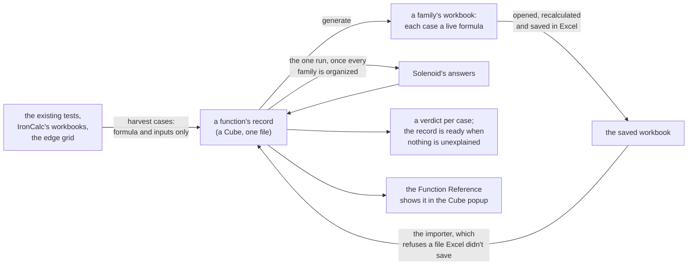

<!-- [[C140]] functionRecords; covers: scripts/function-records/*.ts, scripts/function-records/plans/*.ts -->

# Spec: Function records

Serves [[C140]] functionRecords. Every function Solenoid computes has one record: a Cube that lists the function's cases, each with Excel's answer beside Solenoid's, the kind of truth that settles it, a verdict, and the citation that explains any difference. The records are where a function's answers are checked, and the Function Reference shows a function's record in the Cube popup. This spec says what a record holds, how its cases are chosen, how answers are written and compared, how Excel's answers get in, and when a record is ready.

## What a record holds

A record is one file per function, `fixtures/functions/<NAME>.json`, where `<NAME>` is the function's name as a formula spells it (`STDEV.S.json`). Every name the core answers has a record: every name in the core's call table (`data/call_traits.json`) without a refusal, and every pack function. A function's family is the top-level Add menu group of the node its Function Reference row names, so TEXT and VALUE belong to Output and LEFT to Text; a function no node covers belongs to the family "Formula only". A family is the unit the work moves in: one workbook, one review. The file is Cube Input text: a JSON array of records, so a Cube Input or the Cube popup reads it with no other code ([[frame-verbs#Frames and Cubes]]). Its columns are untyped and every answer is text, so a column never claims a type its cells don't share.

Each top-level row of a record is one group of cases, with these keys:

- `group`: the group's name as the Function Reference shows it, such as "ignore_empty: empty slot" or "Examples".
- `axis`: what the group varies, one of `examples` (cases harvested from tests or workbooks), `argument` (one argument across the edge grid), `mode` (one value of a setting argument, such as XMATCH's `match_mode` of -1) or `pair` (two arguments varied together, authored by hand where one argument's meaning depends on another).
- `cite`: a list of citations that cover the whole group, each a leaf as `[[ID]] name` or a spec anchor as `[[spec#Section]]`.
- `cases`: the group's cases, a nested Frame with one row per case.

Harvested cases sit in the `examples` group "Examples", except a sweep: more than 200 cases one sheet of a source workbook holds for one function (IronCalc's ROMAN over every number from 1 to 3999) form the group "Sweep", so the examples stay readable.

Each case row has these keys:

- `formula`: the formula as Solenoid writes it, without a leading `=`. It is the case's input of record, since an empty slot (`TEXTJOIN(",",,"a")`) exists only in formula text.
- `env`: the names the formula reads, each `name=value` with the value written in Solenoid's answer form below, such as `b=blank:` or `xs=list:num:[1, 2, 3]`. Blank when the formula reads no name.
- `excel`: Excel's answer, written as Excel's constant notation below. Blank until the importer writes it.
- `ours`: Solenoid's answer, written in Solenoid's answer form below. Blank until the run writes it.
- `expect`: the answer a `rule` or `reference` case demands, written in Solenoid's answer form: the answer the cited leaf states, or the reference's answer. Blank for every other case, since an `excel` case's expectation is Excel's column.
- `truth`: which kind of truth settles the case (below). Blank on a case still waiting for Excel's answer.
- `verdict`: how the two answers relate (below). Blank until both answers are in.
- `cite`: the leaf or spec anchor that explains a difference, or the backlog line of a known bug. Blank when the verdict is `same`.

A case's formula is written in the syntax Excel and Solenoid share, since the same text becomes the workbook's live formula. Solenoid's formulas have no array literals, no error literals and no escaped quote ([[formula-language#Lexical grammar]]), so a list, a matrix and a text holding a `"` reach a formula through a name in `env`, and an error through a function that answers one (`NA()`, `1/0`). A name in `env` is never one of Solenoid's constants (`e`, `pi`, `tau`, `phi`). In the workbook, an `env` name is a defined name referring to cells that hold its value: a scalar one cell, a list a row of cells (a List is one row, [[D85]] columnsStayColumns), a matrix a block, a blank a cell left empty. The value sits in cells, never in a constant the name holds, because Excel reads a value in a cell differently from one typed into a formula (`SUM(A1)` with A1 holding the text "5" is 0, `SUM("5")` is 5), and a Solenoid value arriving from a card is the cell's case, as IronCalc's cases are.

Two cases are one case when their formulas differ only in spaces between tokens, which the shared syntax gives no meaning, and their bindings match; the record keeps the spelling it saw first.

The Function Reference's Excel Coverage tab opens a function's record from its row's parity mark, in the Cube popup and read-only (`functionRecords.ts`); a function without a record keeps a plain mark.

What a record does not store: the function's own facts that already have a declaration (its argument roles and empty-slot readings in the core's `data/call_traits.json`, its date class in `date_values.rs`, its unit class in [[unit-flow]], the family lists that name it, such as the aggregates that refuse text). The Function Reference renders those beside the record by reading the declarations, each under the leaf its declaration cites, so no fact is written twice ([[engineering#One declaration per fact]]).

## The kinds of truth

Every case is settled by exactly one kind of truth, written in `truth`:

- `excel`: Excel's answer, as the importer read it from a workbook Excel saved. Only the importer writes this kind, and it writes `excel` for no other source.
- `rule`: a Solenoid decision settles the case, because Solenoid answers otherwise than Excel on purpose or Excel has no answer to give (a function Excel doesn't have, a value with a unit). The case's `cite` names the leaf.
- `reference`: another reference settles the case where Excel has no such function, such as SciPy's answer for a statistic Excel lacks. The case's `cite` names the reference and the call.
- `past`: only Solenoid's own past answer is known. A case harvested from a frozen fixture starts here, and it never counts as evidence that the answer is right.

An answer from a Microsoft documentation page, a value remembered from an Excel session or another program's copy of Excel is not Excel's answer. A case that held such a value moves into its record with the formula and inputs only, and Excel's answer comes from the round trip.

## Writing Excel's answers

Excel's column holds Excel's answer in Excel's own constant notation, the way the answer would be typed as a constant in an Excel formula, with no kind tags, because Excel has only its own four kinds (number, text, logical, error) and no date kind:

| Excel's answer | Written as |
|---|---|
| a number | its digits as the saved workbook stores them, `0.32992582866978502` |
| text | in double quotes with an inner quote doubled, `"a""b"` |
| a logical | `TRUE` or `FALSE` |
| an error | its code, `#N/A` |
| a spilled array | an array constant, columns split by `,` and rows by `;`: `{1,"a";TRUE,#N/A}` |

A date in Excel is a number, so Excel's answer for a date is its serial in Excel's column. A formula in Excel never answers a blank: one that returns nothing shows 0, so Excel's column has no blank form. A complex number in Excel is text, so `IMSUM` answers `"3+4i"`.

## Writing Solenoid's answers

Solenoid's column holds what a user of the app gets, as `kind:value`, in the kinds of Solenoid's value model ([[socket-lattice]]):

| Solenoid's answer | Written as |
|---|---|
| a number | `num:` and the shortest digits that read back to the same number, `num:0.1`; the four non-finite forms `num:-0`, `num:inf`, `num:-inf`, `num:nan` |
| a date | `date:` and the calendar day, `date:2024-03-05`; with a time of day, to the millisecond, `date:2024-03-05T12:00:00.000` |
| text | `text:` and the text quoted as Excel quotes it, `text:"a""b"` |
| a logical | `bool:TRUE` or `bool:FALSE` |
| an error | `err:`, the code, and the message the app shows, quoted: `err:#DIV/0! "Divide by zero"` |
| a blank | `blank:` |
| a list | `list:`, its family's kind, and its items untagged: `list:num:[1, 2.5]`, `list:text:["a", "b,c"]`, `list:date:[2024-03-05, 2024-03-06]` |
| a matrix | `table:`, its family's kind, and its rows, which may differ in length: `table:num:[[1, 2], [3]]` |
| a complex number | `cx:`, the real part, the imaginary part's sign and digits, and `i`, both parts written as a number is, never rounded the way the app shows a complex number (`format_cx` keeps four digits): `cx:1.5-2.25i`, `cx:0+1i`, `cx:3+0i` |
| a value with a unit | `unit:`, the value in base SI, its dimension's symbol, and the unit it shows in when it has one: `unit:5000 m as km`; a pure ratio is `unit:5 ratio` |
| a LAMBDA | `lambda:` and its formula, `lambda:LAMBDA(x, x+1)` |

Rules that keep the form exact:

- **A list has one family.** Its items are untagged because the family says what they are. A blank or an error may stand among the items of any family, as `blank` and as `#N/A "message"`, and those are the only other item forms. A date list holds only dates beside blanks and errors, since a date beside another kind is refused ([[C137]] datesNeverSerials).
- **A mixed list is a finding, never an answer.** If an answer holds items of more than one family, it is written `list:MIXED:[num:2, text:"a"]`, the one place items carry their own tags, and a case with that answer has the verdict `unexplained` until it is fixed or ruled on.
- **A date is written as its day, never its serial.** Solenoid's calendar has no 29 February 1900 ([[C44]] dateSerials), so a Solenoid serial and an Excel serial name different days before 1 March 1900, and writing the day keeps that difference visible.
- **An error is written as the app shows it.** A Formula.js-style error inside the core is written as the Solenoid error the app turns it into, and an error's origin and file reference (graph bookkeeping, [[E9]] errorsKeepOrigin) are left out.
- **The left-out marker is a finding.** The core's left-out value (`Undef`) should never be an answer; if one is, it is written `undef:` and the case is `unexplained`.
- **Text is quoted the same way everywhere**, so a comma, a bracket or a quote inside text can't break a list.

## Comparing the two answers

The comparison reads Solenoid's kind first, then applies that kind's rule. A pair that passes is `same`; a pair that passes only through a rule named here is `same` with that rule in `cite`. Every other pair is a difference.

- **Numbers** are the same when they agree to 15 significant digits, the precision Excel shows and the one Solenoid's comparisons use ([[formula-language#Scalar operators]]). A case that needs a looser tolerance (an iterative solver's answer) is a difference unless its `cite` names the rule that allows it.
- **A date** is the same as Excel's number when the day, turned into a serial through Excel's calendar, equals it, to the millisecond for a time of day. A day before 1 January 1900 has no Excel serial, so Excel's error there is a difference settled by [[D119]] datesBefore1900. A function whose date class says it answers a date (`class_of`, [[date-values#Functions]]) answering `num:` is a difference, whatever the number.
- **Text and logicals** are the same only when exactly equal.
- **Errors** are the same when the codes are equal, or when Solenoid's code is one Excel's splits into: #DOMAIN!, #CONV! and #OVERFLOW! for Excel's #NUM!, #SYNTAX! for Excel's #VALUE!, as the table in [[error-values]] gives them. That table is the one declaration of each code's Excel twin, and the comparison reads it. Messages are never compared, since Excel has none.
- **A blank** is never the same as Excel's 0. It is a difference, accepted only with a `cite`.
- **A list** is the same as an Excel array of one row or one column holding the same items in order; a matrix is the same as an array of the same rows. Excel's column keeps which orientation Excel spilled.
- **A complex number** is the same as Excel's text when the text, read by the complex grammar, agrees to 15 significant digits in both parts.
- **A value with a unit** and **a LAMBDA** have no Excel twin, so their cases are `rule` and compare against the cited rule's stated answer.

## Verdicts

Each case's `verdict` is one of:

- `same`: the comparison passed, directly or through a named rule.
- `deliberate`: Solenoid differs on purpose, and `cite` names the leaf that decided it.
- `bug`: Solenoid is wrong, and `cite` names the backlog line.
- `gap`: one of the two answers is missing where it could exist.
- `unexplained`: the answers differ and nothing explains it yet.

## The edge grid

Every function is asked the same questions, generated, never chosen case by case. A record's `argument` groups come from a baseline call and a fixed list of probes:

- **The baseline** is one call the function answers normally, with every argument it takes written out (`TEXTAFTER("a-b-c", "-", 1, 0, 0, "none")`). Baselines are written by hand in the family's harvest plan, because telling a normal call from an erroring one means knowing its answer, and nothing is run before the records are organized. The build refuses a baseline whose argument count isn't the function's (`FUNCTION_ARITY`, `excelFunctions.ts`).
- **One argument at a time.** Each group takes the baseline and replaces one argument with every probe, so each case differs from a normal call in exactly one place. A function that takes any number of arguments is probed at each fixed position, then at the first repeated position and at one further. A group is named for its position and the argument's name in the function's signature (`FORMULA_SIGNATURES`), as in "2. ignore_empty".
- **Every probe at every position**, whatever the argument is for, because asking a number argument for text is one of the edges the records exist to cover.

The probes, each written as both Excel and Solenoid can read it:

| Kind | Probes |
|---|---|
| number | `0`, `-1`, `0.5`, `1E+307`, `1E-307` |
| text | `""`, `"abc"`, `"5"`, `" 5 "`, `"TRUE"`, `"😀"` |
| logical | `TRUE`, `FALSE` |
| date | `DATE(2024,3,5)`, `DATE(1900,1,1)`, `DATE(2024,3,5)+TIME(12,0,0)` |
| blank value | a name bound to a blank, `p_blank` with `p_blank=blank:` |
| empty slot | nothing between the commas; left out where it would leave the call with no argument at all (`LEN()`), which Excel refuses to enter |
| error | `NA()`, `1/0` |
| list | names bound to lists, since a formula has no array literal: `p_nums=list:num:[1, 2, 3]`, `p_texts=list:text:["a", "b"]`, `p_bools=list:bool:[TRUE, FALSE]`, `p_table=table:num:[[1, 2], [3, 4]]` |
| complex | `COMPLEX(1,2)` |
| a value with a unit | a name bound to one, `p_unit=unit:5000 m as km`. Excel can't express it, so only a Solenoid rule can settle the case; where no rule states what the function does with a unit, the case stays a `gap` naming that missing rule |

`mode` groups take each value a setting argument declares, and `pair` groups are written by hand where the grid can't reach a question. A grid case nobody has answered on a side that could answer it is a `gap`.

## Getting Excel's answers

Excel's answers come only from a workbook the author opens in Excel:

- **Generating.** The cases of one function family are written into one workbook (`scripts/function-records/workbook.ts`), one sheet per function and one row per case. A row holds the case's key (its formula and `env`, so the importer finds the case whatever the record's order), its answer cell and its shape cell. Excel recalculates every formula when the workbook opens.
- **Bound values.** Every distinct `env` binding in the workbook gets its own defined name, `_v1`, `_v2` and on, referring to cells on a Values sheet that hold it, since one name (IronCalc's `c_A2`) means different values in different cases and a defined name is the workbook's. Only the workbook's copy of the formula is renamed; the record keeps its names.
- **What Excel can't be given.** A case whose `env` holds a value Excel has no form for (a value with a unit, an empty list, −0, NaN, ±∞, a day before 31 December 1899, which Excel holds as serial 0) stays out of the workbook, and its Excel column stays blank.
- **How Excel stores a formula.** A function introduced after Excel 2007 is stored with Excel's prefix (`_xlfn.TEXTJOIN`, `_xlfn._xlws.FILTER`) and LET's and LAMBDA's names with `_xlpm.`; without them Excel answers `#NAME?`. The prefixes are read off IronCalc's Excel-saved workbooks, which show how Excel writes each name, and a function the generator can't place stops the build. Every case is a dynamic-array formula, marked as Excel marks one (the cell's `cm` attribute and the workbook's dynamic-array metadata), because Excel opens an unmarked formula as a legacy one and intersects a list argument down to one item.
- **Spills.** The answer cell holds `LET(r, <formula>, IF(ISERROR(ROWS(r)), r, IF(ROWS(r)*COLUMNS(r)=1, r, ARRAYTOTEXT(r, 1))))`, so an array answer is written out in Excel's own constant notation in one cell and never spills into the next case. The shape cell holds the answer's rows and columns (`2x2`, `1x1` for a scalar), so text that happens to read `{1,2}` is never taken for an array. An array answer's numbers are as ARRAYTOTEXT writes them, which the calibration sheet measures.
- **The calibration sheet.** Every workbook opens with known cases whose Excel answers follow from Excel's documented rules: a number, a text, a logical, an error, a date, a 1×3 and a 2×2 array, a bound cell holding the text "5" that SUM reads as 0 (so bound values sit in cells, not constants), and LEFT over a bound row answering a 1×2 array (so the formulas are dynamic arrays, not intersected). The importer reads them first and refuses the workbook if one reads otherwise, since then the workbook, not a function, is what's wrong.
- **The importer** is the only code that writes an `excel` answer. It refuses a workbook whose saved-by record (`docProps/app.xml`'s `Application`) doesn't name Excel, which a workbook the generator wrote and nobody re-saved in Excel never does, reads each answer cell's stored value and its whole spill, writes Excel's column, and sets `truth` to `excel` on every case whose `truth` is blank. A `rule` or `reference` case keeps its truth: Excel's answer is written beside it for the reader, and its `expect` still settles it. A saved workbook is kept beside the records (`fixtures/functions/excel/<family>.xlsx`) so the import can be repeated.
- **Volatile functions** (TODAY, NOW, RAND, RANDARRAY, RANDBETWEEN) answer differently on every recalculation, so their cases record a property (the kind, the range) under `rule`, never Excel's value, and never go into a workbook.

Cases harvested from IronCalc's workbooks and from the existing tests bring their formulas and inputs only, plus `expect`, `truth` and `cite` where the source states a Solenoid rule. Excel's answers for them come from the same round trip, so every Excel answer in every record came from one saved workbook through one importer. IronCalc's workbooks are kept at `fixtures/functions/sources/ironcalc/` with their licences and the commit they came from, so the harvest can be repeated. An IronCalc case is a formula cell whose first call is the record's function. Its cell references, on its own sheet or another, become `env` names holding the referenced cells' saved values (c_B2, a range r_B2_B5, another sheet's c_Sheet2_B2); a referenced cell whose number format is a date format holds a date, every other number a number, an empty cell a blank. A range of one row is a list and any other range a matrix, a column a one-column matrix, so a shape survives the trip; an array constant (`{",",";"}`) becomes an `env` name the same way, `k1`, `k2` in the order the formula holds them. A shared formula's copies are rebuilt from the formula they share, its relative references moved as Excel moves them, and Excel's storage prefixes (`_xlfn.`, `_xlws.`, `_xlpm.`) are dropped. A case that still falls outside the shared syntax (a range or array constant holding more than one kind, which a Solenoid list can't, a whole-column reference, a defined name) is not harvested, and the harvest ledger says why.

## The harvest ledger

The harvest writes `fixtures/functions/harvest.json`, the proof that nothing was left behind. For every source it read (a test file, a spec, a workbook) it lists the cases it moved, by function, and every mention of a function it did not move, with the reason: a check with no single answer (a property, a card answering as its formula), a case outside the shared syntax, a statement that is not an answer. A mention neither moved nor given a reason fails the harvest. The ledger names its sources so the migration can be reviewed; the records themselves don't.

## Readiness

The records are filled in this order, and no step starts before the one above it is finished for every function:

1. **Organize.** Every case from every existing source has moved into its function's record with its formula, inputs, `truth` and any `cite`; every function has its edge grid; every contradiction between the old sources has become a case. Excel's and Solenoid's columns are blank.
2. **Excel's answers.** Every family's workbook has made its round trip, and Excel's column is filled.
3. **Solenoid's answers.** One run writes Solenoid's column for every case of every record.
4. **Verdicts.** Every case gets its verdict.

A record is ready when it has no `unexplained` and no `gap`. The check that gates a change compares a run's answers against the records' `ours` column and fails on any case whose verdict would change, so a change in an answer is made in the record in the same commit, with its verdict and citation.

## What stays outside the records

- **The frozen fixtures** (`fixtures/core/`) stay as they are, as the check that tells whether any answer changed ([[rust-core]]). Their cases enter a record only as `past`.
- **Checks with no single answer** stay as tests: a property (an inverse round trip, a total conserved), a card answering as its formula ([[C17]] shareImpl), a time limit ([[C120]] linearWork), a fuzz run that must not panic.
- **Plumbing** (parsing, the socket lattice, CSV, the boundary) has no function to belong to.
- A leaf that a test must cite (`rules.test.ts`) keeps a test that cites it, which reads the cases of the records that leaf settles.

## Where the old content goes

- The hand-written Excel cases (`excel_doc_sweep.rs`, `excel_examples.rs`, `excelChecked.test.ts`, the Excel-checked parts of the finance, rounding, date and distribution tests) move into the records as cases, and their files keep only what is not a case.
- The per-function statements in [[formula-language#Function notes]] and [[excel-divergences]] become cases with a `cite`, and the specs keep the family rules and the mechanisms.
- Where two old sources disagree about a function's answer, the disagreement becomes a case, settled by Excel's answer or by a ruling, and the losing statement is deleted.
