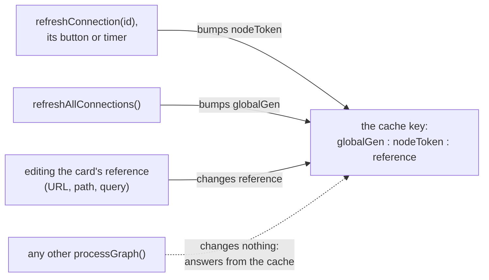
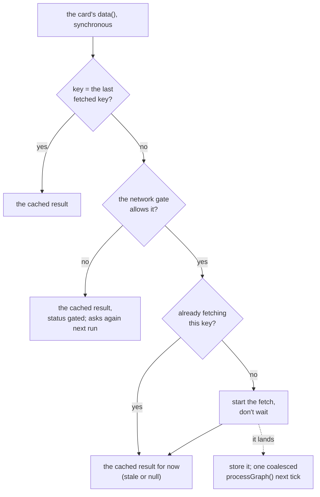

<!-- [[C23]] calcModes -->

# Spec: Live connections

Serves [[C23]] calcModes. It covers what the system does and blocks, and the decision each behavior serves.

A **connection card** pulls data from outside the graph: a URL (Web Source, Import HTML, Import XML), a local file (Local File), or a service (Geocode, Weather, Holidays, FX, Data Feed, Task Notes, Import Obsidian Note), or a vault folder (Vault Folder). Vault Folder refuses a folder that leaves the vault, and Local File refuses a file name that leaves its data folder (a `..` step, an absolute or drive path, a network share) before anything is read; a note renamed or deleted between the listing and its read is left out rather than failing the read. The card saves only its reference (the URL, the path, the query), never the data, so reopening a document fetches again. The shared machinery is `connectionStore.ts`; the fetches are in `nodes/connection.ts` and the other card files; the HTTP layer is `httpBridge.ts`; the status rows and refresh buttons are in `components/ConnectionNodes.tsx`.

## The cache key

Each card caches its last result under a composite key built by `connectionStore.key(id, reference)`:

```
<globalGen>:<nodeToken>:<reference>
```

- `globalGen` is one app-wide counter.
- `nodeToken` is a per-card counter, 0 until first bumped.
- `reference` is the card's own description of what it fetches, such as the trimmed URL, `url#t=<table>` for Import HTML, or `lat,lon,unit,pastDays,forecastDays` for Weather. An empty reference means the card has nothing to fetch; it goes idle and outputs null.

A card keeps out of the reference whatever it can apply to the cached result: Geocode's picked match, Holidays' region and Currency's amount apply on each compute, so changing them reselects without a fetch.

An ordinary `processGraph()`, such as one caused by editing an unrelated card, leaves all three parts unchanged, so the card answers from its cache with no network or disk access. A refresh changes exactly one part:



- `refreshConnection(id)` bumps that card's token, so only that card fetches again. The card's refresh button and its auto-refresh timer both call it. The timer lives in the store (`connectionStore.autoRefresh(id, minutes)`), kept in step by the card's own `data()` and by the cadence field, so a card that is not mounted (inside a composite or a collapsed group) keeps refreshing. A timer whose card is gone from every graph clears itself when it next fires.
- `refreshAllConnections()` bumps the global counter, so every card fetches again. It is the "Refresh all connections" menu item, and it also notifies the store's subscribers. Import Obsidian Note sees the new counter in its own `data()` and re-reads its note (the wired path, or the picked file), so a card that is not mounted, inside a composite or a collapsed group, refreshes too. A note renamed or deleted since keeps what was loaded and says so: a line above the body reads "Gone from the vault (renamed or deleted). Showing the last copy." (a wired path that names no note says that instead). An opened document checks its note is still there without re-reading it (`checkGone`, through `vaultFileExists`; a platform that can't read the vault never calls a note gone), and a read that fails asks the same question before flagging; the flag rides the card's connection state and clears on the next good read.

A heavy-mode composite (one that holds its outputs until Solve) keys its staleness on `connectionStore.liveStamp(ids)` over every node nested inside it: the global counter, each live card's token, and a per-card count of landed fetches that `scheduleConnectionRecalc(id)` bumps. A refresh or a fresh answer inside it shows the composite stale rather than passing silently, and a Solve waits for the fetches it starts. A Solve that runs out of rounds while fetches still land leaves the composite stale, and a refresh-all with no live card inside it leaves it held.

Both then run `processGraph()` outside any rebuild scope ([[compute-pass#A refresh never runs inside a rebuild scope]]), so an Alert watching live data still fires on fresh values ([[D79]] effectsEdgeTriggered). The rebuild scope is the one thing that silences an Alert, so a refresh run inside one would drop every alert it should raise.

Tests:

- `connectionStore.test.ts`: `refreshConnection` never enters a rebuild scope, and a refresh changes the cache key, so the new value reaches a downstream Alert and its change of status fires.
- `liveCardUnmounted.test.ts`: a heavy composite holding a live card turns stale on a refresh and when the fetch lands, its first Solve waits for the fetch it starts, a Solve out of rounds stays stale, and a refresh-all with no live card inside leaves it held; a card inside a composite refreshes on its cadence and a deleted one stops, and a cadence of 0 clears the timer.
- `importObsidianGone.test.ts`: a note gone from the vault is flagged and the body stays, the flag clears once the note is back, a platform that can't read the vault never calls a note gone, and a card with no note picked is never gone.

## Fetching in the background

A connection card's `data()` stays synchronous. On each run it:

1. builds the key; if it equals the key of the last completed fetch (`lastKey`), it returns the cached result;
2. asks the network gate (below); if the gate says no, it returns the cached result. A card records the key as fetched only once the fetch actually launches, so a pass the gate refused asks again on the next run;
3. if no fetch for this key is already in flight (`inflightKey`), starts one without waiting for it;
4. returns the cached result, which is stale or null until the fetch lands. A Frame output with nothing fetched yet is null, never a Frame with no columns.



Import HTML, Import XML and Local File are the exception: their `data()` is async and returns the in-flight promise for the current key (`inflight`), so a recompute waits for their read. A Parquet column the shell's reader refuses answers the reader's own error, not `#REF!`.

The card launches the fetch through `fetchInBackground(id, promise)`, which tracks it under the card's id until it has landed. When the fetch lands, the card stores the result and the key, and `scheduleConnectionRecalc(id)` runs. A fetch whose key a newer one has replaced lands nowhere: a slow answer for the old reference (an earlier currency pair, the previous place, a URL moved away from and back) never overwrites the answer for the current one. That runs one `processGraph()` on the next tick, so several sources resolving together coalesce into one recompute. A failed fetch also records its key, so the card does not retry until the key changes; this keeps a broken URL from hammering the network.

An async `data()` would put every recompute, including every tick of a slider drag, behind the network, and `engine.reset()` on each overlapping recompute would cancel the fetch in flight.

Other loads register with `trackInflight(promise, id?)`. `whenConnectionsSettled(ids?)` waits until every registered load (or, with `ids`, every load of those cards) has settled, and `hasInflightConnections()` reports whether any are pending. Headless runs, such as the marketing scene stage, use these to wait and recompute once. In the app, only a heavy composite's Solve waits, and only on the cards inside it ([[composite-nodes]], the heavy-mode hold); an ordinary pass never waits.

Tests:

- `connectionRace.test.ts`: a Currency answer that lands after a newer one is dropped, and a Weather answer for an old place never replaces the new one's.
- `liveCardUnmounted.test.ts`: Web Source keeps the newer URL's data when the older reply comes back last, and a URL moved away from and back keeps the first URL's data.
- `localFileRace.test.ts`: a Parquet read that lands after a newer one never replaces the newer Frame, a refused column answers the reader's error, and a file name leaving the data folder is refused before any read.
- `connectionStore.test.ts`: Weather's daily Frame is null until its fetch lands.

## Status

Each card's status lives in `connectionStore` as `idle`, `loading`, `ok` (with row count, column count and `fetchedAt`), `error` (with a message shown on the card) or `gated`. The status row renders it, with `gated` reading "Waiting for permission". The store registers `forget` and `forgetAll` ([[stores#The rules]]): deleting a card drops its status and token, and a whole-graph rebuild clears every status and token and resets the permission prompt, so an Allow left on screen from the previous document is removed and, if clicked, grants nothing.

## The network gate

A document opened or imported from outside the app is **foreign**, and its connection cards fetch nothing until the user allows it ([[C103]] untrustedContentSeams). `networkAllowed()` is true for the user's own documents, when the "always allow" setting (`alwaysAllowNetwork`) is on, or when this document has been granted. A card that fetches over the network calls `requestNetwork(id)` before each fetch (Local File reads the disk and does not):

- allowed: the card proceeds;
- not allowed: the card records itself as gated, and on the next tick, once every gated card has registered, one sticky warning asks "This document connects to N services. Allow it to fetch?" with an **Allow** button. The prompt shows once per document.

Web pictures are fetches too. While the document may not fetch, an Image card's, a Report's or a table cell's picture (Record, Cards, the popup's Form) from a web address shows a dashed "Web image" box (`components/WebImage.tsx`), and rendered markdown, a note's or a text value's, holds back every web `src`, `srcset`, `poster` and `background`, an SVG picture's `href`, and any style attribute or `<style>` that can fetch (`url(…)`, `image-set(…)`, `@import`) (`noteHtml.ts`). An address is a web one when the browser's own reading of it leaves the app's origin (`webUrl.ts`), so `\\host/x` and a newline inside `https` count; an image value its card held arrives `held` and stays held wherever it shows, so a card pasted out of a foreign document ([[script-sandbox#A document someone else wrote]]) keeps its picture back in the user's own Report too; each holder joins the one prompt through `askNetwork`, which counts it without touching any card's state, so a render may ask. A `data:` picture shows at once.

`allowNetwork()` (the Allow button, or Settings, Data) saves the grant on the document's metadata and calls `refreshAllConnections()`. Importing a file clears any grant the file itself carries, so a shared file cannot skip the prompt.

Tests:

- `connectionStore.test.ts`: the user's own document is never gated; a foreign, undecided one is, and the card reads `gated`; `allowNetwork()` grants it; the always-allow setting covers it; an Allow from the previous document neither grants nor lingers after a switch; a saved grant is honored on reload.
- `foreignPaste.test.ts`: a web image pasted from a foreign document is held until the network is allowed, and the user's own cards are not.

## The demo vault

Serves [[C1]] demoVault. The read-only demo vault (`demoVault.ts`, `demoVaultData.ts`) sits under the sentinel root `solenoid:demo-vault`. The path-aware `fs()` dispatch in `fileBridge` sends any path under that root to an in-memory provider, so the vault readers work with no real filesystem, and every write there throws. Routing by path leaves desktop file operations on the real filesystem untouched. A path is under the root only at a path boundary, so `solenoid:demo-vault-evil/x` is not. The demo files are lazy-loaded and stay out of the main bundle. The sentinel root carries a colon, so it can never collide with a folder path a user could type. A folder's listing holds its own entries, not nested ones, and a file's `stat` carries no timestamps, since the bundle has none.

The same seam serves Local File's data folder, resolved in the same order as the vault ([[D62]] demoVaultResolution): `getCsvFolder` gives the demo vault's `Data` folder while a marketing page forces the demo, else the data folder set in Settings, else the demo `Data` folder while "Use demo vault" is on. A seed that needs sample tables (Personal Finance) reads them from there rather than from a bundled URL. A demo CSV is read like any other, its text through `fs()` and parsed on the core (`csvToFrame`); a Parquet file needs the desktop shell's reader and a real folder.

Tests: `demoVault.test.ts`: the sentinel root matches only at a path boundary; the marketing force wins over the settings and pins the root and the data folder together, and a configured folder always wins over the demo; the in-memory provider lists, reads, checks existence and joins paths against the bundled files and throws on every write; Local File reads a bundled CSV as a typed Frame with no desktop.

**Picking a file or folder.** Local File's file, Import Obsidian Note's and Write to Obsidian's note, and the vault folder Vault Folder and Write to Obsidian read or write, are each picked through one field (`PickField.tsx`) that calls `chooseFile` (`chooseFile.ts`). On desktop it opens the operating system's dialog at the folder the pick lives under (the data folder, the vault), filtered to the card's extensions; the answer is kept relative to that folder (a Windows path read with either slash and in any case), and a pick outside it is refused with a notice. A second ask while the app's picker is open closes the first as cancelled. On the web, and for the demo vault on any platform, where no dialog can reach the files, it opens the app's own picker (`FilePicker.tsx` on the popup shell, its model in `filePickerModel.ts`). With no search it browses folder by folder (a breadcrumb, folders first with how much each holds, → in and ← out); a search covers every path, a match in the name ranked before one only in its folder, the matched letters marked. It wears the asking card's accent (`readChipPopupStyle`, as a frame chip's popup does), searches through the shell's header Filter, and ends in the popups' footer bar with one confirming action. A click selects and a double-click, Enter or Choose picks; folder mode offers the folder being browsed first. On a phone (640 px and under) the list fills the card and the preview is left out, so a tap picks a file or opens a folder, and the Filter waits as its magnifier; on touch the rows grow to a finger's size, and the trail of folders is the Cube popup's own drill-down crumbs. A preview pane shows what the selection holds: a note's properties (a date as a date) and opening lines, a table's first rows and columns, a folder's files. The last few picks of each kind lead the list (`Recent`, kept in the browser as a per-viewer convenience), and the popup resizes by its grip like every popup. It stays quick on a big vault or a big file ([[C120]] linearWork): a listing walks once a session and a reopened picker shows it at once while it refreshes behind (`listed`, `relist`); a search runs over paths lowercased once, deferred behind the typing, and a list draws at most 300 rows, saying how many more a search would narrow to; a preview reads only a file's head (`readTextHead`: 64 KB of a CSV, 16 KB of a note, the demo vault slicing in memory), parses a table's whole lines on the core (`csvToFrame`) and draws it with the cards' own table preview (`FrameDisplay`). A pick that no longer lists still shows on the card, marked missing. The operating system's dialog is no browser box ([[C106]] noNativeDialogs; the stores floor spec, Notices and confirmations).

The marketing pages' force switch pins the vault root and the data folder together and is never persisted. On the dev server the demo files are read live from disk (`/__demo-vault`, `vite.config.ts`), so an Obsidian edit to the repo's vault shows on refresh.

Tests:

- `chooseFile.test.ts`: a path is read relative to its root (the root itself as empty, nothing outside it), Windows paths with either slash and in any case; off the desktop the app's picker opens and answers, null when closed, and a second ask cancels the first.
- `filePickerModel.test.ts`: a folder lists its folders first, then its files, numbers in order; a search ranks a name match first and marks it; 100,000 paths answer fast, at most the cap, counting the rest; a cut head drops its partial last line; a listing is kept for the session.

## A folder as one table

Reading one file and reading a folder of them are one job, so they are one card ([[B11]] maximalMerge). Local File's `fileName` is a file's name or a pattern over many: a name holding `*` or `?` is a pattern (`isFilePattern`, `fileGlob.ts`).

- **Matching** (`matchFiles`): the pattern is split at `/`; `*` is any run of characters inside one folder, `?` one character, and a `**` part stands for the folder itself and every folder under it, `GLOB_MAX_DEPTH` deep, hidden folders left out. Case is ignored. Only CSV and Parquet files count (`listLocalFilesMatching`), at most `GLOB_MAX_FILES` of them, read in name order with digits by value (`2026-2` before `2026-10`).
- **Stacking** (`readFilesAsOne`, `nodes/connection.ts`): each file is read as Local File reads one, gains a first column `File` holding its path under the data folder (`Source file` where the file has a `File` column of its own), and the files are stacked by the Append card's own body, so columns meet by name and a file lacking one leaves blanks.
- **A file that doesn't read** is left out and named in the status note under the count ("1 didn't read: name (reason)", the first three named); the others load. No file matching, or none reading, is the card's error.
- **Status**: a read that took several files says how many (`files` on the connection state: "3 files · 8×5 · time"). A file added to the folder is picked up by Refresh or the refresh interval, as any other change is.
- **The card** shows the pattern in an `All matching` field under the file pick. Typing one replaces the picked file, picking a file replaces the pattern, and clearing the field clears only a pattern.
- **Where it runs**: wherever a CSV reads, which is the desktop app, the demo vault and the headless runner (`run-graph --data <folder>`); a Parquet file needs the desktop's reader.

- **The files one by one**: the `files` output is a Cube with a row per file read, its `File` and its `Table` (the file's own frame), empty for a single file. It is what a transform that runs once per file takes: a Composite set to By row, Live ([[composite-nodes#By-Row]]) gets one row a pass, unnests `Table` inside, and answers a Cube with a transformed table in each row, which Unnest stacks ([[frame-verbs#Nest and Unnest]]). Unnest on the `files` Cube itself stacks the files as they are.

A pattern never yields a Plan: a folder of plan files has no one schedule.

Tests: `localFolder.test.ts`: the matcher over a fake tree, the stacked table, a file that fails, nothing matching, and the files through a live By-Row Composite and Unnest.

## HTTP

`fetchText` and `fetchJson` in `httpBridge.ts` do the requests.

- On desktop, an absolute `http(s)` URL goes through the shell's `net_fetch` (`src-tauri/src/net.rs`), which has no same-origin policy. A relative URL (a bundled asset) uses the browser fetch even on desktop.
- What someone else wrote never reaches this computer or the local network ([[B18]] safeToShare): a foreign document's cards, and a card pasted out of one (`writtenElsewhere`, [[script-sandbox#A document someone else wrote]]), even once the network is allowed. The shell judges the address, not its spelling: the URL's host on the request and on every redirect, an address carrying an IPv4 one (mapped, NAT64, 6to4) by that address, and a name by every address it resolves to, at the moment it connects, with no proxy in between. Loopback, private, link-local, carrier-grade NAT, unique-local and the other non-public ranges are refused, and the refusal reads as such. The user's own cards may reach them (TaskNotes serves on localhost).
- The desktop request's User-Agent is `DATA_FETCH_UA`, `"curl/8.4.0"`. It must be a recognized tool identifier: FRED's `fredgraph.csv` sits behind a firewall that allows known clients (`curl`, `python-requests`, `wget`) and drops the connection for a browser string, an unknown custom string, or reqwest's default.
- In the browser build, a cross-origin block surfaces as `CorsLikelyError`, whose message points the user at the desktop app.
- A non-OK response throws `HTTP <status> <text>`.
- A body is capped at `MAX_FETCH_BYTES`, 64 MB. An oversized `Content-Length` is refused before reading, and a streamed body aborts the moment it crosses the cap.

Tests: `net.rs`'s own tests (`cargo test --manifest-path src-tauri/Cargo.toml net`): every spelling of an inward address refused, public ones passing, a name resolving to loopback refused, a server on loopback reached by the user's own fetch and refused to a foreign one. `httpBridge.test.ts`: on the desktop branch, the user's own fetch asks for the local network and a foreign one doesn't, the refusal reads as such, a status and an empty 204 come through; on the browser branch: text and content type on success, a network-level `TypeError` read as `CorsLikelyError`, an HTTP error keeping its status, another failure passing through, an oversized `Content-Length` refused before the body is read, a body under the cap returned, and a relative URL taking the plain fetch.

## Service providers

The four service cards call keyless, CORS-open public APIs: a provider module builds the URLs, the card owns the fetch and the cache, and the reply is read on the core (`providers.rs`, frozen in `fixtures/core/providers.json.gz`). Geocode's pick among the matches stays with the card (`pickGeocodeMatch`). A malformed reply reads as empty, never as an error, and every column a reply fills has a row per day the reply names. The currency and country pickers read bundled copies of the providers' own lists, so no call is spent on data that almost never changes.

- **FX** uses Frankfurter's ECB reference rates, updated once per business day: `/v1/latest?base=X&symbols=Y` for spot, and `/v1/{start}..{end}?base=X&symbols=Y` for an inclusive ISO date range. A malformed body gives a null rate. A time series is sorted by date, and days with no rate (weekends, holidays) are absent rather than null. Every currency code is registered as a currency display unit, so the card's authored target-currency unit resolves at render. The spot card's Amount is a combo socket: a list of amounts converts item by item at the one rate.
- **Holidays** uses Nager.Date (`/api/v3/PublicHolidays/{year}/{CC}`), the year truncated to a whole number and the code trimmed and upper-cased. The card caches the reply's text and reads it against the region on each compute. Rows keep the API's date-ascending order, and an undated row is dropped. A nationwide day always applies, a subdivision day only when the chosen region is among its counties, and a blank region keeps every day. Days-to-next counts whole days between UTC-midnight serials: 0 for today, null when none remain.
- **Geocode** uses Open-Meteo geocoding (English labels, up to 10 matches, best first). A pick is stored by its "City, Region, Country" label, never an index, since the API may reorder matches on a refresh, and a stored label that no longer matches falls back to the top match. Each match carries an IANA time zone (`""` when the API omits it) for Weather and Time Zone Convert.
- **Weather** uses the Open-Meteo forecast, which returns past (0 to 92 days) and future (1 to 16 days) daily rows and current conditions in one call. WMO weather codes map to short text, and the temperature columns carry the chosen °C or °F unit; the past and future windows clamp to those ranges.

Tests:

- `coreProviders.test.ts` freezes the replies' reads (`fixtures/core/providers.json.gz`), well-formed and not, and `providers.rs` (solenoid-core) holds the core to them.
- `fxProvider.test.ts`: the spot and range URLs, the bundled currency list, and a currency beyond the built-in four tagging a value on the currency dimension.
- `geocodeProvider.test.ts`: the URL, and the pick by label (the top match with no pick or an unknown label, the labeled match after a reorder, null with no matches).
- `holidaysProvider.test.ts`: the URL and the bundled country list.
- `weatherProvider.test.ts`: the URL's unit and its clamped day windows.
