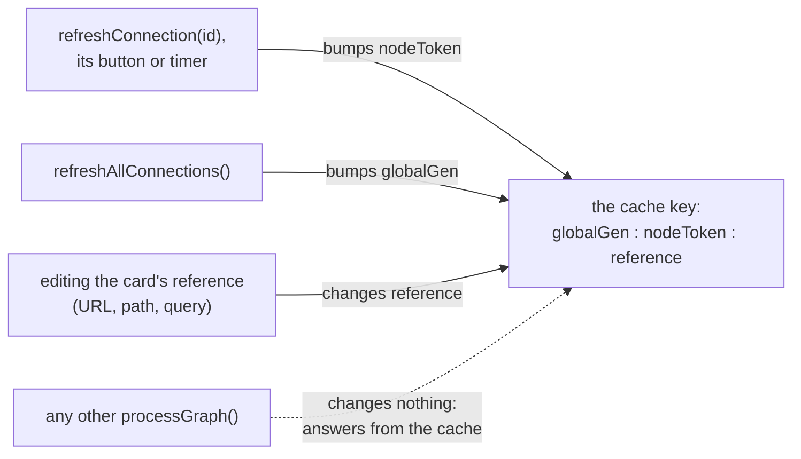
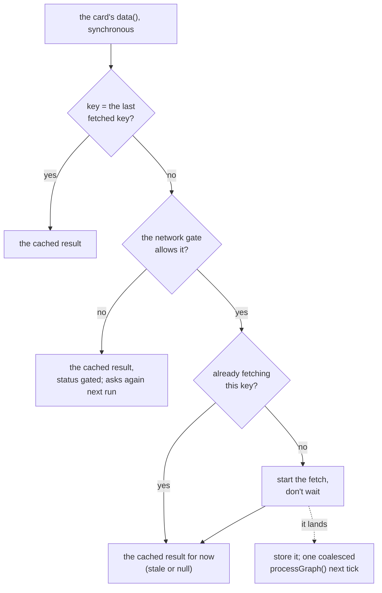

<!-- [[C23]] calcModes -->

# Spec: Live connections

Serves [[C23]] calcModes. It covers what the system does and blocks, and the decision each behavior serves. A WHY that isn't in a node belongs in one.

A **connection card** pulls data from outside the graph: a URL (Web Source, Import HTML, Import XML), a local file (Local File), or a service (Geocode, Weather, Holidays, FX, Data Feed, Task Notes, Import Obsidian Note), or a vault folder (Vault Folder). Vault Folder refuses a folder that leaves the vault, and a note renamed or deleted between the listing and its read is left out rather than failing the read. The card saves only its reference (the URL, the path, the query), never the data, so reopening a document fetches again. The shared machinery is `connectionStore.ts`; the fetches are in `nodes/connection.ts` and the other card files; the HTTP layer is `httpBridge.ts`; the status rows and refresh buttons are in `components/ConnectionNodes.tsx`.

## The cache key

Each card caches its last result under a composite key built by `connectionStore.key(id, reference)`:

```
<globalGen>:<nodeToken>:<reference>
```

- `globalGen` is one app-wide counter.
- `nodeToken` is a per-card counter, 0 until first bumped.
- `reference` is the card's own description of what it fetches, such as the trimmed URL, `url#t=<table>` for Import HTML, or `lat,lon,unit,pastDays,forecastDays` for Weather. An empty reference means the card has nothing to fetch; it goes idle and outputs null.

A card keeps out of the reference whatever it can apply to the cached result: Geocode's picked match, Holidays' region and Currency's amount apply on each compute, so changing them reselects without a fetch.

An ordinary `processGraph()`, such as one caused by editing an unrelated card, leaves all three parts unchanged, so the card answers from its cache with no network or disk access. A refresh changes exactly one part:



- `refreshConnection(id)` bumps that card's token, so only that card fetches again. The card's refresh button and its auto-refresh timer both call it. The timer lives in the store (`connectionStore.autoRefresh(id, minutes)`), kept in step by the card's own `data()` and by the cadence field, so a card that is not mounted (inside a composite or a collapsed group) keeps refreshing. A timer whose card is gone from every graph clears itself when it next fires.
- `refreshAllConnections()` bumps the global counter, so every card fetches again. It is the "Refresh all connections" menu item, and it also notifies the store's subscribers. Import Obsidian Note sees the new counter in its own `data()` and re-reads its note (the wired path, or the picked file), so a card that is not mounted, inside a composite or a collapsed group, refreshes too; a note renamed or deleted since keeps what was loaded.

A heavy-mode composite (one that holds its outputs until Solve) keys its staleness on `connectionStore.liveStamp(ids)` over every node nested inside it: the global counter, each live card's token, and a per-card count of landed fetches that `scheduleConnectionRecalc(id)` bumps. A refresh or a fresh answer inside it shows the composite stale rather than passing silently, and a Solve waits for the fetches it starts (`liveCardUnmounted.test.ts`).

Both then run `processGraph()` outside any rebuild scope ([[compute-pass#A refresh never runs inside a rebuild scope]]), so an Alert watching live data still fires on fresh values ([[D79]] effectsEdgeTriggered).

## Fetching in the background

A connection card's `data()` stays synchronous. On each run it:

1. builds the key; if it equals the key of the last completed fetch (`lastKey`), it returns the cached result;
2. asks the network gate (below); if the gate says no, it returns the cached result. A card records the key as fetched only once the fetch actually launches, so a pass the gate refused asks again on the next run;
3. if no fetch for this key is already in flight (`inflightKey`), starts one without waiting for it;
4. returns the cached result, which is stale or null until the fetch lands.



Import HTML, Import XML and Local File are the exception: their `data()` is async and returns the in-flight promise for the current key (`inflight`), so a recompute waits for their read.

The card launches the fetch through `fetchInBackground(id, promise)`, which tracks it under the card's id until it has landed. When the fetch lands, the card stores the result and the key, and `scheduleConnectionRecalc(id)` runs. A fetch whose key a newer one has replaced lands nowhere: a slow answer for the old reference (an earlier currency pair, the previous place) never overwrites the answer for the current one (`connectionRace.test.ts`). That runs one `processGraph()` on the next tick, so several sources resolving together coalesce into one recompute. A failed fetch also records its key, so the card does not retry until the key changes; this keeps a broken URL from hammering the network.

An async `data()` would put every recompute, including every tick of a slider drag, behind the network, and `engine.reset()` on each overlapping recompute would cancel the fetch in flight.

Other loads register with `trackInflight(promise, id?)`. `whenConnectionsSettled(ids?)` waits until every registered load (or, with `ids`, every load of those cards) has settled, and `hasInflightConnections()` reports whether any are pending. Headless runs, such as the marketing scene stage, use these to wait and recompute once. In the app, only a heavy composite's Solve waits, and only on the cards inside it ([[composite-nodes]], the heavy-mode hold); an ordinary pass never waits.

## Status

Each card's status lives in `connectionStore` as `idle`, `loading`, `ok` (with row count, column count and `fetchedAt`), `error` (with a message shown on the card) or `gated`. The status row renders it, with `gated` reading "Waiting for permission". The store registers `forget` and `forgetAll` ([[stores#The rules]]): deleting a card drops its status and token, and a whole-graph rebuild clears every status and token and resets the permission prompt.

## The network gate

A document opened or imported from outside the app is **foreign**, and its connection cards fetch nothing until the user allows it ([[C103]] untrustedContentSeams). `networkAllowed()` is true for the user's own documents, when the "always allow" setting (`alwaysAllowNetwork`) is on, or when this document has been granted. A card that fetches over the network calls `requestNetwork(id)` before each fetch (Local File reads the disk and does not):

- allowed: the card proceeds;
- not allowed: the card records itself as gated, and on the next tick, once every gated card has registered, one sticky warning asks "This document connects to N services. Allow it to fetch?" with an **Allow** button. The prompt shows once per document.

`allowNetwork()` (the Allow button, or Settings, Data) saves the grant on the document's metadata and calls `refreshAllConnections()`. Importing a file clears any grant the file itself carries, so a shared file cannot skip the prompt.

## The demo vault

Serves [[C1]] demoVault. The read-only demo vault (`demoVault.ts`, `demoVaultData.ts`) sits under the sentinel root `solenoid:demo-vault`. The path-aware `fs()` dispatch in `fileBridge` sends any path under that root to an in-memory provider, so the vault readers work with no real filesystem, and every write there throws. Routing by path leaves desktop file operations on the real filesystem untouched. The demo files are lazy-loaded and stay out of the main bundle. The sentinel root carries a colon, so it can never collide with a folder path a user could type.

The same seam serves Local File's data folder, resolved in the same order as the vault ([[D62]] demoVaultResolution): `getCsvFolder` gives the demo vault's `Data` folder while a marketing page forces the demo, else the data folder set in Settings, else the demo `Data` folder while "Use demo vault" is on. A seed that needs sample tables (Personal Finance) reads them from there rather than from a bundled URL. A demo CSV is read like any other, its text through `fs()` and parsed on the core (`csvToFrame`); a Parquet file needs the desktop shell's reader and a real folder.

The marketing pages' force switch pins the vault root and the data folder together and is never persisted. On the dev server the demo files are read live from disk (`/__demo-vault`, `vite.config.ts`), so an Obsidian edit to the repo's vault shows on refresh.

## HTTP

`fetchText` and `fetchJson` in `httpBridge.ts` do the requests.

- On desktop, an absolute `http(s)` URL goes through the Tauri HTTP plugin, which has no same-origin policy. A relative URL (a bundled asset) uses the browser fetch even on desktop.
- The desktop request's User-Agent is `DATA_FETCH_UA`, `"curl/8.4.0"`. It must be a recognized tool identifier: FRED's `fredgraph.csv` sits behind a firewall that allows known clients (`curl`, `python-requests`, `wget`) and drops the connection for a browser string, an unknown custom string, or reqwest's default.
- In the browser build, a cross-origin block surfaces as `CorsLikelyError`, whose message points the user at the desktop app.
- A non-OK response throws `HTTP <status> <text>`.
- A body is capped at `MAX_FETCH_BYTES`, 64 MB. An oversized `Content-Length` is refused before reading, and a streamed body aborts the moment it crosses the cap.

## Service providers

The four service cards call keyless, CORS-open public APIs: a provider module builds the URLs, the card owns the fetch and the cache, and the reply is read on the core (`providers.rs`, frozen in `fixtures/core/providers.json.gz`). Geocode's pick among the matches stays with the card (`pickGeocodeMatch`). A malformed reply reads as empty, never as an error, and every column a reply fills has a row per day the reply names. The currency and country pickers read bundled copies of the providers' own lists, so no call is spent on data that almost never changes.

- **FX** uses Frankfurter's ECB reference rates, updated once per business day: `/v1/latest?base=X&symbols=Y` for spot, and `/v1/{start}..{end}?base=X&symbols=Y` for an inclusive ISO date range. A malformed body gives a null rate. A time series is sorted by date, and days with no rate (weekends, holidays) are absent rather than null. Every currency code is registered as a currency display unit, so the card's authored target-currency unit resolves at render. The spot card's Amount is a combo socket: a list of amounts converts item by item at the one rate.
- **Holidays** uses Nager.Date (`/api/v3/PublicHolidays/{year}/{CC}`). The card caches the reply's text and reads it against the region on each compute. Rows keep the API's date-ascending order, and an undated row is dropped. A nationwide day always applies, a subdivision day only when the chosen region is among its counties, and a blank region keeps every day. Days-to-next counts whole days between UTC-midnight serials: 0 for today, null when none remain.
- **Geocode** uses Open-Meteo geocoding (English labels, up to 10 matches, best first). A pick is stored by its "City, Region, Country" label, never an index, since the API may reorder matches on a refresh, and a stored label that no longer matches falls back to the top match. Each match carries an IANA time zone (`""` when the API omits it) for Weather and Time Zone Convert.
- **Weather** uses the Open-Meteo forecast, which returns past (0 to 92 days) and future (1 to 16 days) daily rows and current conditions in one call. WMO weather codes map to short text, and the temperature columns carry the chosen °C or °F unit.
