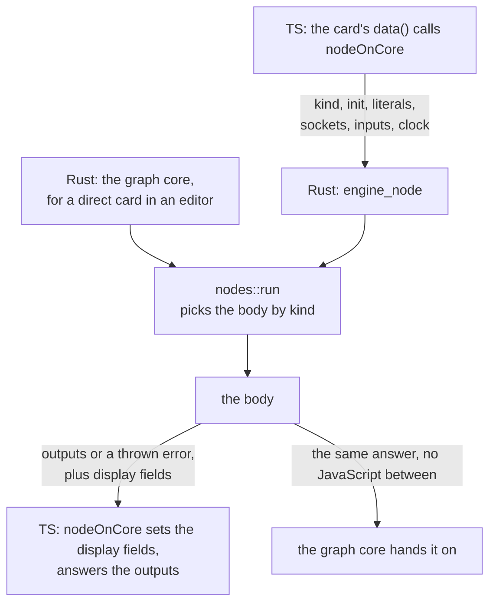
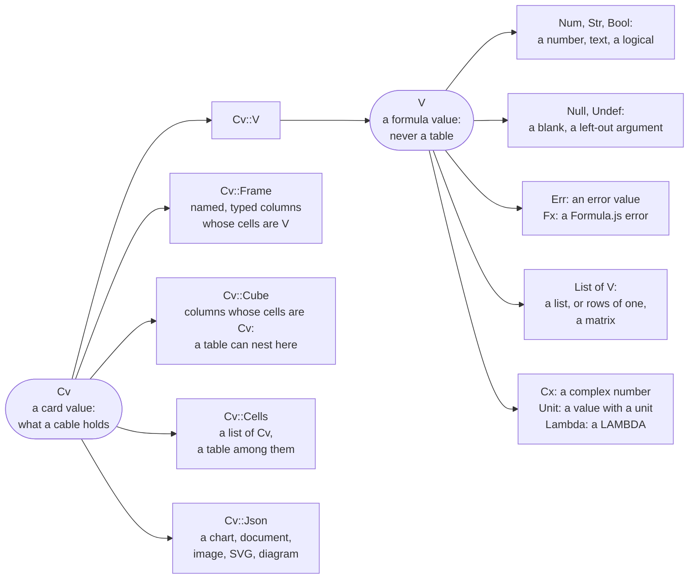
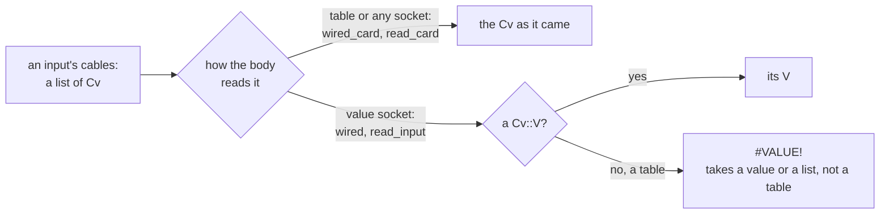
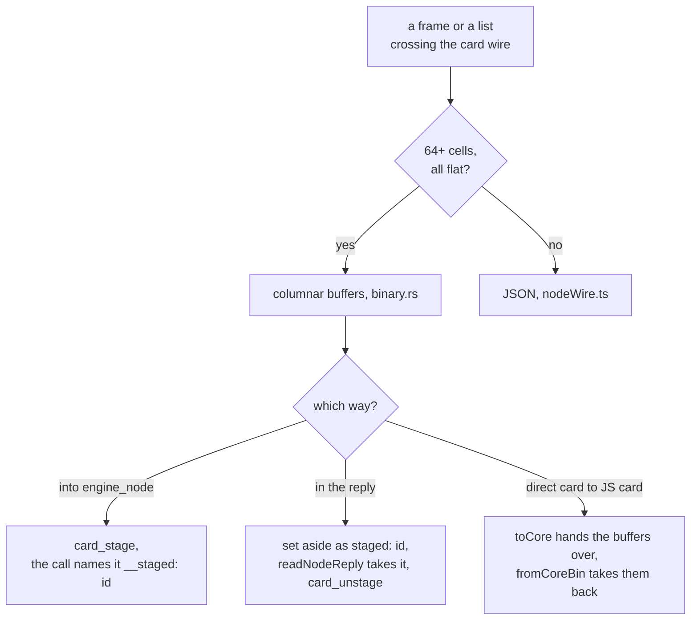
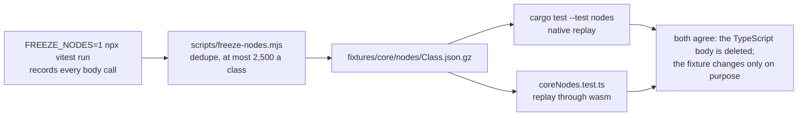

<!-- [[D102]] graphOnCore, [[D99]] rustIsSpec -->

# Spec: card bodies on the core

Serves [[D102]] graphOnCore and [[D99]] rustIsSpec. A card's body, its class's `data()`, moves into the Rust core
(`crates/solenoid-core/src/nodes/`) class by class, the way [[rust-core]] moves formulas: its answers frozen first,
then the Rust held to them, then the TypeScript body deleted.

## What moves and what stays

- **Moves:** the body, everything `data()` computes from its inputs and saved fields, and the shared readers it leans
  on (`readInput`, the broadcasters, the non-finite guard, unit arithmetic).
- **Stays TypeScript:** the class itself (sockets, saved fields, socket swaps, `formatCarry`, the component), arrival
  coercion and the error guard (the graph core's input boundary, `boundary.rs`), which run around the body as
  before; a card whose body needs the browser (a file, the network, the vault) or the canvas.

## The call (`nodeOnCore.ts`, `engine_node`)

A ported class's `data()` is `return nodeOnCore(this, inputs)`. In an editor the engine doesn't call it: such a card is
direct, and its body runs in Rust on the values already there, the call below kept in the core
([[graph-core]] § Direct calls). `nodeOnCore` is what a shell around a body, a test driving `data()` and the recorder
call. It sends:

| Field | What |
|---|---|
| `kind` | the class name, which picks the body (`nodes::run`) |
| `init`, `literals`, `stringLiterals` | what a save holds: `extractInit` and the two literal maps; `init` also carries the run-time fields the class names in `static coreFields` (Math Function's resolved angle mode), which no save keeps (`coreInit`) |
| `sockets`, `outputs` | each input's key, declared type and label, each output's key and declared type, in the card's order, and the type an adoptive socket took up where it differs (`adopted`; `Call::input_type`, `output_type`) |
| `inputs` | each wired input's values on the card wire (`nodeWire.ts`), in order |
| `clock` | `engineClock()`, for a body that reads today |

The reply is the outputs, or the error the body throws (thrown again for the error guard), beside `display`: the
fields the body sets on the card for its component (`cachedResult` and the like), which `nodeOnCore` assigns.
`cardOutputsOnCore` makes the same call and keeps only the outputs, so a card's shape hook can run its body over sample
inputs without touching what the card shows.

**The card wire** (`nodeWire.ts`; `nodes/values.rs`) is the core's value wire (`coreValue`, units included) plus what
only cards hand each other, so a body holds a card value (`Cv`) where the formula language holds a value (`V`, which
has no table, [[C15]] matricesInFormulas): a frame cell by cell with each column's unit, format and typed text
(`Cv::Frame`), a cube, whose cells are card values so a table nests in one (`Cv::Cube`), a list holding a table
(`Cv::Cells`), and plain data a card makes whole, a chart, a document, an image, an SVG or a diagram, as JSON whose
non-finite numbers, -0 and `undefined` are tagged (`Cv::Json`). A body reads a value socket with `Call::wired` and
`read_input`, where a table is `#VALUE!` ("… takes a value or a list, not a table"), and a table or any socket with
`wired_card` and `read_card`; a frame ref (a lazy verb's backend handle and plan of
ops, `{__frameRef, __plan}`) crosses the same way, since a body only extends the plan and the backend runs it
later; and a table's unit, a hidden field on the JS array
(`matrixUnitOf`), beside its cells (`{__munit, m}`; a body reads it with `Call::matrix_unit` and sets an output's with
`set_matrix_unit`, which `nodeOnCore` puts back with `withMatrixUnit`). A LAMBDA crosses as its text: `coreValue`'s `{__lambda: {params, expr, captured, capturedValues, readValues,
descriptions?}}`, its captures with their units (`capturedValues`, what a computed column and Frame Input read) beside
the values its body reads (`readValues`, unit-blind); a bare function name crosses as `{__lambda: {eta}}`, and a
closure a formula made, which has no text, can't cross. A body answers a λ with text as `{lambda: {…}}` in the same
shape (`values::serialize_lambda`), which `nodeWire.ts` rebuilds callable (`wiredLambda`: `fn` compiles the text on
first call and reads a capture naming a column from the row, [[C22]] rowFormulaRefs); a λ with no text answers
`{lambda: true}` and reads back as nothing. A reply's values (an output, a list's items, a frame's and a
cube's cells) cross bare where they can (a finite number other than -0, text, a logical), and a field the body shows that is one of its outputs crosses as that
output's key, so it comes back the same object, as the TS body left it. An output that is one of the call's inputs as it came crosses as
where it came from (`{input: [key, i]}`), so the card hands on that very object: the backend memoizes a plan's flush
and collect by its ref. Uploading a frame to the backend for a handle is async I/O and stays in the card's TS before

the call. **A big value crosses as buffers** (`nodes/columnar.rs`, `wireBinary` and `readBinary` in `nodeWire.ts`): a frame or a list of at least `BINARY_MIN_CELLS` (64) cells, every one a number, text, a logical, a blank or an error with no origin, crosses in the columnar hand-off (`binary.rs`) instead of as JSON: each column's schema entry, its typed text as a `raw` entry after it, and the frame's row total and sampling factor ride in one schema. Into `engine_node` it is staged first (`card_stage`) and the call names it `{__staged: id}`; a big answer in the reply is set aside while the reply is written and named `{staged: id}`, which `readNodeReply` takes (`card_unstage`); each call clears what the last left. Between a direct card and a JavaScript one the host's `toCore` hands the buffers over and `fromCoreBin` takes them back. A smaller or nested value, or an error carrying its origin, crosses as JSON. `cardWireBinary.test.ts` holds the two ways to the same answers. A value that can't cross (text with a lone surrogate) answers `#VALUE!` on the card. A trap answers `#ERROR!` and the module comes back as [[rust-core]] § Where it
runs says.

A table nests only inside a Cube (its cells, or a `Cv::Cells` list in one). A body reads each input one of two ways:

A value crosses the wire one of two ways ("flat": a number, text, a logical, a blank, or an error with no origin):

The core is required: the app's first render waits for it with no deadline (`main.tsx`), and every test file loads it
(`tests/setup/graphEngine.ts`).

## Freezing (`FREEZE_NODES`)

- `FREEZE_NODES=1 npx vitest run` records every body call the suite makes (`tests/setup/nodeRecorder.ts` wraps each
  class's `data()`, or its `body()` where `data()` is an async shell around one, as a lazy verb's is: the shell
  uploads a frame to the backend for a ref, the body plans over refs): the call as above, the outputs or the thrown error, the fields the body changed and what they held
  before. `tests/graph/nodeFuzz.test.ts` adds 150 calls per catalog card on random values of its socket types, with
  units on a unit-aware card's numbers. `FREEZE_NODES=ArithmeticNode,…` records only those classes.
- `node scripts/freeze-nodes.mjs [Class …]` folds the calls into `fixtures/core/nodes/<Class>.json.gz`: deduplicated,
  at most 2,500 a class, a call holding a value that can't cross counted in `.dev/node-freeze-report.json` and not
  kept. A call whose answer differed between two identical calls (a random draw, the clock) is kept marked
  `unstable` and not checked. A call whose body threw a JS exception freezes as its text (`thrownJs`) and is checked
  as the error the error guard shows for it (`from_thrown`: `#SHAPE!` for a `ShapeError`, else `#ERROR!` "This node
  failed to compute: …"), which is what the card answered. The recorder writes a call once per worker and stops a class at 2,500 distinct calls.
- A class is frozen while its TypeScript body exists; once it is deleted, its fixture changes only on purpose, in the
  commit that changes the behaviour.

## Checks

- `cargo test --manifest-path crates/solenoid-core/Cargo.toml --test nodes` replays every frozen case of every class
  with a body on the core, natively (`NODES=ArithmeticNode,…` narrows it). A field the body sets must equal the frozen
  one, or what the card held before where the frozen call left it alone.
- `tests/graph/coreNodes.test.ts` replays the same cases through the wasm module and the TS's reading of the reply.
- A case whose answer comes from host data is held by both: the zone cards' cases, frozen through Node's `Intl`, are
  replayed natively on jiff's bundled tzdb, so `tests/graph/timeZoneCards.test.ts` keeps to zones and instants on
  which the two tzdb releases agree: a zone whose future rules releases keep revising is probed only through 2024, and
  one a release rewrote (`EST5EDT` before 1967 in 2026e, Morocco and western Canada from 2026) stays out of them.
- The whole vitest suite runs the ported cards on the core.

## What has moved

| Family | Classes | Rust |
|---|---|---|
| Scalar | Arithmetic, Math Function, Base Convert, Clamp, MROUND, ROUND, GCD, Two-Input Math, SUMPRODUCT, SERIESSUM, MULTINOMIAL, Bessel | `nodes/scalar.rs` |
| Logic | Comparison, Between, Is Close, IF, Boolean Op, NOT, CHOOSE, SWITCH, IFS, ISEVEN/ISODD | `nodes/logic.rs` |
| Complex | COMPLEX, Unpack, the unary and binary ops, Power, Poly Roots, Quadratic Roots | `nodes/complex.rs` |
| Packs | Parallel Combine, E-Series, AWG, Solar Position, Sunrise/Sunset, Moon Phase, ISA Atmosphere, Antoine, Colebrook, Pipe Roughness, HR Zones, EM Spectrum, Convert, Tornado | `nodes/packs.rs` |
| Text | Text Transform, Replace, Roman/Arabic, Pad, REPT, FIXED, Truncate, CHAR/CODE, DOLLAR, Wrap, TEXTJOIN, Reverse, LEN, Split, Spell Number, CONCAT, EXACT, Similarity, Slice, URL Encode, SUBSTITUTE, Find, Hash | `nodes/text.rs` |
| Date | Date and Time Construct, Date Part, Week Info, Date Diff, Date Add, Workdays, Epoch, Date Trunc, Time Zone Convert, World Clock (its shell reads the clock into `nowMs`; zones come from `Intl` in wasm and jiff's bundled tzdb natively, `zone.rs`) | `nodes/date.rs` |
| Stats | Rank & Percentile, Correl, Standardize, Covariance, Fisher, Regression, Forecast, MODE, Frequency, Confidence, Hypothesis Test, Interpolate, LINEST, Binomial Range, PROB, TRIMMEAN | `nodes/stats.rs` |
| Finance | Bitwise, Depreciation, NPV, IRR, MIRR, FVSCHEDULE, ISPMT, DOLLAR, Discount Security, Coupon, Accrued Interest, Payment Breakdown, Duration, Bond Pricing, Returns | `nodes/finance.rs` |
| Lists | 37 list cards, Aggregate, XMATCH and Series among them | `nodes/list.rs` |
| Tables | MDETERM and kin, Table Mult, Table Unit, Diag, Outer, Solve, Eigen, MAP over a table, BYROW/BYCOL, REDUCE, MAKEARRAY | `nodes/matrix.rs` |
| Figures | Sparkline, Chart, Mermaid, Gauge, Candlestick, Merge Plots, Histogram, KPI, Proportion, Sankey, Heatmap, Surface, Waterfall, Boxplot, Calendar Heatmap, Vector Field, Chart Builder | `nodes/visual.rs` |
| Frames and cubes | Amortization, Forecast (ETS), Fit Distribution, Decompose, K-Means, Logistic, Allocator, Payoff Planner, Choice Ladder, Decision Matrix, Add Column, Get Row, XLOOKUP, Nest, Unnest, Build Cube, Cube Columns, Nest Join, Cube Rollup | `nodes/frames.rs` |
| Leftovers | the table cards that keep a unit (Table Input, Transpose, Stack, Reshape, Select, Take/Drop, EXPAND, Set Cell), IFERROR, the IS tests, Fuzzy Match, Find Peaks, Triangle Solver | their families' modules |
| Formula cards | Expression, Equation, Time Value of Money; the RAND family joined the core for them (`fns_random.rs`: `Math.random` in wasm, a seeded generator natively) | `nodes/formula.rs` |
| Misc | Combinatorics, TEXTAFTER/TEXTBEFORE, INDEX, DATEVALUE/TIMEVALUE, Regex (every JS flag), Cast, Reconcile, Build Frame, Frame from Lists | their families' modules |
| Widgets and draws | Value Input (all but dates), Slider, Color Picker, Color Blend, Angle Dial, XY Pad, Curve, Grid Painter, Point Plotter, Date Range, Constant, Input Switch, SVG Picker; RAND, Shuffle, UUID, Promo, Distributions, whose shells draw and pass the draw in `coreFields` | `nodes/widgets.rs` and their families' modules |
| Pack and frame stragglers | Resistor Color Code, Element, Molar Mass, Physics Constant, NA, TODAY/NOW, Headers, Split Frame, Group Cost Settle, Describe, Correlation Matrix, PCA, Decision Sensitivity | their families' modules |
| Plans | Schedule, Gantt, Earned Value on the scheduling crate (`crates/solenoid-schedule`); ODE Integrate; SCAN | `nodes/sched.rs` |
| Documents | Display, Alert, Expect, Format Controller, Template, Frame Input, Record; their number text, card plans and record layouts on `card_helpers.rs` | `nodes/docs.rs` |
| Lambda and draws | LAMBDA (its shell keeps the last λ while its text and captures stand, since consumers memo on identity), RANDARRAY (its shell draws the rolls the body asks for, `coreFields` `rolls`), QR Code (the symbol is the `qrcodegen` crate's at exactly the medium level, one segment per text; the payload and the SVG are Solenoid's; `fixtures/core/qr-encoder.json.gz`, frozen by `tests/qr.rs`, which reads every symbol back to its text with the `rqrr` decoder) | `nodes/lambda.rs`, `list.rs`, `nodes/qr.rs` |
| Lazy frame verbs | Distinct, Head, Frame Sort, Frame Filter, Columns, GROUPBY (no totals, no cube), Unpivot, Rename, Split Column, Add Index, Fill Blanks, Replace Values, Merge Columns, Drop Blank Rows, Window, Get Column, SUMIFS: each body extends a frame ref's plan or runs a value's verb, the shell uploads a value first and reads a ref's columns for Get Column and SUMIFS | `nodes/verbs.rs` |
| Computed columns | Computed Column (over a value, and the placing of a column the backend computed over a frame ref; the shell runs the ref's formula and assembles the answer), Cube Input (its formula columns; the shell reads the source text into a cube); Frame Input's unit plan lives here too | `nodes/columns.rs` |
| Backend frame verbs | Join, Append, Bind Columns, Table Size, Slicer, PIVOTBY: Join, Append and Bind Columns answer the join or the inputs to stack for the shell to run, or one frame passed on; Table Size counts a zero-row preview the shell reads or takes; Slicer and PIVOTBY over a ref answer the columns they read and are called again with them; PIVOTBY shows its layout (`pivotWire`) for the shell to keep beside the frame and answers the frame's column names (`fieldNames`), to which the shell prunes the saved fields | `nodes/backend_verbs.rs` |
