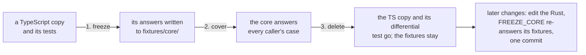
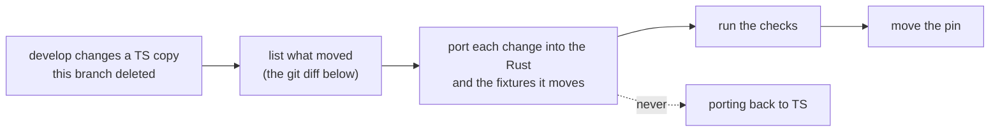
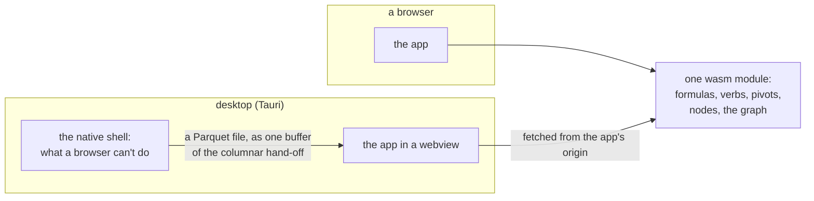

<!-- [[C130]] rustCore, [[D99]] rustIsSpec -->

# Spec: the Rust core

Serves [[C130]] rustCore and [[D99]] rustIsSpec. `crates/solenoid-core` is Solenoid's headless core (it began as a port of the TypeScript one), built for two targets: WebAssembly for the app, linked into the graph engine's module (`npm run build:wasm` writes `src/graph/engineWasm/`, [[graph-core]] § The module), and native for tests (`npm run test:core`). The method is borrowed from [tsrs](https://github.com/oxc-project/tsrs).

## The rule: the Rust is the spec ([[D99]] rustIsSpec)

- The core is the one implementation. A change in behaviour is made in the Rust, together with the fixtures it changes, in the same commit.
- The port began as a mechanical copy of the TypeScript, so the Rust keeps the TS's names (in snake_case) and order of operations wherever a fixture depends on them.
- Moving a TS copy onto the core:
  1. Freeze: the TS's answers on its tests' inputs are written to fixture files (`fixtures/core/`).
  2. Cover: the core answers every case the copy's callers make.
  3. Delete: the TS copy and its differential test go, and the fixtures stay as the test. `FREEZE_CORE=1` re-answers every suite's frozen cases on the core and writes them back (`FREEZE_CORE=frame-fns,columns` only those), which is how a deliberate change in behaviour moves a fixture.



- Gone so far: the graph model, the dataflow engine, the compute pass and its state, the error guard and arrival coercion, the socket lattice, the Type Settle and Conduit lanes, the format-annotation walk, the Format Controller reconcile and the text save form (into the graph module, [[graph-core]]), the scheduler ([[schedule-and-gantt]]), display formatting, typed-text reading, the data providers' parsing, the formula evaluator, the parser, every function body and Formula.js, the computed-column row path, the pack functions' JavaScript, the JS frame verbs and their backend, the node bodies ([[node-bodies]]), the statistics kernels (`statsOps.ts`) and the table popups' footer profile. The TS keeps the editor's walkers over the core's tree (variables, LaTeX, steps) and the op modules the components and the canvas still read.
- The JavaScript semantics the frozen answers carry stay ported, because they decided those answers:
  - `String(x)`, `Number(x)`, `trim` and UTF-16 string order, in `jsnum.rs`.
  - `Array.prototype.sort` that never panics on an inconsistent comparator, in `js_sort.rs`.
  - `toPrecision`, in `unit_value.rs` (17 correctly rounded digits decide the cut unless they read as a possible tie, and Clinger's fast path turns them back into a number); `toFixed` and `toExponential`, exact ties rounding up, in `jsnum.rs`.
  - V8's `Math.hypot` (Kahan-compensated), and V8's `Math.exp`, `log`, `log10`, `log1p`, `pow`, `sin`, `cos`, `tan`, `asin`, `acos`, `atan`, `atan2`, `acosh` and `atanh`, in `fdlibm.rs`. These are fdlibm with V8's own tweaks, because the platform libm is off by an ulp on some inputs.
  - A JS exception (a function that throws) ends the row's evaluation.
- A function's dispatch facts, argument roles and empty-slot readings live in `data/call_traits.json` (first frozen from the TS's call table; the tests read it through `tests/graph/callTraits.ts`). The names the editor offers come from the core (`engine_function_names`); the TS keeps only each name's arity and signature hint (`excelFunctions.ts`, `formulaSignatureTable.ts`).
- Correctness rests on the conformance checks, not review:
  - `tests/graph/coreConformance.test.ts` replays the frozen answers in `fixtures/core/`: every function body on random and edge arguments, 18k formulas over values, 15k computed columns, 12k verb pipelines, 6k parser trees (checked against the TS parser on all 49k formulas the fixtures hold before it went), 3k pack calls; V8's `Math` is checked live, and `corePlatform.test.ts` holds UNACCENT to Node's NFD and a caseless backreference to V8.
  - Every test file loads the core (`tests/setup/graphEngine.ts`), so the hand-written suite's formulas check the Rust evaluator too.
  - `npm run test:core` runs the frame-verb corpus (`fixtures/frame-verbs`) natively.

## Tracking develop



Pinned upstream: `develop` @ `c7da52b`.

`develop` still runs the TypeScript copies this branch deleted. On each merge of `develop`, list what moved in them, port each change into the Rust (and the fixtures it moves), run the checks above and move the pin. Nothing ports back: the TS copies here are gone, and a file this branch deleted stays deleted. A change to a node's `data()` in `src/graph/nodes/` is ported into its Rust body ([[node-bodies]]), and a new node or computation lands there too.

```
git diff c7da52b..develop -- src/graph/frameVerbs.ts src/graph/frame.ts src/graph/frameBackend.ts \
  src/graph/valueKinds.ts src/graph/stringOrder.ts src/graph/unitValue.ts src/graph/pivotLayout.ts \
  src/graph/excelFormula.ts src/graph/excelFunctions.ts src/graph/inputRoles.ts src/graph/emptySlots.ts \
  src/graph/computedColumnCore.ts src/graph/formulaExtensions.ts src/graph/packs src/graph/nodes/statsOps.ts \
  src/graph/nodes/mathUtils.ts src/graph/nodes/dateOps.ts src/graph/nodes/dateSerial.ts src/graph/excelCriteria.ts \
  src/graph/nodes/textOps.ts src/graph/csv.ts src/graph/financeUnits.ts src/graph/nodes/settleOps.ts \
  src/graph/nodes/payoffOps.ts src/graph/nodes/financeOps.ts src/graph/nodes/listOps.ts src/graph/nodes/fitOps.ts \
  src/graph/nodes/hashOps.ts src/graph/nodes/chartOptions.ts src/graph/cxValue.ts src/graph/describeProfile.ts \
  src/graph/nodes/visualOps.ts src/graph/nodes/mlOps.ts \
  src/graph/nodes/signalOps.ts src/graph/unitLattice.ts src/graph/nodes/matrixOps.ts src/graph/nodes/allocateOps.ts \
  src/graph/nodes/distributionOps.ts src/graph/nodes/forecastOps.ts src/graph/nodes/triangleOps.ts \
  src/graph/nodes/coerce.ts src/graph/nodes/indexAccess.ts src/graph/nodes/astroOps.ts src/graph/nodes/emSpectrumOps.ts \
  src/graph/nodes/convertUnits.ts src/graph/dimension.ts src/graph/timeZone.ts fixtures/frame-verbs
```

A Formula.js bump on `develop` changes nothing here: its bodies were ported once and the Rust is their spec.

The last merge (`c7da52b`, 2026-10-24) found every formula, card and verb fix already mirrored; most began on this branch. What it brought: Pele draws Mermaid in place of mermaid.js (UI, taken as is), and Describe's Dashboard tiles ([[C129]] describeDashboard), a TS profile on develop (`describeProfile.ts`) that here is Describe's body on the core (`describe_tiles`, `nodes/frames.rs`): shown as `describeTiles` and kept beside the summary frame by the class's `coreWatched`.

## What runs on the core

| Surface | Where | Evidence |
| --- | --- | --- |
| Frame verbs, joins, appends, binds, PIVOTBY | the core in wasm, on the web and desktop alike, units and formats included: a frame's columns carry them into the core and each verb decides its own | the corpus natively; frozen verb pipelines; the verb tests through `tests/graph/coreVerbs.ts` |
| A cube's row verbs (sort, filter, distinct, head, window) | the node bodies (`nodes/verbs.rs`): the scalar columns run through the frame verb, which answers the rows they keep or the window's column, and the nested cells ride along by them; list conditions read the nested cells | the frozen node cases (`fixtures/core/nodes/`) |
| The formula parser, for the evaluator and the editor (`parseFormula`, `engine_formula_parse`) | `excel_formula.rs` | 6k frozen trees (`formula-trees`) |
| The evaluator (`Eval`): operators, broadcasting, argument roles, the IFERROR family, `route_call`'s ladder, LAMBDA values, MAP BYROW BYCOL REDUCE SCAN MAKEARRAY GROUPBY | `eval.rs` | 18k frozen formulas; the whole suite |
| Every function body in the registry | `excel_functions.rs` and the `fns_*.rs` modules; dates read the host's zone and IANA zones through `zone.rs` (`Intl` in wasm, jiff's bundled tzdb natively, with the names only ICU takes mapped beside it) and text dates through `date_parse.rs` | the frozen function-body cases |
| Computed columns: whole columns as one-column tables, `@name`, side values of any shape, wired LAMBDAs and their captures | `eval::column`, `engine_compute_column` | 15k frozen columns |
| The Expression card and every `compileEvaluator` | `evaluateOnCore` (`coreValues.ts`) | as above |
| The dataflow engine, the compute pass (its walks, seeding, invalidation, fetch and render set) and its state (calc mode, dirty flag, recalc generation, rebuild scopes, single flight), node and cable ids | `crates/solenoid-graph` on Ruggine, in the same wasm module ([[C130]] rustCore, [[graph-core]]) | Ruggine's oracle against rete-engine; `dataflowEngine.test.ts`; the session's native tests; the whole suite |
| The input boundary every node's call goes through: the error guard and arrival coercion ([[compute-pass]] § The per-node wrappers) | `boundary_core.rs` over core values for a card whose body is on the core, called in Rust ([[graph-core]] § Direct calls); `boundary.rs` over the app's JavaScript values for every other card | the frozen boundary answers (`boundary-*`, `coreBoundary.test.ts`); the whole suite |
| Node `data()` | the node bodies ([[node-bodies]]); a body over a list runs its loop on the core | `fixtures/core/nodes/` ([[node-bodies]]); each family's tests |
| Frame computations no formula shares: headers, Describe, Correlation Matrix, Reconcile, Nest's grouping, XLOOKUP over a frame, Get Row, Get and Add Column's naming, Build and Split Frame, Frame from Lists, the Decision Matrix and its flip points, the Allocator, the Payoff Planner, the Choice Ladder (its plan, and its ladder beside it as `ladder_from_wire` lays it out), Group Cost Settle's totals and its ledger, Amortization, K-Means, PCA, logistic regression. A thrown error crosses as itself; a card with several outputs gets them side by side in one frame | `frame_fns.rs`, `decision.rs`, `planners.rs`, `ladder.rs`, `engine_frame_fn`, `frameFnOnCore` (`frameBackend.ts`) | the frozen frame-function cases |
| A pack's formula functions (ELEMENT, SUNRISE, ESERIESVALUE and kin), always known, advertised only while their pack is on | `fns_packs.rs`, over the cards' kernels (`nodes/packs.rs`); a pack's TS declares each one's name, arity and hint (`packs/*Formulas.ts`) | 3k frozen pack-call formulas (`pack-calls`) |
| A formula's unit reading ([[unit-flow]] § Formula dimensions, § Expression): its result dimension (`dim_eval_with_code`) and its point weight over readings (`affine_weight`), for every caller: Expression, the LAMBDA folds, a computed column's unit plan (`plan_column_units`, Frames and Cubes alike, its named LAMBDAs crossing as `fns`) and Equation. A caller with no formula text (Equation's isolated side) sends its tree, as the TS `Ast` object (`Ast::from_json`) | `unit_dims.rs` (a finance call's money through `finance_units.rs`, [[C25]] firstClassUnits); `engine_dim_eval` and `engine_affine_weight` are the conformance suite's way in | 18k frozen formula dimensions (`unit-dims`), 6k through named LAMBDAs (`unit-dims-fns`), 17k frozen weights (`affine-weights`), each replayed as text and as a tree |
| Expression's unit wrapper ([[unit-flow]] § Expression) once its inputs are read: the dimension check, the one shared display unit the formula runs in, the point weight over readings, the inputs in their shown magnitudes (`displayMagnitudeOf`), the evaluation and the result's unit. Each cell's display unit crosses with its dimension beside its scale and offset (`displayDim`) | `unit_expression.rs`, called by Expression's body on the core (`nodes/formula.rs`, [[node-bodies]]) | 6k frozen Expressions over generated unit inputs (`expression-units`) |
| REDUCE, BYROW and BYCOL's unit wrapper ([[unit-flow]] § LAMBDA hosts) over an inline formula: the cells' one dimension, the display unit they share, the fold on the stripped magnitudes, the point weight over readings and the result's re-tagging | `unit_fold.rs`, called by those nodes' bodies (`nodes/matrix.rs`, [[node-bodies]]) | 5k frozen folds over generated unit tables (`fold-units`), also replayed through the nodes' `data()` |
| List bodies over values with a unit (`UNIT_READY`): the ones that move cells without reading them, the shapers SORT, SORTBY, UNIQUE, TAKE and DROP (a unit cell sorts after the logicals and ties with its kind; UNIQUE keys it by base magnitude at 15 digits and dimension), FILTER (a unit cell as a condition is `#VALUE!`), and RUNNING, which reads each cell's display unit from the wire (its scale and offset as the TS resolves them) | `V::Unit`, `unit_lists.rs`, `coreValue(v, true)` and `readReply` (`coreValues.ts`) | 4k frozen calls (`unit-lists`), 5k frozen shaper calls (`unit-shapers`), 4k frozen FILTER calls (`unit-filters`), 6k frozen RUNNING calls with and without units (`unit-running`) |
| The graph's derived state: the socket lattice, the Type Settle with Conduit lanes, the format annotations, the Format Controller reconcile, the walks through Conduits, and the text save form | `crates/solenoid-graph` (`lattice.rs`, `settle.rs`, `annotate.rs`, `fc.rs`, `conduit.rs`, `text_form.rs`; [[graph-core]] § Phase D, § Phase E) | the frozen lattice, settle, annotation, reconcile, Conduit-walk and text-form answers (`fixtures/core/*.json.gz`) |
| Display formatting ([[C118]] formatTravelsWithValue) and typed-text reading ([[C58]] tableInputRawText): a number as the General style or a format annotation shows it, a date serial in a pattern, a typed number or logical | `card_helpers.rs`, `value_kinds.rs`, through the module's `fmt_scalar`, `fmt_annotated`, `fmt_date`, `read_decimal`, `read_logical` ([[format-model]]) | the frozen number formats (`number-format`, `coreCardHelpers.test.ts`) |
| The data providers' replies (Open-Meteo, Nager.Date, Frankfurter) read into their cards' outputs; the cards fetch and cache the text | `providers.rs` | the frozen provider readings (`providers`, `coreProviders.test.ts`) |
| The project scheduler: CPM, calendars, the schedule file formats | `crates/solenoid-schedule`, linked by the core ([[schedule-and-gantt]]) | its own native tests |
| CSV text, on the `csv` crate: the rows under each option, a file's typed frame (`csvToFrame`), a Frame Input's CSV text, and the Sink's CSV ([[frame-verbs]] § Reading CSV text). A 50 MB file reads into a typed frame in about 1.7 s in Node, from 4.1 s on Papa Parse and `inferColumn`; its rows alone in about 1.1 s | `csv.rs`, `engine_csv_frame` and `engine_csv_rows` (the columnar hand-off), `engine_csv_source`, `engine_csv_text` | 11k frozen row readings, 2.9k frozen frames and as many Frame Input sources, 800 frozen writes (`csv-*`, the core's own answers), over generated CSV and the repo's own files |

## Nothing falls back

The core is the only evaluator. A reading it doesn't make is an answer, never a hand-off: text outside the date reader's closed list of shapes is not a date (DATEVALUE answers an error, a criterion compares it as text); a loop past a cap, a value nested past a table and a regex past the core's limits answer an error that says so; a name the core doesn't know is #NAME?. Text crosses well formed: a lone surrogate reads as U+FFFD at the boundary (`toWellFormed`, `coreValues.ts`). A formula over a value with a unit it doesn't take is #VALUE! (the cards run their unit wrappers on the core, `unit_expression.rs` and `unit_fold.rs`). A wired LAMBDA crosses with the captures its body reads (`readValues`: the numbers they show, or a computed column's unit plan's magnitudes) and, beside them, the same captures with their units (`capturedValues`), which the core's unit plan (`nodes/columns.rs`) reads.

## Where it runs




- **Everything:** formulas, computed columns, frame verbs, pivots and nodes run on the core in wasm on every platform, desktop included: one build, one answer ([[C130]] rustCore). The app's chrome renders while it loads; the canvas waits for it (`useCoreReady`, [[graph-core]]), since the nodes run on it ([[node-bodies]]). At 4 Mbps that brings the chrome up at about 3 s where it waited about 13 s for the whole module. A `<link rel="preload">` for the module (measured 2026-10-25) brought the cards about 6% sooner at 40 Mbps but held the chrome back half a second at 4 Mbps, sharing the link with the entry scripts, so the module loads when the scripts ask for it. The desktop shell adds only what a browser can't do; for Frames that is reading a Parquet file (`crates/solenoid-parquet`, [[frame-verbs]] § Reading Parquet). Its webview fetches the module from the app's own origin, so the CSP's `connect-src` carries `'self'` (`tauri.conf.json`, `desktopCsp.test.ts`). The 1.5.0-era `.deb` was 24 MB with Polars; on the core alone it is 18 MB.
- **Speed** (2026-10-23, one chain of filter, computed column, group with sum, mean and median, join to a 1,000-row lookup, sort; the frame already resident): at 1M rows 160 ms in wasm under Node and 210 ms natively. Polars, as the desktop ran it, took 1.17 s, nearly all of it the computed column's round trip out of Polars and back (its verbs alone were 60 ms, the core's 90 ms in wasm). Reopen [[C130]] if a Frame people open is slow in wasm.
- **Size**: the core is wasm32, so everything it holds at once (the frames the verb backend keeps, the values on cables, a verb's working copies) shares one 4 GiB memory, on desktop as on the web. A cell costs 16 bytes there, plus its text for a text cell, so a frame of a few tens of millions of cells fits and a hundred million is near the edge; the JavaScript side's own copy lives outside it. Running out traps (below). Polars kept a desktop frame native with no such ceiling; reopen [[C130]] if a Frame people open runs out. A Parquet file crosses from the shell as one buffer of the columnar hand-off (`Columnar::to_bytes`, `binaryFromBytes`), not JSON.
- **A trap** (an abort, a stack overflow, anything escaping the module mid-call) leaves the instance's stack pointer where it stopped, so the instance is dropped and the compiled module instantiated afresh, the graph with it, as [[graph-core]] § Traps says; the core numbers its handles past the dead one's (`engine_handle_base`). The call that trapped answers #ERROR! (`onCore`); a frame the verb backend held in the dead instance is gone, so a verb over it answers #REF! until the document reloads. `engine_trap` is the tests' trigger (`coreTrap.test.ts`).

## Performance (200k rows × 5 columns, Node, best of 3)

Run it with `BENCH=1 npx vitest run tests/graph/wasmEngineBench.test.ts` (2026-10-23).

- A verb row is the op plus a 100-row preview, with the frame already in wasm.
- An fx row includes uploading its columns and downloading the answer.
- Frames cross as columnar buffers: uploading 200k rows takes about 55 ms, a full download about 70 ms.
- **A name dispatches as text** below `call_function` (`route`, then each module's `match`), and stays so: ABS answers in 22 ns natively, lookups included, and a body's own work is most of a slower function's time (PERMUTATIONA, first in its module's match, takes 129 ns; 2026-10-25). A name's per-call facts are resolved once into `Traits.fast`, and a card reads its options into an enum or a function once per call, never per item ([[C120]] linearWork).
- Run to run the times move by about 20% on a shared machine. `examples/colbench.rs` counts a formula column's instructions natively under callgrind, which doesn't move.

| op | ms |
| --- | ---: |
| sort by a number | 28.8 |
| sort by text | 76.9 |
| filter value > 0 | 6.3 |
| filter text contains | 4.8 |
| distinct key | 3.9 |
| group by key: sum, avg, median | 24.8 |
| window: cumsum by cat over day | 56.0 |
| window: rank by cat | 62.8 |
| pipeline: filter, group, sort | 22.0 |
| left join a 1000-row lookup | 18.7 |
| fx: `@value / SUM(value)` | 64.3 |
| fx: `@value * 1.2 + @cat` | 35.6 |
| fx: `IF(@value > 0, ROUND(@value * 1.2, 2), 0)` | 113.9 |
| fx: `@key & "-" & UPPER(@key)` | 119.8 |
| fx: `IFERROR(LN(@value), 0) + MAX(@cat, 10)` | 107.5 |
| fx: `IF(@value > PERCENTILE(value, 0.9), "top", PROPER(@key))` | 217.4 |
| fx: `SUMIFS(value, key, "k1*") + DATEDIF(45000, 45000 + @cat, "md")` | 224.5 |

Before the JS verbs went, the same ops ran 1.3 to 5 times slower on them.

## Follow-ups
- **Load time is the module's bytes.** A `<link rel="preload">` for the wasm was measured and dropped (2026-10-22): under 4 Mbps throttling the first render came 0.4 s later, since the wasm then shares the link with the entry scripts the render also waits for. What would move it is a smaller module, or a first render that doesn't wait for the core. Size against speed was measured too (2026-10-22): rustc's `opt-level = "z"` cuts the module from 860 KB to 650 KB gzipped but runs formula columns 1.5 to 3 times slower; `"s"` saves 11% for about a third slower; `wasm-opt`'s level moves it under 1%. Re-measured on the one module (2026-10-25): `opt-level = 2` is 6% smaller than 3 (1.26 MB against 1.31 MB with brotli) and runs the same, within 5% either way on every verb, formula column and pass benchmark, so it is 2. Per-dependency levels change nothing under LTO. What's big after rustc: the dispatch functions `wasm-opt` inlines into, `.rodata` (the call table's JSON among it) and serde's derive for `FrameOp`.
- **A function call costs about 1,100 to 2,000 instructions a row** (`ABS(@value)` 1,140, `PROPER(@key)` 1,820, `ROUND(@value, 2)` 2,000), against about 490 for an operator (`@value * 1.2`), counted natively by `colbench` under callgrind. A name resolves once: `route` (`excel_functions.rs`) gives it its arm of `call_function`'s match (an `F`) or the module that holds its body, and the call path's per-name facts (eta host, LAMBDA host, memo shaper, branch selector, ported) sit in its `Traits` as `fast`, so no string is compared per row; that cut `ABS` from 1,440. What's left is spread thin: each call's argument vector, the call site's cache lookup, the column lookup by name.
- **One file.** The module loads whole, not split into pieces loaded on first use: no part of it is more than about 7% of the total, so splitting would save little, and the first screen already waits only on what drawing the graph needs.
- **Size.** The module is 4.6 MB raw / 1.7 MB gzipped / 1.26 MB brotli, what a browser downloads (2026-10-25, the pack functions and the graph core in) after `wasm-opt -O3` (`scripts/build-wasm.mjs`), every function body, the evaluator, the unit dimension algebra, V8's `Date.parse` and the full NFD table included. HASH's digests and base64 run on `md-5`, `sha1`, `sha2`, `crc32fast` and `base64` (20 KB gzipped; `hash_ops.rs` keeps the FNV-1a lines and base64's whitespace, URL-safe, padding and byte-order-mark rules), the hash maps on `rustc-hash`. `regress` is vendored in `crates/vendor/regress` with two patches. Its non-Unicode Canonicalize (`fold_code_point`, which a caseless backreference compares by) reads as V8's: a non-ASCII unit never goes to ASCII (`ſ` and `s` don't match each other), and a unit whose full uppercase is two units stays itself (`ᾳ` and `ᾼ` don't), from a 102-unit table taken from V8 (`corePlatform.test.ts` checks every BMP unit against V8). The `no-property-escapes` feature: `\p{…}` parses only in Unicode mode, which Solenoid never uses, and refusing it drops the property tables (82 KB gzipped). The case-folding tables stay. UNACCENT and SLUGIFY decompose through `nfd_table.rs` (`scripts/gen-nfd-table.mjs`, from Node's own NFD, every code point, combining classes read off its reordering; 19 KB gzipped) instead of `unicode-normalization`. Size modes (`opt-level = "z"`) cut it by a fifth but halve the speed, so they're out. Ops arrive as `TaggedOp`, which reads the TS's `{ kind, ... }` as serde's external tagging, because the derived internally tagged form was the largest function. What's left is spread thin: `call_function` (53 KB before opt), the pivot, the command dispatcher.
- **Text is always well formed**. A slice or match that halves a surrogate pair answers U+FFFD for the half (`from_utf16` in `excel_functions.rs` and `text_ops.rs`), and text holding a lone surrogate reads as U+FFFD where it crosses into wasm, whose strings are UTF-8 (`toWellFormed`, `coreValues.ts`; `coreSurrogates.test.ts`): `LEFT(t,2)&RIGHT(t,2)` over `"a😀b"` answers `a��b`, and Distinct merges two lone halves into one U+FFFD. The rule has no leaf yet.
- **CI** runs each crate's own tests (`engine-test.yml`, jobs `core`, `graph`, `schedule` and `parquet`), and `wasmStamp.test.ts` fails when the module's sources changed without `npm run build:wasm` (the build writes `source-stamp.txt`; [[graph-core]] § The module).
- **A card mapping a body over a list runs its loop on the core** ([[C120]] linearWork): over 50,000 items UPPER takes about 30 ms (develop: 23), ROUND about 36, ISEVEN about 27 (`BENCH=1 npx vitest run tests/graph/cardBatchBench.test.ts`). A wired LAMBDA's captures: a list of 64 or more crosses once and the core holds it by id while the JS list lives (`envValue` in `coreValues.ts`, `HELD` in `eval.rs`), and `engine_eval` keeps its last 16 formulas parsed with their range memo (`eval::formula`), so `x - AVERAGE(vals)` over 3,000 items reads `vals` once: about 50 ms, from 1.9 s (develop: 8 ms).
