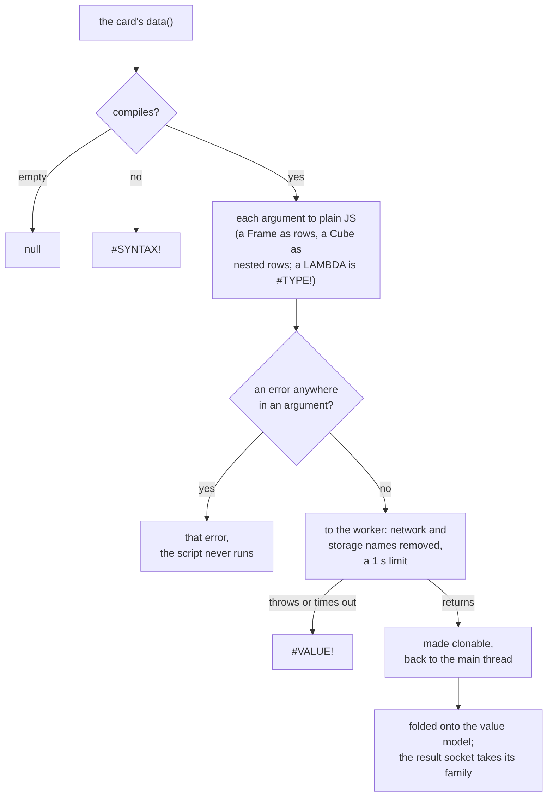

<!-- [[C66]] scriptNode, [[C24]] arraySemantics -->

# Spec: Script sandbox

Serves [[C66]] scriptNode. It covers what the system does and blocks, and the decision each behavior serves.

The Script card runs a user-written JavaScript function on its inputs. Each parameter becomes an input socket, the arguments are converted to plain JavaScript, and the returned value is folded back onto the app's value model, where it types itself. The function runs inside a Web Worker, a separate background thread with the input and output routes removed, so a runaway or careless script cannot freeze the app or reach the network.

The node is named Script, not Code, because CODE is an Excel function ([[B16]] oneFormulaSurface). A script declares no result type, unlike Expression's Number / Text / Date / Auto switch: a JavaScript value says its own type, where a formula does not say what it returns.

| File | Role |
|---|---|
| `nodes/script.ts` | The card: sockets from the function's parameters, arguments in, result out |
| `nodes/scriptRun.ts` | The evaluator: parse, compile, call, make the result clonable |
| `scriptWorker.ts` | The worker: removes the input and output routes, then answers calls |
| `scriptExecutor.ts` | The main-thread client: one shared worker, the call queue, the time limit |
| `nodes/scriptCoerce.ts` | Converts the arguments to JavaScript and folds the returned value onto the value model |

## The source

The source is stored in the card's `expr` field, the same persistence key Expression uses, and edited through `applyScriptChange`, which follows Expression's edit path. It must be a single function expression: `(a, b) => …`, `a => …`, or `function name(a, b) { … }`, optionally `async`, optionally after leading `//` or `/* */` comments. `scriptParams` reads its parameter list:

- Each parameter must be a plain name, not a destructured or defaulted one, and not a reserved word: "Parameters must be plain names, not "…"". A parameter becomes an input socket, and a pattern has no single name to show.
- A name may appear once: "Parameter "…" appears twice".
- A source with no recognizable function head reads "Write a function: (x) => x * 2".

On each commit `_rebuild` adds a `trueany` input for each new parameter and returns the departing ones, so the caller drops their cables before removing the sockets ([[input-cable-pruning#The ordering rule]]).

`compileScript` evaluates the source with `new Function("Solenoid", "\"use strict\"; return (…);")`. A result that is not a function reads "Write a function: (x) => x * 2". Compiled functions are cached by source text; the cache clears when it passes 64 entries.

The one global a script sees is `Solenoid`, frozen, with a single method. JavaScript values already type themselves (a number is a number, a string is text, a `Date` is a date); the one thing a JavaScript value cannot say is "this number is a date serial", so `Solenoid.date(serial)` says it. It maps over lists, passes `null` and a `Date` through unchanged, and tags anything else as `{ __solDate: v }`; the coercer later checks that the tagged value is a finite number.

`scriptIsVolatile` scans the source for `Math.random`, `Date.now`, `new Date()`, `crypto.getRandomValues`, `crypto.randomUUID` and `performance.now`. A match means each run can differ, so the card shows a Recalculate button ("Run the script again", which is F9) and holds its answer between recalculations ([[C23]] calcModes): the card keeps the result with the recalc generation, the source and the converted arguments it ran on, and a later call with all three the same returns it without running the script. A new generation (F9, Recalculate, the other `requestRecalc` entries), an edited source or a changed argument runs it again; arguments compare by value, cell by cell, so an upstream recompute that hands over the same values keeps the held answer, and a script showing the time shows the time of the last F9. Every outcome is held, an error included; a waiting foreign script (below) holds nothing, so Run starts it fresh. A script the scan passes over is not held: it gives the same answer for the same arguments, so a rerun changes nothing. Only volatile sources are held because the leaf asks for draws and clocks, not for every script; holding all would be a speedup, not a rule. The scan reads text, not meaning, so a renamed alias escapes it and a string can match falsely: a missed source runs on every recalculation with no button, and a false match only holds an answer that would not have changed.

Tests: `script.test.ts`: `scriptParams` reads the arrow, bare-arrow, function and async heads, a head after a leading line or block comment, and refuses a non-function, a destructured or defaulted parameter, a reserved word and a repeated name; `scriptIsVolatile` spots each volatile global and stays quiet on a pure script and on a `Date` built from the arguments; a volatile script keeps its answer through a pass with the same inputs, a forced pass included, draws anew on F9, and runs again when an input or its source changes, a clock reading held the same way; a new card carries the default script and its one input; `_rebuild` reports the added and departing names and keeps the rest; the source and both literal maps survive a save, and a parameter named like a saved field keeps both through a paste.

## One call

1. The card's `data()` returns null for an empty source, and `#SYNTAX!` with the compile message when the source does not compile. The main thread checks the syntax too, for immediate feedback on the card: `checkScript` builds the `Function` and never calls it, because calling it evaluates the source, and a source that only opens with a function head (`x => x, (code), x => x`) would run its code on the main thread whenever a document holding the card is checked or loaded. Only the worker runs a script, so "Write a function" for a source that isn't one comes from the worker.
2. Each parameter's argument is its cable's value, or the typed literal when unwired, converted to plain JavaScript (`scriptArgToJs`, below). A parameter is a value slot (`autoLiterals`), so an unwired one takes a typed number or text; exactly one of `literals` and `stringLiterals` holds it, because the inline field clears the other. An unwired input with nothing typed is `undefined`; a wired blank is `null`.
3. An error anywhere in an argument, at any depth (a list cell, a row cell, a converted Frame row), becomes the result without running the script ([[C24]] arraySemantics at cell grain; the engine's error guard sees only whole-value errors).
4. `executeScript(src, args)` sends `{ id, src, args }` to the worker, with a fresh request id per call, and starts the timer.
5. In the worker, `invokeScript` compiles (cached) and calls the function, awaiting a returned promise. A throw is `#VALUE!` with `Name: message`; a compile failure is `#SYNTAX!`. The card shows the message under the source field.
6. The return value is passed through `toClonable` so it can cross back to the main thread. Functions and symbols become an `__unclonable` marker, as do `Map`, `Set` and anything nested more than 7 levels deep; typed arrays become plain arrays. The depth limit clears the deepest legal shape (cube rows holding frame rows holding lists) with a level to spare.
7. On the main thread, `coerceScriptResult` folds the value onto the value model (below). The result socket takes the type of the value it carried, as every wildcard output does ([[socket-lattice]] req. 9): a list's family at the combo rung, a table at its matrix, a frame or cube as itself. A result with nothing to read (an empty list, all blanks or errors) keeps the last type ([[D117]] emptyKeepsLastType).

Tests: `script.test.ts`: building the card, as loading a document does, never runs its source; scalars, lists and matrices arrive as plain values; a wired blank is `null` and an unwired, untyped one `undefined`; an unwired parameter takes its typed number or text; an error cell in any argument, a Frame's included, becomes the result unrun; an empty source is blank, a broken one `#SYNTAX!` and a throw `#VALUE!` with its message; the result socket takes the carried value's type and keeps it through an empty answer; `toClonable` marks what cannot cross and flattens typed arrays; `invokeScript` awaits an async function; the card's cached result mirrors the answer and its error message clears on a success.

## The arguments

Frames and Cubes go into and come out of a script, though a formula keeps them out ([[C15]] matricesInFormulas): Script is the advanced surface, and there is no good reason for the same limit there. This is [[C66]] scriptNode.

`scriptArgToJs` hands the script the same shapes it can return, so what one script emits another can read:

- A Frame becomes an array of `{name: value}` rows. A lazy Frame, or a head-N preview, is collected in full first (through the preview's `__ref` handle), never silently truncated. A date column's cells become JavaScript `Date`s (UTC midnight for a whole day), as does any input whose settled type is a date, so a date never reaches a script as its serial ([[C137]] datesNeverSerials); a `Date` the script returns comes back a date. Unit-locked columns stay their typed magnitudes, since that is how the cells are stored.
- A Cube becomes rows whose cells may hold nested rows (a nested Frame or Cube) or lists. A unit cell unwraps to its display magnitude, so Script is unit-blind. Nested Frames are assumed materialized, as Cubes are built.
- A LAMBDA, a chart or a document has no script form: `#TYPE!` "A script reads data values; a lambda has no script form" (or a chart, a document), before the run.
- Everything else passes through unchanged.

Tests: `script.test.ts`: a Frame round-trips through a script as rows; a Cube arrives as rows with nested rows and lists in its cells; a LAMBDA is `#TYPE!` before the run; a date column and a date-typed input arrive as `Date`s and come back as dates.

## The result

`coerceScriptResult` accepts four shapes: a scalar, a list, rows of values (a list of lists), or `{name: value}` row objects. A row object is any plain object that is not a `Date`, an error, a `Solenoid.date` tag, a complex number or an unclonable marker.

**Each cell** folds by its JavaScript type:

| Returned | Becomes | Family |
|---|---|---|
| `null`, `undefined` | blank | none |
| an error value | itself | none |
| `Solenoid.date(n)` | the serial `n`; `#TYPE!` "Solenoid.date takes a date serial number or a Date" when `n` is not finite | date |
| a `Date` | its serial; `#DOMAIN!` for an invalid date | date |
| a number | itself; `#DOMAIN!` "The result is not a number" for NaN | number |
| a `bigint` | a number; `#OVERFLOW!` beyond the safe-integer range | number |
| a boolean | itself | logical |
| a string | itself | text |
| a complex number | itself | complex |
| anything else | `#TYPE!` "Returned …; return numbers, text, booleans, dates, lists of them, or {name: value} rows" | none |

**Every container is single-typed.** A list or a table mixing families is `#AMBIGUOUS!`, never a mixed list. Data that is mixed by nature is a Frame, whose rows are legitimately mixed while each column is one type.

**The shapes:**

- A scalar is its cell. A list is its cells; `[]` is an empty list with no family.
- Rows of values build a table. Ragged rows pad with null, as every broadcaster pads. A row holding a further list is `#SHAPE!` "Returned rows nested deeper than a table"; a list mixing rows and plain values is `#SHAPE!`.
- `{name: value}` rows, or one such object, build a Frame. Columns are the keys in order of first appearance, each typed by its cells: a column mixing families is `#AMBIGUOUS!`, a complex column is `#TYPE!`, and a column of only blanks or errors is text. Rows with no keys at all are `#SHAPE!`. A list mixing row objects with other values is `#SHAPE!`.
- When any row cell holds a list or a nested row object, the rows build a Cube instead, the one container whose cells are loose by type (`CubeCell`). A nested list of row objects builds a nested Frame or Cube, and another list coerces cell by cell. A structural refusal inside a nested build (`#SHAPE!` or `#AMBIGUOUS!`) aborts the whole result; a single bad cell stays a cell error.

**The family vote.** Number, text and date map to their own result sockets. Logical and complex values are first-class but have no result socket of their own, so they ride the wildcard (`auto`). A Frame votes `frame` and a Cube votes `cube`, which swap the whole result socket. A mixed vote or no vote casts nothing.

Tests:

- `script.test.ts`: values keep their own kinds and blank and error cells pass through; `Solenoid.date` lifts a serial or a list of them and refuses a non-serial with `#TYPE!`; a mixed list or mixed rows are `#AMBIGUOUS!` while a list of booleans alone rides the wildcard; `{name: value}` rows, or one object, build a Frame with typed columns, a missing key reading as a blank cell and a `Date` column typing as date; a Frame column mixing types is `#AMBIGUOUS!` and rows mixed with plain values `#SHAPE!`; rows nesting rows or lists build a Cube; functions and unclonables are `#TYPE!`, deeper or mixed nesting `#SHAPE!`; ragged rows pad with null; a `bigint` past the safe range is `#OVERFLOW!`.
- `spreadLimit.test.ts`: `coerceScriptResult` folds more rows than a call takes arguments.

## A document someone else wrote

A foreign document's Script cards (one opened or imported from outside the app, [[live-connections#The network gate]]) do not run until the user lets them ([[B18]] safeToShare). `requestScript` (`scriptGate.ts`) answers before the arguments are read: a waiting card's result is blank, and the card says "Someone else wrote this script. It runs when you allow it." beside a **Run** button. On the next tick one sticky notice asks for every waiting card ("This document has N scripts someone else wrote. Run them?"), and Settings, Data has the same Run while any wait. `allowScripts()` saves `scriptsAllowed` on the document's metadata, marks each waiting card edited and runs a pass. The grant is the document's own, apart from the network's (the "always allow" network setting does not cover scripts); importing a file clears any grant it carries, and a rewrite (the AI edit) keeps the document's trust, never the rewrite's (`docMetaStore.keepTrust`).

A card keeps asking when it leaves the document: copying out of a foreign document marks each copied card with what that document's user has not yet allowed (`foreignCardStore.ts`, saved on the card as `foreign: { scripts, network }`), and a composite's inner cards take its mark on paste. Pasted into the user's own document, the card still waits, and only it: `scriptsAllowed(id)` and `networkAllowed(id)` read the mark beside the document's grant, and Run or Allow clears it on every marked card. An AI rewrite, which reads the document back from text that carries no marks, keeps each card's mark by its text-form name (`keepCardTrust`, `textForm.ts`).

Tests:

- `scriptGate.test.ts`: the user's own document runs its scripts; a foreign document's script waits, runs once allowed, and the grant saves with the document; a rewrite keeps the document's own trust.
- `foreignPaste.test.ts`: a pasted script waits in the user's own document and runs once allowed, the mark saves with the card and comes back on load, a card from the user's own document pastes unmarked, and the marks match cards by their text-form names.

## The worker

- One shared module worker, spawned on the first call. It holds one call at a time; the executor queues the rest and sends the next when the running call settles.
- Before its first call, the worker deletes these names from its global scope and every object on its prototype chain: `fetch`, `XMLHttpRequest`, `WebSocket`, `EventSource`, `WebTransport`, `RTCPeerConnection`, `importScripts`, `indexedDB`, `caches`, `BroadcastChannel`, `Worker`, `SharedWorker`, `Notification`, `navigator` and `postMessage`. It keeps a private handle to `postMessage` for its replies. `import()` is syntax and cannot be removed, so this is containment against accidents, not a security boundary; the author of a document wrote its scripts.
- `scriptRun.ts` imports nothing from the app. It is the worker's whole bundle, with no React and no module that touches the DOM when loaded, and it is also the inline evaluator on hosts without Workers.

## The time limit

The limit exists because a runaway loop would otherwise freeze the app, and freeze it again every time the autosaved document reopens. The timer lives in the executor, not the worker, because a stuck worker cannot answer. It starts when the call is sent to the worker, so time spent waiting in the queue does not count. A call still running after `SCRIPT_TIMEOUT_MS` (1000 ms) resolves to `#VALUE!` "Timed out after 1 s"; the executor terminates the worker and the next queued call starts on a fresh one.

An uncaught error in the worker (a script throwing from a timer, a policy forbidding eval, a bundling fault) resolves the running call to `#VALUE!` with the reason and retires the worker; the queue carries on with a fresh one. An error thrown late by a call that already settled lands on whichever call is running then. A failure posting a request resolves that call to `#VALUE!`.

Tests: `scriptExecutor.test.ts`, on a stand-in worker: two 600 ms scripts sent together both finish, a call past the limit times out alone and the next runs on a fresh worker, and an uncaught worker error fails only the running call.

## Hosts without Workers

In vitest and other headless hosts, `executeScript` runs `invokeScript` inline, with no time limit. It deep-copies the arguments first (`structuredClone`), as posting to a worker would, so a script that mutates an argument never edits the upstream card's cached value.

Tests: `script.test.ts`: a script that mutates its argument never edits the caller's array.

## Desktop security policy

Because `new Function` is built on both the main thread and in the worker, the desktop content security policy (`src-tauri/tauri.conf.json`) must allow `'unsafe-eval'` in `script-src`. Without it, every Script card shows the policy refusal as its error.

Tests: `desktopCsp.test.ts`: the desktop policy's `script-src` allows eval.
