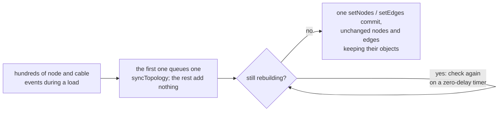

<!-- [[B3]] sameNodeEverywhere -->

# Spec: Graph load / teardown performance

Serves [[B3]] sameNodeEverywhere. It covers what the system does and blocks, and the decision each behavior serves.

Loading a document tears down the current graph and builds the new one (`rebuildGraph` in `persistence.ts`). Opening a file, switching documents, applying an AI rewrite, and every undo or redo restore all go through this path, so its cost scales with graph size. Every card renders in one React tree and React Flow measures its own handles, so the costs that matter are the number of React Flow commits, the number of cards that re-render, the length of the async chain during build, and the per-node store cleanup. This spec covers each.

## One commit per rebuild

The main surface (`flow/FlowCanvas.tsx`) installs an editor pipe that watches `nodecreated`, `noderemoved`, `connectioncreated` and `connectionremoved`. The first such event queues one `syncTopology` call; later events while it is queued add nothing. The queued sync waits while `isGraphRebuilding()` is true, re-checking on a zero-delay timer until the rebuild ends. A load's hundreds of events therefore become a single `setNodes` / `setEdges` commit instead of one per event.

The composite drill-in (`flow/FlowCompositeOverlay.tsx`) has the same pipe with its own local gate, `s.rebuilding`. After its sync it also recomputes the graph and schedules autosave.

## Survivors keep their identity

`syncTopology` (`flow/FlowSurface.tsx`) rebuilds the React Flow node and edge lists from the editor, but reuses the previous object wherever nothing React Flow cares about changed (`mergeFlowNodes`, `flow/flowModel.ts`), so React Flow's memo skips those cards.

- A node keeps its old object when its position, `parentId`, `zIndex`, `className` and `draggable` are all unchanged. Otherwise it gets a new object that carries over the old `selected` flag and `data.version`.
- An edge keeps its old object whenever one with the same id exists.

Adding or removing one node then re-renders one card, not the whole canvas. Both halves are needed: without the single commit and the reused objects, restoring a full snapshot on a big undo costs time quadratic in the node count.

## Re-renders during a rebuild

While a rebuild runs (`isGraphRebuilding()`), a card's re-render request (`bumpNode`) waits in the surface and every waiting card re-renders in one commit when the outermost rebuild ends (`onGraphRebuildEnd`), so a load's compute pass costs one commit, not one per card. A position or re-render for a card React Flow doesn't hold yet does nothing: the topology sync builds it from the editor. The curtain's progress notifies only when its shown percent moves, since each notify renders it synchronously.

## Layout reads come in one batch

A card measures its socket rows, output socket, header and Note dot after it renders. Each read is queued with the write it feeds (`measureThenWrite`, `components/layoutBatch.ts`) and a commit's reads all run before its writes, before paint, so the browser lays out once per commit instead of once per card. Cards share one `ResizeObserver` (`observeResize`), so a frame's size changes reach the cards in one callback and one commit. Measured on personal-finance (154 cards, production build, desktop CPU): forced layouts 860 to 306, React commits 1,070 to 645, load 6.9 s to 6.0 s. **Reopen if:** a card reads layout in an effect outside the batch (the forced-layout count climbs again), or React Flow's own per-card measuring (`updateNodeInternals`, about 0.7 s of a 241-card load) gets a batched path.

## Teardown

1. Remove every connection, then every node, one at a time.
2. Reset every node-keyed store once with `forgetAllNodes()` (`nodeStoreRegistry.ts`).

The per-node `noderemoved` handler in `FlowCanvas` (`settleNodeRemoved`, `canvasActions.ts`) skips `forgetNodeDeep` while a rebuild is running, because some stores scan their whole map on each forget, which would cost nodes × entries. The bulk reset replaces it. A store that registers a per-node forgetter must also register a bulk reset with `registerNodeForgetAll`, or the reset is incomplete ([[stores#The rules]]).

## Build: construct, then add in batches

1. Construct every node synchronously: pick the class from the registry (or a Placeholder for an unknown type), restore its saved state, record the saved-id to fresh-id mapping, and seed its name, size, collapse and flip stores.
2. Add and position the nodes in chunks of 24. Within a chunk every node runs `addNode` then `moveNode` concurrently under one `Promise.all`, so each node's own add stays before its move, but the chunk waits once instead of once per step.

A per-node `await addNode; await moveNode` loop would be about 2N sequential async hops, which was the dominant load cost.

## Loading curtain

When the teardown and build together exceed `SWITCH_CURTAIN_MIN_WORK` (300 nodes plus connections), a "Loading graph" curtain shows a progress bar. It counts teardown too, since leaving a big document dominates. Under the curtain the teardown yields to a paint every 24 removals and the build yields after each chunk, so the bar can repaint. A yield to a paint is an animation frame followed by a zero-delay task: the build otherwise yields only to microtasks, so the curtain would never show and the bar would never move. The curtain begins before teardown, so node-by-node construction is never seen. Without the curtain nothing yields. Undo and redo restores pass `curtain: false` and never show it.

## The web node budget

The web app shows a soft budget, `WEB_DEMO_NODE_BUDGET` (300) in `nodeBudget.ts`: the status bar's node meter turns to a caution color at 75 percent and past the budget offers a note recommending the desktop app. Nothing is blocked, and the desktop app has no budget. The number is a tuning knob; change it with a new measurement here.

Measured 2026-10-05 on a production build in phone emulation (412 × 915, device pixel ratio 2.6, CPU throttled 4×), with personal-finance tiled into larger graphs and a 30-step drag at zoom 0.6:

| Nodes | Load | Pan, frame p50 | Card drag, frame p50 / p95 |
|---|---|---|---|
| 154 | 8.9 s | 100 ms | 17 / 67 ms |
| 308 | 17.9 s | 167 ms | not measured |
| 462 | 34.1 s | 250 ms | 17 / 183 ms |
| 616 | 53.4 s | not measured | 333 / 1333 ms |

Load and pan grow about linearly; a card drag holds until somewhere past 460 nodes and breaks down by 616. 300 is double the size a phone handled well, with room under the drag's knee. Pan is the next limit: the viewport has no compositing layer during a pan, so every frame repaints what is on screen. **Reopen if:** pan gets a layer on coarse pointers ([[html-in-canvas#The GPU texture budget]] says why it has none), which would move the knee.
