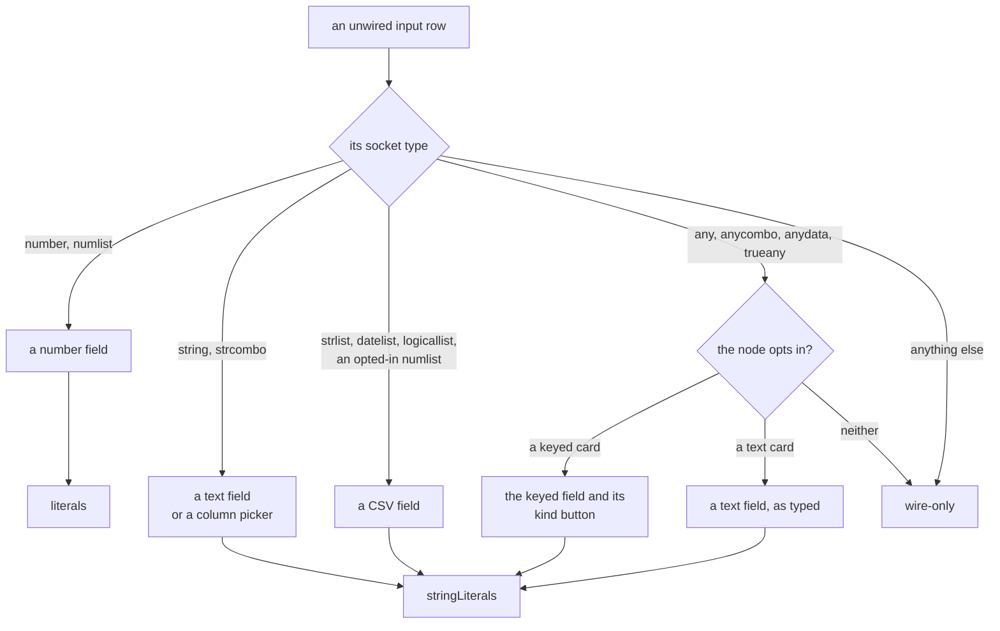

<!-- [[C28]] literalsIffEditable -->

# Spec: Inline literal maps

Serves [[C28]] literalsIffEditable. It covers what the system does and blocks, and the decision each behavior serves.

A **literal** is a value the user types straight into a card's input row instead of wiring a cable to it. A card keeps its literals in one or both of two fields:

- `literals`, a map from input key to number;
- `stringLiterals`, a map from input key to raw text (CSV-typed lists, column pickers, text rows).

An unwired input reads its literal; a wired input always reads its cable.

The governing convention: **a node class declares a literal map if and only if its card edits it inline.** Everything below follows from that.

## Load restores literals only onto declaring classes

When a load restores a saved node (`restoreLiterals` in `literalFields.ts`), it copies the saved `literals` and `stringLiterals` onto the new node only when the class already has that field as an object. A field the class does not declare is dropped.

A wire-driven card declares neither map. The Equation family (Equation, TVM, Triangle Solver) is the main case: its variables are known only through cables, and `equation` (`crates/solenoid-core/src/nodes/formula.rs`) has no literal fallback. So a hand-written save or seed cannot plant a hardcoded known that the user can neither see nor edit on the card.

Tests: `persistenceSweep.test.ts`: for every catalog node, perturbed literals survive a construct cycle.

## Seeds are checked when they are written

A seed node whose `literals` or `stringLiterals` target a class that does not declare that map fails at authoring time instead of being silently dropped on load. A seed that needs a fixed value on a wire-driven card wires a visible input card (a Value Input and the like) instead.

Tests: `seeds.test.ts` ("authored literals land on inline-editable (declaring) classes only").

## A typeable list implies the declaration

A socket of type `strlist`, `datelist` or `logicallist` (the `TYPEABLE_LIST` set of the core's input boundary, `crates/solenoid-graph/src/boundary.rs`) is typeable: the card shows a CSV editor for it. Any node with such an input must declare `stringLiterals`, because the editor stores its raw text there. When the input is unwired, the input boundary parses that text with `parseListLiteral` (`listLiterals.ts`) and injects the list as the input's value (for a node ported to Rust, `coreHeader` in `nodeOnCore.ts` sends the parsed list); blank text injects nothing, and a wired cable always wins. List Input sets `ownsListLiterals` and reads its rows itself ([[C58]] tableInputRawText). A `numlist` input is typeable the same way, but only when the node opts in by putting that input's key in its `stringLiterals`.

Tests: `coerceInputs.test.ts`: a sweep constructs every catalog entry and fails for any node with a typeable input and no `stringLiterals`, so a new node cannot silently lose the user's typed CSV on reload; a `numlist` is typeable only where the node opts in; `parseListLiteral` per list type; and the typed list injected for an unwired input, a wired value winning.

## One field per input

**What a card computes from is what it shows.** An unwired input has exactly one field, and that field names the one place its value lives and how it is read. The core holds the one table (`nodes/fields.rs`, `field_of(card class, key, declared rung)`), and every reader goes through it:

- **The canvas** draws the field the table names (`literalFieldOf`, which asks the core over wasm), in every row host alike: the fixed rows, the extensible rows and the paired rows. A card that draws its own rows (Filter, Frame Filter and SUMIFS's criteria, Expect's In list) draws the field the table names for them.
- **A body** reads an unwired input through it (`Call::unwired`, `Call::read`, `Call::read_num`): a number, a logical as TRUE or FALSE, text as keyed, a keyed value as its kind, or a bound as its rung's kind. A typed list reaches the body through the boundary as if wired; a list on a rung the boundary doesn't parse (Expect's In list) is read as its keyed text (`Call::csv_text`). The literal maps themselves are private to `nodes/fields.rs` (`fields::Saved`), so a body can't read around the field.
- **Every restore** (a load, a composite's hydrate, a Flow model, a paste) puts the saved values on the rebuilt card through `restoreLiterals`, which drops each value its input's field doesn't read (`pruneLiterals`), so nothing survives in a map no field shows.

The fields: `number` (the number field, `literals`), `logical` (the TRUE/FALSE checkbox Value Input's Boolean uses, `literals` as 1 or 0), `text` (`stringLiterals` as keyed), `csv` (a list keyed as comma-separated text), `keyed` (a wildcard slot's keyed text and kind, [[#Wildcard slots]]), `bound` (a range bound: the number field on a number rung, a date's text on a date rung, each kind keeping its own value so a card moving between the two keeps both, [[D120]] rangeBoundsTakeTheValuesKind) and `none` (wire-only). The rung decides the field unless the table names the card:

- `KEYED` and `TEXT`: the cards whose wildcard slots take a keyed value or text (below).
- `NUMBER_VARIABLES`: the cards whose variables take a typed number while unwired, whatever a cable may bring (Expression, LAMBDA, Computed Column's side variables).
- `ROWS`: inputs a card names by key, a numbered row included: the criteria rows of Filter, Frame Filter and SUMIFS (`text`), Expect's Min and Max (`bound`) and In list (`csv`), Is Close's A and B and REDUCE's and SCAN's Initial (`number`), and Fill's Else rows (`number`).

A key with no input (a setting a mode's input takes over, a widget's own state) is the card's own field: a body reads it as saved and a prune leaves it.

Tests: `seedsLiteralFields.test.ts`: every class's fresh defaults and every seed node, nested ones too, keep all their saved values through a restore; `graphValidate.ts` names a saved value no field reads, and its catalog sweep holds every catalog leaf to that; `fields.rs`'s own test pins the table's answers.

**Reopen if:** a card needs an unwired value that no field shows.

## Defaults

A class that initializes a map, such as `literals = { rate: 0.05, … }`, declares a starting value the card computes with, shown in its field: the field's **default**, which a person can clear. A default stays where it keeps a fresh card from answering an error straight away (the 0s and 1s a divisor, a count or a digits field needs). Once cleared, the field is empty and reads as its empty kind ([[#What an empty field is]]); a default usually matches the field's Fallback, but need not.

## What an empty field is

([[D96]] emptySlotShowsItsValue.) Every field declares what it is when empty, as one of four kinds, and shows it in place:

| Kind | The field shows | `Call::unwired` reads | The card |
|---|---|---|---|
| **Fallback** | the value, muted, upright | the value | computes with it |
| **Behavior** | a word in brackets (`[all]`), muted, upright | `undefined`, as now | does what the word names: the body's own reading of the field left out |
| **Example** | a hint, muted, in italics | `undefined`, as now | computes nothing from it, so a blank there may blank the card |
| **Required** | nothing | `#SYNTAX!`: "*label* is empty, and it has no default" | answers that error |

Where a field's kind lives:

- **A setting** declares it through its role ([[input-roles#The roles]]), shared with the formulas: its blank is a Fallback, `LEFT_OUT` a Behavior shown as its word, required a Required.
- **Every other field** declares it in the core's table (`EMPTY` in `nodes/fields.rs`, `empty_of(card class, op, key)`), keyed by card class and input, a key matching a numbered row of itself as `ROWS` does (an exact key wins: `df1` is its own field, not row 1 of `df`). A field whose meaning moves with the card's op declares per op in `EMPTY_BY_OP`, ahead of `EMPTY`: LOG's base falls back to 10 where the other two-input ops' B falls back to 0, CEILING.MATH's and FLOOR.MATH's significance to 1 where MROUND's is required, DROP's counts are `[none]` where TAKE's are `[all]`. `Call::unwired` applies it when the field holds nothing (no saved value, or empty text), so every body reads the same Fallback the field shows.
- **The canvas** asks one function (`emptyFieldShown` in `emptySlots.ts`, with the card's op): the core's declaration over wasm (`coreEmptyField`), else the setting's role. The row host draws `shown` as the field's placeholder and marks the row `solenoid-node__io-row--example` for an Example, which alone sets the placeholder in italics (`nodeCard.css`). The paired rows (IFS's and SWITCH's cases and outputs, `pairPlaceholders`) are Examples.
- **The solver cards** (Equation, Triangle Solver, TVM) declare every field `[solve]` at once (`SOLVERS`): an empty field is the unknown.

A body reads an empty field only through `Call::unwired`, so the value it computes from is the one declared; there is no reader that takes its own default. A formula's variables (Formula card, LAMBDA, a computed column) read 0 when empty through `Call::read_variable`, until the walk of that kind of nothing. A Fallback of empty text reads as nothing, as an empty field always has.

- **A card and its formula twin agree** on an empty field ([[input-roles#Placeholders]]): a Fallback is the formula's empty-slot reading, a Behavior the formula's left-out reading.

Tests: `emptyFieldKinds.test.ts`: every catalog card's fields, a formula's variables aside, declare a kind, and every card with a formula twin reads an empty field as the formula reads that empty slot (`TWINS_APART` names the pairs whose fields don't line up, with why); `emptySlots.test.ts`: what `emptyFieldShown` gives for each kind; `fields.rs`'s own test pins the table's shown text.

## Which field a row edits

An unwired input row's field is picked by its socket type, and the field decides which map it writes.

In `InlineInputs` (the fixed rows of most cards):

| Socket type | Field | Map |
|---|---|---|
| `number`, and `numlist` unless opted in | number field | `literals` |
| `string`, `strcombo` | text field, or a column picker when the node declares that key as a Frame column picker | `stringLiterals` |
| `strlist`, `datelist`, `logicallist`, an opted-in `numlist` | CSV field, with no quote marks, which would suggest one string | `stringLiterals` |
| `any`, `anycombo`, `anydata`, `trueany` on a keyed card | the keyed field and its kind button (below) | `stringLiterals`, the kind in `literalKinds` |
| `any`, `anycombo`, `anydata`, `trueany` on a text card (Replace Values) | text field, kept exactly as keyed | `stringLiterals` |
| anything else | none | none |

The table's entries by card and key (§ One field per input) come before the socket type: a row it names takes that field whatever its rung.

A combo (`numlist`, `strcombo`, `anycombo`) edits in place as a scalar; it becomes a list only when a cable brings one.

`ExtensibleInputs` (rows that can be added and removed) and `PairedExtensibleInputs` draw the same field for each row; a wire-only row shows its row number.

## Wildcard slots

A card's wildcard rows take keyed values when the core's table names it a keyed card (`KEYED` in `nodes/fields.rs`). The value selectors are, since their wildcard rows are value branches, and so are the Cube builders, whose rows are cells. So are IFERROR, whose fallback is a typed value, and CONTAINS, whose value is the one looked for. A wildcard sink or relay (Display, Cast, Report) leaves it off and stays wire-only. The opt-in covers `any`, `anycombo`, `anydata` and `trueany`; a list or a matrix still arrives only by wire.

A card whose op reads a wildcard slot as text is a text card instead (`TEXT` in `nodes/fields.rs`): its rows get the plain text field, so a space, `007` or `1.50` reaches the op exactly as typed rather than trimmed or read as a number. Replace Values' Find and Replace take this field; a wired value of any type still connects.

Tests: `cubeLiteralCells.test.ts`: an unwired wildcard row on the Cube builders takes a number or a text cell, and removing a row drops its keyed text and kind.

**The kind shows before the text is read** ([[C10]] socketLattice: text becomes another kind only where the type shows on screen). The keyed field (`KeyedField`) keeps the text exactly as keyed in `stringLiterals`, and the Frame column's type button sits to its right (`sol-coltype`, the same button and icons): a click cycles Number, Text, Date and Boolean, Number when none is picked, and the pick is saved in the init field `literalKinds`. Nothing guesses the kind from the text, so `12` keyed as Text is the text `"12"`, and a SWITCH case of `12` matches only what its kind says. Text shows in quote marks and a Date shows the date format as its placeholder.

- **One reader per kind, the Frame Input cell's** ([[C58]] tableInputRawText): the core reads a slot through `Call::keyed` (`keyed_value` over `frame_cell_of`), and a body that runs in JavaScript (Script) through `readKeyed`, on the same readers over wasm. Text the kind can't read is `#TYPE!` naming it; blank is unset. Flipping the kind rereads the same text.
- **The socket takes the kind's color while unwired.** Once a kind is picked or text is keyed, the Type Settle adopts the unwired input to that kind (`keyedRestType`, the input fact's `rest`), so the socket and whatever its passthrough feeds show the value's type. A cable decides once wired, and acceptance still goes by the declared base, so any cable connects.
- **No drag-to-scrub** on this field.
