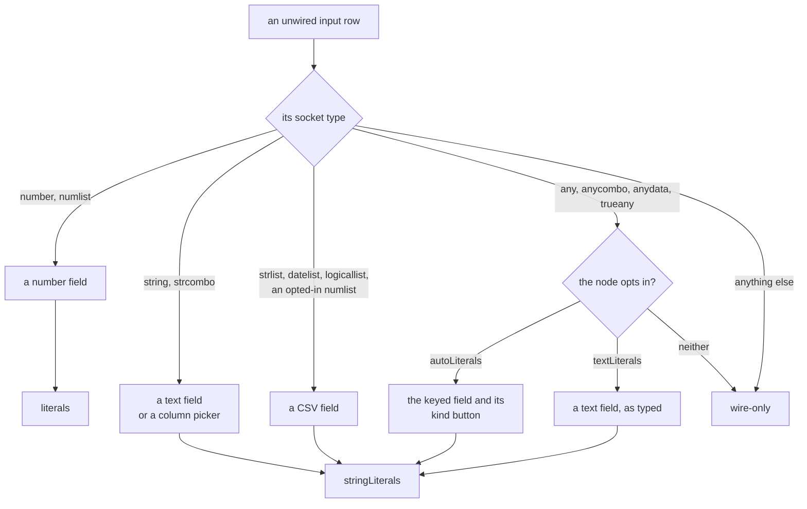

<!-- [[C28]] literalsIffEditable -->

# Spec: Inline literal maps

Serves [[C28]] literalsIffEditable. It covers what the system does and blocks, and the decision each behavior serves.

A **literal** is a value the user types straight into a card's input row instead of wiring a cable to it. A card keeps its literals in one or both of two fields:

- `literals`, a map from input key to number;
- `stringLiterals`, a map from input key to raw text (CSV-typed lists, column pickers, text rows).

An unwired input reads its literal; a wired input always reads its cable.

The governing convention: **a node class declares a literal map if and only if its card edits it inline.** Everything below follows from that.

## Load restores literals only onto declaring classes

When `persistence.ts` loads a saved node, it copies the saved `literals` and `stringLiterals` onto the new node only when the class already has that field as an object (`typeof anyNode.literals === "object"`). A field the class does not declare is dropped.

A wire-driven card declares neither map. The Equation family (Equation, TVM, Triangle Solver) is the main case: its variables are known only through cables, and `equation` (`crates/solenoid-core/src/nodes/formula.rs`) has no literal fallback. So a hand-written save or seed cannot plant a hardcoded known that the user can neither see nor edit on the card.

Tests: `persistenceSweep.test.ts`: for every catalog node, perturbed literals survive a construct cycle.

## Seeds are checked when they are written

A seed node whose `literals` or `stringLiterals` target a class that does not declare that map fails at authoring time instead of being silently dropped on load. A seed that needs a fixed value on a wire-driven card wires a visible input card (a Value Input and the like) instead.

Tests: `seeds.test.ts` ("authored literals land on inline-editable (declaring) classes only").

## A typeable list implies the declaration

A socket of type `strlist`, `datelist` or `logicallist` (the `TYPEABLE_LIST` set of the core's input boundary, `crates/solenoid-graph/src/boundary.rs`) is typeable: the card shows a CSV editor for it. Any node with such an input must declare `stringLiterals`, because the editor stores its raw text there. When the input is unwired, the input boundary parses that text with `parseListLiteral` (`listLiterals.ts`) and injects the list as the input's value (for a node ported to Rust, `coreHeader` in `nodeOnCore.ts` sends the parsed list); blank text injects nothing, and a wired cable always wins. List Input sets `ownsListLiterals` and reads its rows itself ([[C58]] tableInputRawText). A `numlist` input is typeable the same way, but only when the node opts in by putting that input's key in its `stringLiterals`.

Tests: `coerceInputs.test.ts`: a sweep constructs every catalog entry and fails for any node with a typeable input and no `stringLiterals`, so a new node cannot silently lose the user's typed CSV on reload; a `numlist` is typeable only where the node opts in; `parseListLiteral` per list type; and the typed list injected for an unwired input, a wired value winning.

## Defaults are allowed

A class that initializes a map with defaults, such as `literals = { rate: 0.05, … }`, is declaring an editable input with a starting value, which is exactly what the convention permits.

## Which field a row edits

An unwired input row's field is picked by its socket type, and the field decides which map it writes.

In `InlineInputs` (the fixed rows of most cards):

| Socket type | Field | Map |
|---|---|---|
| `number`, and `numlist` unless opted in | number field | `literals` |
| `string`, `strcombo` | text field, or a column picker when the node declares that key as a Frame column picker | `stringLiterals` |
| `strlist`, `datelist`, `logicallist`, an opted-in `numlist` | CSV field, with no quote marks, which would suggest one string | `stringLiterals` |
| `any`, `anycombo`, `anydata`, `trueany` on a node with `autoLiterals` | the keyed field and its kind button (below) | `stringLiterals`, the kind in `literalKinds` |
| `any`, `anycombo`, `anydata`, `trueany` on a node with `textLiterals` | text field, kept exactly as keyed | `stringLiterals` |
| anything else | none | none |

A combo (`numlist`, `strcombo`, `anycombo`) edits in place as a scalar; it becomes a list only when a cable brings one.

In `ExtensibleInputs` (rows that can be added and removed), `string` and the list types `numlist`, `strlist`, `datelist`, `logicallist` get the text field, typed as CSV for a list. `anylist`, `anytable`, `table`, `frame`, `cube`, `logicalcombo`, `lambda` and `chart` rows are wire-only and show their row number, because a typed literal means nothing for them. A wildcard row is wire-only unless the node sets `autoLiterals`. Every other row gets the number field.

## Wildcard slots

A node opts its wildcard rows into typed literals with `autoLiterals` (`AutoLiteralHost`, `takesAutoLiteral`). The value selectors opt in, since their wildcard rows are value branches, and so do the Cube builders, whose rows are cells. A wildcard sink or relay (Display, Cast, Report) leaves it off and stays wire-only. The opt-in covers `any`, `anycombo`, `anydata` and `trueany`; a list or a matrix still arrives only by wire.

A node whose op reads a wildcard slot as text opts in with `textLiterals` instead (`takesTextLiteral`): its rows get the plain text field, so a space, `007` or `1.50` reaches the op exactly as typed rather than trimmed or read as a number. Replace Values' Find and Replace take this field; a wired value of any type still connects.

Tests: `cubeLiteralCells.test.ts`: an unwired wildcard row on the Cube builders takes a number or a text cell, and removing a row drops its keyed text and kind.

**The kind shows before the text is read** ([[C10]] socketLattice: text becomes another kind only where the type shows on screen). The keyed field (`KeyedField`) keeps the text exactly as keyed in `stringLiterals`, and the Frame column's type button sits to its right (`sol-coltype`, the same button and icons): a click cycles Number, Text, Date and Boolean, Number when none is picked, and the pick is saved in the init field `literalKinds`. Nothing guesses the kind from the text, so `12` keyed as Text is the text `"12"`, and a SWITCH case of `12` matches only what its kind says. Text shows in quote marks and a Date shows the date format as its placeholder.

- **One reader per kind, the Frame Input cell's** ([[C58]] tableInputRawText): the core reads a slot through `Call::keyed` (`keyed_value` over `frame_cell_of`), and a body that runs in JavaScript (Script) through `readKeyed`, on the same readers over wasm. Text the kind can't read is `#TYPE!` naming it; blank is unset. Flipping the kind rereads the same text.
- **The socket takes the kind's color while unwired.** Once a kind is picked or text is keyed, the Type Settle adopts the unwired input to that kind (`keyedRestType`, the input fact's `rest`), so the socket and whatever its passthrough feeds show the value's type. A cable decides once wired, and acceptance still goes by the declared base, so any cable connects.
- **No drag-to-scrub** on this field.
