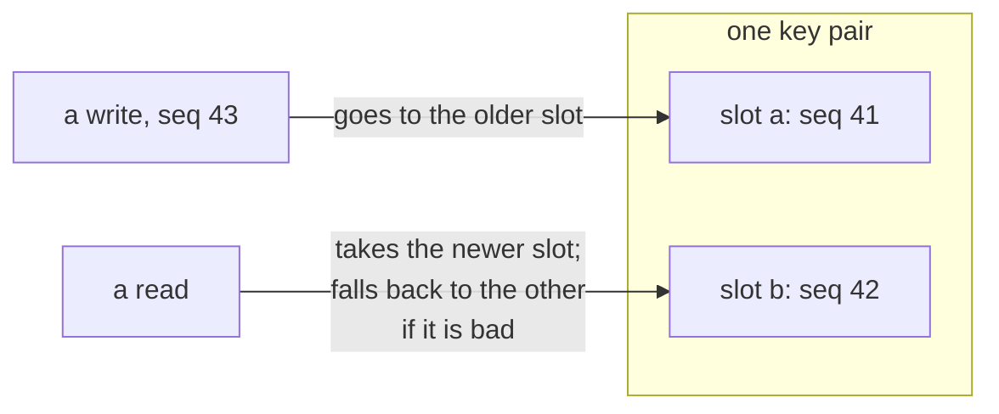
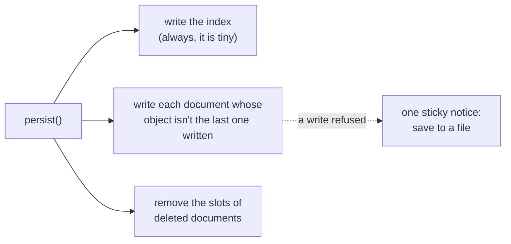
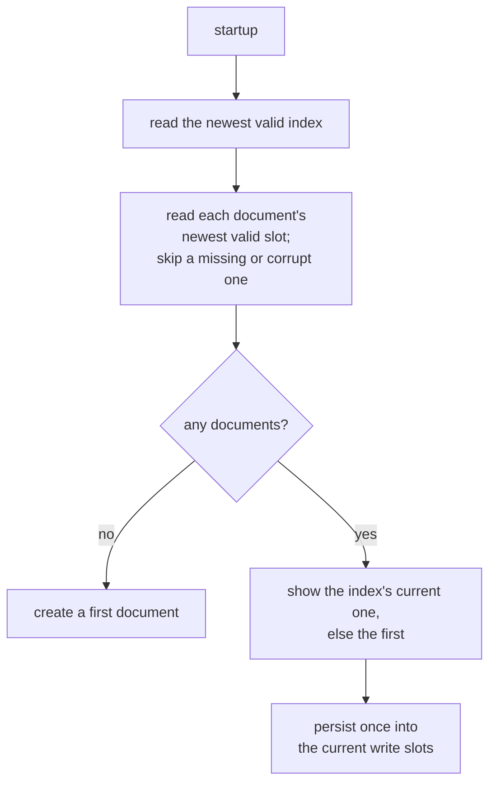

<!-- [[B12]] losslessSaves -->

# Spec: Per-doc autosave persistence

Serves [[B12]] losslessSaves. It covers what the system does and blocks, and the decision each behavior serves.

Autosave keeps the user's whole document library in the browser's `localStorage`. Every document has its own pair of slots, and one small index pair lists the documents. The code is `documentStore.ts` (storage and the public store), `documentStoreCore.ts` (pure library transforms) and `persistenceCore.ts` (slot choice); `documentStorePersist.test.ts` guards it.

## Storage layout

| Key | Holds |
|---|---|
| `solenoid.docs.index.a` / `.b` | `{ seq, currentId, docs: [{ id, name, updatedAt, filePath?, folder? }], folders? }`, metadata only, no graphs |
| `solenoid.docs.doc.<id>.a` / `.b` | `{ seq, doc }`, one full document (`id`, `name`, `graph`, `updatedAt`, `filePath?`, `fileSavedAt?`, `folder?`) |

`folder` is the document's folder path and `folders` the folders the user made, so an empty one survives ([[workspace-tree#Where the tree comes from]]).

`seq` is always the first key of a payload ([[#Two slots per pair]]).

## Two slots per pair

Each pair rotates so a crash in the middle of a write never destroys the only good copy ([[B12]] losslessSaves). **MUST:** a pair always writes the older slot and reads the newer one; a slot's `seq` is a strictly increasing counter kept for the session, never a raw clock reading; `seq` is the first key of every slot payload. The last two each close a way the rotation could silently bring back an older write, as the bullets below say.

- **Write** goes to the older slot (`chooseWriteSlot`): an empty slot first (`a` before `b`), otherwise the one with the lower `seq`, with a tie going to `a`.
- **Read** takes the newer slot (`chooseReadSlot`), the higher `seq`, with a tie going to `a`. If that slot is missing, unparsable or fails validation, the read falls through to the other slot.
- `seq` comes from a counter kept for the session. It starts at `Date.now()` when the module loads, and every write takes the next value. A raw `Date.now()` would let two writes in the same millisecond tie and make the newer slot ambiguous, so a read could bring back the older write.
- A slot's `seq` is read with the prefix regex `^\{"seq":(\d+)`, so choosing the write slot never parses a large graph. A payload with any other key first reads as having no `seq`, that is as an empty slot, and the older write wins. Each slot's `seq` is remembered as this tab last read or wrote it (`slotSeqs`), so a save reads no slot back; another tab's write to a key (the `storage` event) drops that key's entry.

## What a persist writes

`persist()` runs after every change to the library (a capture of the live graph, a rename, a new, duplicated or deleted document, a switch, a file save). It:

1. writes the index, always, since it is tiny and rebuilt wholesale from memory;
2. writes each document whose object is not the one it last wrote for that id (`_lastPersisted`), and records it on success;
3. removes the slots of every id in `_lastPersisted` that is no longer in the library (`removeDocSlots`), which frees the quota a deleted document held.

When any write is refused (storage full or disabled), one sticky error notice says "Couldn't autosave: local storage may be full or disabled. Save your graph to a file (Ctrl+S) to be safe." It stays until a later persist fully succeeds, which dismisses it.

## Swapping documents

**MUST:** every `documentStore` verb that changes which document is on screen calls `captureCurrent()` before switching and guards on `isGraphRebuilding()`. A capture that cannot serialize returns false and the verb stays on the document, since switching would drop its unsaved canvas. Without the capture, edits made within the autosave delay are discarded; without the guard, the verb can race a load and serialize a half-built canvas into the current document. Both failures happened, and both are pinned in `sourceInvariants.test.ts` ([[B12]] losslessSaves). The exceptions carry their reason:

- `restore` runs at startup, when nothing is live yet;
- `remove` skips the capture because the document is going away, and capturing would resurrect its dying edits; `removeFolder` skips it for the same reason, since every document under the folder goes;
- `reloadCurrent` needs no guard of its own, because the guard lives inside `captureCurrent`; its own gate is the reveal lock.

## Open drafts

A text field's draft stays local until blur ([[B19]] spreadsheetHabits), so a capture could miss what the user typed. Every draft field registers with `draftFlush.ts` while its draft differs from the node (`usePendingDraft`: every `useDraftCommit` field, a Format Controller's custom pattern, the Note body, the Report overlay's source, the Record layout field). `flushDrafts()` commits each one as if it had blurred. `captureCurrent()` flushes first, so every swap verb (open, new, duplicate, import, reload) commits the draft into the outgoing document; a file save flushes before it serializes; `pagehide` flushes and captures when a draft or a pending autosave exists, and so does the desktop window's close request (`onCloseRequested`), because closing a Tauri window tears the webview down without a guaranteed `pagehide`. The close handler never throws, since a failed handler would leave the window unable to close; the window's `core:window:allow-destroy` permission lets the handler's close go through. The idle autosave timer alone captures with `keepDrafts`, because committing a field the user is still typing in would reconcile a half-typed Note frontmatter or Report template and prune its cables. `draftFlush.test.ts` pins the call sites.

## Change detection is object identity

`persist()` decides a document changed by comparing object references (`_lastPersisted.get(id) === doc` skips the write). **MUST:** every `documentStoreCore` transform returns a new `SolDoc` for each document it changes (`{ ...d, … }`), and never mutates a document in place. An in-place mutation still updates the screen, but `persist()` sees the same reference and never writes it, so the edit vanishes on the next reload ([[B12]] losslessSaves). Mutating a document you just created, before its first persist, is fine; `importAsDocument` does this. A future transform that needs to touch a document copies it first.

A capture whose graph equals the stored one leaves the library as it was (`updateCurrentGraph`), so the document keeps its `updatedAt` and is not rewritten. Equal means equal as JSON would write it: key order, keys holding `undefined` and the file's `savedAt` stamp don't count. `updatedAt` is the autosave time the Save Times card reads, so it marks the last real edit, and an imported file keeps its own stamp until it is edited: a load adopts the graph as it loaded (`adoptLoadedGraph`, which keeps the time), so a load that normalizes a file's graph is not an edit; the swap verbs and a file save capture without moving it.

## Restore

`restore()` runs on startup:

1. It deletes the whole-library keys `solenoid.docs.lib.a` and `.b`, if present. There is no migration from them ([[B7]] preAlphaBreakFreely).
2. It reads the newest valid index. An index without a `docs` array is invalid.
3. For each entry, it reads that document's newest valid slot. A missing or corrupt document is skipped, and the rest of the library loads.
4. With no documents left, restore reports nothing to show, and the caller creates a first document.
5. The current document is the index's `currentId` if that document loaded, and otherwise the first document.
6. It seeds `_lastPersisted` with the loaded objects, persists once to settle the library into the current write slots, and shows the current document.

The index is metadata only. A document's own slot is the truth wherever the two disagree, except for its folder: a folder rename or move rewrites every document under it, and the index takes all of them in one write, so restore reads the folder from the index and a move cut off partway (storage full) reads back on one side, never split ([[workspace-tree#Where the tree comes from]]).

## Dev mirror

On the dev server only, each captured autosave is also posted to `/__dev-graph`, which `vite.config.ts` (`devGraphMirror`) writes to `.dev/current-graph.json`. A headless browser (`navigator.webdriver`) never posts, so a probe loading a seed does not overwrite the author's live graph. Tests and production builds never post.
