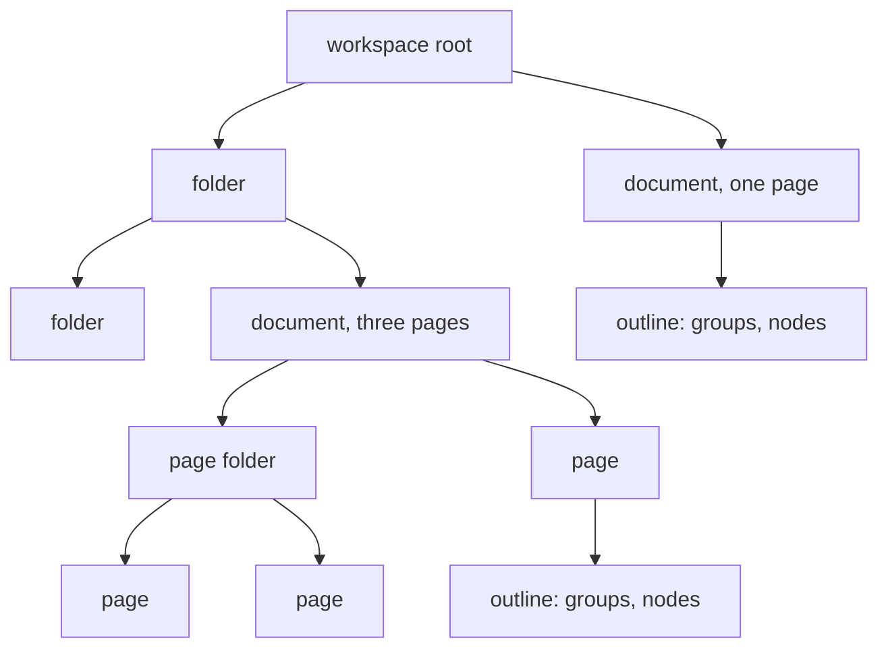
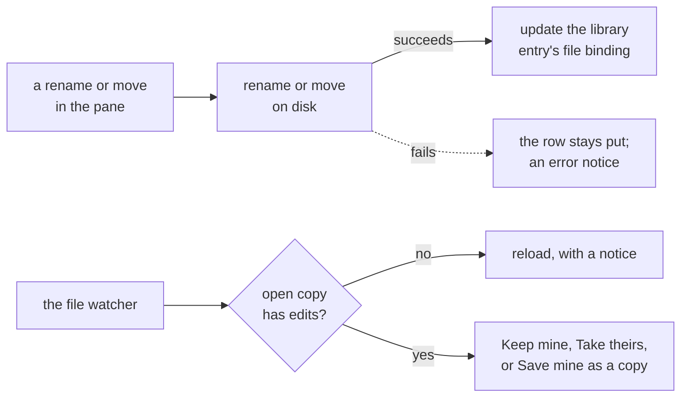
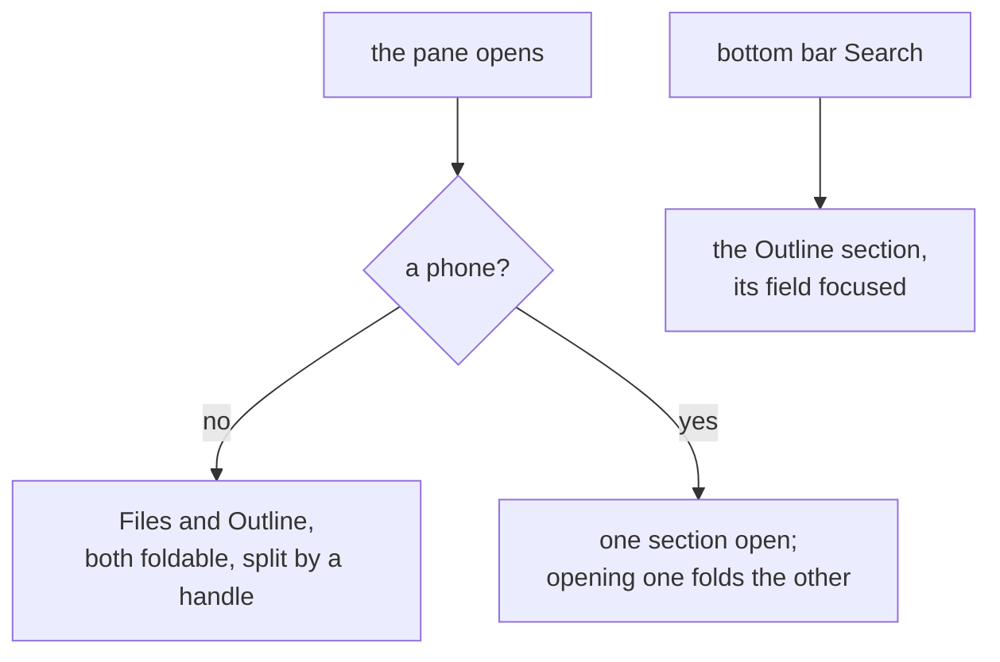

<!-- [[C132]] workspaceTree, [[D103]] folderOnDisk -->

# Spec: Workspace tree

Serves [[C132]] workspaceTree and [[D103]] folderOnDisk. It covers what the system does and blocks, and the decision each behavior serves. A WHY that isn't in a node belongs in one.

**Status: planned, prototyped in the pane.** The plan and its open author calls are `../../../docs/v2.0/26-navigator-tree.md`; the page model it reads is `../../../docs/v2.0/20-pages.md`. Sections marked *(built)* describe code on `rust-port`; the rest is the contract the build follows. The node outline below the tree keeps its own spec, [[outline-panel]].

## The rows

| Kind | Glyph | Children | Opens on a single click |
|---|---|---|---|
| Folder | folder | folders, documents | no: a click folds it |
| Document | file | page folders and pages, or its outline when it has one page | yes |
| Page folder | stacked pages | page folders, pages | no: a click folds it |
| Page | page | the page's outline | yes |

- **A container never holds nodes and a canvas never holds its own kind.** A folder holds no pages, a page folder holds no documents, and only a page (or a one-page document) has an outline.
- **A one-page document has no page row.** Its row expands to the outline directly; the second page brings the page rows in, the first of them the existing canvas.
- **Order.** Folders before documents, then by name with numbers compared as numbers and case ignored, the outline's alphabetical compare. Pages keep the order the user gave them; page order is the document's, not the tree's.
- **The open document and the open page** wear the selected-row fill *(built for documents)* (`--accent-soft`, the outline's `--sel` look). An ancestor of the open row is expanded whenever the open row changes, so it is never hidden in a folded folder.

## Where the tree comes from

| Platform | Root | A folder is | A document is |
|---|---|---|---|
| Desktop | the Documents folder setting (`docsFolder`) | a folder on disk under the root | a graph file under the root |
| Web | the browser library (`documentStore`) | a path on the library entry, `folder: "Finance/2026"` | a library entry |

- **Web folders are paths, not records** *(built; on the desktop too, until the disk tree lands)*. A folder exists while some entry's path names it, plus any empty folder the user created, kept in a short `folders` list in the library index. Renaming a folder rewrites the path prefix of every entry under it in one library transform; every transform returns new `SolDoc` objects for the entries it changes ([[per-doc-autosave-persistence#Change detection is object identity]]).
- **The desktop tree reads the disk** and keeps the library as its autosave buffer: a document's library entry is bound to its file (`filePath`), and a file with no entry gets one the first time it is opened. A rename or move in the pane renames or moves the file first and updates the binding only once the disk call succeeds.
- **Outside changes** arrive through the file watcher bundle 21 Stage 0 builds. A changed file whose open copy has no unsaved edits reloads with a notice; one with unsaved edits offers Keep mine, Take theirs or Save mine as a copy. A file deleted outside the app leaves its library entry as an unsaved document, marked on its row.

## Acting on rows

- **Opening** a document or page goes through the existing swap verbs: `documentStore.open(id)` for a document, so the outgoing capture and the rebuild guard hold ([[per-doc-autosave-persistence#Swapping documents]]); a page switch is a view change inside the open document (bundle 20), never a rebuild. *(built for documents)*
- **Rename** is F2, a double click on the name, or the row menu; on a document that isn't open, the double click's first click opens it, so the rename lands on the open document; it edits in place, commits on Enter or click-away and reverts on Escape ([[C95]] commitOnEnter). An empty name is ignored; a duplicate in the same folder takes the library's ` 2`, ` 3` suffix. *(built for documents)*
- **The row menu** opens from a ⋯ button (on hover with a mouse, always on touch), a right-click or a long-press: Open, Rename, Duplicate, Move to…, Delete, and on desktop Reveal in file manager and Copy path. *(built: Open, Rename, Duplicate, Move to…, Delete for a document; New Document, New Folder, Rename, Delete for a folder)*
- **Delete** of a document asks, as the documents menu does today *(built)*. A folder with documents asks and names how many it holds; an empty folder goes without asking. Deleting the last document leaves a blank one, as `documentStore.remove` does.
- **The + menu** in the pane header: New Document, New Folder, New Page, New from example. A new row lands inside the folder last picked in the tree (the open document's folder until another is picked) and opens in rename *(built: New Document, New Folder)*.
- **Drag and drop** moves documents and folders between folders, the empty space below the rows standing for the top level *(built, mouse only; touch moves through Move to…)*; a folder never drops into itself or its own subfolder. It moves pages between page folders; outline rows dropped on a page row move those nodes to that page; a drop on another document is refused, since nothing flows between documents yet ([[C132]] workspaceTree).

## The pane

- **Two sections, Files above Outline** *(built)*. Each has a header with a fold chevron; on desktop both can be open and a drag handle between them sets the most Files may take, remembered per device (a short list takes only its own height). The Outline header names the open page's place, Document › Page *(built: the document name)*, and a click on it scrolls Files to that row.
- **Ctrl+F and the phone's Search** open the Outline section when it is folded, then focus its field *(built)*.
- **On a phone the sections are an accordion** *(built)*: opening one folds the other, so the pane never holds two scrollers in a phone's height. Opening the pane from the bottom bar's Search opens the Outline section focused on its field, as today.
- **The one-tree layout** (the plan's layout A) nests the open page's outline under its row in Files and drops the Outline section. It is preview-only, behind the layout toggle, until the author picks.
- **Search scope** is a pill beside the search field: This page (the outline today), This document, Everywhere. Everywhere matches folder, document and page names, and node names from a per-document list of display names the library entry carries, refreshed on each capture, so the search never loads a graph to look inside it.
- **Keyboard**: the tree is an ARIA `tree` with `treeitem` rows *(built: the roles)*; Up and Down move, Right opens a fold or steps into it, Left folds or steps out, Enter opens, F2 renames, Delete deletes, and typed letters jump to the next row whose name starts with them.
- **Remembered state**: the expanded rows, the split and the pane width *(built: rows and split)*, per device in `localStorage`, keyed by row path, so a renamed folder forgets only its own state.

## The preview

`?navpreview=1` on the app URL fills the Files section with a sample workspace (folders, a document with three pages and a page folder) and shows the layout toggle, so the design can be looked at before the folder and page models exist. The sample rows fold and unfold and do nothing else; the real library still lists below them. The preview is removed when the models land. *(built)*
