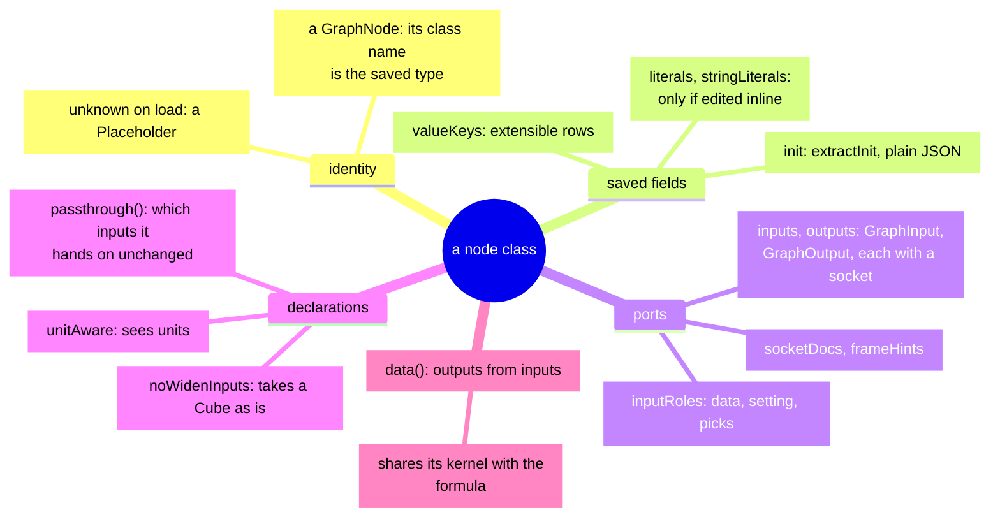
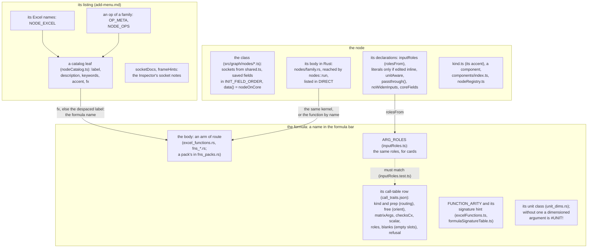
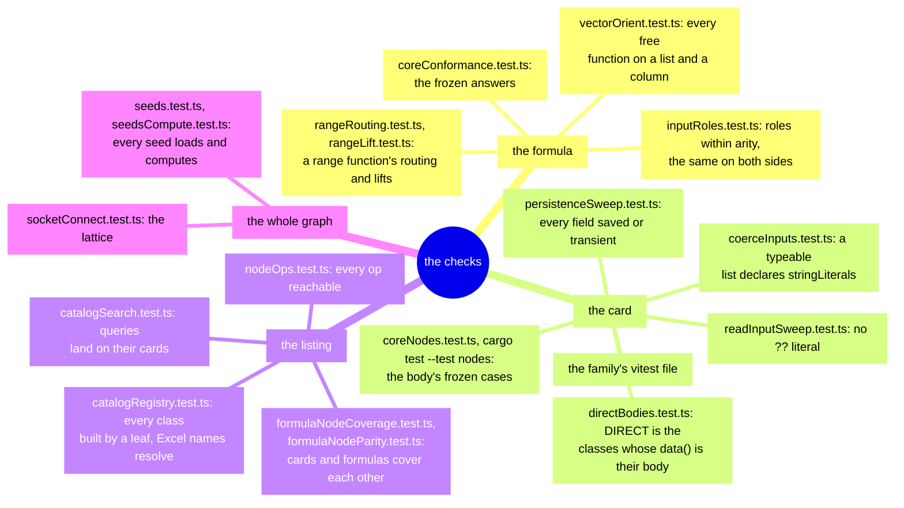
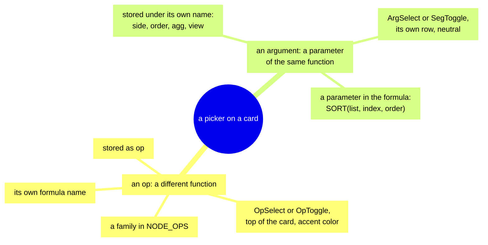
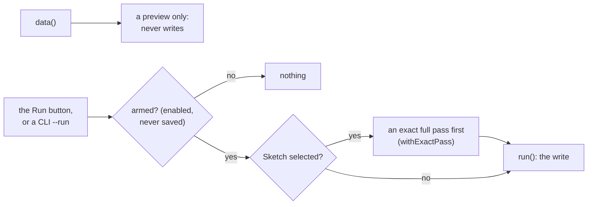

<!-- [[B12]] losslessSaves, [[C17]] shareImpl, [[C25]] firstClassUnits, [[D46]] freezeVolatilePerCalc, [[C28]] literalsIffEditable, [[C35]] unknownViaPlaceholder, [[B11]] maximalMerge, [[B14]] oneDesignSystem, [[D86]] blankRoles; covers: src/graph/nodes/*.ts -->

# Spec: Node classes and op modules

Serves [[B12]] losslessSaves, [[C17]] shareImpl, [[C25]] firstClassUnits, [[D46]] freezeVolatilePerCalc and [[C28]] literalsIffEditable, with [[C35]] unknownViaPlaceholder and [[D86]] blankRoles. Node merges and control-driven socket swaps serve [[B11]] maximalMerge; frame input labels serve [[B14]] oneDesignSystem.

This is the floor every node class and op module under `src/graph/nodes/` is built to. A file that implements a specific mechanism (units, dates, errors, a family's merge) cites that leaf in its own header. This spec's `covers:` line is what `dte blast` and `dte coverage` read instead of a citation in every file.

A **node class** is the headless model of one card: its sockets, its saved fields and its `data()`, which computes outputs from inputs. An **op module** (`*Ops.ts`) holds a family's op names, their metadata and the few pure helpers its card and components share; the calculations a class and its formula functions share are the core's ([[node-bodies]]).

## A new function across the app

A function that is both a formula and a card is declared in three places that never import each other: its call-table row and Rust function, its node class in TypeScript and Rust, and its **listing**, the catalog entries that make it findable ([[add-menu]]). The `add-node` skill walks the steps; this is the map of what each one is and which check catches a gap. A function that is only a formula needs the first box and an Excel name in its listing; a card no formula expresses (a Frame verb, a figure, an input) needs the last two.

Each declaration in the map, and the spec that governs it:

| Declaration | What it says | Governed by |
|---|---|---|
| an arm of `route` | the body that answers the formula name | [[formula-language#The registry]] |
| `call_traits.json` | how a call routes (`kind`, `prep`), its vector direction (`free`), whether a matrix reaches the body (`matrixArgs`) and a complex value is refused before it (`checksCx`), the arguments a list lifts in (`scalar`), each argument's role and empty-slot reading, a blocked name's message | [[formula-language#The registry]], [[formula-language#Argument routing]], [[input-roles]] |
| `FUNCTION_ARITY`, the signature table | the argument count and the hint the editor shows | [[formula-language#The registry]] |
| `ARG_ROLES` | each argument's role (data, setting, required, picks), the same as the call table's | [[input-roles#The declaration]] |
| a unit class in `unit_dims.rs` | what dimension the answer carries | [[unit-flow#Formula dimensions (`unit_dims.rs`)]] |
| the class, `INIT_FIELD_ORDER` | the card's sockets and saved fields, in the save's order | this spec, [[save-format]] |
| `data() = nodeOnCore` | the node's work is done in Rust | [[node-bodies]] |
| `inputRoles`, literal maps, `unitAware`, `passthrough()`, `noWidenInputs` | which roles its sockets take, which values it types inline, whether it sees units, which inputs it hands on unchanged, whether a Cube arrives as is | this spec, [[inline-literal-maps]], [[unit-flow]], [[compute-pass]] |
| `coreFields` | run-time fields the body reads that no save keeps (a resolved angle mode) | [[node-bodies#The call (`nodeOnCore.ts`, `engine_node`)]] |
| `nodes::run`, `DIRECT` | the Rust body's dispatch by class name; the classes the engine calls in Rust with no JavaScript between | [[node-bodies]], [[graph-core#Direct calls (phase C)]] |
| `kind.ts`, the component, the registry | the card's accent, its face, and the class-to-component table persistence also reads | [[components]] |
| the catalog leaf, `OP_META`, `NODE_OPS`, `NODE_EXCEL` | its name, description, search words and formula name; an op family's ops; its Excel names | [[add-menu]] |
| `socketDocs`, `frameHints` | the Inspector's sentence per socket, and an example table per frame input | this spec |

What catches a gap:

## Identity and persistence

- **A node class is a `GraphNode`** (`graphModel.ts`), its ports `GraphInput`s and `GraphOutput`s holding sockets. Its ports change only through `addInput`, `removeInput`, `addOutput`, `removeOutput`, `moveInputLast`, a port's `socket` setter and a `MutableSocket`'s `setType`, which reach the graph core while the node is in an editor; `inputs` and `outputs` are read-only otherwise ([[graph-core#The model (`graphEditor.ts`, `graphModel.ts`, `model.rs`)]]).
- **The class name is the persisted type.** It is kept and unique, so renaming a class changes the save format ([[save-format#The persisted type is the class name]]).
- **An unknown saved type loads as a Placeholder** and saves back out as itself, losing nothing ([[C35]] unknownViaPlaceholder). `PlaceholderNode` is not in the Add-menu catalog; only the loader builds one. It keeps the original type, init and literal maps verbatim, rebuilds the saved socket keys (adoptive inputs, `trueany` outputs) so the cables survive, and every output emits `#REF!` naming the missing type.
- **Every field is either persisted or deliberately transient**, and the persistence sweep (`persistenceSweep.test.ts`) knows which ([[save-format#Every field is persisted or deliberately transient]]). `extractInit` is a fixed point, so saving a freshly loaded node gives back the same init, and its output is plain JSON ([[save-format#The capture is a fixed point, and plain JSON]]).
- **Extensible rows rebuild their exact keys.** A card with addable rows (value rows `v0`, `v1`, …, or paired rows such as `column0` and `value0`) takes the saved keys from `valueKeys` on load and paste and rebuilds exactly those, never a fresh sequence; paired cards read the ids through `pairIdsFromKeys`. Otherwise saved literals and cables stop lining up with their rows. A row's insertion order is its meaning (stack order, concatenation order, left to right). A fixed input that sits after the rows (SWITCH's Default, IFS's Otherwise, Merge Plots' Options) is re-seated last by `moveInputLast` each time a row is added, so the live socket order is the one a reload rebuilds.

## Formula registrations and op modules

- **A formula function's contract lives in one place**, the core's call table (`data/call_traits.json`): its routing, its argument roles and its empty-slot readings; its arity is `FUNCTION_ARITY`. Routing is derived from that table, never from a hand-kept list ([[formula-language#The registry]], [[engineering#Lists of names are generated]]).
- **An op module imports nothing from the graph model** ([[engineering#The formula path is graph-free]]). **A card and its formula share one kernel** ([[C17]] shareImpl): the node calls the formula's function by name, or its kernel.
- **A variant is a selector on the existing card, never a sibling node** ([[B11]] maximalMerge). An op is a different function; an argument is a parameter of the same function ([[C26]] opArgDistinct). A merge follows these mechanics, each of which was once gotten wrong:
  - An op's formula name is `fx ?? despace(label)`. When the real name is an Excel spelling or the label went bare, declare `fx` (distribution `normal` → NORM.DIST). Never dodge a [[formula-language#Derived names are unique]] collision by reclassifying the family as an argument or inventing a parallel presentation flag: the selector that names the node is the `op` field, and the accent follows.
  - Selector-driven socket swaps prune departing keys through `dropInputCables` before `removeInput` ([[input-cable-pruning#The ordering rule]]), keep the per-op shape in a spec table (the `DIST_SPECS` pattern), and carry state across a switch by meaning (PDF↔PMF, inverse variants → Inverse).
  - Where the combinations are few, flat ops beat a second picker: each op keeps its own hover description and no new saved field is needed (Hypothesis Test's six tests, Rank & Percentile's INC and EXC forms).
  - A merge keeps the old Add-menu leaf types, so `NODE_EXCEL` and the Function Reference are untouched; the merged nodes are inventoried in `docs/node-coverage.md`. Old saves load as Placeholders ([[B7]] preAlphaBreakFreely).
  - After a merge, run `nodeOps.test.ts` and `formulaNodeCoverage.test.ts` beside the parity, catalog and seed suites.

- **The field name is the whole op/argument classification** ([[C26]] opArgDistinct). An op is stored in a field named `op`, declared as a family in `NODE_OPS`, and picked with `OpSelect` or `OpToggle` at the top of the card, in the accent color. An argument is stored under its own name (`side`, `order`, `agg`, `view`, `condition`) and picked with a neutral `ArgSelect` or `SegToggle` in its own row; its search words go in the host leaf's `keywords`. Nothing sits between the two: no `kind` switch, no `arg` flag, no argument family in `NODE_OPS`, no argument stored as `op`. In a formula an argument is a parameter of the node's one function: `SORT(list, index, order)`, `RUNNING(op, list, [window])`, `PADTEXT(text, width, [side])`.
  - **An aggregator is an argument when the host has a job the aggregator only parameterizes.** Group Lists, GROUPBY, Cube Rollup and Running each pick SUM, AVERAGE, MIN and so on as an argument, with no function name per aggregator. Aggregate is the exception: the aggregator is the whole node, so it is an op. If users search for aggregator names and miss, the fix is more `keywords` on the host leaf, never a search row per aggregator.
  - **Classifying a new picker.** Weigh the signals together; none wins on its own. Would the user pick it, or could it arrive computed? Does it have its own name? Would the user search for it? Is it meaningless without its host? Is it an Excel function (which only corroborates)? [[formula-language#Derived names are unique]] can overrule: choices that would share a formula name can't be ops. A per-choice formula name follows from the answer, never decides it.
  - Distribution's `.RT` forms have search rows because Distribution is an op family, not because arguments may be searchable. Gauge's Dial and Bar are an argument (`mode`, a `SegToggle`): nobody searches for "dial", and the card has no formula surface. Whether every op is callable from a formula is [[D73]] nodeCoversFormula's business, not this classification's. The picker components and their layout: `DESIGN.md` § Op pickers.
- **A node reaches everything its formula does** ([[D73]] nodeCoversFormula). A card whose body calls a function by name passes the function's full argument list. A node with its own computation covers every mode the registration does, preferably through one shared kernel: the REGEX card and the REGEX formulas run the core's one regex engine (`text_ops.rs`). An argument whose meaning lives only in a cell grid, or one the formula accepts and ignores (IRR's guess), has no socket; the reason is recorded against that function.

## Reading inputs

- **`data()` reads inputs the value-semantics way** ([[value-semantics]], "Reading an input"):
  - a null is skipped, not treated as zero ([[D36]] nullSkippedNotZero);
  - an error beats a missing value in the same cell ([[C24]] arraySemantics);
  - a producer turns a non-finite result into a classified error rather than emitting it bare ([[D48]] classifyNonFinite);
  - an input ignores units only where that input is declared unit-blind ([[C25]] firstClassUnits).
- **Wired beats literal, even when blank.** A connected cable's value wins even when it carries null; only an unwired slot falls back to the card's typed literal ([[D86]] blankRoles). So a card tests connection presence (`readInput`, or `inputs[key]?.length`), never `?? literal`, which would hide a wired blank behind the literal. A setting or pick socket declares its role (`static inputRoles`, usually `rolesFrom` its formula twin) and reads through `readRole` ([[input-roles]]). A wildcard slot on an `autoLiterals` card reads through `pick_slot`, which applies the same rule over both literal maps.
- **A unit-aware class sets `unitAware = true`.** It then receives `UnitCell` tags intact and runs the dimension algebra itself ([[unit-flow]]); every other class sees bare magnitudes.
- **A class that takes a Cube as is lists the input in `noWidenInputs`**, so the coercion wrapper skips rank widening there and the class runs its own Cube branch ([[frame-verbs]] § Frames and Cubes).
- **A volatile `data()` freezes its random draw per recalc.** It keys the draw on the recalc generation (`getRecalcGen` in `process.ts`), so every read within one recalc sees the same value, and it never calls a bare `Math.random()` ([[D46]] freezeVolatilePerCalc). The raw draw is what freezes; live inputs such as bounds apply to it on every call, so a new bound rescales the same draw instead of rerolling.
- **A sink never acts from `data()`** ([[C38]] sinkRunButtonOnly). A class with an irreversible external effect (a disk write) computes only a preview in `data()`. The effect lives in `run()`, which fires only from the node's Run button or an explicit CLI run (`scripts/run-graph.ts --run <label>`, which stands in for the button), and only while the `enabled` arm flag is on. While Sketch is selected, `run()` goes through `withExactPass` (`process.ts`), which runs a forced exact full pass before the write, so a file, note or task carries every row rather than the sample. The arm flag never persists: it is left out of the `extractInit` whitelist, so every load path (reopening a save, paste, Placeholder restore) starts disarmed.

## Sockets

- **A socket that is about to disappear loses its cables first.** A method that removes sockets returns the departing keys, so the caller runs `dropInputCables` before `removeInput` ([[input-cable-pruning#The ordering rule]]).
- **A socket retyped in place reconciles everything downstream** ([[type-propagation-on-in-place-socket-retype#Control-driven socket swaps]]). Swapping `socket` on an existing input or output fires no connection event, so the method that does it (`setOp`, `setMode`, `setDataType`) says so, and the caller follows with `retypeOutputCables` for outputs, or prunes an input's incompatible cables before the swap.
- **A literal map exists if and only if the card edits it inline** ([[C28]] literalsIffEditable; [[inline-literal-maps]]). A wildcard input row keeps its typed cell in exactly one of `literals` and `stringLiterals`.
- **Socket docs are opt-in and live on the class.** A node class may declare a static `socketDocs` map (socket key to one plain-English sentence beyond the type name) for the Inspector's per-socket detail, read through `socketDocFor(node, key)`. It has the same declare-on-the-class shape as `frameHints` and `literals`, so the text sits beside the sockets it documents and survives minification. Most sockets need none, since the label plus `SOCKET_TYPE_LABELS` already describes them.

### Frame input labels

A Frame input's label names the columns it expects, in order, and an input that takes any columns gets a plain noun; the label never states the shape, which the socket already shows ([[B14]] oneDesignSystem). The label is the only place a user can see what columns a node wants before wiring it up. This would reopen if a node could show its expected columns some other way before it is wired.

- **The label grammar.** A label that names columns lists their roles in the expected order, each a Title-case word, joined with `" + "` (`From + To + Value`, `Label + Value`); a standard group of columns may shorten to its standard initialism (`Date + OHLC`), never spaced-out single letters. An input that expects no particular columns is one plain Title-case noun (`Frame`, `Data`, `Series`). A label never carries the shape in brackets (`(2-D)`, `(list)`), which the socket and the Socket Legend already show. A role-labeled input declares its example in the class's static `frameHints` map under the input key (`frameHint.ts`), and the hint's column names equal the label's roles in order.
- **Every role-labeled input shows a matching example table** (`frameHint.test.ts`). Its columns are the label's columns, in order, with a standard initialism spelled out (`OHLC` is Open, High, Low, Close). Every example, whether or not its label lists columns, is 3 to 5 full rows whose cells match the declared column types. The example is the label worked through, so the two are one promise: a labeled input with no example leaves the user guessing, and an example whose columns drift from the label shows a confidently wrong table, which is worse than none. That is why a test enforces it rather than care.

*Exception:* the λ-table inputs in `nodes/tableLambda.ts` are named for the λ argument they bind (`Values (value)`, `value2 (optional)`), since that is what the user needs to know there; the exception is scoped to that file. **Removed by:** those nodes binding by column name instead.
