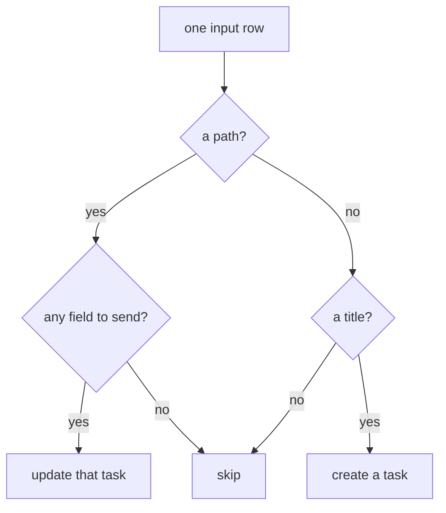

<!-- [[B1]] obsidianBet, [[B18]] safeToShare, [[D62]] demoVaultResolution, [[C44]] dateSerials, [[B11]] maximalMerge -->

# Spec: TaskNotes

Serves [[B1]] obsidianBet. TaskNotes is an Obsidian plugin that keeps each task as a note and serves them over a local HTTP API. Two nodes speak to it: the TaskNotes node reads tasks, calendar events and counts, and the Write Tasks node creates and updates tasks from rows. [[vault-bridge]] names their neighbors; fetching, caching, the network prompt and refresh follow [[live-connections]]. The code is `taskNotesApi.ts` (the URLs and every conversion, with no network in it) and `nodes/taskNotes.ts` (the two nodes).

## Reaching the API

- **The address** is the "TaskNotes API" setting. Blank means `http://localhost:8080`, an address without `http://` gets it, and trailing slashes are dropped.
- **The token** is pasted on the TaskNotes node and kept with the app's other API keys, never in the document. It is sent as `Authorization: Bearer <token>`; with no token no header is sent.
- **A reply** is JSON wrapped as `{ success, data }`. A reply with `success: false` fails with the API's own error text, and a reply that is not JSON fails with "the reply was not JSON". A bare JSON reply with no wrapper is read as the data.
- **The demo.** With "Use demo vault" on and no address set, or on a marketing page that forces the demo, the TaskNotes node answers a fixed set of demo tasks, events and counts and touches no network ([[D62]] demoVaultResolution).
- **A real address is reached only after the network prompt allows it** ([[B18]] safeToShare). Until then the TaskNotes node shows the gated state and answers its empty shape.
- A rejected token shows "Token rejected. Paste the plugin's API token." and an unreachable address shows a message saying TaskNotes can't be reached.

## The TaskNotes node

One node reads three things, picked on the card ([[B11]] maximalMerge). Switching the pick swaps the node's sockets; cables on a socket that leaves are pruned first ([[input-cable-pruning]]).

| Pick | Inputs | Output | Answers before anything is read |
|---|---|---|---|
| Tasks | none | `tasks`, a Cube | a Cube with one empty `title` column |
| Calendar | `from`, `to` (dates) | `events`, a Frame | the four event columns with no rows |
| Stats | none | `stats`, a Frame | the five counts, each blank |

### Tasks

Tasks are read 200 at a time until the API says there are no more, then answered as one Cube, a row per task, with these columns in this order:

| Column | Type | From the API's |
|---|---|---|
| `path` | text | `path`, else `id` |
| `title` | text | `title` |
| `status` | text | `status` |
| `priority` | text | `priority` |
| `due` | date | `due` |
| `scheduled` | date | `scheduled` |
| `completed` | date | `completedDate` |
| `timeEstimate` | number | `timeEstimate`, in minutes |
| `trackedMinutes` | number | `totalTrackedTime`, else the sum of the time entries' minutes |
| `archived` | TRUE/FALSE | `archived` |
| `projects` | list of text | `projects`, each reduced to the note's name |
| `contexts` | list of text | `contexts` |
| `tags` | list of text | `tags` |
| `blockedBy` | list of text | `blockedBy`, each reduced to the blocking note's name |
| `timeEntries` | nested Frame | `timeEntries`: Start, End, Minutes, Description |
| `complete_instances` | nested Frame | `complete_instances`: one Date column, a row per completed day of a recurring task |
| `created` | date | `dateCreated` |
| `modified` | date | `dateModified` |

After them comes one column per user field, in the order first met going down the tasks. A user field is every key under the task's `customProperties` and every top-level key the list above and the plugin's own bookkeeping keys (recurrence, reminders, calendar ids and the like) do not name, so a field the plugin adds later is carried, never dropped. A user field's text that starts as an ISO date is a date, a list stays a list, and any other object is its JSON text.

- **A note's name** from a link or a path is the text inside `[[ ]]`, before any `|` alias or `#` heading, after the last `/`, without `.md`: `[[Projects/Kitchen.md|the kitchen]]` is `Kitchen`.
- **A time entry's Minutes** is its End minus its Start, rounded to the minute, else the entry's own `duration`.
- **Dates are the local wall clock** ([[C44]] dateSerials). A date alone is that day. A date and time with no zone is the time as written. A date and time with a zone (`Z` or `+02:00`) is this machine's clock at that instant. A day the month does not have (`2026-02-30`) is blank, with or without a time, never rolled into the next month.

### Calendar

The Calendar pick asks for the events between two days, from the start of `from` to the end of `to`, and swaps the two when `from` is the later one. Unwired, `from` is a year back from today and `to` a year ahead. A cabled date that is blank holds the read: the TaskNotes node stays idle and answers no rows. The answer is a Frame of `Title`, `Start`, `End` and `Source` (the calendar or subscription an event came from).

### Stats

The Stats pick answers a Frame of `Status` and `Count` with five rows: Total, Completed, Active, Overdue, Archived. A count the API leaves out is blank.

## The Write Tasks node

The Write Tasks node takes rows on `tasks` (a Cube; a Frame cabled in widens to one) and the columns to send on `keys`, and answers its `plan`, a Frame saying what a Run would do. Computing the plan reaches nothing: only Preview reads and only Run writes.

- **The fields that can be sent** are `title`, `details`, `status`, `priority`, `due`, `scheduled`, `tags`, `contexts`, `projects`, `recurrence`, `recurrence_anchor`, `timeEstimate` and `blockedBy`. A column with any other name is never sent, and `path` only addresses the task.
- **Keys** narrows the send to the named columns. Blank Keys sends every sendable column the rows have.
- **A blank cell is not sent**, so a blank never clears a field on the task. A nested table and a date that cannot be read are not sent either.
- **How a cell is written:** `due` and `scheduled` as `YYYY-MM-DD`, with `THH:mm` added when the date carries a time; `tags`, `contexts` and `projects` as a list, a list cell as it is and text split on commas and semicolons; `blockedBy` as links to the named notes, each finish-to-start; `timeEstimate` as a number; anything else as its text.
- **The plan** has a row per input row: `path`, `title`, `action` (`create`, `update` or `skip`) and `fields`, the names that would be sent.

**Preview** reads each task a row would update and compares the fields to send with what the task holds. A row with nothing to change is marked `unchanged` and a task that cannot be read `unreadable`, in the plan's `action` column; Run then leaves both alone. The marks last until a different object arrives on `tasks`.

**Run** writes only when the node is armed, and the node loads disarmed in every document: the arm is never saved ([[B18]] safeToShare). Run refuses, with the reason on the card and without touching the network, when the node is disarmed, when the rows are an error, when there are no rows, and while the TaskNotes node shows the demo (demo paths must never reach a real server). Otherwise it creates each `create` row and updates each `update` row in order, carries on past a row that fails, and reports how many were created, updated and failed, with the first three failures' reasons. Run settles the graph's pass first, so the rows written are the current ones ([[compute-pass]]).

Tests:

- `taskNotesApi.test.ts`: the three addresses and the bearer header; dates and timestamps as serials, zone-less as written and zoned as the local clock, a day the month lacks as blank; a link or path reduced to the note's name; the reply wrapper and its error text; a full task as a record (lists, nested time entries with minutes worked out, completed instances, user fields); `totalTrackedTime` over the worked-out minutes; an unknown top-level key kept as a user field; paging; the Cube's column order; events and stats.
- `taskNotesWrite.test.ts`: each field's written form and what is not sent; a row with a path updates, without one creates from its title, with nothing to send skips; Keys narrows the fields and `path` is never one; the plan Frame and Preview's marks over it; the update and create addresses; the Write Tasks node loads disarmed, refuses to run disarmed or with nothing to write without touching the network, and refuses Preview and Run while the demo shows.
