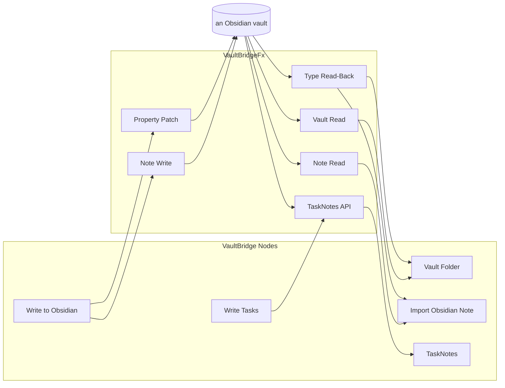

<!-- [[B1]] obsidianBet, [[C101]] onePatchPath, [[C38]] sinkRunButtonOnly, [[D62]] demoVaultResolution -->

# Spec: VaultBridge

Serves [[B1]] obsidianBet. **VaultBridge** is everything that crosses between a Solenoid document and an Obsidian vault. Its cards are the **VaultBridge Nodes**; the processes behind them, which are not graph items, are the **VaultBridgeFx** (an Fx is a process, as in [[group-expand-push#LayoutFx]]). This spec names the members and routes each to the spec that governs it; the mechanics live there.

## VaultBridge Nodes

| Node | Direction | Its Fx | Governed by |
|---|---|---|---|
| Vault Folder | reads a folder as one Cube, a row per note | the Vault Read, the Type Read-Back | [[live-connections]] (fetch and cache only; the Cube's shape has no spec yet) |
| Import Obsidian Note | reads one note as a read-only Note | the Note Read, the Type Read-Back | [[reports-and-notes#Notes]], [[obsidian-plugin#What Solenoid reads back]] |
| TaskNotes | reads tracked time, recurring instances, events and stats | the TaskNotes API | [[live-connections]] (fetch and cache only; no spec yet) |
| Write to Obsidian | writes a Note, a Report or a Cube of rows | the Note Write, the Property Patch | [[reports-and-notes#Write to Obsidian]] |
| Write Tasks | creates or updates TaskNotes tasks from rows | the TaskNotes API | [[compute-pass]] (its Run only; no spec yet) |

A Note and a Report are documents, not VaultBridge Nodes: they reach a vault through Write to Obsidian. The Solenoid Properties plugin is the bridge's other end, inside Obsidian ([[obsidian-plugin]]).

## VaultBridgeFx

| Fx | What it does | Code | Governed by |
|---|---|---|---|
| **Vault Read** | lists a folder's notes and builds the Cube: file columns, every frontmatter key, inline tags, a daily note's date from its name | `vaultCube.ts`, `dailyNotesConfig.ts`, the Vault Folder card in `nodes/connection.ts` | no spec yet |
| **Note Read** | one note's frontmatter and body | `noteFrontmatter.ts`, `obsidianMarkdown.ts`, `nodes/obsidian.ts` | [[reports-and-notes#Frontmatter becomes output sockets]] |
| **Type Read-Back** | the column types a vault declares: `.obsidian/types.json`, an mdbase schema, and the plugin's own picks | `obsidianTypes.ts`, `mdbaseTypes.ts`, `vaultTypes.ts`, `pluginColumnTypes.ts`, `pluginDataPath.ts` | [[obsidian-plugin#What Solenoid reads back]], [[obsidian-plugin#The app reads the picks]] |
| **Note Write** | a document as markdown Obsidian renders, its pictures as assets, one note per page | `obsidianWrite.ts` (`writeDocumentToVault`) | [[reports-and-notes#Write to Obsidian]] |
| **Property Patch** | changes only the frontmatter keys it targets in an existing note ([[C101]] onePatchPath) | `frontmatterPatch.ts` | [[reports-and-notes#Write to Obsidian]] |
| **TaskNotes API** | the TaskNotes plugin's local HTTP API, read and write | `taskNotesApi.ts`, `nodes/taskNotes.ts` | no spec yet |

`obsidianLinks.ts` builds the `obsidian://` links a card opens a note with. On the web, and whenever "Use demo vault" is on, the reads go to the read-only demo vault instead ([[live-connections#The demo vault]], [[D62]] demoVaultResolution).

## What every VaultBridgeFx holds to

- **Writes happen only on Run.** Write to Obsidian and Write Tasks load disarmed and write nothing on their own ([[C38]] sinkRunButtonOnly); a write refuses against the demo vault.
- **Nothing leaves the vault.** A write drops empty, `.` and `..` path segments, and Vault Folder refuses a folder outside the vault.
- **A write changes only what it targets** ([[C101]] onePatchPath).
