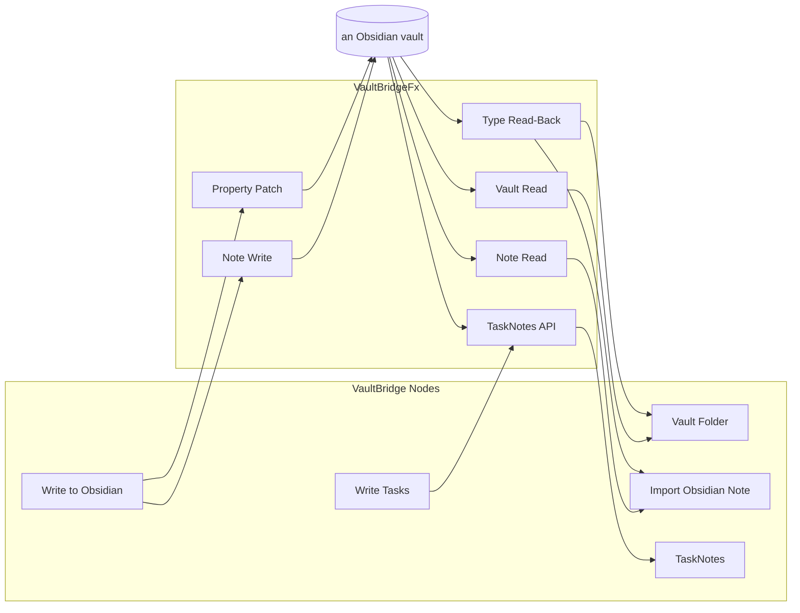

<!-- [[B1]] -->
<!-- [[B1]] obsidianBet, [[B18]] safeToShare, [[D62]] demoVaultResolution -->

# Spec: VaultBridge

Serves [[B1]] obsidianBet. **VaultBridge** is everything that crosses between a Solenoid document and an Obsidian vault. Its cards are the **VaultBridge Nodes**; the processes behind them, which are not graph items, are the **VaultBridgeFx** (an Fx is a process, as in [[group-expand-push#LayoutFx]]). This spec names the members and routes each to the spec that governs it; the mechanics live there.

## VaultBridge Nodes

| Node | Direction | Its Fx | Governed by |
|---|---|---|---|
| Vault Folder | reads a folder as one Cube, a row per note | the Vault Read, the Type Read-Back | [[vault-read]] (the Cube), [[live-connections]] (fetch and cache) |
| Import Obsidian Note | reads one note as a read-only Note | the Note Read, the Type Read-Back | [[reports-and-notes#Notes]], [[obsidian-plugin#What Solenoid reads back]] |
| TaskNotes | reads tracked time, recurring instances, events and stats | the TaskNotes API | [[tasknotes#The TaskNotes node]], [[live-connections]] (fetch and cache) |
| Write to Obsidian | writes a Note, a Report or a Cube of rows, or ticks checklist items | the Note Write, the Property Patch, the Task Mark | [[reports-and-notes#Write to Obsidian]] |
| Write Tasks | creates or updates TaskNotes tasks from rows | the TaskNotes API | [[tasknotes#The Write Tasks node]] |

A Note and a Report are documents, not VaultBridge Nodes: they reach a vault through Write to Obsidian. The Solenoid Properties plugin is the bridge's other end, inside Obsidian ([[obsidian-plugin]]).

## VaultBridgeFx

| Fx | What it does | Code | Governed by |
|---|---|---|---|
| **Vault Read** | lists a folder's notes and builds the Cube: file columns, every frontmatter key, inline tags, a daily note's date from its name | `vaultCube.ts`, `dailyNotesConfig.ts`, the Vault Folder card in `nodes/connection.ts` | [[vault-read]] |
| **Note Read** | one note's frontmatter and body | `noteFrontmatter.ts`, `obsidianMarkdown.ts`, `nodes/obsidian.ts` | [[reports-and-notes#Frontmatter becomes output sockets]] |
| **Type Read-Back** | the column types a vault declares: `.obsidian/types.json`, an mdbase schema, and the plugin's own picks | `obsidianTypes.ts`, `mdbaseTypes.ts`, `vaultTypes.ts`, `pluginColumnTypes.ts`, `pluginDataPath.ts` | [[obsidian-plugin#What Solenoid reads back]], [[obsidian-plugin#The app reads the picks]] |
| **Note Write** | a document as markdown Obsidian renders, its pictures as assets, one note per page | `obsidianWrite.ts` (`writeDocumentToVault`) | [[reports-and-notes#Write to Obsidian]] |
| **Property Patch** | changes only the frontmatter keys it targets in an existing note ([[#Writing a note's properties changes only what it targets]]) | `frontmatterPatch.ts` | [[reports-and-notes#Write to Obsidian]] |
| **Task Mark** | sets the mark of a checklist item in a note's body, one character and nothing else ([[#Writing a note's properties changes only what it targets]]) | `noteBody.ts` (`planTaskMark`, `setTaskMarks`) | [[reports-and-notes#Write to Obsidian]] |
| **TaskNotes API** | the TaskNotes plugin's local HTTP API, read and write | `taskNotesApi.ts`, `nodes/taskNotes.ts` | [[tasknotes]] |

`obsidianLinks.ts` builds the `obsidian://` links a card opens a note with. On the web, and whenever "Use demo vault" is on, the reads go to the read-only demo vault instead ([[live-connections#The demo vault]], [[D62]] demoVaultResolution).

## What every VaultBridgeFx holds to

- **Writes happen only on Run.** Write to Obsidian and Write Tasks load disarmed and write nothing on their own ([[B18]] safeToShare); a write refuses against the demo vault.
- **Nothing leaves the vault.** A write drops empty, `.` and `..` path segments, and Vault Folder refuses a folder outside the vault.
- **A write changes only what it targets** ([[#Writing a note's properties changes only what it targets]]).

Tests:

- `taskNotesWrite.test.ts`: Write Tasks loads disarmed, refuses to run while disarmed or with nothing to write without touching the network, and refuses Preview and Run while its reader shows the demo, so demo paths never reach a real server.
- `catalogRegistry.test.ts`: no card persists an `enabled` arm flag, and none constructs armed.
- `demoVault.test.ts`: the demo vault is read-only, every writer throwing.

## Write to Obsidian types a new property with the Solenoid Properties types

When Write to Obsidian adds a property a vault has no type for, it registers the Solenoid Properties type that matches the column: a list, a matrix, a Frame, a Cube or a complex number gets its Solenoid type, and a plain number, text, date or true/false keeps Obsidian's own. It assumes the plugin is installed. Obsidian's own tags, aliases and cssclasses are never retyped.

- How it's built: `docs/node-coverage.md` § Write to Obsidian, Properties target.
- **Reopen if:** people write to vaults without the plugin often enough that a Solenoid type showing as unknown costs more than it gives.

## Writing a note's properties changes only what it targets

When Solenoid writes a note's properties, it changes only what it means to change, leaves every other character as it was, and writes the way Obsidian does.

- How it's built: [[reports-and-notes#Write to Obsidian]].
- **Reopen if:** a write needs to restructure a note beyond its properties.
