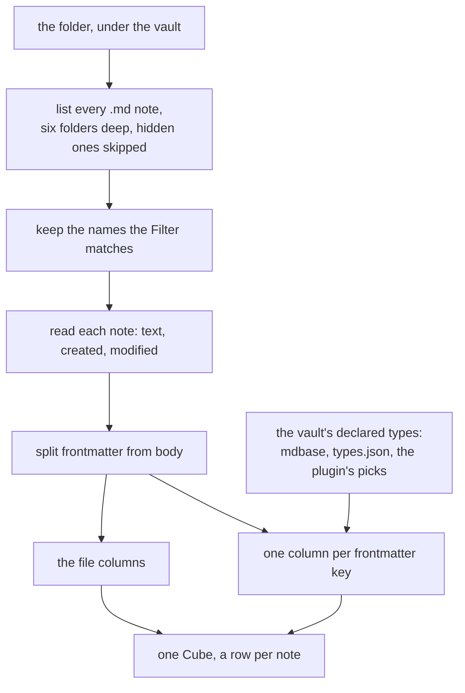

<!-- [[B1]] obsidianBet, [[C67]] mdbaseCeiling, [[C44]] dateSerials, [[C58]] tableInputRawText, [[D62]] demoVaultResolution -->

# Spec: Vault Read

Serves [[B1]] obsidianBet. The Vault Read is the process behind the Vault Folder node: it reads a folder of an Obsidian vault and answers one Cube, a row per note and a column per property. [[vault-bridge]] names its neighbors; fetching, caching and refresh follow [[live-connections]]. The code is `vaultCube.ts` (`notesToCube`), `dailyNotesConfig.ts` and the Vault Folder node in `nodes/connection.ts`.

## Which notes are read

- **The vault** is the one [[D62]] demoVaultResolution resolves: a forced demo, else the vault set in Settings, else the demo vault when allowed. With no vault at all the Vault Folder node answers nothing and shows no error.
- **The folder** is the Vault Folder node's Folder field, or the text cabled into its Folder socket, relative to the vault with leading and trailing slashes dropped. A blank folder reads the whole vault. A folder that resolves outside the vault is refused with `"<folder>" is not inside the vault`.
- **The notes** are every `.md` file under the folder, down to six folders deep, with hidden files and folders (a name starting with a dot, so `.obsidian` and `.trash`) skipped, and every folder named `_types` skipped (an mdbase collection keeps its type definitions there, and they are not notes).
- **The Filter** keeps the notes whose file name matches a pattern, ignoring case: `*` stands for any run of characters and `?` for exactly one. The pattern is matched against the whole file name including `.md`, so `2026-*` keeps `2026-03-01.md` and `2026-03-01` alone keeps nothing. A blank Filter keeps every note.
- **Row order** is the notes' paths in alphabetical order, so a folder of daily notes named by date reads oldest first.
- A note renamed or deleted between the listing and its read is left out, with no error.
- **Where it runs:** the desktop app, the demo vault, and the headless runner given `--vault <path>`. On the web with a real vault path the Vault Folder node shows "Reading a vault is available in the desktop app only".

## The file columns

Every Cube starts with the same eleven columns, in this order, whatever the notes hold:

| Column | Type | What it holds |
|---|---|---|
| `path` | text | the note's path relative to the vault, with forward slashes and `.md` |
| `name` | text | the file name without its extension |
| `folder` | text | the path without the file name; blank for a note at the vault root |
| `ext` | text | the extension with its dot, `.md` |
| `size` | number | the note's length in bytes as UTF-8 |
| `created` | date | when the file was created, date and time in UTC; blank where the file system does not say |
| `modified` | date | when the file was last changed, date and time in UTC; blank where the file system does not say |
| `tags` | list of text | the frontmatter `tags` first, then every inline `#tag` in the body, each once, without the `#` |
| `links` | list of text | the target of every `[[wikilink]]` in the note, frontmatter included, each once in reading order; an alias (`\|shown`) and a heading (`#Heading`) are dropped, and an embed's target is listed too |
| `embeds` | list of text | the target of every `![[embed]]`, read the same way |
| `date` | date | the day the file name spells, by the name format below; blank when the name does not match |

With "Include body" on, a twelfth column `note-body` follows: the note's text after its frontmatter.

An inline tag is read as Obsidian reads one: letters, digits, `_`, `-` and `/` after a `#` that starts a line or follows a space, never all digits (`#1` is no tag), and never inside a code fence or a code span.

**The name format** turns a file name into the `date` column, with the tokens `YYYY`, `YY`, `MM`, `M`, `DD`, `D`, `HH`, `mm` and `ss` and every other character matched as written. The Vault Folder node's own name format wins. Left blank, a folder that is the vault's daily-notes folder (`.obsidian/daily-notes.json`, the core Daily notes plugin's settings) takes that plugin's format, which is `YYYY-MM-DD` when the plugin names none; any other folder has no format and a blank `date` column. A name must match the format whole and must spell a year, a month and a day: `2026-03` under `YYYY-MM` is blank, since a month is not a day ([[C44]] dateSerials).

## The property columns

After the file columns comes one column per frontmatter key, in the order the keys are first met going down the rows. A note without a key has a blank cell in that column.

A key named like a file column never becomes a second column. `tags` is merged into the `tags` file column. A frontmatter `path`, `name`, `folder`, `ext`, `size`, `created`, `modified`, `links`, `embeds`, `date` or `note-body` is not read at all: the file column of that name keeps its own value, so a note's own `date: 2026-03-04` property does not reach the Cube. This is a gap (`docs/backlog.md` § VaultBridge), and no test pins it.

**A column's shape and type** come from the first source that names the key:

1. **An mdbase type** ([[C67]] mdbaseCeiling). A folder holding `mdbase.yaml` is a collection, its types defined by the notes in its `_types` folder. Each note takes the nearest collection at or above it, inside the folder being read, and within it the type whose path pattern matches the note. The first note down the rows whose type declares the key decides the whole column.
2. **Obsidian's own types**, `.obsidian/types.json` at the vault root.
3. **A guess from the values.** A key holding rows of records anywhere is a column of nested Cubes; else a list of lists anywhere makes it a column of tables; else a list anywhere makes it a column of lists; else it is a column of single values. The cell type is the one every present value shares (number, text, TRUE/FALSE or date), and text when they differ. A value written as an ISO date and time counts as a date.

The Solenoid Properties plugin's picks then type the columns inside a nested Cube ([[obsidian-plugin#The app reads the picks]]).

**A cell is made to fit its column's shape.** In a column of lists a single value is a list of one. In a column of single values a list gives its first item. In a column of tables a list is one row. In a column of nested Cubes anything that is not rows of records is blank.

**A cell is read as its column's type**, the way a Frame cell of that type reads typed text ([[C58]] tableInputRawText): text the type cannot read is `NaN`, never a blank, so a wrong value stays visible. Under a text type a number or TRUE/FALSE is its text, and a date is the ISO text the note holds, never its serial ([[obsidian-plugin#What Solenoid reads back]]).

## What the Vault Folder node keeps

- The Cube is held in memory only. It is never saved into the project file, so a shared document carries no note text; opening the document reads the vault again.
- A read that a newer one overtook (the folder, the Filter, the name format or the vault changed while it ran) lands nowhere, so a slow read never replaces a fresh one.
- A failed read clears the Cube and shows the error on the card.
- A note edited in Obsidian does not reach the Cube until the Vault Folder node refreshes: on its Refresh, on its "refresh every N minutes" setting, or on reopening the document.

Tests:

- `vaultCube.test.ts`: the file columns come first and the frontmatter keys follow in first-met order; `tags` merges frontmatter and inline tags, each once; `links` collects wikilinks from the body and the frontmatter; an inline tag is never all digits and never read from a code fence or a code span; a file name parses by the daily-notes format and by a custom one, and a name with no day is blank; an mdbase type and a `types.json` type each decide a column; with neither, a column is guessed and one mixed across rows is text; a list key is a list cell, rows of records a nested Cube, a list of lists a table; text a type cannot read is `NaN`; a date under a text type is the ISO text written.
- `demoVault.test.ts`: the demo vault is read through the same file calls and refuses every write.
