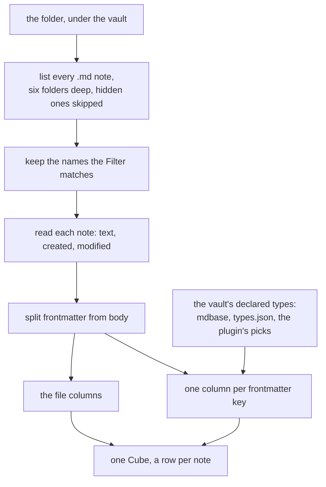
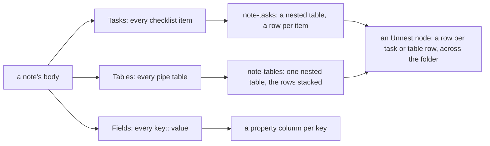

<!-- [[B2]] -->
<!-- [[B1]] obsidianBet, [[C67]] mdbaseCeiling, [[C44]] dateSerials, [[C58]] tableInputRawText, [[D62]] demoVaultResolution -->

# Spec: Vault Read

Serves [[B1]] obsidianBet. The Vault Read is the process behind the Vault Folder node: it reads a folder of an Obsidian vault and answers one Cube, a row per note and a column per property. [[vault-bridge]] names its neighbors; fetching, caching and refresh follow [[live-connections]]. The code is `vaultCube.ts` (`notesToCube`), `noteBody.ts`, `dailyNotesConfig.ts` and the Vault Folder node in `nodes/connection.ts`.

## Which notes are read

- **The vault** is the one [[D62]] demoVaultResolution resolves: a forced demo, else the vault set in Settings, else the demo vault when allowed. With no vault at all the Vault Folder node answers nothing and shows no error.
- **The folder** is the Vault Folder node's Folder field, or the text cabled into its Folder socket, relative to the vault with leading and trailing slashes dropped. A blank folder reads the whole vault. A folder that resolves outside the vault is refused with `"<folder>" is not inside the vault`.
- **The notes** are every `.md` file under the folder, down to six folders deep, with hidden files and folders (a name starting with a dot, so `.obsidian` and `.trash`) skipped, and every folder named `_types` skipped (an mdbase collection keeps its type definitions there, and they are not notes).
- **The Filter** keeps the notes whose file name matches a pattern, ignoring case: `*` stands for any run of characters and `?` for exactly one. The pattern is matched against the whole file name including `.md`, so `2026-*` keeps `2026-03-01.md` and `2026-03-01` alone keeps nothing. A blank Filter keeps every note.
- **Row order** is the notes' paths in alphabetical order, so a folder of daily notes named by date reads oldest first.
- A note renamed or deleted between the listing and its read is left out, with no error.
- **Where it runs:** the desktop app, the demo vault, and the headless runner given `--vault <path>`. On the web with a real vault path the Vault Folder node shows "Reading a vault is available in the desktop app only".

## The file columns

Every Cube starts with the same eleven columns, in this order, whatever the notes hold:

| Column | Type | What it holds |
|---|---|---|
| `path` | text | the note's path relative to the vault, with forward slashes and `.md` |
| `name` | text | the file name without its extension |
| `folder` | text | the path without the file name; blank for a note at the vault root |
| `ext` | text | the extension with its dot, `.md` |
| `size` | number | the note's length in bytes as UTF-8 |
| `created` | date | when the file was created, date and time in UTC; blank where the file system does not say |
| `modified` | date | when the file was last changed, date and time in UTC; blank where the file system does not say |
| `tags` | list of text | the frontmatter `tags` first, then every inline `#tag` in the body, each once, without the `#` |
| `links` | list of text | the target of every `[[wikilink]]` in the note, frontmatter included, each once in reading order; an alias (`\|shown`) and a heading (`#Heading`) are dropped, and an embed's target is listed too |
| `embeds` | list of text | the target of every `![[embed]]`, read the same way |
| `date` | date | the day the file name spells, by the name format below; blank when the name does not match |

With Body ticked under "From each note", a twelfth column `note-body` follows: the note's text after its frontmatter. Tasks and Tables add `note-tasks` and `note-tables` after it (*The body as data*).

An inline tag is read as Obsidian reads one: letters, digits, `_`, `-` and `/` after a `#` that starts a line or follows a space, never all digits (`#1` is no tag), and never inside a code fence or a code span.

**The name format** turns a file name into the `date` column, with the tokens `YYYY`, `YY`, `MM`, `M`, `DD`, `D`, `HH`, `mm` and `ss` and every other character matched as written. The Vault Folder node's own name format wins. Left blank, a folder that is the vault's daily-notes folder (`.obsidian/daily-notes.json`, the core Daily notes plugin's settings) takes that plugin's format, which is `YYYY-MM-DD` when the plugin names none; any other folder has no format and a blank `date` column. A name must match the format whole and must spell a year, a month and a day: `2026-03` under `YYYY-MM` is blank, since a month is not a day ([[C44]] dateSerials).

## The property columns

After the file columns comes one column per frontmatter key, in the order the keys are first met going down the rows. A note without a key has a blank cell in that column.

A key named like a file column never becomes a second column. `tags` is merged into the `tags` file column. A frontmatter `path`, `name`, `folder`, `ext`, `size`, `created`, `modified`, `links`, `embeds`, `date`, `note-body`, `note-tasks`, `note-tables` or `backlinks` is not read at all: the file column of that name keeps its own value, so a note's own `date: 2026-03-04` property does not reach the Cube. This is a gap (`docs/backlog.md` § VaultBridge), and no test pins it.

**A column's shape and type** come from the first source that names the key:

1. **An mdbase type** ([[C67]] mdbaseCeiling). A folder holding `mdbase.yaml` is a collection, its types defined by the notes in its `_types` folder. Each note takes the nearest collection at or above it, inside the folder being read, and within it the type whose path pattern matches the note. The first note down the rows whose type declares the key decides the whole column.
2. **Obsidian's own types**, `.obsidian/types.json` at the vault root.
3. **A guess from the values.** A key holding rows of records anywhere is a column of nested Cubes; else a list of lists anywhere makes it a column of tables; else a list anywhere makes it a column of lists; else it is a column of single values. The cell type is the one every present value shares (number, text, TRUE/FALSE or date), and text when they differ. A value written as an ISO date and time counts as a date.

The Solenoid Properties plugin's picks then type the columns inside a nested Cube ([[obsidian-plugin#The app reads the picks]]).

**A cell is made to fit its column's shape.** In a column of lists a single value is a list of one. In a column of single values a list gives its first item. In a column of tables a list is one row. In a column of nested Cubes anything that is not rows of records is blank.

**A cell is read as its column's type**, the way a Frame cell of that type reads typed text ([[C58]] tableInputRawText): text the type cannot read is `NaN`, never a blank, so a wrong value stays visible. Under a text type a number or TRUE/FALSE is its text, and a date is the ISO text the note holds, never its serial ([[obsidian-plugin#What Solenoid reads back]]).

## The body as data

A note's properties are not the only data in it. The Vault Folder node's "From each note" section has three more boxes, each off until ticked, that read what people write in the body itself: checklists, tables, and `key:: value` fields. Nothing inside a code fence is read by any of them, and a line inside a quote or a callout is read as if its `>` marks were not there. The code is `noteBody.ts`. The Import Obsidian Note node gives the same tasks and tables for one note, as its `note-tasks` and `note-tables` outputs ([[reports-and-notes#Frontmatter becomes output sockets]]).

### Tasks

Tasks adds the column `note-tasks`. A note's cell holds a nested table with one row per checklist item, in the order written, and is blank for a note with none. A checklist item is a list item (`-`, `*`, `+` or a number) whose text starts with one character in square brackets, at any indent.

| Column | Type | What it holds |
|---|---|---|
| `task` | text | the item's text, without the dates, priority and other fields listed below; tags stay in it |
| `done` | TRUE/FALSE | TRUE when the brackets hold `x` or `X` |
| `taskStatus` | text | the character in the brackets when it is neither a space nor an x, such as `/` for in progress or `-` for cancelled; blank otherwise |
| `taskDue` | date | the date after `📅`, or in `[due:: 2026-09-12]` |
| `taskScheduled` | date | the date after `⏳`, or in `[scheduled:: …]` |
| `taskCompleted` | date | the date after `✅`, or in `[completion:: …]` |
| `taskPriority` | text | `highest`, `high`, `medium`, `low` or `lowest` for `🔺 ⏫ 🔼 🔽 ⏬`, or the word in `[priority:: …]` |
| `taskTags` | list of text | the item's own `#tags`, without the `#` |
| `heading` | text | the nearest heading above the item |
| `line` | number | the item's line in the note's file, counting from 1 |

The `line` and `done` columns are what Write to Obsidian's Tasks target reads to tick an item back in its note ([[reports-and-notes#Write to Obsidian]]). The emoji fields are the Tasks plugin's and the bracketed ones Dataview's; a bracketed field may use round brackets. The Tasks plugin's other fields (start `🛫`, created `➕`, cancelled `❌`, recurrence `🔁`, id `🆔`, depends on `⛔`, on completion `🏁`) are taken out of `task` with their values and not kept. The four columns a project note often has of its own (status, due, priority, tags) carry `task` in their names so that, after an Unnest node, a task's due date and its note's `due` property sit side by side under different names.

### Tables

Tables adds the column `note-tables`. A note's cell holds one nested table and is blank for a note with no table. A table is a header line with at least one `|`, a line of dashes under it with the same number of cells, and every following line that holds a `|`, up to the first blank line. The outer pipes are optional. A `|` written `\|`, inside a code span, or inside a `[[link|alias]]` belongs to its cell. A row with fewer cells than the header is blank where it is short, and cells past the header are dropped.

A note with several tables has their rows stacked into the one nested table, with a column for every header any of them has and a blank where a table has no such column, as [[live-connections#A folder as one table]] stacks files. Each column takes the type its cells read as, the way an imported file's columns do, so `1,250.50` is the number 1250.5. A first column `heading` names the heading each row's table sits under, which tells the tables apart; when one of the note's tables has a `heading` column of its own, that column is kept and none is added.

### Fields

Fields reads Dataview's inline fields as property columns, beside the frontmatter's and typed by the same sources (*The property columns*). Two forms are read: a line that is `Key:: value`, after an optional list marker and with the key optionally in bold or italic marks, and `[key:: value]` or `(key:: value)` anywhere in a line. The `::` of a line field must be followed by a space or the end of the line, so `std::vector` in prose is no field. A value reads as a number, as TRUE or FALSE, as a date when it is an ISO date, as its text without the quotes when it is in double quotes, and as text otherwise. A key written more than once in a note holds a list. A key with no value is skipped, a field inside a checklist item belongs to the task and is not read here, and a key the note's frontmatter also has keeps the frontmatter's value.

Tests: `noteBody.test.ts`: a checklist item's text, mark, heading and line, in a callout and at an indent, and none from a code fence or a plain list item; the emoji and bracketed dates and priorities read and taken out of the text; the nested table's column names; a table's header, dashes and rows with a pipe kept inside a link, a code span and an escape; a note's tables stacked and typed with their headings, and a table's own `heading` column left alone; each form of inline field and each kind of value, a repeated key as a list; the Vault Folder Cube unchanged until a box is ticked, `note-tasks` and `note-tables` after the file columns and blank for a note with none, a column per inline field, and the frontmatter's value kept for a key written both ways.

## Backlinks

Backlinks, the last box under "From each note", adds the column `backlinks` after `note-tables`: for each note, a list of the paths of the notes that link to it, in alphabetical order, each once. The linking notes come from the whole vault, not only the folder being read, so ticking the box reads every note in the vault on each refresh; a note never lists itself. A link is any `[[wikilink]]` or `![[embed]]` in the linking note, frontmatter included, the same targets the `links` column lists.

A link's target finds its note as Obsidian finds it (`resolveLink`): a note at exactly that path wins; otherwise the notes whose name is the target, or whose path ends in it, are candidates, and the one in the fewest folders wins, the alphabetically first among equals. Case does not matter and a trailing `.md` is ignored. A target that names no note links to nothing.

The paths are written as the `path` column writes them, so a Join on `path` brings in the linking notes' own properties, and `LINKNAME` over the list gives their names.

Tests: `noteBody.test.ts`: a link resolved by its path, by its name, by the nearest of two same-named notes, in any case, and to nothing; each note's linkers listed once in path order from frontmatter and body, never itself; the `backlinks` column present only when asked.

## What the Vault Folder node keeps

- The Cube is held in memory only. It is never saved into the project file, so a shared document carries no note text; opening the document reads the vault again.
- A read that a newer one overtook (the folder, the Filter, the name format, a "From each note" box or the vault changed while it ran) lands nowhere, so a slow read never replaces a fresh one.
- A failed read clears the Cube and shows the error on the card.
- A note edited in Obsidian does not reach the Cube until the Vault Folder node refreshes: on its Refresh, on its "refresh every N minutes" setting, or on reopening the document.

Tests:

- `vaultCube.test.ts`: the file columns come first and the frontmatter keys follow in first-met order; `tags` merges frontmatter and inline tags, each once; `links` collects wikilinks from the body and the frontmatter; an inline tag is never all digits and never read from a code fence or a code span; a file name parses by the daily-notes format and by a custom one, and a name with no day is blank; an mdbase type and a `types.json` type each decide a column; with neither, a column is guessed and one mixed across rows is text; a list key is a list cell, rows of records a nested Cube, a list of lists a table; text a type cannot read is `NaN`; a date under a text type is the ISO text written.
- `demoVault.test.ts`: the demo vault is read through the same file calls and refuses every write.

## The app ships a read-only demo vault to try the vault nodes on

The app ships a small read-only demo vault of real notes, tasks and tables, so the Obsidian nodes work before you set up a vault of your own, and on the web.

- How it's built: [[live-connections#The demo vault]].
- **Reopen if:** the web app can open a real vault.
