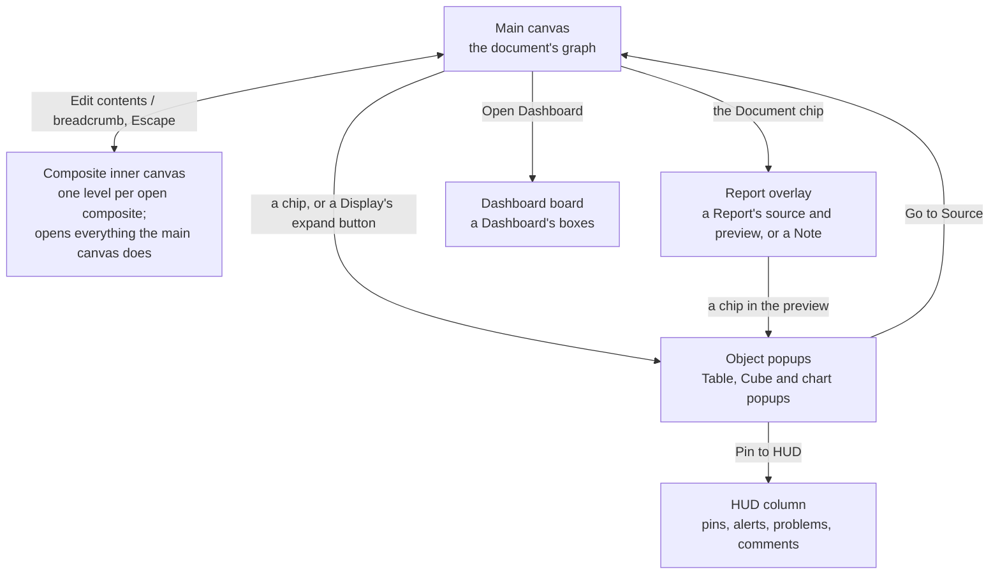
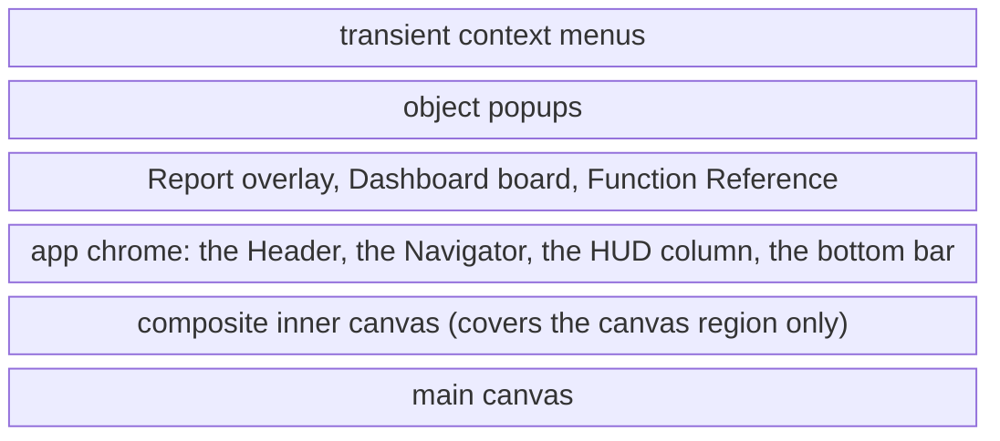
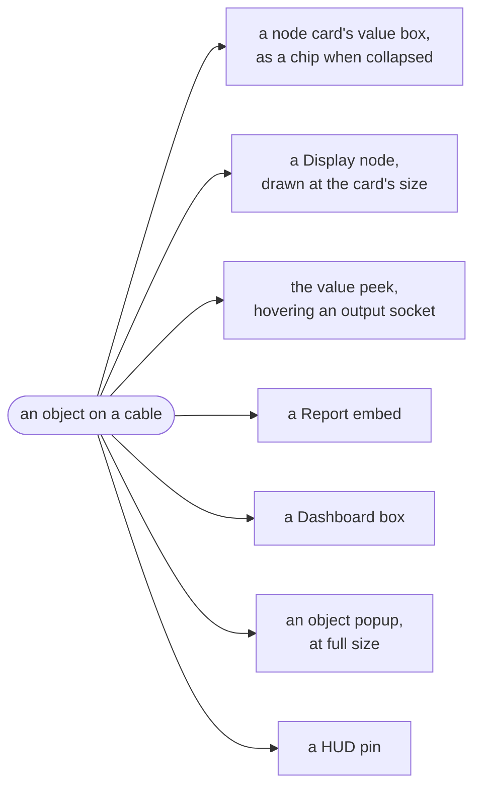
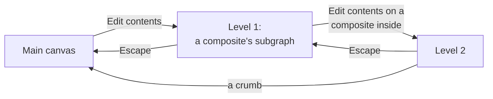
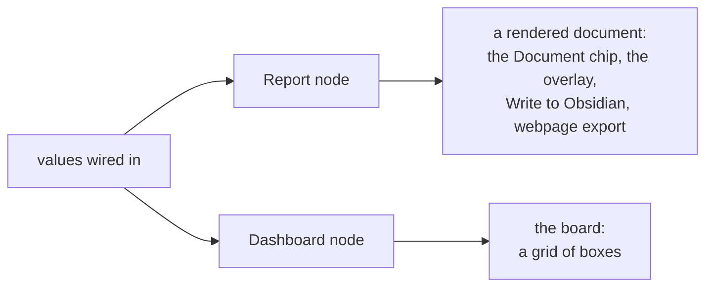
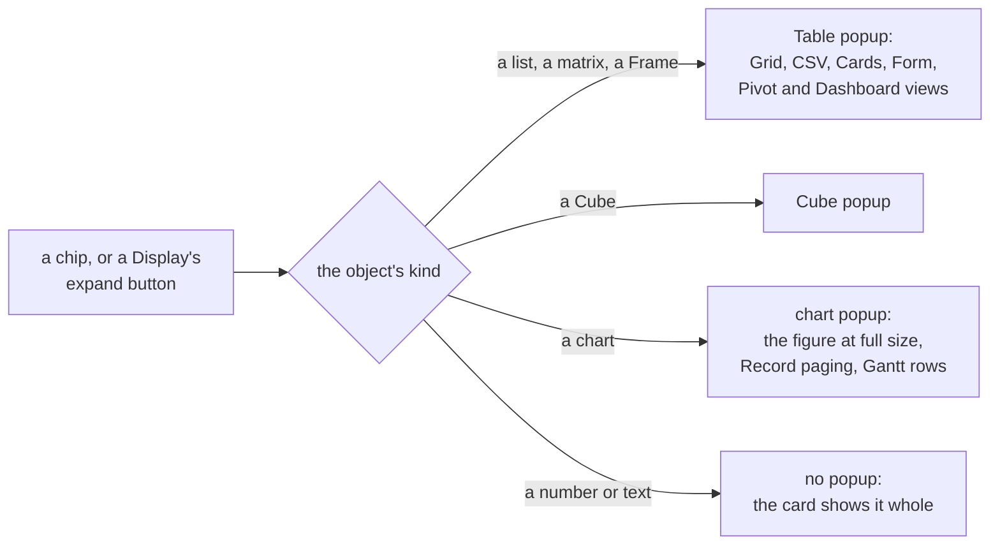
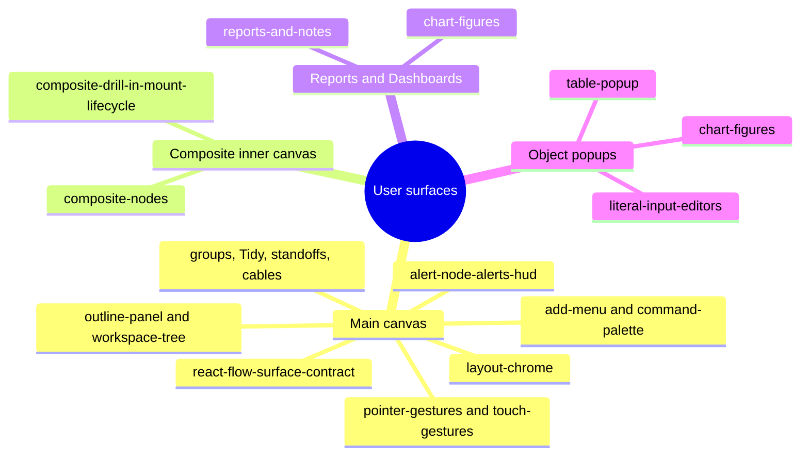

<!-- [[A1]] visualGraphCalculator, [[B3]] sameNodeEverywhere, [[C100]] chartIsAValue, [[B20]] mobileFriendly -->

# Spec: User surfaces

Serves [[A1]] visualGraphCalculator, [[B3]] sameNodeEverywhere, [[C100]] chartIsAValue and [[B20]] mobileFriendly. It maps the four places a person works in Solenoid: the main canvas, a composite's inner canvas, the full-window boards (the Report overlay and the Dashboard board), and the object popups. It says what each is for, how a person moves between them, what stays the same on all of them, and which spec owns each piece. It holds no mechanics of its own; every section points to the spec that does.

## The map

The main canvas is home. Everything else opens from it, sits over it, and returns to it.

| Surface | What a person does there | Opens from | Closes or leaves by | Owning specs |
|---|---|---|---|---|
| Main canvas | builds and runs the graph: places nodes, wires cables, reads results on the cards | opening a document | switching documents | [[react-flow-surface-contract]], [[layout-chrome]] |
| Composite inner canvas | builds the subgraph inside a composite node, on the same canvas | Edit contents on a Composite node's card or its context menu | the breadcrumb, or Escape for one level | [[composite-drill-in-mount-lifecycle]], [[composite-nodes]] |
| Report overlay | writes a Report's Knap template and reads the rendered document, or reads a Note | the Document chip on a Report or Note node | Escape, the close button, a press on the backdrop | [[reports-and-notes#The overlay]] |
| Dashboard board | reads a Dashboard node's inputs as a grid of boxes, and lays the grid out | Open Dashboard on a Dashboard node's card | Escape (after any open menu, rename, expanded box or edit), Close, or Caused by on an error box, which flies to its origin | [[reports-and-notes#Dashboards]] |
| Object popups | reads an object at full size, and edits a literal source's object | a chip, or a Display node's expand button | Escape, the close button, a press on the dimmed overlay | [[table-popup]], [[chart-figures#Surfaces and sizing]] |

## What covers what

The surfaces stack in a fixed order. A board or an inner canvas covers only the region the main canvas fills, so the Header, the Navigator and the bars stay put around it; a popup sits above every full-window surface, so one opened from inside a Report or a drill-in lands on top of it. While a full-window surface is open, the canvas under it stops painting ([[html-in-canvas]] § The GPU texture budget).

The numbers behind this order are [[layout-chrome#The z-index ladder]] and [[table-popup#The popup shell]] (Layering). Docking a Report shrinks the canvas region instead of covering it ([[layout-chrome#Push or overlay: how the pieces interact]]).

## One object, every surface

An object (a number, a list, a Frame, a Cube, a chart, a document) looks the same wherever it shows, because every surface draws it through the same renderers: the chips, the chart figure and the value renderer the Report and Dashboard share ([[B3]] sameNodeEverywhere, [[C100]] chartIsAValue).

- A number takes its format from a Format Controller on every surface; no surface adds its own ([[format-model]], [[C118]] formatTravelsWithValue).
- A chart carries its own controls wherever it is drawn: a Record pages on a Display, a Dashboard box and the chart popup alike, and a Choice Ladder takes its actions on a Display and a Dashboard box ([[chart-figures#Surfaces and sizing]]).
- An error shows its code and message on every surface. Where it knows its origin, a Report's card and a Dashboard box offer a way to fly to the node that made it ([[error-values]], [[reports-and-notes#A box]]).

## The main canvas

The main canvas is the document's graph: cards (nodes) on a dot grid, cables between their sockets, groups around cards, Conduits that bundle cables, standoffs that hold spacing, and drawn arrows for annotation. Results show on the cards themselves, so most work never leaves this surface. The canvas is drawn by React Flow over the graph model in the Rust core; [[react-flow-surface-contract]] says which side owns what.

Around the canvas sits the app chrome, mapped in [[layout-chrome]]: the Header (the menu bar and the top bar), the Navigator on the left, the Zoom pill at the top right, the HUD column under it, the minimap at the bottom right, and on a phone the bottom bar. A tablet runs the desktop chrome with touch actions; a phone turned sideways runs the tablet layout scaled down.

| Topic | Spec |
|---|---|
| What React Flow owns, sockets, cables, selection, keys, copy and paste, undo | [[react-flow-surface-contract]] |
| Mouse, pen and touch gestures, and which wins | [[pointer-gestures]], [[touch-gestures]] |
| Placing a node | [[add-menu]] |
| Running a command by name, and the AI assistant | [[command-palette]] |
| The Navigator: documents and the open level's outline | [[outline-panel]], [[workspace-tree]] |
| Groups opening and closing | [[group-expand-push]], [[group-collapse]] |
| Tidy, Cleanup and standoffs | [[auto-arrange-tidy]], [[standoffs]] |
| How cables draw, Conduits and drawn arrows | [[cable-rendering-knobs]], [[conduit-lane-faces]], [[drawn-cables]] |
| Cards whose content resizes | [[resizable-content-nodes]] |
| Drawing big graphs as pictures while they move | [[html-in-canvas]] |
| Pins, alerts, problems and comments in the HUD column | [[alert-node-alerts-hud#The HUD column]] |
| The accent, palettes and light or dark | [[palette-and-theme]] |
| Presenting: the canvas as the slide, with the chrome hidden | [[layout-chrome#Push or overlay: how the pieces interact]] |

## Composite inner canvases

A composite node holds a subgraph. Edit contents opens it as a full canvas over the main one, and a composite inside opens one level deeper; the breadcrumb at the top left names every level and steps back to any of them, and Escape goes up one. The inner canvas is the same surface as the main canvas: the same gestures, menus, keys and cards, so the inside of a composite is one more place a node appears ([[B3]] sameNodeEverywhere). It differs only where the place has to: what an edit lands in, which undo history answers, and what Escape and Delete do ([[react-flow-surface-contract#One surface for both canvases]]).

- The strip under the breadcrumb holds the buttons that add input and output ports, and the run-mode panel under it mirrors the outer card's run controls (Single run, Scenarios, Goal Seek, Monte Carlo and the rest) ([[composite-drill-in-mount-lifecycle#Drill-in chrome]], [[composite-nodes#Run modes]]). On a phone the port buttons move to the bottom bar.
- The Navigator stays open and lists the open level's cards, and backs out the same way the breadcrumb does ([[outline-panel#Composites]]).
- Chrome acts on the level being shown: Tidy, Cleanup, selection and the touch delete button all point at the open level while it is open ([[composite-drill-in-mount-lifecycle#Opening a level]]).
- An edit inside reaches the outside when the level is left, as a recompute from the composite on the main canvas ([[composite-drill-in-mount-lifecycle#Leaving a level]], [[composite-nodes#Edits inside and how they reach the outside]]).

## Reports and Dashboards

Two full-window surfaces turn the graph's results into something to read. Both cover the canvas region under the Header, and both draw the values wired into them through the one shared value renderer ([[reports-and-notes#On-screen rendering of the span]]).

**The Report overlay** opens from the Document chip on a Report or Note node. On a Report it is the editing surface: a source pane for the Knap template and a preview pane that renders it against the latest values, side by side on a wide screen and as Draft and Preview tabs on a narrow one. It can dock to the right of the canvas instead of covering it, so the graph stays in view while the document is written. On a Note it is a read-only view of the note. With Records wired, the preview pages through one rendering per record. The overlay is [[reports-and-notes#The overlay]]; what a template can say is [[reports-and-notes#What an author types]].

**The Dashboard board** opens from Open Dashboard on a Dashboard node's card. It lays the node's inputs out as a grid of boxes, from a layout written in the Record figure's grammar, and draws each value to fill its box: a number scaled up as the box's figure, a chart fitted to the box, a Frame or document scrolling inside it. A box expands to fill the board, Edit Layout rearranges the grid, and on a narrow screen the boxes stack in reading order. The board is [[reports-and-notes#Dashboards]].

The same document can leave the app: Write to Obsidian puts it in a vault note, and the webpage export saves it as a page ([[reports-and-notes#Write to Obsidian]], [[reports-and-notes#Webpage export]]).

## Object popups

An object popup shows one object at full size. It opens from the object's chip, or from a Display node's expand button, never from the node that made the object; the opener picks the popup by the object's kind ([[table-popup#The store and the openers]]).

- **The Table popup** views and edits a list, a matrix or a Frame: as a grid, as CSV text, as cards, as a one-record form, as a pivot table for a Pivot's output, or as a dashboard of columns for a Describe's ([[table-popup]], [[C127]] pivotView). On a literal source, such as a Frame Input node, it is the editor, and Save writes back to the node ([[literal-input-editors]], [[table-popup#Modes and what Save writes back]]).
- **The Cube popup** opens a Cube a level at a time and edits a Cube Input's ([[table-popup#The Cube popup]]).
- **The chart popup** draws a chart object at the window's size, pages a Record from the keyboard, and copies a Gantt as SVG ([[chart-figures#Surfaces and sizing]]).
- **Every popup shares one shell**: a header that reads like the source node's (its accent and its group framing), an overflow menu with Go to Source and Pin to HUD, a resize grip, and the same ways to close ([[table-popup#The popup shell]]).
- The node editors that open in a window, the Formula, Script and pivot-field editors, sit on the same shell; they are part of their nodes, built to [[components]].

Hovering an output socket shows a value peek, a small read-only Display of the socket's object that stays the size of a tooltip; it is a preview, not a popup ([[table-popup#The example hint and the value peek]]).

## What stays the same everywhere

- **The same node.** A card looks and works the same on the main canvas, in a composite and on the website's scenes, and the Obsidian plugin shows Solenoid's values with the app's own chips ([[B3]] sameNodeEverywhere, [[obsidian-plugin]]).
- **The same object.** Every surface draws an object through the shared renderers above, with the format its Format Controller set.
- **Escape backs out one step.** It closes the topmost popup, menu or board, and on an inner canvas goes up one level.
- **Touch works everywhere.** Every surface is built for a finger and the on-screen keyboard as well as a mouse ([[B20]] mobileFriendly, [[touch-gestures]], [[layout-chrome#Mobile]]).
- **A typed edit commits on Enter or click-away**, on a card or in a popup's cell, never on each keystroke; the Report's source pane, where Enter starts a new line, commits on click-away, on closing and on switching to Preview ([[B19]] spreadsheetHabits).

## Spec map

