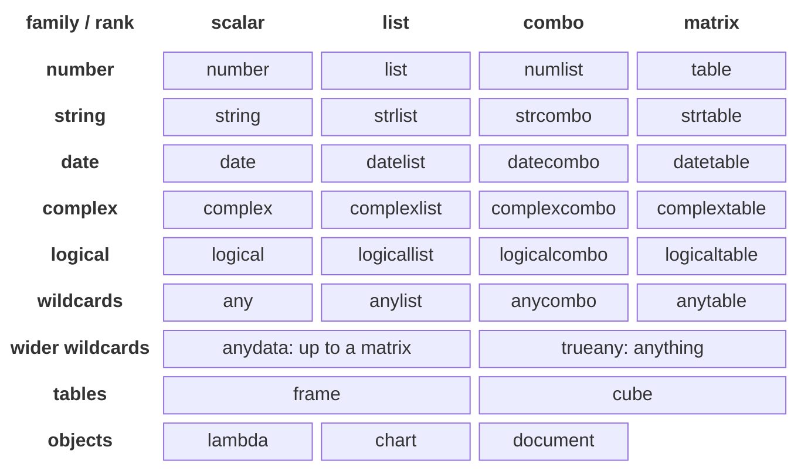
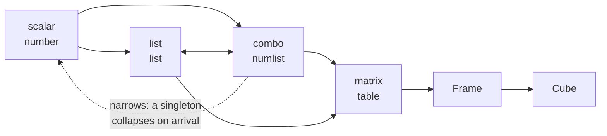
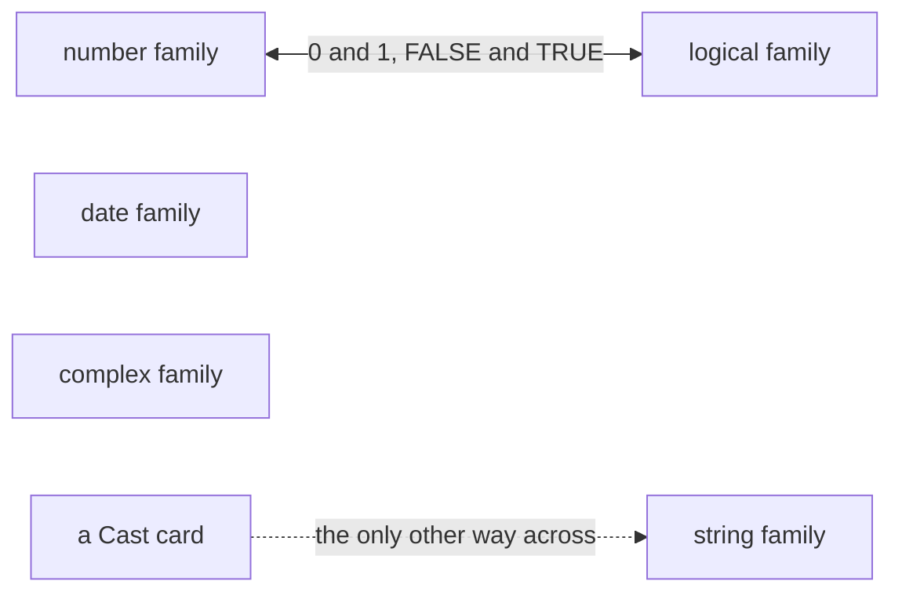
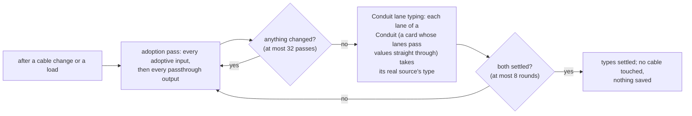
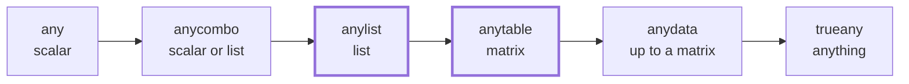
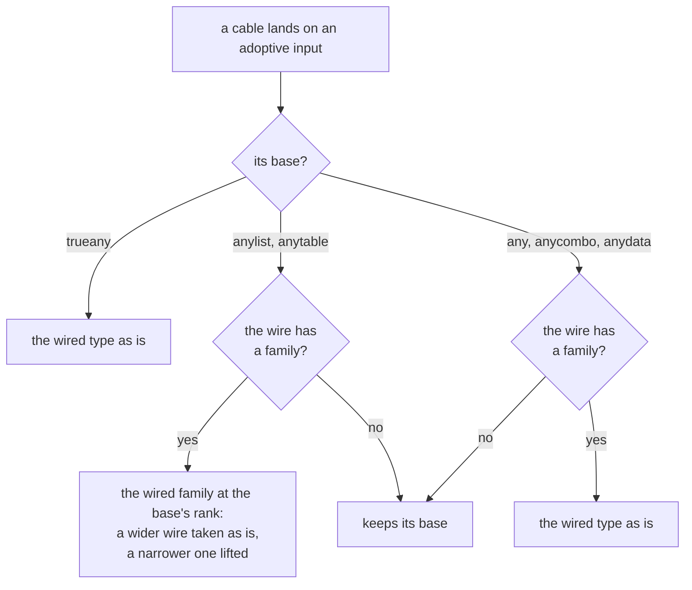

<!-- [[C10]] socketLattice, [[C139]] mathlibLaws -->

# Spec: Socket lattice

Serves [[C10]] socketLattice: type separation and dimensional flow, derived from the family × rank product. It covers what the system does and blocks, and the decision each behavior serves; a builder implements this file without reading the tree. `docs/socket-reference.md` is the per-variant reference for readers, with each socket's dot shape and color.

Every socket has a type (`SocketDataType`, `sockets.ts`), and the type decides which cables may connect. The rules are the core's (`crates/solenoid-graph/src/lattice.rs`, [[graph-core#Phase D: the graph's derived state]]); `sockets.ts` reads them as tables and keeps the colors and labels.

- **Families.** Element families never cross on their own: crossing takes a Cast, and the only bridge is `logical ↔ number`.
- **Rank.** Values flow freely up in rank: scalar, list, matrix, Frame, Cube. Going up a rank loses nothing, while going down has to drop or pick values, so only going up happens on its own; going down takes a node that picks what to keep.
- **Derived, not listed.** Which connections are legal is derived from the family × rank product, never listed pair by pair.
- **Honest outputs.** Every node declares honestly what kind of value it gives; a node that can't know its output in advance declares a wildcard and takes on the kind of whatever is wired to it (req. 8) ([[B17]] typedValueModel).

Every socket type, by element family and rank (a combo is a scalar or a list; the wildcards carry no family):

Within one family (number shown; string, date, complex and logical are the same), a value flows along the arrows, and through any chain of the solid ones; the dotted narrowing is one step and never part of a chain ([[#The shape of what connects]]):

Families never cross on their own; the one bridge is logical and number, at every rank:

## The shape of what connects

Serves [[C139]] mathlibLaws as well as [[C10]] socketLattice. `accepts` mixes three kinds of edge, and only the first composes:

- **Widening** (the solid arrows, and the logical and number bridge): an order on the concrete types. It is
  reflexive (every type connects to itself) and transitive (if A reaches B and B reaches C, A reaches C), so a chain of
  cables through passthroughs never reaches a type a direct cable couldn't. It is a preorder rather than a partial
  order, because some distinct types reach each other both ways: a list and its family's combo, logical and number at
  each rank, and `logicaltable` and `table`. "Lattice" is the name, not a claim that every two types have a join.
- **Narrowing** (the dotted arrow: a combo, `numlist` included, into its family's scalar): a checked step. It connects
  because a combo may hold one value, and the input boundary collapses that singleton or refuses the rest
  (req. 4). Checked steps don't compose: `list` reaches `numlist` and `numlist` reaches `number`, but `list` does
  not reach `number`.
- **Wildcards**: a wildcard stands for an unknown type, so it connects to more than any one concrete type would, and
  chains through one don't compose either (`anydata` reaches `any` through `number`, not directly).

Over the 25 concrete types, with the seven narrowing edges removed, what connects is reflexive and transitive (a
preorder in mathlib's sense, the class Preorder in `Mathlib/Order/Defs/PartialOrder.lean`); with them, 11 chains fail to
compose, each a narrowing step after a widening one. Held by `widening_is_a_preorder_and_narrowing_does_not_compose`
(`crates/solenoid-graph/tests/lattice.rs`), which also pins the seven narrowing edges by name.

**Coercions agree along paths, with one exception.** Where a value can reach a type by two routes (a list into a
matrix and then a Frame, or straight into a Frame), arrival coercion gives the same value either way: both read a list
as one row (req. 5). A conversion pair that disagreed would make a cable's answer depend on which passthroughs it ran
through. The exception is a route **through the bridge**: 5 through a logical socket is TRUE, and comes back as 1. The
bridge is lossy, so logical and number reach each other both ways without being the same type, and no route through
it can agree with one around it. That is the bridge working as designed. Every family's matrix rung shapes what
arrives as number's `table` does, so a scalar wired into a `strtable` input is a 1×1 matrix, as it would be through a
list socket first ([[#Enforcement]]).

A Frame on the way to a Cube also keeps its column types, which a value converted straight to a Cube has none of; only
the metadata differs. Held by `coercions_agree_along_widening_paths` (`crates/solenoid-graph/tests/boundary_core.rs`),
with the bridge and the metadata case left out by name.

## Constraints

- [[C10]] socketLattice: a value's type is part of its meaning, so a connection that would silently coerce is refused.
- Reopen if: a new family or a second bridge. Re-derive the lattice and the sweep; never hand-edit a pair.

## Requirements

1. **The grid.** The regular types are an element × dimension product: `FAMILIES` (number, string, date, complex, logical) × `DIMS` (scalar, list, combo, matrix). Each family's rank-1 rung comes in two forms: `list` (strict) and `combo` (scalar or list). [[C10]] socketLattice, [[#New socket types are derived]].
2. **One predicate derives the within-family accept-sets.** `dim_flows(d_out, d_in)` is `rank(d_out) ≤ rank(d_in)`, or the one exception the rank model can't express: a combo may narrow into its element scalar. Every within-family accept-set is built from it (`family_accepts`). [[C10]] socketLattice.
3. **The bridge is built by the same predicate.** `logical ↔ number` is the one cross-family bridge (0 and 1 for FALSE and TRUE, as in Excel, and the multiply-by-a-condition idiom). It is mirrored through `dimFlows` on both sides, so the combo-to-scalar exception can't hold on one side and not the other (`logicalcombo → number` flows wherever `logical → number` does). Arrival coercion in the graph core's input boundary does the runtime conversion ([[compute-pass]] § Arrival coercion). [[C10]] socketLattice.
4. **A combo collapses a singleton on arrival.** A one-element list arriving at a combo or any scalar rung is that scalar (the input boundary's `collapse`, `boundary.rs`); a strict list rung keeps its list and re-widens a scalar on the way in, so the round trip is lossless. A complex is a tagged scalar and collapses like one. This is what makes the combo-to-scalar edge true rather than merely permitted.
5. **Cross-type dimensional edges are explicit in `accepts` (`lattice.rs`)**, because rank derivation can't express them and they are the edges a rework is most likely to lose. The complete list:
   - `combo → scalar` within a family (req. 2), and `anycombo → any` for the same reason.
   - `any` as an input takes every family scalar and combo, plus `anycombo`. As an output it reaches everything but the object family (lambda, chart, document).
   - `anylist` is 1-D both ways: as an input it takes every rank-1 family value and `anycombo`; as an output it reaches every family list and combo. `anycombo` is 0-D or 1-D: as an input it takes rank-1 family values and `anylist`; as an output it reaches every non-object input.
   - `anytable` as an input takes any family value of rank 2 or less, or `anylist` (a list or scalar widens into the 2-D wildcard). As an output it is strictly 2-D and reaches concrete matrices only; it never narrows.
   - `anydata` as an input takes any family value of rank 2 or less, `anylist` and `anytable`, and refuses Frames, Cubes and the object family. As an output it reaches every non-object input. Only `anylist` and `anytable` outputs need naming in the input branch, since `anycombo` and `any` outputs already reach every non-object input. [[#anydata, the formula-variable wildcard]].
   - `frame` as an input takes any family value of rank 2 or less, `anytable` or `anylist`: a matrix is rows × columns, a 1-D list is a single row (as in CSV; transpose for a column), and a scalar is 1×1, built at arrival through `frameFromRows`. As an output it reaches only another `frame` or a `cube`, since anything else would lose the headers.
   - `cube` as an input takes everything `frame` takes, plus `frame` itself (the supremum). As an output it reaches only another `cube` or `trueany`, since any narrower container would silently drop the nesting. A Frame verb that should take a Cube gets a cube-adoptive input of its own (`cubeAdoptIn` with `noWidenInputs`, the Add Column pattern); how it flattens or refuses nested columns is in the frame-verbs spec. The lattice is never widened for one node. [[C10]] socketLattice.
   - `trueany` on either side accepts everything; it resolves by adoption (req. 8).
6. **Element-agnostic 2-D inputs use the grid socket** (`anyTableIn`), not the scalar-circle `any`: TRANSPOSE, HSTACK, CHOOSEROWS and CHOOSECOLS, reshape-flatten, and the MAP, BYROW and REDUCE values. `any` is the rank-0 wildcard (comparison values, CHOOSE and SWITCH rows, EXPAND's fill, fold seeds). Cast, Display and IS.TEST are `trueany`; Expression and computed-column variables are `anydata`; a LAMBDA's captured-variable inputs are `anylist`, so a matrix does not wire into a λ capture. Table Info is `frame`-typed, so anything of rank 2 or less widens in and it reports rows × columns.
7. **The socket type is the only date signal.** A date serial is a number at runtime, so every "is this a date?" check goes through `isDateType`, and a port whose value is a date uses the date family. [[#Date-valued ports are date-typed]].
8. **Adoption keeps rank on the rank-bearing wildcards.** When a cable lands on an adoptive input, `adoptTypeForBase` decides its type. An `anylist` or `anytable` base keeps its rank and adopts only the wired element family: a wider wire is taken as is, and a narrower one is lifted to the base's rank in the wired family. A family-less wire carries nothing to adopt, so the port keeps its base (and still refuses what its rung refuses), and the `any`, `anycombo` and `anydata` bases follow the same family-less rule. `trueany` adopts the wired type as is. An unwired adoptive input keeps its base, except a keyed wildcard slot whose kind was picked or whose text was keyed: it adopts that kind as a cable of it would ([[inline-literal-maps#Wildcard slots]]). `projectTypeToBase` is the output-side mirror (WRAPROWS widens, flatten narrows). The two give one answer for every type that can connect into a base; they differ only where the output side projects a rank-crossing reshape down (TOCOL: `strtable` in, `strlist` out), a pair no input connection can make. [[#The wildcard ladder keeps rank]].
9. **Adoption never touches connections and is never saved.** The Type Settle (`settle.rs`) repeats the adoption pass until nothing changes, at most 32 passes a round and 8 rounds, so 256 passes in all (a round that still changed starts another). Each pass recomputes every port from what feeds it, so on a graph without loops each port's type is a function of the ports upstream of it and the answer is fixed by the wiring, by induction on depth. A pass visits the cards in topological order, each after every card feeding it (`visit_order`, Kahn's order with ties in graph order, a loop's members last), so one pass settles any graph without loops; visiting in graph order once took a pass per card of the longest chain listed against the wiring and left the tail of a 257-card chain untyped. The caps guard a `#CIRC!` loop, where the settle leaves the loop's ports untyped, the least informative of the typings consistent with it. What it computes is a fixed point, a typing that one more pass leaves unchanged, and its answer must not depend on the order cards are visited in (the reverse-order run in `coreSettle.test.ts` and `a_chain_settles_whatever_order_its_cards_are_listed_in` in `crates/solenoid-graph/tests/settle.rs` hold that; the order independence of a rewriting that converges is mathlib's `Relation.church_rosser`, `Mathlib/Logic/Relation.lean`). The caps are guards, not derived bounds: a pass that only ever moved a port's type one way up a finite order would stop on its own within a bound computed from the graph, but nothing yet shows the adoption pass is one-way (the run-time types and the `trueany` veto are the cases to check), so the caps stay. It alternates it with Conduit lane typing, at most 8 rounds, until both settle together, because each can feed the other. One frame-shape walk serves every pass, since shape depends only on topology and literal config, which no pass changes. Each pass first sets every adoptive input (the wired output's type through `adoptTypeForBase`, or its `base` when unwired), then every passthrough output that is a `MutableSocket`, projected through `projectTypeToBase` when it is adoptive.
   - Output policy comes from the node's `passthrough()` declaration, the same single source unit flow reads.
   - When branches vote, an unwired source or one flagged `errorOnlyOutput` abstains: NA() is always a tagged error, which shows as an error under any type, so `IF(cond, num, NA())` keeps the number type. A branch votes its input socket's current type, and a `trueany` vote vetoes agreement: a branch wired to a source of unknowable type (XLOOKUP, Get Cell) is a real value that a typed agreement would format wrongly, so `IF(cond, XLOOKUP(…), date)` stays unknown until the run-time types below settle it. The projection context (the frame shape on an input, and whether an input is wired) is built lazily, since only an extraction out of a Frame asks for it.
   - A reshape that crosses rank adopts the element family at its own declared rank. [[#The wildcard ladder keeps rank]], [[type-propagation-on-in-place-socket-retype#A trueany output declares its passthrough]].
   - **Run-time types** ([[C136]] typesKnownAfterCalc, [[D117]] emptyKeepsLastType). Before a calculation the wiring can leave an output a wildcard; after one, nothing is unknown. After each pass the core reads the type of every passthrough output and every value-typed output (`ValueTypedSocket`: the formula family's and Script's Auto result, and Unnest's, which is a Frame or a Cube by what the nested column holds) off the value the pass landed there (`Val::socket_type`): a frame or cube as itself, a table at its family's matrix, anything else at its family's combo, a mix of families untyped. It keeps that reading per output (`readTypes` in `solenoid-graph/src/wasm.rs`, the keys from `readTypeKeys` in `settleFacts.ts`), and an answer with nothing to read (empty, blank, errors only) keeps the last one. Where the wiring's answer is a wildcard, the Type Settle uses the reading, fitted to the output's declared rung (a scalar rung keeps the scalar, the strict rungs keep their rank); where the wiring already settles the type, as a passthrough's `project` does from the frame's shape before anything has run, the reading is never used. A value-typed output with no reading yet shows its rung. When a reading moves, or an output still shows a wildcard its reading would type, the pass runs the Type Settle again (`process.ts`), and the cards whose types moved redraw. Inside a composite, whose cards compute by fetching rather than by a pass, the reading comes from the inner engine's cache once every card inside has computed (`readInnerTypes`, `composite.ts`). A branch card whose branches differ therefore shows the taken branch's type, and a type follows the data from one pass to the next. No card declares the family it produced.
10. **Two wildcard predicates, on purpose.** `isWildcardType` names the two rankless rungs, `any` and `trueany`, since a rank-bearing wildcard is a real dimensional constraint, not "untyped". `isWildcardRung` names every family-less rung (adding `anycombo`, `anylist`, `anytable` and `anydata`) and is the one to use for resolving a family: the see-through walks (the FC reconcile's, the adoption settle) call it. Its rule is the core's (`is_wildcard_rung`, `lattice.rs`; the tables' `wildcard`). `isWildcardType` is read only by `familyOf`'s provisional-number rule. [[#The wildcard ladder keeps rank]].
11. **Each port owns its mutable socket.** `MutableSocket` (the FC, Conduit lanes) and `AdoptiveSocket` instances are per port, never module-level, so a retype on one card never lands on another; the reconcile pass finds adoptive ports by `instanceof`. An `AdoptiveSocket` reverts to its `base` when unwired, and a base narrower than `trueany` keeps the port restricted to that rung while it still adopts the wired concrete type. [[#Each port owns its socket instance]].
12. **A new socket type is a derived edit.** Extend the product; the sweep picks it up. Hand-writing its pairs is the failure mode this spec exists to prevent. [[#New socket types are derived]].

Tests:

- `socketConnect.test.ts` and `coreLattice.test.ts`: reqs. 1 to 5 and 8 (see [[#Enforcement]]).
- `coreSettle.test.ts`: the Type Settle's frozen answers over every seed graph, as saved, with every third cable dropped and in reverse node order (req. 9).
- `trueAnyAdopt.test.ts`: adoption through a real editor (req. 9): a Display adopts on both sides and reverts when unwired; no save or paste init carries an adopted type; adoption runs down a chain of passthroughs; IF's result adopts when its branches agree; the Input Switch adopts its active slot; element-preserving list ops (Reverse, Sort By, Set, Concat, Interleave) forward the element type; VSTACK and HSTACK adopt the agreed row type at the table rank; rank-crossing reshapes project the family onto the output's rank; and the vote's veto and abstention.
- `typesKnownAfterCalc.test.ts`: run-time types (req. 9): XLOOKUP and INDEX with a column on a cable, IF showing the branch it took, a retyped card drawn again, a card inside a composite, and IFERROR when nothing was caught, and Unnest showing Frame or Cube once it has run.
- `cablesTypedAfterCalc.test.ts`: over every example as shipped, once the calculation has run no cable that carries a value has an untyped end, output or input (req. 9); the cards typed by a system of their own (the Format Controller, the Conduit, a composite's boundary) are left to their own tests.
- `catalogRegistry.test.ts`: no two instances of a class share a `MutableSocket` (req. 11), and no catalog port whose label names a date sits on a non-date socket (req. 7).

How the adoption settle runs (req. 9):

## Rules and their reasons

### Date-valued ports are date-typed

**MUST:** a socket whose value is a date uses the date family (`date`, `datecombo`, `datelist`, `datetable`), never `number` or `numlist` on the grounds that a serial is numerically a number (req. 7). A wildcard rung is not a violation, since it has committed to no family.

A date is a kind of its own at runtime ([[D114]] dateIsAKind), so a number socket would refuse the very value it is meant to carry, and the socket's family is how a cable, a peek and the Add menu say what flows before anything has. The date family also brings the typeable date-list editor, which is why such a port declares `stringLiterals` too ([[inline-literal-maps]]).

*Exception:* a port whose label only mentions time while holding a count or an index ("Start period", "Days", "Coupon rate") is a number and stays one. The guard anchors on a label ending in date or dates for exactly this reason. **Removed by:** port semantics declared directly instead of inferred from the label.

The guard sweeps the whole catalog, since the convention is worth something only when it is total: a lone mistyped port is invisible precisely because everything around it is right. A formula-preset node names its free variables as ports (`ROUNDUP(MONTH(date)/3,0)` has a `date` port), and that port is an expression variable on a wildcard socket, not a mistyped date port.

Tests: `catalogRegistry.test.ts` ("date-valued ports are typed date"): every catalog port whose label ends in date or dates is date-typed or a wildcard.

### New socket types are derived

**MUST:** a new socket type is added by extending the family × rank product (req. 12). Cross-type dimensional edges are explicit in `accepts` (`lattice.rs`) (req. 5) and swept exhaustively by test; a new type never needs its pairs written by hand. Hand-listed pairs grow with the square of the variant count, and a hand-kept list drifts from the rule it copies.

### The wildcard ladder keeps rank

**MUST:** the untyped ladder is `any` (scalar) → `anycombo` (scalar or list) → `anylist` (list) → `anytable` (matrix) → `anydata` (up to a matrix) → `trueany` (anything). The strict rungs, `anylist` and `anytable`, keep their rank and adopt only the wired element family; the elastic rungs, `any`, `anycombo` and `anydata`, adopt the wired type as is; every rung keeps its base on a family-less wire (req. 8, `adoptTypeForBase`, `RANK_BASES` in the sweep).

Bold: the strict rungs, which keep their rank. What a wildcard input becomes when a cable lands on it (`adoptTypeForBase`):

**MUST:** adoption (the core's `settle.rs`, called through `settleWildcardTypes`) resolves a type without disconnecting anything, and the adopted type is never saved; it is worked out again from the wiring after load (req. 9).

A wildcard that forgot its rank would let a list-shaped port take a matrix, and any untyped hop would become a way around [[C10]] socketLattice. Adoption is a reading of the current wiring, not something the user authored: dropping cables would destroy work to satisfy a guess, and saving the guess would freeze a type the wiring no longer implies. `trueany` draws as the hollow ring.

INDEX takes its element family from its container:

- **A Frame.** The named column's type, read from the shape the verb chain produced, when `frameShapeResolver` can know it ahead of time; with no column named, the whole row, which is a one-row Frame.
- **A Cube.** A slice keeps nested cells whole, so any blank axis types the output `cube` (both blank is the whole Cube, a column alone is a one-column Cube, a row alone a one-row Cube). A single cell, row and column both given, is a wildcard, since a Cube's column can hold different kinds.
- **A cable on an axis.** A column or row picked by a cable is a runtime value, so the output is a wildcard; the stale literal behind the cable no longer decides the type.

A wildcard output is typed by the value it carried once the calculation runs (req. 9, run-time types).

Tests: `trueAnyAdopt.test.ts`: the rung kept on a family-less wire (`any` and `anycombo` included, so an occupied SWITCH row still refuses a Frame), and INDEX over a Frame and a Cube, by literal and by cable.

### anydata, the formula-variable wildcard

`anydata` is the socket for a value that may be a scalar, a list or a matrix of any element type and passes on exactly as it arrived. Every formula variable uses it.

**MUST:**
- As an input it accepts every value of rank 2 or less and the smaller wildcards (`any`, `anylist`, `anycombo`, `anytable`), and refuses Frames, Cubes and the object family (req. 5).
- It never changes what it is given: a scalar stays a scalar and a list stays a list.
- As an output it connects wherever `anycombo` does; its actual shape is known only at run time, with the same accepted risk.
- A formula surface's variable and side sockets are `anydata`: Expression variables, and Computed Column side inputs (a side value can be a whole list, as in `SUM(list)`, or a row-aligned list read with `@name`).
- The result socket keeps its family instead. The result's combo socket serves results of rank 1 or less; a matrix result swaps to the same family's matrix socket and reconciles through `retypeOutputCables` ([[type-propagation-on-in-place-socket-retype]]). Downstream FCs keep their family, and the socket never lies about rank.

Tests: `coerceInputs.test.ts`: every formula variable is an `anydata` port that tracks the formula, and a scalar into one stays a scalar; `coreLattice.test.ts` holds `anydata`'s accept set among every pair.

Its two neighbors each fail a formula variable. `trueany` accepts everything and doesn't change its input, because it exists to carry a value somewhere unchanged, but it also accepts Frames, Cubes and objects, which must never enter a formula ([[C15]] matricesInFormulas). `anytable` (Any Matrix) turns every scalar or list wired into it into a matrix, so a variable would see `5` as a 1×1 matrix, breaking every function that expects a scalar or a list and changing every downstream rank. `anydata` is the one that doesn't change its input and still keeps Frames, Cubes and objects out; `anycombo` can't do it, because it refuses the matrices [[C15]] admits. The result socket isn't `anydata`, because that would give up the family FCs key on (`familyOf` is none) for a rank the matrix sockets already spell.

### Each port owns its socket instance

**MUST:** every `MutableSocket` or `AdoptiveSocket` port gets its own fresh instance, never a shared module-level one (req. 11). The `staticTrueAny*` / `trueAnySocket` singleton is outside the rule: it is a plain immutable `SolenoidSocket`, so the sweep never sees it.

A shared mutable socket means wiring a date into one card retypes another card's port, which then coerces its input under the wrong type and answers a believable number the user can't trace. The Input Switch's shared `valueSocket` did exactly this.

Tests:

- `catalogRegistry.test.ts`: two instances of every catalog class share no `MutableSocket`.
- `trueAnyAdopt.test.ts`: two Displays don't share adoption.

## The API

- `accepts(in_t, out_t)` (`lattice.rs`) is the one directional primitive. `canConnect(out, inp)` and `SolenoidSocket.canConnectTo(input)` are its directional forms, used by the connection guard. `areCompatible` and `isCompatibleWith` are symmetric and serve only non-connection uses such as legend and highlight grouping.
- `is_matrix` (`lattice.rs`) is the homogeneous matrices plus `anytable`, not `frame`.
- `elementFamilyOf(dt)` is a type's family at any rank, or `null` outside the five families. `typeAtRank(dt, rank)` is the same family at another rank (`strlist` at rank 2 is `strtable`). `comboOfType(dt)` is the family's combo rung, the honest output type for an element-preserving extraction whose rank depends on runtime arguments (INDEX), and `comboOfFamily(name)` does the same from a family name, which is what a Frame column's `type` is.
- `latticeRank(dt)` is 0 for a scalar and `any`, 1 for a list or combo and for `anylist` and `anycombo`, 2 for a matrix and for `anytable` and `anydata`, and `null` for the rankless structural types.
- `SOCKET_COLORS` are CSS variables, so socket colors follow the theme live; `SOCKET_TYPE_LABELS` is a socket dot's hover title, the only path to "what type is this" that doesn't depend on color.

## Enforcement

The "Dimensional Flow" seed shows the lattice visually. The doc of every variant, `docs/socket-reference.md`, is parsed and held to the code rather than trusted as prose, so a lattice change fails with the line to fix.

Adding an element family touches sites neither the compiler nor the sweep sees, since they are string-keyed: the arrival coercion's rank cases (a rung that falls through still connects, and the wrong rank shows up inside `data()`), the socket's glyph branches (an unlisted rung draws as a plain circle), the color variables and their palette rows, and the Format Controller's controls. `docs/socket-reference.md` section 10 lists them. Every family's matrix rung shapes what arrives into a matrix, as number's `table` does: a scalar is 1×1 and a list one row (`to_matrix`, both boundaries), so a body on a `strtable`, `datetable`, `logicaltable` or `complextable` input always receives rank 2 ([[#The shape of what connects]]).

Tests:

- `socketConnect.test.ts`: derives every answer from the rule itself, so editing the doc can't make a broken lattice pass: within a family a value widens up and a combo reaches its scalar, never narrows; across families only logical and number connect, by the same rule; `cube` is symmetric over everything it accepts; `adoptTypeForBase` and `projectTypeToBase` agree on every connectable pair, and only the output side projects down a rank.
- `coreLattice.test.ts`: the lattice's frozen answers (`fixtures/core/lattice.json.gz`): for every pair of socket types, whether they connect, what an adoptive input of that base takes up and what an adoptive output shows; per type, its rank, family and forms at each rank; and the settle's agreement votes, carried over from the file when the cases are frozen afresh.
- `socketReference.test.ts`: every variant has one section and the count is right; every accepts and reaches list matches `canConnect`, one case per variant and direction; the glyph table matches the socket component's branches, the family table matches `familyOf`, the port-factory table names real factories building that type, and the gray variants are the ones sharing `--sock-any`; and a node whose every family-bearing input is a combo declares no strict-list or scalar output (the reference's own rule for choosing a rung, section 8).
- `socketFamilyCompleteness.test.ts`: each family, derived from the code and never listed, has all four rungs, widens and collapses at the rank-1 rungs, has a glyph branch for its list, combo and matrix rungs, and has its colors and FC controls.

## Out of scope

Unit separation (`#UNIT!` at compute time, [[unit-flow]], [[C25]] firstClassUnits): `accepts()` stays unit-blind. Value coercion on arrival beyond req. 4 ([[compute-pass]], "Arrival coercion"). In-place retype reconciliation ([[B11]] maximalMerge, [[type-propagation-on-in-place-socket-retype]]).

## Gaps

A builder that finds this spec silent stops that part and runs `python3 tools/dte.py gap [[socket-lattice]] --title "..." --by <name>`; it never improvises.
