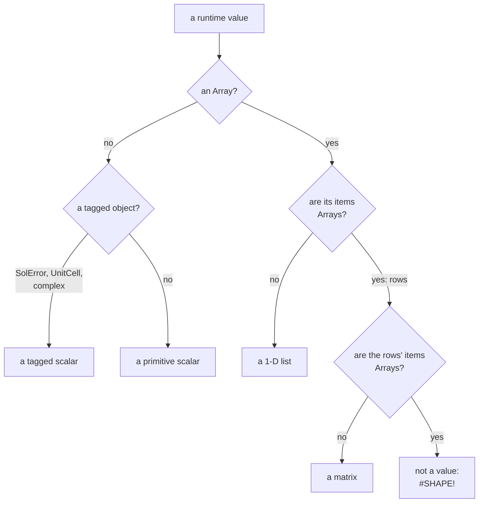
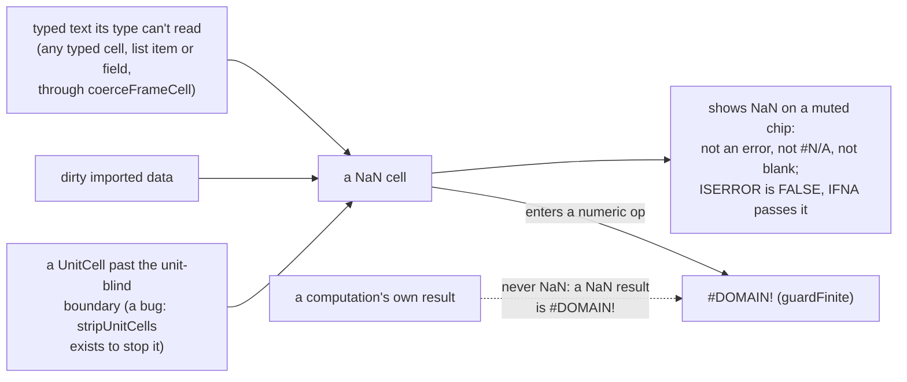
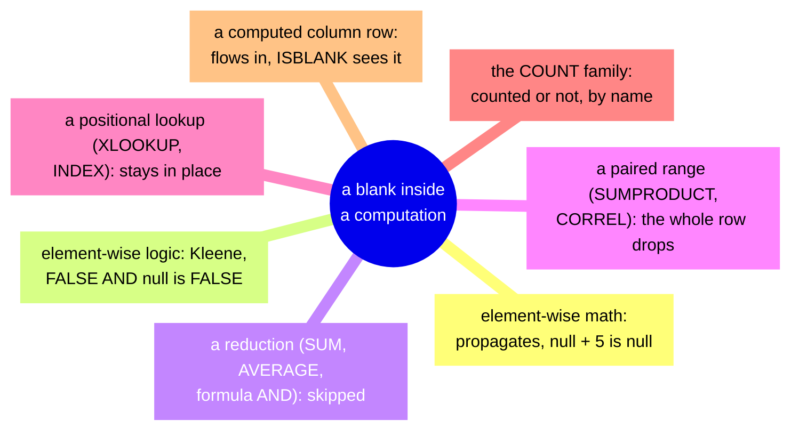
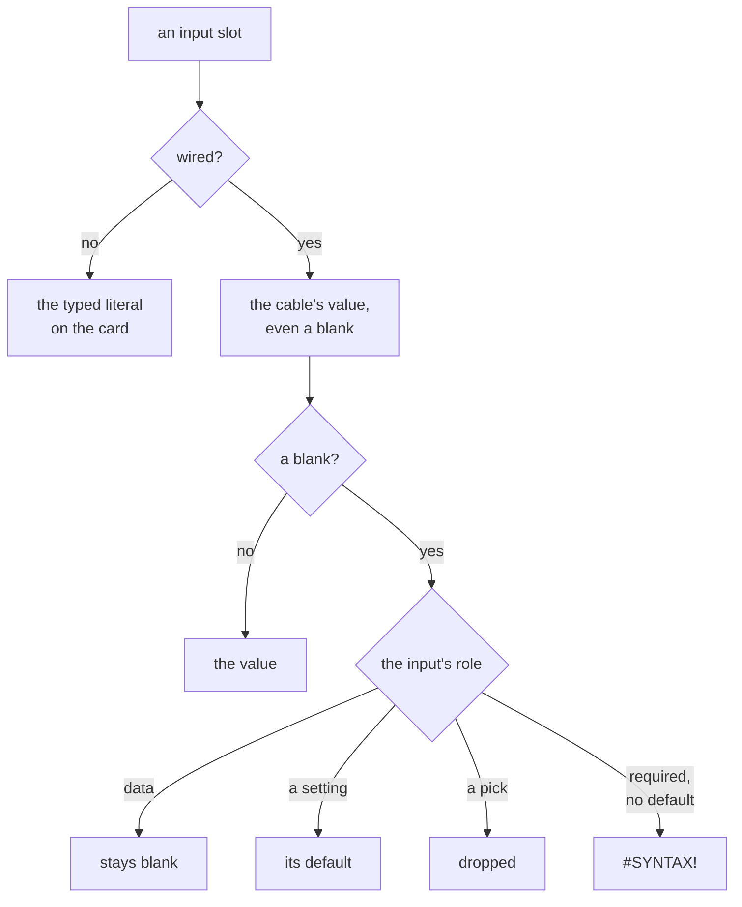

<!-- [[C24]] arraySemantics, [[D86]] blankRoles, [[D36]] nullSkippedNotZero, [[C24]] arraySemantics, [[D38]] kleeneLogic, [[D51]] oneAnswerOneDivergence, [[C45]] excelComparisons, [[B16]] oneFormulaSurface, [[C14]] currentExcelParity, [[C22]] rowFormulaRefs -->

# Spec: Value semantics

Serves [[C24]] arraySemantics (the value model), [[D86]] blankRoles, [[D36]] nullSkippedNotZero, [[C24]] arraySemantics, [[D38]] kleeneLogic, [[D51]] oneAnswerOneDivergence (one answer per computation, and the reduction versus element-wise line), [[C45]] excelComparisons (comparisons versus identity, list versus relational), [[B16]] oneFormulaSurface and [[C14]] currentExcelParity. It covers what the system does and blocks, and the decision each behavior serves. A WHY that isn't in a node belongs in one.

This is the one reference for the value model's special kinds: what each means, what produces it, how it propagates in each kind of computation, and how it renders. The mechanics (the error guard, the per-cell contract, the bounded scan) are [[error-values]]; this file is the meaning. Every rule here is built. A rule that is decided but not yet built gets a `[decided <date>]` tag here and an item in the backlog.

## The kinds

| Kind | Meaning | It is |
|---|---|---|
| value | a real number, string, date, logical or complex | the normal case |
| `null` | **missing**: no value was ever there | data, not a failure |
| `SolError` | **failure**: a computation could not answer (a tagged code, one of 16, including `#OVERFLOW!` and the internal `#ERROR!` catch-all) | loud until caught |
| `NaN` | **an undefined number that leaked**: neither an error nor missing | residue; a computation may not produce it (`guardFinite`) |
| `Infinity` | **a definable infinity**: declared on purpose (the Constant node) or derived from an infinite input | a first-class value |

A **complex** value is the tagged object `{ __cx: true, re, im }` (tagSpecialScalars), never a bare `[re, im]` array. So `Array.isArray` never means "a complex number": an array is a 1-D list, or a matrix when its own elements are arrays (rank 2 is allowed by [[C15]] matricesInFormulas). `isCx` (`cxValue.ts`) is the one complex test.

### The value grammar

**MUST:** a runtime value is one of four shapes:

- a primitive scalar;
- a tagged scalar, a value that is one thing but needs more than one JS primitive to carry it, always a tagged object: `SolError` (`{__solError…}`), `UnitCell`, complex (`{__cx, re, im}`);
- a 1-D `Array` of cells;
- a 2-D `Array` of row `Array`s.



No scalar is a bare array, so `Array.isArray` at two depths is the complete rank test, and no code carries a private way of sniffing shape. Depth 3 or more is not a value: a surface that meets one answers `#SHAPE!`. Anything deeper than a matrix is a Cube, which is a container, not a value shape.

A bare-array scalar collides with the list representation, and every consumer that checks shape then needs its own way to tell the two apart. Complex numbers as an `[re, im]` tuple once forced four such workarounds: complex.ts's own broadcaster, special cases in `coerceInputs`, array canonicalization in `set_key`, and `ArrayChip.is2D`, where a complex list reaching a generic chip rendered as a two-column table. With one grammar, [[C15]] matricesInFormulas admits matrices without a branded value type, and a new nesting scheme would reopen the ambiguity.

Three distinctions carry the most weight:

- **Null versus error.** A blank cell is data you don't have; an error is an answer that failed. Aggregators skip null but propagate errors, Filter drops rows whose predicate is null, Fill and Coalesce recover null, and IFERROR and IFNA recover errors. Detection and recovery form a 2 × 2: ISNULL, ISERROR and ISNA detect; Fill, Coalesce, IFERROR and IFNA recover.
- **NaN versus `#N/A`.** Unrelated, despite the letters. `#N/A` is a real tagged error ("no result exists"), minted by an XLOOKUP miss, the NA node, and IFS or SWITCH with no match; IFNA catches it. NaN is IEEE float residue with no special status. IFNA does not catch it, and it never renders as "N/A": it renders as `NaN` with a muted chip.
- **Infinity versus overflow.** `10^400` is a real, very large number the app can't represent, which is `#OVERFLOW!`, not infinity. Infinity is only ever deliberate.

## Where each kind comes from

- **Errors are minted at the failure, with the specific code.** `#DIV/0!` at the divide; `#DOMAIN!` at a sqrt, log or pow domain failure; `#N/A` at not-found or no-match; `#SHAPE!` at coercion, and per row in a computed column (a list-shaped cell result, or an `@`-read of a mis-sized list, which is the deliberate loud failure for a bare column name in scalar position, [[C22]] rowFormulaRefs); `#CIRC!` at engine cache seeding; `#OVERFLOW!` at representation overflow. A raw NaN is never a failure signal.
- **Fill's unwired pad is `null`** (first-class missing, the author's call), not the `#N/A` Excel's EXPAND uses for an omitted `pad_with`. Wire the NA node into Fill to get Excel's form (`fill`, the core's `nodes/list.rs`).
- **The non-finite guard** (the core's `guard_finite`, `value_kinds.rs`; `guardFinite` in `valueKinds.ts` for the frame backend's aggregates) applies to every numeric op:
  - a `NaN` result is `#DOMAIN!` (indeterminate: `(-8)^(1/3)`, `∞−∞`, `∞/∞`, `0×∞`, or a NaN input entering the op);
  - a `±Infinity` result from all-finite inputs is `#OVERFLOW!`;
  - a `±Infinity` result with an infinite input passes through, since it is definable.

  ```mermaid
  flowchart LR
      op["a numeric op's result"] --> n{"NaN?"}
      n -->|yes| dom["#DOMAIN!"]
      n -->|no| inf{"±Infinity?"}
      inf -->|"from all-finite inputs"| ov["#OVERFLOW!"]
      inf -->|"from an infinite input"| pass["passes: definable"]
      inf -->|no| ok["the number"]
  ```

  So a computation cannot produce NaN. The remaining NaN sources are data entry (dirty imported data, or unreadable text in any typed cell, list item or list field, all read through `coerceFrameCell`, [[D93]] oneTextReading) and one class of bug: a `UnitCell` that escapes the unit-blind boundary reaches `coerceNumber` as NaN, which `stripUnitCells` exists to prevent.



- **`null`** comes from data (blank cells, CSV holes), from padding a ragged list, from an empty aggregation (`AVG([])`), and from Kleene logic that really cannot answer.

## Propagation, by context

Which rule applies is decided by the kind of computation, not by the function's name.

| Context | An error | A `null` | Where |
|---|---|---|---|
| **Element-wise numeric** (operators, mapped functions) | propagates unchanged, per cell, the first in argument order | propagates (`null + 5` is `null`: the SQL model, not Excel's blank-as-0) | `map_cells` and `broadcast_call` (`eval.rs`) for formulas; `broadcast_err` (`nodes/kit.rs`) for cards |
| **Element-wise logical** (Comparison, BooleanOp, IF, NOT) | propagates unchanged | goes into Kleene logic: `FALSE AND null` is FALSE, `TRUE AND null` is null, `TRUE OR null` is TRUE, `FALSE OR null` is null: a test with a blank in it answers unknown, never FALSE ([[D38]] kleeneLogic) | `broadcast_el` and the Kleene tables (`nodes/logic.rs`) |
| **Reduction or aggregate** (SUM, AVG, the formula AND and OR, the Aggregate node) | propagates, the first error wins | skipped (Excel's range behavior, SQL aggregates) | `for_aggregate`, `prep_range_args` |
| **Paired, index-aligned** (SUMPRODUCT, CORREL, SUMIF…) | propagates | a null in any range drops that whole row pairwise; ragged ranges keep the shortest zip (pad-then-drop is the same as truncating) | `prep: paired` |
| **Positional lookups** (XLOOKUP, XMATCH, INDEX) | propagates | nulls stay put, since dropping them would shift indices | `prep: positional` |
| **The COUNT family** | classified, not propagated (COUNT skips, COUNTA counts) | COUNTBLANK counts them | `prep: raw` |
| **A ragged element-wise zip** | — | pads to the longest with null; a padded position is missing | every broadcaster |
| **Computed column, per row** | a row-bound error cell (a λ parameter or an `@`-read) fails that row only; an error inside a whole-column binding flows into the formula, where the aggregate's own rule applies | flows in (ISBLANK sees it); a result of `undefined` reads as blank | the core's `tag_computed_cell` (`excel_formula.rs`) ([[C22]] rowFormulaRefs, [[C54]] noPerCellFormulas) |



The one sanctioned divergence ([[D51]] oneAnswerOneDivergence): the formula `AND(x)` is a reduction, so it skips nulls as Excel does, while the BooleanOp node is element-wise and uses Kleene logic. Same word, two contexts, both correct. Any other disagreement between a node and a formula is a bug.

**Scalar operators.** The operator table (`apply_op`: errors first, then `null` propagating, the logical bridge, case-blind `=`, code-unit ordering with `#TYPE!` across types) and blank arguments (a blank slot is `null` unless `ARG_ROLES` declares its role, [[input-roles]], so `IF(x,,y)` answers `null`, not 0) are in [[formula-language]].

## Reading an input: a wired blank versus the typed literal

The table above says how a missing value behaves once it is inside a computation. This section says how it gets there, which is a separate decision every node makes and which nodes long got wrong. **Read this section before writing a new node.**

A value can also enter a computation through a reference resolved against a computed column's row, rather than through a socket ([[C22]] rowFormulaRefs). Its resolution order and what a miss answers are in [[computed-columns]]. A new surface must supply the core's `sideValue` hook and answer a miss explicitly, as Frame Input does with `#REF!`; the core supplies no default of its own.

### The one rule

Most inputs are both a socket and a field on the card. Read them with `readInput` (`nodes/shared.ts`), or in a core card body `Call::read_input` (`nodes/mod.rs`):

```ts
const n = readInput(inputs.count, this.literals.count ?? 1);
```

- When the slot is **unwired** (`undefined`), the typed literal is the value: the field on the card is the input.
- When the slot is **wired**, the cable's value wins, **even when it is `null`**: the typed value never stands in for a wired blank. What the blank then means is the input's role ([[input-roles]]).



**Never write `inputs.x?.[0] ?? this.literals.x`.** `??` can't tell "no cable" from "a cable carrying blank", so it silently puts the card's value in place of the graph's answer: a number the user never asked for, with an origin they can't see. This is the most common way a Solenoid node has produced a confidently wrong answer. `tests/graph/nodes/readInputSweep.test.ts` is a floor: any occurrence under `src/graph/nodes/` fails it.

**A wildcard slot's literal lives in one of two maps.** A slot typed `any` or `trueany` is element-agnostic, so its typed literal may be a number (`literals`) or text (`stringLiterals`). The inline field writes exactly one and clears the other, so the reader never has to break a tie. Only a node that declares `autoLiterals = true` gets that field: the value selectors IF, IFS, SWITCH and CHOOSE, whose wildcard rows are value branches, and the builders whose wildcard slots take a typed value (Build Cube, Cube Columns, Script, XMATCH, Set Cell). A wildcard sink or relay (Display, Cast, Report) leaves it off and stays wire-only. The unwired-versus-wired rule is unchanged; it just reads both maps (`pick_slot` in the core's `nodes/logic.rs`).

### What the node does with a blank

Reading the input correctly is half of it; the other half is what the node then does, and that depends on the input's role: data stays blank, a setting left blank is its default, a blank pick is dropped, and a required one with no default is `#SYNTAX!` ([[D86]] blankRoles). The roles, the one declaration every function and card subscribes to (`ARG_ROLES`, `readRole`), what each input kind does today, where the check goes and the checklist for a new node are [[input-roles]].

## Boundaries and bridges

- **The logical and number bridge** (arrival coercion, `boundary.rs`): 0 and 1 map to FALSE and TRUE, and **NaN maps to null** (an unknown truth value, as in R and pandas), consistent with `coerceLogical`.
- **Text read as a number** (`decimalFromText`, `valueKinds.ts`): every place that reads a number out of text calls this one reader, from `coerceNumber` and `coerceLogical` to the frame inference, the filter and lookup verbs, the criteria family, VALUE and NUMBERVALUE, and the table popup. It accepts trimmed plain decimal or scientific text, or thousands grouped by commas (`1,234.5`). A `0x`, `0b` or `0o` radix prefix, `Infinity` and anything else is NaN, so `0x1F` is text, as in Excel. It is a call into the core's `decimal_from_text` (`crates/solenoid-core/src/value_kinds.rs`), the one implementation. Only the US form is read ([[C117]] usNumberText): a European `3,5` or `1.234,5` is not a number here, never reread as a different one. VALUE and Cast to Number read a comma anywhere before the decimal point as grouping ([[formulajs-divergences]]).
- **Text on a number port** (arrival coercion, `boundary.rs` `family_cell`): only a wildcard cable can land text or a complex on a number-family input. It is `#TYPE!`, per cell on a list or matrix port and for the whole node on a scalar port, never a parsed number ([[B17]] typedValueModel). Pinned in `coerceInputs.test.ts` and the boundary's frozen answers (`coreBoundary.test.ts`).
- **The unit-blind boundary, and wired null versus unwired**, are arrival coercion and `readInput`: [[compute-pass]], "Arrival coercion", with the unit rules in [[unit-flow]].
- **The IPC and frame boundary.** Non-finite numbers and per-cell errors cross the wire as tagged sentinels, and aggregates apply the scalar non-finite guard: [[frame-verbs]], "The FrameBackend seam".
- **List ops versus relational verbs** ([[C45]] excelComparisons). List UNIQUE never dedupes error cells, since each is an independent problem, while frame Distinct dedupes by error code (errors as values, SQL identity). List and Frame Sort both put nulls and errors last, in both directions, stably.

## Display

- **`null`**: a scalar renders as the muted em dash; a cell in a list or Frame renders the word `null`, muted.
- **`SolError`**: the red badge with its code. All 16 codes are in `errorValue.ts`, and `#OVERFLOW!` is toured in the error showcase seed.
- **`NaN`**: the literal `NaN`, shown quietly with a muted background tint (not error red, not chip-like) and a fixed structural tooltip. Never "N/A".
- **`Infinity`**: the `∞` glyph (`-∞` when negative), in `formatScalar` and list previews (`format.ts`).

## Open divergence

A mode selector on a wired blank: `text.ts` and `date.ts` fall back to the literal, where the table above says propagate. It awaits the author's call.
