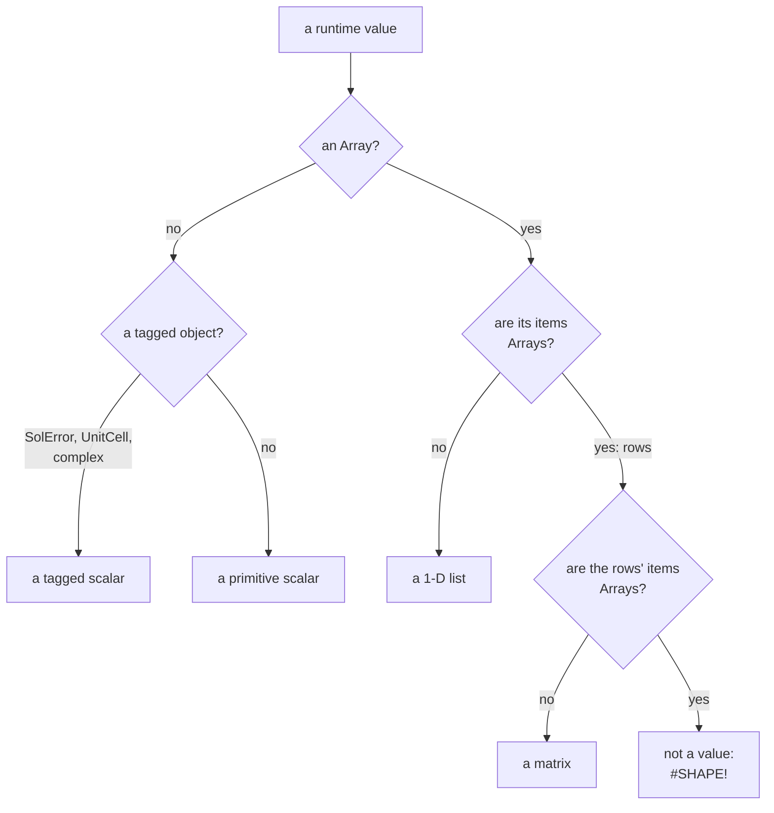
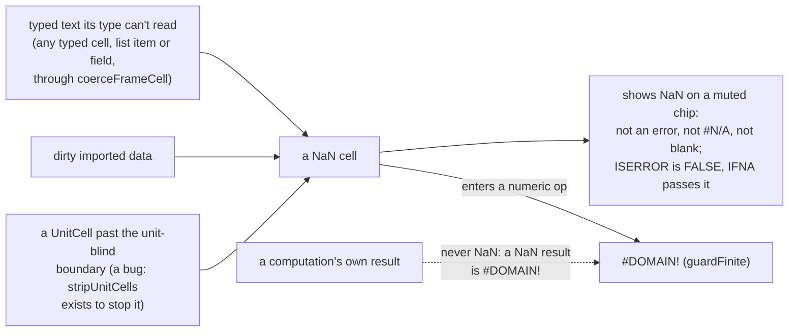
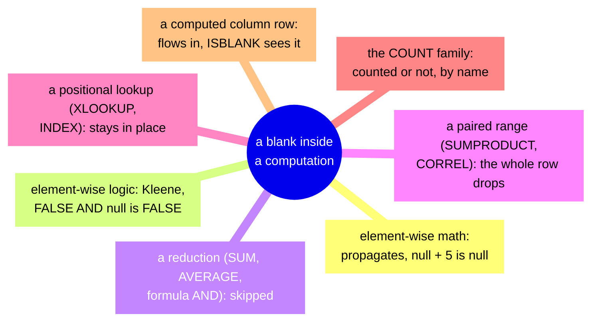
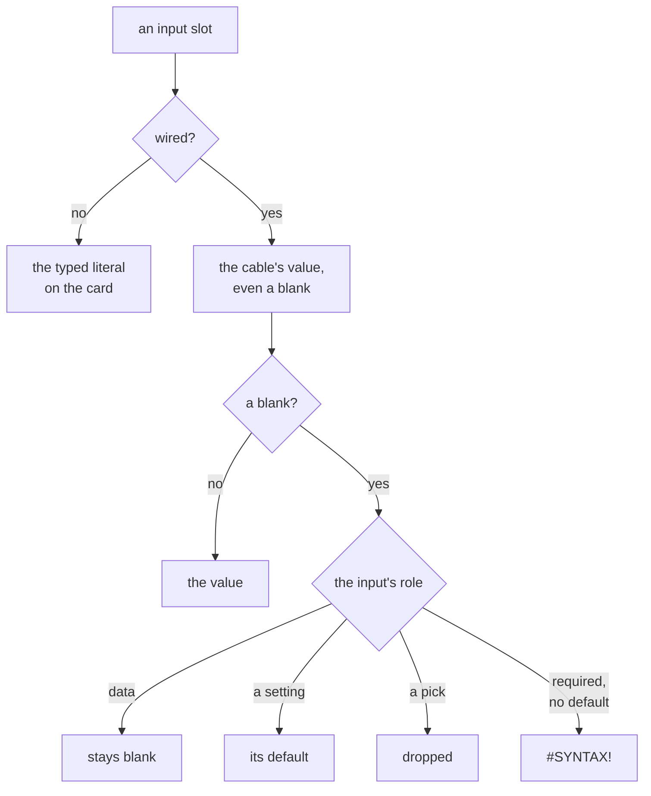
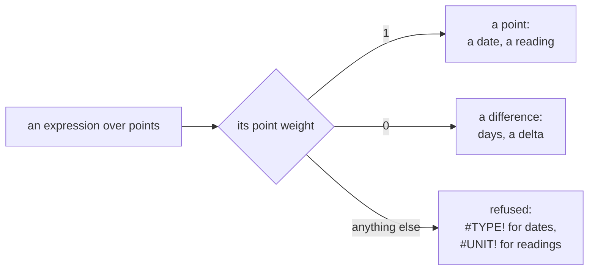

<!-- [[C24]] arraySemantics, [[D114]] dateIsAKind, [[D115]] datesArePoints, [[D86]] blankRoles, [[C45]] excelComparisons, [[B16]] oneFormulaSurface, [[C22]] rowFormulaRefs, [[C139]] mathlibLaws -->

# Spec: Value semantics

Serves [[C24]] arraySemantics (the value model), [[D86]] blankRoles, [[C45]] excelComparisons (comparisons versus identity, list versus relational) and [[B16]] oneFormulaSurface. It covers what the system does and blocks, and the decision each behavior serves.

This is the one reference for the value model's special kinds: what each means, what produces it, how it propagates in each kind of computation, and how it renders. The mechanics (the error guard, the per-cell contract, the bounded scan) are [[error-values]]; this file is the meaning. Every rule here is built. A rule that is decided but not yet built gets a `[decided <date>]` tag here and an item in the backlog.

## The kinds

| Kind | Meaning | It is |
|---|---|---|
| value | a real number, string, date, logical or complex | the normal case |
| `null` | **missing**: no value was ever there | data, not a failure |
| `SolError` | **failure**: a computation could not answer (a tagged code, one of 16, including `#OVERFLOW!` and the internal `#ERROR!` catch-all) | loud until caught |
| `NaN` | **an undefined number that leaked**: neither an error nor missing | residue; a computation may not produce it (`guardFinite`) |
| `Infinity` | **a definable infinity**: declared on purpose (the Constant node) or derived from an infinite input | a first-class value |

A **complex** value is the tagged object `{ __cx: true, re, im }` (tagSpecialScalars), never a bare `[re, im]` array. So `Array.isArray` never means "a complex number": an array is a 1-D list, or a matrix when its own elements are arrays (rank 2 is allowed by [[C15]] matricesInFormulas). `isCx` (`cxValue.ts`) is the one complex test.

### The value grammar

**MUST:** a runtime value is one of four shapes:

- a primitive scalar;
- a tagged scalar, a value that is one thing but needs more than one JS primitive to carry it, always a tagged object: `SolError` (`{__solError…}`), `UnitCell`, complex (`{__cx, re, im}`);
- a 1-D `Array` of cells;
- a 2-D `Array` of row `Array`s.



No scalar is a bare array, so `Array.isArray` at two depths is the complete rank test, and no code carries a private way of sniffing shape. Depth 3 or more is not a value: a surface that meets one answers `#SHAPE!`. Anything deeper than a matrix is a Cube, which is a container, not a value shape.

A bare-array scalar collides with the list representation, and every consumer that checks shape then needs its own way to tell the two apart. Complex numbers as an `[re, im]` tuple once forced four such workarounds: complex.ts's own broadcaster, special cases in `coerceInputs`, array canonicalization in `set_key`, and `ArrayChip.is2D`, where a complex list reaching a generic chip rendered as a two-column table. With one grammar, [[C15]] matricesInFormulas admits matrices without a branded value type, and a new nesting scheme would reopen the ambiguity.

Tests:

- `broadcastRules.test.ts`: a value deeper than a matrix is `#SHAPE!` in a formula.
- `complexInvariants.test.ts`: the tagged complex value through the IM functions, checked by the algebra (inverses round-trip, Euler's identity, sin² + cos² = 1), so it needs no oracle.

Three distinctions carry the most weight:

- **Null versus error.** A blank cell is data you don't have; an error is an answer that failed. Aggregators skip null but propagate errors, Filter drops rows whose predicate is null, Fill and Coalesce recover null, and IFERROR and IFNA recover errors. Detection and recovery form a 2 × 2: ISNULL, ISERROR and ISNA detect; Fill, Coalesce, IFERROR and IFNA recover.
- **NaN versus `#N/A`.** Unrelated, despite the letters. `#N/A` is a real tagged error ("no result exists"), minted by an XLOOKUP miss, the NA node, and IFS or SWITCH with no match; IFNA catches it. NaN is IEEE float residue with no special status. IFNA does not catch it, and it never renders as "N/A": it renders as `NaN` with a muted chip.
- **Infinity versus overflow.** `10^400` is a real, very large number the app can't represent, which is `#OVERFLOW!`, not infinity. Infinity is only ever deliberate.

## Where each kind comes from

- **Errors are minted at the failure, with the specific code.** `#DIV/0!` at the divide; `#DOMAIN!` at a sqrt, log or pow domain failure; `#N/A` at not-found or no-match; `#SHAPE!` at coercion, and per row in a computed column (a list-shaped cell result, or an `@`-read of a mis-sized list, which is the deliberate loud failure for a bare column name in scalar position, [[C22]] rowFormulaRefs); `#CIRC!` at engine cache seeding; `#OVERFLOW!` at representation overflow. A raw NaN is never a failure signal.
- **Fill's unwired pad is `null`** (first-class missing), not the `#N/A` Excel's EXPAND uses for an omitted `pad_with`. Wire the NA node into Fill to get Excel's form (`fill`, the core's `nodes/list.rs`).
- **The non-finite guard** (the core's `guard_finite`, `value_kinds.rs`; `guardFinite` in `valueKinds.ts` for the frame backend's aggregates) applies to every numeric op:
  - a `NaN` result is `#DOMAIN!` (indeterminate: `(-8)^(1/3)`, `∞−∞`, `∞/∞`, `0×∞`, or a NaN input entering the op);
  - a `±Infinity` result from all-finite inputs is `#OVERFLOW!`;
  - a `±Infinity` result with an infinite input passes through, since it is definable.

  ```mermaid
  flowchart LR
      op["a numeric op's result"] --> n{"NaN?"}
      n -->|yes| dom["#DOMAIN!"]
      n -->|no| inf{"±Infinity?"}
      inf -->|"from all-finite inputs"| ov["#OVERFLOW!"]
      inf -->|"from an infinite input"| pass["passes: definable"]
      inf -->|no| ok["the number"]
  ```

  So a computation cannot produce NaN. The remaining NaN sources are data entry (dirty imported data, or unreadable text in any typed cell, list item or list field, all read through `coerceFrameCell`, [[C58]] tableInputRawText) and one class of bug: a `UnitCell` that escapes the unit-blind boundary reaches `coerceNumber` as NaN, which `stripUnitCells` exists to prevent.



- **`null`** comes from data (blank cells, CSV holes), from padding a ragged list, from an empty aggregation (`AVG([])`), and from Kleene logic that really cannot answer.

## Propagation, by context

Which rule applies is decided by the kind of computation, not by the function's name.

| Context | An error | A `null` | Where |
|---|---|---|---|
| **Element-wise numeric** (operators, mapped functions) | propagates unchanged, per cell, the first in argument order | propagates (`null + 5` is `null`: the SQL model, not Excel's blank-as-0) | `map_cells` and `broadcast_call` (`eval.rs`) for formulas; `broadcast_err` (`nodes/kit.rs`) for cards |
| **Element-wise logical** (Comparison, BooleanOp, IF, NOT) | propagates unchanged | goes into Kleene logic: `FALSE AND null` is FALSE, `TRUE AND null` is null, `TRUE OR null` is TRUE, `FALSE OR null` is null: a test with a blank in it answers unknown, never FALSE ([[C24]] arraySemantics) | `broadcast_el` and the Kleene tables (`nodes/logic.rs`) |
| **Reduction or aggregate** (SUM, AVG, the formula AND and OR, the Aggregate node) | propagates, the first error wins | skipped (Excel's range behavior, SQL aggregates) | `for_aggregate`, `prep_range_args` |
| **Paired, index-aligned** (SUMPRODUCT, CORREL, SUMIF…) | propagates | a null in any range drops that whole row pairwise; ragged ranges keep the shortest zip (pad-then-drop is the same as truncating) | `prep: paired` |
| **Positional lookups** (XLOOKUP, XMATCH, INDEX) | propagates | nulls stay put, since dropping them would shift indices | `prep: positional` |
| **The COUNT family** | classified, not propagated (COUNT skips, COUNTA counts) | COUNTBLANK counts them | `prep: raw` |
| **A ragged element-wise zip** | — | pads to the longest with null; a padded position is missing | every broadcaster |
| **Computed column, per row** | a row-bound error cell (a λ parameter or an `@`-read) fails that row only; an error inside a whole-column binding flows into the formula, where the aggregate's own rule applies | flows in (ISBLANK sees it); a result of `undefined` reads as blank | the core's `tag_computed_cell` (`excel_formula.rs`) ([[C22]] rowFormulaRefs, [[C54]] noPerCellFormulas) |



The one sanctioned divergence ([[C24]] arraySemantics): the formula `AND(x)` is a reduction, so it skips nulls as Excel does, while the BooleanOp node is element-wise and uses Kleene logic. Same word, two contexts, both correct. Any other disagreement between a node and a formula is a bug.

**Why the Kleene tables are these tables.** Read `null` as "TRUE or FALSE, not known which". A Kleene answer is a
truth value only when every way of filling in the unknowns gives that value, and `null` otherwise: `FALSE AND null`
is FALSE because both fillings are FALSE, `TRUE AND null` is null because they differ. So a Kleene answer is never
contradicted when the blank is later filled in, and it is the most an answer can say without guessing (in order
theory, the most-defined monotone extension of the two-valued tables, with unknown below TRUE and FALSE). Any change
to a table must keep that property.

The Kleene family reads a wired logical as the real boolean the input boundary hands it as well as the 0 or 1 a number cable carries: `AND(FALSE, TRUE)` is FALSE and `NOT(FALSE)` is TRUE either way, and a wired blank still reads as unknown.

Tests:

- `valueKinds.test.ts`: the Aggregate's list prep skips `null` and propagates the first error.
- `broadcastContract.test.ts`: element-wise calls, unary minus and percent carry an error or a `null` per cell.
- `wiredNull.test.ts` ("Kleene logic through the real coercion wrapper"): AND and NOT through the input boundary, wired as numbers and as booleans, and a wired blank as unknown.

**Scalar operators.** The operator table (`apply_op`: errors first, then `null` propagating, the logical bridge, case-blind `=`, code-unit ordering with `#TYPE!` across types) and blank arguments (a blank slot is `null` unless `ARG_ROLES` declares its role, [[input-roles]], so `IF(x,,y)` answers `null`, not 0) are in [[formula-language]].

## Reading an input

The table above says how a missing value behaves once it is inside a computation. This section says how it gets there, a wired blank versus the typed literal, which is a separate decision every node makes. **Read this section before writing a new node.**

A value can also enter a computation through a reference resolved against a computed column's row, rather than through a socket ([[C22]] rowFormulaRefs). Its resolution order and what a miss answers are in [[computed-columns]]. A new surface must supply the core's `sideValue` hook and answer a miss explicitly, as Frame Input does with `#REF!`; the core supplies no default of its own.

### The one rule

Most inputs are both a socket and a field on the card. Read them with `readInput` (`nodes/shared.ts`), or in a node's Rust body, `Call::read_input` (`nodes/mod.rs`):

```ts
const n = readInput(inputs.count, this.literals.count ?? 1);
```

- When the slot is **unwired** (it arrives as `undefined`), the typed literal is the value: the field on the card is the input.
- When the slot is **wired**, the cable's value wins, **even when it is `null`** (a wired blank arrives as `[null]`): the typed value never stands in for a wired blank. What the blank then means is the input's role ([[input-roles]]).

An input with a real omitted reading passes no default: `readInput` then hands back `undefined` for the unwired slot and `null` for a blank cable, so the two stay apart.

Both halves matter: a fix that propagated a blank whether or not the slot was wired would break every node's typed default as badly as the swallow breaks the wired blank. So each case is tested in a pair, the wired blank beside the unwired literal.



**Never write `inputs.x?.[0] ?? this.literals.x`.** `??` can't tell "no cable" from "a cable carrying blank", so it silently puts the card's value in place of the graph's answer: a number the user never asked for, with an origin they can't see. This is the most common way a Solenoid node has produced a confidently wrong answer. The project follows its own value model here, not Excel's defaulting of an omitted argument.

**A wildcard slot's literal is keyed text and a kind.** A slot typed `any`, `anycombo`, `anydata` or `trueany` is element-agnostic, so its keyed text (`stringLiterals`) is read as the kind its button shows (`literalKinds`, Number when unset), never as a kind guessed from the text ([[inline-literal-maps#Wildcard slots]]). Only a keyed card in the core's field table gets that field ([[inline-literal-maps#One field per input]]): the value selectors IF, IFS, SWITCH and CHOOSE, whose wildcard rows are value branches, and the builders whose wildcard slots take a keyed value (Build Cube, Cube Columns, Script, XMATCH, Set Cell). A wildcard sink or relay (Display, Cast, Report) leaves it off and stays wire-only. A wired cable wins; unwired, the core reads the slot through its field (`Call::unwired`).

Tests:

- `readInputSweep.test.ts`: a floor at zero. Any read of a wired input with `?? literal` or `|| literal` under `src/graph/nodes/` or in the new-node templates fails it, whatever whitespace or line break sits between the operator and the literal; comments don't count, and a trailing comment can't hide a live read on its line.
- `broadcastContract.test.ts`: `readInput` itself, unwired, wired with 0 and wired with `null`.
- `wiredNull.test.ts`: a worked example of each role, in pairs ([[input-roles]]).

### What the node does with a blank

Reading the input correctly is half of it; the other half is what the node then does, and that depends on the input's role: data stays blank, a setting left blank is its default, a blank pick is dropped, and a required one with no default is `#SYNTAX!` ([[D86]] blankRoles). The roles, the one declaration every function and card subscribes to (`ARG_ROLES`, `readRole`), what each input kind does today, where the check goes and the checklist for a new node are [[input-roles]].

## Comparing, keying and storing a value

A card body never builds its own reading of a value for a comparison, a key or a cell: each job has one path, and a new kind (a date was the last, [[D114]] dateIsAKind) is taught there once. A local converter with a catch-all is how a kind drifts: a date that fell to its display text compared as text, and one that fell to a shared key matched every other date. `crates/solenoid-core/tests/value_paths.rs` fails on a new local converter.

| Job | The one path |
|---|---|
| What kinds a value holds (one kind, a mix, dates beside another kind) | `value_kinds::Census`, read through `date_values::census` (a long list's census is kept) |
| A loose value as a table cell | `FrameCell::of_scalar`: a date is its day, as a Date column packs it; a list, a LAMBDA or a complex number is no cell |
| A wired value as a filter's test value | `frame_verbs::filter_cell` (`of_scalar`, an error as its code) |
| A value as text for a plan that takes text (a lookup, a find, a list test) | `frame_verbs::plan_text`: a date is its exact day number, which a Date column reads back as that day |
| Equality (`===`): a match, a SWITCH case, a membership | `excel_functions::strict_equals`: a date equals the same date and never its serial |
| A key for a set, a tally, an index or a lookup | `fns_matrix::set_key`, `fns_lists` `key_of`, `ExactKey`, `shapers` `KeyPart`: each has a Date key of its own, so a date never keys as its serial |
| A date input's day | `kit::day` (only a date), `kit::cell_day` (a date or a Date column's packed number); in TypeScript `dayOf` (`dateValue.ts`) |
| Combining inputs into one answer | `Call::mixes_dates` over the inputs' values, or `date_values::refuse_mixed` over the answer |

Showing a value is not one of these jobs: display text (`value_text`, `formatDateSerial`) is for display and for a text function's argument, never for a value something then compares.

A value-to-cell `match` of its own, beside `FrameCell::of_scalar`, is allowed in four places, each because its cells differ:

- the computed-cell tagging (`frame.rs`), where a NaN, a format and a list each have their own error;
- the binary list transport (`nodes/columnar.rs`), where a date keeps its tag on the JSON path;
- a frame function's argument (`frame_fns.rs`), where a date is refused until its column is typed;
- Cast to Logical's reading (`nodes/text.rs`).

One place, `nodes/list.rs`, makes a value's display text into a cell something then compares. No place keeps a local copy of `strict_equals`.

Tests: `value_paths.rs` (solenoid-core): scans the core's source and fails a local `===` copy, a value-to-cell `match` or a display-text cell outside the places above.

## Points and differences

Two kinds are positions rather than amounts: a **date** ([[D115]] datesArePoints) and a **temperature reading** on an
offset scale, °C or °F ([[C25]] firstClassUnits). Each is a **point kind**, paired with a **difference kind**: days for
a date, a kelvin (or Δ°C, Δ°F) delta for a reading. The rules that hold for both:

- point − point is a difference;
- point + difference and point − difference are points;
- difference ± difference, and a difference scaled by a number, are differences;
- nothing else: a point is never added to a point, scaled, negated or raised to a power.

A difference is an ordinary amount, so everything the value model does with numbers it does with differences. A point
is not: its zero is arbitrary (30-Dec-1899, the freezing point of water), and an answer that changed when the zero moved
would mean nothing.

**Point weight.** An expression over points is classified by its **point weight**, the sum of its coefficients on the
points: a point weighs 1, a difference or a plain number 0, `a + b` weighs 2, `(a + b) / 2` and `a + (b - a) / 2` weigh
1, `b - a` weighs 0. The weight decides the kind:

- weight 1 is a point (an **affine combination**: the midpoint, a weighted average);
- weight 0 is a difference;
- any other weight has no meaning and is refused.

An expression whose weight is 1 or 0 gives the same answer whichever zero the scale uses, which is why exactly those two
are allowed. The functions follow from it: an average, a min, a max or a median of points is a point; a spread is a
difference; a sum of two or more points is refused.



**Where it is built.** Readings classify a whole formula by weight (`affine_weight`, [[unit-flow#Expression]]), so
`(a + b) / 2` over two readings is a reading. Dates check each operator alone (`date_op`, [[date-values#Arithmetic]]),
and a formula the operators refuse is then weighed ([[E19]] datesWeighAsPoints, `by_point_weight`): whole first, then
each refused piece on its own, so `(d1 + d2) / 2` is a date and `YEAR((d1 + d2) / 2)` its year. The two kinds now
answer alike; the Arithmetic card, which sees one operation, still refuses adding two dates, as it refuses adding two
readings.

The mathematical names, for a reader who wants the full theory ([[C139]] mathlibLaws, [[engineering#Laws come from mathlib, by name]]): a
point kind with its difference kind is a *torsor* (the class AddTorsor, `Mathlib/Algebra/Torsor/Defs.lean`; an affine
space when the differences can be scaled), point weight 1 is an *affine combination* (`Finset.affineCombination`) and
weight 0 a *weighted difference* (`Finset.weightedVSub`), both in `Mathlib/LinearAlgebra/AffineSpace/Combination.lean`.
The two laws behind "exactly those two": weights summing to 1 give a point that doesn't depend on where zero is
(`Finset.weightedVSubOfPoint_vadd_eq_of_sum_eq_one`), and weights summing to 0 give a difference that doesn't either
(`Finset.weightedVSubOfPoint_eq_of_sum_eq_zero`), same file. None of these words belong in the app.

## Boundaries and bridges

- **The logical and number bridge** (arrival coercion, `boundary.rs`). A logical is the number 0 or 1 ([[C133]] logicalIsZeroOrOne): FALSE is 0 and TRUE is 1 in arithmetic, comparison and every aggregate, and its TRUE/FALSE, 1/0, Yes/No or check-mark style changes only the drawing. Arriving where a logical is asked for, 0 maps to FALSE, any other number to TRUE, and **NaN maps to null** (an unknown truth value, as in R and pandas), consistent with `coerceLogical`.
- **Text read as a number** (`decimalFromText`, `valueKinds.ts`): every place that reads a number out of text calls this one reader, from `coerceNumber` and `coerceLogical` to the frame inference, the filter and lookup verbs, the criteria family, VALUE and NUMBERVALUE, and the table popup. It accepts trimmed plain decimal or scientific text, or thousands grouped by commas (`1,234.5`). A `0x`, `0b` or `0o` radix prefix, `Infinity` and anything else is NaN, so `0x1F` is text, as in Excel. It is a call into the core's `decimal_from_text` (`crates/solenoid-core/src/value_kinds.rs`), the one implementation. Only the US form is read ([[C58]] tableInputRawText): a European `3,5` or `1.234,5` is not a number here, never reread as a different one. VALUE and Cast to Number read a comma anywhere before the decimal point as grouping ([[excel-divergences]]).
- **Text on a number port** (arrival coercion, `boundary.rs` `family_cell`): only a wildcard cable can land text or a complex on a number-family input. It is `#TYPE!`, per cell on a list or matrix port and for the whole node on a scalar port, never a parsed number ([[B17]] typedValueModel).
- **The unit-blind boundary, and wired null versus unwired**, are arrival coercion and `readInput`: [[compute-pass]], "Arrival coercion", with the unit rules in [[unit-flow]].
- **The IPC and frame boundary.** Non-finite numbers and per-cell errors cross the wire as tagged sentinels, and aggregates apply the scalar non-finite guard: [[frame-verbs#The frame store]].
- **List ops versus relational verbs** ([[C45]] excelComparisons). List UNIQUE never dedupes error cells, since each is an independent problem, while frame Distinct dedupes by error code (errors as values, SQL identity). List and Frame Sort both put nulls and errors last, in both directions, stably.

Tests:

- `valueKinds.test.ts`: the logical and number bridge, and `coerceLogical` (a boolean, TRUE and FALSE text read case-blind and trimmed, a number or numeric text by the bridge, any other text as NaN, which a computation reads as `#TYPE!` naming the value).
- `coerceInputs.test.ts` and the boundary's frozen answers (`coreBoundary.test.ts`): text on a number port.

## Display

- **`null`**: a scalar renders as the muted em dash; a cell in a list or Frame renders the word `null`, muted.
- **`SolError`**: the red badge with its code. All 16 codes are in `errorValue.ts`, and `#OVERFLOW!` is toured in the error showcase seed.
- **`NaN`**: the literal `NaN`, shown quietly with a muted background tint (not error red, not chip-like) and a fixed structural tooltip. Never "N/A".
- **`Infinity`**: the `∞` glyph (`-∞` when negative), in `formatScalar` and list previews (`format.ts`).

Tests: `format.test.ts` ("formatScalar"): NaN shows as `NaN`, ±Infinity as `∞` and `-∞`.

## Open divergence

A mode selector on a wired blank: `text.ts` and `date.ts` fall back to the literal, where the table above says propagate. Which one is right is still open.
